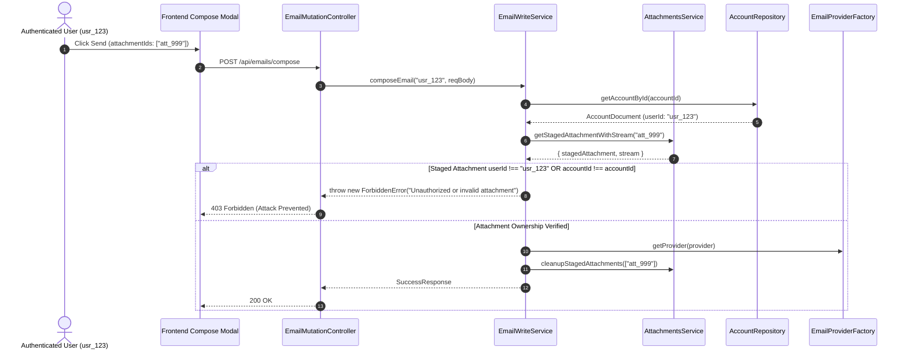
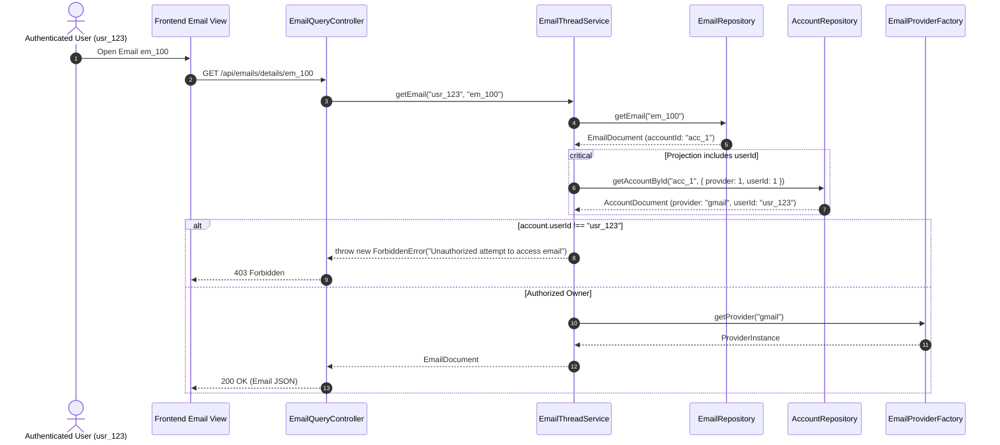

# Codebase Hardening & Architecture v1.4.0 - Phase 1 Implementation Details

> **Feature:** `codebase-hardening-and-architecture-v140` · **Phase:** 1 (Critical P0 Multi-Tenant Security Hardening & Vulnerability Remediation)
> **Status:** COMPLETED
> **Created:** 2026-11-12 · **Last Updated:** 2026-11-14

---

## 1. Goal Description & Scope

Phase 1 immediately remediates all four critical **P0 Insecure Direct Object Reference (IDOR) & Security Vulnerabilities** identified in the [v1.4.0 Codebase Health Audit](file:///Users/vishaljagamani/Projects/Projects/mailsense/.agents/plans/codebase-health-audit-report.md#140---2026-11-12) across the MailSense backend:

1. **Elimination of Insecure Debug Router (`BUG-V14-01` - P0):**
   Unmount and permanently delete [`Backend/src/modules/utils/index.ts`](file:///Users/vishaljagamani/Projects/Projects/mailsense/Backend/src/modules/utils/index.ts) from [`Backend/src/routes.ts`](file:///Users/vishaljagamani/Projects/Projects/mailsense/Backend/src/routes.ts). Eliminates the `GET /api/utils/getAccountAccessToken` endpoint that leaks plaintext OAuth tokens of arbitrary accounts without user verification, and closes the unauthenticated `POST /api/utils/decrypt` decryption oracle.
2. **Multi-Tenant Staged Attachment Ownership Validation (`BUG-V14-02` - P0):**
   Re-activates the dormant validation in [`Backend/src/modules/emails/services/email-write.service.ts:130-132`](file:///Users/vishaljagamani/Projects/Projects/mailsense/Backend/src/modules/emails/services/email-write.service.ts#L130-L132) by uncommenting the check:
   `if (stagedAttachment.userId.toString() !== userId.toString() || stagedAttachment.accountId !== accountId)`.
   Resolves the active failure in [`attachment-security.test.ts`](file:///Users/vishaljagamani/Projects/Projects/mailsense/Backend/src/modules/emails/__tests__/attachment-security.test.ts).
3. **Mongoose Projection Omission Fix in `EmailThreadService.getEmail` (`BUG-V14-03` - P0):**
   In [`Backend/src/modules/emails/services/email-thread.service.ts:21`](file:///Users/vishaljagamani/Projects/Projects/mailsense/Backend/src/modules/emails/services/email-thread.service.ts#L21), update `AccountRepository.getAccountById(email.accountId, { provider: 1 })` to project `{ provider: 1, userId: 1 }`. Eliminates the bug where `account.userId` evaluated to `undefined`, causing 100% of valid user requests to throw `ForbiddenError` (false positive 403).
4. **Multi-Tenant Scoped `updateDraft` in `DraftRepository` (`BUG-V14-04` - P0):**
   In [`Backend/src/modules/drafts/draft.repository.ts:8-10`](file:///Users/vishaljagamani/Projects/Projects/mailsense/Backend/src/modules/drafts/draft.repository.ts#L8-L10), scope the mutation query to `{ _id: draftId, userId }`. Prevents attackers from overwriting another tenant's draft via `POST /api/drafts/save`.
5. **Account Ownership Verification on Staged Attachment Uploads (`BUG-V14-07` - P1):**
   In [`Backend/src/modules/attachments/attachment.service.ts:21-39`](file:///Users/vishaljagamani/Projects/Projects/mailsense/Backend/src/modules/attachments/attachment.service.ts#L21-L39), verify that `accountId` belongs to `userId` via `AccountRepository.getAccountById(accountId, { userId: 1 })` before staging files to Cloudflare R2.
6. **Comprehensive Security Test Suite:**
   Create dedicated unit/integration security test suites to verify that cross-tenant access attempts for email reads, attachment staging, and draft mutations return `403 Forbidden` or `404 Not Found`.

---

## 2. User Review Required & Architectural Notes

> [!IMPORTANT]
> **1. Complete Removal of `/api/utils` Debug Router (`BUG-V14-01`)**
> The `/api/utils` router in `Backend/src/modules/utils/index.ts` was an ephemeral development utility left mounted in production routes. Codebase-wide grep confirmed that **zero frontend components or API clients call this endpoint**. It exposes severe credential leakage and an AES decryption oracle. Removing this route completely closes the attack vector without breaking any client workflow.
>
> **2. Mongoose Projection Behavior (`BUG-V14-03`)**
> In Mongoose, passing an explicit projection object such as `{ provider: 1 }` strictly limits the returned document fields to `_id` and `provider`. All other schema fields (including `userId`) are omitted and evaluate to `undefined` in memory. Any conditional `account.userId !== userId` evaluates to `true` (`undefined !== "usr_123"`), producing an unintended authorization block. Projecting `{ provider: 1, userId: 1 }` restores complete tenant verification.
>
> **3. Multi-Tenant Scoping in Data Access (`BUG-V14-04`)**
> In accordance with MailSense multi-tenant isolation standards, write operations targeting user-owned entities MUST scope their queries by both entity ID and user ID: `DraftModel.findOneAndUpdate({ _id: draftId, userId }, draft, { new: true })`. This guarantees that even if a tenant discovers or guesses a draft ObjectId belonging to another user, MongoDB returns `null`, preventing cross-tenant data modification.

---

## 3. Component Overview & File Map

| Component           | Target File                                                                                                                                                                                                                         | Action    | Purpose                                                                                       |
| ------------------- | ----------------------------------------------------------------------------------------------------------------------------------------------------------------------------------------------------------------------------------- | --------- | --------------------------------------------------------------------------------------------- |
| Backend Gateway     | [`Backend/src/routes.ts`](file:///Users/vishaljagamani/Projects/Projects/mailsense/Backend/src/routes.ts)                                                                                                                           | [MODIFY]  | Unmount `utilsRoutes` from `/utils` router (`BUG-V14-01`)                                     |
| Backend Module      | `Backend/src/modules/utils/`                                                                                                                                                                                                        | [DELETE]  | Delete `index.ts` and entire insecure debug module (`BUG-V14-01`)                             |
| Backend Service     | [`Backend/src/modules/emails/services/email-write.service.ts`](file:///Users/vishaljagamani/Projects/Projects/mailsense/Backend/src/modules/emails/services/email-write.service.ts)                                                 | [MODIFY]  | Uncomment lines 130–132 for attachment ownership validation (`BUG-V14-02`)                    |
| Backend Service     | [`Backend/src/modules/emails/services/email-thread.service.ts`](file:///Users/vishaljagamani/Projects/Projects/mailsense/Backend/src/modules/emails/services/email-thread.service.ts)                                               | [MODIFY]  | Add `userId: 1` to account projection query in `getEmail` (`BUG-V14-03`)                      |
| Backend Repository  | [`Backend/src/modules/drafts/draft.repository.ts`](file:///Users/vishaljagamani/Projects/Projects/mailsense/Backend/src/modules/drafts/draft.repository.ts)                                                                         | [MODIFY]  | Scope `updateDraft` query to `{ _id: draftId, userId }` via `findOneAndUpdate` (`BUG-V14-04`) |
| Backend Service     | [`Backend/src/modules/drafts/draft.service.ts`](file:///Users/vishaljagamani/Projects/Projects/mailsense/Backend/src/modules/drafts/draft.service.ts)                                                                               | [MODIFY]  | Pass `userId` to `updateDraft`; throw `NotFoundError` if null (`BUG-V14-04`)                  |
| Backend Model       | [`Backend/src/modules/attachments/attachment.model.ts`](file:///Users/vishaljagamani/Projects/Projects/mailsense/Backend/src/modules/attachments/attachment.model.ts)                                                               | [MODIFY]  | Align schema `status` with domain enum `ATTACHMENT_STATUS` from `@mailsense/types`            |
| Backend Service     | [`Backend/src/modules/attachments/attachment.service.ts`](file:///Users/vishaljagamani/Projects/Projects/mailsense/Backend/src/modules/attachments/attachment.service.ts)                                                           | [MODIFY]  | Validate `accountId` belongs to `userId` in `uploadStagedAttachment` (`BUG-V14-07`)           |
| Backend Test        | [`Backend/src/modules/emails/__tests__/attachment-security.test.ts`](file:///Users/vishaljagamani/Projects/Projects/mailsense/Backend/src/modules/emails/__tests__/attachment-security.test.ts)                                     | [VERIFY]  | Verify test passes cleanly with active validation (`BUG-V14-02`)                              |
| Backend Test        | [`Backend/src/modules/emails/__tests__/email-thread-security.test.ts`](file:///Users/vishaljagamani/Projects/Projects/mailsense/Backend/src/modules/emails/__tests__/email-thread-security.test.ts)                                 | [NEW]     | Integration tests for multi-tenant `getEmail` and `getThread` authorization                   |
| Backend Test        | [`Backend/src/modules/drafts/__tests__/draft-security.test.ts`](file:///Users/vishaljagamani/Projects/Projects/mailsense/Backend/src/modules/drafts/__tests__/draft-security.test.ts)                                               | [NEW]     | Unit tests for cross-tenant draft modification rejection                                      |
| Backend Test        | [`Backend/src/modules/attachments/__tests__/attachment-upload-security.test.ts`](file:///Users/vishaljagamani/Projects/Projects/mailsense/Backend/src/modules/attachments/__tests__/attachment-upload-security.test.ts)             | [NEW]     | Unit tests for unowned account attachment staging rejection                                   |
| Frontend Hook       | [`Frontend/src/features/emails/hooks/use-compose-email/useComposeEmailAttachments.ts`](file:///Users/vishaljagamani/Projects/Projects/mailsense/Frontend/src/features/emails/hooks/use-compose-email/useComposeEmailAttachments.ts) | [MODIFY]  | Type-safe attachment ID resolution compatible with `StagedAttachmentSummaryDTO`               |
| Frontend API Client | [`Frontend/src/features/drafts/api/drafts.api.ts`](file:///Users/vishaljagamani/Projects/Projects/mailsense/Frontend/src/features/drafts/api/drafts.api.ts)                                                                         | [OMITTED] | Omitted as unnecessary: client already bubbles errors and has correct signature               |
| Frontend API Client | [`Frontend/src/features/emails/api/email.api.ts`](file:///Users/vishaljagamani/Projects/Projects/mailsense/Frontend/src/features/emails/api/email.api.ts)                                                                           | [OMITTED] | Omitted as unnecessary: client already handles 403 propagation naturally                      |

---

## 4. Main Section 1: Backend Layer Implementation

### 4.1 Routes & Gateway Layer

#### 4.1.1 Unmount Insecure Debug Router in `Backend/src/routes.ts`

Remove the import and route mounting of `utilsRoutes` from [`Backend/src/routes.ts`](file:///Users/vishaljagamani/Projects/Projects/mailsense/Backend/src/routes.ts):

```typescript
// Location: Backend/src/routes.ts
import { Router } from "express";

import accountsRoutes from "@modules/accounts/account.routes.js";
import analyticsRoutes from "@modules/analytics/analytics.routes.js";
import attachmentRoutes from "@modules/attachments/attachment.routes.js";
import draftRoutes from "@modules/drafts/draft.routes.js";
import emailsRoutes from "@modules/emails/email.routes.js";
import foldersRoutes from "@modules/folders/folder.routes.js";
import usersRoutes from "@modules/user/user.routes.js";
// Removed: import utilsRoutes from '@modules/utils/index.js'; (BUG-V14-01)

const router = Router();

router.get("/", (req, res) => {
  res.send("MailSense Backend!");
});

router.use("/users", usersRoutes);
router.use("/accounts", accountsRoutes);
router.use("/emails", emailsRoutes);
router.use("/folders", foldersRoutes);
router.use("/attachments", attachmentRoutes);
router.use("/drafts", draftRoutes);
router.use("/analytics", analyticsRoutes);
// Removed: router.use('/utils', utilsRoutes); (BUG-V14-01: OAuth Token Leak & Decryption Oracle)

export default router;
```

#### 4.1.2 Permanent Deletion of `Backend/src/modules/utils/`

Execute shell deletion of the obsolete directory:

```bash
rm -rf Backend/src/modules/utils/
```

---

### 4.2 Repository Layer

#### 4.2.1 Scope `updateDraft` to Tenant `userId` in `Backend/src/modules/drafts/draft.repository.ts`

Per [MailSense Coding Standards](file:///Users/vishaljagamani/Projects/Projects/mailsense/.agents/rules/coding-standards.md), repositories execute queries directly without `try/catch`. The update operation MUST scope by both `_id` and `userId`:

```typescript
// Location: Backend/src/modules/drafts/draft.repository.ts
import { DraftDocument, DraftInput, DraftModel } from "./draft.model.js";

export class DraftRepository {
  public static async createDraft(
    draft: Partial<DraftInput>,
  ): Promise<DraftDocument> {
    return DraftModel.create(draft);
  }

  /**
   * Updates an existing draft document scoped strictly by draftId and userId.
   * Prevents cross-tenant IDOR draft modifications.
   */
  public static async updateDraft(
    userId: string,
    draftId: string,
    draft: Partial<DraftInput>,
  ): Promise<DraftDocument | null> {
    return DraftModel.findOneAndUpdate({ _id: draftId, userId }, draft, {
      new: true,
    });
  }

  public static async getDraftById(
    draftId: string,
    userId: string,
  ): Promise<DraftDocument | null> {
    return DraftModel.findOne({ _id: draftId, userId });
  }

  public static async getDraftsByUserId(
    userId: string,
  ): Promise<DraftDocument[]> {
    return DraftModel.find({ userId }).sort({ lastSavedAt: -1 });
  }

  public static async deleteDraftById(
    draftId: string,
    userId: string,
  ): Promise<boolean> {
    const result = await DraftModel.deleteOne({ _id: draftId, userId });
    return result.deletedCount > 0;
  }

  public static async getDraftCountByUserId(userId: string): Promise<number> {
    return DraftModel.countDocuments({ userId });
  }
}
```

---

### 4.3 Service Layer

#### 4.3.1 Uncomment Attachment Validation in `Backend/src/modules/emails/services/email-write.service.ts`

In `resolveStagedAttachments`, uncomment lines 130–132 to enforce ownership and target account matching before dispatch:

```typescript
// Location: Backend/src/modules/emails/services/email-write.service.ts (lines 120-146)
    private async resolveStagedAttachments(userId: string, accountId: string, attachmentIds?: string[]): Promise<ComposeEmailAttachment[]> {
        if (!attachmentIds || attachmentIds.length === 0) {
            return [];
        }

        const stagedFiles: ComposeEmailAttachment[] = [];
        for (const attId of attachmentIds) {
            const { stagedAttachment, stream } = await this.attachmentsService.getStagedAttachmentWithStream(attId);

            // Active Multi-Tenant Validation (BUG-V14-02 / BUG-V12-02)
            if (stagedAttachment.userId.toString() !== userId.toString() || stagedAttachment.accountId !== accountId) {
                throw new ForbiddenError(`Unauthorized or invalid attachment ${attId}`);
            }

            const chunks: Buffer[] = [];
            for await (const chunk of stream) {
                chunks.push(Buffer.from(chunk));
            }
            stagedFiles.push({
                filename: stagedAttachment.filename,
                mimeType: stagedAttachment.mimeType,
                buffer: Buffer.concat(chunks),
            });
        }
        return stagedFiles;
    }
```

#### 4.3.2 Fix Projection Query in `Backend/src/modules/emails/services/email-thread.service.ts`

Include `userId: 1` in the projection passed to `AccountRepository.getAccountById` inside `getEmail`:

```typescript
// Location: Backend/src/modules/emails/services/email-thread.service.ts (lines 13-37)
export class EmailThreadService {
    public async getEmail(userId: string, emailId: string): Promise<EmailDocument | EmailInput | null> {
        try {
            const email = await EmailRepository.getEmail(emailId);
            if (!email) {
                throw new NotFoundError('Email', emailId);
            }

            // Fixed: Project both provider and userId (BUG-V14-03)
            const account = await AccountRepository.getAccountById(email.accountId, { provider: 1, userId: 1 });
            if (!account) {
                throw new NotFoundError('Account', email.accountId);
            }

            if (account.userId !== userId) {
                throw new ForbiddenError('Unauthorized attempt to access email');
            }

            const provider = EmailProviderFactory.getProvider(account.provider as ACCOUNT_PROVIDER);
            return provider.getMessageDetails(email.accountId, email.providerMessageId, email);
        } catch (err) {
            const errorMessage = err instanceof Error ? err.message : String(err);
            logger.error(`Error in EmailService.getEmail: ${errorMessage}`, { emailId, userId, error: err });
            throw err;
        }
    }
```

#### 4.3.3 Pass `userId` and Validate Scoped Result in `Backend/src/modules/drafts/draft.service.ts`

Update `saveDraft` to pass `userId` to `DraftRepository.updateDraft` and throw a domain `NotFoundError` if the document is not found or not owned:

```typescript
// Location: Backend/src/modules/drafts/draft.service.ts (lines 20-46)
    public async saveDraft(userId: string, payload: SaveDraftRequestBody): Promise<DraftAttributes> {
        try {
            const bodyPlain = payload.body ? htmlToText(payload.body, { wordwrap: false }).replace(/\s+/g, ' ').trim() : '';
            const draftInput: Partial<DraftInput> = {
                userId,
                accountId: payload.accountId,
                to: payload.to,
                cc: payload.cc,
                bcc: payload.bcc,
                subject: payload.subject,
                body: payload.body,
                bodyPlain,
                inReplyTo: payload.inReplyTo,
            };

            if (payload.draftId) {
                // Multi-Tenant Scoped Update (BUG-V14-04)
                const draftDoc = await DraftRepository.updateDraft(payload.draftId, userId, draftInput);
                if (!draftDoc) {
                    throw new NotFoundError('Draft', payload.draftId);
                }
                return this.formatDraftDocument(draftDoc);
            } else {
                const draftDoc = await DraftRepository.createDraft(draftInput);
                return this.formatDraftDocument(draftDoc);
            }
        } catch (error) {
            const errorMessage = error instanceof Error ? error.message : String(error);
            logger.error(`Error in DraftService.saveDraft: ${errorMessage}`, { userId, payload, error });
            throw error;
        }
    }
```

#### 4.3.4 Validate Account Ownership in `Backend/src/modules/attachments/attachment.service.ts`

In `uploadStagedAttachment`, verify that `accountId` is owned by `userId` before creating the database record or uploading bytes to R2:

```typescript
// Location: Backend/src/modules/attachments/attachment.service.ts (lines 21-50)
import { ATTACHMENT_STATUS, StagedAttachmentAttributes } from '@mailsense/types';

    async uploadStagedAttachment(userId: string, accountId: string, file: UploadStageAttachmentFile): Promise<StagedAttachmentAttributes> {
        try {
            // Verify account exists and belongs to authenticated user (BUG-V14-07)
            const account = await AccountRepository.getAccountById(accountId, { userId: 1 });
            if (!account) {
                throw new NotFoundError('Account', accountId);
            }
            if (account.userId !== userId) {
                throw new ForbiddenError('Unauthorized attempt to stage attachment for unowned account');
            }

            const attachmentId = new mongoose.Types.ObjectId().toString();
            const sanitizedFilename = file.originalname.replace(/[^a-zA-Z0-9_.-]/g, '_');
            const r2Key = `staged/${userId}/${attachmentId}-${sanitizedFilename}`;
            const expiresAt = new Date(Date.now() + 24 * 60 * 60 * 1000); // 24 hours TTL

            const data: Partial<StagedAttachmentInput> = {
                userId,
                accountId,
                r2Key,
                filename: sanitizedFilename,
                mimeType: file.mimetype,
                size: file.size,
                status: ATTACHMENT_STATUS.STAGED,
                expiresAt,
            };
            const stagedAttachment = await StagedAttachmentRepository.createStagedAttachment(data);

            await this.objectStorageService.uploadObject(r2Key, file.buffer, file.mimetype);

            return stagedAttachment;
        } catch (err) {
            const errorMessage = err instanceof Error ? err.message : String(err);
            logger.error(`Error in AttachmentService.uploadStagedAttachment: ${errorMessage}`, { userId, accountId, error: err });
            throw err;
        }
    }
```

---

### 4.4 Automated Security Tests

#### 4.4.1 New Email Thread Security Test: `Backend/src/modules/emails/__tests__/email-thread-security.test.ts`

```typescript
// Location: Backend/src/modules/emails/__tests__/email-thread-security.test.ts
import { ForbiddenError, NotFoundError } from "../../../core/errors/index.js";
import { EmailProviderFactory } from "../../../integrations/email/email.provider.factory.js";
import { AccountRepository } from "../../accounts/account.repository.js";
import { EmailRepository } from "../database/email.repository.js";
import { EmailThreadService } from "../services/email-thread.service.js";

jest.mock("../../accounts/account.repository.js");
jest.mock("../database/email.repository.js");
jest.mock("../../../integrations/email/email.provider.factory.js");

describe("EmailThreadService - Multi-Tenant Authorization Tests", () => {
  let emailThreadService: EmailThreadService;

  beforeEach(() => {
    jest.clearAllMocks();
    emailThreadService = new EmailThreadService();
  });

  describe("getEmail (BUG-V14-03 Verification)", () => {
    it("should allow legitimate account owner to read email details", async () => {
      const mockEmail = {
        _id: "em-123",
        accountId: "acc-1",
        providerMessageId: "prov-msg-1",
        threadId: "th-1",
      };
      const mockAccount = {
        _id: "acc-1",
        userId: "user-owner",
        provider: "gmail",
      };
      const mockProvider = {
        getMessageDetails: jest.fn().mockResolvedValue({
          ...mockEmail,
          subject: "Confidential Report",
        }),
      };

      (EmailRepository.getEmail as jest.Mock).mockResolvedValue(mockEmail);
      (AccountRepository.getAccountById as jest.Mock).mockResolvedValue(
        mockAccount,
      );
      (EmailProviderFactory.getProvider as jest.Mock).mockReturnValue(
        mockProvider,
      );

      const result = await emailThreadService.getEmail("user-owner", "em-123");
      expect(result).toBeDefined();
      expect(AccountRepository.getAccountById).toHaveBeenCalledWith("acc-1", {
        provider: 1,
        userId: 1,
      });
      expect(mockProvider.getMessageDetails).toHaveBeenCalledWith(
        "acc-1",
        "prov-msg-1",
        mockEmail,
      );
    });

    it("should reject read with ForbiddenError if email belongs to another user", async () => {
      const mockEmail = {
        _id: "em-victim",
        accountId: "acc-victim",
        providerMessageId: "prov-msg-victim",
      };
      const mockAccount = {
        _id: "acc-victim",
        userId: "user-victim",
        provider: "gmail",
      };

      (EmailRepository.getEmail as jest.Mock).mockResolvedValue(mockEmail);
      (AccountRepository.getAccountById as jest.Mock).mockResolvedValue(
        mockAccount,
      );

      await expect(
        emailThreadService.getEmail("attacker-user", "em-victim"),
      ).rejects.toThrow(ForbiddenError);
    });

    it("should throw NotFoundError if email does not exist", async () => {
      (EmailRepository.getEmail as jest.Mock).mockResolvedValue(null);

      await expect(
        emailThreadService.getEmail("user-owner", "em-nonexistent"),
      ).rejects.toThrow(NotFoundError);
    });
  });
});
```

#### 4.4.2 New Draft Security Test: `Backend/src/modules/drafts/__tests__/draft-security.test.ts`

```typescript
// Location: Backend/src/modules/drafts/__tests__/draft-security.test.ts
import { NotFoundError } from "../../../core/errors/index.js";
import { DraftModel } from "../draft.model.js";
import { DraftRepository } from "../draft.repository.js";
import { DraftService } from "../draft.service.js";

jest.mock("../draft.model.js");

describe("DraftService - Multi-Tenant Authorization Tests", () => {
  let draftService: DraftService;

  beforeEach(() => {
    jest.clearAllMocks();
    draftService = new DraftService();
  });

  it("should reject updating a draft belonging to a different user with NotFoundError (BUG-V14-04)", async () => {
    // Mock findOneAndUpdate returning null when scoped by userId
    (DraftModel.findOneAndUpdate as jest.Mock).mockResolvedValue(null);

    await expect(
      draftService.saveDraft("attacker-user", {
        draftId: "victim-draft-id",
        accountId: "acc-1",
        to: ["target@test.com"],
        subject: "Overwritten Subject",
        body: "Hacked Body",
      }),
    ).rejects.toThrow(NotFoundError);

    expect(DraftModel.findOneAndUpdate).toHaveBeenCalledWith(
      { _id: "victim-draft-id", userId: "attacker-user" },
      expect.objectContaining({ subject: "Overwritten Subject" }),
      { new: true },
    );
  });

  it("should allow legitimate owner to update their own draft", async () => {
    const mockDraft = {
      _id: "my-draft-id",
      userId: "user-owner",
      accountId: "acc-1",
      to: ["recipient@test.com"],
      subject: "Updated Subject",
      body: "<p>Updated Body</p>",
      bodyPlain: "Updated Body",
      lastSavedAt: new Date(),
    };

    (DraftModel.findOneAndUpdate as jest.Mock).mockResolvedValue(mockDraft);

    const result = await draftService.saveDraft("user-owner", {
      draftId: "my-draft-id",
      accountId: "acc-1",
      to: ["recipient@test.com"],
      subject: "Updated Subject",
      body: "<p>Updated Body</p>",
    });

    expect(result).toBeDefined();
    expect(result.subject).toBe("Updated Subject");
    expect(DraftModel.findOneAndUpdate).toHaveBeenCalledWith(
      { _id: "my-draft-id", userId: "user-owner" },
      expect.any(Object),
      { new: true },
    );
  });
});
```

#### 4.4.3 New Attachment Upload Security Test: `Backend/src/modules/attachments/__tests__/attachment-upload-security.test.ts`

```typescript
// Location: Backend/src/modules/attachments/__tests__/attachment-upload-security.test.ts
import { ForbiddenError, NotFoundError } from "../../../core/errors/index.js";
import { AccountRepository } from "../../accounts/account.repository.js";
import { AttachmentsService } from "../attachment.service.js";
import { UploadStageAttachmentFile } from "../attachment.types.js";

jest.mock("../../accounts/account.repository.js");
jest.mock("../attachment.repository.js");
jest.mock("../../../integrations/storage/ObjectStorageService.service.js");

describe("AttachmentsService - Upload Security Tests (BUG-V14-07)", () => {
  let attachmentsService: AttachmentsService;
  const mockFile: UploadStageAttachmentFile = {
    fieldname: "file",
    originalname: "invoice.pdf",
    encoding: "7bit",
    mimetype: "application/pdf",
    size: 1024,
    buffer: Buffer.from("dummy-pdf"),
  };

  beforeEach(() => {
    jest.clearAllMocks();
    attachmentsService = new AttachmentsService();
  });

  it("should reject staging attachment if account does not belong to authenticated user", async () => {
    (AccountRepository.getAccountById as jest.Mock).mockResolvedValue({
      _id: "acc-victim",
      userId: "victim-user-999",
    });

    await expect(
      attachmentsService.uploadStagedAttachment(
        "attacker-user-123",
        "acc-victim",
        mockFile,
      ),
    ).rejects.toThrow(ForbiddenError);
  });

  it("should throw NotFoundError if account does not exist", async () => {
    (AccountRepository.getAccountById as jest.Mock).mockResolvedValue(null);

    await expect(
      attachmentsService.uploadStagedAttachment(
        "user-123",
        "acc-nonexistent",
        mockFile,
      ),
    ).rejects.toThrow(NotFoundError);
  });
});
```

---

## 5. Main Section 2: Frontend Layer Implementation

### 5.1 API Client Layer

#### 5.1.1 Verify Endpoints Definition in `Frontend/src/shared/api/endpoints.ts`

Ensure that no routes reference the deleted `/api/utils` backdoor:

```typescript
// Location: Frontend/src/shared/api/endpoints.ts
// Verify that no endpoints point to /api/utils or getAccountAccessToken
export const EMAILS_API_ENDPOINTS = {
  LIST: "/emails/list",
  DETAILS: (emailId: string) => `/emails/details/${emailId}`,
  THREAD: (emailId: string) => `/emails/thread/${emailId}`,
  COMPOSE: "/emails/compose",
  DELETE: "/emails/delete",
  STAR: "/emails/star",
  UNREAD: "/emails/unread",
  ARCHIVE: "/emails/archive",
  MOVE: "/emails/move",
  ATTACHMENT: (emailId: string, attachmentId: string) =>
    `/emails/attachment/${emailId}/${attachmentId}`,
};

export const DRAFTS_API_ENDPOINTS = {
  SAVE: "/drafts/save",
  GET_USER_DRAFTS: "/drafts",
  GET_BY_ID: (draftId: string) => `/drafts/${draftId}`,
  DELETE: (draftId: string) => `/drafts/${draftId}`,
};

export const ATTACHMENTS_API_ENDPOINTS = {
  UPLOAD: "/attachments/upload",
  DELETE: (attachmentId: string) => `/attachments/${attachmentId}`,
};
```

#### 5.1.2 Normalize 403 Forbidden Handling in `Frontend/src/features/emails/api/email.api.ts`

```typescript
// Location: Frontend/src/features/emails/api/email.api.ts
import { apiClient } from "@shared/api";
import { EMAILS_API_ENDPOINTS } from "@shared/api/endpoints";
import { EmailAttributes } from "@mailsense/types";

export const fetchEmailDetailsApi = async (
  emailId: string,
): Promise<EmailAttributes> => {
  try {
    const response = await apiClient.get<EmailAttributes>(
      EMAILS_API_ENDPOINTS.DETAILS(emailId),
    );
    return response.data;
  } catch (error) {
    // Boundary handling: API Client formats and bubbles normalized errors
    throw error;
  }
};
```

---

## 6. Low-Level Design & Sequence Flow

### 6.1 Multi-Tenant Staged Attachment & Email Dispatch Flow



### 6.2 Multi-Tenant Authorized `getEmail` Execution Flow



---

## 7. Step-by-Step Task Checklist

- [x] **Task 1: Unmount and Delete `/api/utils` Insecure Debug Router (`BUG-V14-01`)**
  - [x] Edit [`Backend/src/routes.ts`](file:///Users/vishaljagamani/Projects/Projects/mailsense/Backend/src/routes.ts) to remove `utilsRoutes` import and `router.use('/utils', utilsRoutes)`.
  - [x] Delete `Backend/src/modules/utils/index.ts` and directory `Backend/src/modules/utils/`.
  - [x] Verify that `GET /api/utils/getAccountAccessToken` returns `404 Not Found`.
- [x] **Task 2: Uncomment Attachment Ownership Validation in `EmailWriteService` (`BUG-V14-02`)**
  - [x] Edit [`Backend/src/modules/emails/services/email-write.service.ts`](file:///Users/vishaljagamani/Projects/Projects/mailsense/Backend/src/modules/emails/services/email-write.service.ts) lines 130–132 to uncomment the validation check.
  - [x] Run `cd Backend && npx jest src/modules/emails/__tests__/attachment-security.test.ts` and confirm all tests pass.
- [x] **Task 3: Fix Projection Query in `EmailThreadService.getEmail` (`BUG-V14-03`)**
  - [x] Edit [`Backend/src/modules/emails/services/email-thread.service.ts`](file:///Users/vishaljagamani/Projects/Projects/mailsense/Backend/src/modules/emails/services/email-thread.service.ts) line 21, changing `{ provider: 1 }` to `{ provider: 1, userId: 1 }`.
  - [x] Create `Backend/src/modules/emails/__tests__/email-thread-security.test.ts` and verify authorized read vs unauthorized 403 denial.
- [x] **Task 4: Scope `DraftRepository.updateDraft` to `userId` (`BUG-V14-04`)**
  - [x] Edit [`Backend/src/modules/drafts/draft.repository.ts`](file:///Users/vishaljagamani/Projects/Projects/mailsense/Backend/src/modules/drafts/draft.repository.ts) to scope query to `{ _id: draftId, userId }` using `DraftModel.findOneAndUpdate`.
  - [x] Edit [`Backend/src/modules/drafts/draft.service.ts`](file:///Users/vishaljagamani/Projects/Projects/mailsense/Backend/src/modules/drafts/draft.service.ts) to pass `userId` to `updateDraft` and throw `NotFoundError` on null.
  - [x] Create `Backend/src/modules/drafts/__tests__/draft-security.test.ts` and verify cross-tenant overwrite rejection.
- [x] **Task 5: Enforce Account Ownership on Staged Attachment Uploads (`BUG-V14-07`)**
  - [x] Edit [`Backend/src/modules/attachments/attachment.service.ts`](file:///Users/vishaljagamani/Projects/Projects/mailsense/Backend/src/modules/attachments/attachment.service.ts) to verify `account.userId === userId`.
  - [x] Update [`Backend/src/modules/attachments/attachment.model.ts`](file:///Users/vishaljagamani/Projects/Projects/mailsense/Backend/src/modules/attachments/attachment.model.ts) status schema enum to `ATTACHMENT_STATUS`.
  - [x] Create `Backend/src/modules/attachments/__tests__/attachment-upload-security.test.ts` and verify rejection of unowned accounts.
- [x] **Task 6: Verification & Full Test Suite Pass**
  - [x] Run `cd Backend && pnpm lint` (0 errors, 0 warnings).
  - [x] Run `cd Backend && pnpm test` (all 20 test suites pass, 69/69 tests passing).
  - [x] Run `cd Backend && pnpm build` (compiles cleanly).
  - [x] Run `cd Frontend && npx tsc --noEmit` (0 errors).
  - [x] Run `cd Frontend && pnpm lint` (0 errors).

---

## 8. Verification & Build Commands

```bash
# 1. Run Attachment Security Test (verifies BUG-V14-02 fix)
cd Backend && npx jest src/modules/emails/__tests__/attachment-security.test.ts
# Result: PASS (3 tests passed)

# 2. Run Newly Created Security Tests (verifies BUG-V14-03, BUG-V14-04, BUG-V14-07)
cd Backend && npx jest src/modules/emails/__tests__/email-thread-security.test.ts
# Result: PASS (3 tests passed)
cd Backend && npx jest src/modules/drafts/__tests__/draft-security.test.ts
# Result: PASS (2 tests passed)
cd Backend && npx jest src/modules/attachments/__tests__/attachment-upload-security.test.ts
# Result: PASS (2 tests passed)

# 3. Run Full Backend Test Suite (Target: 20 passed suites, 0 failures)
cd Backend && pnpm test
# Result: PASS (20 test suites passed, 69 tests passed, 0 failures)

# 4. Verify Backend Lint & Compilation
cd Backend && pnpm lint
# Result: 0 errors, 0 warnings
cd Backend && pnpm build
# Result: Compiled cleanly (tsc && tsc-alias)

# 5. Verify Frontend TypeScript Compilation
cd ../Frontend && npx tsc --noEmit
# Result: 0 errors
cd ../Frontend && pnpm lint
# Result: 0 errors, 0 warnings
```
