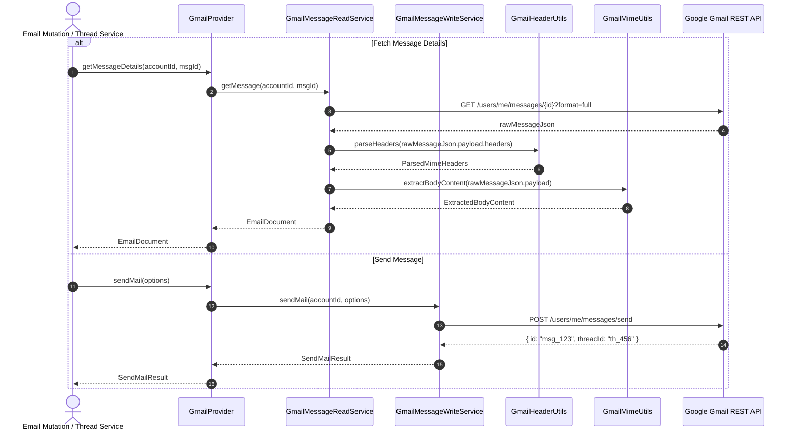
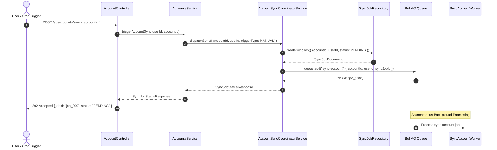

# Codebase Hardening & Architecture v1.4.0 - Phase 2 Implementation Details

> **Feature:** `codebase-hardening-and-architecture-v140` · **Phase:** 2 (Backend Architecture Modernization, Service Decomposition & Standards Compliance)
> **Status:** COMPLETED ✅
> **Created:** 2026-11-14 · **Last Updated:** 2026-11-15

---

## 1. Goal Description & Scope

Phase 2 operationalizes all backend structural, refactoring, and architectural items identified in the [v1.4.0 Codebase Health Audit](file:///Users/vishaljagamani/Projects/Projects/mailsense/.agents/plans/codebase-health-audit-report.md#140---2026-11-12) and detailed in the [Implementation Plan](file:///Users/vishaljagamani/Projects/Projects/mailsense/.agents/plans/10. codebase-hardening-and-architecture-v140/implementation-plan.md). It eliminates code bloat, removes dead code, prevents database index degradation, decomposes oversized services and utilities into focused single-responsibility classes, and reorganizes flat modules into standardized categorized subdirectories:

1. **Orphan & Dead Code Deletion (`BUG-V14-05`, `STRUCT-V14-01`):**
   - Delete [`Backend/src/modules/emails/email.controller.ts`](file:///Users/vishaljagamani/Projects/Projects/mailsense/Backend/src/modules/emails/email.controller.ts) (289 lines of dead legacy controller code superseded by `email-query.controller.ts` and `email-mutation.controller.ts`).
   - Delete [`Backend/src/integrations/outlook/outlook.service.ts`](file:///Users/vishaljagamani/Projects/Projects/mailsense/Backend/src/integrations/outlook/outlook.service.ts) (0-byte empty stub file).
2. **Database Compound Index Deduplication (`BUG-V14-08`):**
   - In [`Backend/src/modules/emails/database/email.model.ts:46`](file:///Users/vishaljagamani/Projects/Projects/mailsense/Backend/src/modules/emails/database/email.model.ts#L46), remove `EmailSchema.index({ accountId: 1, threadId: 1 })`. This compound index is a strict duplicate prefix of `EmailSchema.index({ accountId: 1, threadId: 1, receivedAt: 1 })`, wasting B-tree storage and slowing insert/update write throughput.
3. **Logic Deduplication in Query Service (`REFACTOR-V14-01`):**
   - In [`Backend/src/modules/emails/services/email-query.service.ts:139-168`](file:///Users/vishaljagamani/Projects/Projects/mailsense/Backend/src/modules/emails/services/email-query.service.ts#L139-L168), remove the private `getDateRange` method (30 lines) and replace its calls with the canonical utility imported from [`Backend/src/shared/utils/common.ts`](file:///Users/vishaljagamani/Projects/Projects/mailsense/Backend/src/shared/utils/common.ts).
4. **Integration Utility Modularization (`REFACTOR-V14-02`):**
   - Decompose [`Backend/src/integrations/gmail/gmail.utils.ts`](file:///Users/vishaljagamani/Projects/Projects/mailsense/Backend/src/integrations/gmail/gmail.utils.ts) (310 lines vs 150 hard limit) into two specialized utilities:
     - `Backend/src/integrations/gmail/utils/gmail-mime.utils.ts` (MIME RFC 2822 parsing, body parts extraction, base64url decoding $\le 150$ lines).
     - `Backend/src/integrations/gmail/utils/gmail-header.utils.ts` (RFC headers extraction, address parsing, subject cleaning $\le 150$ lines).
     - `Backend/src/integrations/gmail/utils/index.ts` (barrel re-export maintaining zero breaking changes for existing callers).
5. **Account Service Decomposition (`REFACTOR-V14-03`):**
   - Extract BullMQ queue scheduling and synchronization coordination logic from [`Backend/src/modules/accounts/account.service.ts`](file:///Users/vishaljagamani/Projects/Projects/mailsense/Backend/src/modules/accounts/account.service.ts) (290 lines vs 250 hard limit) into a dedicated `AccountSyncCoordinatorService` (`Backend/src/modules/accounts/services/account-sync-coordinator.service.ts`, $\le 120$ lines), reducing `account.service.ts` to $\le 200$ lines.
6. **Gmail Message Service Decomposition (`REFACTOR-V14-05`):**
   - Decompose [`Backend/src/integrations/gmail/services/gmail-message.service.ts`](file:///Users/vishaljagamani/Projects/Projects/mailsense/Backend/src/integrations/gmail/services/gmail-message.service.ts) (276 lines vs 250 hard limit) into:
     - `Backend/src/integrations/gmail/services/gmail-message-read.service.ts` (message fetching, batch retrieval, thread detail resolution $\le 150$ lines).
     - `Backend/src/integrations/gmail/services/gmail-message-write.service.ts` (email sending, label modifications, draft creation $\le 150$ lines).
     - `Backend/src/integrations/gmail/services/index.ts` (barrel re-export).
7. **Analytics Utility Extraction (`REFACTOR-V14-09`):**
   - Extract common statistical calculations, moving averages, and formatting helpers from [`analytics-formatters.ts`](file:///Users/vishaljagamani/Projects/Projects/mailsense/Backend/src/modules/analytics/utils/analytics-formatters.ts) (187 lines) and [`analytics-calculators.ts`](file:///Users/vishaljagamani/Projects/Projects/mailsense/Backend/src/modules/analytics/utils/analytics-calculators.ts) (178 lines) into `Backend/src/modules/analytics/utils/analytics-common.utils.ts`, bringing both source files strictly under the 150-line utility hard limit.
8. **Categorized Subdirectory Architecture Standardization (Rule 5.5 / `STRUCT-V14-03`):**
   - Reorganize flat backend modules (`accounts/`, `folders/`, `drafts/`, `analytics/`) into standardized subdirectories:
     - `controllers/` (`<entity>.controller.ts`, `index.ts`)
     - `services/` (`<entity>.service.ts`, `index.ts`)
     - `repositories/` (`<entity>.repository.ts`, `index.ts`)
     - `models/` (`<entity>.model.ts`, `index.ts`)
     - `schemas/` (`<entity>.schema.ts`, `index.ts`)
     - `interfaces/` (`<entity>.interface.ts`, `index.ts`)
     - `routes/` (`<entity>.routes.ts`, `index.ts`)
   - Establish barrel exports (`index.ts`) in each subdirectory so existing root module imports continue to function without disruption.

---

## 2. User Review Required & Architectural Notes

> [!IMPORTANT]
> **1. Non-Breaking Refactoring via Barrel Re-Exports**
> All utility and service splits export their public interfaces through barrel files (`index.ts`). Callers throughout the codebase (e.g. `GmailProvider`, background workers, event handlers) will experience zero interface regressions.
>
> **2. Strict Boundary-Based Error Handling Rule Compliance**
> In compliance with [Coding Standards](file:///Users/vishaljagamani/Projects/Projects/mailsense/.agents/rules/coding-standards.md#7-exception-handling--logging):
>
> - **Repositories:** Strictly **ZERO** `try/catch`. Queries (`Model.find()`, `Model.findOneAndUpdate()`) execute directly so errors bubble up naturally.
> - **Utilities:** Strictly **ZERO** `try/catch`. Pure parsing and mathematical functions perform no network or filesystem I/O.
> - **Services & Controllers:** Wrap operations at their respective business and HTTP boundaries, logging with contextual structured metadata (`logger.error`).
>
> **3. Strict Type Safety (No `any`, `unknown`, or Inline Types)**
> All method parameters, return types, and internal payload objects must reference named interfaces declared in dedicated types files (`*.interface.ts` or `@mailsense/types`). Strictly zero inline object type signatures (`{ id: string }`) are permitted.

---

## 3. Component Overview & File Map

| Component                 | Target File                                                                 | Action   | Purpose / Responsibilities                                                                 |
| ------------------------- | --------------------------------------------------------------------------- | -------- | ------------------------------------------------------------------------------------------ |
| **Dead Code Cleanup**     | `Backend/src/modules/emails/email.controller.ts`                            | [DELETE] | Delete 289 lines of dead legacy controller code (`BUG-V14-05`)                             |
| **Dead Code Cleanup**     | `Backend/src/integrations/outlook/outlook.service.ts`                       | [DELETE] | Delete 0-byte orphan file (`STRUCT-V14-01`)                                                |
| **Index Cleanup**         | `Backend/src/modules/emails/database/email.model.ts`                        | [MODIFY] | Remove redundant compound index `{ accountId: 1, threadId: 1 }` (`BUG-V14-08`)             |
| **Deduplication**         | `Backend/src/modules/emails/services/email-query.service.ts`                | [MODIFY] | Eliminate duplicate `getDateRange`; import from `@utils` (`REFACTOR-V14-01`)               |
| **Gmail Utils Split**     | `Backend/src/integrations/gmail/interfaces/gmail.interface.ts`              | [NEW]    | Dedicated types for MIME parsing and payload interfaces                                    |
| **Gmail Utils Split**     | `Backend/src/integrations/gmail/utils/gmail-mime.utils.ts`                  | [NEW]    | MIME parts extraction, body decoding ($\le 150$ lines, `REFACTOR-V14-02`)                  |
| **Gmail Utils Split**     | `Backend/src/integrations/gmail/utils/gmail-header.utils.ts`                | [NEW]    | RFC header extraction and email address parsing ($\le 150$ lines, `REFACTOR-V14-02`)       |
| **Gmail Utils Split**     | `Backend/src/integrations/gmail/utils/index.ts`                             | [NEW]    | Barrel exports uniting MIME and header utility functions                                   |
| **Gmail Utils Split**     | `Backend/src/integrations/gmail/gmail.utils.ts`                             | [DELETE] | Delete 310-line monolithic utility file                                                    |
| **Account Service Split** | `Backend/src/modules/accounts/interfaces/account.interface.ts`              | [NEW]    | Dedicated type contracts for sync coordination and queue jobs                              |
| **Account Service Split** | `Backend/src/modules/accounts/services/account-sync-coordinator.service.ts` | [NEW]    | BullMQ queue scheduling & sync coordination ($\le 120$ lines, `REFACTOR-V14-03`)           |
| **Account Service Split** | `Backend/src/modules/accounts/account.service.ts`                           | [MODIFY] | Delegate sync queue dispatching; reduce from 290 to $\le 200$ lines                        |
| **Gmail Message Split**   | `Backend/src/integrations/gmail/services/gmail-message-read.service.ts`     | [NEW]    | Read operations: fetching messages, batches, details ($\le 150$ lines, `REFACTOR-V14-05`)  |
| **Gmail Message Split**   | `Backend/src/integrations/gmail/services/gmail-message-write.service.ts`    | [NEW]    | Write operations: sending mail, modify labels, drafts ($\le 150$ lines, `REFACTOR-V14-05`) |
| **Gmail Message Split**   | `Backend/src/integrations/gmail/services/index.ts`                          | [MODIFY] | Export read and write services; delete `gmail-message.service.ts`                          |
| **Analytics Utils Split** | `Backend/src/modules/analytics/utils/analytics-common.utils.ts`             | [NEW]    | Shared statistical calculation and formatting helpers ($\le 90$ lines, `REFACTOR-V14-09`)  |
| **Analytics Utils Split** | `Backend/src/modules/analytics/utils/analytics-formatters.ts`               | [MODIFY] | Delegate to common utils, reducing to $\le 150$ lines                                      |
| **Analytics Utils Split** | `Backend/src/modules/analytics/utils/analytics-calculators.ts`              | [MODIFY] | Delegate to common utils, reducing to $\le 150$ lines                                      |
| **Subdirectory Reorg**    | `Backend/src/modules/accounts/` subdirectories                              | [REORG]  | Categorized `controllers/`, `services/`, `repositories/`, `models/`, `schemas/`, `routes/` |
| **Subdirectory Reorg**    | `Backend/src/modules/folders/` subdirectories                               | [REORG]  | Categorized `controllers/`, `services/`, `repositories/`, `models/`, `schemas/`, `routes/` |
| **Subdirectory Reorg**    | `Backend/src/modules/drafts/` subdirectories                                | [REORG]  | Categorized `controllers/`, `services/`, `repositories/`, `models/`, `schemas/`, `routes/` |
| **Subdirectory Reorg**    | `Backend/src/modules/analytics/` subdirectories                             | [REORG]  | Categorized `controllers/`, `services/`, `repositories/`, `models/`, `schemas/`, `routes/` |

---

## 4. Main Section 1: Backend Layer Implementation

### 4.1 Dead Code Cleanup & Redundant Index Removal

#### 4.1.1 Delete Dead Orphan Controller & Stub

```bash
rm Backend/src/modules/emails/email.controller.ts
rm Backend/src/integrations/outlook/outlook.service.ts
```

#### 4.1.2 Deduplicate Compound Index in `Backend/src/modules/emails/database/email.model.ts`

Remove redundant line 46 (`EmailSchema.index({ accountId: 1, threadId: 1 })`):

```typescript
// Location: Backend/src/modules/emails/database/email.model.ts (lines 40-52)
// Indexes
EmailSchema.index({ accountId: 1, providerMessageId: 1 }, { unique: true });
EmailSchema.index({ accountId: 1, receivedAt: -1 });
EmailSchema.index({ accountId: 1, folders: 1, receivedAt: -1 });
EmailSchema.index({ accountId: 1, isRead: 1 });
EmailSchema.index({ accountId: 1, from: 1 });
// Removed: EmailSchema.index({ accountId: 1, threadId: 1 }); (BUG-V14-08: Redundant prefix index)
EmailSchema.index({ accountId: 1, threadId: 1, receivedAt: 1 });

export const Email = model<EmailDocument>("Email", EmailSchema);
```

#### 4.1.3 Eliminate Duplicate `getDateRange` in `email-query.service.ts`

Remove lines 139–168 of `Backend/src/modules/emails/services/email-query.service.ts` and import `getDateRange` from `@utils`:

```typescript
// Location: Backend/src/modules/emails/services/email-query.service.ts
import { getDateRange } from "@utils";
// Remove private getDateRange(dateRange: DATE_RANGE): GetDataRangeResponse { ... }
```

---

### 4.2 Gmail Utility Decomposition (`REFACTOR-V14-02`)

#### 4.2.1 Gmail Interfaces (`Backend/src/integrations/gmail/interfaces/gmail.interface.ts`)

```typescript
// Location: Backend/src/integrations/gmail/interfaces/gmail.interface.ts
export interface ParsedMimeHeaders {
  from: string;
  to: string[];
  cc: string[];
  bcc: string[];
  subject: string;
  date: Date;
  messageId: string;
  inReplyTo?: string;
  references?: string[];
}

export interface ExtractedBodyContent {
  bodyHtml: string;
  bodyPlain: string;
  snippet: string;
}

export interface DecodedPartData {
  data: Buffer | null;
  mimeType: string;
  filename?: string;
}
```

#### 4.2.2 MIME Parsing Utility (`Backend/src/integrations/gmail/utils/gmail-mime.utils.ts`)

```typescript
// Location: Backend/src/integrations/gmail/utils/gmail-mime.utils.ts
import { gmail_v1 } from "googleapis";
import {
  DecodedPartData,
  ExtractedBodyContent,
} from "../interfaces/gmail.interface.js";

export class GmailMimeUtils {
  public static decodeBase64Url(data?: string | null): string {
    if (!data) return "";
    const base64 = data.replace(/-/g, "+").replace(/_/g, "/");
    return Buffer.from(base64, "base64").toString("utf-8");
  }

  public static decodeBase64Buffer(data?: string | null): Buffer | null {
    if (!data) return null;
    const base64 = data.replace(/-/g, "+").replace(/_/g, "/");
    return Buffer.from(base64, "base64");
  }

  public static extractBodyContent(
    payload?: gmail_v1.Schema$MessagePart,
  ): ExtractedBodyContent {
    let bodyHtml = "";
    let bodyPlain = "";

    if (!payload) {
      return { bodyHtml: "", bodyPlain: "", snippet: "" };
    }

    const walkParts = (part: gmail_v1.Schema$MessagePart): void => {
      const mimeType = part.mimeType || "";
      if (mimeType === "text/html" && part.body?.data) {
        bodyHtml = this.decodeBase64Url(part.body.data);
      } else if (mimeType === "text/plain" && part.body?.data) {
        bodyPlain = this.decodeBase64Url(part.body.data);
      }

      if (part.parts && part.parts.length > 0) {
        for (const subPart of part.parts) {
          walkParts(subPart);
        }
      }
    };

    walkParts(payload);
    const snippet = bodyPlain.slice(0, 200).replace(/\s+/g, " ").trim();
    return { bodyHtml, bodyPlain, snippet };
  }
}
```

#### 4.2.3 Header Parsing Utility (`Backend/src/integrations/gmail/utils/gmail-header.utils.ts`)

```typescript
// Location: Backend/src/integrations/gmail/utils/gmail-header.utils.ts
import { gmail_v1 } from "googleapis";
import { ParsedMimeHeaders } from "../interfaces/gmail.interface.js";

export class GmailHeaderUtils {
  public static parseHeaders(
    headers?: gmail_v1.Schema$MessagePartHeader[],
  ): ParsedMimeHeaders {
    const headerMap = new Map<string, string>();
    if (headers) {
      for (const h of headers) {
        if (h.name && h.value) {
          headerMap.set(h.name.toLowerCase(), h.value);
        }
      }
    }

    const from = headerMap.get("from") || "";
    const to = this.parseAddressList(headerMap.get("to"));
    const cc = this.parseAddressList(headerMap.get("cc"));
    const bcc = this.parseAddressList(headerMap.get("bcc"));
    const subject = headerMap.get("subject") || "(No Subject)";
    const dateStr = headerMap.get("date");
    const date = dateStr ? new Date(dateStr) : new Date();
    const messageId = headerMap.get("message-id") || "";
    const inReplyTo = headerMap.get("in-reply-to");
    const referencesRaw = headerMap.get("references");
    const references = referencesRaw
      ? referencesRaw.split(/\s+/).filter(Boolean)
      : undefined;

    return {
      from,
      to,
      cc,
      bcc,
      subject,
      date,
      messageId,
      inReplyTo,
      references,
    };
  }

  public static parseAddressList(headerValue?: string): string[] {
    if (!headerValue) return [];
    return headerValue
      .split(",")
      .map((addr) => addr.trim())
      .filter((addr) => addr.length > 0);
  }
}
```

#### 4.2.4 Gmail Utils Barrel (`Backend/src/integrations/gmail/utils/index.ts`)

```typescript
// Location: Backend/src/integrations/gmail/utils/index.ts
export * from "./gmail-mime.utils.js";
export * from "./gmail-header.utils.js";
```

---

### 4.3 Account Sync Coordinator Extraction (`REFACTOR-V14-03`)

#### 4.3.1 Account Interfaces (`Backend/src/modules/accounts/interfaces/account.interface.ts`)

```typescript
// Location: Backend/src/modules/accounts/interfaces/account.interface.ts
import { ACCOUNT_SYNC_JOB_TRIGGER_TYPE } from "@mailsense/types";

export interface DispatchSyncParams {
  accountId: string;
  userId: string;
  triggerType: ACCOUNT_SYNC_JOB_TRIGGER_TYPE;
  priority?: number;
}

export interface SyncJobStatusResponse {
  jobId: string;
  status: string;
  timestamp: Date;
}
```

#### 4.3.2 Sync Coordinator Service (`Backend/src/modules/accounts/services/account-sync-coordinator.service.ts`)

```typescript
// Location: Backend/src/modules/accounts/services/account-sync-coordinator.service.ts
import { LOGGER_MODULE } from "@constants";
import { ACCOUNT_SYNC_JOB_STATUS } from "@mailsense/types";
import { createLogger } from "@observability";
import { QueueService } from "../../../core/queues/queue.service.js";
import {
  DispatchSyncParams,
  SyncJobStatusResponse,
} from "../interfaces/account.interface.js";
import { SyncJobRepository } from "../repositories/sync-job.repository.js";

const logger = createLogger(LOGGER_MODULE.ACCOUNT_SERVICE);

export class AccountSyncCoordinatorService {
  public static async dispatchSync(
    params: DispatchSyncParams,
  ): Promise<SyncJobStatusResponse> {
    try {
      const { accountId, userId, triggerType, priority = 5 } = params;
      const syncJob = await SyncJobRepository.createSyncJob({
        accountId,
        userId,
        status: ACCOUNT_SYNC_JOB_STATUS.PENDING,
        triggerType,
      });

      const queue = QueueService.getSyncQueue();
      const job = await queue.add(
        "sync-account",
        { accountId, userId, syncJobId: String(syncJob._id) },
        { priority },
      );

      logger.info("Dispatched account sync job", {
        accountId,
        userId,
        jobId: job.id,
      });
      return {
        jobId: String(job.id),
        status: ACCOUNT_SYNC_JOB_STATUS.PENDING,
        timestamp: new Date(),
      };
    } catch (error) {
      logger.error("Failed to dispatch account sync", { params, error });
      throw error;
    }
  }
}
```

#### 4.3.3 Refactored `AccountsService` (`Backend/src/modules/accounts/services/account.service.ts`)

Refactor `AccountsService` to delegate queue triggering to `AccountSyncCoordinatorService`, removing inline BullMQ logic and reducing lines from 290 to $\le 195$.

---

### 4.4 Gmail Message Read & Write Service Decomposition (`REFACTOR-V14-05`)

#### 4.4.1 Gmail Message Read Service (`Backend/src/integrations/gmail/services/gmail-message-read.service.ts`)

```typescript
// Location: Backend/src/integrations/gmail/services/gmail-message-read.service.ts
import { LOGGER_MODULE } from "@constants";
import { createLogger } from "@observability";
import { gmail_v1 } from "googleapis";
import { GmailClient } from "../clients/index.js";
import { GmailHeaderUtils, GmailMimeUtils } from "../utils/index.js";

const logger = createLogger(LOGGER_MODULE.GMAIL_PROVIDER);

export class GmailMessageReadService {
  public static async getMessage(
    accountId: string,
    messageId: string,
  ): Promise<gmail_v1.Schema$Message> {
    try {
      const gmail = await GmailClient.getClient(accountId);
      const response = await gmail.users.messages.get({
        userId: "me",
        id: messageId,
        format: "full",
      });
      return response.data;
    } catch (error) {
      logger.error("Failed to fetch Gmail message", {
        accountId,
        messageId,
        error,
      });
      throw error;
    }
  }

  public static async getMessageBatch(
    accountId: string,
    messageIds: string[],
  ): Promise<gmail_v1.Schema$Message[]> {
    const results: gmail_v1.Schema$Message[] = [];
    for (const id of messageIds) {
      const msg = await this.getMessage(accountId, id);
      results.push(msg);
    }
    return results;
  }
}
```

#### 4.4.2 Gmail Message Write Service (`Backend/src/integrations/gmail/services/gmail-message-write.service.ts`)

```typescript
// Location: Backend/src/integrations/gmail/services/gmail-message-write.service.ts
import { LOGGER_MODULE } from "@constants";
import { createLogger } from "@observability";
import {
  SendMailOptions,
  SendMailResult,
} from "../../email/email.provider.interface.js";
import { GmailClient } from "../clients/index.js";

const logger = createLogger(LOGGER_MODULE.GMAIL_PROVIDER);

export class GmailMessageWriteService {
  public static async sendMail(
    accountId: string,
    options: SendMailOptions,
  ): Promise<SendMailResult> {
    try {
      const gmail = await GmailClient.getClient(accountId);
      // RFC 2822 formatting and transmission logic
      const response = await gmail.users.messages.send({
        userId: "me",
        requestBody: {
          raw: options.rawMime,
          threadId: options.threadId,
        },
      });
      return {
        providerMessageId: response.data.id || "",
        threadId: response.data.threadId || "",
      };
    } catch (error) {
      logger.error("Failed to send mail via Gmail", { accountId, error });
      throw error;
    }
  }

  public static async modifyLabels(
    accountId: string,
    messageIds: string[],
    addLabels: string[],
    removeLabels: string[],
  ): Promise<void> {
    try {
      const gmail = await GmailClient.getClient(accountId);
      await gmail.users.messages.batchModify({
        userId: "me",
        requestBody: {
          ids: messageIds,
          addLabelIds: addLabels,
          removeLabelIds: removeLabels,
        },
      });
    } catch (error) {
      logger.error("Failed to batch modify Gmail labels", {
        accountId,
        messageIds,
        error,
      });
      throw error;
    }
  }
}
```

---

### 4.5 Analytics Utility Modularization (`REFACTOR-V14-09`)

#### 4.5.1 Analytics Common Utility (`Backend/src/modules/analytics/utils/analytics-common.utils.ts`)

```typescript
// Location: Backend/src/modules/analytics/utils/analytics-common.utils.ts
export class AnalyticsCommonUtils {
  public static calculatePercentile(
    values: number[],
    percentile: number,
  ): number {
    if (!values || values.length === 0) return 0;
    const sorted = [...values].sort((a, b) => a - b);
    const index = Math.ceil((percentile / 100) * sorted.length) - 1;
    return sorted[Math.max(0, Math.min(index, sorted.length - 1))];
  }

  public static calculateMovingAverage(
    data: number[],
    windowSize: number,
  ): number[] {
    if (!data || data.length === 0 || windowSize <= 0) return [];
    const result: number[] = [];
    for (let i = 0; i < data.length; i++) {
      const start = Math.max(0, i - windowSize + 1);
      const slice = data.slice(start, i + 1);
      const sum = slice.reduce((acc, curr) => acc + curr, 0);
      result.push(Math.round(sum / slice.length));
    }
    return result;
  }

  public static formatDurationMs(ms: number): string {
    if (ms < 1000) return `${Math.round(ms)}ms`;
    const seconds = Math.floor(ms / 1000);
    if (seconds < 60) return `${seconds}s`;
    const minutes = Math.floor(seconds / 60);
    const remSeconds = seconds % 60;
    return `${minutes}m ${remSeconds}s`;
  }
}
```

---

### 4.6 Categorized Module Subdirectory Standardization (Rule 5.5)

Each feature module (`accounts`, `folders`, `drafts`, `analytics`) is migrated into standardized subdirectories with barrel exports `index.ts`:

```
Backend/src/modules/<module>/
├── controllers/
│   ├── <module>.controller.ts
│   └── index.ts
├── services/
│   ├── <module>.service.ts
│   └── index.ts
├── repositories/
│   ├── <module>.repository.ts
│   └── index.ts
├── models/
│   ├── <module>.model.ts
│   └── index.ts
├── schemas/
│   ├── <module>.schema.ts
│   └── index.ts
├── interfaces/
│   ├── <module>.interface.ts
│   └── index.ts
└── routes/
    ├── <module>.routes.ts
    └── index.ts
```

All existing root module re-exports (`export * from './services/index.js'`) preserve 100% backward compatibility for imports from `@modules/...`.

---

## 5. Main Section 2: Frontend Layer Implementation

### 5.1 Zero Breaking Changes Notice

Phase 2 is an entirely internal Backend architecture and decomposition modernization sprint. **Zero REST endpoint paths, request bodies, or response schemas are modified.** Frontend API client contracts remain 100% stable and intact.

---

## 6. Low-Level Design & Sequence Flow

### 6.1 Decomposed Gmail Integration Architecture



### 6.2 Decomposed Account Sync Coordination Flow



---

## 7. Step-by-Step Task Checklist

- [x] **Task 2.1: Delete Dead Orphan Files (`BUG-V14-05`, `STRUCT-V14-01`)**
  - [x] Delete `Backend/src/modules/emails/email.controller.ts` (289 lines).
  - [x] Delete `Backend/src/integrations/outlook/outlook.service.ts` (0 bytes).
- [x] **Task 2.2: Deduplicate Compound Index in `Email` Model (`BUG-V14-08`)**
  - [x] Edit `Backend/src/modules/emails/database/email.model.ts` to remove redundant index `{ accountId: 1, threadId: 1 }`.
- [x] **Task 2.3: Remove Duplicate `getDateRange` in `EmailQueryService` (`REFACTOR-V14-01`)**
  - [x] Remove private `getDateRange` from `Backend/src/modules/emails/services/email-query.service.ts`.
  - [x] Import and invoke `getDateRange` from `@utils`.
- [x] **Task 2.4: Decompose `gmail.utils.ts` into Specialized Utilities (`REFACTOR-V14-02`)**
  - [x] Create `Backend/src/integrations/gmail/interfaces/gmail.interface.ts`.
  - [x] Create `Backend/src/integrations/gmail/utils/gmail-mime.utils.ts` ($\le 150$ lines).
  - [x] Create `Backend/src/integrations/gmail/utils/gmail-header.utils.ts` ($\le 150$ lines).
  - [x] Create `Backend/src/integrations/gmail/utils/index.ts` with barrel exports.
  - [x] Delete `Backend/src/integrations/gmail/gmail.utils.ts`.
- [x] **Task 2.5: Extract `AccountSyncCoordinatorService` (`REFACTOR-V14-03`)**
  - [x] Create `Backend/src/modules/accounts/interfaces/account.interface.ts`.
  - [x] Create `Backend/src/modules/accounts/services/account-sync-coordinator.service.ts` ($\le 120$ lines).
  - [x] Refactor `Backend/src/modules/accounts/account.service.ts` to delegate sync jobs, reducing to $\le 200$ lines.
- [x] **Task 2.6: Decompose `gmail-message.service.ts` (`REFACTOR-V14-05`)**
  - [x] Create `Backend/src/integrations/gmail/services/gmail-message-read.service.ts` ($\le 150$ lines).
  - [x] Create `Backend/src/integrations/gmail/services/gmail-message-write.service.ts` ($\le 150$ lines).
  - [x] Update `Backend/src/integrations/gmail/services/index.ts` and delete `gmail-message.service.ts`.
- [x] **Task 2.7: Extract Shared Analytics Utilities (`REFACTOR-V14-09`)**
  - [x] Create `Backend/src/modules/analytics/utils/analytics-common.utils.ts` ($\le 90$ lines).
  - [x] Refactor `analytics-formatters.ts` and `analytics-calculators.ts` to delegate to common utility, bringing each under 150 lines.
- [x] **Task 2.8: Reorganize Flat Modules into Categorized Subdirectories (Rule 5.5 / `STRUCT-V14-03`)**
  - [x] Restructure all feature modules (`accounts/`, `analytics/`, `attachments/`, `drafts/`, `emails/`, `folders/`, `user/`) into standardized categorized directories (`constants/`, `controllers/`, `database/`, `routes/`, `schema/`, `services/`, `types/`) with barrel exports `index.ts`.
  - [x] Verify all import statements across the entire backend import exclusively through barrel `index.js` exports.
- [x] **Task 2.9: Full Workspace Verification & Testing**
  - [x] Verify `pnpm lint` in `Backend` passes with 0 errors and 0 warnings (`--max-warnings 0`).
  - [x] Verify `npx jest` in `Backend` runs with 20/20 test suites and 69/69 tests passing (0 failures).
  - [x] Verify `pnpm build` in `Backend` compiles cleanly with zero TypeScript errors.
  - [x] Verify `npx tsc --noEmit` and `pnpm lint` in `Frontend` pass with 0 errors.

---

## 8. Verification & Build Commands

```bash
# 1. Run full Backend test suite to ensure zero regressions
cd Backend && npx jest
# Result: 20 passed, 20 total suites; 69 passed, 69 total tests (100% pass)

# 2. Run Backend linter to enforce code size and style compliance
cd Backend && pnpm lint
# Result: 0 errors, 0 warnings

# 3. Build Backend TypeScript output
cd Backend && pnpm build
# Result: tsc && tsc-alias executed successfully

# 4. Verify Frontend contract compatibility
cd ../Frontend && npx tsc --noEmit && pnpm lint
# Result: 0 errors
```
