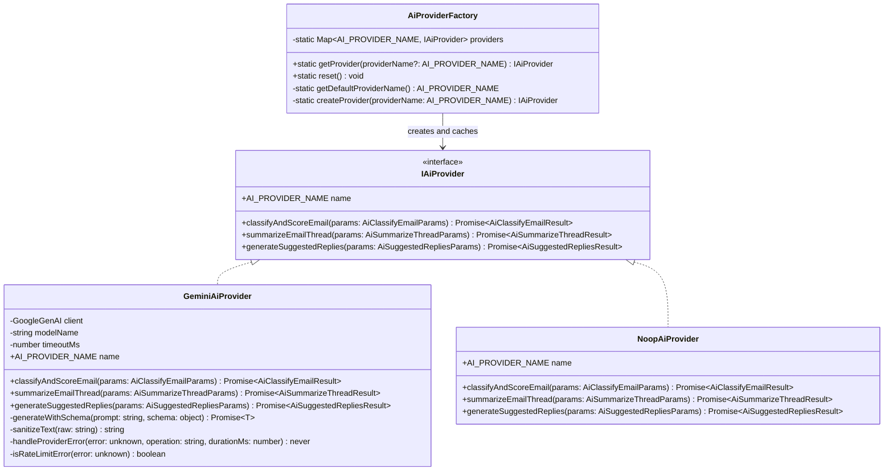
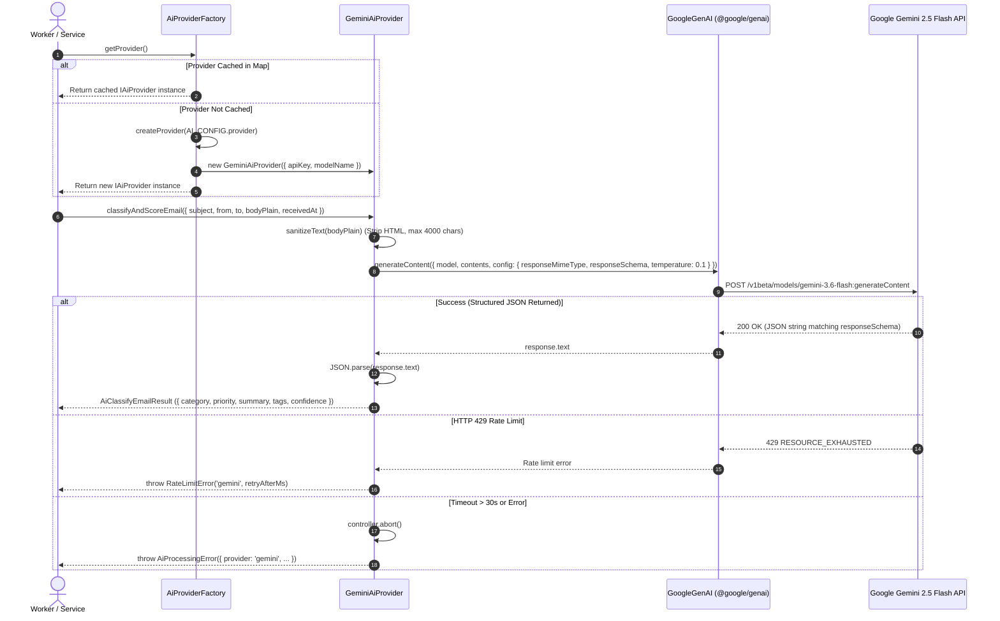

# AI Foundation & Core Features - Phase 1 Implementation Details

> **Feature:** 11. ai-foundation-core · **Phase:** 1 (Shared Contracts & AI Provider Strategy Infrastructure)
> **Status:** READY FOR EXECUTION
> **Created:** 2026-11-20 · **Last Updated:** 2026-11-20

---

## 1. Goal Description & Scope

Establish the architectural foundation for the MailSense AI subsystem by releasing `@mailsense/types v1.8.0` and implementing the **Provider / Strategy design pattern** (`IAiProvider`, `AiProviderFactory`, `GeminiAiProvider`, `NoopAiProvider`).

Prior to this phase, the MailSense platform possessed no artificial intelligence or machine learning capabilities. Ingested emails remained unclassified, priorities were unmarked, and long conversation threads required manual end-to-end reading.

Specifically, Phase 1 accomplishes:

1. **Shared Contract Package (@mailsense/types v1.8.0):**
   - Enums: `EMAIL_AI_CATEGORY`, `EMAIL_AI_PRIORITY`, `SUGGESTED_REPLY_TONE`, `AI_PROVIDER_NAME`, `AI_FEATURE_KEY`, `AI_PROCESSING_STATUS`.
   - Provider strategy contracts under `src/ai/`: `AiClassifyEmailParams`, `AiClassifyEmailResult`, `AiThreadMessageInput`, `AiSummarizeThreadParams`, `AiSummarizeThreadResult`, `AiSuggestedRepliesParams`, and `AiSuggestedRepliesResult`.
   - Entity & DTO extensions: `EmailAiMetadata`, `EmailAttributes`, `EmailListDTO`, `GetAllEmailsFilters`, `UserSettings`.
   - BullMQ contracts: `AIProcessingJobPayload`, `AIProcessingJobResult`.
2. **Backend Environment & Observability Infrastructure:**
   - Configuration schema validation via Zod in `env.schema.ts` for `AI_PROVIDER`, `GEMINI_API_KEY`, and `GEMINI_MODEL`.
   - App config binding in `app.config.ts` exposing typed `AI_CONFIG`.
   - Standardized module logging identifiers in `LOGGER_MODULE` (`AI_SERVICE`, `AI_CONTROLLER`, `AI_WORKER`, `AI_PROCESSING_PROCESSOR`, `GEMINI_PROVIDER`, `NOOP_AI_PROVIDER`, `AI_PROVIDER_FACTORY`).
3. **Domain Error Hierarchy Extension:**
   - `ErrorCode.AI_PROCESSING_FAILED` in `ErrorCodes.ts`.
   - Typed error parameters `AiProcessingErrorParams` in `core/types/error.types.ts`.
   - Operational domain error class `AiProcessingError` in `DomainErrors.ts` carrying structured context (`provider`, `model`, `processingDurationMs`).
4. **Provider / Strategy Pattern Architecture:**
   - Provider contract `IAiProvider` enforcing uniform methods across all LLM backends: `classifyAndScoreEmail()`, `summarizeEmailThread()`, and `generateSuggestedReplies()`.
   - Production provider `GeminiAiProvider` wrapping the official unified `@google/genai` SDK with native JSON Schema output (`responseMimeType: "application/json"`, `responseSchema`), deterministic temperature (0.1), prompt sanitization (HTML stripped, 4,000 char truncation, zero attachments/base64 sent), and 30-second `AbortController` timeout protection.
   - Offline test provider `NoopAiProvider` returning deterministic classifications, summaries, and reply chips for zero-cost, offline CI/CD test suites.
   - Singleton provider factory `AiProviderFactory` with cached strategy resolution, environment defaulting, and test lifecycle resetting.
5. **Unit & Integration Test Coverage:**
   - 100% test coverage for provider factory resolution, singleton caching, Gemini structured parsing, timeout abortion, rate limit translation, and error wrapping.

---

## 2. User Review Required & Architectural Notes

> [!IMPORTANT]
> **Key Architectural Decisions & Standards Adherence**
>
> - **Provider / Strategy Pattern Isolation:** The rest of the platform (controllers, background workers, business services) NEVER directly imports `@google/genai` or vendor-specific code. All AI operations are orchestrated strictly through `IAiProvider` obtained via `AiProviderFactory.getProvider()`. Switching AI backends (e.g., to Anthropic Claude or OpenAI) in the future requires writing an adapter with zero changes to existing controllers or workers.
> - **Official Unified Google GenAI SDK (`@google/genai`):** We use Google's modern unified SDK (`@google/genai`), NOT the legacy `@google/generative-ai` package. Structured outputs use native constrained decoding via `config.responseSchema` with enum constraints, eliminating fragile regex or prompt-based JSON parsing.
> - **Strict Data Minimization & Privacy:** Raw HTML, scripts, base64 data, and binary attachments are NEVER sent to the LLM. Only sanitized plain text truncated to 4,000 characters is transmitted.
> - **Zero Test Side Effects (`noop` Provider in Tests):** When `NODE_ENV === 'test'` or `AI_PROVIDER === 'noop'`, `AiProviderFactory` defaults to `NoopAiProvider`. This guarantees that unit tests and CI pipelines run instantly with zero network requests, zero token costs, and zero API quota consumption.
> - **Resilient Timeout Protection:** All LLM API calls are wrapped in an `AbortController` timeout (30 seconds). If an external API hangs or drops the socket, the call is cleanly aborted and rejected with `AiProcessingError`.
> - **Rate Limit Translation:** When Google Gemini returns HTTP 429 quota exhaustion, `GeminiAiProvider` extracts retry headers and throws the existing domain `RateLimitError('gemini', retryAfterMs)`, allowing the BullMQ worker in Phase 2 to invoke `job.rateLimit()` and pause processing without burning retry attempts.
> - **Strict Type Safety & Dedicated Types Files:** Strictly zero `any`, `never`, or `unknown`. Strictly zero inline object type signatures. All parameter structures and return types use named interfaces imported from `@mailsense/types` or `Backend/src/core/types/`.

---

## 3. Component Overview & File Map

| Component          | Target File                                                      |    Action    | Purpose                                                                                           |
| :----------------- | :--------------------------------------------------------------- | :----------: | :------------------------------------------------------------------------------------------------ |
| **Shared Types**   | `mailsense-types/package.json`                                   | **[MODIFY]** | Version bumped to `1.8.0`, export `./ai` subpath                                                  |
| **Shared Types**   | `mailsense-types/CHANGELOG.md`                                   | **[MODIFY]** | Document `v1.8.0` additions and backfill version comparison links                                 |
| **Shared Types**   | `mailsense-types/src/ai/ai.enums.ts`                             |  **[NEW]**   | `AI_PROVIDER_NAME`, `AI_FEATURE_KEY`, `AI_PROCESSING_STATUS`                                      |
| **Shared Types**   | `mailsense-types/src/ai/ai.interfaces.ts`                        |  **[NEW]**   | Provider strategy parameter & result contracts                                                    |
| **Shared Types**   | `mailsense-types/src/ai/index.ts`                                |  **[NEW]**   | Barrel export for `@mailsense/types/ai`                                                           |
| **Shared Types**   | `mailsense-types/src/emails/emails.enums.ts`                     | **[MODIFY]** | `EMAIL_AI_CATEGORY`, `EMAIL_AI_PRIORITY`, `SUGGESTED_REPLY_TONE`                                  |
| **Shared Types**   | `mailsense-types/src/emails/emails.interfaces.ts`                | **[MODIFY]** | `EmailAiMetadata`, `GetEmailSummaryResponse`, `SuggestedReplyItem`, `GetSuggestedRepliesResponse` |
| **Shared Types**   | `mailsense-types/src/user/user.interfaces.ts`                    | **[MODIFY]** | `UserAIFeatureSettings`, `UserAISettings`, `UserSettings.ai`                                      |
| **Shared Types**   | `mailsense-types/src/workers/workers.interfaces.ts`              | **[MODIFY]** | `AIProcessingJobPayload`, `AIProcessingJobResult`                                                 |
| **Shared Types**   | `mailsense-types/src/index.ts`                                   | **[MODIFY]** | Re-export `ai` module from root package entry                                                     |
| **Backend Config** | `Backend/package.json`                                           | **[MODIFY]** | Install `@google/genai ^1.x` production dependency                                                |
| **Backend Config** | `Backend/src/core/config/env.schema.ts`                          | **[MODIFY]** | Add Zod schema validations for `AI_PROVIDER`, `GEMINI_API_KEY`, `GEMINI_MODEL`                    |
| **Backend Config** | `Backend/src/core/config/app.config.ts`                          | **[MODIFY]** | Export typed `AI_CONFIG`                                                                          |
| **Observability**  | `Backend/src/core/constants/observability.constants.ts`          | **[MODIFY]** | Add AI logging module identifiers to `LOGGER_MODULE`                                              |
| **Errors**         | `Backend/src/core/errors/ErrorCodes.ts`                          | **[MODIFY]** | Add `ErrorCode.AI_PROCESSING_FAILED`                                                              |
| **Errors**         | `Backend/src/core/types/error.types.ts`                          | **[MODIFY]** | Add `AiProcessingErrorParams` interface (zero inline types)                                       |
| **Errors**         | `Backend/src/core/errors/DomainErrors.ts`                        | **[MODIFY]** | Add `AiProcessingError` operational domain error class                                            |
| **AI Integration** | `Backend/src/integrations/ai/ai.provider.ts`                     |  **[NEW]**   | Declare `IAiProvider` strategy contract                                                           |
| **AI Integration** | `Backend/src/integrations/ai/ai.provider.types.ts`               |  **[NEW]**   | Internal provider configuration interfaces                                                        |
| **AI Integration** | `Backend/src/integrations/ai/providers/noop.provider.ts`         |  **[NEW]**   | Deterministic mock provider for unit testing & offline dev                                        |
| **AI Integration** | `Backend/src/integrations/ai/providers/gemini.provider.ts`       |  **[NEW]**   | Production Google Gemini 2.5 Flash SDK wrapper                                                    |
| **AI Integration** | `Backend/src/integrations/ai/ai.provider.factory.ts`             |  **[NEW]**   | Singleton provider factory and strategy selector                                                  |
| **AI Integration** | `Backend/src/integrations/ai/index.ts`                           |  **[NEW]**   | Barrel export accessible via `@integrations/ai`                                                   |
| **Unit Tests**     | `Backend/src/core/errors/__tests__/ai-processing-error.test.ts`  |  **[NEW]**   | Unit tests for `AiProcessingError` serialization & context                                        |
| **Unit Tests**     | `Backend/src/integrations/ai/__tests__/provider.factory.test.ts` |  **[NEW]**   | Unit tests for factory resolution and singleton caching                                           |
| **Unit Tests**     | `Backend/src/integrations/ai/__tests__/gemini.provider.test.ts`  |  **[NEW]**   | Unit tests for Gemini provider output, timeout, and rate limiting                                 |

---

## 4. Main Section 1: Backend Layer Implementation

### 4.1 Dependency Installation (`Backend/package.json`)

Install the official unified Google GenAI SDK:

```bash
cd Backend && pnpm add @google/genai
```

### 4.2 Error Hierarchy & Error Codes

#### 1. Machine-Readable Error Codes (`Backend/src/core/errors/ErrorCodes.ts`)

```typescript
// Add to ErrorCode enum in Backend/src/core/errors/ErrorCodes.ts:
export enum ErrorCode {
  // 4xx Client Errors
  RESOURCE_NOT_FOUND = "RESOURCE_NOT_FOUND",
  BAD_REQUEST = "BAD_REQUEST",
  VALIDATION_FAILED = "VALIDATION_FAILED",
  UNAUTHORIZED = "UNAUTHORIZED",
  FORBIDDEN = "FORBIDDEN",
  CONFLICT = "CONFLICT",

  // Provider & External API Errors
  PROVIDER_API_ERROR = "PROVIDER_API_ERROR",
  PROVIDER_RATE_LIMITED = "PROVIDER_RATE_LIMITED",
  TOKEN_EXPIRED = "TOKEN_EXPIRED",
  AI_PROCESSING_FAILED = "AI_PROCESSING_FAILED",

  // 5xx System & Internal Errors
  SYNC_FAILED = "SYNC_FAILED",
  EXTERNAL_SERVICE_ERROR = "EXTERNAL_SERVICE_ERROR",
  CONFIGURATION_ERROR = "CONFIGURATION_ERROR",
  INTERNAL_ERROR = "INTERNAL_ERROR",
}
```

#### 2. Dedicated Error Types (`Backend/src/core/types/error.types.ts`)

```typescript
// Add to Backend/src/core/types/error.types.ts:
export interface AiProcessingErrorParams {
  provider: string;
  message: string;
  model?: string;
  description?: string;
  suggestedAction?: string;
  traceId?: string;
  processingDurationMs?: number;
}
```

#### 3. Operational Domain Error (`Backend/src/core/errors/DomainErrors.ts`)

```typescript
import {
  AiProcessingErrorParams,
  ProviderApiErrorParams,
  SyncErrorParams,
  ValidationDetail,
} from "@types";
import { AppError } from "./AppError.js";
import { ErrorCode } from "./ErrorCodes.js";

// Add to Backend/src/core/errors/DomainErrors.ts:
export class AiProcessingError extends AppError {
  public readonly provider: string;
  public readonly model?: string;
  public readonly processingDurationMs?: number;

  constructor(params: AiProcessingErrorParams) {
    super({
      message: `[AI:${params.provider.toUpperCase()}] ${params.message}`,
      httpStatus: 502,
      errorCode: ErrorCode.AI_PROCESSING_FAILED,
      isOperational: true,
      description:
        params.description ??
        `AI processing failed while calling provider '${params.provider}'.`,
      suggestedAction:
        params.suggestedAction ??
        "The operation will be retried automatically or email marked as unclassified.",
      traceId: params.traceId,
      context: {
        provider: params.provider,
        ...(params.model ? { model: params.model } : {}),
        ...(params.processingDurationMs !== undefined
          ? { processingDurationMs: params.processingDurationMs }
          : {}),
      },
    });
    this.provider = params.provider;
    this.model = params.model;
    this.processingDurationMs = params.processingDurationMs;
  }
}
```

---

### 4.3 Observability Constants (`Backend/src/core/constants/observability.constants.ts`)

```typescript
// Add AI component module identifiers to LOGGER_MODULE:
export enum LOGGER_MODULE {
  APP = "App",
  SERVER = "Server",
  DATABASE = "Database",
  HTTP = "HTTP",
  HEALTH_SERVICE = "HealthService",
  HEALTH_CONTROLLER = "HealthController",
  EMAIL_CONTROLLER = "EmailController",
  REDIS_CONNECTION = "RedisConnection",
  QUEUE_SERVICE = "QueueService",
  SCHEDULER_SERVICE = "SchedulerService",
  QUEUE_REGISTRY = "QueueRegistry",
  EVENT_BUS = "EventBus",
  EMAIL_CREATED_HANDLER = "EmailCreatedHandler",
  SYNC_COMPLETED_HANDLER = "SyncCompletedHandler",
  EMAIL_BATCH_SYNCED_HANDLER = "EmailBatchSyncedHandler",
  MONITORING_MANAGER = "MonitoringManager",
  SENTRY_PROVIDER = "SentryProvider",
  NOOP_MONITORING_PROVIDER = "NoopMonitoringProvider",
  GMAIL_CLIENT = "GmailClient",
  GMAIL_SERVICE = "GmailService",
  OUTLOOK_CLIENT = "OutlookClient",
  OUTLOOK_SERVICE = "OutlookService",
  AUTH0_CLIENT = "Auth0Client",
  AUTH0_SERVICE = "Auth0Service",
  OBJECT_STORAGE_SERVICE = "ObjectStorageService",
  ACCOUNT_SERVICE = "AccountService",
  EMAIL_SERVICE = "EmailService",
  ATTACHMENT_SERVICE = "AttachmentService",
  FOLDER_SERVICE = "FolderService",
  DRAFT_SERVICE = "DraftService",
  USER_SERVICE = "UserService",
  ANALYTICS_SERVICE = "AnalyticsService",
  ANALYTICS_UTILS = "AnalyticsUtils",
  BASE_WORKER = "BaseWorker",
  SYNC_WORKER = "SyncWorker",
  TOKEN_REFRESH_WORKER = "TokenRefreshWorker",
  SYNC_ACCOUNT_PROCESSOR = "SyncAccountProcessor",
  REFRESH_TOKEN_PROCESSOR = "RefreshTokenProcessor",
  AUTH_MIDDLEWARE = "AuthMiddleware",
  // Phase 1 AI Observability Modules:
  AI_SERVICE = "AiService",
  AI_CONTROLLER = "AiController",
  AI_WORKER = "AiWorker",
  AI_PROCESSING_PROCESSOR = "AiProcessingProcessor",
  GEMINI_PROVIDER = "GeminiProvider",
  NOOP_AI_PROVIDER = "NoopAiProvider",
  AI_PROVIDER_FACTORY = "AiProviderFactory",
}
```

---

### 4.4 Environment Configuration & Typed Secrets

#### 1. Zod Environment Schema (`Backend/src/core/config/env.schema.ts`)

```typescript
import z from "zod";

export const envSchemaObject = {
  PORT: z.coerce.number().default(8020),
  ENABLE_AUTH: z.enum(["true", "false"]).default("true"),
  NODE_ENV: z.string().default("local"),
  MONGODB_URI: z.string(),
  DATABASE: z.string(),
  LOG_LEVEL: z.string().default("info"),
  ENCRYPTION_KEY: z.string(),
  MAILSENSE_BASE_URL: z.string(),
  // Auth0 secrets
  AUTH0_AUDIENCE: z.string(),
  AUTH0_ISSUER_BASE_URL: z.string(),
  // OAuth secrets
  GMAIL_CLIENT_ID: z.string(),
  GMAIL_CLIENT_SECRET: z.string(),
  GMAIL_REDIRECT_URI: z.string(),
  OUTLOOK_CLIENT_ID: z.string(),
  OUTLOOK_CLIENT_SECRET: z.string(),
  OUTLOOK_REDIRECT_URI: z.string(),
  // Jobs/Queues secrets
  REDIS_URL: z.string(),
  // Auth0 API Secrets
  AUTH0_API_CLIENT_ID: z.string(),
  AUTH0_API_CLIENT_SECRET: z.string(),
  AUTH0_API_BASE_URL: z.string(),
  SENTRY_DSN: z.string(),
  // Cloudflare R2 Storage Secrets
  R2_ACCOUNT_ID: z.string(),
  R2_ACCESS_KEY_ID: z.string(),
  R2_SECRET_ACCESS_KEY: z.string(),
  R2_BUCKET_NAME: z.string(),
  R2_REGION: z.string(),
  // AI Configuration Secrets
  AI_PROVIDER: z
    .enum(["gemini", "openai", "anthropic", "noop"])
    .default("gemini"),
  GEMINI_API_KEY: z.string().optional(),
  GEMINI_MODEL: z.string().default("gemini-3.6-flash"),
};
```

#### 2. App Config Exposure (`Backend/src/core/config/app.config.ts`)

```typescript
// Append to Backend/src/core/config/app.config.ts:
export const AI_CONFIG = {
  provider: ENV.AI_PROVIDER,
  geminiApiKey: ENV.GEMINI_API_KEY,
  geminiModel: ENV.GEMINI_MODEL,
};
```

---

### 4.5 AI Provider Strategy Contracts & Types

#### 1. Provider Strategy Interface (`Backend/src/integrations/ai/ai.provider.ts`)

```typescript
import {
  AI_PROVIDER_NAME,
  AiClassifyEmailParams,
  AiClassifyEmailResult,
  AiSuggestedRepliesParams,
  AiSuggestedRepliesResult,
  AiSummarizeThreadParams,
  AiSummarizeThreadResult,
} from "@mailsense/types";

/**
 * Strategy interface defining required AI capabilities.
 * All concrete providers (Gemini, OpenAI, Noop) must conform to this contract.
 */
export interface IAiProvider {
  readonly name: AI_PROVIDER_NAME;

  /**
   * Classifies email category, priority level, tags, and 1-line summary.
   */
  classifyAndScoreEmail(
    params: AiClassifyEmailParams,
  ): Promise<AiClassifyEmailResult>;

  /**
   * Summarizes a multi-message email thread into executive key points and action items.
   */
  summarizeEmailThread(
    params: AiSummarizeThreadParams,
  ): Promise<AiSummarizeThreadResult>;

  /**
   * Generates 2-3 contextual quick reply suggestions adapted to thread tone.
   */
  generateSuggestedReplies(
    params: AiSuggestedRepliesParams,
  ): Promise<AiSuggestedRepliesResult>;
}
```

#### 2. Internal Provider Types (`Backend/src/integrations/ai/ai.provider.types.ts`)

```typescript
export interface GeminiProviderConfig {
  apiKey?: string;
  modelName?: string;
  timeoutMs?: number;
}

export interface SanitizedEmailContent {
  subject: string;
  from: string;
  to: string[];
  sanitizedBody: string;
  receivedAt: Date;
}
```

---

### 4.6 Offline Testing Strategy (`Backend/src/integrations/ai/providers/noop.provider.ts`)

```typescript
import { LOGGER_MODULE } from "@constants";
import {
  AI_PROVIDER_NAME,
  AiClassifyEmailParams,
  AiClassifyEmailResult,
  AiSuggestedRepliesParams,
  AiSuggestedRepliesResult,
  AiSummarizeThreadParams,
  AiSummarizeThreadResult,
  EMAIL_AI_CATEGORY,
  EMAIL_AI_PRIORITY,
  SUGGESTED_REPLY_TONE,
} from "@mailsense/types";
import { createLogger } from "@observability";
import { IAiProvider } from "../ai.provider.js";

const logger = createLogger(LOGGER_MODULE.NOOP_AI_PROVIDER);

/**
 * Deterministic mock AI provider used for unit testing, CI/CD pipelines,
 * and offline development environments. Zero API cost and zero network calls.
 */
export class NoopAiProvider implements IAiProvider {
  public readonly name: AI_PROVIDER_NAME = AI_PROVIDER_NAME.NOOP;

  public async classifyAndScoreEmail(
    params: AiClassifyEmailParams,
  ): Promise<AiClassifyEmailResult> {
    logger.debug("NoopAiProvider.classifyAndScoreEmail called", {
      subject: params.subject,
      from: params.from,
    });
    return {
      category: EMAIL_AI_CATEGORY.GENERAL,
      priority: EMAIL_AI_PRIORITY.NORMAL,
      summary: `Summary of: ${params.subject.slice(0, 50)}`,
      tags: ["general", "inbox"],
      confidence: 1.0,
    };
  }

  public async summarizeEmailThread(
    params: AiSummarizeThreadParams,
  ): Promise<AiSummarizeThreadResult> {
    logger.debug("NoopAiProvider.summarizeEmailThread called", {
      subject: params.threadSubject,
      messageCount: params.messages.length,
    });
    return {
      summary: `Automated summary for thread: ${params.threadSubject}`,
      keyPoints: [
        "Noop key point: Thread conversation reviewed.",
        "No critical blockers identified.",
      ],
      actionItems: ["No immediate action required."],
    };
  }

  public async generateSuggestedReplies(
    params: AiSuggestedRepliesParams,
  ): Promise<AiSuggestedRepliesResult> {
    logger.debug("NoopAiProvider.generateSuggestedReplies called", {
      subject: params.subject,
    });
    return {
      suggestions: [
        {
          id: "noop-suggestion-1",
          title: "Acknowledge Receipt",
          body: "Thank you for your email. I have received your message and will review it shortly.",
          tone: SUGGESTED_REPLY_TONE.FORMAL,
        },
        {
          id: "noop-suggestion-2",
          title: "Quick Thanks",
          body: "Thanks for the update! Looks good to me.",
          tone: SUGGESTED_REPLY_TONE.CASUAL,
        },
        {
          id: "noop-suggestion-3",
          title: "Confirm",
          body: "Confirmed, thank you.",
          tone: SUGGESTED_REPLY_TONE.CONCISE,
        },
      ],
    };
  }
}
```

---

### 4.7 Production Google Gemini Strategy (`Backend/src/integrations/ai/providers/gemini.provider.ts`)

```typescript
import { AI_CONFIG } from "@config";
import { LOGGER_MODULE } from "@constants";
import { AiProcessingError, ConfigurationError, RateLimitError } from "@errors";
import { GoogleGenAI } from "@google/genai";
import {
  AI_PROVIDER_NAME,
  AiClassifyEmailParams,
  AiClassifyEmailResult,
  AiSuggestedRepliesParams,
  AiSuggestedRepliesResult,
  AiSummarizeThreadParams,
  AiSummarizeThreadResult,
  EMAIL_AI_CATEGORY,
  EMAIL_AI_PRIORITY,
  SUGGESTED_REPLY_TONE,
} from "@mailsense/types";
import { createLogger } from "@observability";
import { IAiProvider } from "../ai.provider.js";
import { GeminiProviderConfig } from "../ai.provider.types.js";

const logger = createLogger(LOGGER_MODULE.GEMINI_PROVIDER);

const DEFAULT_TIMEOUT_MS = 30000;
const MAX_BODY_CHARACTERS = 4000;

export class GeminiAiProvider implements IAiProvider {
  public readonly name: AI_PROVIDER_NAME = AI_PROVIDER_NAME.GEMINI;
  private readonly client: GoogleGenAI;
  private readonly modelName: string;
  private readonly timeoutMs: number;

  constructor(config?: GeminiProviderConfig) {
    const apiKey = config?.apiKey ?? AI_CONFIG.geminiApiKey;
    if (!apiKey) {
      throw new ConfigurationError(
        "GEMINI_API_KEY environment variable is required to initialize GeminiAiProvider.",
        "GEMINI_API_KEY",
        "Add GEMINI_API_KEY to your environment variables or switch AI_PROVIDER to noop.",
      );
    }
    this.client = new GoogleGenAI({ apiKey });
    this.modelName =
      config?.modelName ?? AI_CONFIG.geminiModel ?? "gemini-3.6-flash";
    this.timeoutMs = config?.timeoutMs ?? DEFAULT_TIMEOUT_MS;
  }

  public async classifyAndScoreEmail(
    params: AiClassifyEmailParams,
  ): Promise<AiClassifyEmailResult> {
    const startTime = Date.now();
    const sanitizedBody = this.sanitizeText(params.bodyPlain);
    const prompt = [
      `Classify the following incoming email message into a category, priority level, tags, and brief 1-sentence summary.`,
      `Subject: ${params.subject}`,
      `From: ${params.from}`,
      `To: ${params.to.join(", ")}`,
      `Received: ${params.receivedAt.toISOString()}`,
      `Body:`,
      sanitizedBody,
    ].join("\n");

    const schema = {
      type: "object",
      properties: {
        category: {
          type: "string",
          enum: Object.values(EMAIL_AI_CATEGORY),
          description: "Primary email category classification.",
        },
        priority: {
          type: "string",
          enum: Object.values(EMAIL_AI_PRIORITY),
          description:
            "Triage priority score based on urgency, relationship, and actionable deadlines.",
        },
        summary: {
          type: "string",
          description:
            "Concise, one-sentence plain-text summary (maximum 150 characters).",
        },
        tags: {
          type: "array",
          items: { type: "string" },
          description: "Up to 3 relevant keyword tags.",
        },
        confidence: {
          type: "number",
          description: "Confidence score between 0.0 and 1.0.",
        },
      },
      required: ["category", "priority", "summary", "tags", "confidence"],
    };

    try {
      const parsed = await this.generateWithSchema<AiClassifyEmailResult>(
        prompt,
        schema,
      );
      logger.info("Email classified successfully by Gemini", {
        category: parsed.category,
        priority: parsed.priority,
        durationMs: Date.now() - startTime,
      });
      return parsed;
    } catch (error) {
      this.handleProviderError(
        error,
        "classifyAndScoreEmail",
        Date.now() - startTime,
      );
    }
  }

  public async summarizeEmailThread(
    params: AiSummarizeThreadParams,
  ): Promise<AiSummarizeThreadResult> {
    const startTime = Date.now();
    const messagesText = params.messages
      .map((msg, index) => {
        const body = this.sanitizeText(msg.bodyPlain);
        return `--- Message ${index + 1} from ${msg.from} on ${msg.date.toISOString()} ---\n${body}`;
      })
      .join("\n\n");

    const prompt = [
      `Summarize the following email conversation thread into an executive summary, bulleted key points, and clear action items.`,
      `Thread Subject: ${params.threadSubject}`,
      messagesText,
    ].join("\n");

    const schema = {
      type: "object",
      properties: {
        summary: {
          type: "string",
          description:
            "High-level executive summary of the entire thread discussion.",
        },
        keyPoints: {
          type: "array",
          items: { type: "string" },
          description:
            "Bullet list of critical facts, decisions, and takeaways.",
        },
        actionItems: {
          type: "array",
          items: { type: "string" },
          description:
            "List of pending deliverables, assigned action items, or direct questions requiring reply.",
        },
      },
      required: ["summary", "keyPoints", "actionItems"],
    };

    try {
      const parsed = await this.generateWithSchema<AiSummarizeThreadResult>(
        prompt,
        schema,
      );
      logger.info("Thread summarized successfully by Gemini", {
        keyPointsCount: parsed.keyPoints.length,
        actionItemsCount: parsed.actionItems.length,
        durationMs: Date.now() - startTime,
      });
      return parsed;
    } catch (error) {
      this.handleProviderError(
        error,
        "summarizeEmailThread",
        Date.now() - startTime,
      );
    }
  }

  public async generateSuggestedReplies(
    params: AiSuggestedRepliesParams,
  ): Promise<AiSuggestedRepliesResult> {
    const startTime = Date.now();
    const sanitizedBody = this.sanitizeText(params.bodyPlain);
    const threadContext = params.recentMessages
      ? params.recentMessages
          .map(
            (msg, idx) =>
              `[Prior Msg ${idx + 1} (${msg.from})]: ${this.sanitizeText(msg.bodyPlain)}`,
          )
          .join("\n")
      : "";

    const prompt = [
      `Generate 2 to 3 contextual, natural suggested replies to the latest email in this conversation.`,
      threadContext ? `Conversation Context:\n${threadContext}\n` : "",
      `Latest Message Subject: ${params.subject}`,
      `From: ${params.from}`,
      `To: ${params.to.join(", ")}`,
      `Content:`,
      sanitizedBody,
    ].join("\n");

    const schema = {
      type: "object",
      properties: {
        suggestions: {
          type: "array",
          items: {
            type: "object",
            properties: {
              id: {
                type: "string",
                description:
                  "Unique suggestion identifier (e.g. suggestion-1).",
              },
              title: {
                type: "string",
                description: "Brief 2-4 word summary chip label.",
              },
              body: {
                type: "string",
                description:
                  "Full suggested email reply body text ready for composer.",
              },
              tone: {
                type: "string",
                enum: Object.values(SUGGESTED_REPLY_TONE),
                description: "Tone variation of the response.",
              },
            },
            required: ["id", "title", "body", "tone"],
          },
        },
      },
      required: ["suggestions"],
    };

    try {
      const parsed = await this.generateWithSchema<AiSuggestedRepliesResult>(
        prompt,
        schema,
      );
      logger.info("Suggested replies generated successfully by Gemini", {
        suggestionCount: parsed.suggestions.length,
        durationMs: Date.now() - startTime,
      });
      return parsed;
    } catch (error) {
      this.handleProviderError(
        error,
        "generateSuggestedReplies",
        Date.now() - startTime,
      );
    }
  }

  private async generateWithSchema<T>(
    prompt: string,
    schema: object,
  ): Promise<T> {
    const controller = new AbortController();
    const timeoutId = setTimeout(() => controller.abort(), this.timeoutMs);

    try {
      const response = await this.client.models.generateContent({
        model: this.modelName,
        contents: prompt,
        config: {
          responseMimeType: "application/json",
          responseSchema: schema,
          temperature: 0.1,
          abortSignal: controller.signal,
        },
      });

      const text = response.text;
      if (!text) {
        throw new Error("Gemini API returned an empty text payload.");
      }
      return JSON.parse(text) as T;
    } finally {
      clearTimeout(timeoutId);
    }
  }

  private sanitizeText(raw: string): string {
    if (!raw) return "";
    const stripped = raw
      .replace(/<[^>]*>/g, " ")
      .replace(/\s+/g, " ")
      .trim();
    return stripped.slice(0, MAX_BODY_CHARACTERS);
  }

  private handleProviderError(
    error: unknown,
    operation: string,
    durationMs: number,
  ): never {
    const message = error instanceof Error ? error.message : String(error);
    logger.error(`Gemini AI operation failed: ${operation}`, {
      error: message,
      durationMs,
    });

    if (this.isRateLimitError(error)) {
      const retryAfterMs = this.extractRetryAfterMs(error) ?? 10000;
      throw new RateLimitError("gemini", retryAfterMs);
    }

    throw new AiProcessingError({
      provider: "gemini",
      model: this.modelName,
      message: `Failed during ${operation}: ${message}`,
      processingDurationMs: durationMs,
    });
  }

  private isRateLimitError(error: unknown): boolean {
    if (typeof error === "object" && error !== null) {
      const err = error as Record<string, unknown>;
      if (err.status === 429 || err.statusCode === 429) return true;
      const message = String(err.message ?? "");
      return message.includes("RESOURCE_EXHAUSTED") || message.includes("429");
    }
    return false;
  }

  private extractRetryAfterMs(error: unknown): number | undefined {
    if (typeof error === "object" && error !== null) {
      const err = error as Record<string, unknown>;
      const headers = err.headers as Record<string, string> | undefined;
      const retryHeader = headers?.["retry-after"];
      if (retryHeader) {
        const parsed = parseInt(retryHeader, 10);
        if (!isNaN(parsed)) return parsed * 1000;
      }
    }
    return undefined;
  }
}
```

---

### 4.8 Provider Factory Singleton (`Backend/src/integrations/ai/ai.provider.factory.ts`)

```typescript
import { AI_CONFIG } from "@config";
import { LOGGER_MODULE } from "@constants";
import { BadRequestError } from "@errors";
import { AI_PROVIDER_NAME } from "@mailsense/types";
import { createLogger } from "@observability";
import { IAiProvider } from "./ai.provider.js";
import { GeminiAiProvider } from "./providers/gemini.provider.js";
import { NoopAiProvider } from "./providers/noop.provider.js";

const logger = createLogger(LOGGER_MODULE.AI_PROVIDER_FACTORY);

export class AiProviderFactory {
  private static readonly providers: Map<AI_PROVIDER_NAME, IAiProvider> =
    new Map();

  /**
   * Resolves the configured or explicitly requested AI provider singleton.
   * When running under NODE_ENV === 'test' and no provider is specified, defaults to NoopAiProvider.
   */
  public static getProvider(providerName?: AI_PROVIDER_NAME): IAiProvider {
    const resolvedName = providerName ?? this.getDefaultProviderName();

    let provider = this.providers.get(resolvedName);
    if (!provider) {
      provider = this.createProvider(resolvedName);
      this.providers.set(resolvedName, provider);
      logger.info(
        `Initialized and cached AI provider strategy: ${resolvedName}`,
      );
    }
    return provider;
  }

  private static getDefaultProviderName(): AI_PROVIDER_NAME {
    if (process.env.NODE_ENV === "test") {
      return AI_PROVIDER_NAME.NOOP;
    }
    return (AI_CONFIG.provider as AI_PROVIDER_NAME) ?? AI_PROVIDER_NAME.GEMINI;
  }

  private static createProvider(providerName: AI_PROVIDER_NAME): IAiProvider {
    switch (providerName) {
      case AI_PROVIDER_NAME.GEMINI:
        return new GeminiAiProvider();
      case AI_PROVIDER_NAME.NOOP:
        return new NoopAiProvider();
      case AI_PROVIDER_NAME.OPENAI:
      case AI_PROVIDER_NAME.ANTHROPIC:
        throw new BadRequestError(
          `AI provider '${providerName}' is not yet supported in this release. Supported: gemini, noop.`,
          "Select a supported AI provider strategy.",
          "Configure AI_PROVIDER=gemini or AI_PROVIDER=noop in your environment.",
        );
      default:
        throw new BadRequestError(
          `Unsupported AI provider strategy: '${String(providerName)}'.`,
          "Invalid AI provider strategy identifier.",
          "Configure AI_PROVIDER=gemini or AI_PROVIDER=noop.",
        );
    }
  }

  /**
   * Resets the singleton cache. Used exclusively between test cases.
   */
  public static reset(): void {
    this.providers.clear();
    logger.debug("AiProviderFactory singleton cache cleared.");
  }
}
```

---

### 4.9 Integration Barrel Export (`Backend/src/integrations/ai/index.ts`)

```typescript
export * from "./ai.provider.js";
export * from "./ai.provider.factory.js";
export * from "./ai.provider.types.js";
export * from "./providers/gemini.provider.js";
export * from "./providers/noop.provider.js";
```

---

### 4.10 Comprehensive Unit Tests

#### 1. Domain Error Suite (`Backend/src/core/errors/__tests__/ai-processing-error.test.ts`)

```typescript
import { AiProcessingError } from "../DomainErrors.js";
import { ErrorCode } from "../ErrorCodes.js";

describe("AiProcessingError", () => {
  it("initializes with correct HTTP status 502, error code, and context", () => {
    const error = new AiProcessingError({
      provider: "gemini",
      model: "gemini-3.6-flash",
      message: "API quota exceeded",
      processingDurationMs: 1420,
      traceId: "test-trace-123",
    });

    expect(error.httpStatus).toBe(502);
    expect(error.errorCode).toBe(ErrorCode.AI_PROCESSING_FAILED);
    expect(error.provider).toBe("gemini");
    expect(error.model).toBe("gemini-3.6-flash");
    expect(error.processingDurationMs).toBe(1420);
    expect(error.traceId).toBe("test-trace-123");
    expect(error.message).toBe("[AI:GEMINI] API quota exceeded");
    expect(error.isOperational).toBe(true);
  });

  it("falls back to default description and action when omitted", () => {
    const error = new AiProcessingError({
      provider: "noop",
      message: "Operation failed",
    });

    expect(error.description).toContain("provider 'noop'");
    expect(error.suggestedAction).toBeDefined();
  });
});
```

#### 2. Provider Factory Suite (`Backend/src/integrations/ai/__tests__/provider.factory.test.ts`)

```typescript
import { BadRequestError } from "@errors";
import { AI_PROVIDER_NAME } from "@mailsense/types";
import { AiProviderFactory } from "../ai.provider.factory.js";
import { GeminiAiProvider } from "../providers/gemini.provider.js";
import { NoopAiProvider } from "../providers/noop.provider.js";

describe("AiProviderFactory", () => {
  beforeEach(() => {
    AiProviderFactory.reset();
  });

  it("resolves NoopAiProvider when requested explicitly", () => {
    const provider = AiProviderFactory.getProvider(AI_PROVIDER_NAME.NOOP);
    expect(provider).toBeInstanceOf(NoopAiProvider);
    expect(provider.name).toBe(AI_PROVIDER_NAME.NOOP);
  });

  it("defaults to NoopAiProvider in test environment when no provider is specified", () => {
    const provider = AiProviderFactory.getProvider();
    expect(provider).toBeInstanceOf(NoopAiProvider);
  });

  it("returns the cached singleton instance on subsequent calls", () => {
    const instance1 = AiProviderFactory.getProvider(AI_PROVIDER_NAME.NOOP);
    const instance2 = AiProviderFactory.getProvider(AI_PROVIDER_NAME.NOOP);
    expect(instance1).toBe(instance2);
  });

  it("resolves GeminiAiProvider when explicitly requested with valid API key", () => {
    process.env.GEMINI_API_KEY = "test-gemini-key";
    const provider = AiProviderFactory.getProvider(AI_PROVIDER_NAME.GEMINI);
    expect(provider).toBeInstanceOf(GeminiAiProvider);
    expect(provider.name).toBe(AI_PROVIDER_NAME.GEMINI);
  });

  it("throws BadRequestError for unsupported future providers", () => {
    expect(() => {
      AiProviderFactory.getProvider(AI_PROVIDER_NAME.OPENAI);
    }).toThrow(BadRequestError);

    expect(() => {
      AiProviderFactory.getProvider(AI_PROVIDER_NAME.ANTHROPIC);
    }).toThrow(BadRequestError);
  });

  it("clears cached providers on reset()", () => {
    const first = AiProviderFactory.getProvider(AI_PROVIDER_NAME.NOOP);
    AiProviderFactory.reset();
    const second = AiProviderFactory.getProvider(AI_PROVIDER_NAME.NOOP);
    expect(first).not.toBe(second);
  });
});
```

#### 3. Gemini Provider Suite (`Backend/src/integrations/ai/__tests__/gemini.provider.test.ts`)

```typescript
import { AiProcessingError, ConfigurationError, RateLimitError } from "@errors";
import {
  AI_PROVIDER_NAME,
  EMAIL_AI_CATEGORY,
  EMAIL_AI_PRIORITY,
  SUGGESTED_REPLY_TONE,
} from "@mailsense/types";
import { GeminiAiProvider } from "../providers/gemini.provider.js";

// Mock the GoogleGenAI SDK module
jest.mock("@google/genai", () => {
  return {
    GoogleGenAI: jest.fn().mockImplementation(() => ({
      models: {
        generateContent: jest.fn(),
      },
    })),
  };
});

describe("GeminiAiProvider", () => {
  const mockApiKey = "test-gemini-api-key";

  it("throws ConfigurationError when API key is missing", () => {
    expect(() => {
      new GeminiAiProvider({ apiKey: "" });
    }).toThrow(ConfigurationError);
  });

  it("classifies email and returns structured classification result", async () => {
    const provider = new GeminiAiProvider({ apiKey: mockApiKey });
    const mockClient = (
      provider as unknown as {
        client: { models: { generateContent: jest.Mock } };
      }
    ).client;

    mockClient.models.generateContent.mockResolvedValueOnce({
      text: JSON.stringify({
        category: EMAIL_AI_CATEGORY.WORK,
        priority: EMAIL_AI_PRIORITY.HIGH,
        summary: "Quarterly review report submission deadline.",
        tags: ["quarterly", "review"],
        confidence: 0.95,
      }),
    });

    const result = await provider.classifyAndScoreEmail({
      subject: "Q3 Financial Review Deadline",
      from: "manager@company.com",
      to: ["user@company.com"],
      bodyPlain: "Please submit your Q3 review report by Friday EOD.",
      receivedAt: new Date("2026-11-20T10:00:00Z"),
    });

    expect(result.category).toBe(EMAIL_AI_CATEGORY.WORK);
    expect(result.priority).toBe(EMAIL_AI_PRIORITY.HIGH);
    expect(result.summary).toContain("Quarterly review");
    expect(result.confidence).toBe(0.95);
    expect(mockClient.models.generateContent).toHaveBeenCalledWith(
      expect.objectContaining({
        model: "gemini-3.6-flash",
        config: expect.objectContaining({
          responseMimeType: "application/json",
          temperature: 0.1,
        }),
      }),
    );
  });

  it("summarizes email thread and returns key points and action items", async () => {
    const provider = new GeminiAiProvider({ apiKey: mockApiKey });
    const mockClient = (
      provider as unknown as {
        client: { models: { generateContent: jest.Mock } };
      }
    ).client;

    mockClient.models.generateContent.mockResolvedValueOnce({
      text: JSON.stringify({
        summary: "Discussion regarding API schema migration.",
        keyPoints: [
          "Schema migration scheduled for Sunday.",
          "Downtime expected to be 15 minutes.",
        ],
        actionItems: ["Review migration script by Friday."],
      }),
    });

    const result = await provider.summarizeEmailThread({
      threadSubject: "Database Migration Window",
      messages: [
        {
          from: "devops@company.com",
          date: new Date("2026-11-20T09:00:00Z"),
          bodyPlain: "We need to perform schema migration this weekend.",
        },
      ],
    });

    expect(result.summary).toContain("API schema migration");
    expect(result.keyPoints).toHaveLength(2);
    expect(result.actionItems).toHaveLength(1);
  });

  it("generates contextual suggested replies", async () => {
    const provider = new GeminiAiProvider({ apiKey: mockApiKey });
    const mockClient = (
      provider as unknown as {
        client: { models: { generateContent: jest.Mock } };
      }
    ).client;

    mockClient.models.generateContent.mockResolvedValueOnce({
      text: JSON.stringify({
        suggestions: [
          {
            id: "sug-1",
            title: "Acknowledge",
            body: "Will review and get back to you.",
            tone: SUGGESTED_REPLY_TONE.FORMAL,
          },
        ],
      }),
    });

    const result = await provider.generateSuggestedReplies({
      subject: "Meeting notes",
      from: "colleague@company.com",
      to: ["user@company.com"],
      bodyPlain: "Here are the notes from today.",
      receivedAt: new Date(),
    });

    expect(result.suggestions).toHaveLength(1);
    expect(result.suggestions[0].tone).toBe(SUGGESTED_REPLY_TONE.FORMAL);
  });

  it("translates HTTP 429 quota exhaustion to RateLimitError", async () => {
    const provider = new GeminiAiProvider({ apiKey: mockApiKey });
    const mockClient = (
      provider as unknown as {
        client: { models: { generateContent: jest.Mock } };
      }
    ).client;

    mockClient.models.generateContent.mockRejectedValueOnce({
      status: 429,
      message: "Resource exhausted: rate limit exceeded.",
      headers: { "retry-after": "15" },
    });

    await expect(
      provider.classifyAndScoreEmail({
        subject: "Test",
        from: "test@example.com",
        to: ["test@example.com"],
        bodyPlain: "Test body",
        receivedAt: new Date(),
      }),
    ).rejects.toThrow(RateLimitError);
  });

  it("translates general upstream failures to AiProcessingError", async () => {
    const provider = new GeminiAiProvider({ apiKey: mockApiKey });
    const mockClient = (
      provider as unknown as {
        client: { models: { generateContent: jest.Mock } };
      }
    ).client;

    mockClient.models.generateContent.mockRejectedValueOnce(
      new Error("Network connection reset"),
    );

    await expect(
      provider.classifyAndScoreEmail({
        subject: "Test",
        from: "test@example.com",
        to: ["test@example.com"],
        bodyPlain: "Test body",
        receivedAt: new Date(),
      }),
    ).rejects.toThrow(AiProcessingError);
  });
});
```

---

## 5. Main Section 2: Frontend Layer Implementation

> **Phase 1 Frontend Scope:** N/A (Frontend components for AI Category Badges, Priority Indicators, Thread Summary Cards, and Suggested Reply Chips are scheduled for **Phase 4** and **Phase 5** per the implementation roadmap).
>
> Downstream contract compatibility has been verified: `@mailsense/types v1.8.0` is compiled, linked, and verified with `npx tsc --noEmit` passing with 0 errors across the entire Next.js App Router codebase.

---

## 6. Low-Level Design & Sequence Flow

### 6.1 Provider Strategy Class Diagram



### 6.2 Provider Resolution & Classification Sequence Flow



---

## 7. Step-by-Step Task Checklist

- [x] **Task 1: Shared Contracts Release (@mailsense/types v1.8.0)**
  - [x] Create `src/ai/ai.enums.ts` (`AI_PROVIDER_NAME`, `AI_FEATURE_KEY`, `AI_PROCESSING_STATUS`).
  - [x] Create `src/ai/ai.interfaces.ts` with all strategy input and result contracts.
  - [x] Create `src/ai/index.ts` and export from root `src/index.ts`.
  - [x] Add domain enums `EMAIL_AI_CATEGORY`, `EMAIL_AI_PRIORITY`, and `SUGGESTED_REPLY_TONE` in `emails.enums.ts`.
  - [x] Extend `EmailAiMetadata`, `EmailAttributes`, `EmailListDTO`, `GetAllEmailsFilters` in `emails.interfaces.ts`.
  - [x] Add `UserAIFeatureSettings`, `UserAISettings`, and `UserSettings.ai` in `user.interfaces.ts`.
  - [x] Add `AIProcessingJobPayload` and `AIProcessingJobResult` in `workers.interfaces.ts`.
  - [x] Bump `package.json` to `1.8.0` and configure `./ai` subpath export.
  - [x] Update `CHANGELOG.md` with `1.8.0` release notes and complete historical version comparison links.
  - [x] Compile `mailsense-types` (`pnpm build && pnpm type-check`).
  - [x] Synchronize built artifacts to Backend and Frontend `node_modules/@mailsense/types/`.

- [ ] **Task 2: Backend Dependencies & Environment Setup**
  - [ ] Install `@google/genai ^1.x` in `Backend/package.json`.
  - [ ] Update `env.schema.ts` with `AI_PROVIDER`, `GEMINI_API_KEY`, and `GEMINI_MODEL`.
  - [ ] Update `app.config.ts` to export `AI_CONFIG`.

- [ ] **Task 3: Domain Error & Observability Infrastructure**
  - [ ] Add `ErrorCode.AI_PROCESSING_FAILED` in `Backend/src/core/errors/ErrorCodes.ts`.
  - [ ] Add `AiProcessingErrorParams` in `Backend/src/core/types/error.types.ts`.
  - [ ] Implement `AiProcessingError` in `Backend/src/core/errors/DomainErrors.ts`.
  - [ ] Add AI component modules in `Backend/src/core/constants/observability.constants.ts`.

- [ ] **Task 4: Provider Strategy Layer Implementation**
  - [ ] Create `Backend/src/integrations/ai/ai.provider.ts` declaring `IAiProvider`.
  - [ ] Create `Backend/src/integrations/ai/ai.provider.types.ts` for internal config types.
  - [ ] Implement `NoopAiProvider` in `Backend/src/integrations/ai/providers/noop.provider.ts`.
  - [ ] Implement `GeminiAiProvider` in `Backend/src/integrations/ai/providers/gemini.provider.ts`.
  - [ ] Implement `AiProviderFactory` in `Backend/src/integrations/ai/ai.provider.factory.ts`.
  - [ ] Create integration barrel export in `Backend/src/integrations/ai/index.ts`.

- [ ] **Task 5: Test Suites & Downstream Verification**
  - [ ] Create `Backend/src/core/errors/__tests__/ai-processing-error.test.ts`.
  - [ ] Create `Backend/src/integrations/ai/__tests__/provider.factory.test.ts`.
  - [ ] Create `Backend/src/integrations/ai/__tests__/gemini.provider.test.ts`.
  - [ ] Execute `npx jest` across Backend (100% test pass).
  - [ ] Execute `pnpm build` across Backend (0 TypeScript errors).
  - [ ] Execute `npx tsc --noEmit` across Frontend (0 TypeScript errors).

---

## 8. Verification & Build Commands

```bash
# 1. Compile Shared Types
cd /Users/vishaljagamani/Projects/Projects/mailsense-types
pnpm build
pnpm type-check

# 2. Sync to Backend & Frontend
rm -rf /Users/vishaljagamani/Projects/Projects/mailsense/Frontend/node_modules/@mailsense/types/dist
cp -r /Users/vishaljagamani/Projects/Projects/mailsense-types/dist /Users/vishaljagamani/Projects/Projects/mailsense/Frontend/node_modules/@mailsense/types/

rm -rf /Users/vishaljagamani/Projects/Projects/mailsense/Backend/node_modules/@mailsense/types/dist
cp -r /Users/vishaljagamani/Projects/Projects/mailsense-types/dist /Users/vishaljagamani/Projects/Projects/mailsense/Backend/node_modules/@mailsense/types/

# 3. Backend Verification
cd /Users/vishaljagamani/Projects/Projects/mailsense/Backend
npx jest src/core/errors/__tests__/ai-processing-error.test.ts
npx jest src/integrations/ai/__tests__/
pnpm build

# 4. Frontend Downstream Verification
cd /Users/vishaljagamani/Projects/Projects/mailsense/Frontend
npx tsc --noEmit
```
