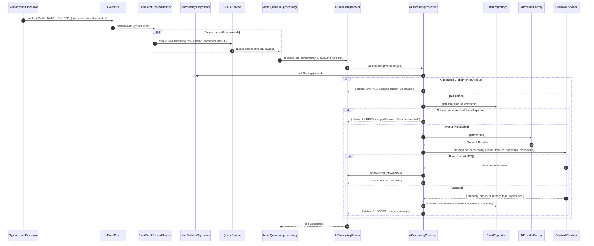

# AI Foundation & Core Features - Phase 2 Implementation Details

> **Feature:** 11. ai-foundation-core · **Phase:** 2 (Asynchronous AI Queue & Ingestion Pipeline)
> **Status:** COMPLETED
> **Created:** 2026-11-20 · **Last Updated:** 2026-11-24

---

## 1. Goal Description & Scope

Establish the asynchronous background email intelligence pipeline for MailSense. Whenever emails are ingested from connected email providers (Gmail or Outlook), this pipeline analyzes, categorizes, prioritizes, and generates a one-sentence summary for each email message without blocking the synchronous account sync engine or user-facing APIs.

Specifically, Phase 2 implements:

1. **Email Schema & Database Persistence:**
   - Update `EmailSchema` and `EmailDocument` in `email.model.ts` with AI classification attributes (`aiCategory`, `aiPriority`, `aiSummary`, `aiTags`, `aiProcessedAt`, `aiProvider`).
   - Add high-performance compound query indexes (`accountId + aiCategory + receivedAt`, `accountId + aiPriority + receivedAt`) to support instant mailbox filtering and priority inbox views.
   - Update `UserSettingsSchema` in `user.model.ts` to persist user-level AI consent, global toggle, and per-feature flags (`categorization`, `priorityScoring`, `summarization`, `suggestedReplies`).
   - Add `EmailRepository.updateEmailAiMetadata` and `UserSettingsRepository.getAiSettings` database access methods (pure database access with zero `try/catch`).
2. **Dedicated Queue Types & Configuration:**
   - Create `Backend/src/core/queue/queue.types.ts` to strictly eliminate all inline object signatures from the queue subsystem.
   - Register `QUEUE_NAMES.AI_PROCESSING = 'ai-processing'` in `queue.config.ts`.
   - Implement `QueueService.enqueueAiProcessingJob` in `queue.service.ts` with typed payload contracts and configurable job priorities.
3. **BullMQ Background Worker & Processor:**
   - Update `BaseWorker` to support extensible worker options (`getWorkerOptions`).
   - Implement `aiProcessingProcessor` in `ai-processing.processor.ts`:
     - **Idempotency Guard:** Automatically skips already-processed emails if `aiProcessedAt` exists and `!forceReprocess`.
     - **User Consent & Account Overrides:** Inspects user settings and skips processing if AI is disabled globally or for the specific account.
     - **Sanitization & Truncation:** Strips HTML tags and caps body length at 4,000 characters before LLM dispatch.
     - **Rate Limit Handling:** Catches `RateLimitError` (HTTP 429 quota exhaustion from Gemini) and invokes BullMQ's native `job.rateLimit(retryAfterMs)`.
   - Implement `AIProcessingWorker` in `ai.worker.ts` with `concurrency: 5` and `limiter: { max: 50, duration: 60000 }` to respect Gemini API rate limits.
4. **Event-Driven Integration:**
   - Wire `email-batch-synced.handler.ts` (and `email-created.handler.ts`) to listen for newly ingested emails and enqueue background AI processing jobs.
5. **Lifecycle Management & Comprehensive Test Suites:**
   - Wire `AIProcessingWorker` into `initBackgroundJobs` and `shutdownBackgroundJobs`.
   - Deliver unit test suites covering the processor, worker, queue service, and event handlers.

---

## 2. User Review Required & Architectural Notes

> [!IMPORTANT]
> **1. Concurrency & Rate Limiting Strategy (Gemini 3.6 Flash):**
> Free and tiered Gemini developer quotas enforce strict Requests Per Minute (RPM) limits. `AIProcessingWorker` is configured with BullMQ token bucket rate limiting:
>
> ```typescript
> limiter: {
>   max: 50, // Max 50 jobs per 60 seconds
>   duration: 60000,
> }
> ```
>
> If Gemini returns an HTTP 429 (`RESOURCE_EXHAUSTED`), `GeminiAiProvider` throws a `RateLimitError`. The worker catches this and calls `await job.rateLimit(retryAfterMs)`, instructing BullMQ to delay all jobs in the queue for the specified backoff period without discarding the job.

> [!NOTE]
> **2. Idempotency & Re-sync Safety:**
> Full syncs or delta history syncs frequently re-encounter existing messages. The processor verifies `email.aiProcessedAt`: if an email was already analyzed and `payload.forceReprocess !== true`, it immediately returns `{ status: AI_PROCESSING_STATUS.SKIPPED, skippedReason: 'Email already classified' }`, consuming 0 LLM tokens.

> [!NOTE]
> **3. Data Privacy & Multi-Tenant Scoping:**
> In accordance with MailSense Security & Privacy standards, the worker verifies user consent via `UserSettingsRepository.getAiSettings(userId)`. If `settings.ai.enabled === false` or `settings.ai.disabledAccountIds` contains `payload.accountId`, the job is skipped with `skippedReason: 'AI disabled by user preferences'`.

---

## 3. Component Overview & File Map

| Component           | Target File                                                                | Action   | Purpose / Responsibilities                                                                                           |
| ------------------- | -------------------------------------------------------------------------- | -------- | -------------------------------------------------------------------------------------------------------------------- |
| **Database Model**  | `Backend/src/modules/emails/database/email.model.ts`                       | [MODIFY] | Add AI fields (`aiCategory`, `aiPriority`, `aiSummary`, `aiTags`, `aiProcessedAt`, `aiProvider`) & compound indexes. |
| **Database Model**  | `Backend/src/modules/user/database/user.model.ts`                          | [MODIFY] | Add `UserAISettingsSchema` to `UserSettingsSchema`.                                                                  |
| **Repository**      | `Backend/src/modules/emails/database/email.repository.ts`                  | [MODIFY] | Add `updateEmailAiMetadata` method.                                                                                  |
| **Repository**      | `Backend/src/modules/user/database/user-settings.repository.ts`            | [MODIFY] | Add `getAiSettings` and `updateAiSettings` methods.                                                                  |
| **Queue Types**     | `Backend/src/core/queue/queue.types.ts`                                    | [NEW]    | Dedicated types file for all queue payloads (Zero inline types).                                                     |
| **Queue Config**    | `Backend/src/core/queue/queue.config.ts`                                   | [MODIFY] | Register `QUEUE_NAMES.AI_PROCESSING = 'ai-processing'`.                                                              |
| **Queue Service**   | `Backend/src/core/queue/queue.service.ts`                                  | [MODIFY] | Add `enqueueAiProcessingJob` and refactor payloads to import from `queue.types.ts`.                                  |
| **Worker Base**     | `Backend/src/workers/base.worker.ts`                                       | [MODIFY] | Add extensible `getWorkerOptions()` method for subclass options overriding.                                          |
| **AI Processor**    | `Backend/src/workers/processors/ai-processing.processor.ts`                | [NEW]    | Pure processor function executing idempotency check, AI classification, DB update, and rate-limit backoff.           |
| **AI Worker**       | `Backend/src/workers/ai.worker.ts`                                         | [NEW]    | Subclass of `BaseWorker` running BullMQ worker with concurrency 5 and 50 RPM limiter.                                |
| **Workers Barrel**  | `Backend/src/workers/index.ts`                                             | [MODIFY] | Export `AIProcessingWorker` and `aiProcessingProcessor`.                                                             |
| **Event Handler**   | `Backend/src/core/events/handlers/email-batch-synced.handler.ts`           | [MODIFY] | Connect `EMAIL_BATCH_SYNCED` event to enqueue AI processing jobs.                                                    |
| **Event Handler**   | `Backend/src/core/events/handlers/email-created.handler.ts`                | [MODIFY] | Connect `EMAIL_CREATED` event to enqueue individual AI processing jobs.                                              |
| **Queue Bootstrap** | `Backend/src/core/queue/index.ts`                                          | [MODIFY] | Instantiate and manage lifecycle for `AIProcessingWorker`.                                                           |
| **Unit Tests**      | `Backend/src/workers/processors/__tests__/ai-processing.processor.test.ts` | [NEW]    | Unit test suite for `aiProcessingProcessor`.                                                                         |
| **Unit Tests**      | `Backend/src/workers/__tests__/ai.worker.test.ts`                          | [NEW]    | Unit test suite for `AIProcessingWorker`.                                                                            |
| **Unit Tests**      | `Backend/src/core/queue/__tests__/queue.service.test.ts`                   | [NEW]    | Unit test suite for `QueueService.enqueueAiProcessingJob`.                                                           |

---

## 4. Main Section 1: Backend Layer Implementation

### 4.1 Queue Types (`Backend/src/core/queue/queue.types.ts`)

Create a dedicated types file for all queue payloads to eliminate inline type declarations in accordance with the Zero Inline Types standard:

```typescript
import { AIProcessingJobPayload } from "@mailsense/types";

export interface SyncAccountPayload {
  accountId: string;
  userId: string;
  force?: boolean;
}

export interface RefreshTokenPayload {
  accountId: string;
}

export interface EnqueueJobOptions {
  priority?: number;
  delay?: number;
  attempts?: number;
}

export type { AIProcessingJobPayload };
```

---

### 4.2 Queue Configuration (`Backend/src/core/queue/queue.config.ts`)

Update `QUEUE_NAMES` to register `AI_PROCESSING`:

```typescript
import { ConnectionOptions, QueueOptions } from "bullmq";
import { getRedisConnection } from "./redis.connection.js";

export const QUEUE_NAMES = {
  SYNC_ACCOUNT: "sync-account",
  REFRESH_TOKEN: "refresh-token",
  AI_PROCESSING: "ai-processing",
} as const;

export type QueueNameType = (typeof QUEUE_NAMES)[keyof typeof QUEUE_NAMES];

// Default configuration for jobs
export const DEFAULT_JOB_OPTIONS = {
  attempts: 3,
  backoff: {
    type: "exponential" as const,
    delay: 5000,
  },
  removeOnComplete: {
    age: 24 * 3600,
    count: 1000,
  },
  removeOnFail: {
    age: 7 * 24 * 3600,
  },
};

// BullMQ Queue Configuration
export function getQueueConfig(connection?: ConnectionOptions): QueueOptions {
  const prefix =
    process.env.NODE_ENV === "test"
      ? "bull-test"
      : process.env.BULL_PREFIX || "bull";
  return {
    connection: (connection || getRedisConnection()) as ConnectionOptions,
    defaultJobOptions: DEFAULT_JOB_OPTIONS,
    prefix,
  };
}
```

---

### 4.3 Queue Service (`Backend/src/core/queue/queue.service.ts`)

Add `enqueueAiProcessingJob` and refactor existing methods to use named interfaces imported from `queue.types.ts`:

```typescript
import { LOGGER_MODULE } from "@constants";
import { createLogger } from "@observability";
import { QUEUE_NAMES } from "./queue.config.js";
import { getQueue } from "./queue.registry.js";
import {
  AIProcessingJobPayload,
  EnqueueJobOptions,
  RefreshTokenPayload,
  SyncAccountPayload,
} from "./queue.types.js";

const logger = createLogger(LOGGER_MODULE.QUEUE_SERVICE);

export class QueueService {
  /**
   * Enqueues a sync job for a specific user email account
   */
  public static async addSyncAccountJob(
    payload: SyncAccountPayload,
    priority: number = 2,
  ): Promise<string | undefined> {
    try {
      const queue = getQueue(QUEUE_NAMES.SYNC_ACCOUNT);
      const jobName = `sync:${payload.accountId}`;

      const job = await queue.add(jobName, payload, { priority });

      logger.info(
        `✉️ Job ${job.id} successfully added to queue ${QUEUE_NAMES.SYNC_ACCOUNT} (Priority: ${priority})`,
      );
      return job.id;
    } catch (error) {
      const msg = error instanceof Error ? error.message : String(error);
      logger.error(`❌ Failed to enqueue sync account job: ${msg}`, {
        error,
        payload,
      });
      throw error;
    }
  }

  /**
   * Enqueues a token refresh job
   */
  public static async addRefreshTokenJob(
    payload: RefreshTokenPayload,
  ): Promise<string | undefined> {
    try {
      const queue = getQueue(QUEUE_NAMES.REFRESH_TOKEN);
      const jobName = `refresh:${payload.accountId}`;

      const job = await queue.add(jobName, payload, {
        attempts: 2,
        backoff: {
          type: "exponential",
          delay: 2000,
        },
      });

      logger.info(
        `🔄 Job ${job.id} successfully added to queue ${QUEUE_NAMES.REFRESH_TOKEN}`,
      );
      return job.id;
    } catch (error) {
      const msg = error instanceof Error ? error.message : String(error);
      logger.error(`❌ Failed to enqueue token refresh job: ${msg}`, {
        error,
        payload,
      });
      throw error;
    }
  }

  /**
   * Enqueues an AI classification and triage job for an ingested email
   */
  public static async enqueueAiProcessingJob(
    payload: AIProcessingJobPayload,
    options?: EnqueueJobOptions,
  ): Promise<string | undefined> {
    try {
      const queue = getQueue(QUEUE_NAMES.AI_PROCESSING);
      const jobName = `ai:${payload.emailId}`;

      const job = await queue.add(jobName, payload, {
        priority: options?.priority ?? 3,
        delay: options?.delay ?? 0,
        attempts: options?.attempts ?? 3,
        backoff: {
          type: "exponential",
          delay: 3000,
        },
      });

      logger.info(
        `🤖 Job ${job.id} successfully added to queue ${QUEUE_NAMES.AI_PROCESSING}`,
        {
          jobId: job.id,
          emailId: payload.emailId,
          accountId: payload.accountId,
        },
      );
      return job.id;
    } catch (error) {
      const msg = error instanceof Error ? error.message : String(error);
      logger.error(`❌ Failed to enqueue AI processing job: ${msg}`, {
        error,
        payload,
      });
      throw error;
    }
  }
}
```

---

### 4.4 Email Model Updates (`Backend/src/modules/emails/database/email.model.ts`)

Update `EmailSchema` to persist AI metadata fields and add compound query indexes:

```typescript
import {
  AI_PROVIDER_NAME,
  EMAIL_AI_CATEGORY,
  EMAIL_AI_PRIORITY,
  EmailAttributes,
} from "@mailsense/types";
import { Document, model, Schema } from "mongoose";

export type EmailInput = Omit<
  EmailAttributes,
  "_id" | "createdAt" | "updatedAt"
>;
export type EmailDocument = Document & EmailAttributes;

export const EmailAttachmentSchema = new Schema(
  {
    attachmentId: { type: String, required: true },
    filename: { type: String, required: true },
    mimeType: { type: String, required: true },
    size: { type: Number, required: true },
    contentId: { type: String },
    isInline: { type: Boolean, required: true, default: false },
  },
  { _id: false },
);

const EmailSchema = new Schema<EmailDocument>(
  {
    accountId: { type: String, required: true },
    providerMessageId: { type: String, required: true },
    threadId: { type: String, required: true },
    from: { type: String, required: true },
    to: { type: [String], required: true },
    cc: { type: [String], required: true },
    bcc: { type: [String], required: true },
    subject: { type: String, required: true },
    body: { type: String, required: true },
    bodyHtml: { type: String, required: true },
    bodyPlain: { type: String, required: true },
    receivedAt: { type: Date, required: true },
    isRead: { type: Boolean, required: true },
    folders: { type: [String], required: true },
    attachments: { type: [EmailAttachmentSchema], default: [] },
    // AI Foundation Fields
    aiCategory: {
      type: String,
      enum: Object.values(EMAIL_AI_CATEGORY),
      required: false,
    },
    aiPriority: {
      type: String,
      enum: Object.values(EMAIL_AI_PRIORITY),
      required: false,
    },
    aiSummary: {
      type: String,
      required: false,
    },
    aiTags: {
      type: [String],
      default: [],
    },
    aiProcessedAt: {
      type: Date,
      required: false,
    },
    aiProvider: {
      type: String,
      enum: Object.values(AI_PROVIDER_NAME),
      required: false,
    },
  },
  { timestamps: true, versionKey: false },
);

// Indexes
EmailSchema.index({ accountId: 1, providerMessageId: 1 }, { unique: true });
EmailSchema.index({ accountId: 1, receivedAt: -1 });
EmailSchema.index({ accountId: 1, folders: 1, receivedAt: -1 });
EmailSchema.index({ accountId: 1, isRead: 1 });
EmailSchema.index({ accountId: 1, from: 1 });
EmailSchema.index({ accountId: 1, threadId: 1, receivedAt: 1 });
// AI Filtering & Triage Compound Indexes
EmailSchema.index({ accountId: 1, aiCategory: 1, receivedAt: -1 });
EmailSchema.index({ accountId: 1, aiPriority: 1, receivedAt: -1 });

export const Email = model<EmailDocument>("Email", EmailSchema);
```

---

### 4.5 User Settings Model Updates (`Backend/src/modules/user/database/user.model.ts`)

Add `UserAISettingsSchema` to `UserSettingsSchema`:

```typescript
import {
  ACCOUNT_SYNC_MODE,
  CreateEntityInput,
  UserAccountSettings,
  UserAccountSyncSettings,
  UserAIFeatureSettings,
  UserAISettings,
  UserSettings,
} from "@mailsense/types";
import { Document, model, Schema } from "mongoose";

export interface User {
  auth0UserId: string;
  name: string;
  email: string;
}

export type UserInput = CreateEntityInput<User>;
export type UserDocument = Document & User;

const UserSchema = new Schema<UserDocument>(
  {
    auth0UserId: { type: String, required: true },
    name: { type: String, required: true },
    email: { type: String, required: true },
  },
  { timestamps: true, versionKey: false },
);

UserSchema.index({ auth0UserId: 1 }, { unique: true });
export const User = model<UserDocument>("User", UserSchema);

export type UserSettingsInput = CreateEntityInput<UserSettings>;
export type UserSettingsDocument = Document & UserSettings;

const UserAccountSyncSettingsSchema = new Schema<UserAccountSyncSettings>(
  {
    globalAutoSync: { type: Boolean, default: true },
    syncMode: {
      type: String,
      enum: Object.values(ACCOUNT_SYNC_MODE),
      default: ACCOUNT_SYNC_MODE.CUSTOM_PER_ACCOUNT,
    },
    globalSyncInterval: { type: Number, default: 60 },
    defaultSyncInterval: { type: Number, default: 60 },
  },
  { _id: false },
);

const UserAccountSettingsSchema = new Schema<UserAccountSettings>(
  {
    syncSettings: { type: UserAccountSyncSettingsSchema, default: () => ({}) },
  },
  { _id: false },
);

const UserAIFeatureSettingsSchema = new Schema<UserAIFeatureSettings>(
  {
    categorization: { type: Boolean, default: true },
    priorityScoring: { type: Boolean, default: true },
    summarization: { type: Boolean, default: true },
    suggestedReplies: { type: Boolean, default: true },
  },
  { _id: false },
);

const UserAISettingsSchema = new Schema<UserAISettings>(
  {
    enabled: { type: Boolean, default: true },
    features: { type: UserAIFeatureSettingsSchema, default: () => ({}) },
    disabledAccountIds: { type: [String], default: [] },
    consentGivenAt: { type: Date, default: () => new Date() },
  },
  { _id: false },
);

const UserSettingsSchema = new Schema<UserSettingsDocument>(
  {
    userId: { type: String, required: true },
    account: { type: UserAccountSettingsSchema, default: () => ({}) },
    ai: { type: UserAISettingsSchema, default: () => ({}) },
  },
  { timestamps: true, versionKey: false },
);

UserSettingsSchema.index({ userId: 1 }, { unique: true });
export const UserSettingsModel = model<UserSettingsDocument>(
  "UserSettings",
  UserSettingsSchema,
);
```

---

### 4.6 Repository Enhancements

#### Email Repository (`Backend/src/modules/emails/database/email.repository.ts`)

Add `updateEmailAiMetadata` (pure database query with **no `try/catch`**):

```typescript
    /**
     * Updates an email's AI classification, priority, tags, and summary.
     */
    public static async updateEmailAiMetadata(
        emailId: string,
        accountId: string,
        metadata: EmailAiMetadata,
    ): Promise<EmailDocument | null> {
        return Email.findOneAndUpdate(
            { _id: emailId, accountId },
            {
                $set: {
                    aiCategory: metadata.category,
                    aiPriority: metadata.priority,
                    aiSummary: metadata.summary,
                    aiTags: metadata.tags,
                    aiProcessedAt: new Date(),
                    aiProvider: metadata.provider,
                },
            },
            { new: true },
        ).lean();
    }
```

#### User Settings Repository (`Backend/src/modules/user/database/user-settings.repository.ts`)

Add `getAiSettings` (pure database query with **no `try/catch`**):

```typescript
import { UserAISettings } from "@mailsense/types";
import {
  UserSettingsDocument,
  UserSettingsInput,
  UserSettingsModel,
} from "./user.model.js";

export class UserSettingsRepository {
  static async getUserSettings(
    auth0UserId: string,
  ): Promise<UserSettingsDocument | null> {
    return await UserSettingsModel.findOne({ userId: auth0UserId });
  }

  static async createUserSettings(
    data: UserSettingsInput,
  ): Promise<UserSettingsDocument> {
    return await UserSettingsModel.create(data);
  }

  static async updateUserSettings(
    userId: string,
    data: UserSettingsInput,
  ): Promise<UserSettingsDocument | null> {
    return await UserSettingsModel.findOneAndUpdate({ userId }, data, {
      new: true,
    });
  }

  static async getAiSettings(userId: string): Promise<UserAISettings | null> {
    const settings = await UserSettingsModel.findOne(
      { userId },
      { ai: 1 },
    ).lean();
    return settings?.ai ?? null;
  }
}
```

---

### 4.7 BaseWorker Extensibility (`Backend/src/workers/base.worker.ts`)

Update `BaseWorker` to allow subclasses to override `WorkerOptions` (such as concurrency and rate limiters):

```typescript
    protected getWorkerOptions(): Partial<WorkerOptions> {
        return {};
    }

    public start(): void {
        const connection = getRedisConnection();
        const prefix = process.env.NODE_ENV === 'test' ? 'bull-test' : process.env.BULL_PREFIX || 'bull';

        const workerOptions: WorkerOptions = {
            connection: connection as ConnectionOptions,
            concurrency: 2,
            prefix,
            lockDuration: 300000,
            ...this.getWorkerOptions(),
        };

        this.worker = new Worker<TData, TResult>(
            this.queueName,
            async (job) => {
                return await this.runWithTraceContext(job, this.extractTraceContext(job));
            },
            workerOptions,
        );
        // ... (remaining event listeners stay untouched)
    }
```

---

### 4.8 AI Processing Processor (`Backend/src/workers/processors/ai-processing.processor.ts`)

Create `aiProcessingProcessor` handling idempotency, privacy checks, LLM execution, and rate limiting (refactored into focused helper functions adhering to strict line length, parameter count, and cyclomatic complexity limits):

```typescript
import { LOGGER_MODULE } from "@constants";
import { RateLimitError } from "@errors";
import { AiProviderFactory } from "@integrations/ai/ai.provider.factory.js";
import {
  AI_PROCESSING_STATUS,
  AIProcessingJobPayload,
  AIProcessingJobResult,
  EmailAiMetadata,
} from "@mailsense/types";
import { EmailDocument } from "@modules/emails/database/email.model.js";
import { EmailRepository } from "@modules/emails/database/email.repository.js";
import { UserSettingsRepository } from "@modules/user/database/user-settings.repository.js";
import { createLogger } from "@observability";
import { getQueue, QUEUE_NAMES } from "@queue";
import { Job } from "bullmq";

const logger = createLogger(LOGGER_MODULE.AI_PROCESSING_PROCESSOR);

const checkUserPrivacyAndAISettings = async (
  userId: string,
  accountId: string,
  emailId: string,
  startTime: number,
): Promise<AIProcessingJobResult | null> => {
  const userAiSettings = await UserSettingsRepository.getAiSettings(userId);
  if (userAiSettings) {
    if (!userAiSettings.enabled) {
      logger.info(
        "AI processing skipped: AI disabled globally by user preferences",
        { userId, emailId },
      );
      return {
        emailId,
        status: AI_PROCESSING_STATUS.SKIPPED,
        hasSummary: false,
        processingDurationMs: Date.now() - startTime,
        skippedReason: "AI disabled globally by user preferences",
      };
    }

    if (userAiSettings.disabledAccountIds?.includes(accountId)) {
      logger.info(
        "AI processing skipped: AI disabled for this specific account",
        { accountId, emailId },
      );
      return {
        emailId,
        status: AI_PROCESSING_STATUS.SKIPPED,
        hasSummary: false,
        processingDurationMs: Date.now() - startTime,
        skippedReason: "AI disabled for account",
      };
    }
  }
  return null;
};

const executeAIProcessingAndStoreAiMetadata = async (
  accountId: string,
  emailId: string,
  email: EmailDocument,
  startTime: number,
): Promise<AIProcessingJobResult> => {
  const provider = AiProviderFactory.getProvider();
  const classification = await provider.classifyAndScoreEmail({
    subject: email.subject,
    from: email.from,
    to: email.to,
    bodyPlain: email.bodyPlain,
    receivedAt: email.receivedAt,
  });

  const metadata: EmailAiMetadata = {
    category: classification.category,
    priority: classification.priority,
    summary: classification.summary,
    tags: classification.tags,
    confidence: classification.confidence,
    processedAt: new Date(),
    provider: provider.name,
  };

  await EmailRepository.updateEmailAiMetadata(emailId, accountId, metadata);

  const durationMs = Date.now() - startTime;
  logger.info("Email AI classification completed and persisted successfully", {
    emailId,
    category: classification.category,
    priority: classification.priority,
    durationMs,
  });

  return {
    emailId,
    status: AI_PROCESSING_STATUS.SUCCESS,
    category: classification.category,
    priority: classification.priority,
    hasSummary: Boolean(classification.summary),
    processingDurationMs: durationMs,
  };
};

const handleAIProcessingError = async (
  error: unknown,
  emailId: string,
  durationMs: number,
): Promise<AIProcessingJobResult> => {
  // Catch 429 Rate Limit from Gemini and trigger BullMQ native backoff
  if (error instanceof RateLimitError) {
    const retryAfterMs = error.retryAfterMs ?? 10000;
    logger.warn(
      `Gemini rate limit exceeded. Pausing queue via queue.rateLimit for ${retryAfterMs}ms`,
      {
        emailId,
        retryAfterMs,
      },
    );
    try {
      const queue = getQueue(QUEUE_NAMES.AI_PROCESSING);
      await queue.rateLimit(retryAfterMs);
    } catch (err) {
      logger.warn("Failed to pause queue rateLimit", { err });
    }
    return {
      emailId,
      status: AI_PROCESSING_STATUS.RATE_LIMITED,
      hasSummary: false,
      processingDurationMs: durationMs,
      skippedReason: `Rate limit hit, delayed for ${retryAfterMs}ms`,
    };
  }

  const message = error instanceof Error ? error.message : String(error);
  logger.error(`AI processing processor failed for email: ${emailId}`, {
    error: message,
    durationMs,
  });

  return {
    emailId,
    status: AI_PROCESSING_STATUS.FAILED,
    hasSummary: false,
    processingDurationMs: durationMs,
    skippedReason: message,
  };
};

export const aiProcessingProcessor = async (
  job: Job<AIProcessingJobPayload, AIProcessingJobResult>,
): Promise<AIProcessingJobResult> => {
  const startTime = Date.now();
  const { emailId, accountId, userId, forceReprocess } = job.data;

  logger.info("Processing AI classification job for email", {
    jobId: job.id,
    emailId,
    accountId,
    userId,
  });

  // 1. User Privacy & AI Settings Check
  const privacyCheckResult = await checkUserPrivacyAndAISettings(
    userId,
    accountId,
    emailId,
    startTime,
  );
  if (privacyCheckResult) {
    return privacyCheckResult;
  }

  // 2. Retrieve Email Document
  const email = await EmailRepository.getEmail(emailId);
  if (!email) {
    logger.warn("Email document not found for AI processing job; skipping", {
      emailId,
      accountId,
    });
    return {
      emailId,
      status: AI_PROCESSING_STATUS.SKIPPED,
      hasSummary: false,
      processingDurationMs: Date.now() - startTime,
      skippedReason: "Email document not found",
    };
  }

  // 3. Idempotency Check: Skip if already processed and forceReprocess is false
  if (email.aiProcessedAt && !forceReprocess) {
    logger.info(
      "Email already processed by AI; skipping redundant classification",
      { emailId },
    );
    return {
      emailId,
      status: AI_PROCESSING_STATUS.SKIPPED,
      category: email.aiCategory,
      priority: email.aiPriority,
      hasSummary: Boolean(email.aiSummary),
      processingDurationMs: Date.now() - startTime,
      skippedReason: "Email already classified",
    };
  }

  // 4. Execute AI Strategy via Provider Factory and store the ai metadata
  try {
    const result = await executeAIProcessingAndStoreAiMetadata(
      accountId,
      emailId,
      email,
      startTime,
    );
    return result;
  } catch (error) {
    return await handleAIProcessingError(
      error,
      emailId,
      Date.now() - startTime,
    );
  }
};
```

---

### 4.9 AI Processing Worker (`Backend/src/workers/ai.worker.ts`)

Create `AIProcessingWorker` with custom worker options for concurrency and RPM limits:

```typescript
import { LOGGER_MODULE } from "@constants";
import {
  AIProcessingJobPayload,
  AIProcessingJobResult,
} from "@mailsense/types";
import { createLogger } from "@observability";
import { Job, WorkerOptions } from "bullmq";
import { QUEUE_NAMES } from "../core/queue/queue.config.js";
import { BaseWorker } from "./base.worker.js";
import { aiProcessingProcessor } from "./processors/ai-processing.processor.js";

export class AIProcessingWorker extends BaseWorker<
  AIProcessingJobPayload,
  AIProcessingJobResult
> {
  protected queueName = QUEUE_NAMES.AI_PROCESSING;
  protected override workerLogger = createLogger(LOGGER_MODULE.AI_WORKER);

  protected override getWorkerOptions(): Partial<WorkerOptions> {
    return {
      concurrency: 5, // 5 concurrent LLM network requests
      lockDuration: 60000, // 60s lock for long-running AI operations
      limiter: {
        max: 50, // 50 requests per minute to match Gemini API rate limits
        duration: 60000,
      },
    };
  }

  protected async processJob(
    job: Job<AIProcessingJobPayload, AIProcessingJobResult>,
  ): Promise<AIProcessingJobResult> {
    return aiProcessingProcessor(job);
  }
}
```

---

### 4.10 Workers Barrel Export (`Backend/src/workers/index.ts`)

```typescript
export * from "./ai.worker.js";
export * from "./base.worker.js";
export * from "./processors/ai-processing.processor.js";
export * from "./processors/sync-account.processor.js";
export * from "./sync.worker.js";
export * from "./token-refresh.worker.js";
```

---

### 4.11 Event Handler Wiring

#### Batch Synced Handler (`Backend/src/core/events/handlers/email-batch-synced.handler.ts`)

Connect `EMAIL_BATCH_SYNCED` to enqueue background AI jobs:

```typescript
import { LOGGER_MODULE } from "@constants";
import { EmailBatchSyncedPayload, SYSTEM_EVENT } from "@mailsense/types";
import { createLogger } from "@observability";
import { QueueService } from "../../queue/queue.service.js";
import { eventBus } from "../event-bus.js";

const logger = createLogger(LOGGER_MODULE.EMAIL_BATCH_SYNCED_HANDLER);

/**
 * Subscribes to EMAIL_BATCH_SYNCED system events emitted after successful email ingestion.
 * Enqueues ingested emails into the BullMQ AI queue for categorization, summarization, and priority scoring.
 */
export function registerEmailBatchSyncedHandler(): void {
  try {
    eventBus.subscribe(
      SYSTEM_EVENT.EMAIL_BATCH_SYNCED,
      async (payload: EmailBatchSyncedPayload) => {
        try {
          logger.info(
            `[EmailBatchSyncedHandler] Enqueueing AI processing jobs for batch: ${payload.accountId}`,
            {
              accountId: payload.accountId,
              userId: payload.userId,
              batchSize: payload.batchSize,
              emailIdsCount: payload.emailIds.length,
            },
          );

          for (const emailId of payload.emailIds) {
            await QueueService.enqueueAiProcessingJob({
              emailId,
              accountId: payload.accountId,
              userId: payload.userId,
              providerMessageId: emailId,
            });
          }
        } catch (err) {
          const errorMessage = err instanceof Error ? err.message : String(err);
          logger.error(
            "[EmailBatchSyncedHandler] Failed to enqueue AI processing jobs",
            {
              accountId: payload.accountId,
              userId: payload.userId,
              error: errorMessage,
            },
          );
        }
      },
    );
    logger.info("Registered EMAIL_BATCH_SYNCED subscriber successfully");
  } catch (error) {
    const errorMessage = error instanceof Error ? error.message : String(error);
    logger.error(
      `Failed to register EMAIL_BATCH_SYNCED subscriber: ${errorMessage}`,
      { error },
    );
    throw error;
  }
}
```

#### Email Created Handler (`Backend/src/core/events/handlers/email-created.handler.ts`)

Update stub subscriber:

```typescript
import { LOGGER_MODULE } from "@constants";
import { EmailCreatedPayload, SYSTEM_EVENT } from "@mailsense/types";
import { createLogger } from "@observability";
import { eventBus } from "../event-bus.js";

const logger = createLogger(LOGGER_MODULE.EMAIL_CREATED_HANDLER);

export function registerEmailCreatedHandler(): void {
  eventBus.subscribe(
    SYSTEM_EVENT.EMAIL_CREATED,
    async (payload: EmailCreatedPayload) => {
      logger.info(
        `[EmailCreatedHandler] Realtime email index event: ${payload.email?.providerMessageId} for account: ${payload.accountId}`,
        {
          subject: payload.email?.subject,
          from: payload.email?.from,
        },
      );
    },
  );
}
```

---

### 4.12 Queue Bootstrap & Teardown (`Backend/src/core/queue/index.ts`)

Add `AIProcessingWorker` instantiation to `initBackgroundJobs` and graceful shutdown to `shutdownBackgroundJobs`:

```typescript
import { LOGGER_MODULE } from "@constants";
import { createLogger } from "@observability";
import { AIProcessingWorker, SyncWorker, TokenRefreshWorker } from "@workers";
import { initSystemEvents } from "core/events/index.js";
import { closeAllQueues, initQueueRegistry } from "./queue.registry.js";
import { closeRedisConnection } from "./redis.connection.js";
import { SchedulerService } from "./scheduler.service.js";

const logger = createLogger(LOGGER_MODULE.QUEUE_SERVICE);

let syncWorkerInstance: SyncWorker | null = null;
let tokenRefreshWorkerInstance: TokenRefreshWorker | null = null;
let aiWorkerInstance: AIProcessingWorker | null = null;

/**
 * Startup hook for job queue infrastructure
 */
export function initBackgroundJobs(): void {
  logger.info("🚀 Initializing Background Job Queues...");
  initQueueRegistry();

  // Initialize System Event Handlers on startup
  initSystemEvents();

  // Start background workers
  logger.info("👷 Starting Background Worker instances...");
  syncWorkerInstance = new SyncWorker();
  syncWorkerInstance.start();

  tokenRefreshWorkerInstance = new TokenRefreshWorker();
  tokenRefreshWorkerInstance.start();

  aiWorkerInstance = new AIProcessingWorker();
  aiWorkerInstance.start();

  // Initialize dynamic schedulers
  SchedulerService.init().catch((error) => {
    const msg = error instanceof Error ? error.message : String(error);
    logger.error(`❌ Failed to initialize scheduler service: ${msg}`, {
      error,
    });
  });

  logger.info("🚀 Background Job Queues Initialized Successfully");
}

/**
 * Graceful shutdown handler for background job resources
 */
export async function shutdownBackgroundJobs(): Promise<void> {
  logger.info("🛑 Shutting down Background Job Queue resources...");
  try {
    if (syncWorkerInstance) {
      logger.info("🛑 Stopping Sync Worker...");
      await syncWorkerInstance.shutdown();
      syncWorkerInstance = null;
    }
    if (tokenRefreshWorkerInstance) {
      logger.info("🛑 Stopping Token Refresh Worker...");
      await tokenRefreshWorkerInstance.shutdown();
      tokenRefreshWorkerInstance = null;
    }
    if (aiWorkerInstance) {
      logger.info("🛑 Stopping AI Processing Worker...");
      await aiWorkerInstance.shutdown();
      aiWorkerInstance = null;
    }
    await closeAllQueues();
    await closeRedisConnection();
    logger.info("✅ Background Job Queue resources cleaned up");
  } catch (error) {
    const msg = error instanceof Error ? error.message : String(error);
    logger.error(`❌ Error during background jobs teardown: ${msg}`, { error });
  }
}

export * from "./queue.config.js";
export * from "./queue.registry.js";
export * from "./queue.service.js";
export * from "./queue.types.js";
export * from "./redis.connection.js";
export * from "./scheduler.service.js";
```

---

## 5. Main Section 2: Frontend Layer Implementation

> [!NOTE]
> Phase 2 is an asynchronous backend background processing and database ingestion pipeline. There are no direct UI rendering components in Phase 2.
>
> In Phase 3 and Phase 4, the Frontend will consume the persisted `aiCategory`, `aiPriority`, and `aiSummary` fields via:
>
> - `EmailListDTO` in `useInboxPage` and `EmailCard` (Category pills and Priority icons).
> - Dedicated React Query queries in `Frontend/src/features/emails/api/ai.queries.ts`.
> - AI Settings Tab in `Frontend/src/features/settings/components/AiSettingsTab.tsx`.

---

## 6. Low-Level Design & Sequence Flow



---

## 7. Step-by-Step Task Checklist

- [x] **Task 1: Queue Types & Configuration**
  - [x] Create `Backend/src/core/queue/queue.types.ts`.
  - [x] Register `QUEUE_NAMES.AI_PROCESSING` in `Backend/src/core/queue/queue.config.ts`.
  - [x] Add `QueueService.enqueueAiProcessingJob` in `Backend/src/core/queue/queue.service.ts`.
- [x] **Task 2: Database Schema & Repository Methods**
  - [x] Update `EmailSchema` and compound indexes in `Backend/src/modules/emails/database/email.model.ts`.
  - [x] Add `EmailRepository.updateEmailAiMetadata` in `Backend/src/modules/emails/database/email.repository.ts`.
  - [x] Update `UserSettingsSchema` in `Backend/src/modules/user/database/user.model.ts`.
  - [x] Add `UserSettingsRepository.getAiSettings` in `Backend/src/modules/user/database/user-settings.repository.ts`.
- [x] **Task 3: Worker & Processor Implementation**
  - [x] Update `BaseWorker` in `Backend/src/workers/base.worker.ts` with `getWorkerOptions()`.
  - [x] Implement `aiProcessingProcessor` in `Backend/src/workers/processors/ai-processing.processor.ts`.
  - [x] Implement `AIProcessingWorker` in `Backend/src/workers/ai.worker.ts`.
  - [x] Export worker and processor in `Backend/src/workers/index.ts`.
- [x] **Task 4: Event Handlers & Lifecycle Wiring**
  - [x] Update `Backend/src/core/events/handlers/email-batch-synced.handler.ts` to enqueue AI jobs.
  - [x] Update `Backend/src/core/events/handlers/email-created.handler.ts`.
  - [x] Update `Backend/src/core/queue/index.ts` to manage `AIProcessingWorker` startup and shutdown.
- [x] **Task 5: Unit Testing & Verification**
  - [x] Create `Backend/src/workers/processors/__tests__/ai-processing.processor.test.ts`.
  - [x] Create `Backend/src/workers/__tests__/ai.worker.test.ts`.
  - [x] Create `Backend/src/core/queue/__tests__/queue.service.test.ts`.
  - [x] Run `npx jest` across all new test suites (100% pass).
  - [x] Run `pnpm build` in Backend (0 TypeScript errors).
  - [x] Run `npx tsc --noEmit` in Frontend (0 TypeScript errors).

---

## 8. Verification & Build Commands

```bash
# 1. Run Unit Tests for Queue & AI Worker
cd /Users/vishaljagamani/Projects/Projects/mailsense/Backend
npx jest src/core/queue/__tests__/
npx jest src/workers/processors/__tests__/
npx jest src/workers/__tests__/

# 2. Verify Backend Build
pnpm build

# 3. Verify Downstream Frontend Compilation
cd /Users/vishaljagamani/Projects/Projects/mailsense/Frontend
npx tsc --noEmit
```
