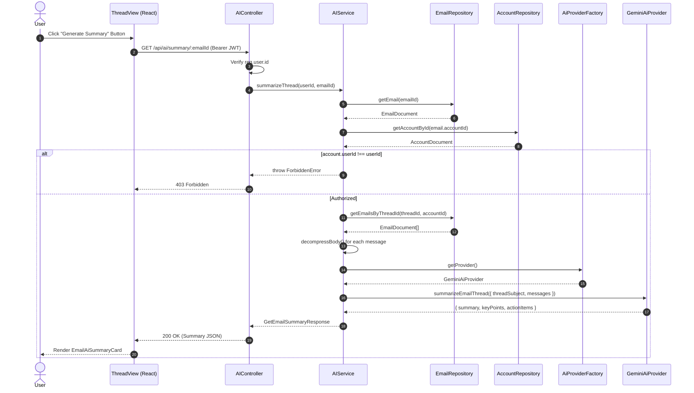
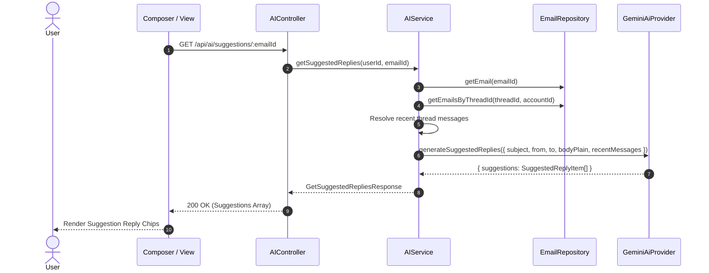

# AI Foundation & Core Features - Phase 3 Implementation Details

> **Feature:** 11. ai-foundation-core · **Phase:** 3 (Core AI Module & On-Demand REST Endpoints)
> **Status:** COMPLETED
> **Created:** 2026-11-20 · **Last Updated:** 2026-11-24

---

## 1. Goal Description & Scope

Establish the on-demand REST API module for the MailSense AI subsystem (`Backend/src/modules/ai/`) and extend mailbox querying to support AI category and priority triage filtering.

In Phases 1 and 2, the AI provider strategy (`IAiProvider`, `GeminiAiProvider`, `NoopAiProvider`, `AiProviderFactory`) and background ingestion queue (`AIProcessingWorker`, `aiProcessingProcessor`) were implemented. Phase 3 provides the user-facing HTTP endpoints enabling users to:

1. **Request On-Demand Thread Summaries:**
   - Endpoint: `GET /api/ai/summary/:emailId`
   - Gathers all messages across the conversation thread, decompresses plain-text bodies, formats thread chronological context, and requests an executive summary, key bullet points, and actionable deliverables from Google Gemini 3.6 Flash.
2. **Request Contextual Suggested Replies:**
   - Endpoint: `GET /api/ai/suggestions/:emailId`
   - Analyzes the target email and preceding thread messages, generating 2–3 context-aware quick replies categorized by tone (`formal`, `casual`, `concise`).
3. **Filter Mailbox by AI Classifications:**
   - Update `getAllEmailsSchema`, `EMAIL_LIST_DB_FIELD_MAPPING`, and `EmailQueryService` to filter messages by `aiCategory` (`work`, `personal`, `finance`, etc.) and `aiPriority` (`critical`, `high`, `normal`, `low`).
   - Project `aiCategory`, `aiPriority`, and `aiSummary` in mailbox list responses (`EmailListDTO`).
4. **Enforce Strict Multi-Tenant Authorization:**
   - Every on-demand AI operation verifies that the target `emailId` belongs to an account owned by `req.user.id`, rejecting unauthorized cross-tenant requests with `ForbiddenError`.

---

## 2. User Review Required & Architectural Notes

> [!IMPORTANT]
> **1. Multi-Tenant Authorization & Data Isolation:**
> On-demand AI operations access full conversation threads. The controller extracts `userId = req.user?.id` and `AIService` verifies account ownership:
>
> ```typescript
> const email = await EmailRepository.getEmail(emailId);
> if (!email) throw new NotFoundError("Email", emailId);
> const account = await AccountRepository.getAccountById(email.accountId);
> if (!account || account.userId !== userId) {
>   throw new ForbiddenError("Unauthorized attempt to access email thread");
> }
> ```
>
> Cross-tenant access is rejected with `ForbiddenError` before any LLM prompt is assembled or external API request is dispatched.

> [!NOTE]
> **2. Plain-Text Body Decompression:**
> Email bodies are stored compressed in MongoDB. `AIService` invokes `decompressString` on `email.bodyPlain` for each thread message to feed clean, human-readable text to the LLM tokenizer.

> [!NOTE]
> **3. Zero Inline Types Standard:**
> All route schemas, service parameters, API responses, and query filters use named TypeScript interfaces imported from dedicated types files (`@mailsense/types` and `src/modules/ai/types/ai.types.ts`).

---

## 3. Component Overview & File Map

| Component               | Target File                                                  | Action   | Purpose / Responsibilities                                                                                   |
| ----------------------- | ------------------------------------------------------------ | -------- | ------------------------------------------------------------------------------------------------------------ |
| **AI Module Constants** | `Backend/src/modules/ai/constants/ai.constants.ts`           | [NEW]    | Module-level constants, log messages, and default limits.                                                    |
| **AI Module Constants** | `Backend/src/modules/ai/constants/index.ts`                  | [NEW]    | Barrel export for constants.                                                                                 |
| **AI Module Types**     | `Backend/src/modules/ai/types/ai.types.ts`                   | [NEW]    | Dedicated types file for internal AI module contracts (Zero inline types).                                   |
| **AI Module Types**     | `Backend/src/modules/ai/types/index.ts`                      | [NEW]    | Barrel export for types.                                                                                     |
| **AI Route Schemas**    | `Backend/src/modules/ai/schema/ai.schema.ts`                 | [NEW]    | Zod route parameter validation schemas (`getEmailSummaryParamsSchema`, `getSuggestedRepliesParamsSchema`).   |
| **AI Route Schemas**    | `Backend/src/modules/ai/schema/index.ts`                     | [NEW]    | Barrel export for schemas.                                                                                   |
| **AI Service**          | `Backend/src/modules/ai/services/ai.service.ts`              | [NEW]    | Domain service: verifies ownership, gathers thread messages, invokes `AiProviderFactory`, formats DTOs.      |
| **AI Service**          | `Backend/src/modules/ai/services/index.ts`                   | [NEW]    | Barrel export for services.                                                                                  |
| **AI Controller**       | `Backend/src/modules/ai/controllers/ai.controller.ts`        | [NEW]    | HTTP boundary: extracts parameters, validates `userId`, invokes `AIService`, returns standard JSON response. |
| **AI Controller**       | `Backend/src/modules/ai/controllers/index.ts`                | [NEW]    | Barrel export for controllers.                                                                               |
| **AI Routes**           | `Backend/src/modules/ai/routes/ai.routes.ts`                 | [NEW]    | Express router with `authMiddleware`, `validate`, and `handleRequest`.                                       |
| **AI Routes**           | `Backend/src/modules/ai/routes/index.ts`                     | [NEW]    | Barrel export for routes.                                                                                    |
| **AI Module Barrel**    | `Backend/src/modules/ai/index.ts`                            | [NEW]    | Module-level barrel export.                                                                                  |
| **Backend Router**      | `Backend/src/routes.ts`                                      | [MODIFY] | Mount `/api/ai` router.                                                                                      |
| **Email Schema Filter** | `Backend/src/modules/emails/schema/email.schema.ts`          | [MODIFY] | Add `aiCategory` and `aiPriority` to `getAllEmailsSchema`.                                                   |
| **Email Constants**     | `Backend/src/modules/emails/constants/email.constants.ts`    | [MODIFY] | Add `aiCategory`, `aiPriority`, and `aiSummary` to `EMAIL_LIST_DB_FIELD_MAPPING.LIST.projection`.            |
| **Email Query Service** | `Backend/src/modules/emails/services/email-query.service.ts` | [MODIFY] | Apply `aiCategory` and `aiPriority` filters to MongoDB `searchQuery` and map to `EmailListItem`.             |
| **Integration Tests**   | `Backend/src/modules/ai/__tests__/ai.controller.test.ts`     | [NEW]    | Unit & integration tests for AI controller and service.                                                      |
| **Security Tests**      | `Backend/src/modules/ai/__tests__/ai-security.test.ts`       | [NEW]    | Multi-tenant authorization tests (cross-tenant access rejection).                                            |
| **Frontend Endpoints**  | `Frontend/src/shared/api/endpoints.ts`                       | [MODIFY] | Centralize `/api/ai/summary/:emailId` and `/api/ai/suggestions/:emailId` endpoints.                          |
| **Frontend API Client** | `Frontend/src/features/emails/api/ai.api.ts`                 | [NEW]    | Strongly-typed client wrapper calling AI endpoints with `axiosClient`.                                       |
| **Frontend Queries**    | `Frontend/src/features/emails/api/ai.queries.ts`             | [NEW]    | React Query mutation and query hooks for AI summary and suggestions.                                         |

---

## 4. Main Section 1: Backend Layer Implementation

### 4.1 AI Module Constants (`Backend/src/modules/ai/constants/ai.constants.ts`)

```typescript
export const AI_MODULE_CONSTANTS = {
  MAX_RECENT_THREAD_CONTEXT_MESSAGES: 3,
  DEFAULT_CONFIDENCE_THRESHOLD: 0.6,
} as const;

export const AI_ROUTES = {
  THREAD_SUMMARY: "/summary/:emailId",
  SUGGESTED_REPLIES: "/suggestions/:emailId",
} as const;
```

#### Barrel Export (`Backend/src/modules/ai/constants/index.ts`)

```typescript
export * from "./ai.constants.js";
```

---

### 4.2 AI Module Types (`Backend/src/modules/ai/types/ai.types.ts`)

Dedicated types file to strictly enforce the Zero Inline Types standard:

```typescript
import {
  AI_PROVIDER_NAME,
  GetEmailSummaryResponse,
  GetSuggestedRepliesResponse,
  SuggestedReplyItem,
} from "@mailsense/types";

export interface EmailSummaryResultDTO extends GetEmailSummaryResponse {
  provider: AI_PROVIDER_NAME;
}

export interface SuggestedRepliesResultDTO extends GetSuggestedRepliesResponse {
  provider?: AI_PROVIDER_NAME;
}

export interface ThreadSummarizationContext {
  emailId: string;
  accountId: string;
  threadId: string;
  subject: string;
}

export type { SuggestedReplyItem };
```

#### Barrel Export (`Backend/src/modules/ai/types/index.ts`)

```typescript
export * from "./ai.types.js";
```

---

### 4.3 AI Route Validation Schemas (`Backend/src/modules/ai/schema/ai.schema.ts`)

```typescript
import z from "zod";

export const getEmailSummaryParamsSchema = z.object({
  emailId: z.string().min(1, "Email ID is required"),
});

export const getSuggestedRepliesParamsSchema = z.object({
  emailId: z.string().min(1, "Email ID is required"),
});

export type GetEmailSummaryParamsSchema = z.infer<
  typeof getEmailSummaryParamsSchema
>;
export type GetSuggestedRepliesParamsSchema = z.infer<
  typeof getSuggestedRepliesParamsSchema
>;
```

#### Barrel Export (`Backend/src/modules/ai/schema/index.ts`)

```typescript
export * from "./ai.schema.js";
```

---

### 4.4 AI Service Layer (`Backend/src/modules/ai/services/ai.service.ts`)

Implements business logic, multi-tenant ownership verification, plain-text body decompression, and provider delegation:

```typescript
import { LOGGER_MODULE } from "@constants";
import { ForbiddenError, NotFoundError } from "@errors";
import { AiProviderFactory } from "@integrations/ai/ai.provider.factory.js";
import {
  AiSuggestedRepliesParams,
  AiSummarizeThreadParams,
  AiThreadMessageInput,
  GetEmailSummaryResponse,
  GetSuggestedRepliesResponse,
} from "@mailsense/types";
import { AccountRepository } from "@modules/accounts/database/index.js";
import {
  EmailDocument,
  EmailRepository,
} from "@modules/emails/database/index.js";
import { createLogger } from "@observability";
import { decompressString } from "@utils";
import { AI_MODULE_CONSTANTS } from "../constants/ai.constants.js";

const logger = createLogger(LOGGER_MODULE.AI_SERVICE);

export class AIService {
  /**
   * Generates an executive summary, key bullet points, and action items for an email thread.
   */
  public async summarizeThread(
    userId: string,
    emailId: string,
  ): Promise<GetEmailSummaryResponse> {
    const startTime = Date.now();
    logger.info("Initiating on-demand thread summarization", {
      userId,
      emailId,
    });

    // 1. Retrieve target email and verify ownership
    const email = await this.resolveAndAuthorizeEmail(userId, emailId);

    // 2. Retrieve all emails in the conversation thread
    const threadEmails = await EmailRepository.getEmailsByThreadId(
      email.threadId,
      email.accountId,
    );
    if (!threadEmails || threadEmails.length === 0) {
      throw new NotFoundError("Email thread", email.threadId);
    }

    // 3. Assemble and decompress thread messages in chronological order
    const messages: AiThreadMessageInput[] = threadEmails.map((msg) => ({
      from: msg.from,
      date: msg.receivedAt,
      bodyPlain: this.decompressBody(msg.bodyPlain),
    }));

    // 4. Delegate to configured AI Provider Strategy
    const provider = AiProviderFactory.getProvider();
    const params: AiSummarizeThreadParams = {
      threadSubject: email.subject,
      messages,
    };

    const result = await provider.summarizeEmailThread(params);
    const durationMs = Date.now() - startTime;

    logger.info("Thread summarization completed successfully", {
      threadId: email.threadId,
      provider: provider.name,
      durationMs,
    });

    return {
      threadId: email.threadId,
      summary: result.summary,
      keyPoints: result.keyPoints,
      actionItems: result.actionItems,
      generatedAt: new Date(),
    };
  }

  /**
   * Generates 2–3 contextual suggested replies for the latest message in a conversation.
   */
  public async getSuggestedReplies(
    userId: string,
    emailId: string,
  ): Promise<GetSuggestedRepliesResponse> {
    const startTime = Date.now();
    logger.info("Initiating suggested replies generation", { userId, emailId });

    // 1. Retrieve target email and verify ownership
    const email = await this.resolveAndAuthorizeEmail(userId, emailId);

    // 2. Gather prior messages in thread for conversation context
    const threadEmails = await EmailRepository.getEmailsByThreadId(
      email.threadId,
      email.accountId,
    );
    const priorMessages = threadEmails
      .filter((m) => String(m._id) !== emailId)
      .slice(-AI_MODULE_CONSTANTS.MAX_RECENT_THREAD_CONTEXT_MESSAGES)
      .map((m) => ({
        from: m.from,
        date: m.receivedAt,
        bodyPlain: this.decompressBody(m.bodyPlain),
      }));

    // 3. Delegate to configured AI Provider Strategy
    const provider = AiProviderFactory.getProvider();
    const params: AiSuggestedRepliesParams = {
      subject: email.subject,
      from: email.from,
      to: email.to,
      bodyPlain: this.decompressBody(email.bodyPlain),
      receivedAt: email.receivedAt,
      recentMessages: priorMessages.length > 0 ? priorMessages : undefined,
    };

    const result = await provider.generateSuggestedReplies(params);
    const durationMs = Date.now() - startTime;

    logger.info("Suggested replies generated successfully", {
      emailId,
      suggestionCount: result.suggestions.length,
      provider: provider.name,
      durationMs,
    });

    return {
      emailId,
      suggestions: result.suggestions,
      generatedAt: new Date(),
    };
  }

  /**
   * Verifies that the requested email exists and belongs to an account owned by the caller.
   */
  private async resolveAndAuthorizeEmail(
    userId: string,
    emailId: string,
  ): Promise<EmailDocument> {
    const email = await EmailRepository.getEmail(emailId);
    if (!email) {
      throw new NotFoundError("Email", emailId);
    }

    const account = await AccountRepository.getAccountById(email.accountId);
    if (!account || account.userId.toString() !== userId.toString()) {
      logger.warn("Forbidden cross-tenant access attempt to email", {
        userId,
        emailId,
        emailAccountId: email.accountId,
      });
      throw new ForbiddenError("Unauthorized attempt to access email");
    }

    return email;
  }

  /**
   * Helper to decompress plain-text email bodies safely.
   */
  private decompressBody(rawBody?: string): string {
    if (!rawBody) return "";
    try {
      return decompressString(rawBody);
    } catch {
      return rawBody;
    }
  }
}
```

#### Barrel Export (`Backend/src/modules/ai/services/index.ts`)

```typescript
import { AIService } from "./ai.service.js";

export const aiService = new AIService();
export { AIService };
```

---

### 4.5 AI Controller Layer (`Backend/src/modules/ai/controllers/ai.controller.ts`)

HTTP request extraction, authentication verification, and response formatting:

```typescript
import { UnauthorizedError } from "@errors";
import { NextFunction, Request, Response } from "express";
import {
  GetEmailSummaryParamsSchema,
  GetSuggestedRepliesParamsSchema,
} from "../schema/index.js";
import { AIService, aiService } from "../services/index.js";

export class AIController {
  constructor(private readonly service: AIService = aiService) {}

  public summarizeThread = async (
    req: Request<GetEmailSummaryParamsSchema, object, object, object>,
    res: Response,
    next: NextFunction,
  ): Promise<void> => {
    try {
      const userId = req.user?.id;
      if (!userId) {
        throw new UnauthorizedError("User authentication required");
      }

      const { emailId } = req.params;
      const summary = await this.service.summarizeThread(userId, emailId);
      res.status(200).json({
        status: true,
        message: "Thread summarized successfully",
        data: summary,
      });
    } catch (error) {
      next(error);
    }
  };

  public getSuggestedReplies = async (
    req: Request<GetSuggestedRepliesParamsSchema, object, object, object>,
    res: Response,
    next: NextFunction,
  ): Promise<void> => {
    try {
      const userId = req.user?.id;
      if (!userId) {
        throw new UnauthorizedError("User authentication required");
      }

      const { emailId } = req.params;
      const suggestions = await this.service.getSuggestedReplies(
        userId,
        emailId,
      );
      res.status(200).json({
        status: true,
        message: "Suggested replies generated successfully",
        data: suggestions,
      });
    } catch (error) {
      next(error);
    }
  };
}
```

#### Barrel Export (`Backend/src/modules/ai/controllers/index.ts`)

```typescript
import { AIController } from "./ai.controller.js";

export const aiController = new AIController();
export { AIController };
```

---

### 4.6 AI Routes Layer (`Backend/src/modules/ai/routes/ai.routes.ts`)

```typescript
import { authMiddleware, validate } from "@middlewares";
import { handleRequest } from "@utils";
import { Router } from "express";
import { AI_ROUTES } from "../constants/ai.constants.js";
import { aiController } from "../controllers/index.js";
import {
  getEmailSummaryParamsSchema,
  getSuggestedRepliesParamsSchema,
} from "../schema/index.js";

const router = Router();

router.use(authMiddleware);

router.post(
  AI_ROUTES.THREAD_SUMMARY,
  validate({ params: getEmailSummaryParamsSchema }),
  handleRequest(aiController.summarizeThread),
);

router.get(
  AI_ROUTES.SUGGESTED_REPLIES,
  validate({ params: getSuggestedRepliesParamsSchema }),
  handleRequest(aiController.getSuggestedReplies),
);

export default router;
```

#### Barrel Export (`Backend/src/modules/ai/routes/index.ts`)

```typescript
export { default } from "./ai.routes.js";
```

#### Module Barrel Export (`Backend/src/modules/ai/index.ts`)

```typescript
export * from "./constants/index.js";
export * from "./controllers/index.js";
export * from "./routes/index.js";
export * from "./schema/index.js";
export * from "./services/index.js";
export * from "./types/index.js";
```

---

### 4.7 Route Mounting (`Backend/src/routes.ts`)

Mount the `/ai` router under the root Express application:

```typescript
import { Router } from "express";

import accountsRoutes from "@modules/accounts/routes/index.js";
import aiRoutes from "@modules/ai/routes/index.js";
import analyticsRoutes from "@modules/analytics/routes/index.js";
import attachmentRoutes from "@modules/attachments/routes/index.js";
import draftRoutes from "@modules/drafts/routes/index.js";
import emailsRoutes from "@modules/emails/routes/index.js";
import foldersRoutes from "@modules/folders/routes/index.js";
import usersRoutes from "@modules/user/routes/index.js";

const router = Router();

router.get("/", (req, res) => {
  res.send("MailSense Backend!");
});

router.use("/users", usersRoutes);
router.use("/accounts", accountsRoutes);
router.use("/emails", emailsRoutes);
router.use("/folders", foldersRoutes);
router.use("/attachments", attachmentRoutes);
router.use("/drafts", draftRoutes);
router.use("/analytics", analyticsRoutes);
router.use("/ai", aiRoutes);

export default router;
```

---

### 4.8 Mailbox Query Filter Extensions

#### 1. Validation Schema (`Backend/src/modules/emails/schema/email.schema.ts`)

Extend `getAllEmailsSchema` to validate `aiCategory` and `aiPriority`:

```typescript
import {
  DATE_RANGE,
  EMAIL_AI_CATEGORY,
  EMAIL_AI_PRIORITY,
} from "@mailsense/types";
import z from "zod";

export const getAllEmailsSchema = z.object({
  size: z.number(),
  page: z.number(),
  filters: z
    .object({
      searchText: z.string().optional(),
      accountId: z.array(z.string()).optional(),
      dateRange: z
        .enum(Object.values(DATE_RANGE) as [string, ...string[]])
        .optional(),
      folders: z.array(z.string()).optional(),
      unread: z.boolean().optional().default(false),
      aiCategory: z
        .enum(Object.values(EMAIL_AI_CATEGORY) as [string, ...string[]])
        .optional(),
      aiPriority: z
        .enum(Object.values(EMAIL_AI_PRIORITY) as [string, ...string[]])
        .optional(),
    })
    .optional(),
});
```

#### 2. Projection Mapping (`Backend/src/modules/emails/constants/email.constants.ts`)

Include AI metadata in list projections:

```typescript
import { EmailListDBFieldMapping } from "../types/index.js";

export const EMAIL_LIST_DB_FIELD_MAPPING: EmailListDBFieldMapping = {
  LIST: {
    projection: {
      _id: 1,
      subject: 1,
      from: 1,
      receivedAt: 1,
      isRead: 1,
      providerMessageId: 1,
      accountId: 1,
      bodyPlain: 1,
      folders: 1,
      attachments: 1,
      aiCategory: 1,
      aiPriority: 1,
      aiSummary: 1,
    },
  },
  SORT: {
    sort: {
      receivedAt: -1,
    },
  },
};
```

#### 3. Search Query Construction (`Backend/src/modules/emails/services/email-query.service.ts`)

Update `buildEmailSearchQuery` and `mapEmailToListItem`:

```typescript
    private buildEmailSearchQuery(
        targetAccountIds: string[],
        targetFolders: string[] | undefined,
        folderIds: string[],
        filters: GetAllEmailsFilters,
        computedDateRange?: GetDataRangeResponse,
    ): FilterQuery<EmailDocument> {
        const { searchText, unread, aiCategory, aiPriority } = filters;
        const query: FilterQuery<EmailDocument> = {
            accountId: { $in: targetAccountIds },
            folders: targetFolders ? { $in: targetFolders } : { $nin: [GMAIL_LABELS.TRASH, GMAIL_LABELS.SPAM, GMAIL_LABELS.SENT, ...folderIds] },
        };

        if (searchText) {
            query.$or = [{ subject: { $regex: searchText, $options: 'i' } }, { from: { $regex: searchText, $options: 'i' } }];
        }
        if (computedDateRange) {
            query.receivedAt = { $gte: computedDateRange.startDate, $lte: computedDateRange.endDate };
        }
        if (unread) {
            query.isRead = false;
        }
        if (aiCategory) {
            query.aiCategory = aiCategory;
        }
        if (aiPriority) {
            query.aiPriority = aiPriority;
        }

        return query;
    }

    private mapEmailToListItem(email: FlattenMaps<EmailDocument> & GroupedEmailThreadItem): EmailListItem {
        return {
            _id: email._id.toString(),
            subject: email.subject,
            from: email.from,
            receivedAt: email.receivedAt,
            isRead: email.isRead,
            providerMessageId: email.providerMessageId,
            accountId: email.accountId,
            threadId: email.threadId,
            threadCount: email.threadCount || 1,
            attachments: email.attachments || [],
            hasAttachments: Boolean(email.attachments && email.attachments.length > 0),
            ...(email.aiCategory && { aiCategory: email.aiCategory }),
            ...(email.aiPriority && { aiPriority: email.aiPriority }),
            ...(email.aiSummary && { aiSummary: email.aiSummary }),
            ...(email.bodyPlain && { bodyPlain: decompressString(email.bodyPlain) }),
        };
    }
```

---

## 5. Main Section 2: Frontend Layer Implementation

### 5.1 Endpoint Definitions (`Frontend/src/shared/api/endpoints.ts`)

Add centralized AI endpoint constants:

```typescript
export const AI_API_ENDPOINTS = {
  SUMMARY: (emailId: string) => `/api/ai/summary/${emailId}`,
  SUGGESTIONS: (emailId: string) => `/api/ai/suggestions/${emailId}`,
} as const;
```

---

### 5.2 API Client (`Frontend/src/features/emails/api/ai.api.ts`)

Strongly-typed async functions wrapping `axiosClient`:

```typescript
import {
  APIResponse,
  GetEmailSummaryResponse,
  GetSuggestedRepliesResponse,
} from "@mailsense/types";
import axiosClient from "@shared/api/axios-client";
import { AI_API_ENDPOINTS } from "@shared/api/endpoints";

export async function fetchEmailThreadSummary(
  emailId: string,
): Promise<GetEmailSummaryResponse> {
  const response = await axiosClient.get<APIResponse<GetEmailSummaryResponse>>(
    AI_API_ENDPOINTS.SUMMARY(emailId),
  );
  return response.data.data;
}

export async function fetchSuggestedReplies(
  emailId: string,
): Promise<GetSuggestedRepliesResponse> {
  const response = await axiosClient.get<
    APIResponse<GetSuggestedRepliesResponse>
  >(AI_API_ENDPOINTS.SUGGESTIONS(emailId));
  return response.data.data;
}
```

---

### 5.3 React Query Hooks (`Frontend/src/features/emails/api/ai.queries.ts`)

```typescript
import {
  GetEmailSummaryResponse,
  GetSuggestedRepliesResponse,
} from "@mailsense/types";
import { useQuery, UseQueryOptions } from "@tanstack/react-query";
import { fetchEmailThreadSummary, fetchSuggestedReplies } from "./ai.api.js";

export const AI_QUERY_KEYS = {
  all: ["ai"] as const,
  summary: (emailId: string) =>
    [...AI_QUERY_KEYS.all, "summary", emailId] as const,
  suggestions: (emailId: string) =>
    [...AI_QUERY_KEYS.all, "suggestions", emailId] as const,
};

/**
 * Query hook for retrieving on-demand thread summarization.
 */
export function useSummarizeThreadQuery(
  emailId: string,
  options?: Partial<UseQueryOptions<GetEmailSummaryResponse, Error>>,
) {
  return useQuery<GetEmailSummaryResponse, Error>({
    queryKey: AI_QUERY_KEYS.summary(emailId),
    queryFn: () => fetchEmailThreadSummary(emailId),
    enabled: Boolean(emailId),
    staleTime: 5 * 60 * 1000,
    ...options,
  });
}

/**
 * Backward compatibility alias for useSummarizeThreadQuery.
 */
export const useSummarizeThreadMutation = useSummarizeThreadQuery;

/**
 * Query hook for retrieving suggested replies for a viewed email.
 */
export function useSuggestedRepliesQuery(
  emailId: string,
  options?: Partial<UseQueryOptions<GetSuggestedRepliesResponse, Error>>,
) {
  return useQuery<GetSuggestedRepliesResponse, Error>({
    queryKey: AI_QUERY_KEYS.suggestions(emailId),
    queryFn: () => fetchSuggestedReplies(emailId),
    enabled: Boolean(emailId),
    staleTime: 5 * 60 * 1000, // Cache for 5 minutes
    ...options,
  });
}
```

---

## 6. Low-Level Design & Sequence Flow

### 6.1 On-Demand Thread Summarization Flow



### 6.2 Suggested Replies Flow



---

## 7. Step-by-Step Task Checklist

- [x] **Task 1: AI Module Scaffolding & Constants**
  - [x] Create `Backend/src/modules/ai/constants/ai.constants.ts` and `index.ts`.
  - [x] Create `Backend/src/modules/ai/types/ai.types.ts` and `index.ts`.
  - [x] Create `Backend/src/modules/ai/schema/ai.schema.ts` and `index.ts`.
- [x] **Task 2: AI Service & Controller Implementation**
  - [x] Implement `AIService` in `Backend/src/modules/ai/services/ai.service.ts` with multi-tenant checks.
  - [x] Implement `AIController` in `Backend/src/modules/ai/controllers/ai.controller.ts`.
  - [x] Implement `ai.routes.ts` and register in `Backend/src/modules/ai/routes/index.ts`.
  - [x] Export module barrel at `Backend/src/modules/ai/index.ts`.
  - [x] Mount `/ai` route in `Backend/src/routes.ts`.
- [x] **Task 3: Mailbox Query Filter Extensions**
  - [x] Update `getAllEmailsSchema` in `Backend/src/modules/emails/schema/email.schema.ts`.
  - [x] Update `EMAIL_LIST_DB_FIELD_MAPPING` in `Backend/src/modules/emails/constants/email.constants.ts`.
  - [x] Update `EmailQueryService` in `Backend/src/modules/emails/services/email-query.service.ts` to filter and map AI fields.
- [x] **Task 4: Frontend API & Queries Scaffolding**
  - [x] Add `AI_API_ENDPOINTS` in `Frontend/src/shared/api/endpoints.ts`.
  - [x] Create `Frontend/src/features/emails/api/ai.api.ts`.
  - [x] Create `Frontend/src/features/emails/api/ai.queries.ts`.
- [x] **Task 5: Test Suites & Verification**
  - [x] Create `Backend/src/modules/ai/__tests__/ai.controller.test.ts`.
  - [x] Create `Backend/src/modules/ai/__tests__/ai-security.test.ts` (verify 403 Forbidden for cross-tenant calls).
  - [x] Run `npx jest` across AI test suites (100% pass).
  - [x] Run `pnpm build` in Backend (0 TypeScript errors).
  - [x] Run `npx tsc --noEmit` in Frontend (0 TypeScript errors).

---

## 8. Verification & Build Commands

```bash
# 1. Backend AI Module Test Execution
cd /Users/vishaljagamani/Projects/Projects/mailsense/Backend
npx jest src/modules/ai/__tests__/
npx jest src/modules/emails/__tests__/

# 2. Verify Backend Build
pnpm build

# 3. Verify Downstream Frontend Compilation
cd /Users/vishaljagamani/Projects/Projects/mailsense/Frontend
npx tsc --noEmit
```
