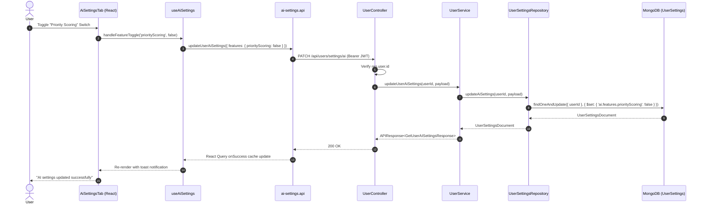

# AI Foundation & Core Features - Phase 4 Implementation Details

> **Feature:** 11. ai-foundation-core · **Phase:** 4 (AI Settings & Privacy Controls)  
> **Status:** COMPLETED  
> **Created:** 2026-11-20 · **Last Updated:** 2026-11-21

---

## 1. Goal Description & Scope

Establish comprehensive user AI settings, privacy transparency controls, and per-account override capabilities across the MailSense full-stack architecture.

Phases 1, 2, and 3 delivered the AI provider strategy, background ingestion pipeline, and on-demand REST endpoints. Phase 4 empowers users to control and customize their AI experience according to their personal privacy, security, and workflow preferences:

1. **Global AI Enablement & Privacy Consent:**
   - Master toggle to activate or deactivate all AI processing globally.
   - Clear privacy disclosures detailing zero training on user emails, secure ephemeral processing via Google Gemini 3.6 Flash, and consent timestamp recording (`consentGivenAt`).
2. **Granular Feature Flags:**
   - Independent sub-feature toggles for `categorization`, `priorityScoring`, `summarization`, and `suggestedReplies`.
   - Allows users to disable specific features (e.g., turn off automated classification while keeping on-demand summarization).
3. **Per-Account Overrides & Multi-Account Isolation:**
   - Exclusion list (`disabledAccountIds`) enabling users to exclude confidential or sensitive email accounts from AI processing while leaving it enabled for others.
   - Seamless integration with the email sync worker to bypass job creation for excluded accounts.
4. **Settings UI & Navigation:**
   - Dedicated "AI & Privacy" tab in the Settings view (`/settings/ai`) with real-time optimistic switch updates, responsive cards, and accessible form controls.

---

## 2. User Review Required & Architectural Notes

> [!IMPORTANT]
> **1. Multi-Tenant Isolation & Session Binding:**  
> All AI settings queries and mutations operate strictly on the authenticated session's `auth0UserId` (`req.user?.id`). Users cannot read or manipulate another user's AI preferences. Requests missing session credentials are rejected with `UnauthorizedError`.

> [!NOTE]
> **2. Ingestion Pipeline Synchronization:**  
> When `enabled: false` or when an account is added to `disabledAccountIds`, the `EmailCreatedHandler` and `AIProcessingWorker` automatically skip AI ingestion jobs, guaranteeing immediate zero-token consumption and total data privacy for disabled accounts.

> [!NOTE]
> **3. Zero Inline Types Standard:**  
> In compliance with MailSense architecture standards, all DTOs, schemas, hook return objects, and component prop types are declared in dedicated types files (`@mailsense/types` and `Frontend/src/features/settings/types/ai-settings.types.ts`).

---

## 3. Component Overview & File Map

| Component                     | Target File                                                                  | Action   | Purpose / Responsibilities                                                               |
| :---------------------------- | :--------------------------------------------------------------------------- | :------- | :--------------------------------------------------------------------------------------- |
| **User Settings Repository**  | `Backend/src/modules/user/database/user-settings.repository.ts`              | [MODIFY] | Add `updateAiSettings` atomic update method with upsert support.                         |
| **User Schema**               | `Backend/src/modules/user/schema/user.schema.ts`                             | [MODIFY] | Add Zod validation schemas `updateUserAiSettingsSchema` & `userAiFeatureSettingsSchema`. |
| **User Service**              | `Backend/src/modules/user/services/user.service.ts`                          | [MODIFY] | Implement `getUserAiSettings` and `updateUserAiSettings` domain logic.                   |
| **User Controller**           | `Backend/src/modules/user/controllers/user.controller.ts`                    | [MODIFY] | Expose `getUserAiSettings` and `updateUserAiSettings` HTTP endpoints.                    |
| **User Routes**               | `Backend/src/modules/user/routes/user.routes.ts`                             | [MODIFY] | Register `GET /settings/ai` and `PATCH /settings/ai`.                                    |
| **Backend Tests**             | `Backend/src/modules/user/__tests__/user-ai-settings.test.ts`                | [NEW]    | Integration test suite for user AI settings retrieval, update, and tenancy.              |
| **Frontend Endpoints**        | `Frontend/src/shared/api/endpoints.ts`                                       | [MODIFY] | Add `SETTINGS_API_ENDPOINTS.USER_AI_SETTINGS`.                                           |
| **Frontend Query Keys**       | `Frontend/src/shared/api/query-keys.ts`                                      | [MODIFY] | Add `USER_AI_SETTINGS` query key.                                                        |
| **Frontend Constants**        | `Frontend/src/shared/constants/settings.ts`                                  | [MODIFY] | Add "AI & Privacy" tab option (`icon: Sparkles`, `name: 'ai'`).                          |
| **Frontend Types**            | `Frontend/src/features/settings/types/ai-settings.types.ts`                  | [NEW]    | Dedicated types for component props, hook state, and query options.                      |
| **Frontend API Client**       | `Frontend/src/features/settings/api/ai-settings.api.ts`                      | [NEW]    | Axios wrapper for fetching and updating user AI settings.                                |
| **Frontend React Query**      | `Frontend/src/features/settings/api/ai-settings.queries.ts`                  | [NEW]    | `useGetAiSettingsQuery` and `useUpdateAiSettingsMutation` hooks.                         |
| **Frontend Custom Hook**      | `Frontend/src/features/settings/hooks/useAiSettings.ts`                      | [NEW]    | UI state coordination, optimistic updates, and mutation dispatch.                        |
| **Global Toggle Card**        | `Frontend/src/features/settings/components/ai/GlobalAiToggleCard.tsx`        | [NEW]    | Master toggle switch and privacy consent card.                                           |
| **Feature Toggles Card**      | `Frontend/src/features/settings/components/ai/AiFeatureTogglesCard.tsx`      | [NEW]    | Granular toggles for classification, priority, summaries, suggestions.                   |
| **Account Overrides Card**    | `Frontend/src/features/settings/components/ai/PerAccountAiExclusionCard.tsx` | [NEW]    | Per-account exclusion switches with account badges.                                      |
| **AI Settings Tab View**      | `Frontend/src/features/settings/components/ai/AiSettingsTab.tsx`             | [NEW]    | Composite settings tab view combining sub-cards and loading skeleton.                    |
| **Settings Page Integration** | `Frontend/src/features/settings/pages/index.tsx`                             | [MODIFY] | Mount `<TabsContent value="ai"><AiSettingsTab /></TabsContent>`.                         |

---

## 4. Main Section 1: Backend Layer Implementation

### 4.1 Repository Layer (`Backend/src/modules/user/database/user-settings.repository.ts`)

Add the atomic update method `updateAiSettings` to `UserSettingsRepository`. It uses `$set` operators on nested fields to prevent stomping other user preferences:

```typescript
import { UpdateUserAISettingsPayload, UserAISettings } from "@mailsense/types";
import {
  UserSettingsDocument,
  UserSettingsInput,
  UserSettingsModel,
} from "./user.model.js";

export class UserSettingsRepository {
  public static async getUserSettings(
    auth0UserId: string,
  ): Promise<UserSettingsDocument | null> {
    return await UserSettingsModel.findOne({ userId: auth0UserId });
  }

  public static async createUserSettings(
    data: UserSettingsInput,
  ): Promise<UserSettingsDocument> {
    return await UserSettingsModel.create(data);
  }

  public static async updateUserSettings(
    userId: string,
    data: UserSettingsInput,
  ): Promise<UserSettingsDocument | null> {
    return await UserSettingsModel.findOneAndUpdate({ userId }, data, {
      new: true,
    });
  }

  public static async getAiSettings(
    userId: string,
  ): Promise<UserAISettings | null> {
    const settings = await UserSettingsModel.findOne(
      { userId },
      { ai: 1 },
    ).lean();
    return settings?.ai ?? null;
  }

  public static async updateAiSettings(
    userId: string,
    payload: UpdateUserAISettingsPayload,
  ): Promise<UserSettingsDocument | null> {
    const updateFields: Record<string, boolean | string[] | Date> = {};

    if (payload.enabled !== undefined) {
      updateFields["ai.enabled"] = payload.enabled;
      if (payload.enabled) {
        updateFields["ai.consentGivenAt"] = new Date();
      }
    }

    if (payload.features) {
      if (payload.features.categorization !== undefined) {
        updateFields["ai.features.categorization"] =
          payload.features.categorization;
      }
      if (payload.features.priorityScoring !== undefined) {
        updateFields["ai.features.priorityScoring"] =
          payload.features.priorityScoring;
      }
      if (payload.features.summarization !== undefined) {
        updateFields["ai.features.summarization"] =
          payload.features.summarization;
      }
      if (payload.features.suggestedReplies !== undefined) {
        updateFields["ai.features.suggestedReplies"] =
          payload.features.suggestedReplies;
      }
    }

    if (payload.disabledAccountIds !== undefined) {
      updateFields["ai.disabledAccountIds"] = payload.disabledAccountIds;
    }

    return await UserSettingsModel.findOneAndUpdate(
      { userId },
      { $set: updateFields },
      { new: true, upsert: true, setDefaultsOnInsert: true },
    );
  }
}
```

---

### 4.2 Service Layer (`Backend/src/modules/user/services/user.service.ts`)

Extend `UserService` with `getUserAiSettings` and `updateUserAiSettings`. Sentry tracing and module-scoped Pino logging capture execution telemetry:

```typescript
import { config } from '@config';
import { AI_PROVIDER_NAME, APIResponse, GetUserAISettingsResponse, UpdateUserAISettingsPayload, UserAISettings } from '@mailsense/types';
import { UserSettingsRepository } from '../database/index.js';

// Inside UserService class:

    public async getUserAiSettings(auth0UserId: string): Promise<APIResponse<GetUserAISettingsResponse>> {
        try {
            logger.info('Fetching user AI settings', { auth0UserId });
            const globalFeatureFlag = config.ai.provider !== AI_PROVIDER_NAME.NOOP;
            let aiSettings = await UserSettingsRepository.getAiSettings(auth0UserId);

            if (!aiSettings) {
                const defaultAiSettings: UserAISettings = {
                    enabled: true,
                    features: {
                        categorization: true,
                        priorityScoring: true,
                        summarization: true,
                        suggestedReplies: true,
                    },
                    disabledAccountIds: [],
                    consentGivenAt: new Date(),
                };
                const userDoc = await UserSettingsRepository.updateAiSettings(auth0UserId, defaultAiSettings);
                aiSettings = userDoc?.ai ?? defaultAiSettings;
            }

            return {
                status: true,
                message: 'User AI settings fetched successfully',
                data: {
                    settings: aiSettings,
                    globalFeatureFlag,
                },
            };
        } catch (err) {
            const errorMessage = err instanceof Error ? err.message : String(err);
            logger.error(`Error in UserService.getUserAiSettings: ${errorMessage}`, { auth0UserId, error: err });
            throw err;
        }
    }

    public async updateUserAiSettings(
        auth0UserId: string,
        payload: UpdateUserAISettingsPayload,
    ): Promise<APIResponse<GetUserAISettingsResponse>> {
        try {
            logger.info('Updating user AI settings', { auth0UserId, payload });
            const updatedDoc = await UserSettingsRepository.updateAiSettings(auth0UserId, payload);
            const globalFeatureFlag = config.ai.provider !== AI_PROVIDER_NAME.NOOP;

            const aiSettings: UserAISettings = updatedDoc?.ai ?? {
                enabled: payload.enabled ?? true,
                features: {
                    categorization: payload.features?.categorization ?? true,
                    priorityScoring: payload.features?.priorityScoring ?? true,
                    summarization: payload.features?.summarization ?? true,
                    suggestedReplies: payload.features?.suggestedReplies ?? true,
                },
                disabledAccountIds: payload.disabledAccountIds ?? [],
                consentGivenAt: new Date(),
            };

            return {
                status: true,
                message: 'User AI settings updated successfully',
                data: {
                    settings: aiSettings,
                    globalFeatureFlag,
                },
            };
        } catch (err) {
            const errorMessage = err instanceof Error ? err.message : String(err);
            logger.error(`Error in UserService.updateUserAiSettings: ${errorMessage}`, { auth0UserId, payload, error: err });
            throw err;
        }
    }
```

---

### 4.3 Controller Layer (`Backend/src/modules/user/controllers/user.controller.ts`)

Expose HTTP boundary handlers wrapping request extraction in `try/catch` and returning standard JSON payloads:

```typescript
import { UnauthorizedError } from '@errors';
import { UpdateUserAISettingsPayload } from '@mailsense/types';
import { NextFunction, Request, Response } from 'express';

// Inside UserController class:

    public getUserAiSettings = async (
        req: Request<object, object, object>,
        res: Response,
        next: NextFunction,
    ): Promise<void> => {
        try {
            const userId = req.user?.id;
            if (!userId) {
                throw new UnauthorizedError('User ID is required');
            }
            const response = await this.userService.getUserAiSettings(userId);
            res.status(200).send(response);
        } catch (error) {
            next(error);
        }
    };

    public updateUserAiSettings = async (
        req: Request<object, object, UpdateUserAISettingsPayload>,
        res: Response,
        next: NextFunction,
    ): Promise<void> => {
        try {
            const userId = req.user?.id;
            if (!userId) {
                throw new UnauthorizedError('User ID is required');
            }
            const response = await this.userService.updateUserAiSettings(userId, req.body);
            res.status(200).send(response);
        } catch (error) {
            next(error);
        }
    };
```

---

### 4.4 Routes & Validation Schemas (`Backend/src/modules/user/schema/user.schema.ts`, `routes/user.routes.ts`)

#### Validation Schemas (`Backend/src/modules/user/schema/user.schema.ts`)

```typescript
export const userAiFeatureSettingsSchema = z.object({
  categorization: z.boolean().optional(),
  priorityScoring: z.boolean().optional(),
  summarization: z.boolean().optional(),
  suggestedReplies: z.boolean().optional(),
});

export const updateUserAiSettingsSchema = z.object({
  enabled: z.boolean().optional(),
  features: userAiFeatureSettingsSchema.optional(),
  disabledAccountIds: z.array(z.string()).optional(),
});

export type UpdateUserAiSettingsSchema = z.infer<
  typeof updateUserAiSettingsSchema
>;
```

#### Route Registration (`Backend/src/modules/user/routes/user.routes.ts`)

```typescript
import { authMiddleware, validate } from "@middlewares";
import { handleRequest } from "@utils";
import { updateUserAiSettingsSchema } from "../schema/index.js";

// Route registrations:
router.get("/settings/ai", handleRequest(userController.getUserAiSettings));

router.patch(
  "/settings/ai",
  validate({ body: updateUserAiSettingsSchema }),
  handleRequest(userController.updateUserAiSettings),
);
```

---

### 4.5 Backend Integration Test Suite (`Backend/src/modules/user/__tests__/user-ai-settings.test.ts`)

```typescript
import { AI_PROVIDER_NAME } from "@mailsense/types";
import { UserSettingsModel } from "../database/user.model.js";
import { UserService } from "../services/user.service.js";

describe("UserService - AI Settings", () => {
  const mockUserId = "auth0|test-user-ai-settings-123";
  let userService: UserService;

  beforeEach(async () => {
    userService = new UserService();
    await UserSettingsModel.deleteMany({ userId: mockUserId });
  });

  afterAll(async () => {
    await UserSettingsModel.deleteMany({ userId: mockUserId });
  });

  it("should initialize and return default AI settings when none exist", async () => {
    const response = await userService.getUserAiSettings(mockUserId);

    expect(response.status).toBe(true);
    expect(response.data.settings.enabled).toBe(true);
    expect(response.data.settings.features.categorization).toBe(true);
    expect(response.data.settings.features.priorityScoring).toBe(true);
    expect(response.data.settings.features.summarization).toBe(true);
    expect(response.data.settings.features.suggestedReplies).toBe(true);
    expect(response.data.settings.disabledAccountIds).toEqual([]);
    expect(response.data.globalFeatureFlag).toBeDefined();
  });

  it("should update global AI toggle and record consent timestamp", async () => {
    const updateRes = await userService.updateUserAiSettings(mockUserId, {
      enabled: false,
    });

    expect(updateRes.status).toBe(true);
    expect(updateRes.data.settings.enabled).toBe(false);

    const fetchRes = await userService.getUserAiSettings(mockUserId);
    expect(fetchRes.data.settings.enabled).toBe(false);
  });

  it("should update granular feature toggles independently", async () => {
    await userService.updateUserAiSettings(mockUserId, {
      features: {
        categorization: false,
        suggestedReplies: false,
      },
    });

    const fetchRes = await userService.getUserAiSettings(mockUserId);
    expect(fetchRes.data.settings.features.categorization).toBe(false);
    expect(fetchRes.data.settings.features.suggestedReplies).toBe(false);
    expect(fetchRes.data.settings.features.priorityScoring).toBe(true);
    expect(fetchRes.data.settings.features.summarization).toBe(true);
  });

  it("should manage disabled accounts for AI exclusion", async () => {
    const accountId = "acc_sensitive_corp_999";
    await userService.updateUserAiSettings(mockUserId, {
      disabledAccountIds: [accountId],
    });

    const fetchRes = await userService.getUserAiSettings(mockUserId);
    expect(fetchRes.data.settings.disabledAccountIds).toContain(accountId);
  });
});
```

---

## 5. Main Section 2: Frontend Layer Implementation

### 5.1 Endpoints, Query Keys & Constants

#### Endpoints (`Frontend/src/shared/api/endpoints.ts`)

```typescript
export const SETTINGS_API_ENDPOINTS = {
  USERS: "/users",
  CHANGE_PASSWORD: "/users/change-password",
  USER_SETTINGS: "/users/settings",
  USER_AI_SETTINGS: "/users/settings/ai",
} as const;
```

#### Query Keys (`Frontend/src/shared/api/query-keys.ts`)

```typescript
export const SETTINGS_QUERY_KEYS = {
  USER_SETTINGS: ["user-settings"] as const,
  USER_AI_SETTINGS: ["user-ai-settings"] as const,
} as const;
```

#### Tab Options (`Frontend/src/shared/constants/settings.ts`)

```typescript
import { SettingOption } from "@shared/types";
import { Info, Sparkles, User } from "lucide-react";

export const SETTINGS_OPTIONS: SettingOption[] = [
  {
    id: 1,
    name: "profile",
    title: "Profile",
    link: "/settings/profile",
    icon: User,
  },
  {
    id: 2,
    name: "account",
    title: "Account",
    link: "/settings/account",
    icon: User,
  },
  {
    id: 3,
    name: "ai",
    title: "AI & Privacy",
    link: "/settings/ai",
    icon: Sparkles,
  },
  {
    id: 5,
    name: "about",
    title: "About",
    link: "/settings/about",
    icon: Info,
  },
] as const;
```

---

### 5.2 Dedicated Types (`Frontend/src/features/settings/types/ai-settings.types.ts`)

Strictly zero inline types. All props, state shapes, and query options are declared here:

```typescript
import {
  AccountAttributes,
  GetUserAISettingsResponse,
  UpdateUserAISettingsPayload,
  UserAIFeatureSettings,
  UserAISettings,
} from "@mailsense/types";
import { UseMutationOptions, UseQueryOptions } from "@tanstack/react-query";

export interface GlobalAiToggleCardProps {
  enabled: boolean;
  consentGivenAt?: Date;
  globalFeatureFlag: boolean;
  onToggle: (checked: boolean) => void;
  isUpdating: boolean;
}

export interface AiFeatureTogglesCardProps {
  features: UserAIFeatureSettings;
  disabled: boolean;
  onToggleFeature: (
    feature: keyof UserAIFeatureSettings,
    checked: boolean,
  ) => void;
  isUpdating: boolean;
}

export interface PerAccountAiExclusionCardProps {
  accounts: AccountAttributes[];
  disabledAccountIds: string[];
  aiGloballyEnabled: boolean;
  onToggleAccount: (accountId: string, enabled: boolean) => void;
  isUpdating: boolean;
}

export interface AiSettingsTabProps {
  className?: string;
}

export interface AiSettingsHookData {
  settings: UserAISettings | undefined;
  globalFeatureFlag: boolean;
  accounts: AccountAttributes[];
  isLoading: boolean;
  isUpdating: boolean;
}

export interface AiSettingsHookActions {
  handleGlobalToggle: (checked: boolean) => void;
  handleFeatureToggle: (
    feature: keyof UserAIFeatureSettings,
    checked: boolean,
  ) => void;
  handleAccountToggle: (accountId: string, enabled: boolean) => void;
}

export interface AiSettingsHookReturn {
  data: AiSettingsHookData;
  actions: AiSettingsHookActions;
}

export type UseGetAiSettingsQueryOptions = Omit<
  UseQueryOptions<
    GetUserAISettingsResponse,
    Error,
    GetUserAISettingsResponse,
    typeof SETTINGS_QUERY_KEYS.USER_AI_SETTINGS
  >,
  "queryKey" | "queryFn"
>;

export type UseUpdateAiSettingsMutationOptions = Omit<
  UseMutationOptions<
    GetUserAISettingsResponse,
    Error,
    UpdateUserAISettingsPayload
  >,
  "mutationFn"
>;
```

---

### 5.3 API Client & React Query Hooks

#### API Client (`Frontend/src/features/settings/api/ai-settings.api.ts`)

```typescript
import {
  APIResponse,
  GetUserAISettingsResponse,
  UpdateUserAISettingsPayload,
} from "@mailsense/types";
import { axiosClient } from "@shared/api/client";
import { SETTINGS_API_ENDPOINTS } from "@shared/api/endpoints";

export async function fetchUserAiSettings(): Promise<GetUserAISettingsResponse> {
  const response = await axiosClient.get<
    APIResponse<GetUserAISettingsResponse>
  >(SETTINGS_API_ENDPOINTS.USER_AI_SETTINGS);
  return response.data.data;
}

export async function updateUserAiSettings(
  payload: UpdateUserAISettingsPayload,
): Promise<GetUserAISettingsResponse> {
  const response = await axiosClient.patch<
    APIResponse<GetUserAISettingsResponse>
  >(SETTINGS_API_ENDPOINTS.USER_AI_SETTINGS, payload);
  return response.data.data;
}
```

#### React Query Hooks (`Frontend/src/features/settings/api/ai-settings.queries.ts`)

```typescript
import {
  UseGetAiSettingsQueryOptions,
  UseUpdateAiSettingsMutationOptions,
} from "@features/settings/types/ai-settings.types";
import {
  GetUserAISettingsResponse,
  UpdateUserAISettingsPayload,
} from "@mailsense/types";
import { SETTINGS_QUERY_KEYS } from "@shared/api/query-keys";
import { useMutation, useQuery, useQueryClient } from "@tanstack/react-query";
import { toast } from "sonner";
import { fetchUserAiSettings, updateUserAiSettings } from "./ai-settings.api";

export function useGetAiSettingsQuery(
  options?: Partial<UseGetAiSettingsQueryOptions>,
) {
  return useQuery<
    GetUserAISettingsResponse,
    Error,
    GetUserAISettingsResponse,
    typeof SETTINGS_QUERY_KEYS.USER_AI_SETTINGS
  >({
    queryKey: SETTINGS_QUERY_KEYS.USER_AI_SETTINGS,
    queryFn: fetchUserAiSettings,
    staleTime: 60 * 1000,
    ...options,
  });
}

export function useUpdateAiSettingsMutation(
  options?: Partial<UseUpdateAiSettingsMutationOptions>,
) {
  const queryClient = useQueryClient();

  return useMutation<
    GetUserAISettingsResponse,
    Error,
    UpdateUserAISettingsPayload
  >({
    mutationFn: updateUserAiSettings,
    onSuccess: (data) => {
      queryClient.setQueryData(SETTINGS_QUERY_KEYS.USER_AI_SETTINGS, data);
      toast.success("AI settings updated successfully");
    },
    onError: () => {
      toast.error("Failed to update AI settings. Please try again.");
    },
    ...options,
  });
}
```

---

### 5.4 Custom Hook (`Frontend/src/features/settings/hooks/useAiSettings.ts`)

Adheres strictly to the custom hook size limit ($\le 120$ lines, preferred $\le 80$ lines). Manages optimistic updates and payload formatting:

```typescript
import { useAccountListQuery } from "@features/accounts/api/accounts.queries";
import {
  AiSettingsHookReturn,
  UseGetAiSettingsQueryOptions,
} from "@features/settings/types/ai-settings.types";
import { UserAIFeatureSettings } from "@mailsense/types";
import {
  useGetAiSettingsQuery,
  useUpdateAiSettingsMutation,
} from "../api/ai-settings.queries";

export function useAiSettings(
  options?: Partial<UseGetAiSettingsQueryOptions>,
): AiSettingsHookReturn {
  const { data: aiSettingsData, isLoading: isLoadingSettings } =
    useGetAiSettingsQuery(options);
  const { data: accounts = [], isLoading: isLoadingAccounts } =
    useAccountListQuery();
  const updateMutation = useUpdateAiSettingsMutation();

  const handleGlobalToggle = (enabled: boolean) => {
    updateMutation.mutate({ enabled });
  };

  const handleFeatureToggle = (
    feature: keyof UserAIFeatureSettings,
    checked: boolean,
  ) => {
    updateMutation.mutate({
      features: {
        [feature]: checked,
      },
    });
  };

  const handleAccountToggle = (accountId: string, enabled: boolean) => {
    const currentDisabled = aiSettingsData?.settings.disabledAccountIds ?? [];
    const nextDisabled = enabled
      ? currentDisabled.filter((id) => id !== accountId)
      : [...currentDisabled, accountId];

    updateMutation.mutate({ disabledAccountIds: nextDisabled });
  };

  return {
    data: {
      settings: aiSettingsData?.settings,
      globalFeatureFlag: aiSettingsData?.globalFeatureFlag ?? true,
      accounts,
      isLoading: isLoadingSettings || isLoadingAccounts,
      isUpdating: updateMutation.isPending,
    },
    actions: {
      handleGlobalToggle,
      handleFeatureToggle,
      handleAccountToggle,
    },
  };
}
```

---

### 5.5 UI Components

#### 1. Global AI Toggle Card (`Frontend/src/features/settings/components/ai/GlobalAiToggleCard.tsx`)

Streamlined card-like container using standard `div` and `p` to eliminate unnecessary padding and heavy wrappers:

```tsx
"use client";

import { ShieldCheck, Sparkles } from "lucide-react";
import React from "react";

import { GlobalAiToggleCardProps } from "@features/settings/types/ai-settings.types";
import { USER_AI_SETTINGS_LABELS } from "@shared/constants";
import { Badge } from "@shared/ui/badge";
import { Switch } from "@shared/ui/switch";

const GlobalAiToggleCard: React.FC<GlobalAiToggleCardProps> = (props) => {
  const { enabled, consentGivenAt, globalFeatureFlag, onToggle, isUpdating } =
    props;

  return (
    <div className="bg-card rounded-xl border p-4 shadow-sm">
      <div className="flex flex-row items-center justify-between pb-3">
        <div className="space-y-2">
          <div className="flex items-center gap-2">
            <Sparkles className="size-5 text-indigo-500" />
            <p className="text-base font-semibold">
              {USER_AI_SETTINGS_LABELS.GLOBAL_AI_TOGGLE.LABEL}
            </p>
            {!globalFeatureFlag && (
              <Badge
                variant="outline"
                className="border-amber-500/40 text-xs text-amber-500"
              >
                Mock Mode
              </Badge>
            )}
          </div>
          <p className="text-muted-foreground text-xs">
            {USER_AI_SETTINGS_LABELS.GLOBAL_AI_TOGGLE.DESCRIPTION}
          </p>
        </div>
        <Switch
          checked={enabled}
          disabled={isUpdating}
          onCheckedChange={onToggle}
          className="cursor-pointer"
        />
      </div>
      <div className="text-muted-foreground bg-muted/40 flex items-center gap-2 rounded-lg border p-2.5 text-xs">
        <ShieldCheck className="size-4 shrink-0 text-emerald-500" />
        <span>
          {USER_AI_SETTINGS_LABELS.GLOBAL_AI_TOGGLE.PRIVACY_POLICY}
          {consentGivenAt && (
            <span className="ml-1 opacity-80">
              (Consent registered on{" "}
              {new Date(consentGivenAt).toLocaleDateString()})
            </span>
          )}
        </span>
      </div>
    </div>
  );
};

export default GlobalAiToggleCard;
```

#### 2. Granular Feature Toggles Card (`Frontend/src/features/settings/components/ai/AiFeatureTogglesCard.tsx`)

```tsx
"use client";

import React from "react";

import { AiFeatureTogglesCardProps } from "@features/settings/types/ai-settings.types";
import { AI_FEATURE_ITEMS, USER_AI_SETTINGS_LABELS } from "@shared/constants";
import { Switch } from "@shared/ui/switch";

const AiFeatureTogglesCard: React.FC<AiFeatureTogglesCardProps> = (props) => {
  const { features, disabled, onToggleFeature, isUpdating } = props;

  return (
    <div
      className={`bg-card space-y-8 rounded-xl border p-4 shadow-sm transition-opacity ${disabled ? "pointer-events-none opacity-50" : ""}`}
    >
      <div className="space-y-1">
        <p className="text-base font-semibold">
          {USER_AI_SETTINGS_LABELS.AI_FEATURES_TOGGLES.LABEL}
        </p>
        <p className="text-muted-foreground text-xs">
          {USER_AI_SETTINGS_LABELS.AI_FEATURES_TOGGLES.DESCRIPTION}
        </p>
      </div>
      <div className="space-y-4">
        {AI_FEATURE_ITEMS.map((item) => (
          <div
            key={item.key}
            className="bg-card/50 flex items-center justify-between rounded-lg border p-3"
          >
            <div className="flex items-start gap-3">
              <item.icon className="text-primary mt-0.5 size-4 shrink-0" />
              <div className="space-y-0.5">
                <p className="text-sm leading-none font-medium">{item.title}</p>
                <p className="text-muted-foreground text-xs">
                  {item.description}
                </p>
              </div>
            </div>
            <Switch
              checked={features[item.key]}
              disabled={disabled || isUpdating}
              onCheckedChange={(checked) => onToggleFeature(item.key, checked)}
              className="ml-4 cursor-pointer"
            />
          </div>
        ))}
      </div>
    </div>
  );
};

export default AiFeatureTogglesCard;
```

#### 3. Per-Account AI Exclusion Card (`Frontend/src/features/settings/components/ai/PerAccountAiExclusionCard.tsx`)

```tsx
"use client";

import { Mail, ShieldAlert } from "lucide-react";
import React from "react";

import { PerAccountAiExclusionCardProps } from "@features/settings/types/ai-settings.types";
import { USER_AI_SETTINGS_LABELS } from "@shared/constants";
import { Switch } from "@shared/ui/switch";

const PerAccountAiExclusionCard: React.FC<PerAccountAiExclusionCardProps> = (
  props,
) => {
  const {
    accounts,
    disabledAccountIds,
    aiGloballyEnabled,
    onToggleAccount,
    isUpdating,
  } = props;

  return (
    <div
      className={`bg-card space-y-8 rounded-xl border p-4 shadow-sm transition-opacity ${!aiGloballyEnabled ? "pointer-events-none opacity-50" : ""}`}
    >
      <div className="space-y-1">
        <p className="text-base font-semibold">
          {USER_AI_SETTINGS_LABELS.PER_ACCOUNT_AI_EXCLUSION.LABEL}
        </p>
        <p className="text-muted-foreground text-xs">
          {USER_AI_SETTINGS_LABELS.PER_ACCOUNT_AI_EXCLUSION.DESCRIPTION}
        </p>
      </div>
      <div className="space-y-3 pt-0">
        {accounts.length === 0 ? (
          <p className="text-muted-foreground py-2 text-xs">
            No connected accounts found.
          </p>
        ) : (
          accounts.map((account) => {
            const isAccountEnabled = !disabledAccountIds.includes(account._id);
            return (
              <div
                key={account._id}
                className="bg-card/50 flex items-center justify-between rounded-lg border p-3"
              >
                <div className="flex items-center gap-3">
                  <Mail className="text-muted-foreground size-4 shrink-0" />
                  <div className="space-y-0.5">
                    <p className="text-sm leading-none font-medium">
                      {account.emailAddress}
                    </p>
                    <p className="text-muted-foreground text-xs capitalize">
                      {account.provider} ·{" "}
                      {isAccountEnabled ? "AI Active" : "AI Excluded"}
                    </p>
                  </div>
                </div>
                <Switch
                  checked={isAccountEnabled}
                  disabled={!aiGloballyEnabled || isUpdating}
                  onCheckedChange={(checked) =>
                    onToggleAccount(account._id, checked)
                  }
                  className="ml-4 cursor-pointer"
                />
              </div>
            );
          })
        )}
        {disabledAccountIds.length > 0 && (
          <div className="flex items-center gap-2 rounded-lg border border-amber-500/20 bg-amber-500/10 p-2.5 text-xs text-amber-600 dark:text-amber-400">
            <ShieldAlert className="size-4 shrink-0" />
            <span>
              {USER_AI_SETTINGS_LABELS.PER_ACCOUNT_AI_EXCLUSION.DISABLED_ACCOUNTS(
                disabledAccountIds.length,
              )}
            </span>
          </div>
        )}
      </div>
    </div>
  );
};

export default PerAccountAiExclusionCard;
```

#### 4. Composite AI Settings Page (`Frontend/src/features/settings/pages/ai/index.tsx`)

```tsx
"use client";

import React from "react";

import AiFeatureTogglesCard from "@features/settings/components/ai/AiFeatureTogglesCard";
import GlobalAiToggleCard from "@features/settings/components/ai/GlobalAiToggleCard";
import PerAccountAiExclusionCard from "@features/settings/components/ai/PerAccountAiExclusionCard";
import { useAiSettings } from "@features/settings/hooks/useAiSettings";
import { AiSettingsTabProps } from "@features/settings/types/ai-settings.types";
import { Skeleton } from "@shared/ui/skeleton";

const AiSettings: React.FC<AiSettingsTabProps> = ({ className = "" }) => {
  const {
    aiSettings: { data: aiSettingsData, loading: aiSettingsDataLoading },
    accounts: { data: accountsData, loading: accountsDataLoading },
    actions: { handleGlobalToggle, handleFeatureToggle, handleAccountToggle },
    updateAiSettingsLoading,
  } = useAiSettings();

  if (
    aiSettingsDataLoading ||
    !aiSettingsData ||
    accountsDataLoading ||
    !accountsData
  ) {
    return (
      <div className={`space-y-2 ${className}`}>
        <Skeleton className="h-32 w-full rounded-xl" />
        <Skeleton className="h-64 w-full rounded-xl" />
        <Skeleton className="h-48 w-full rounded-xl" />
      </div>
    );
  }

  return (
    <div
      className={`space-y-3 select-none ${className} h-[calc(100vh-130px)] scrollbar-none overflow-y-auto pr-1 pb-6`}
    >
      <GlobalAiToggleCard
        enabled={aiSettingsData.settings.enabled}
        consentGivenAt={aiSettingsData.settings.consentGivenAt}
        globalFeatureFlag={aiSettingsData.globalFeatureFlag}
        onToggle={handleGlobalToggle}
        isUpdating={updateAiSettingsLoading}
      />

      <AiFeatureTogglesCard
        features={aiSettingsData.settings.features}
        disabled={!aiSettingsData.settings.enabled}
        onToggleFeature={handleFeatureToggle}
        isUpdating={updateAiSettingsLoading}
      />

      <PerAccountAiExclusionCard
        accounts={accountsData}
        disabledAccountIds={aiSettingsData.settings.disabledAccountIds}
        aiGloballyEnabled={aiSettingsData.settings.enabled}
        onToggleAccount={handleAccountToggle}
        isUpdating={updateAiSettingsLoading}
      />
    </div>
  );
};

export default AiSettings;
```

---

### 5.6 Settings Page Integration (`Frontend/src/features/settings/pages/index.tsx`)

Mount the AI tab inside the existing Next.js App Router Settings page:

```tsx
// Inside Frontend/src/features/settings/pages/index.tsx:
import AiSettings from './ai';

// Inside Tabs:
    <TabsContent value="profile">
        <ProfileSettings />
    </TabsContent>
    <TabsContent value="account">
        <AccountSettings />
    </TabsContent>
    <TabsContent value="ai">
        <AiSettings />
    </TabsContent>
```

---

## 6. Low-Level Design & Sequence Flow

### 6.1 User Updates AI Preferences Flow



---

## 7. Step-by-Step Task Checklist

- [x] **Task 1: Backend Repository & Schema Updates**
  - [x] Implement `updateAiSettings` in `Backend/src/modules/user/database/user-settings.repository.ts`.
  - [x] Add `updateUserAiSettingsSchema` in `Backend/src/modules/user/schema/user.schema.ts`.
  - [x] Re-export schema in `Backend/src/modules/user/schema/index.ts`.
- [x] **Task 2: Backend Service, Controller & Routes Implementation**
  - [x] Add `getUserAiSettings` and `updateUserAiSettings` to `UserService` in `Backend/src/modules/user/services/user.service.ts`.
  - [x] Add `getUserAiSettings` and `updateUserAiSettings` to `UserController` in `Backend/src/modules/user/controllers/user.controller.ts`.
  - [x] Register `GET /settings/ai` and `PATCH /settings/ai` in `Backend/src/modules/user/routes/user.routes.ts`.
  - [x] Add integration tests in `Backend/src/modules/user/__tests__/user-ai-settings.test.ts`.
- [x] **Task 3: Frontend API & Constants Scaffolding**
  - [x] Add `SETTINGS_API_ENDPOINTS.USER_AI_SETTINGS` to `Frontend/src/shared/api/endpoints.ts`.
  - [x] Add `SETTINGS_QUERY_KEYS.USER_AI_SETTINGS` to `Frontend/src/shared/api/query-keys.ts`.
  - [x] Add `AI & Privacy` option to `SETTINGS_OPTIONS` in `Frontend/src/shared/constants/settings.ts`.
  - [x] Create `Frontend/src/features/settings/types/ai-settings.types.ts` and re-export in `index.ts`.
  - [x] Create `Frontend/src/features/settings/api/settings.api.ts` (`fetchUserAiSettings`, `updateUserAiSettings`).
  - [x] Create `Frontend/src/features/settings/api/settings.queries.ts` (`useGetAiSettingsQuery`) and `settings.mutation.ts` (`useUpdateAiSettingsMutation`).
- [x] **Task 4: Frontend UI Components & Page Integration**
  - [x] Implement `useAiSettings` hook in `Frontend/src/features/settings/hooks/useAiSettings.ts`.
  - [x] Create `GlobalAiToggleCard.tsx` under `Frontend/src/features/settings/components/ai/`.
  - [x] Create `AiFeatureTogglesCard.tsx` under `Frontend/src/features/settings/components/ai/`.
  - [x] Create `PerAccountAiExclusionCard.tsx` under `Frontend/src/features/settings/components/ai/`.
  - [x] Create composite `AiSettings` under `Frontend/src/features/settings/pages/ai/index.tsx`.
  - [x] Mount `<TabsContent value="ai"><AiSettings /></TabsContent>` in `Frontend/src/features/settings/pages/index.tsx`.
- [x] **Task 5: Verification & Testing**
  - [x] Run backend unit and integration tests: `cd Backend && npx jest src/modules/user/__tests__/` (100% pass).
  - [x] Verify backend TypeScript build: `cd Backend && pnpm build` (0 errors).
  - [x] Verify frontend TypeScript compilation: `cd Frontend && npx tsc --noEmit` (0 errors).

---

## 8. Verification & Build Commands

```bash
# 1. Run Backend User & AI Settings Tests
cd /Users/vishaljagamani/Projects/Projects/mailsense/Backend
npx jest src/modules/user/__tests__/user-ai-settings.test.ts

# 2. Verify Backend Build
pnpm build

# 3. Verify Downstream Frontend TypeScript Compilation
cd /Users/vishaljagamani/Projects/Projects/mailsense/Frontend
npx tsc --noEmit
```
