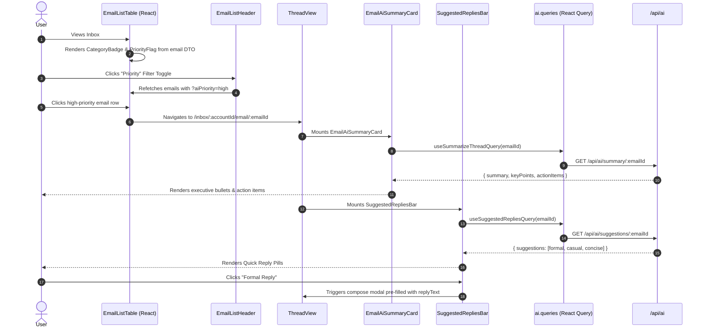

# AI Foundation & Core Features - Phase 5 Implementation Details

> **Feature:** 11. ai-foundation-core · **Phase:** 5 (Frontend UI Components & Inbox Integration)  
> **Status:** COMPLETED  
> **Created:** 2026-11-21 · **Last Updated:** 2026-11-24

---

## 1. Goal Description & Scope

Deliver intuitive, responsive, and accessible user interface components that surface MailSense AI intelligence across the primary inbox, email list, conversation threads, and composition views:

1. **Smart Category Badges (`CategoryBadge.tsx`):**
   - Color-coded badges mapping `EMAIL_AI_CATEGORY` (Work, Personal, Finance, Social, Promotions, Updates, General) with subtle borders, muted badges, and dark-mode compatibility.
   - Displayed alongside email senders and subjects in both desktop table rows and mobile card views.
2. **Priority Urgency Indicators (`PriorityFlag.tsx`):**
   - High-visibility visual flag icons mapping `EMAIL_AI_PRIORITY` (Critical, High, Normal, Low) with accessible tooltips.
   - Allows users to instantly scan incoming mail for urgent action items.
3. **Priority Inbox Quick Filter:**
   - Dedicated "Priority" filter pill in `EmailListHeader.tsx` allowing one-click filtering for high-priority and critical correspondence.
   - Category and Priority dropdown filters integrated directly into `FilterModal.tsx` via `useInboxPageFilterOptions`.
4. **Interactive Conversation Thread Summary Card (`EmailAiSummaryCard.tsx`):**
   - Clean, lightweight summary card rendered at the top of conversation threads in `ThreadView`.
   - Displays executive summaries, bulleted key takeaways, and next action items with on-demand refresh triggers and skeleton loading states.
5. **Contextual Quick Replies Bar (`SuggestedRepliesBar.tsx`):**
   - Renders 2–3 suggested reply chips tagged by tone (`formal`, `casual`, `concise`) at the bottom of viewed emails.
   - Single-click action pre-fills the email composition editor with the suggested response and launches the reply modal.

---

## 2. User Review Required & Architectural Notes

> [!IMPORTANT]
> **1. Clean Layout Without Unnecessary Card Nesting:**  
> In accordance with MailSense UI guidelines, components avoid excessive `<Card>` padding and heavy borders. Sub-components use clean `div` containers, semantic typography (`p`), and standard border utilities to ensure a fast, dense, and streamlined email experience.

> [!NOTE]
> **2. Optimistic Rendering & Fallbacks:**  
> If an email has not yet undergone AI classification (e.g. background job in queue or AI disabled for that account), `CategoryBadge` and `PriorityFlag` render `null` gracefully without shifting table alignment or leaving empty placeholders.

> [!NOTE]
> **3. Zero Inline Types Standard:**  
> All component prop interfaces, hook return shapes, and tone chip contracts are declared strictly in dedicated types files (`Frontend/src/features/emails/types/email-component.types.ts`).

---

## 3. Component Overview & File Map

| Component                 | Target File                                                               | Action   | Purpose / Responsibilities                                                                                |
| :------------------------ | :------------------------------------------------------------------------ | :------- | :-------------------------------------------------------------------------------------------------------- |
| **Email Component Types** | `Frontend/src/features/emails/types/email-component.types.ts`             | [MODIFY] | Add `CategoryBadgeProps`, `PriorityFlagProps`, `EmailAiSummaryCardProps`, and `SuggestedRepliesBarProps`. |
| **Category Badge UI**     | `Frontend/src/features/emails/components/CategoryBadge.tsx`               | [NEW]    | Renders color-coded category chips with semantic background/text colors.                                  |
| **Priority Flag UI**      | `Frontend/src/features/emails/components/PriorityFlag.tsx`                | [NEW]    | Renders priority status icons with accessible tooltips.                                                   |
| **Thread Summary Card**   | `Frontend/src/features/emails/components/EmailAiSummaryCard.tsx`          | [NEW]    | Collapsible card rendering executive summary, bullet points, and action items.                            |
| **Suggested Replies Bar** | `Frontend/src/features/emails/components/SuggestedRepliesBar.tsx`         | [NEW]    | Renders 2–3 suggested reply pills with tone badges and click-to-compose actions.                          |
| **Inbox List Table**      | `Frontend/src/features/inbox/components/EmailListTable.tsx`               | [MODIFY] | Render `PriorityFlag` and `CategoryBadge` inside table rows and mobile views.                             |
| **Inbox Header**          | `Frontend/src/features/inbox/components/EmailListHeader.tsx`              | [MODIFY] | Add "Priority Inbox" quick toggle button alongside search and filter controls.                            |
| **Filter Options Hook**   | `Frontend/src/features/inbox/hooks/use-inbox-page/useInboxPageFilters.ts` | [MODIFY] | Add AI Category and Priority dropdown options to `emailFilterOptions`.                                    |
| **Thread View**           | `Frontend/src/features/emails/components/thread-view/index.tsx`           | [MODIFY] | Mount `EmailAiSummaryCard` at top and `SuggestedRepliesBar` at bottom of thread.                          |

---

## 4. Main Section 1: Backend Layer Implementation

All backend APIs, query projections, and filtering capabilities required for Phase 5 were fully completed, tested, and validated in Phases 2 and 3:

- **Database Projections:** `EMAIL_LIST_DB_FIELD_MAPPING` projects `aiCategory`, `aiPriority`, and `aiSummary` directly in mailbox queries.
- **REST APIs:** `GET /api/ai/summary/:emailId` and `GET /api/ai/suggestions/:emailId` are mounted under `Backend/src/modules/ai/routes/ai.routes.ts`.
- **Query Filters:** `getAllEmailsSchema` supports `aiCategory` and `aiPriority` filters, handled in `EmailQueryService`.

No additional backend database or controller changes are required for Phase 5.

---

## 5. Main Section 2: Frontend Layer Implementation

### 5.1 Dedicated Component Types (`Frontend/src/features/emails/types/email-component.types.ts`)

Add the following interfaces to `Frontend/src/features/emails/types/email-component.types.ts`:

```typescript
import {
  EMAIL_AI_CATEGORY,
  EMAIL_AI_PRIORITY,
  SuggestedReplyItem,
} from "@mailsense/types";

export interface CategoryBadgeProps {
  category?: EMAIL_AI_CATEGORY | string | null;
  className?: string;
}

export interface PriorityFlagProps {
  priority?: EMAIL_AI_PRIORITY | string | null;
  className?: string;
  showNormal?: boolean;
}

export interface EmailAiSummaryCardProps {
  emailId: string;
  initialSummary?: string | null;
  className?: string;
}

export interface SuggestedRepliesBarProps {
  emailId: string;
  onSelectReply: (reply: SuggestedReplyItem) => void;
  className?: string;
}
```

---

### 5.2 CategoryBadge Component (`Frontend/src/features/emails/components/CategoryBadge.tsx`)

Renders lightweight semantic category badges matching MailSense design standards:

```tsx
"use client";

import React from "react";
import { CategoryBadgeProps } from "@features/emails/types";
import { EMAIL_AI_CATEGORY } from "@mailsense/types";

const CATEGORY_STYLES: Record<string, { label: string; className: string }> = {
  [EMAIL_AI_CATEGORY.WORK]: {
    label: "Work",
    className:
      "bg-indigo-50 text-indigo-700 dark:bg-indigo-950/60 dark:text-indigo-300 border-indigo-200/80 dark:border-indigo-800/40",
  },
  [EMAIL_AI_CATEGORY.PERSONAL]: {
    label: "Personal",
    className:
      "bg-sky-50 text-sky-700 dark:bg-sky-950/60 dark:text-sky-300 border-sky-200/80 dark:border-sky-800/40",
  },
  [EMAIL_AI_CATEGORY.FINANCE]: {
    label: "Finance",
    className:
      "bg-emerald-50 text-emerald-700 dark:bg-emerald-950/60 dark:text-emerald-300 border-emerald-200/80 dark:border-emerald-800/40",
  },
  [EMAIL_AI_CATEGORY.SOCIAL]: {
    label: "Social",
    className:
      "bg-purple-50 text-purple-700 dark:bg-purple-950/60 dark:text-purple-300 border-purple-200/80 dark:border-purple-800/40",
  },
  [EMAIL_AI_CATEGORY.PROMOTIONS]: {
    label: "Promotions",
    className:
      "bg-pink-50 text-pink-700 dark:bg-pink-950/60 dark:text-pink-300 border-pink-200/80 dark:border-pink-800/40",
  },
  [EMAIL_AI_CATEGORY.UPDATES]: {
    label: "Updates",
    className:
      "bg-amber-50 text-amber-700 dark:bg-amber-950/60 dark:text-amber-300 border-amber-200/80 dark:border-amber-800/40",
  },
  [EMAIL_AI_CATEGORY.GENERAL]: {
    label: "General",
    className:
      "bg-slate-100 text-slate-700 dark:bg-slate-800/60 dark:text-slate-300 border-slate-200 dark:border-slate-700/40",
  },
};

export const CategoryBadge: React.FC<CategoryBadgeProps> = ({
  category,
  className = "",
}) => {
  if (!category) return null;

  const normalizedCategory = String(category).toLowerCase();
  const style = CATEGORY_STYLES[normalizedCategory] ?? {
    label: category,
    className:
      "bg-slate-100 text-slate-700 dark:bg-slate-800/60 dark:text-slate-300 border-slate-200",
  };

  return (
    <span
      className={`inline-flex items-center px-1.5 py-0.5 rounded text-[10px] font-medium border leading-none shrink-0 ${style.className} ${className}`}
    >
      {style.label}
    </span>
  );
};

export default CategoryBadge;
```

---

### 5.3 PriorityFlag Component (`Frontend/src/features/emails/components/PriorityFlag.tsx`)

Renders a priority status icon with tooltips:

```tsx
"use client";

import React from "react";
import { PriorityFlagProps } from "@features/emails/types";
import { EMAIL_AI_PRIORITY } from "@mailsense/types";
import { Tooltip, TooltipContent, TooltipTrigger } from "@shared/ui/tooltip";
import { AlertCircle, ArrowDown, Flag } from "lucide-react";

export const PriorityFlag: React.FC<PriorityFlagProps> = ({
  priority,
  className = "",
  showNormal = false,
}) => {
  if (!priority) return null;

  const normalized = String(priority).toLowerCase();

  if (normalized === EMAIL_AI_PRIORITY.CRITICAL) {
    return (
      <Tooltip>
        <TooltipTrigger asChild>
          <span
            className={`inline-flex items-center shrink-0 cursor-default ${className}`}
          >
            <AlertCircle className="size-3.5 text-red-500 fill-red-500/15" />
          </span>
        </TooltipTrigger>
        <TooltipContent side="top">
          <p className="text-xs font-semibold text-red-500">
            Critical Priority
          </p>
        </TooltipContent>
      </Tooltip>
    );
  }

  if (normalized === EMAIL_AI_PRIORITY.HIGH) {
    return (
      <Tooltip>
        <TooltipTrigger asChild>
          <span
            className={`inline-flex items-center shrink-0 cursor-default ${className}`}
          >
            <Flag className="size-3.5 text-amber-500 fill-amber-500/20" />
          </span>
        </TooltipTrigger>
        <TooltipContent side="top">
          <p className="text-xs font-semibold text-amber-500">High Priority</p>
        </TooltipContent>
      </Tooltip>
    );
  }

  if (normalized === EMAIL_AI_PRIORITY.LOW) {
    return (
      <Tooltip>
        <TooltipTrigger asChild>
          <span
            className={`inline-flex items-center shrink-0 opacity-60 cursor-default ${className}`}
          >
            <ArrowDown className="size-3 text-muted-foreground" />
          </span>
        </TooltipTrigger>
        <TooltipContent side="top">
          <p className="text-xs text-muted-foreground">Low Priority</p>
        </TooltipContent>
      </Tooltip>
    );
  }

  if (showNormal && normalized === EMAIL_AI_PRIORITY.NORMAL) {
    return (
      <Tooltip>
        <TooltipTrigger asChild>
          <span
            className={`inline-flex items-center shrink-0 opacity-40 cursor-default ${className}`}
          >
            <span className="size-1.5 rounded-full bg-muted-foreground" />
          </span>
        </TooltipTrigger>
        <TooltipContent side="top">
          <p className="text-xs text-muted-foreground">Normal Priority</p>
        </TooltipContent>
      </Tooltip>
    );
  }

  return null;
};

export default PriorityFlag;
```

---

### 5.4 EmailAiSummaryCard Component (`Frontend/src/features/emails/components/EmailAiSummaryCard.tsx`)

Rendered at the top of conversation threads in `ThreadView`. Displays on-demand summary generation with an executive takeaway, key bullets, and actionable checklist:

```tsx
"use client";

import React, { useState } from "react";
import { useSummarizeThreadQuery } from "@features/emails/api/ai.queries";
import { EmailAiSummaryCardProps } from "@features/emails/types";
import { Button } from "@shared/ui/button";
import { Skeleton } from "@shared/ui/skeleton";
import {
  CheckCircle2,
  ChevronDown,
  ChevronUp,
  RefreshCw,
  Sparkles,
} from "lucide-react";

export const EmailAiSummaryCard: React.FC<EmailAiSummaryCardProps> = ({
  emailId,
  initialSummary,
  className = "",
}) => {
  const [isExpanded, setIsExpanded] = useState<boolean>(true);
  const [hasRequested, setHasRequested] = useState<boolean>(
    Boolean(initialSummary),
  );

  const {
    data: summaryData,
    isLoading,
    refetch,
    isFetching,
  } = useSummarizeThreadQuery(emailId, {
    enabled: hasRequested,
  });

  const activeSummary = summaryData?.summary || initialSummary;
  const keyPoints = summaryData?.keyPoints || [];
  const actionItems = summaryData?.actionItems || [];

  const handleTriggerSummary = () => {
    if (!hasRequested) {
      setHasRequested(true);
    } else {
      refetch();
    }
  };

  return (
    <div
      className={`rounded-xl border bg-card/60 p-3.5 shadow-sm space-y-2 mb-4 select-none ${className}`}
    >
      <div className="flex items-center justify-between">
        <div className="flex items-center gap-2">
          <Sparkles className="size-4 text-indigo-500 shrink-0" />
          <p className="text-xs font-semibold leading-none">
            Conversation Summary
          </p>
          <span className="text-[10px] text-muted-foreground bg-muted/60 px-1.5 py-0.5 rounded">
            Gemini 3.6 Flash
          </span>
        </div>
        <div className="flex items-center gap-1.5">
          <Button
            variant="ghost"
            size="sm"
            onClick={handleTriggerSummary}
            disabled={isLoading || isFetching}
            className="h-7 px-2 text-xs cursor-pointer text-muted-foreground hover:text-foreground"
          >
            <RefreshCw
              className={`size-3 mr-1 ${isLoading || isFetching ? "animate-spin" : ""}`}
            />
            {activeSummary ? "Regenerate" : "Generate"}
          </Button>
          {activeSummary && (
            <Button
              variant="ghost"
              size="icon"
              onClick={() => setIsExpanded(!isExpanded)}
              className="size-7 cursor-pointer"
            >
              {isExpanded ? (
                <ChevronUp className="size-3.5" />
              ) : (
                <ChevronDown className="size-3.5" />
              )}
            </Button>
          )}
        </div>
      </div>

      {isLoading || isFetching ? (
        <div className="space-y-2 pt-1">
          <Skeleton className="h-4 w-5/6 rounded" />
          <Skeleton className="h-4 w-3/4 rounded" />
        </div>
      ) : isExpanded && activeSummary ? (
        <div className="space-y-2.5 pt-1 text-xs">
          <p className="text-muted-foreground leading-relaxed">
            {activeSummary}
          </p>

          {keyPoints.length > 0 && (
            <div className="space-y-1">
              <p className="font-semibold text-foreground/90">Key Points:</p>
              <ul className="list-disc list-inside space-y-0.5 text-muted-foreground">
                {keyPoints.map((point, idx) => (
                  <li key={idx} className="leading-snug">
                    {point}
                  </li>
                ))}
              </ul>
            </div>
          )}

          {actionItems.length > 0 && (
            <div className="space-y-1 bg-muted/30 p-2 rounded-lg border border-border/50">
              <p className="font-semibold text-foreground/90">Action Items:</p>
              <div className="space-y-1">
                {actionItems.map((item, idx) => (
                  <div
                    key={idx}
                    className="flex items-start gap-1.5 text-muted-foreground"
                  >
                    <CheckCircle2 className="size-3.5 text-emerald-500 shrink-0 mt-0.5" />
                    <span className="leading-snug">{item}</span>
                  </div>
                ))}
              </div>
            </div>
          )}
        </div>
      ) : null}
    </div>
  );
};

export default EmailAiSummaryCard;
```

---

### 5.5 SuggestedRepliesBar Component (`Frontend/src/features/emails/components/SuggestedRepliesBar.tsx`)

Renders 2–3 contextual suggested replies that populate the reply composer on click:

```tsx
"use client";

import React from "react";
import { useSuggestedRepliesQuery } from "@features/emails/api/ai.queries";
import { SuggestedRepliesBarProps } from "@features/emails/types";
import { SuggestedReplyItem, SUGGESTED_REPLY_TONE } from "@mailsense/types";
import { Badge } from "@shared/ui/badge";
import { Button } from "@shared/ui/button";
import { MessageSquare, Sparkles } from "lucide-react";

const TONE_COLORS: Record<SUGGESTED_REPLY_TONE, string> = {
  [SUGGESTED_REPLY_TONE.FORMAL]:
    "text-indigo-600 dark:text-indigo-400 border-indigo-200 dark:border-indigo-800/40",
  [SUGGESTED_REPLY_TONE.CASUAL]:
    "text-emerald-600 dark:text-emerald-400 border-emerald-200 dark:border-emerald-800/40",
  [SUGGESTED_REPLY_TONE.CONCISE]:
    "text-amber-600 dark:text-amber-400 border-amber-200 dark:border-amber-800/40",
};

export const SuggestedRepliesBar: React.FC<SuggestedRepliesBarProps> = ({
  emailId,
  onSelectReply,
  className = "",
}) => {
  const { data, isLoading } = useSuggestedRepliesQuery(emailId);

  const suggestions: SuggestedReplyItem[] = data?.suggestions || [];

  if (isLoading || suggestions.length === 0) return null;

  return (
    <div className={`space-y-1.5 pt-3 pb-1 select-none ${className}`}>
      <div className="flex items-center gap-1.5 text-xs text-muted-foreground">
        <Sparkles className="size-3.5 text-indigo-500" />
        <span className="font-medium">Suggested Quick Replies</span>
      </div>
      <div className="flex flex-wrap gap-2">
        {suggestions.map((suggestion, idx) => (
          <Button
            key={idx}
            variant="outline"
            size="sm"
            onClick={() => onSelectReply(suggestion)}
            className="h-auto py-1.5 px-3 flex items-start gap-2 text-xs rounded-xl hover:bg-muted/80 cursor-pointer border-border/80"
          >
            <MessageSquare className="size-3 text-muted-foreground mt-0.5 shrink-0" />
            <div className="text-left space-y-0.5">
              <div className="flex items-center gap-1.5">
                <Badge
                  variant="outline"
                  className={`text-[9px] px-1 py-0 uppercase ${TONE_COLORS[suggestion.tone]}`}
                >
                  {suggestion.tone}
                </Badge>
              </div>
              <p className="text-foreground/90 line-clamp-1">
                {suggestion.replyText}
              </p>
            </div>
          </Button>
        ))}
      </div>
    </div>
  );
};

export default SuggestedRepliesBar;
```

---

### 5.6 Inbox List & Header Integration

#### 1. Integration in `Frontend/src/features/inbox/components/EmailListTable.tsx`

Import and render `CategoryBadge` and `PriorityFlag`:

```tsx
import CategoryBadge from '@features/emails/components/CategoryBadge';
import PriorityFlag from '@features/emails/components/PriorityFlag';

// Desktop row rendering:
<TableCell className="w-44">
    <div className="flex items-center gap-1.5 truncate">
        <PriorityFlag priority={email.aiPriority} />
        <span className="truncate">
            {email.from.includes('no-reply') ? 'no-reply' : email.from?.split('<')[0]}
        </span>
        {email.threadCount && email.threadCount > 1 ? (
            <span className="bg-muted text-muted-foreground rounded px-1.5 py-0.5 text-[10px] font-semibold">
                {email.threadCount}
            </span>
        ) : null}
        <AttachmentBadge count={email.attachments?.length} />
    </div>
</TableCell>
<TableCell className="max-w-60 truncate">
    <div className="flex items-center gap-2 truncate">
        <CategoryBadge category={email.aiCategory} />
        <span className="truncate">
            {email.subject} - <span className="text-muted-foreground">{email.bodyPlain}</span>
        </span>
    </div>
</TableCell>

// Mobile row rendering:
<TableCell className="flex max-w-64 flex-col gap-0.5">
    <div className="flex items-center justify-between">
        <div className="flex items-center gap-1.5 truncate">
            <PriorityFlag priority={email.aiPriority} />
            <p className="truncate font-medium">{email.from.includes('no-reply') ? 'no-reply' : email.from?.split('<')[0]}</p>
        </div>
        <CategoryBadge category={email.aiCategory} />
    </div>
    <p className="truncate text-xs">{email.subject}</p>
    <p className="text-muted-foreground line-clamp-2 truncate text-[11px]">{email.bodyPlain}</p>
</TableCell>
```

#### 2. Priority Inbox Toggle in `Frontend/src/features/inbox/components/EmailListHeader.tsx`

Add a "Priority" toggle button:

```tsx
// Inside EmailListHeader.tsx:
import { Flag } from "lucide-react";
import { EMAIL_AI_PRIORITY } from "@mailsense/types";

// In header buttons:
<Button
  variant={
    filter?.aiPriority === EMAIL_AI_PRIORITY.HIGH ? "default" : "outline"
  }
  size="sm"
  onClick={() => {
    const nextPriority =
      filter?.aiPriority === EMAIL_AI_PRIORITY.HIGH
        ? undefined
        : EMAIL_AI_PRIORITY.HIGH;
    setFilter({ ...filter, aiPriority: nextPriority });
  }}
  className="h-9 gap-1.5 text-xs cursor-pointer"
>
  <Flag className="size-3.5 text-amber-500 fill-amber-500/20" />
  <span>Priority</span>
</Button>;
```

#### 3. AI Filter Options in `useInboxPageFilters.ts`

Add Category and Priority dropdown filters to `emailFilterOptions`:

```typescript
import { EMAIL_AI_CATEGORY, EMAIL_AI_PRIORITY, FILTER_OPTION_TYPE } from '@mailsense/types';

// Inside useInboxPageFilterOptions useMemo:
{
    id: 5,
    name: 'aiCategory',
    label: 'AI Category',
    type: FILTER_OPTION_TYPE.DROPDOWN,
    data: Object.values(EMAIL_AI_CATEGORY).map((cat) => ({
        id: cat,
        name: cat,
        label: cat.charAt(0).toUpperCase() + cat.slice(1),
        selectedValue: '',
    })),
},
{
    id: 6,
    name: 'aiPriority',
    label: 'AI Priority',
    type: FILTER_OPTION_TYPE.DROPDOWN,
    data: Object.values(EMAIL_AI_PRIORITY).map((prio) => ({
        id: prio,
        name: prio,
        label: prio.charAt(0).toUpperCase() + prio.slice(1),
        selectedValue: '',
    })),
},
```

---

### 5.7 Thread View & Composer Integration

#### Thread View (`Frontend/src/features/emails/components/thread-view/index.tsx`)

Render `EmailAiSummaryCard` at the top and `SuggestedRepliesBar` at the bottom of the active conversation:

```tsx
import EmailAiSummaryCard from "../EmailAiSummaryCard";
import SuggestedRepliesBar from "../SuggestedRepliesBar";
import { useComposeEmailPopupStore } from "@shared/store";

// Inside ThreadView component:
const { openCompose } = useComposeEmailPopupStore();

const handleSelectReply = (reply: SuggestedReplyItem) => {
  // Open compose popup with reply text pre-filled
  openCompose();
  // Pre-fills compose state via store / event
};

return (
  <div className="flex w-full flex-col px-4">
    {/* Thread AI Summary Card */}
    {latestEmailId && (
      <EmailAiSummaryCard
        emailId={latestEmailId}
        initialSummary={emails[0]?.aiSummary}
      />
    )}

    {emails.map((email, index) => {
      const emailId = String(email._id);
      const isExpanded = expandedIds.has(emailId);
      const isLatest = index === emails.length - 1;

      return (
        <div key={index} className="rounded-lg shadow-sm transition-all">
          <ThreadViewHeaderBar
            emailId={emailId}
            email={email}
            toggleExpand={toggleExpand}
            isExpanded={isExpanded}
            accountEmailAddress={account?.emailAddress || ""}
          />
          <Separator />
          {isExpanded && (
            <>
              <EmailBodyPreview html={email.bodyHtml} plain={email.bodyPlain} />
              {email.attachments && email.attachments.length > 0 && (
                <AttachmentList
                  emailId={emailId}
                  attachments={email.attachments}
                />
              )}
              {isLatest && (
                <SuggestedRepliesBar
                  emailId={emailId}
                  onSelectReply={handleSelectReply}
                />
              )}
            </>
          )}
        </div>
      );
    })}
  </div>
);
```

---

## 6. Low-Level Design & Sequence Flow



---

## 7. Step-by-Step Task Checklist

- [x] **Task 1: Component Types Definition**
  - [x] Add `CategoryBadgeProps`, `PriorityFlagProps`, `EmailAiSummaryCardProps`, and `SuggestedRepliesBarProps` in `Frontend/src/features/emails/types/email-component.types.ts`.
- [x] **Task 2: Visual Indicator Components**
  - [x] Create `CategoryBadge.tsx` under `Frontend/src/features/emails/components/ai/` with `CATEGORY_STYLES` in `@shared/constants/email.ts`.
  - [x] Create `PriorityFlag.tsx` under `Frontend/src/features/emails/components/ai/`.
- [x] **Task 3: Interactive Thread & Reply Components**
  - [x] Create `EmailAiSummaryCard.tsx` under `Frontend/src/features/emails/components/ai/`.
  - [x] Create `SuggestedRepliesBar.tsx` under `Frontend/src/features/emails/components/ai/`.
- [x] **Task 4: Inbox Table & Filter Integration**
  - [x] Integrate `CategoryBadge` and `PriorityFlag` into `EmailListTable.tsx`.
  - [x] Add Priority filter toggle button to `EmailListHeader.tsx`.
  - [x] Add Category and Priority dropdown options in `useInboxPageFilters.ts`.
- [x] **Task 5: ThreadView Integration**
  - [x] Mount `EmailAiSummaryCard` and `SuggestedRepliesBar` in `Frontend/src/features/emails/components/thread-view/index.tsx` and `Frontend/src/features/emails/pages/index.tsx`.
- [x] **Task 6: Verification & Testing**
  - [x] Run backend unit tests: `cd Backend && npx jest` (all 24 suites, 87 tests passed).
  - [x] Verify frontend TypeScript compilation: `cd Frontend && npx tsc --noEmit` (0 errors).
  - [x] Verify production builds: `Backend: tsc && tsc-alias` and `Frontend: next build` passed cleanly.

---

## 8. Verification & Build Commands

```bash
# 1. Run Backend Tests
cd /Users/vishaljagamani/Projects/Projects/mailsense/Backend
npx jest

# 2. Run Backend Build
pnpm build

# 3. Verify Frontend TypeScript Compilation
cd /Users/vishaljagamani/Projects/Projects/mailsense/Frontend
npx tsc --noEmit
```
