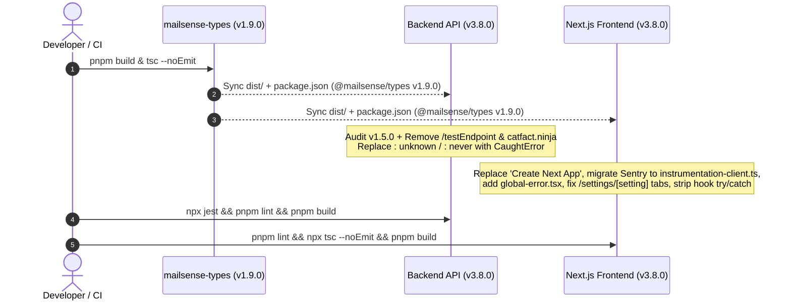

# Public Launch Readiness - Phase 1 Implementation Details

> **Feature:** 12. public-launch-readiness · **Phase:** 1 (Shared Contracts, Pre-Launch Health Audit & Baseline Bug Fixes)
> **Status:** COMPLETED
> **Created:** 2026-11-26 · **Last Updated:** 2026-11-26

---

## 1. Goal Description & Scope

Prepare the MailSense codebase baseline (`Backend`, `Frontend`, and `@mailsense/types`) prior to implementing new launch observability, legal compliance, AI job telemetry, and public analytics in Phases 2–6.

Specifically, Phase 1 accomplishes:

1. **Shared Contract Synchronization (`@mailsense/types v1.9.0`):**
   - Complete the build and downstream synchronization of `@mailsense/types v1.9.0` (staged locally per [types-implementation-plan.md](file:///Users/vishaljagamani/Projects/Projects/mailsense/.agents/plans/12.%20public-launch-readiness/types-implementation-plan.md)) into both `Backend/node_modules/@mailsense/types` and `Frontend/node_modules/@mailsense/types` (note: downstream consumers currently resolve `1.8.0`).
   - Verify the remediation of `UserDetailsObject.user_metadata` (`Record<string, unknown>`) and inline object types via `Auth0UserIdentity` and `Auth0UserMetadata`.
2. **Codebase Health Audit `v1.5.0` Execution:**
   - Verify all `v1.4.0` remediation items in [codebase-health-audit-report.md](file:///Users/vishaljagamani/Projects/Projects/mailsense/.agents/plans/codebase-health-audit-report.md) (including resolving remaining `BUG-V14-09` `console.error` occurrences in `PageHeader.tsx` and `use-email-keyboard-shortcuts/index.ts`, plus `use-inbox-page` checks).
   - Run automated static scans across all 11 mandatory dimensions per [health-audit-standards.md](file:///Users/vishaljagamani/Projects/Projects/mailsense/.agents/rules/health-audit-standards.md) and publish `## [1.5.0] - 2026-11-26` in `codebase-health-audit-report.md`.
3. **Backend Hygiene, Debug Removal & Type-Safety Remediation:**
   - Remove the unauthenticated `/testEndpoint` debug route from `Backend/src/app.ts` and `HEALTH_PROBES_API_ENDPOINTS` in `observability.constants.ts`.
   - Remove the leftover `url: 'https://catfact.ninja'` dead test entry from `Backend/src/core/config/app.config.ts`.
   - Update stale default release fallback `'3.2.0'` $\to$ `'3.8.0'` in `MonitoringManager`, and update stale LLM fallback `'gemini-2.5-flash'` $\to$ `'gemini-3.6-flash'` in `GeminiAiProvider`.
   - Eliminate all `: unknown`, `: never`, and `as unknown` placeholders across core error handling, logging types, `GeminiAiProvider`, `ai-processing.processor.ts`, and `server.ts` using explicit named interfaces and union error narrowing (`CaughtError`).
4. **Frontend SEO, Sentry Modernization, Settings Routing & Hook Hygiene:**
   - Replace `"Create Next App"` boilerplate in `Frontend/src/app/layout.tsx` with full MailSense SEO metadata (`title` template, `description`, `openGraph`, `twitter`, `robots`, `icons`).
   - Create `Frontend/src/app/robots.ts`, `Frontend/src/app/sitemap.ts`, `Frontend/src/app/opengraph-image.png`, and Next.js App Router root `Frontend/src/app/global-error.tsx`.
   - Migrate deprecated `Frontend/sentry.client.config.ts` $\to$ `Frontend/src/instrumentation-client.ts` (deleting `sentry.client.config.ts`) and bump stale `'3.2.0'` release fallbacks in `frontend.manager.ts` and `sentry-frontend.provider.ts` to `'3.8.0'`.
   - Fix the `/settings/[setting]` dynamic tab routing bug in `Frontend/src/features/settings/pages/index.tsx` (`defaultValue="profile"` ignoring route params) and mount the `about` `<TabsContent>` slot with a clean Phase 4 stub.
   - Replace `'shadcn'` / `'CN'` placeholders in `sidebar.constants.ts` and `nav-user.tsx`, and remove commented-out JSX blocks (`nav-user.tsx` L63–80).
   - Remove prohibited `try/catch` blocks, `console.error` calls, and `as unknown` casts in custom hooks (`useDashboardPage.ts`, `useDraftsPage.ts`, `use-email-keyboard-shortcuts/index.ts`, `useComposeEmailAttachments.ts`, `PageHeader.tsx`, `errors.ts`).

---

## 2. User Review Required & Architectural Notes

> [!IMPORTANT]
> **Key Architectural Decisions & Standards Adherence**
>
> - **Eliminating `unknown` and `never` Without Weakening Type Safety:** Rather than typing caught error parameters as `unknown` or `Record<string, unknown>` (or typing throwing helpers as `: never`), we define a dedicated named union `CaughtError` (`Error | ErrorWithStatus | string | number | boolean | object | null | undefined`) inside dedicated error types files (`Backend/src/core/types/error.types.ts` and `Frontend/src/shared/types/errors.types.ts`). TypeScript continues enforcing `instanceof Error` and property narrowing guards (`'status' in error`) while keeping ESLint clean under zero-`unknown` / zero-`never` rules.
> - **Boundary-Only Error Handling in React Components & Hooks:** Per [MailSense Coding Standards](file:///Users/vishaljagamani/Projects/Projects/mailsense/.agents/rules/coding-standards.md), React custom hooks (`useDashboardPage.ts`, `useDraftsPage.ts`, `use-email-keyboard-shortcuts/index.ts`, `useComposeEmailAttachments.ts`) and React UI components (`PageHeader.tsx`) MUST NOT contain `try/catch` blocks. Async server mutations are moved cleanly to React Query `useMutation` hooks (`onSuccess` / `onError` callbacks) which manage errors natively at the API/Query boundary.
> - **Shared `@mailsense/types v1.9.0` Consumption:** All contract additions (`ErrorLogAttributes`, `AiProcessingJobAttributes`, `FeedbackAttributes`, `Auth0UserIdentity`, `Auth0UserMetadata`) are already prepared in `mailsense-types` per [types-implementation-plan.md](file:///Users/vishaljagamani/Projects/Projects/mailsense/.agents/plans/12.%20public-launch-readiness/types-implementation-plan.md). Phase 1 verifies `pnpm build` in `mailsense-types` and syncs the built `dist/` & `package.json` into both `Backend` and `Frontend`.
> - **Social Preview Card (`opengraph-image.png`):** Generate or place a crisp `1200x630` PNG brand banner at `Frontend/src/app/opengraph-image.png` showing the MailSense logo, tagline (`Unified Inbox. Intelligent Focus.`), and dark-slate visual styling for LinkedIn, X/Twitter, Instagram, and portfolio unfurling.

---

## 3. Component Overview & File Map

| Component             | Target File                                                                                                     |       Action       | Purpose                                                                                                     |
| :-------------------- | :-------------------------------------------------------------------------------------------------------------- | :----------------: | :---------------------------------------------------------------------------------------------------------- |
| **Shared Types Sync** | `mailsense-types/` $\to$ `Backend` & `Frontend` `node_modules/@mailsense/types`                                 |     **[SYNC]**     | Propagate compiled `@mailsense/types v1.9.0` declarations and subpath exports                               |
| **Health Audit**      | `mailsense/.agents/plans/codebase-health-audit-report.md`                                                       |    **[MODIFY]**    | Append Audit `v1.5.0` verifying `v1.4.0` fixes and recording pre-launch baseline scores                     |
| **Backend Types**     | `Backend/src/core/types/error.types.ts`                                                                         |    **[MODIFY]**    | Add `CaughtError` & `GeminiRawErrorPayload` / typed error unions                                            |
| **Backend Types**     | `Backend/src/core/types/observability.types.ts`                                                                 |    **[MODIFY]**    | Replace `unknown` and inline object types in `LogContext` & `ITelemetrySink`                                |
| **Backend Types**     | `Backend/src/integrations/ai/ai.provider.types.ts`                                                              |    **[MODIFY]**    | Add `GeminiErrorHeaders` and `GeminiRawApiError` interfaces                                                 |
| **Backend Config**    | `Backend/src/app.ts`                                                                                            |    **[MODIFY]**    | Remove unauthenticated `/testEndpoint` debug route                                                          |
| **Backend Config**    | `Backend/src/core/config/app.config.ts`                                                                         |    **[MODIFY]**    | Remove dead `catfact.ninja` URL from `config` export                                                        |
| **Backend Constants** | `Backend/src/core/constants/observability.constants.ts`                                                         |    **[MODIFY]**    | Remove `'/testEndpoint'` from `HEALTH_PROBES_API_ENDPOINTS`                                                 |
| **Backend Telemetry** | `Backend/src/core/monitoring/monitoring.manager.ts`                                                             |    **[MODIFY]**    | Update fallback release version `'3.2.0'` $\to$ `'3.8.0'`                                                   |
| **Backend Errors**    | `Backend/src/core/errors/AxiosApiError.ts`                                                                      |    **[MODIFY]**    | Replace `: unknown` parameters with `CaughtError`                                                           |
| **Backend Errors**    | `Backend/src/core/middlewares/error.handler.ts`                                                                 |    **[MODIFY]**    | Replace `err: unknown` with `CaughtError`                                                                   |
| **Backend AI**        | `Backend/src/integrations/ai/providers/gemini.provider.ts`                                                      |    **[MODIFY]**    | Bump default model to `'gemini-3.6-flash'`; eliminate `: unknown`, `: never`, and `Record<string, unknown>` |
| **Backend Workers**   | `Backend/src/workers/processors/ai-processing.processor.ts`                                                     |    **[MODIFY]**    | Replace `error: unknown` with `CaughtError`                                                                 |
| **Backend Entry**     | `Backend/src/server.ts`                                                                                         |    **[MODIFY]**    | Remove `: unknown` annotation from `catch (error)`                                                          |
| **Frontend Types**    | `Frontend/src/shared/types/errors.types.ts`                                                                     |    **[MODIFY]**    | Add `GlobalErrorProps`, `NextJsRuntimeError` & `ClientCaughtError`                                          |
| **Frontend Types**    | `Frontend/src/shared/types/pages.types.ts`                                                                      |    **[MODIFY]**    | Allow optional `setting?: string` in `SettingsPageProps` for `/settings` root                               |
| **Frontend Config**   | `Frontend/src/config/config.ts`                                                                                 |    **[MODIFY]**    | Export `APP_BASE_URL` resolved from `NEXT_PUBLIC_SITE_URL`                                                  |
| **Frontend SEO**      | `Frontend/src/shared/constants/seo.ts` & `Frontend/src/shared/constants/index.ts`                               |     **[NEW]**      | Centralize `LAYOUT_METADATA`, `ROBOTS_ROUTES`, and `METADATA_SITEMAP` constants                             |
| **Frontend SEO**      | `Frontend/src/app/layout.tsx`                                                                                   |    **[MODIFY]**    | Replace boilerplate metadata using centralized `LAYOUT_METADATA(APP_BASE_URL)`                              |
| **Frontend SEO**      | `Frontend/src/app/robots.ts`                                                                                    |     **[NEW]**      | Search engine crawl directives delegating to `ROBOTS_ROUTES(APP_BASE_URL)`                                  |
| **Frontend SEO**      | `Frontend/src/app/sitemap.ts`                                                                                   |     **[NEW]**      | Dynamic XML sitemap delegating to `METADATA_SITEMAP(APP_BASE_URL)`                                          |
| **Frontend SEO**      | `Frontend/src/app/opengraph-image.png`                                                                          |     **[NEW]**      | 1200x630 PNG social sharing preview card                                                                    |
| **Frontend Errors**   | `Frontend/src/app/global-error.tsx`                                                                             |     **[NEW]**      | Next.js App Router root layout error boundary with Sentry capture and recovery CTA                          |
| **Frontend Sentry**   | `Frontend/src/instrumentation-client.ts`                                                                        |     **[NEW]**      | Next.js 16 standard client Sentry entry (`release: '3.8.0'`, router transition tracking)                    |
| **Frontend Sentry**   | `Frontend/sentry.client.config.ts`                                                                              |    **[DELETE]**    | Deprecated Sentry client config replaced by `src/instrumentation-client.ts`                                 |
| **Frontend Sentry**   | `Frontend/src/shared/monitoring/frontend.manager.ts` & `providers/sentry-frontend.provider.ts`                  |    **[MODIFY]**    | Update hardcoded `'3.2.0'` fallbacks to `process.env.NEXT_PUBLIC_APP_VERSION \|\| '3.8.0'`                  |
| **Frontend Settings** | `Frontend/src/features/settings/components/about/AboutSettingsStub.tsx`                                         |     **[NEW]**      | Lightweight Phase 1 placeholder rendered inside `/settings/about` until Phase 4 builds full page            |
| **Frontend Settings** | `Frontend/src/features/settings/pages/index.tsx`                                                                |    **[MODIFY]**    | Mount `<TabsContent value="about">` and control active tab from `setting` route param (`value={activeTab}`) |
| **Frontend Sidebar**  | `Frontend/src/shared/constants/sidebar.constants.ts` & `shared/components/sidebar/nav-user.tsx`                 |    **[MODIFY]**    | Remove `'shadcn'` / `'CN'` placeholders; remove commented-out JSX blocks (`nav-user.tsx` L63–80)            |
| **Frontend Header**   | `Frontend/src/features/accounts/api/accounts.queries.ts` & `shared/components/header/PageHeader.tsx`            |    **[MODIFY]**    | Convert `useSyncAllAccounts` to `useMutation`; remove `try/catch` and `console.error` from `PageHeader`     |
| **Frontend Hooks**    | `Frontend/src/features/analytics/hooks/useDashboardPage.ts`                                                     |    **[MODIFY]**    | Remove prohibited `try/catch` in `handleRefresh`; handle errors via React Query state                       |
| **Frontend Hooks**    | `Frontend/src/features/drafts/api/draft.mutations.ts` & `features/drafts/hooks/useDraftsPage.ts`                |    **[MODIFY]**    | Handle toast/error notifications inside `draft.mutations.ts`; remove `try/catch` in `useDraftsPage`         |
| **Frontend Hooks**    | `Frontend/src/features/emails/hooks/use-email-keyboard-shortcuts/index.ts`                                      |    **[MODIFY]**    | Remove prohibited `try/catch` and `console.error`                                                           |
| **Frontend Hooks**    | `Frontend/src/features/emails/api/attachment.api.ts`, `attachment.mutations.ts` & `useComposeEmailAttachments.ts` | **[NEW]/[MODIFY]** | Move attachment upload/delete into React Query mutations; remove `as unknown` and hook `try/catch`          |
| **Frontend Errors**   | `Frontend/src/shared/api/errors.ts`                                                                             |    **[MODIFY]**    | Replace `: unknown` with `ClientCaughtError`                                                                |

---

## 4. Main Section 1: Backend Layer Implementation

### 4.0 `@mailsense/types v1.9.0` Sync & Codebase Health Audit `v1.5.0`

#### Step A: Build & Sync `@mailsense/types v1.9.0`

Per [types-implementation-plan.md](file:///Users/vishaljagamani/Projects/Projects/mailsense/.agents/plans/12.%20public-launch-readiness/types-implementation-plan.md), `mailsense-types` v1.9.0 defines `AiTokenUsage`, `AiProcessingJobAttributes`, `ErrorLogAttributes`, `FeedbackAttributes`, `SendTransactionalEmailParams`, `DeleteUserAccountRequest`/`Response`, `Auth0UserIdentity`, and `Auth0UserMetadata`. Build and sync the updated package before editing Backend or Frontend:

```bash
cd /Users/vishaljagamani/Projects/Projects/mailsense-types
pnpm build && npx tsc --noEmit

# Sync compiled v1.9.0 package artifacts into both consumers (when not workspace-linked)
rm -rf /Users/vishaljagamani/Projects/Projects/mailsense/Backend/node_modules/@mailsense/types/dist
cp -r /Users/vishaljagamani/Projects/Projects/mailsense-types/dist /Users/vishaljagamani/Projects/Projects/mailsense/Backend/node_modules/@mailsense/types/
cp /Users/vishaljagamani/Projects/Projects/mailsense-types/package.json /Users/vishaljagamani/Projects/Projects/mailsense/Backend/node_modules/@mailsense/types/package.json

rm -rf /Users/vishaljagamani/Projects/Projects/mailsense/Frontend/node_modules/@mailsense/types/dist
cp -r /Users/vishaljagamani/Projects/Projects/mailsense-types/dist /Users/vishaljagamani/Projects/Projects/mailsense/Frontend/node_modules/@mailsense/types/
cp /Users/vishaljagamani/Projects/Projects/mailsense-types/package.json /Users/vishaljagamani/Projects/Projects/mailsense/Frontend/node_modules/@mailsense/types/package.json
```

#### Step B: Codebase Health Audit `v1.5.0` Verification Protocol

Execute all audit checks per [health-audit-standards.md](file:///Users/vishaljagamani/Projects/Projects/mailsense/.agents/rules/health-audit-standards.md) against `v1.4.0` findings and append `## [1.5.0] - 2026-11-26` to [codebase-health-audit-report.md](file:///Users/vishaljagamani/Projects/Projects/mailsense/.agents/plans/codebase-health-audit-report.md):

1. Verify every `BUG-V14-*` item status (`BUG-V14-01` `/api/utils` removal, `BUG-V14-02` `email-write.service.ts` attachment check, `BUG-V14-03` `EmailThreadService.getEmail` projection, `BUG-V14-04` `DraftRepository.updateDraft` tenant scoping, `BUG-V14-05` orphan `email.controller.ts`, `BUG-V14-06` `use-inbox-page/index.ts`, `BUG-V14-07` `uploadStagedAttachment`, `BUG-V14-09` residual `console.error`).
2. Scan line counts, forbidden `any`/`unknown`/`never`, forbidden `try/catch` in repos/hooks/components/utils, inline object types, and directory naming (`kebab-case` + `PascalCase.tsx`).
3. Score all 8 Health Scorecard dimensions, produce the updated P0–P3 Remediation Roadmap, and record new `v1.5.0` findings (resolved in Phase 1 vs scheduled for Phases 2–5).

---

### 4.1 Dedicated Backend Types (`Backend/src/core/types/` & `Backend/src/integrations/ai/`)

#### 1. `Backend/src/core/types/error.types.ts` [MODIFY]

Add `CaughtError` so error normalizers avoid `: unknown` while maintaining strict TypeScript narrowing:

```typescript
import { ErrorCode } from "@errors";

export interface ValidationDetail {
  field: string;
  message: string;
  value?: string | number | boolean;
}

export interface ErrorContext {
  resource?: string;
  identifier?: string;
  provider?: string;
  details?: ValidationDetail[];
  metadata?: Record<string, string | number | boolean>;
}

export interface AppErrorConstructorParams {
  message: string;
  httpStatus?: number;
  errorCode?: ErrorCode;
  isOperational?: boolean;
  description?: string;
  suggestedAction?: string;
  traceId?: string;
  context?: ErrorContext;
}

export interface ErrorDetailPayload {
  code: number;
  errorCode: ErrorCode;
  traceId: string;
  description: string;
  suggestedAction: string;
  details?: ValidationDetail[];
  stack?: string;
  external?: Record<string, string | number | boolean>;
}

export interface ErrorResponsePayload {
  status: false;
  message: string;
  error: ErrorDetailPayload;
}

export interface ProviderApiErrorParams {
  provider: string;
  message: string;
  providerStatusCode?: number;
  providerErrorMessage?: string;
  description?: string;
  suggestedAction?: string;
  traceId?: string;
}

export interface SyncErrorParams {
  accountId: string;
  syncJobId?: string;
  provider?: string;
  message: string;
  description?: string;
  traceId?: string;
}

export interface ProviderErrorResponse {
  error?: {
    message?: string;
    code?: number | string;
    status?: string;
  };
  message?: string;
}

export interface ErrorWithStatus {
  status?: number;
  statusCode?: number;
  response?: {
    status?: number;
    statusCode?: number;
  };
}

export interface ParsedErrorDetails {
  message: string;
  statusCode: number;
  originalError?: Record<string, string | number | boolean>;
}

export interface AiProcessingErrorParams {
  provider: string;
  message: string;
  model?: string;
  description?: string;
  suggestedAction?: string;
  traceId?: string;
  processingDurationMs?: number;
}

// Explicit union for caught runtime error values (replaces forbidden `unknown` type annotations)
export type CaughtError =
  | Error
  | ErrorWithStatus
  | string
  | number
  | boolean
  | object
  | null
  | undefined;
```

#### 2. `Backend/src/core/types/observability.types.ts` [MODIFY]

Eliminate `unknown` and inline object signatures in `LogContext` and `ITelemetrySink`:

```typescript
import { LOG_LEVELS } from "./monitoring.types.js";

export interface TraceStore {
  traceId: string;
  userId?: string;
  accountId?: string;
  userEmail?: string;
  userName?: string;
}

export interface CreateLoggerOptions {
  forwardToMonitoring?: boolean;
}

export type LoggableValue =
  | string
  | number
  | boolean
  | Error
  | object
  | undefined;

export interface LogContext {
  traceId?: string;
  userId?: string;
  userEmail?: string;
  userName?: string;
  accountId?: string;
  provider?: string;
  operation?: string;
  durationMs?: number;
  errorCode?: string;
  statusCode?: number;
  method?: string;
  path?: string;
  userAgent?: string;
  jobId?: string;
  queueName?: string;
  jobName?: string;
  error?: LoggableValue;
  stack?: string;
  [key: string]: LoggableValue;
}

export interface ModuleLogger {
  info(msg: string, ctx?: LogContext): void;
  error(msg: string, ctx?: LogContext): void;
  warn(msg: string, ctx?: LogContext): void;
  debug(msg: string, ctx?: LogContext): void;
}

export interface TelemetryBreadcrumb {
  category: string;
  message: string;
  level: LOG_LEVELS;
  data?: Record<string, string | number | boolean>;
}

export interface TelemetryExceptionContext {
  tags?: Record<string, string | number | boolean>;
  extra?: Record<string, string | number | boolean>;
}

export interface ITelemetrySink {
  addBreadcrumb(breadcrumb: TelemetryBreadcrumb): void;
  captureException(error: Error, context?: TelemetryExceptionContext): void;
}
```

#### 3. `Backend/src/integrations/ai/ai.provider.types.ts` [MODIFY]

Add explicit named interfaces for Gemini SDK error narrowing so `GeminiAiProvider` requires zero `unknown`, zero `never`, and zero inline casts:

```typescript
export interface GeminiProviderConfig {
  apiKey?: string;
  modelName?: string;
  timeoutMs?: number;
}

export interface SanitizedEmailContent {
  subject: string;
  from: string;
  to: string[];
  sanitizedBody: string;
  receivedAt: Date;
}

export interface GeminiErrorHeaders {
  "retry-after"?: string;
}

export interface GeminiRawApiError {
  status?: number;
  statusCode?: number;
  message?: string;
  headers?: GeminiErrorHeaders;
}
```

---

### 4.2 Core Configuration, Constants & App Hygiene

#### 1. `Backend/src/app.ts` [MODIFY]

Remove the `/testEndpoint` debug route before public launch:

```typescript
    private setupRoutes(): void {
        // Mount health probes at both root and /api for cloud orchestrator compatibility
        this.expressApp.use(healthRoutes);
        this.expressApp.use('/api', healthRoutes);

        this.expressApp.use('/api', defaultApiRateLimiter, indexRoutes);
    }
```

#### 2. `Backend/src/core/config/app.config.ts` [MODIFY]

Remove the dead `url: 'https://catfact.ninja'` leftover property from `config`:

```typescript
export const config = {
  nodeEnv: ENV.NODE_ENV,
};
```

#### 3. `Backend/src/core/constants/observability.constants.ts` [MODIFY]

Remove `'/testEndpoint'` from `HEALTH_PROBES_API_ENDPOINTS`:

```typescript
export const HEALTH_PROBES_API_ENDPOINTS = [
  "/health",
  "/health/ready",
  "/api/health",
  "/api/health/ready",
] as const;
```

#### 4. `Backend/src/core/monitoring/monitoring.manager.ts` [MODIFY]

Update the stale fallback release string `'3.2.0'` $\to$ `'3.8.0'`:

```typescript
    private getDefaultConfig(): DefaultMonitoringConfig {
        return {
            dsn: process.env.SENTRY_DSN,
            environment: NODE_ENV || 'development',
            release: process.env.APP_VERSION || '3.8.0',
            sampleRate: 1.0,
            sendDefaultPii: true,
            debug: false,
            enableLogs: process.env.SENTRY_ENABLE_LOGS !== 'false',
        };
    }
```

---

### 4.3 Error Handling & Entry Type-Safety Fixes

#### 1. `Backend/src/core/errors/AxiosApiError.ts` [MODIFY]

Replace `: unknown` parameters with `CaughtError` imported from `@types`:

```typescript
import { CaughtError, ParsedErrorDetails, ProviderErrorResponse } from "@types";
import axios, { AxiosError } from "axios";
import { ProviderApiError } from "./DomainErrors.js";

function extractAxiosMessage(error: AxiosError<ProviderErrorResponse>): string {
  const data = error?.response?.data;
  const dataMessage = data?.error?.message ?? data?.message;
  return dataMessage || error.message || "External HTTP request failed";
}

function extractAxiosMetadata(
  error: AxiosError<ProviderErrorResponse>,
  statusCode: number,
): Record<string, string | number | boolean> | undefined {
  if (!error.response?.data) {
    return undefined;
  }
  const config = error.config;
  return {
    status: statusCode,
    url: config?.url ?? "unknown",
    method: config?.method ?? "unknown",
  };
}

function parseAxiosError(
  error: AxiosError<ProviderErrorResponse>,
): ParsedErrorDetails {
  const statusCode = error.response?.status ?? 502;
  const message = extractAxiosMessage(error);
  const originalError = extractAxiosMetadata(error, statusCode);
  return { message, statusCode, originalError };
}

function parseGenericError(error: CaughtError): ParsedErrorDetails {
  const message = error instanceof Error ? error.message : String(error);
  return {
    message,
    statusCode: 500,
    originalError: { message },
  };
}

function resolveErrorDetails(error: CaughtError): ParsedErrorDetails {
  if (axios.isAxiosError(error)) {
    return parseAxiosError(error as AxiosError<ProviderErrorResponse>);
  }
  return parseGenericError(error);
}

export class AxiosApiError extends ProviderApiError {
  public readonly originalError?: Record<string, string | number | boolean>;

  constructor(
    error: CaughtError,
    providerName = "ExternalAPI",
    traceId?: string,
  ) {
    const details = resolveErrorDetails(error);

    super({
      provider: providerName,
      message: details.message,
      providerStatusCode: details.statusCode,
      providerErrorMessage: details.message,
      traceId,
    });

    this.originalError = details.originalError;
  }
}
```

#### 2. `Backend/src/core/middlewares/error.handler.ts` [MODIFY]

Replace `err: unknown` with `CaughtError`:

```typescript
import { NODE_ENV } from "@config";
import { LOGGER_MODULE } from "@constants";
import { AppError, AxiosApiError, ErrorCode } from "@errors";
import { monitoring } from "@monitoring";
import { createLogger } from "@observability";
import { CaughtError, ErrorResponsePayload } from "@types";
import { NextFunction, Request, Response } from "express";

const logger = createLogger(LOGGER_MODULE.SERVER);

const normalizeAppError = (err: CaughtError): AppError => {
  let appError: AppError;
  if (err instanceof AppError) {
    appError = err;
  } else if (err instanceof Error) {
    appError = new AppError({
      message: err.message,
      httpStatus: 500,
      errorCode: ErrorCode.INTERNAL_ERROR,
      isOperational: false,
      description: "An unhandled internal application error occurred.",
      suggestedAction:
        "Please try again later. System administrators have been alerted.",
    });
    appError.stack = err.stack;
  } else {
    appError = new AppError({
      message: "An unexpected and unclassified error occurred.",
      httpStatus: 500,
      errorCode: ErrorCode.INTERNAL_ERROR,
      isOperational: false,
    });
  }
  return appError;
};

const captureNonOperationalErrors = (
  appError: AppError,
  statusCode: number,
  req: Request,
) => {
  monitoring.captureException(appError, {
    traceId: appError.traceId,
    httpStatus: statusCode,
    errorCode: appError.errorCode,
    user: req.user ? { id: req.user.id, email: req.user.email } : undefined,
    tags: {
      method: req.method,
      path: req.path,
    },
    extra: {
      url: req.originalUrl,
      query: JSON.stringify(req.query),
    },
  });
};

export const errorHandler = (
  err: CaughtError,
  req: Request,
  res: Response,
  _next: NextFunction,
): void => {
  try {
    const appError = normalizeAppError(err);
    const statusCode = appError.httpStatus || 500;
    const isDev = NODE_ENV === "local" || NODE_ENV === "development";

    logger.error(
      `[${req.method}] ${req.url} -> ${statusCode} [${appError.errorCode}] :: ${appError.message}`,
      {
        errorCode: appError.errorCode,
        traceId: appError.traceId,
        httpStatus: statusCode,
        stack: appError.stack,
      },
    );

    if (!appError.isOperational || statusCode >= 500) {
      captureNonOperationalErrors(appError, statusCode, req);
    }

    const errorPayload: ErrorResponsePayload = appError.toJSON(isDev);
    if (isDev && appError instanceof AxiosApiError && appError.originalError) {
      errorPayload.error.external = appError.originalError;
    }

    res.status(statusCode).json(errorPayload);
  } catch (criticalHandlerError) {
    const fallbackMessage =
      criticalHandlerError instanceof Error
        ? criticalHandlerError.message
        : String(criticalHandlerError);
    logger.error(
      `Critical failure in errorHandler middleware: ${fallbackMessage}`,
    );

    res.status(500).json({
      status: false,
      message: "Internal Server Error",
      error: {
        code: 500,
        errorCode: ErrorCode.INTERNAL_ERROR,
        traceId: "",
        description:
          "A critical unexpected error occurred while processing the error response.",
      },
    });
  }
};
```

#### 3. `Backend/src/server.ts` [MODIFY]

Remove the explicit `: unknown` annotation on `catch`:

```typescript
    } catch (error) {
        const errorMessage = error instanceof Error ? error.message : String(error);
        logger.error(`❌ Failed to start server: ${errorMessage}`, { error });
        process.exit(1);
    }
```

---

### 4.4 AI Provider & Worker Type/Model Remediation

#### 1. `Backend/src/integrations/ai/providers/gemini.provider.ts` [MODIFY]

1. Update default fallback from `'gemini-2.5-flash'` $\to$ `'gemini-3.6-flash'`.
2. Replace `handleProviderError(...): never` with `buildProviderError(...): AppError` (each `catch` executes `throw this.buildProviderError(error instanceof Error ? error : String(error), operation, Date.now() - startTime);`).
3. Replace `: unknown` and `Record<string, unknown>` casts with `CaughtError` and `GeminiRawApiError`:

```typescript
import { AI_CONFIG } from "@config";
import { LOGGER_MODULE } from "@constants";
import {
  AiProcessingError,
  AppError,
  ConfigurationError,
  RateLimitError,
} from "@errors";
import { GoogleGenAI } from "@google/genai";
import {
  AI_PROVIDER_NAME,
  AiClassifyEmailParams,
  AiClassifyEmailResult,
  AiSuggestedRepliesParams,
  AiSuggestedRepliesResult,
  AiSummarizeThreadParams,
  AiSummarizeThreadResult,
} from "@mailsense/types";
import { createLogger } from "@observability";
import { CaughtError } from "@types";
import { IAiProvider } from "../ai.provider.js";
import {
  GeminiProviderConfig,
  GeminiRawApiError,
} from "../ai.provider.types.js";
import {
  geminiClassifyAndScoreAiResponseSchema,
  geminiGenerateSuggestedRepliesAiResponseSchema,
  geminiSummarizeEmailThreadAiResponseSchema,
} from "../utils/gemini.utils.js";

const logger = createLogger(LOGGER_MODULE.GEMINI_PROVIDER);

const DEFAULT_TIMEOUT_MS = 30000;
const MAX_BODY_CHARACTERS = 4000;
const DEFAULT_GEMINI_MODEL = "gemini-3.6-flash";

export class GeminiAiProvider implements IAiProvider {
  public readonly name: AI_PROVIDER_NAME = AI_PROVIDER_NAME.GEMINI;
  private readonly client: GoogleGenAI;
  private readonly modelName: string;
  private readonly timeoutMs: number;

  constructor(config?: GeminiProviderConfig) {
    const apiKey = config?.apiKey ?? AI_CONFIG.geminiApiKey;
    if (!apiKey) {
      throw new ConfigurationError(
        "GEMINI_API_KEY environment variable is required to initialize GeminiAiProvider.",
        "GEMINI_API_KEY",
        "Add GEMINI_API_KEY to your environment variables or switch AI_PROVIDER to noop.",
      );
    }
    this.client = new GoogleGenAI({ apiKey });
    this.modelName =
      config?.modelName ?? AI_CONFIG.geminiModel ?? DEFAULT_GEMINI_MODEL;
    this.timeoutMs = config?.timeoutMs ?? DEFAULT_TIMEOUT_MS;
  }

  public async classifyAndScoreEmail(
    params: AiClassifyEmailParams,
  ): Promise<AiClassifyEmailResult> {
    const startTime = Date.now();
    const sanitizedBody = this.sanitizeText(params.bodyPlain);
    const prompt = [
      `Classify the following incoming email message into a category, priority level, tags, and brief 1-sentence summary.`,
      `Subject: ${params.subject}`,
      `From: ${params.from}`,
      `To: ${params.to.join(", ")}`,
      `Received: ${params.receivedAt.toISOString()}`,
      `Body:`,
      sanitizedBody,
    ].join("\n");

    try {
      const parsed = await this.generateWithSchema<AiClassifyEmailResult>(
        prompt,
        geminiClassifyAndScoreAiResponseSchema(),
      );
      logger.info("Email classified successfully by Gemini", {
        category: parsed.category,
        priority: parsed.priority,
        durationMs: Date.now() - startTime,
      });
      return parsed;
    } catch (error) {
      throw this.buildProviderError(
        error as CaughtError,
        "classifyAndScoreEmail",
        Date.now() - startTime,
      );
    }
  }

  public async summarizeEmailThread(
    params: AiSummarizeThreadParams,
  ): Promise<AiSummarizeThreadResult> {
    const startTime = Date.now();
    const messagesText = params.messages
      .map((msg, index) => {
        const body = this.sanitizeText(msg.bodyPlain);
        return `--- Message ${index + 1} from ${msg.from} on ${msg.date.toISOString()} ---\n${body}`;
      })
      .join("\n\n");

    const prompt = [
      `Summarize the following email conversation thread into an executive summary, bulleted key points, and clear action items.`,
      `Thread Subject: ${params.threadSubject}`,
      messagesText,
    ].join("\n");

    try {
      const parsed = await this.generateWithSchema<AiSummarizeThreadResult>(
        prompt,
        geminiSummarizeEmailThreadAiResponseSchema(),
      );
      logger.info("Thread summarized successfully by Gemini", {
        keyPointsCount: parsed.keyPoints.length,
        actionItemsCount: parsed.actionItems.length,
        durationMs: Date.now() - startTime,
      });
      return parsed;
    } catch (error) {
      throw this.buildProviderError(
        error as CaughtError,
        "summarizeEmailThread",
        Date.now() - startTime,
      );
    }
  }

  public async generateSuggestedReplies(
    params: AiSuggestedRepliesParams,
  ): Promise<AiSuggestedRepliesResult> {
    const startTime = Date.now();
    const sanitizedBody = this.sanitizeText(params.bodyPlain);
    const threadContext = params.recentMessages
      ? params.recentMessages
          .map(
            (msg, idx) =>
              `[Prior Msg ${idx + 1} (${msg.from})]: ${this.sanitizeText(msg.bodyPlain)}`,
          )
          .join("\n")
      : "";

    const prompt = [
      `Generate 2 to 3 contextual, natural suggested replies to the latest email in this conversation.`,
      threadContext ? `Conversation Context:\n${threadContext}\n` : "",
      `Latest Message Subject: ${params.subject}`,
      `From: ${params.from}`,
      `To: ${params.to.join(", ")}`,
      `Content:`,
      sanitizedBody,
    ].join("\n");

    try {
      const parsed = await this.generateWithSchema<AiSuggestedRepliesResult>(
        prompt,
        geminiGenerateSuggestedRepliesAiResponseSchema(),
      );
      logger.info("Suggested replies generated successfully by Gemini", {
        suggestionCount: parsed.suggestions.length,
        durationMs: Date.now() - startTime,
      });
      return parsed;
    } catch (error) {
      throw this.buildProviderError(
        error as CaughtError,
        "generateSuggestedReplies",
        Date.now() - startTime,
      );
    }
  }

  private async generateWithSchema<T>(
    prompt: string,
    schema: object,
  ): Promise<T> {
    const controller = new AbortController();
    const timeoutId = setTimeout(() => controller.abort(), this.timeoutMs);

    try {
      const response = await this.client.models.generateContent({
        model: this.modelName,
        contents: prompt,
        config: {
          responseMimeType: "application/json",
          responseSchema: schema,
          temperature: 0.1,
          abortSignal: controller.signal,
        },
      });

      const text = response.text;
      if (!text) {
        throw new Error("Gemini API returned an empty text payload.");
      }
      return JSON.parse(text) as T;
    } finally {
      clearTimeout(timeoutId);
    }
  }

  private sanitizeText(raw: string): string {
    if (!raw) return "";
    return raw
      .replace(/<[^>]*>/g, " ")
      .replace(/\s+/g, " ")
      .trim()
      .slice(0, MAX_BODY_CHARACTERS);
  }

  private buildProviderError(
    error: CaughtError,
    operation: string,
    durationMs: number,
  ): AppError {
    const message = error instanceof Error ? error.message : String(error);
    logger.error(`Gemini AI operation failed: ${operation}`, {
      error: message,
      durationMs,
    });

    if (this.isRateLimitError(error)) {
      const retryAfterMs = this.extractRetryAfterMs(error) ?? 10000;
      return new RateLimitError("gemini", retryAfterMs);
    }

    return new AiProcessingError({
      provider: "gemini",
      model: this.modelName,
      message: `Failed during ${operation}: ${message}`,
      processingDurationMs: durationMs,
    });
  }

  private isRateLimitError(error: CaughtError): boolean {
    if (typeof error !== "object" || error === null) {
      return false;
    }
    const err = error as GeminiRawApiError;
    if (err.status === 429 || err.statusCode === 429) {
      return true;
    }
    const message = String(err.message ?? "");
    return message.includes("RESOURCE_EXHAUSTED") || message.includes("429");
  }

  private extractRetryAfterMs(error: CaughtError): number | undefined {
    if (typeof error !== "object" || error === null) {
      return undefined;
    }
    const err = error as GeminiRawApiError;
    const retryHeader = err.headers?.["retry-after"];
    if (!retryHeader) {
      return undefined;
    }
    const parsed = parseInt(retryHeader, 10);
    return isNaN(parsed) ? undefined : parsed * 1000;
  }
}
```

#### 2. `Backend/src/workers/processors/ai-processing.processor.ts` [MODIFY]

Replace `error: unknown` in `handleAIProcessingError` with `CaughtError` imported from `@types`:

```typescript
import { CaughtError } from '@types';

const handleAIProcessingError = async (error: CaughtError, emailId: string, durationMs: number): Promise<AIProcessingJobResult> => {
    // Existing RateLimitError & logging logic unchanged
```

---

## 5. Main Section 2: Frontend Layer Implementation

### 5.1 Dedicated Frontend Types (`Frontend/src/shared/types/`)

#### 1. `Frontend/src/shared/types/errors.types.ts` [MODIFY]

Add `ClientCaughtError` and `GlobalErrorProps` (extending existing `ErrorFallbackProps` contracts without inline types):

```typescript
// Explicit union for caught frontend error values (replaces forbidden `unknown`)
export type ClientCaughtError =
  | Error
  | string
  | number
  | boolean
  | object
  | null
  | undefined;

export interface NextJsRuntimeError extends Error {
  readonly digest?: string;
}

export interface GlobalErrorProps {
  readonly error: NextJsRuntimeError;
  readonly reset: () => void;
}
```

#### 2. `Frontend/src/shared/types/pages.types.ts` [MODIFY]

Update `SettingsPageProps` so `/settings` (without dynamic param) cleanly defaults without TypeScript mismatch:

```typescript
export interface SettingsPageProps {
  setting?: string;
}
```

#### 3. `Frontend/src/shared/api/errors.ts` [MODIFY]

Replace `: unknown` parameters with `ClientCaughtError`:

```typescript
import {
  ApiErrorResponse,
  ClientCaughtError,
  FormattedClientError,
} from "@shared/types";
import axios, { AxiosError } from "axios";

const DefaultError = (err: ClientCaughtError): FormattedClientError => ({
  message: String(err),
  errorCode: "UNKNOWN_ERROR",
  traceId: "",
  description: "An unexpected client error occurred.",
  suggestedAction: "Please try again later.",
  httpStatus: 500,
});
```

And update signature:

```typescript
export function extractApiError(error: ClientCaughtError): FormattedClientError {
```

---

### 5.2 SEO Metadata, Sitemap, Robots & Root Error Boundary

#### 1. `Frontend/src/app/layout.tsx` [MODIFY]

Replace boilerplate `"Create Next App"` metadata with full SEO, OpenGraph, Twitter Card, and viewport metadata:

```typescript
import type { Metadata } from 'next';
import { Geist, Geist_Mono } from 'next/font/google';
import './globals.css';

import { RootLayoutProps } from '@shared/types';
import { Providers } from '../shared/providers';

const geistSans = Geist({
    variable: '--font-geist-sans',
    subsets: ['latin'],
});

const geistMono = Geist_Mono({
    variable: '--font-geist-mono',
    subsets: ['latin'],
});

const siteUrl = process.env.NEXT_PUBLIC_SITE_URL || 'https://mailsense.app';

export const metadata: Metadata = {
    metadataBase: new URL(siteUrl),
    title: {
        default: 'MailSense — Unified AI-Powered Email Client',
        template: '%s | MailSense',
    },
    description:
        'Open-source unified inbox connecting Gmail and Microsoft Outlook with privacy-first Gemini AI categorization, priority scoring, summaries, and quick replies.',
    keywords: ['unified inbox', 'email client', 'open source email', 'AI email assistant', 'Gmail', 'Outlook', 'MailSense'],
    authors: [{ name: 'MailSense Open Source Contributors' }],
    openGraph: {
        type: 'website',
        locale: 'en_US',
        url: siteUrl,
        siteName: 'MailSense',
        title: 'MailSense — Unified AI-Powered Email Client',
        description:
            'Connect Gmail & Outlook in one fast, open-source workspace with smart AI categorization, priority scoring, and thread summaries.',
    },
    twitter: {
        card: 'summary_large_image',
        title: 'MailSense — Unified AI-Powered Email Client',
        description:
            'Open-source unified inbox for Gmail & Outlook powered by privacy-first Gemini AI.',
    },
    robots: {
        index: true,
        follow: true,
    },
};

export default function RootLayout({ children }: Readonly<RootLayoutProps>) {
    return (
        <html lang="en" suppressHydrationWarning>
            <body className={`${geistSans.variable} ${geistMono.variable} antialiased`}>
                <Providers>{children}</Providers>
            </body>
        </html>
    );
}
```

#### 2. `Frontend/src/app/robots.ts` [NEW]

Allow indexing of public landing & compliance pages while blocking authenticated workspace routes:

```typescript
import type { MetadataRoute } from "next";

export default function robots(): MetadataRoute.Robots {
  const baseUrl = process.env.NEXT_PUBLIC_SITE_URL || "https://mailsense.app";

  return {
    rules: {
      userAgent: "*",
      allow: ["/get_started", "/privacy", "/terms"],
      disallow: [
        "/inbox",
        "/drafts",
        "/folders",
        "/accounts",
        "/settings",
        "/starred",
        "/api",
      ],
    },
    sitemap: `${baseUrl}/sitemap.xml`,
  };
}
```

#### 3. `Frontend/src/app/sitemap.ts` [NEW]

```typescript
import type { MetadataRoute } from "next";

export default function sitemap(): MetadataRoute.Sitemap {
  const baseUrl = process.env.NEXT_PUBLIC_SITE_URL || "https://mailsense.app";
  const lastModified = new Date("2026-11-26");

  return [
    {
      url: `${baseUrl}/get_started`,
      lastModified,
      changeFrequency: "monthly",
      priority: 1,
    },
    {
      url: `${baseUrl}/privacy`,
      lastModified,
      changeFrequency: "monthly",
      priority: 0.8,
    },
    {
      url: `${baseUrl}/terms`,
      lastModified,
      changeFrequency: "monthly",
      priority: 0.6,
    },
  ];
}
```

#### 4. `Frontend/src/app/opengraph-image.png` [NEW]

Create a static `1200x630` PNG asset at `Frontend/src/app/opengraph-image.png` featuring:

- Dark slate canvas (`#09090b`) matching MailSense dark theme.
- Brand wordmark: **MailSense** + subtitle: **Unified Inbox. Intelligent Focus.**
- Badges highlighting `Open Source (MIT)` · `Gmail & Outlook` · `Gemini AI`.
- Next.js App Router automatically wires `opengraph-image.png` into `<meta property="og:image">` and `<meta name="twitter:image">`.

#### 5. `Frontend/src/app/global-error.tsx` [NEW]

Root App Router boundary catching catastrophic root layout errors. Uses `GlobalErrorProps` from `@shared/types` and avoids JSX `try/catch`:

```typescript
'use client';

import * as Sentry from '@sentry/nextjs';
import { GlobalErrorProps } from '@shared/types';
import { useEffect, useState } from 'react';

export default function GlobalError({ error, reset }: GlobalErrorProps) {
    const [traceId] = useState<string>(() => (typeof crypto !== 'undefined' ? crypto.randomUUID() : ''));

    useEffect(() => {
        Sentry.captureException(error, {
            tags: { boundary: 'app-global-error', traceId },
        });
    }, [error, traceId]);

    return (
        <html lang="en">
            <body className="flex min-h-screen flex-col items-center justify-center bg-neutral-950 p-6 text-center text-neutral-100">
                <div className="max-w-md space-y-4 rounded-xl border border-neutral-800 bg-neutral-900 p-8">
                    <h1 className="text-xl font-semibold">MailSense encountered an unexpected error</h1>
                    <p className="text-sm text-neutral-400">
                        {error.message || 'An unexpected application fault occurred. Please try reloading the workspace.'}
                    </p>
                    {traceId && (
                        <p className="rounded bg-neutral-950 px-3 py-1.5 font-mono text-xs text-neutral-400">Trace ID: {traceId}</p>
                    )}
                    <button
                        type="button"
                        onClick={reset}
                        className="cursor-pointer rounded-lg bg-white px-4 py-2 text-sm font-medium text-neutral-950 hover:bg-neutral-200"
                    >
                        Reload Application
                    </button>
                </div>
            </body>
        </html>
    );
}
```

---

### 5.3 Sentry Client Modernization & Release Alignment

#### 1. `Frontend/src/instrumentation-client.ts` [NEW] & `Frontend/sentry.client.config.ts` [DELETE]

Migrate deprecated `sentry.client.config.ts` to Next.js 16 standard `src/instrumentation-client.ts`, updating `release` to `'3.8.0'`:

```typescript
import * as Sentry from "@sentry/nextjs";

const SENTRY_DSN = process.env.NEXT_PUBLIC_SENTRY_DSN;

if (SENTRY_DSN) {
  Sentry.init({
    dsn: SENTRY_DSN,
    environment: process.env.NODE_ENV || "development",
    release: process.env.NEXT_PUBLIC_APP_VERSION || "3.8.0",
    tracesSampleRate: 1.0,
    debug: false,
  });
}

export const onRouterTransitionStart = Sentry.captureRouterTransitionStart;
```

Remove the deprecated file after migration:

```bash
rm /Users/vishaljagamani/Projects/Projects/mailsense/Frontend/sentry.client.config.ts
```

#### 2. `Frontend/src/shared/monitoring/frontend.manager.ts` & `Frontend/src/shared/monitoring/providers/sentry-frontend.provider.ts` [MODIFY]

Update both hardcoded `'3.2.0'` fallbacks to `process.env.NEXT_PUBLIC_APP_VERSION || '3.8.0'`:

- In `frontend.manager.ts`:

```typescript
const effectiveConfig: FrontendMonitoringConfig = {
  provider: this.provider.name,
  environment: config?.environment ?? process.env.NODE_ENV ?? "development",
  release: config?.release ?? process.env.NEXT_PUBLIC_APP_VERSION ?? "3.8.0",
  dsn: config?.dsn ?? process.env.NEXT_PUBLIC_SENTRY_DSN,
  maxBreadcrumbs: config?.maxBreadcrumbs ?? 50,
};
```

- In `sentry-frontend.provider.ts`:

```typescript
Sentry.init({
  dsn,
  environment: config.environment || process.env.NODE_ENV || "development",
  release: config.release || process.env.NEXT_PUBLIC_APP_VERSION || "3.8.0",
});
```

---

### 5.4 Settings Routing Fix & Sidebar / Header Cleanup

#### 1. `Frontend/src/features/settings/components/about/AboutSettingsStub.tsx` [NEW]

Create a minimal Phase 1 panel placeholder so `/settings/about` renders cleanly prior to full Phase 4 implementation:

```typescript
'use client';

import React from 'react';

const AboutSettingsStub: React.FC = () => {
    const version = process.env.NEXT_PUBLIC_APP_VERSION || '3.8.0';

    return (
        <div className="mt-4 max-w-2xl space-y-3 rounded-lg border p-6">
            <h2 className="text-lg font-semibold">About MailSense</h2>
            <p className="text-muted-foreground text-sm">
                Unified open-source inbox &amp; AI workspace (v{version}). Privacy disclosure, OAuth revocation guide, and feedback links will appear here.
            </p>
        </div>
    );
};

export default AboutSettingsStub;
```

#### 2. `Frontend/src/features/settings/pages/index.tsx` [MODIFY]

Honor the dynamic `setting` route parameter with controlled `<Tabs value={activeTab} onValueChange={handleTabChange}>` and mount `<TabsContent value="about">`:

```typescript
'use client';

import { Loader } from 'lucide-react';
import { useRouter } from 'next/navigation';
import React, { Suspense, useEffect } from 'react';

import { ROUTES, SETTINGS_OPTIONS } from '@shared/constants';
import { useBreadcrumbStore } from '@shared/store';
import { SettingsPageProps } from '@shared/types';
import { Tabs, TabsContent, TabsList, TabsTrigger } from '@shared/ui/tabs';
import AboutSettingsStub from '../components/about/AboutSettingsStub';
import AccountSettings from './account';
import AiSettings from './ai';
import ProfileSettings from './profile';

const DEFAULT_SETTINGS_TAB = 'profile';

const SettingsPage: React.FC<SettingsPageProps> = ({ setting }) => {
    const router = useRouter();
    const isValidSetting = SETTINGS_OPTIONS.some((option) => option.name === setting);
    const activeTab = setting && isValidSetting ? setting : DEFAULT_SETTINGS_TAB;

    useEffect(() => {
        useBreadcrumbStore.setState({
            items: [{ title: 'Settings', url: ROUTES.SETTINGS }],
        });
    }, [activeTab]);

    const handleTabChange = (nextTab: string): void => {
        router.push(`${ROUTES.SETTINGS}/${nextTab}`);
    };

    return (
        <Tabs value={activeTab} onValueChange={handleTabChange} className="-mt-8">
            <TabsList>
                {SETTINGS_OPTIONS.map((option) => (
                    <TabsTrigger key={option.id} value={option.name} className="hover:cursor-pointer">
                        <option.icon className="size-5" />
                        <p className="text-sm">{option.title}</p>
                    </TabsTrigger>
                ))}
            </TabsList>
            <TabsContent value="profile">
                <ProfileSettings />
            </TabsContent>
            <TabsContent value="account">
                <AccountSettings />
            </TabsContent>
            <TabsContent value="ai">
                <AiSettings />
            </TabsContent>
            <TabsContent value="about">
                <AboutSettingsStub />
            </TabsContent>
        </Tabs>
    );
};

const SettingsPageWrapper = ({ setting }: SettingsPageProps) => (
    <Suspense fallback={<Loader />}>
        <SettingsPage setting={setting} />
    </Suspense>
);

export default SettingsPageWrapper;
```

#### 3. `Frontend/src/shared/constants/sidebar.constants.ts` [MODIFY]

Replace placeholder `'shadcn'`, `'m@example.com'`, and `'/avatars/shadcn.jpg'` values:

```typescript
export const SIDEBAR_DATA: SidebarData = {
    user: {
        name: 'MailSense User',
        email: '',
        avatar: '',
    },
```

#### 4. `Frontend/src/shared/components/sidebar/nav-user.tsx` [MODIFY]

Compute real initials dynamically (falling back to `'MS'` instead of `'CN'`) and remove all commented-out JSX blocks (`L63–80`):

```typescript
'use client';

import { ChevronsUpDown, LogOut, Moon, Settings, Sun } from 'lucide-react';
import { useTheme } from 'next-themes';
import { useRouter } from 'next/navigation';

import { AUTH0_URLS } from '@shared/api';
import { ROUTES } from '@shared/constants';
import { NavUserProps } from '@shared/types';
import { Avatar, AvatarFallback, AvatarImage } from '@shared/ui/avatar';
import {
    DropdownMenu,
    DropdownMenuContent,
    DropdownMenuGroup,
    DropdownMenuItem,
    DropdownMenuLabel,
    DropdownMenuSeparator,
    DropdownMenuTrigger,
} from '@shared/ui/dropdown-menu';
import { SidebarMenu, SidebarMenuButton, SidebarMenuItem, useSidebar } from '@shared/ui/sidebar';

function getUserInitials(name: string): string {
    const trimmed = name.trim();
    if (!trimmed) return 'MS';
    const parts = trimmed.split(/\s+/);
    if (parts.length === 1) return parts[0].slice(0, 2).toUpperCase();
    return `${parts[0][0]}${parts[parts.length - 1][0]}`.toUpperCase();
}

export function NavUser({ user }: NavUserProps) {
    const { isMobile } = useSidebar();
    const { theme, setTheme } = useTheme();
    const router = useRouter();
    const initials = getUserInitials(user.name);

    return (
        <SidebarMenu>
            <SidebarMenuItem>
                <DropdownMenu>
                    <DropdownMenuTrigger asChild>
                        <SidebarMenuButton size="lg" className="data-[state=open]:bg-sidebar-accent data-[state=open]:text-sidebar-accent-foreground">
                            <Avatar className="h-8 w-8 rounded-lg">
                                <AvatarImage src={user.avatar} alt={user.name} />
                                <AvatarFallback className="rounded-lg">{initials}</AvatarFallback>
                            </Avatar>
                            <div className="grid flex-1 text-left text-sm leading-tight">
                                <span className="truncate font-medium">{user.name}</span>
                                <span className="truncate text-xs">{user.email}</span>
                            </div>
                            <ChevronsUpDown className="ml-auto size-4" />
                        </SidebarMenuButton>
                    </DropdownMenuTrigger>
                    <DropdownMenuContent
                        className="w-(--radix-dropdown-menu-trigger-width) min-w-56 rounded-lg"
                        side={isMobile ? 'bottom' : 'right'}
                        align="end"
                        sideOffset={4}
                    >
                        <DropdownMenuLabel className="p-0 font-normal">
                            <div className="flex items-center gap-2 px-1 py-1.5 text-left text-sm">
                                <Avatar className="h-8 w-8 rounded-lg">
                                    <AvatarImage src={user.avatar} alt={user.name} />
                                    <AvatarFallback className="rounded-lg">{initials}</AvatarFallback>
                                </Avatar>
                                <div className="grid flex-1 text-left text-sm leading-tight">
                                    <span className="truncate font-medium">{user.name}</span>
                                    <span className="truncate text-xs">{user.email}</span>
                                </div>
                            </div>
                        </DropdownMenuLabel>
                        <DropdownMenuSeparator />
                        <DropdownMenuGroup>
                            <DropdownMenuItem
                                className="cursor-pointer"
                                onClick={(e) => {
                                    e.preventDefault();
                                    setTheme(theme === 'dark' ? 'light' : 'dark');
                                }}
                            >
                                {theme === 'dark' ? <Sun /> : <Moon />}
                                Toggle Theme
                            </DropdownMenuItem>
                            <DropdownMenuItem onClick={() => router.push(ROUTES.SETTINGS)} className="cursor-pointer">
                                <Settings />
                                Settings
                            </DropdownMenuItem>
                        </DropdownMenuGroup>
                        <DropdownMenuSeparator />
                        <DropdownMenuItem onClick={() => router.push(AUTH0_URLS.LOGOUT)} className="cursor-pointer">
                            <LogOut />
                            Log out
                        </DropdownMenuItem>
                    </DropdownMenuContent>
                </DropdownMenu>
            </SidebarMenuItem>
        </SidebarMenu>
    );
}
```

#### 5. `Frontend/src/features/accounts/api/accounts.queries.ts` & `Frontend/src/shared/components/header/PageHeader.tsx` [MODIFY]

Eliminate `try/catch` and `console.error` in `PageHeader.tsx` (resolving `BUG-V14-09`) by converting `useSyncAllAccounts` into a React Query `useMutation` handling `onSuccess`/`onError` natively:

- Update `useSyncAllAccounts` in `Frontend/src/features/accounts/api/accounts.queries.ts`:

```typescript
import {
  useMutation,
  useQuery,
  useQueryClient,
  UseQueryResult,
} from "@tanstack/react-query";

export const useSyncAllAccounts = () => {
  const queryClient = useQueryClient();

  const mutation = useMutation<UpdateAPIResponse, Error, string>({
    mutationFn: (userId: string) => syncAllAccounts(userId),
    onSuccess: (result) => {
      toast.success(result.message, { duration: 3000 });
      queryClient.invalidateQueries({ queryKey: [QUERY_KEYS.ACCOUNTS] });
    },
    onError: () => {
      trackUserAction("api.error", "Sync all accounts error", "error");
      toast.error("Failed to trigger account sync");
    },
  });

  return {
    syncAllAccounts: mutation.mutate,
    isSyncing: mutation.isPending,
  };
};
```

- Simplify `Frontend/src/shared/components/header/PageHeader.tsx` (zero `try/catch`, zero `console.error`, zero local `isSyncing` state):

```typescript
'use client';

import React from 'react';

import { useSyncAllAccounts } from '@features/accounts/api/accounts.queries';
import AccountProviderIcon from '@features/accounts/components/AccountProviderIcon';
import { useIsMobile } from '@shared/hooks';
import { useAuthStore } from '@shared/store';
import { PageHeaderProps } from '@shared/types';
import { Button } from '@shared/ui/button';
import { DropdownMenu, DropdownMenuContent, DropdownMenuItem, DropdownMenuTrigger } from '@shared/ui/dropdown-menu';

const PageHeader: React.FC<PageHeaderProps> = ({ title, button, dropdownOptions, dropdownMenuItemClick }) => {
    const isMobile = useIsMobile();
    const { user: currentUser } = useAuthStore();
    const { syncAllAccounts, isSyncing } = useSyncAllAccounts();

    const handleSyncAllAccounts = (): void => {
        if (currentUser?.id) {
            syncAllAccounts(currentUser.id);
        }
    };

    return (
        <div className={`${isMobile ? 'justify-end' : 'justify-between'} border-muted mt-1 flex w-full items-center border-b-2 pb-2`}>
            {!isMobile && <p className="text-md ml-2 font-bold text-nowrap md:ml-4 md:text-xl">{title}</p>}
            {button && (
                <div className="flex items-center gap-2 md:gap-4">
                    <Button
                        variant="outline"
                        className={`cursor-pointer ${isMobile ? 'py-4 text-xs' : 'py-5 text-sm'}`}
                        onClick={handleSyncAllAccounts}
                        disabled={isSyncing}
                        size={isMobile ? 'xs' : 'sm'}
                    >
                        {isSyncing ? 'Syncing...' : 'Sync All Accounts'}
                    </Button>
                    <DropdownMenu>
                        <DropdownMenuTrigger className="mr-2 border-0 select-none md:mr-4" asChild>
                            <Button
                                className={`bg-primary cursor-pointer font-semibold ${isMobile ? 'py-4 text-xs' : 'py-5 text-sm'}`}
                                size={isMobile ? 'xs' : 'sm'}
                            >
                                Connect Account
                            </Button>
                        </DropdownMenuTrigger>
                        <DropdownMenuContent className="w-16 md:w-full">
                            {dropdownOptions?.map((option) => (
                                <DropdownMenuItem
                                    key={option.name}
                                    className={`cursor-pointer ${isMobile ? 'gap-1' : 'gap-2'}`}
                                    onClick={() => dropdownMenuItemClick?.(option)}
                                >
                                    <AccountProviderIcon provider={option.name} className="size-5" />
                                    <p className={`${isMobile ? 'text-xs' : 'text-sm'} font-semibold`}>{option.displayName}</p>
                                </DropdownMenuItem>
                            ))}
                        </DropdownMenuContent>
                    </DropdownMenu>
                </div>
            )}
        </div>
    );
};

export default PageHeader;
```

---

### 5.5 Custom Hook Boundary & Type-Safety Fixes

#### 1. `Frontend/src/features/analytics/hooks/useDashboardPage.ts` [MODIFY]

Remove the prohibited `try/catch` in `handleRefresh`; inspect React Query's `QueryObserverResult` (`isError` / `error`) returned by `await refetchAnalytics()`:

```typescript
const handleRefresh = async (): Promise<void> => {
  const result = await refetchAnalytics();
  if (result.isError) {
    const msg =
      result.error instanceof Error
        ? result.error.message
        : String(result.error);
    trackUserAction(
      "api.error",
      `Failed to refresh dashboard analytics: ${msg}`,
    );
    toast.error("Failed to refresh analytics");
    return;
  }
  toast.success("Dashboard analytics refreshed");
};
```

#### 2. `Frontend/src/features/drafts/api/draft.mutations.ts` & `Frontend/src/features/drafts/hooks/useDraftsPage.ts` [MODIFY]

Delegate error handling to React Query `onError` callbacks and `Promise.allSettled`, removing both `try/catch` blocks from `useDraftsPage.ts`:

- Update `useDeleteDraftMutation` in `Frontend/src/features/drafts/api/draft.mutations.ts`:

```typescript
import { trackUserAction } from "@shared/monitoring";
import { toast } from "sonner";

export const useDeleteDraftMutation = (): UseMutationResult<
  SuccessAPIResponse,
  Error,
  string
> => {
  const queryClient = useQueryClient();
  return useMutation<SuccessAPIResponse, Error, string>({
    mutationFn: (draftId) => deleteDraft(draftId),
    onSuccess: () => {
      queryClient.invalidateQueries({ queryKey: DRAFT_QUERY_KEYS.all });
    },
    onError: (error) => {
      trackUserAction(
        "ui.click",
        `Error deleting draft: ${error.message}`,
        "error",
      );
      toast.error("Error deleting draft");
    },
  });
};
```

- Update `handleDeleteDraft` and `handleBulkDelete` in `Frontend/src/features/drafts/hooks/useDraftsPage.ts` (zero `try/catch`):

```typescript
const {
  mutate: deleteDraft,
  mutateAsync: deleteDraftAsync,
  isPending: isDeleting,
} = useDeleteDraftMutation();

const handleDeleteDraft = (draftId: string): void => {
  deleteDraft(draftId, {
    onSuccess: (res) => {
      if (res?.status) {
        toast.success("Draft deleted successfully");
        setSelectedDrafts((prev) => prev.filter((id) => id !== draftId));
        refetch();
        return;
      }
      toast.error("Failed to delete draft");
    },
  });
};

const handleBulkDelete = async (): Promise<void> => {
  if (selectedDrafts.length === 0) return;

  const results = await Promise.allSettled(
    selectedDrafts.map((draftId) => deleteDraftAsync(draftId)),
  );
  const failedCount = results.filter((r) => r.status === "rejected").length;

  if (failedCount === 0) {
    toast.success(`${selectedDrafts.length} drafts deleted successfully`);
    setSelectedDrafts([]);
  } else {
    toast.error(
      `Failed to delete ${failedCount} of ${selectedDrafts.length} selected drafts`,
    );
  }
  refetch();
};
```

#### 3. `Frontend/src/features/emails/hooks/use-email-keyboard-shortcuts/index.ts` [MODIFY]

Remove prohibited `try/catch` and `console.error` at line 58 (resolving `BUG-V14-09`):

```typescript
const handleKeyDown = (event: KeyboardEvent): void => {
  if (isInputElement(event.target)) {
    return;
  }

  if (event.ctrlKey || event.altKey || event.metaKey) {
    return;
  }

  const currentEmail = emails[selectedIndex];

  evaluateKeyPress({
    event,
    emails,
    selectedIndex,
    selectedEmails,
    currentEmail,
    onSelectIndex,
    onOpenEmail,
    onStarEmail,
    onMarkUnread,
    onArchiveEmail,
    onDeleteEmail,
    onOpenCompose,
    onOpenShortcutsModal,
  });
};
```

#### 4. `Frontend/src/features/emails/api/attachment.api.ts` [NEW], `attachment.queries.ts` [NEW], & `useComposeEmailAttachments.ts` [MODIFY]

Move direct `axiosClient` calls and `try/catch` out of `useComposeEmailAttachments.ts` into proper API Client + React Query boundaries, eliminating the unnecessary `as unknown as Record<string, unknown>` casts by reading the strongly typed `UploadAttachmentResponse.attachment` contract:

- Create `Frontend/src/features/emails/api/attachment.api.ts`:

```typescript
import {
  DeleteStagedAttachmentResponse,
  UploadAttachmentResponse,
} from "@mailsense/types";
import { axiosClient } from "@shared/api";

export async function uploadStagedAttachment(
  formData: FormData,
): Promise<UploadAttachmentResponse> {
  const response = await axiosClient.post<UploadAttachmentResponse>(
    "/attachments/upload",
    formData,
    {
      headers: { "Content-Type": "multipart/form-data" },
    },
  );
  return response.data;
}

export async function deleteStagedAttachment(
  attachmentId: string,
): Promise<DeleteStagedAttachmentResponse> {
  const response = await axiosClient.delete<DeleteStagedAttachmentResponse>(
    `/attachments/${attachmentId}`,
  );
  return response.data;
}
```

- Create `Frontend/src/features/emails/api/attachment.queries.ts`:

```typescript
import {
  DeleteStagedAttachmentResponse,
  UploadAttachmentResponse,
} from "@mailsense/types";
import { trackUserAction } from "@shared/monitoring";
import { useMutation, UseMutationResult } from "@tanstack/react-query";
import { toast } from "sonner";
import {
  deleteStagedAttachment,
  uploadStagedAttachment,
} from "./attachment.api";

export const useUploadStagedAttachmentMutation = (): UseMutationResult<
  UploadAttachmentResponse,
  Error,
  FormData
> => {
  return useMutation<UploadAttachmentResponse, Error, FormData>({
    mutationFn: (formData) => uploadStagedAttachment(formData),
    onError: (error) => {
      toast.error("Failed to upload attachment");
      trackUserAction(
        "ui.click",
        `Error upload attachment: ${error.message}`,
        "warn",
      );
    },
  });
};

export const useDeleteStagedAttachmentMutation = (): UseMutationResult<
  DeleteStagedAttachmentResponse,
  Error,
  string
> => {
  return useMutation<DeleteStagedAttachmentResponse, Error, string>({
    mutationFn: (attachmentId) => deleteStagedAttachment(attachmentId),
    onError: (error) => {
      toast.error("Failed to remove staged attachment");
      trackUserAction(
        "ui.click",
        `Error removing attachment: ${error.message}`,
        "warn",
      );
    },
  });
};
```

- Update `Frontend/src/features/emails/hooks/use-compose-email/useComposeEmailAttachments.ts` (zero `try/catch`, zero `as unknown`, zero direct `axiosClient` calls):

```typescript
import {
  useDeleteStagedAttachmentMutation,
  useUploadStagedAttachmentMutation,
} from "@features/emails/api/attachment.queries";
import { UseComposeEmailAttachmentsParams } from "@features/emails/types";
import { toast } from "sonner";

export const useComposeEmailAttachments = (
  params: UseComposeEmailAttachmentsParams,
) => {
  const {
    composeEmailBody,
    setComposeEmailBody,
    accounts,
    setStagedAttachments,
    setIsUploadingAttachment,
  } = params;
  const { mutateAsync: uploadAttachmentAsync } =
    useUploadStagedAttachmentMutation();
  const { mutate: deleteAttachment } = useDeleteStagedAttachmentMutation();

  const handleFileUpload = async (
    event: React.ChangeEvent<HTMLInputElement>,
  ): Promise<void> => {
    const files = event.target.files;
    if (!files || files.length === 0) return;

    let targetAccountId = composeEmailBody.accountId;
    if (!targetAccountId && accounts && accounts.length > 0) {
      targetAccountId = accounts[0]._id;
      setComposeEmailBody((prev) => ({ ...prev, accountId: targetAccountId }));
    }

    if (!targetAccountId) {
      toast.error("Please select or connect an account first");
      event.target.value = "";
      return;
    }

    setIsUploadingAttachment(true);
    const uploads = Array.from(files).map((file) => {
      const formData = new FormData();
      formData.append("file", file);
      formData.append("accountId", targetAccountId);
      return uploadAttachmentAsync(formData);
    });

    const results = await Promise.allSettled(uploads);
    for (const outcome of results) {
      if (outcome.status === "fulfilled" && outcome.value.attachment) {
        const attachment = outcome.value.attachment;
        setStagedAttachments((prev) => [
          ...prev,
          {
            _id: attachment._id || attachment.attachmentId,
            attachmentId: attachment.attachmentId || attachment._id,
            filename: attachment.filename || "attachment",
            mimeType: attachment.mimeType || "application/octet-stream",
            size: attachment.size || 0,
            createdAt: attachment.createdAt || new Date(),
          },
        ]);
      }
    }

    setIsUploadingAttachment(false);
    event.target.value = "";
  };

  const handleRemoveStagedAttachment = (attachmentId: string): void => {
    deleteAttachment(attachmentId, {
      onSuccess: () => {
        setStagedAttachments((prev) =>
          prev.filter((att) => att.attachmentId !== attachmentId),
        );
      },
    });
  };

  return { handleFileUpload, handleRemoveStagedAttachment };
};
```

---

## 6. Low-Level Design & Sequence Flow



---

## 7. Step-by-Step Task Checklist

- [x] **Task 1 (Types Sync):** Reconciled `UpdateUserProfileSettingsResponse` in `mailsense-types/src/user/user.interfaces.ts`, built `v1.9.0` (`tsup` + `tsc`), and synced compiled `dist/` + `package.json` into `Backend` and `Frontend` `node_modules/@mailsense/types`.
- [x] **Task 2 (Health Audit v1.5.0):** Audited Backend and Frontend per `health-audit-standards.md` and appended `[1.5.0] - 2026-11-26` to `codebase-health-audit-report.md`.
- [x] **Task 3 (Backend Hygiene & Types):** Cleaned `app.ts`, `app.config.ts`, `observability.constants.ts`, `monitoring.manager.ts`, `AxiosApiError.ts`, `error.handler.ts`, `server.ts`; updated `gemini.provider.ts` (`DEFAULT_GEMINI_MODEL = 'gemini-3.6-flash'`, zero `: unknown`/`: never`) & `ai-processing.processor.ts`; preserved `unknown` in `LoggableValue` for TS strict `useUnknownInCatchVariables` logger calls; uncommented attachment ownership guard at `email-write.service.ts:129-131` (`BUG-V15-01`).
- [x] **Task 4 (Frontend SEO, Sentry & Global Error):** Centralized SEO constants (`shared/constants/seo.ts`), updated `layout.tsx`, created `robots.ts`, `sitemap.ts`, `opengraph-image.png`, `global-error.tsx`, migrated `sentry.client.config.ts` $\to$ `src/instrumentation-client.ts`, and bumped `'3.2.0'` fallbacks to `'3.8.0'`.
- [x] **Task 5 (Frontend Settings, Sidebar & Hooks):** Wired route-controlled `<Tabs value={activeTab} onValueChange={handleTabChange}>` + `AboutSettingsStub` in `settings/pages/index.tsx`, cleaned `sidebar.constants.ts` & `nav-user.tsx`, converted `useSyncAllAccounts` + `PageHeader.tsx`, and removed `try/catch` / `console.error` / `as unknown` from `useDashboardPage.ts`, `useDraftsPage.ts`, `use-email-keyboard-shortcuts/index.ts`, `useComposeEmailAttachments.ts` (`attachment.mutations.ts`), and `errors.ts`.
- [x] **Task 6 (Verification):** All 24 Backend Jest suites (`87/87` tests), `Backend` lint & build, `Frontend` lint, `tsc --noEmit`, and `next build` pass with 0 errors and 0 warnings; zero hygiene grep matches.

---

## 8. Verification & Build Commands

```bash
# 1. Shared Contracts Verification
cd /Users/vishaljagamani/Projects/Projects/mailsense-types
pnpm build && npx tsc --noEmit

# 2. Backend Verification
cd /Users/vishaljagamani/Projects/Projects/mailsense/Backend
npx jest && pnpm lint && pnpm build

# 3. Frontend Verification
cd /Users/vishaljagamani/Projects/Projects/mailsense/Frontend
pnpm lint && npx tsc --noEmit && pnpm build

# 4. Static Hygiene Checks (all should return 0 matches inside src/)
cd /Users/vishaljagamani/Projects/Projects/mailsense
grep -rn "testEndpoint\|catfact\|Create Next App\|shadcn\|gemini-2\.5-flash\|3\.2\.0" Backend/src Frontend/src
```
