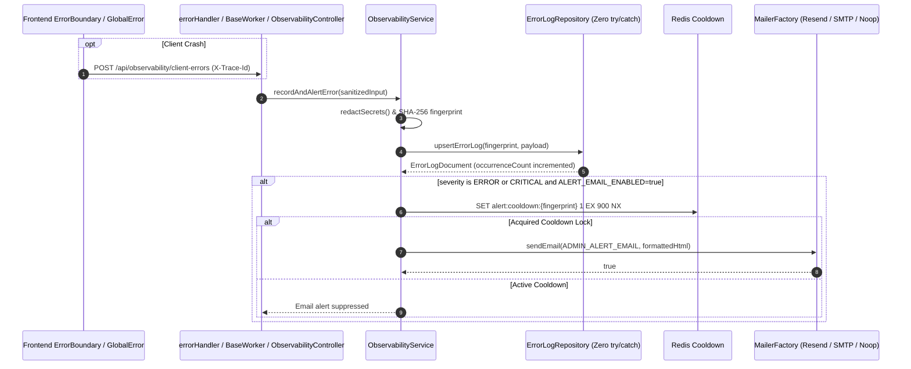

# Public Launch Readiness - Phase 2 Implementation Details

> **Feature:** 12. public-launch-readiness · **Phase:** 2 (Hardened Observability, MongoDB ErrorLogs & Email Alerts)
> **Status:** COMPLETED
> **Created:** 2026-11-26 · **Last Updated:** 2026-11-26

---

## 1. Goal Description & Scope

Harden MailSense's runtime observability ahead of public open-source launch by persisting sanitized error diagnostics into MongoDB (`error_logs`) and sending Redis-throttled alert emails to the maintainer when unhandled faults occur.

Specifically, Phase 2 delivers:

1. **Pluggable Transactional Mailer Integration (`Backend/src/integrations/mailer/`):**
   - Strategy interface `ITransactionalMailer` backed by `ResendMailerProvider` (REST HTTPS over `axios` — zero port issues), `SmtpMailerProvider` (`nodemailer` adapter for self-hosted deployments), and `NoopMailerProvider` (offline dev/CI).
   - Singleton `MailerFactory` resolved from `MAILER_CONFIG` (`EMAIL_ALERT_PROVIDER`), defaulting safely to `NoopMailerProvider` in `test` or when credentials are absent so application boot never breaks.
2. **Environment & Logging Infrastructure (`Backend/src/core/`):**
   - Extend `env.schema.ts`, `env.config.ts`, `app.config.ts`, and `observability.constants.ts` (`LOGGER_MODULE`) with typed configuration for `APP_VERSION`, `EMAIL_ALERT_PROVIDER`, `RESEND_API_KEY`, `SMTP_URL`, `ADMIN_ALERT_EMAIL`, `SUPPORT_EMAIL`, `ALERT_EMAIL_ENABLED`, `ALERT_FROM_EMAIL`, and `ALERT_COOLDOWN_SECONDS`.
3. **MongoDB Persistent Error Logging (`Backend/src/modules/observability/`):**
   - Mongoose `ErrorLog` model (`database/error-log.model.ts`) implementing `@mailsense/types` `ErrorLogAttributes` with a **90-day TTL index** (`expireAfterSeconds: 7776000`) and deduplicated `fingerprint` index.
   - Pure `ErrorLogRepository` (strictly zero `try/catch`) performing atomic `$inc: { occurrenceCount: 1 }` upserts.
   - `ObservabilityService` providing PII scrubbing, SHA-256 fingerprinting, Redis alert cooldown locking (`SET alert:cooldown:<fingerprint> 1 EX <cooldown> NX`) with bounded in-memory fallback, and formatted maintainer alert emails.
4. **Architectural Boundary Wiring & Sentry Deduplication:**
   - Wire `ObservabilityService` into `Backend/src/core/middlewares/error.handler.ts` (`>= 500` or `!isOperational`) and `Backend/src/workers/base.worker.ts` (worker job exceptions).
   - Eliminate existing double Sentry captures by passing `{ forwardToMonitoring: false }` to error-boundary loggers in `errorHandler` and `BaseWorker` (so `monitoring.captureException` / `monitoring.reportWorkerError` executes once cleanly).
5. **Frontend Client Crash Bridge (`Frontend/src/shared/api/` & Error Boundaries):**
   - Add public-compatible, Zod-validated, rate-limited `POST /api/observability/client-errors` endpoint (`20 requests / 15m`) wired into `ErrorBoundary.tsx` and `app/global-error.tsx`.

---

## 2. User Review Required & Architectural Notes

> [!IMPORTANT]
> **Critical Architecture & Stability Guardrails**
>
> - **Infinite Recursion Prevention (`forwardToMonitoring: false`):** Both `ObservabilityService` and all `ITransactionalMailer` providers MUST initialize their Pino logger with `createLogger(moduleName, { forwardToMonitoring: false })`. If a MongoDB write or Resend HTTP request fails while recording an error, it MUST log locally without triggering `activeTelemetrySink.captureException` or re-entering `ObservabilityService`.
> - **Eliminating Duplicate Sentry Events:** Prior to Phase 2, calling `logger.error(..., { error })` inside `error.handler.ts` and `base.worker.ts` triggered `forwardException()` to Sentry *in addition* to explicit `monitoring.captureException()` / `reportWorkerError()` calls. Setting `{ forwardToMonitoring: false }` on those boundary loggers ensures each unhandled fault generates exactly one Sentry event and one `ErrorLog` upsert.
> - **Isolated Plain Axios Instance for Client Error Bridge:** `Frontend/src/shared/api/observability.api.ts` creates its own standalone Axios client pointing to `API_BASE_URL` rather than using the Auth0-coupled `axiosClient`. This ensures crashes occurring before login (`/get_started`, `/privacy`, `/terms`), inside `global-error.tsx`, or during Auth0 token expiration never loop back into `getAccessToken()` errors.
> - **Repository Layer Boundary:** `ErrorLogRepository` contains **zero `try/catch`** blocks. `ObservabilityService.recordAndAlertError` serves as the non-blocking isolation boundary (`try/catch` returning cleanly after local warn log if DB/Redis/Mailer fail).
> - **TypeScript Narrowing & Phase 1 Alignment:** With `@mailsense/types v1.9.0` synced into `Backend` and `Frontend` and `LoggableValue` verified across `Backend/src/`, all new Phase 2 modules pass `error instanceof Error ? error : String(error)` and explicit named interfaces with zero `: unknown`, `: never`, or inline object types.

---

## 3. Component Overview & File Map

| Component             | Target File                                                                  |    Action    | Purpose                                                                                             |
| :-------------------- | :--------------------------------------------------------------------------- | :----------: | :-------------------------------------------------------------------------------------------------- |
| **Backend Deps**      | `Backend/package.json`                                                       | **[MODIFY]** | Install `nodemailer` + `@types/nodemailer` (optional SMTP transport alongside Resend REST)          |
| **Backend Config**    | `Backend/src/core/config/env.schema.ts`, `env.config.ts`, `app.config.ts`    | **[MODIFY]** | Validate and export `APP_VERSION`, `MAILER_CONFIG`, and `ALERTING_CONFIG`                           |
| **Backend Constants** | `Backend/src/core/constants/observability.constants.ts`                      | **[MODIFY]** | Add `LOGGER_MODULE` entries for mailer and observability modules                                    |
| **Mailer Strategy**   | `Backend/src/integrations/mailer/mailer.constants.ts`                        |  **[NEW]**   | Centralize `RESEND_API_BASE_URL` and `RESEND_APIs` endpoint constants                               |
| **Mailer Strategy**   | `Backend/src/integrations/mailer/mailer.types.ts`                            |  **[NEW]**   | Define `ITransactionalMailer`, `MailerStrategyConfig`, and `ResendEmailRequestPayload`            |
| **Mailer Strategy**   | `Backend/src/integrations/mailer/providers/resend-mailer.provider.ts`        |  **[NEW]**   | Send transactional emails via Resend REST API (`@utils` `apiRequest`) with 10s timeout          |
| **Mailer Strategy**   | `Backend/src/integrations/mailer/providers/smtp-mailer.provider.ts`          |  **[NEW]**   | Send transactional emails via `nodemailer` SMTP transport (`url` + timeouts)                        |
| **Mailer Strategy**   | `Backend/src/integrations/mailer/providers/noop-mailer.provider.ts`          |  **[NEW]**   | Offline/test strategy logging email dispatch without external network I/O                           |
| **Mailer Strategy**   | `Backend/src/integrations/mailer/mailer.factory.ts` & `index.ts`             |  **[NEW]**   | Singleton mailer factory selecting strategy from `MAILER_CONFIG` + barrel export                    |
| **Observability Mod** | `Backend/src/modules/observability/constants/observability.constants.ts` & `index.ts` | **[NEW]** | Plain-text and XSS-escaped HTML email alert templates (`ALERT_EMAIL_TEXT`, `ALERT_EMAIL_HTML`)    |
| **Observability Mod** | `Backend/src/modules/observability/types/observability.types.ts` & `index.ts`|  **[NEW]**   | Dedicated interfaces `RecordSystemErrorInput`, `ErrorLogInput`, and `RecordClientErrorResult`       |
| **Observability Mod** | `Backend/src/modules/observability/utils/observability.utils.ts` & `index.ts`|  **[NEW]**   | Pure helpers `computeFingerprint`, `sanitizeContext`, and `escapeHtml`                              |
| **Observability Mod** | `Backend/src/modules/observability/database/error-log.model.ts` & `index.ts` |  **[NEW]**   | `ErrorLog` Mongoose schema + 90-day TTL index                                                       |
| **Observability Mod** | `Backend/src/modules/observability/database/error-log.repository.ts`         |  **[NEW]**   | Atomic `upsertErrorLog` (`occurrenceCount` increment) & `countUnresolved` — zero `try/catch`        |
| **Observability Mod** | `Backend/src/modules/observability/services/observability.service.ts` & `index.ts` |  **[NEW]** | PII scrubber, SHA-256 fingerprint, Redis cooldown (`SET NX EX`), singleton `observabilityService`   |
| **Observability Mod** | `Backend/src/modules/observability/controllers/observability.controller.ts` & `index.ts` |  **[NEW]** | HTTP handler for `POST /api/observability/client-errors`                                          |
| **Observability Mod** | `Backend/src/modules/observability/schemas/observability.schema.ts` & `index.ts` |  **[NEW]** | Zod payload validation enforcing size bounds against DB spam                                        |
| **Observability Mod** | `Backend/src/modules/observability/routes/observability.routes.ts` & `index.ts` |  **[NEW]** | Rate-limited `POST /client-errors` router + module barrel export                                    |
| **Backend Wiring**    | `Backend/src/core/security/rate-limit.config.ts` & `Backend/src/routes.ts`   | **[MODIFY]** | Add `clientErrorRateLimiter` (`20/15m`) and mount `/observability`                                  |
| **Backend Wiring**    | `Backend/src/core/middlewares/error.handler.ts` & `workers/base.worker.ts`   | **[MODIFY]** | Record persisted `ErrorLog` + alert on server/worker failures; deduplicate Sentry captures          |
| **Unit Tests**        | `Backend/src/modules/observability/__tests__/observability.service.test.ts`  |  **[NEW]**   | Tests for fingerprinting, PII redaction, Redis cooldown throttling, and non-blocking DB failure     |
| **Unit Tests**        | `Backend/src/integrations/mailer/__tests__/mailer.factory.test.ts`           |  **[NEW]**   | Tests for `MailerFactory` resolution, fallback on missing secrets, and Resend request formatting    |
| **Frontend API**      | `Frontend/src/shared/api/endpoints.ts`                                       | **[MODIFY]** | Add `OBSERVABILITY_API_ENDPOINTS.CLIENT_ERRORS`                                                     |
| **Frontend API**      | `Frontend/src/shared/api/observability.api.ts` & `Frontend/src/shared/api/index.ts` |  **[NEW]** | Non-blocking `reportClientError` client using isolated Axios instance                               |
| **Frontend Boundary** | `Frontend/src/shared/components/ErrorBoundary.tsx` & `app/global-error.tsx`  | **[MODIFY]** | Forward uncaught UI crashes and `traceId` to `reportClientError`                                    |

---

## 4. Main Section 1: Backend Layer Implementation

### 4.1 Dependency Installation (`Backend/package.json`)

Install `nodemailer` so self-hosted deployments can use SMTP out of the box alongside the default Resend REST transport:

```bash
cd /Users/vishaljagamani/Projects/Projects/mailsense/Backend
pnpm add nodemailer
pnpm add -D @types/nodemailer
```

---

### 4.2 Environment Config & Constants

#### 1. `Backend/src/core/config/env.schema.ts` [MODIFY]

Add observability, transactional mailer, and alerting env schemas importing `TRANSACTIONAL_MAILER_PROVIDER` from `@mailsense/types`:

```typescript
import { AI_PROVIDER_NAME, TRANSACTIONAL_MAILER_PROVIDER } from '@mailsense/types';
import z from 'zod';

export const envSchemaObject = {
    // ...existing variables unchanged...
    APP_VERSION: z.string().default('3.8.0'),
    // Transactional Mailer & Error Alerting Secrets (Phase 2)
    EMAIL_ALERT_PROVIDER: z.enum(TRANSACTIONAL_MAILER_PROVIDER).default(TRANSACTIONAL_MAILER_PROVIDER.NOOP),
    RESEND_API_KEY: z.string().optional(),
    SMTP_URL: z.string().optional(),
    ALERT_FROM_EMAIL: z.string().default('MailSense Alerts <alerts@mailsense.app>'),
    ADMIN_ALERT_EMAIL: z.string().optional(),
    SUPPORT_EMAIL: z.string().optional(),
    ALERT_EMAIL_ENABLED: z.enum(['true', 'false']).default('false'),
    ALERT_COOLDOWN_SECONDS: z.coerce.number().int().min(60).default(900),
};
```

#### 2. `Backend/src/core/config/env.config.ts` & `app.config.ts` [MODIFY]

Bind validated fields in `EnvConfig` (`env.config.ts`, setting `this.ALERT_EMAIL_ENABLED = data.ALERT_EMAIL_ENABLED === 'true'`) and export typed configs in `app.config.ts`:

```typescript
// Add to Backend/src/core/config/app.config.ts
export const APP_VERSION = ENV.APP_VERSION;

export const MAILER_CONFIG = {
    provider: ENV.EMAIL_ALERT_PROVIDER,
    resendApiKey: ENV.RESEND_API_KEY,
    smtpUrl: ENV.SMTP_URL,
    fromEmail: ENV.ALERT_FROM_EMAIL,
};

export const ALERTING_CONFIG = {
    enabled: ENV.ALERT_EMAIL_ENABLED,
    adminAlertEmail: ENV.ADMIN_ALERT_EMAIL,
    supportEmail: ENV.SUPPORT_EMAIL,
    cooldownSeconds: ENV.ALERT_COOLDOWN_SECONDS,
};
```

#### 3. `Backend/src/core/constants/observability.constants.ts` [MODIFY]

Extend `LOGGER_MODULE` with mailer and observability module tags:

```typescript
    // Phase 2: Transactional Mailer & Persistent Observability
    OBSERVABILITY_SERVICE = 'ObservabilityService',
    OBSERVABILITY_CONTROLLER = 'ObservabilityController',
    MAILER_FACTORY = 'MailerFactory',
    RESEND_MAILER = 'ResendMailer',
    SMTP_MAILER = 'SmtpMailer',
    NOOP_MAILER = 'NoopMailer',
```

---

### 4.3 Transactional Mailer Strategy (`Backend/src/integrations/mailer/`)

#### 1. `Backend/src/integrations/mailer/mailer.constants.ts` [NEW]

```typescript
export const RESEND_API_BASE_URL = 'https://api.resend.com';

export const RESEND_APIs = {
    SEND_EMAIL: '/emails',
} as const;

export const MAILER_TIMEOUT_MS = 10000;
```

#### 2. `Backend/src/integrations/mailer/mailer.interface.ts` [NEW]

```typescript
import { SendTransactionalEmailParams, TRANSACTIONAL_MAILER_PROVIDER } from '@mailsense/types';

export interface ITransactionalMailer {
    readonly name: TRANSACTIONAL_MAILER_PROVIDER;
    sendEmail(params: SendTransactionalEmailParams): Promise<boolean>;
}

export interface MailerStrategyConfig {
    apiKey?: string;
    smtpUrl?: string;
    fromEmail: string;
}

export interface ResendEmailRequestPayload {
    from: string;
    to: string[];
    subject: string;
    html: string;
    text: string;
    reply_to?: string;
}
```

#### 3. `Backend/src/integrations/mailer/providers/resend-mailer.provider.ts` [NEW]

```typescript
import { LOGGER_MODULE } from '@constants';
import { SendTransactionalEmailParams, TRANSACTIONAL_MAILER_PROVIDER } from '@mailsense/types';
import { createLogger } from '@observability';
import axios from 'axios';
import { MAILER_TIMEOUT_MS, RESEND_API_BASE_URL, RESEND_APIs } from '../mailer.constants.js';
import { ITransactionalMailer, MailerStrategyConfig, ResendEmailRequestPayload } from '../mailer.interface.js';

const logger = createLogger(LOGGER_MODULE.RESEND_MAILER, { forwardToMonitoring: false });

export class ResendMailerProvider implements ITransactionalMailer {
    public readonly name: TRANSACTIONAL_MAILER_PROVIDER = TRANSACTIONAL_MAILER_PROVIDER.RESEND;
    private readonly apiKey: string;
    private readonly fromEmail: string;

    constructor(config: MailerStrategyConfig) {
        this.apiKey = config.apiKey ?? '';
        this.fromEmail = config.fromEmail;
    }

    public async sendEmail(params: SendTransactionalEmailParams): Promise<boolean> {
        if (!this.apiKey) {
            logger.warn('ResendMailerProvider skipped: RESEND_API_KEY not configured');
            return false;
        }

        const recipients = Array.isArray(params.to) ? params.to : [params.to];
        const payload: ResendEmailRequestPayload = {
            from: this.fromEmail,
            to: recipients,
            subject: params.subject,
            html: params.html,
            text: params.text,
            ...(params.replyTo ? { reply_to: params.replyTo } : {}),
        };

        try {
            await axios.post(`${RESEND_API_BASE_URL}${RESEND_APIs.SEND_EMAIL}`, payload, {
                timeout: MAILER_TIMEOUT_MS,
                headers: {
                    Authorization: `Bearer ${this.apiKey}`,
                    'Content-Type': 'application/json',
                },
            });
            logger.info('Transactional email dispatched via Resend', { subject: params.subject, recipientCount: recipients.length });
            return true;
        } catch (error) {
            const msg = error instanceof Error ? error.message : String(error);
            logger.warn(`Failed to dispatch transactional email via Resend: ${msg}`, { error: msg, subject: params.subject });
            return false;
        }
    }
}
```

#### 4. `Backend/src/integrations/mailer/providers/smtp-mailer.provider.ts` [NEW]

```typescript
import { LOGGER_MODULE } from '@constants';
import { SendTransactionalEmailParams, TRANSACTIONAL_MAILER_PROVIDER } from '@mailsense/types';
import { createLogger } from '@observability';
import nodemailer, { Transporter } from 'nodemailer';
import { MAILER_TIMEOUT_MS } from '../mailer.constants.js';
import { ITransactionalMailer, MailerStrategyConfig } from '../mailer.interface.js';

const logger = createLogger(LOGGER_MODULE.SMTP_MAILER, { forwardToMonitoring: false });

export class SmtpMailerProvider implements ITransactionalMailer {
    public readonly name: TRANSACTIONAL_MAILER_PROVIDER = TRANSACTIONAL_MAILER_PROVIDER.SMTP;
    private readonly transporter: Transporter | null;
    private readonly fromEmail: string;

    constructor(config: MailerStrategyConfig) {
        this.fromEmail = config.fromEmail;
        this.transporter = config.smtpUrl
            ? nodemailer.createTransport(config.smtpUrl, { connectionTimeout: MAILER_TIMEOUT_MS, socketTimeout: MAILER_TIMEOUT_MS })
            : null;
    }

    public async sendEmail(params: SendTransactionalEmailParams): Promise<boolean> {
        if (!this.transporter) {
            logger.warn('SmtpMailerProvider skipped: SMTP_URL not configured');
            return false;
        }

        try {
            await this.transporter.sendMail({
                from: this.fromEmail,
                to: params.to,
                subject: params.subject,
                html: params.html,
                text: params.text,
                ...(params.replyTo ? { replyTo: params.replyTo } : {}),
            });
            logger.info('Transactional email dispatched via SMTP', { subject: params.subject });
            return true;
        } catch (error) {
            const msg = error instanceof Error ? error.message : String(error);
            logger.warn(`Failed to dispatch transactional email via SMTP: ${msg}`, { error: msg, subject: params.subject });
            return false;
        }
    }
}
```

#### 5. `Backend/src/integrations/mailer/providers/noop-mailer.provider.ts` [NEW]

```typescript
import { LOGGER_MODULE } from '@constants';
import { SendTransactionalEmailParams, TRANSACTIONAL_MAILER_PROVIDER } from '@mailsense/types';
import { createLogger } from '@observability';
import { ITransactionalMailer } from '../mailer.interface.js';

const logger = createLogger(LOGGER_MODULE.NOOP_MAILER, { forwardToMonitoring: false });

export class NoopMailerProvider implements ITransactionalMailer {
    public readonly name: TRANSACTIONAL_MAILER_PROVIDER = TRANSACTIONAL_MAILER_PROVIDER.NOOP;

    public async sendEmail(params: SendTransactionalEmailParams): Promise<boolean> {
        const recipients = Array.isArray(params.to) ? params.to.join(', ') : params.to;
        logger.info('[NoopMailer] Email delivery suppressed in local/test mode', {
            to: recipients,
            subject: params.subject,
        });
        return true;
    }
}
```

#### 6. `Backend/src/integrations/mailer/mailer.factory.ts` & `index.ts` [NEW]

```typescript
import { MAILER_CONFIG, NODE_ENV } from '@config';
import { LOGGER_MODULE } from '@constants';
import { TRANSACTIONAL_MAILER_PROVIDER } from '@mailsense/types';
import { createLogger } from '@observability';
import { ITransactionalMailer, MailerStrategyConfig } from './mailer.interface.js';
import { NoopMailerProvider } from './providers/noop-mailer.provider.js';
import { ResendMailerProvider } from './providers/resend-mailer.provider.js';
import { SmtpMailerProvider } from './providers/smtp-mailer.provider.js';

const logger = createLogger(LOGGER_MODULE.MAILER_FACTORY, { forwardToMonitoring: false });

export class MailerFactory {
    private static instance: ITransactionalMailer | null = null;

    public static getMailer(): ITransactionalMailer {
        if (MailerFactory.instance) {
            return MailerFactory.instance;
        }

        if (NODE_ENV === 'test') {
            MailerFactory.instance = new NoopMailerProvider();
            return MailerFactory.instance;
        }

        const strategyConfig: MailerStrategyConfig = {
            apiKey: MAILER_CONFIG.resendApiKey,
            smtpUrl: MAILER_CONFIG.smtpUrl,
            fromEmail: MAILER_CONFIG.fromEmail,
        };

        MailerFactory.instance = MailerFactory.createMailer(MAILER_CONFIG.provider, strategyConfig);
        logger.info(`Transactional mailer initialized: [${MailerFactory.instance.name}]`);
        return MailerFactory.instance;
    }

    public static createMailer(providerName: string, config: MailerStrategyConfig): ITransactionalMailer {
        const normalized = providerName.toUpperCase();
        if (normalized === TRANSACTIONAL_MAILER_PROVIDER.RESEND && config.apiKey) {
            return new ResendMailerProvider(config);
        }
        if (normalized === TRANSACTIONAL_MAILER_PROVIDER.SMTP && config.smtpUrl) {
            return new SmtpMailerProvider(config);
        }
        if (normalized !== TRANSACTIONAL_MAILER_PROVIDER.NOOP) {
            logger.warn(`Requested mailer [${normalized}] lacks credentials. Falling back to NoopMailerProvider.`);
        }
        return new NoopMailerProvider();
    }

    public static resetMailer(): void {
        MailerFactory.instance = null;
    }
}
```

Create `Backend/src/integrations/mailer/index.ts`:

```typescript
export * from './mailer.constants.js';
export * from './mailer.factory.js';
export * from './mailer.interface.js';
```

---

### 4.4 Observability Module (`Backend/src/modules/observability/`)

#### 1. Dedicated Types (`Backend/src/modules/observability/types/observability.types.ts` & `index.ts`) [NEW]

```typescript
import { ERROR_LOG_SEVERITY, ERROR_LOG_SOURCE, ErrorLogAttributes, ErrorLogContext } from '@mailsense/types';

export type ErrorLogInput = Omit<ErrorLogAttributes, '_id' | 'createdAt' | 'updatedAt' | 'resolved' | 'occurrenceCount'>;

export interface RecordSystemErrorInput {
    source: ERROR_LOG_SOURCE;
    severity: ERROR_LOG_SEVERITY;
    module: string;
    errorCode: string;
    httpStatus?: number;
    message: string;
    stack?: string;
    traceId?: string;
    context?: ErrorLogContext;
}

export interface RecordClientErrorResult {
    logged: boolean;
    traceId: string;
}
```

Create `Backend/src/modules/observability/types/index.ts`:

```typescript
export * from './observability.types.js';
```

#### 2. Mongoose Model (`Backend/src/modules/observability/database/error-log.model.ts`) [NEW]

```typescript
import { ERROR_LOG_SEVERITY, ERROR_LOG_SOURCE, ErrorLogAttributes } from '@mailsense/types';
import { Document, model, Schema } from 'mongoose';

export type ErrorLogDocument = Document & ErrorLogAttributes;

const ErrorLogSchema = new Schema<ErrorLogDocument>(
    {
        traceId: { type: String, required: false, index: true },
        fingerprint: { type: String, required: true, unique: true },
        source: { type: String, enum: Object.values(ERROR_LOG_SOURCE), required: true, index: true },
        severity: { type: String, enum: Object.values(ERROR_LOG_SEVERITY), required: true, index: true },
        module: { type: String, required: true, index: true },
        errorCode: { type: String, required: true, index: true },
        httpStatus: { type: Number, required: false },
        message: { type: String, required: true },
        stack: { type: String, required: false },
        context: { type: Schema.Types.Mixed, required: false },
        environment: { type: String, required: true },
        appVersion: { type: String, required: true },
        resolved: { type: Boolean, default: false, index: true },
        occurrenceCount: { type: Number, default: 1 },
        lastOccurredAt: { type: Number, required: true, index: true },
    },
    { timestamps: true, versionKey: false },
);

// Automatic 90-day TTL retention policy (7,776,000 seconds)
ErrorLogSchema.index({ createdAt: 1 }, { expireAfterSeconds: 7776000 });

export const ErrorLog = model<ErrorLogDocument>('ErrorLog', ErrorLogSchema);
```

#### 3. Repository Layer (`Backend/src/modules/observability/database/error-log.repository.ts` & `index.ts`) [NEW]

Pure data access — strictly **zero `try/catch`**:

```typescript
import { ErrorLogInput } from '../types/index.js';
import { ErrorLog, ErrorLogDocument } from './error-log.model.js';

export class ErrorLogRepository {
    public static async upsertErrorLog(data: ErrorLogInput): Promise<ErrorLogDocument> {
        return await ErrorLog.findOneAndUpdate(
            { fingerprint: data.fingerprint },
            {
                $set: {
                    traceId: data.traceId,
                    source: data.source,
                    severity: data.severity,
                    module: data.module,
                    errorCode: data.errorCode,
                    httpStatus: data.httpStatus,
                    message: data.message,
                    stack: data.stack,
                    context: data.context,
                    environment: data.environment,
                    appVersion: data.appVersion,
                    lastOccurredAt: data.lastOccurredAt,
                    resolved: false,
                },
                $inc: { occurrenceCount: 1 },
            },
            { upsert: true, new: true },
        );
    }

    public static async countUnresolved(): Promise<number> {
        return await ErrorLog.countDocuments({ resolved: false });
    }
}
```

Create `Backend/src/modules/observability/database/index.ts`:

```typescript
export * from './error-log.model.js';
export * from './error-log.repository.js';
```

#### 4. Service Layer (`Backend/src/modules/observability/services/observability.service.ts` & `index.ts`) [NEW]

```typescript
import { ALERTING_CONFIG, APP_VERSION, NODE_ENV } from '@config';
import { LOGGER_MODULE } from '@constants';
import { MailerFactory } from '@integrations/mailer';
import { ERROR_LOG_SEVERITY, ERROR_LOG_SOURCE, ErrorLogContext, ReportClientErrorPayload } from '@mailsense/types';
import { createLogger, getTraceId } from '@observability';
import { getRedisConnection } from '@queue';
import crypto from 'node:crypto';
import { ErrorLogDocument, ErrorLogRepository } from '../database/index.js';
import { ErrorLogInput, RecordClientErrorResult, RecordSystemErrorInput } from '../types/index.js';

const logger = createLogger(LOGGER_MODULE.OBSERVABILITY_SERVICE, { forwardToMonitoring: false });

const MAX_STACK_LENGTH = 4000;
const MAX_FALLBACK_MAP_SIZE = 500;
const SENSITIVE_KEY_PATTERN = /(token|password|secret|authorization|cookie|apikey|api_key|bodyplain)/i;

export class ObservabilityService {
    private readonly memoryCooldowns = new Map<string, number>();

    public async recordAndAlertError(input: RecordSystemErrorInput): Promise<ErrorLogDocument | null> {
        try {
            const sanitizedContext = this.sanitizeContext(input.context);
            const sanitizedMessage = input.message.slice(0, 1000);
            const sanitizedStack = input.stack ? input.stack.slice(0, MAX_STACK_LENGTH) : undefined;
            const fingerprint = this.computeFingerprint(input.source, input.module, input.errorCode, sanitizedMessage);

            const record: ErrorLogInput = {
                traceId: input.traceId || getTraceId() || undefined,
                fingerprint,
                source: input.source,
                severity: input.severity,
                module: input.module,
                errorCode: input.errorCode,
                httpStatus: input.httpStatus,
                message: sanitizedMessage,
                stack: sanitizedStack,
                context: sanitizedContext,
                environment: NODE_ENV || 'development',
                appVersion: APP_VERSION,
                lastOccurredAt: Date.now(),
            };

            const persisted = await ErrorLogRepository.upsertErrorLog(record);

            if (this.shouldSendAlertEmail(input.severity)) {
                const canAlert = await this.acquireAlertCooldown(fingerprint);
                if (canAlert) {
                    await this.dispatchAlertEmail(persisted);
                }
            }

            return persisted;
        } catch (err) {
            const msg = err instanceof Error ? err.message : String(err);
            logger.warn(`Non-blocking error persistence failure: ${msg}`);
            return null;
        }
    }

    public async recordClientError(
        payload: ReportClientErrorPayload,
        userId?: string,
        userAgent?: string,
    ): Promise<RecordClientErrorResult> {
        const traceId = payload.traceId || getTraceId() || crypto.randomUUID();
        const combinedStack = [payload.stack, payload.componentStack].filter(Boolean).join('\n--- Component Stack ---\n');

        const persisted = await this.recordAndAlertError({
            source: ERROR_LOG_SOURCE.FRONTEND_CLIENT,
            severity: ERROR_LOG_SEVERITY.ERROR,
            module: 'FrontendClientBoundary',
            errorCode: 'FRONTEND_RUNTIME_CRASH',
            message: payload.message,
            stack: combinedStack || undefined,
            traceId,
            context: {
                userId,
                pageUrl: payload.pageUrl,
                userAgent,
                extra: { clientAppVersion: payload.appVersion },
            },
        });

        return { logged: Boolean(persisted), traceId };
    }

    public computeFingerprint(source: ERROR_LOG_SOURCE, module: string, errorCode: string, message: string): string {
        const normalizedMsg = message
            .replace(/[0-9a-f]{24}/gi, '<id>')
            .replace(/\d+/g, '<num>')
            .slice(0, 200);
        return crypto.createHash('sha256').update(`${source}|${module}|${errorCode}|${normalizedMsg}`).digest('hex');
    }

    private sanitizeContext(context?: ErrorLogContext): ErrorLogContext | undefined {
        if (!context) return undefined;
        const cleanExtra: Record<string, string | number | boolean> = {};
        if (context.extra) {
            for (const [key, val] of Object.entries(context.extra)) {
                cleanExtra[key] = SENSITIVE_KEY_PATTERN.test(key) ? '[REDACTED]' : val;
            }
        }

        return {
            userId: context.userId,
            accountId: context.accountId,
            jobId: context.jobId,
            queueName: context.queueName,
            method: context.method,
            path: context.path,
            pageUrl: context.pageUrl,
            userAgent: context.userAgent,
            ...(Object.keys(cleanExtra).length > 0 ? { extra: cleanExtra } : {}),
        };
    }

    private shouldSendAlertEmail(severity: ERROR_LOG_SEVERITY): boolean {
        if (!ALERTING_CONFIG.enabled || !ALERTING_CONFIG.adminAlertEmail) {
            return false;
        }
        return severity === ERROR_LOG_SEVERITY.ERROR || severity === ERROR_LOG_SEVERITY.CRITICAL;
    }

    private async acquireAlertCooldown(fingerprint: string): Promise<boolean> {
        const cooldownSeconds = ALERTING_CONFIG.cooldownSeconds;
        const key = `alert:cooldown:${fingerprint}`;

        try {
            const redis = getRedisConnection();
            const status = await redis.set(key, '1', 'EX', cooldownSeconds, 'NX');
            return status === 'OK';
        } catch {
            // Redis fallback cooldown map prevents alert storms during Redis outage
            const now = Date.now();
            const expiresAt = this.memoryCooldowns.get(fingerprint);
            if (expiresAt && expiresAt > now) {
                return false;
            }
            if (this.memoryCooldowns.size >= MAX_FALLBACK_MAP_SIZE) {
                this.memoryCooldowns.clear();
            }
            this.memoryCooldowns.set(fingerprint, now + cooldownSeconds * 1000);
            return true;
        }
    }

    private async dispatchAlertEmail(doc: ErrorLogDocument): Promise<void> {
        const adminEmail = ALERTING_CONFIG.adminAlertEmail;
        if (!adminEmail) return;

        const mailer = MailerFactory.getMailer();
        const subject = `[MailSense ${doc.environment.toUpperCase()}] [${doc.severity}] ${doc.module}: ${doc.errorCode}`;
        const text = [
            `MailSense Runtime Error Alert`,
            `Severity: ${doc.severity} | Source: ${doc.source}`,
            `Environment: ${doc.environment} | Version: ${doc.appVersion}`,
            `Module: ${doc.module} | ErrorCode: ${doc.errorCode}`,
            `Trace ID: ${doc.traceId ?? 'N/A'} | Occurrences: ${doc.occurrenceCount}`,
            `Message: ${doc.message}`,
            doc.stack ? `\nStack:\n${doc.stack.slice(0, 1000)}` : '',
        ].join('\n');

        const html = `
            <div style="font-family: sans-serif; line-height: 1.5; color: #111827;">
                <h2 style="color: #dc2626;">MailSense Error Alert [${doc.severity}]</h2>
                <p><strong>Environment:</strong> ${doc.environment} (v${doc.appVersion})</p>
                <p><strong>Source / Module:</strong> ${doc.source} &rarr; ${doc.module}</p>
                <p><strong>Error Code:</strong> ${doc.errorCode} ${doc.httpStatus ? `(HTTP ${doc.httpStatus})` : ''}</p>
                <p><strong>Trace ID:</strong> <code>${doc.traceId ?? 'N/A'}</code> &bull; <strong>Occurrences:</strong> ${doc.occurrenceCount}</p>
                <p><strong>Message:</strong> ${doc.message}</p>
                ${doc.stack ? `<pre style="background: #f3f4f6; padding: 12px; border-radius: 6px; overflow-x: auto;">${doc.stack.slice(0, 1200)}</pre>` : ''}
            </div>
        `;

        await mailer.sendEmail({ to: adminEmail, subject, text, html });
    }
}

export const observabilityService = new ObservabilityService();
```

Create `Backend/src/modules/observability/services/index.ts`:

```typescript
export * from './observability.service.js';
```

#### 5. Schema, Controller & Routes (`Backend/src/modules/observability/`) [NEW]

- `Backend/src/modules/observability/schema/observability.schema.ts` & `index.ts`:

```typescript
import { z } from 'zod';

export const reportClientErrorSchema = z.object({
    message: z.string().trim().min(1, 'Error message is required').max(1000),
    stack: z.string().max(2000).optional(),
    componentStack: z.string().max(2000).optional(),
    traceId: z.string().max(128).optional(),
    pageUrl: z.string().trim().min(1).max(500),
    appVersion: z.string().trim().min(1).max(32),
});
```

- `Backend/src/modules/observability/controllers/observability.controller.ts` & `index.ts`:

```typescript
import { ReportClientErrorPayload, ReportClientErrorResponse } from '@mailsense/types';
import { getTraceUserId } from '@observability';
import { NextFunction, Request, Response } from 'express';
import { ObservabilityService, observabilityService } from '../services/index.js';

export class ObservabilityController {
    constructor(private readonly service: ObservabilityService = observabilityService) {}

    public reportClientError = async (
        req: Request<object, object, ReportClientErrorPayload>,
        res: Response,
        next: NextFunction,
    ): Promise<void> => {
        try {
            const userId = req.user?.id || req.header('x-user-id') || getTraceUserId();
            const userAgent = req.get('user-agent');
            const result = await this.service.recordClientError(req.body, userId, userAgent);

            const responsePayload: ReportClientErrorResponse = {
                status: true,
                traceId: result.traceId,
                logged: result.logged,
            };

            res.status(201).json(responsePayload);
        } catch (error) {
            next(error);
        }
    };
}

export const observabilityController = new ObservabilityController();
```

- `Backend/src/modules/observability/routes/observability.routes.ts`, `index.ts` & `Backend/src/modules/observability/index.ts`:

```typescript
import { validate } from '@middlewares';
import { clientErrorRateLimiter } from '@security';
import { handleRequest } from '@utils';
import { Router } from 'express';
import { observabilityController } from '../controllers/index.js';
import { reportClientErrorSchema } from '../schema/index.js';

const router = Router();

router.post('/client-errors', clientErrorRateLimiter, validate({ body: reportClientErrorSchema }), handleRequest(observabilityController.reportClientError));

export default router;
```

---

### 4.5 Wiring `ObservabilityService`, Rate Limiter & Deduplicating Sentry

#### 1. `Backend/src/core/security/rate-limit.config.ts` & `Backend/src/routes.ts` [MODIFY]

Add `clientErrorRateLimiter` (`20 requests / 15m` per client/IP) in `rate-limit.config.ts`:

```typescript
/**
 * Client Error Bridge Limiter: 20 requests per 15 minutes per client
 */
export const clientErrorRateLimiter: RateLimitRequestHandler = rateLimit({
    windowMs: 15 * 60 * 1000,
    limit: 20,
    standardHeaders: 'draft-7',
    legacyHeaders: false,
    keyGenerator: resolveClientKey,
    handler: createRateLimitHandler('ClientErrorReport', 900),
});
```

Mount in `Backend/src/routes.ts`:

```typescript
import observabilityRoutes from '@modules/observability/routes/index.js';
// ...
router.use('/observability', observabilityRoutes);
```

#### 2. `Backend/src/core/middlewares/error.handler.ts` [MODIFY]

Set `{ forwardToMonitoring: false }` on `logger` to prevent duplicate Sentry captures, and invoke `observabilityService.recordAndAlertError` asynchronously for `5xx` or `!isOperational` errors:

```typescript
import { ERROR_LOG_SEVERITY, ERROR_LOG_SOURCE } from '@mailsense/types';
import { observabilityService } from '@modules/observability';

// Use forwardToMonitoring: false so captureNonOperationalErrors handles Sentry once
const logger = createLogger(LOGGER_MODULE.SERVER, { forwardToMonitoring: false });

// Inside errorHandler when (!appError.isOperational || statusCode >= 500):
captureNonOperationalErrors(appError, statusCode, req);
void observabilityService.recordAndAlertError({
    source: ERROR_LOG_SOURCE.BACKEND_API,
    severity: statusCode >= 500 && !appError.isOperational ? ERROR_LOG_SEVERITY.CRITICAL : ERROR_LOG_SEVERITY.ERROR,
    module: LOGGER_MODULE.SERVER,
    errorCode: appError.errorCode,
    httpStatus: statusCode,
    message: appError.message,
    stack: appError.stack,
    traceId: appError.traceId,
    context: {
        userId: req.user?.id,
        method: req.method,
        path: req.path,
    },
});
```

#### 3. `Backend/src/workers/base.worker.ts` [MODIFY]

Prevent double Sentry calls in `BaseWorker` (`forwardToMonitoring: false` on `workerLogger`) and persist worker failures in `ErrorLog`:

```typescript
import { ERROR_LOG_SEVERITY, ERROR_LOG_SOURCE } from '@mailsense/types';
import { observabilityService } from '@modules/observability';

// On BaseWorker class:
protected workerLogger = createLogger(LOGGER_MODULE.BASE_WORKER, { forwardToMonitoring: false });

// Inside runWithTraceContext catch block, alongside monitoring.reportWorkerError:
void observabilityService.recordAndAlertError({
    source: ERROR_LOG_SOURCE.BACKEND_WORKER,
    severity: ERROR_LOG_SEVERITY.ERROR,
    module: this.queueName,
    errorCode: 'WORKER_JOB_FAILED',
    message: err.message,
    stack: err.stack,
    traceId,
    context: {
        userId: traceContext.userId,
        accountId: traceContext.accountId,
        jobId: String(job.id),
        queueName: this.queueName,
    },
});
```

---

## 5. Main Section 2: Frontend Layer Implementation

### 5.1 Endpoints & Isolated Error Client (`Frontend/src/shared/api/`)

#### 1. `Frontend/src/shared/api/endpoints.ts` [MODIFY]

```typescript
export const OBSERVABILITY_API_ENDPOINTS = {
    CLIENT_ERRORS: '/observability/client-errors',
} as const;
```

#### 2. `Frontend/src/shared/api/observability.api.ts` [NEW] & `Frontend/src/shared/api/index.ts` [MODIFY]

Standalone Axios instance without Auth0 interceptor so pre-login/root crashes report cleanly without side effects:

```typescript
import { API_BASE_URL } from '@config/config';
import { ReportClientErrorPayload, ReportClientErrorResponse } from '@mailsense/types';
import { trackUserAction } from '@shared/monitoring';
import axios from 'axios';
import { OBSERVABILITY_API_ENDPOINTS } from './endpoints';

const clientErrorHttp = axios.create({
    baseURL: API_BASE_URL,
    timeout: 5000,
});

export async function reportClientError(payload: ReportClientErrorPayload): Promise<ReportClientErrorResponse | null> {
    try {
        const response = await clientErrorHttp.post<ReportClientErrorResponse>(
            OBSERVABILITY_API_ENDPOINTS.CLIENT_ERRORS,
            payload,
            { headers: payload.traceId ? { 'X-Trace-Id': payload.traceId } : undefined },
        );
        return response.data;
    } catch (err) {
        const msg = err instanceof Error ? err.message : String(err);
        trackUserAction('api.error', `Failed to bridge client error to observability API: ${msg}`, 'warn');
        return null;
    }
}
```

Re-export in `Frontend/src/shared/api/index.ts`:

```typescript
export * from './observability.api';
```

---

### 5.2 Error Boundary & Global Error Integration

#### 1. `Frontend/src/shared/components/ErrorBoundary.tsx` [MODIFY]

In `showBoundary`, `handleError`, and `handleRejection`, call `void reportClientError(...)` alongside `frontendMonitoring.captureException`:

```typescript
import { reportClientError } from '@shared/api';

// Helper called from showBoundary / handleError / handleRejection
const dispatchClientErrorReport = (error: Error, traceId: string): void => {
    const pageUrl = typeof window !== 'undefined' ? window.location.pathname : 'unknown';
    void reportClientError({
        message: error.message || 'Unhandled frontend crash',
        stack: error.stack,
        traceId,
        pageUrl,
        appVersion: process.env.NEXT_PUBLIC_APP_VERSION || '3.8.0',
    });
};
```

#### 2. `Frontend/src/app/global-error.tsx` [MODIFY]

Forward fatal Next.js root crashes cleanly inside `useEffect`:

```typescript
import { reportClientError } from '@shared/api';

    useEffect(() => {
        Sentry.captureException(error, {
            tags: { boundary: 'app-global-error', traceId },
        });
        void reportClientError({
            message: error.message || 'Fatal global layout error',
            stack: error.stack,
            traceId,
            pageUrl: typeof window !== 'undefined' ? window.location.pathname : '/',
            appVersion: process.env.NEXT_PUBLIC_APP_VERSION || '3.8.0',
        });
    }, [error, traceId]);
```

---

## 6. Low-Level Design & Sequence Flow



---

## 7. Step-by-Step Task Checklist

- [x] **Task 1 (Mailer Strategy):** Install `nodemailer` + `@types/nodemailer` and create `Backend/src/integrations/mailer/` (`mailer.constants.ts`, `mailer.types.ts`, `resend-mailer.provider.ts`, `smtp-mailer.provider.ts`, `noop-mailer.provider.ts`, `mailer.factory.ts`, `index.ts`).
- [x] **Task 2 (Env & Constants):** Add mailer & alerting env schemas/configs in `env.schema.ts`, `env.config.ts`, `app.config.ts`, and `LOGGER_MODULE` entries in `observability.constants.ts`.
- [x] **Task 3 (Observability Module):** Create `Backend/src/modules/observability/` (`constants/`, `controllers/`, `database/`, `routes/`, `schemas/`, `services/`, `types/`, `utils/`, `index.ts`).
- [x] **Task 4 (Boundary Wiring & Rate Limit):** Register `clientErrorRateLimiter`, mount `/observability` in `routes.ts`, wire `observabilityService` singleton into `error.handler.ts` (`reportUnhandledException`) & `BaseWorker`, and set `{ forwardToMonitoring: false }` to eliminate duplicate Sentry calls.
- [x] **Task 5 (Frontend Bridge):** Add `OBSERVABILITY_API_ENDPOINTS.CLIENT_ERRORS`, create `observability.api.ts`, and connect `ErrorBoundary.tsx` (`dispatchClientErrorReport`) and `global-error.tsx`.
- [x] **Task 6 (Tests & Verification):** Add unit tests for `ObservabilityService` (`observability.service.test.ts`) and `MailerFactory` (`mailer.factory.test.ts`); verify Jest suites, ESLint, TypeScript, and builds pass with 0 errors/warnings.

---

## 8. Verification & Build Commands

```bash
# 1. Backend Tests, Lint & Build
cd /Users/vishaljagamani/Projects/Projects/mailsense/Backend
npx jest
pnpm lint
pnpm build

# 2. Frontend Lint, Type-check & Build
cd /Users/vishaljagamani/Projects/Projects/mailsense/Frontend
pnpm lint
npx tsc --noEmit
pnpm build
```
