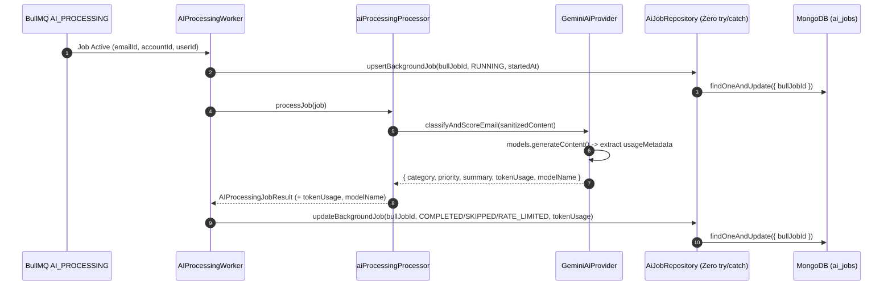

# Public Launch Readiness - Phase 3 Implementation Details

> **Feature:** 12. public-launch-readiness · **Phase:** 3 (AI Job Lifecycle & Token Spend Tracking in MongoDB)
> **Status:** COMPLETED
> **Created:** 2026-11-26 · **Last Updated:** 2026-11-26

---

## 1. Goal Description & Scope

Instrument MailSense's AI execution pipeline—both asynchronous background BullMQ classification (`AIProcessingWorker`) and synchronous on-demand user requests (`AIService.summarizeThread` and `AIService.getSuggestedReplies`)—so every AI invocation persists structured execution telemetry and LLM token consumption into MongoDB (`ai_jobs`), matching the lifecycle ergonomics of `SyncJob`.

Specifically, Phase 3 delivers:

1. **LLM Token Usage Telemetry Extraction (`Backend/src/integrations/ai/`):**
   - Extend `ai.provider.types.ts` with `GeminiStructuredGenerationResult<T>` (strictly named interface, zero inline object types).
   - Update `GeminiAiProvider.generateWithSchema` to extract `response.usageMetadata` (`promptTokenCount`, `candidatesTokenCount`, `totalTokenCount`, `cachedContentTokenCount`) from `@google/genai` responses and attach `tokenUsage` and `modelName` across `classifyAndScoreEmail`, `summarizeEmailThread`, and `generateSuggestedReplies`.
   - Update `NoopAiProvider` to emit deterministic `tokenUsage` and `modelName` metrics for unit testing and offline development.
2. **AI Job Persistence Layer (`Backend/src/modules/ai/database/` & `types/`):**
   - Extend `Backend/src/modules/ai/types/ai.types.ts` with `AiJobInput`, `OnDemandAiTelemetryParams`, and `AiJobPaginationOptions`.
   - Create `AiJob` Mongoose model (`ai-job.model.ts`) implementing `@mailsense/types v1.9.0` `AiProcessingJobAttributes` with compound indexes `(userId, operationType, startedAt)` and `(status, startedAt)` plus sparse unique `bullJobId`.
   - Create `AiJobRepository` (`ai-job.repository.ts`) with **strictly zero `try/catch`** blocks providing `upsertBackgroundJob`, `updateBackgroundJob`, `createOnDemandJob`, `getJobByBullId`, and Phase 4-ready cascade cleanup helpers (`deleteJobsByAccountId`, `deleteJobsByUserId`).
3. **Background Worker & Processor Lifecycle Wiring (`Backend/src/workers/`):**
   - Update `aiProcessingProcessor` to forward `tokenUsage` and `modelName` on returned `AIProcessingJobResult` objects.
   - Implement `onActive`, `onCompleted`, and `onFailed` lifecycle hooks in `AIProcessingWorker` mapping `AI_PROCESSING_STATUS` cleanly via lookup dictionary to `AI_JOB_STATUS` and persisting duration, retries, error details, and tokens spent.
4. **On-Demand AI Telemetry Recording (`Backend/src/modules/ai/services/ai.service.ts`):**
   - Record `ON_DEMAND_SUMMARY` and `ON_DEMAND_SUGGESTIONS` `AiJob` documents (including both `COMPLETED` and `FAILED` outcomes) inside a non-blocking telemetry isolation boundary so analytics logging never breaks user requests.
5. **Comprehensive Unit Tests (`Backend/src/modules/ai/__tests__/ai-job-tracking.test.ts`):**
   - Cover `GeminiAiProvider` `usageMetadata` extraction, `AiJobRepository` persistence calls, `AIProcessingWorker` status mapping and error capture, and non-blocking `AIService` job recording.

---

## 2. User Review Required & Architectural Notes

> [!IMPORTANT]
> **Architectural & Performance Guardrails**
>
> - **Zero PII & Zero Email Bodies Persisted:** `AiJob` records strictly operational metadata (`userId`, `accountId`, `emailId`, `operationType`, `status`, `provider`, `modelName`, `tokenUsage`, `processingDurationMs`, `traceId`). Subject lines, sender addresses, prompts, and message contents MUST NOT be written to `AiJob`.
> - **Non-Blocking Telemetry Boundary (`AIService` & `AIProcessingWorker`):** Telemetry writes in `AIProcessingWorker` hooks and `AIService.recordOnDemandAiJob` are wrapped in safe `try / catch` blocks logging warnings locally (`logger.warn`), ensuring a transient MongoDB outage during telemetry persistence never aborts email classification or user summary responses.
> - **Repository Layer Purity (`AiJobRepository`):** `AiJobRepository` contains **zero `try/catch`** blocks so Mongoose errors surface directly to service and worker lifecycle boundaries per [coding-standards.md](file:///Users/vishaljagamani/Projects/Projects/mailsense/.agents/rules/coding-standards.md).
> - **Rate Limit Retry Awareness (`RATE_LIMITED` vs `COMPLETED`):** When `aiProcessingProcessor` catches Gemini HTTP 429 (`RateLimitError`), it pauses the BullMQ queue via `queue.rateLimit(retryAfterMs)` and returns `{ status: AI_PROCESSING_STATUS.RATE_LIMITED }`. `AIProcessingWorker.onCompleted` maps this status to `AI_JOB_STATUS.RATE_LIMITED` rather than marking the job `COMPLETED`.
> - **Zero Inline Types & Strict Narrowing:** Every internal helper DTO (`GeminiStructuredGenerationResult<T>`, `AiJobInput`, `OnDemandAiTelemetryParams`) is defined in dedicated `*.types.ts` files.

---

## 3. Component Overview & File Map

| Component            | Target File                                                        |       Action       | Purpose                                                                              |
| :------------------- | :----------------------------------------------------------------- | :----------------: | :----------------------------------------------------------------------------------- |
| **AI Contracts**     | `Backend/src/integrations/ai/ai.provider.types.ts`                 |    **[MODIFY]**    | Add `GeminiStructuredGenerationResult<T>` wrapper interface                          |
| **Gemini Adapter**   | `Backend/src/integrations/ai/providers/gemini.provider.ts`         |    **[MODIFY]**    | Extract `response.usageMetadata` into `AiTokenUsage` and return `modelName`          |
| **Noop Adapter**     | `Backend/src/integrations/ai/providers/noop.provider.ts`           |    **[MODIFY]**    | Emit deterministic `tokenUsage` and `modelName` for tests and offline runs           |
| **AI Module Types**  | `Backend/src/modules/ai/types/ai.types.ts`                         |    **[MODIFY]**    | Add `AiJobInput`, `OnDemandAiTelemetryParams`, `AiTokenUsageFallback`                |
| **AI Database**      | `Backend/src/modules/ai/database/ai-job.model.ts`                  |     **[NEW]**      | Define `AiJob` Mongoose schema + token subdocument + compound indexes                |
| **AI Database**      | `Backend/src/modules/ai/database/ai-job.repository.ts`             |     **[NEW]**      | Pure Mongoose operations (`upsertBackgroundJob`, `createOnDemandJob`, etc.)          |
| **AI Database**      | `Backend/src/modules/ai/database/index.ts` & `modules/ai/index.ts` | **[NEW / MODIFY]** | Barrel export `database/` module and expose cleanly in `modules/ai/index.ts`         |
| **Worker Processor** | `Backend/src/workers/processors/ai-processing.processor.ts`        |    **[MODIFY]**    | Forward `tokenUsage` and `modelName` into `AIProcessingJobResult`                    |
| **AI Worker**        | `Backend/src/workers/workers/ai.worker.ts`                         |    **[MODIFY]**    | Implement `onActive`, `onCompleted`, `onFailed` persisting `AiJob` records           |
| **AI Service**       | `Backend/src/modules/ai/services/ai.service.ts`                    |    **[MODIFY]**    | Persist `ON_DEMAND_SUMMARY` and `ON_DEMAND_SUGGESTIONS` `AiJob` telemetry            |
| **Unit Tests**       | `Backend/src/modules/ai/__tests__/ai-job-tracking.test.ts`         |     **[NEW]**      | Unit coverage for `usageMetadata` extraction, worker hooks, and telemetry resilience |

---

## 4. Main Section 1: Backend Layer Implementation

> Shared contracts `AiTokenUsage`, `AI_JOB_STATUS`, `AI_OPERATION_TYPE`, `AiProcessingJobAttributes`, and `AIProcessingJobResult` (`tokenUsage?`, `modelName?`) are already built in `@mailsense/types v1.9.0`.

### 4.1 AI Provider Types & Telemetry Extraction (`Backend/src/integrations/ai/`)

#### 1. `Backend/src/integrations/ai/ai.provider.types.ts` [MODIFY]

Add the named generic wrapper `GeminiStructuredGenerationResult<T>` so `generateWithSchema` never returns an inline object type:

```typescript
import { AiTokenUsage } from "@mailsense/types";

export interface GeminiProviderConfig {
  apiKey?: string;
  modelName?: string;
  timeoutMs?: number;
}

export interface SanitizedEmailContent {
  subject: string;
  from: string;
  to: string[];
  sanitizedBody: string;
  receivedAt: Date;
}

export interface GeminiErrorHeaders {
  "retry-after"?: string;
}

export interface GeminiRawApiError {
  status?: number;
  statusCode?: number;
  message?: string;
  headers?: GeminiErrorHeaders;
}

export interface GeminiStructuredGenerationResult<T> {
  data: T;
  tokenUsage?: AiTokenUsage;
  modelName: string;
}
```

#### 2. `Backend/src/integrations/ai/providers/gemini.provider.ts` [MODIFY]

Import `AiTokenUsage` from `@mailsense/types`, `GenerateContentResponseUsageMetadata` from `@google/genai`, and `GeminiStructuredGenerationResult` from `../ai.provider.types.js`. Extract a focused `extractTokenUsage` helper and return `tokenUsage` and `modelName` across all three provider methods:

```typescript
import { AI_CONFIG } from "@config";
import { LOGGER_MODULE } from "@constants";
import {
  AiProcessingError,
  AppError,
  ConfigurationError,
  RateLimitError,
} from "@errors";
import {
  GenerateContentResponseUsageMetadata,
  GoogleGenAI,
} from "@google/genai";
import {
  AI_PROVIDER_NAME,
  AiClassifyEmailParams,
  AiClassifyEmailResult,
  AiSuggestedRepliesParams,
  AiSuggestedRepliesResult,
  AiSummarizeThreadParams,
  AiSummarizeThreadResult,
  AiTokenUsage,
} from "@mailsense/types";
import { createLogger } from "@observability";
import { CaughtError } from "@types";
import { IAiProvider } from "../ai.provider.js";
import {
  GeminiProviderConfig,
  GeminiRawApiError,
  GeminiStructuredGenerationResult,
} from "../ai.provider.types.js";
import {
  geminiClassifyAndScoreAiResponseSchema,
  geminiGenerateSuggestedRepliesAiResponseSchema,
  geminiSummarizeEmailThreadAiResponseSchema,
} from "../utils/gemini.utils.js";

const logger = createLogger(LOGGER_MODULE.GEMINI_PROVIDER);

const DEFAULT_TIMEOUT_MS = 30000;
const MAX_BODY_CHARACTERS = 4000;

export class GeminiAiProvider implements IAiProvider {
  public readonly name: AI_PROVIDER_NAME = AI_PROVIDER_NAME.GEMINI;
  private readonly client: GoogleGenAI;
  private readonly modelName: string;
  private readonly timeoutMs: number;

  constructor(config?: GeminiProviderConfig) {
    const apiKey = config?.apiKey ?? AI_CONFIG.geminiApiKey;
    if (!apiKey) {
      throw new ConfigurationError(
        "GEMINI_API_KEY environment variable is required to initialize GeminiAiProvider.",
        "GEMINI_API_KEY",
        "Add GEMINI_API_KEY to your environment variables or switch AI_PROVIDER to noop.",
      );
    }
    this.client = new GoogleGenAI({ apiKey });
    this.modelName = config?.modelName ?? AI_CONFIG.geminiModel;
    this.timeoutMs = config?.timeoutMs ?? DEFAULT_TIMEOUT_MS;
  }

  public async classifyAndScoreEmail(
    params: AiClassifyEmailParams,
  ): Promise<AiClassifyEmailResult> {
    const startTime = Date.now();
    const sanitizedBody = this.sanitizeText(params.bodyPlain);
    const prompt = [
      `Classify the following incoming email message into a category, priority level, tags, and brief 1-sentence summary.`,
      `Subject: ${params.subject}`,
      `From: ${params.from}`,
      `To: ${params.to.join(", ")}`,
      `Received: ${params.receivedAt.toISOString()}`,
      `Body:`,
      sanitizedBody,
    ].join("\n");

    try {
      const generated = await this.generateWithSchema<AiClassifyEmailResult>(
        prompt,
        geminiClassifyAndScoreAiResponseSchema(),
      );
      logger.info("Email classified successfully by Gemini", {
        category: generated.data.category,
        priority: generated.data.priority,
        durationMs: Date.now() - startTime,
        totalTokens: generated.tokenUsage?.totalTokens,
      });
      return {
        ...generated.data,
        tokenUsage: generated.tokenUsage,
        modelName: generated.modelName,
      };
    } catch (error) {
      const caughtError: CaughtError =
        error instanceof Error || (typeof error === "object" && error !== null)
          ? error
          : String(error);
      throw this.buildProviderError(
        caughtError,
        "classifyAndScoreEmail",
        Date.now() - startTime,
      );
    }
  }

  public async summarizeEmailThread(
    params: AiSummarizeThreadParams,
  ): Promise<AiSummarizeThreadResult> {
    const startTime = Date.now();
    const messagesText = params.messages
      .map(
        (msg, index) =>
          `--- Message ${index + 1} from ${msg.from} on ${msg.date.toISOString()} ---\n${this.sanitizeText(msg.bodyPlain)}`,
      )
      .join("\n\n");

    const prompt = [
      `Summarize the following email conversation thread into an executive summary, bulleted key points, and clear action items.`,
      `Thread Subject: ${params.threadSubject}`,
      messagesText,
    ].join("\n");

    try {
      const generated = await this.generateWithSchema<AiSummarizeThreadResult>(
        prompt,
        geminiSummarizeEmailThreadAiResponseSchema(),
      );
      logger.info("Thread summarized successfully by Gemini", {
        keyPointsCount: generated.data.keyPoints.length,
        actionItemsCount: generated.data.actionItems.length,
        durationMs: Date.now() - startTime,
        totalTokens: generated.tokenUsage?.totalTokens,
      });
      return {
        ...generated.data,
        tokenUsage: generated.tokenUsage,
        modelName: generated.modelName,
      };
    } catch (error) {
      const caughtError: CaughtError =
        error instanceof Error || (typeof error === "object" && error !== null)
          ? error
          : String(error);
      throw this.buildProviderError(
        caughtError,
        "summarizeEmailThread",
        Date.now() - startTime,
      );
    }
  }

  public async generateSuggestedReplies(
    params: AiSuggestedRepliesParams,
  ): Promise<AiSuggestedRepliesResult> {
    const startTime = Date.now();
    const sanitizedBody = this.sanitizeText(params.bodyPlain);
    const threadContext = params.recentMessages
      ? params.recentMessages
          .map(
            (msg, idx) =>
              `[Prior Msg ${idx + 1} (${msg.from})]: ${this.sanitizeText(msg.bodyPlain)}`,
          )
          .join("\n")
      : "";

    const prompt = [
      `Generate 2 to 3 contextual, natural suggested replies to the latest email in this conversation.`,
      threadContext ? `Conversation Context:\n${threadContext}\n` : "",
      `Latest Message Subject: ${params.subject}`,
      `From: ${params.from}`,
      `To: ${params.to.join(", ")}`,
      `Content:`,
      sanitizedBody,
    ].join("\n");

    try {
      const generated = await this.generateWithSchema<AiSuggestedRepliesResult>(
        prompt,
        geminiGenerateSuggestedRepliesAiResponseSchema(),
      );
      logger.info("Suggested replies generated successfully by Gemini", {
        suggestionCount: generated.data.suggestions.length,
        durationMs: Date.now() - startTime,
        totalTokens: generated.tokenUsage?.totalTokens,
      });
      return {
        ...generated.data,
        tokenUsage: generated.tokenUsage,
        modelName: generated.modelName,
      };
    } catch (error) {
      const caughtError: CaughtError =
        error instanceof Error || (typeof error === "object" && error !== null)
          ? error
          : String(error);
      throw this.buildProviderError(
        caughtError,
        "generateSuggestedReplies",
        Date.now() - startTime,
      );
    }
  }

  private async generateWithSchema<T>(
    prompt: string,
    schema: object,
  ): Promise<GeminiStructuredGenerationResult<T>> {
    const controller = new AbortController();
    const timeoutId = setTimeout(() => controller.abort(), this.timeoutMs);

    try {
      const response = await this.client.models.generateContent({
        model: this.modelName,
        contents: prompt,
        config: {
          responseMimeType: "application/json",
          responseSchema: schema,
          temperature: 0.1,
          abortSignal: controller.signal,
        },
      });

      const text = response.text;
      if (!text) {
        throw new AiProcessingError({
          provider: "gemini",
          model: this.modelName,
          message: "Gemini API returned an empty text payload.",
        });
      }

      return {
        data: JSON.parse(text) as T,
        tokenUsage: this.extractTokenUsage(response.usageMetadata),
        modelName: this.modelName,
      };
    } finally {
      clearTimeout(timeoutId);
    }
  }

  private extractTokenUsage(
    metadata?: GenerateContentResponseUsageMetadata,
  ): AiTokenUsage | undefined {
    if (!metadata) {
      return undefined;
    }
    const inputTokens = metadata.promptTokenCount ?? 0;
    const outputTokens = metadata.candidatesTokenCount ?? 0;
    const totalTokens = metadata.totalTokenCount ?? inputTokens + outputTokens;

    return {
      inputTokens,
      outputTokens,
      totalTokens,
      ...(metadata.cachedContentTokenCount !== undefined
        ? { cachedTokens: metadata.cachedContentTokenCount }
        : {}),
    };
  }

  // ... existing sanitizeText, buildProviderError, isRateLimitError, extractRetryAfterMs unchanged ...
}
```

#### 3. `Backend/src/integrations/ai/providers/noop.provider.ts` [MODIFY]

Include deterministic `tokenUsage` and `modelName` fields so offline testing and `NoopAiProvider` job records contain valid telemetry payloads:

```typescript
// Inside NoopAiProvider methods:
// classifyAndScoreEmail return:
// tokenUsage: { inputTokens: 120, outputTokens: 45, totalTokens: 165 },
// modelName: 'noop-mock',

// summarizeEmailThread return:
// tokenUsage: { inputTokens: 200, outputTokens: 80, totalTokens: 280 },
// modelName: 'noop-mock',

// generateSuggestedReplies return:
// tokenUsage: { inputTokens: 160, outputTokens: 90, totalTokens: 250 },
// modelName: 'noop-mock',
```

---

### 4.2 Dedicated Types, Schema Model & Repository Layer (`Backend/src/modules/ai/`)

#### 1. `Backend/src/modules/ai/types/ai.types.ts` [MODIFY]

Add dedicated types for AI job persistence (avoiding inline object types anywhere across service, repository, or worker layers):

```typescript
import {
  AI_JOB_STATUS,
  AI_OPERATION_TYPE,
  AI_PROVIDER_NAME,
  AiProcessingJobAttributes,
  AiTokenUsage,
  GetEmailSummaryResponse,
  GetSuggestedRepliesResponse,
} from "@mailsense/types";

export interface EmailSummaryResultDTO extends GetEmailSummaryResponse {
  provider: AI_PROVIDER_NAME;
}

export interface SuggestedRepliesResultDTO extends GetSuggestedRepliesResponse {
  provider?: AI_PROVIDER_NAME;
}

export interface ThreadSummarizationContext {
  emailId: string;
  accountId: string;
  threadId: string;
  subject: string;
}

export type AiJobInput = Omit<
  AiProcessingJobAttributes,
  "_id" | "createdAt" | "updatedAt"
>;

export interface OnDemandAiTelemetryContext {
  userId: string;
  accountId: string;
  emailId: string;
  operationType: AI_OPERATION_TYPE;
  provider: AI_PROVIDER_NAME;
  startedAt: number;
}

export interface OnDemandAiTelemetryParams extends OnDemandAiTelemetryContext {
  status: AI_JOB_STATUS;
  modelName: string;
  completedAt: number;
  tokenUsage?: AiTokenUsage;
  errorMessage?: string;
  errorCode?: string;
  traceId?: string;
}
```

#### 2. `Backend/src/modules/ai/database/ai-job.model.ts` [NEW]

Mirror `SyncJob` ergonomics using `@mailsense/types` `AiProcessingJobAttributes` and a nested `AiTokenUsageSchema` (`{ _id: false }`):

```typescript
import {
  AI_JOB_STATUS,
  AI_OPERATION_TYPE,
  AI_PROVIDER_NAME,
  AiProcessingJobAttributes,
  AiTokenUsage,
} from "@mailsense/types";
import { Document, model, Schema } from "mongoose";

export type AiJobDocument = Document & AiProcessingJobAttributes;

const AiTokenUsageSchema = new Schema<AiTokenUsage>(
  {
    inputTokens: { type: Number, required: true, default: 0 },
    outputTokens: { type: Number, required: true, default: 0 },
    totalTokens: { type: Number, required: true, default: 0 },
    cachedTokens: { type: Number, required: false },
  },
  { _id: false },
);

const AiJobSchema = new Schema<AiJobDocument>(
  {
    userId: { type: String, ref: "User", required: true, index: true },
    accountId: { type: String, ref: "Account", required: true, index: true },
    emailId: { type: String, ref: "Email", required: true, index: true },
    bullJobId: { type: String, required: false, unique: true, sparse: true },
    operationType: {
      type: String,
      enum: Object.values(AI_OPERATION_TYPE),
      required: true,
      index: true,
    },
    status: {
      type: String,
      enum: Object.values(AI_JOB_STATUS),
      default: AI_JOB_STATUS.PENDING,
      index: true,
    },
    provider: {
      type: String,
      enum: Object.values(AI_PROVIDER_NAME),
      required: true,
    },
    modelName: { type: String, required: true },
    startedAt: { type: Number, required: true, index: true },
    completedAt: { type: Number, required: false },
    processingDurationMs: { type: Number, required: false, default: 0 },
    tokenUsage: { type: AiTokenUsageSchema, required: false },
    estimatedCostUsd: { type: Number, required: false },
    skippedReason: { type: String, required: false },
    errorMessage: { type: String, required: false },
    errorCode: { type: String, required: false },
    attemptCount: { type: Number, default: 1 },
    traceId: { type: String, required: false, index: true },
  },
  { timestamps: true, versionKey: false },
);

AiJobSchema.index({ userId: 1, operationType: 1, startedAt: -1 });
AiJobSchema.index({ status: 1, startedAt: -1 });

export const AiJob = model<AiJobDocument>("AiJob", AiJobSchema);
```

#### 3. `Backend/src/modules/ai/database/ai-job.repository.ts` [NEW]

Pure Mongoose data access layer — **strictly zero `try/catch` blocks** so errors propagate cleanly to worker/service isolation boundaries:

```typescript
import { AiJobInput } from "../types/index.js";
import { AiJob, AiJobDocument } from "./ai-job.model.js";

export class AiJobRepository {
  public static async upsertBackgroundJob(
    bullJobId: string,
    data: Partial<AiJobInput>,
  ): Promise<AiJobDocument | null> {
    return AiJob.findOneAndUpdate(
      { bullJobId },
      { $set: data },
      { upsert: true, new: true, setDefaultsOnInsert: true },
    );
  }

  public static async updateBackgroundJob(
    bullJobId: string,
    data: Partial<AiJobInput>,
  ): Promise<AiJobDocument | null> {
    return AiJob.findOneAndUpdate({ bullJobId }, { $set: data }, { new: true });
  }

  public static async createOnDemandJob(
    data: Partial<AiJobInput>,
  ): Promise<AiJobDocument> {
    return AiJob.create(data);
  }

  public static async getJobByBullId(
    bullJobId: string,
  ): Promise<AiJobDocument | null> {
    return AiJob.findOne({ bullJobId });
  }

  public static async getLatestJobsByUser(
    userId: string,
    limit: number = 50,
  ): Promise<AiJobDocument[]> {
    return AiJob.find({ userId }).sort({ startedAt: -1 }).limit(limit);
  }

  public static async deleteJobsByAccountId(
    accountId: string,
  ): Promise<number> {
    const result = await AiJob.deleteMany({ accountId });
    return result.deletedCount ?? 0;
  }

  public static async deleteJobsByUserId(userId: string): Promise<number> {
    const result = await AiJob.deleteMany({ userId });
    return result.deletedCount ?? 0;
  }
}
```

#### 4. `Backend/src/modules/ai/database/index.ts` [NEW] & `Backend/src/modules/ai/index.ts` [MODIFY]

```typescript
// Backend/src/modules/ai/database/index.ts
export * from "./ai-job.model.js";
export * from "./ai-job.repository.js";
```

Re-export `database/index.js` from `Backend/src/modules/ai/index.ts`:

```typescript
// Backend/src/modules/ai/index.ts
export * from "./constants/index.js";
export * from "./controllers/index.js";
export * from "./database/index.js";
export * from "./routes/index.js";
export * from "./schema/index.js";
export * from "./services/index.js";
export * from "./types/index.js";
```

---

### 4.3 Worker Processor & Lifecycle Hooks (`Backend/src/workers/`)

#### 1. `Backend/src/workers/processors/ai-processing.processor.ts` [MODIFY]

Forward `tokenUsage` and `modelName` from `provider.classifyAndScoreEmail(...)` inside `executeAIProcessingAndStoreAiMetadata`:

```typescript
return {
  emailId,
  status: AI_PROCESSING_STATUS.SUCCESS,
  category: classification.category,
  priority: classification.priority,
  hasSummary: Boolean(classification.summary),
  processingDurationMs: durationMs,
  tokenUsage: classification.tokenUsage,
  modelName: classification.modelName,
};
```

#### 2. `Backend/src/workers/workers/ai.worker.ts` [MODIFY]

Override `onActive`, `onCompleted`, and `onFailed` lifecycle hooks on `AIProcessingWorker`. Wrap each hook in `try / catch` so database persistence failures are logged via `this.workerLogger.error` without interrupting worker scheduling:

```typescript
import { AI_CONFIG } from "@config";
import { LOGGER_MODULE } from "@constants";
import {
  AI_JOB_STATUS,
  AI_OPERATION_TYPE,
  AI_PROCESSING_STATUS,
  AI_PROVIDER_NAME,
  AIProcessingJobPayload,
  AIProcessingJobResult,
} from "@mailsense/types";
import { AiJobRepository } from "@modules/ai/database/index.js";
import { createLogger, getTraceId } from "@observability";
import { QUEUE_NAMES } from "@queue";
import { Job, WorkerOptions } from "bullmq";
import { BaseWorker } from "../base.worker.js";
import { aiProcessingProcessor } from "../processors/ai-processing.processor.js";

const STATUS_MAP: Record<AI_PROCESSING_STATUS, AI_JOB_STATUS> = {
  [AI_PROCESSING_STATUS.SUCCESS]: AI_JOB_STATUS.COMPLETED,
  [AI_PROCESSING_STATUS.SKIPPED]: AI_JOB_STATUS.SKIPPED,
  [AI_PROCESSING_STATUS.RATE_LIMITED]: AI_JOB_STATUS.RATE_LIMITED,
  [AI_PROCESSING_STATUS.FAILED]: AI_JOB_STATUS.FAILED,
};

export class AIProcessingWorker extends BaseWorker<
  AIProcessingJobPayload,
  AIProcessingJobResult
> {
  protected queueName = QUEUE_NAMES.AI_PROCESSING;
  protected override workerLogger = createLogger(LOGGER_MODULE.AI_WORKER);

  protected override getWorkerOptions(): Partial<WorkerOptions> {
    return {
      concurrency: 5,
      lockDuration: 60000,
      limiter: {
        max: 50,
        duration: 60000,
      },
    };
  }

  protected async processJob(
    job: Job<AIProcessingJobPayload, AIProcessingJobResult>,
  ): Promise<AIProcessingJobResult> {
    return aiProcessingProcessor(job);
  }

  protected override async onActive(
    job: Job<AIProcessingJobPayload, AIProcessingJobResult>,
  ): Promise<void> {
    try {
      if (!job.id) return;
      const { userId, accountId, emailId, forceReprocess } = job.data;
      const operationType = forceReprocess
        ? AI_OPERATION_TYPE.MANUAL_REPROCESS
        : AI_OPERATION_TYPE.BACKGROUND_CLASSIFICATION;

      await AiJobRepository.upsertBackgroundJob(job.id, {
        userId,
        accountId,
        emailId,
        bullJobId: job.id,
        operationType,
        status: AI_JOB_STATUS.RUNNING,
        provider: AI_CONFIG.provider as AI_PROVIDER_NAME,
        modelName: AI_CONFIG.geminiModel,
        startedAt: Date.now(),
        attemptCount: (job.attemptsMade ?? 0) + 1,
        traceId: getTraceId() || undefined,
      });
    } catch (error) {
      const msg = error instanceof Error ? error.message : String(error);
      this.workerLogger.error(
        `Error persisting AI job start state in AIProcessingWorker.onActive: ${msg}`,
        { error },
      );
    }
  }

  protected override async onCompleted(
    job: Job<AIProcessingJobPayload, AIProcessingJobResult>,
    result: AIProcessingJobResult,
  ): Promise<void> {
    try {
      if (!job.id) return;
      const completedAt = Date.now();
      const jobStatus = STATUS_MAP[result.status] ?? AI_JOB_STATUS.COMPLETED;

      await AiJobRepository.updateBackgroundJob(job.id, {
        status: jobStatus,
        completedAt,
        processingDurationMs: result.processingDurationMs,
        tokenUsage: result.tokenUsage,
        modelName: result.modelName ?? AI_CONFIG.geminiModel,
        skippedReason: result.skippedReason,
        errorMessage:
          jobStatus === AI_JOB_STATUS.FAILED ? result.skippedReason : undefined,
      });
    } catch (error) {
      const msg = error instanceof Error ? error.message : String(error);
      this.workerLogger.error(
        `Error updating AI job completion in AIProcessingWorker.onCompleted: ${msg}`,
        { error },
      );
    }
  }

  protected override async onFailed(
    job: Job<AIProcessingJobPayload, AIProcessingJobResult> | undefined,
    error: Error,
  ): Promise<void> {
    try {
      if (!job?.id) return;
      const completedAt = Date.now();
      const startedAt = job.processedOn ?? completedAt;

      await AiJobRepository.updateBackgroundJob(job.id, {
        status: AI_JOB_STATUS.FAILED,
        completedAt,
        processingDurationMs: Math.max(0, completedAt - startedAt),
        errorMessage: error.message,
        errorCode: error.name || "AI_WORKER_FAILED",
        attemptCount: (job.attemptsMade ?? 0) + 1,
      });
    } catch (persistError) {
      const msg =
        persistError instanceof Error
          ? persistError.message
          : String(persistError);
      this.workerLogger.error(
        `Error updating AI job failure in AIProcessingWorker.onFailed: ${msg}`,
        { error: persistError },
      );
    }
  }
}
```

---

### 4.4 Service Layer On-Demand Telemetry (`Backend/src/modules/ai/services/ai.service.ts`)

Add `recordOnDemandAiJob` and `recordFailedOnDemandAiJob` helpers on `AIService` wrapped in a safe `try / catch` block to record `ON_DEMAND_SUMMARY` and `ON_DEMAND_SUGGESTIONS` executions cleanly without exceeding parameter limits:

```typescript
import { AI_CONFIG } from "@config";
import { LOGGER_MODULE } from "@constants";
import { AppError, ForbiddenError, NotFoundError } from "@errors";
import { AiProviderFactory } from "@integrations/ai/ai.provider.factory.js";
import {
  AI_JOB_STATUS,
  AI_OPERATION_TYPE,
  AI_PROVIDER_NAME,
  AiSuggestedRepliesParams,
  AiSummarizeThreadParams,
  AiThreadMessageInput,
  GetEmailSummaryResponse,
  GetSuggestedRepliesResponse,
} from "@mailsense/types";
import { AccountRepository } from "@modules/accounts/database/account.repository.js";
import {
  EmailDocument,
  EmailRepository,
} from "@modules/emails/database/index.js";
import { createLogger, getTraceId } from "@observability";
import { CaughtError } from "@types";
import { decompressString } from "@utils";
import { AI_MODULE_CONSTANTS } from "../constants/ai.constants.js";
import { AiJobRepository } from "../database/index.js";
import {
  OnDemandAiTelemetryContext,
  OnDemandAiTelemetryParams,
} from "../types/index.js";

const logger = createLogger(LOGGER_MODULE.AI_SERVICE);

export class AIService {
  public async summarizeThread(
    userId: string,
    emailId: string,
  ): Promise<GetEmailSummaryResponse> {
    const startedAt = Date.now();
    logger.info("Initiating on-demand thread summarization", {
      userId,
      emailId,
    });

    const email = await this.resolveAndAuthorizeEmail(userId, emailId);
    const threadEmails = await EmailRepository.getEmailsByThreadId(
      email.threadId,
      email.accountId,
    );
    if (!threadEmails || threadEmails.length === 0) {
      throw new NotFoundError("Email thread", email.threadId);
    }

    const messages: AiThreadMessageInput[] = threadEmails.map((msg) => ({
      from: msg.from,
      date: msg.receivedAt,
      bodyPlain: decompressString(msg.bodyPlain),
    }));

    const provider = AiProviderFactory.getProvider();
    const telemetryContext: OnDemandAiTelemetryContext = {
      userId,
      accountId: email.accountId,
      emailId: String(email._id),
      operationType: AI_OPERATION_TYPE.ON_DEMAND_SUMMARY,
      provider: provider.name,
      startedAt,
    };
    const params: AiSummarizeThreadParams = {
      threadSubject: email.subject,
      messages,
    };

    try {
      const result = await provider.summarizeEmailThread(params);
      const completedAt = Date.now();

      await this.recordOnDemandAiJob({
        ...telemetryContext,
        status: AI_JOB_STATUS.COMPLETED,
        modelName: result.modelName ?? AI_CONFIG.geminiModel,
        completedAt,
        tokenUsage: result.tokenUsage,
        traceId: getTraceId() || undefined,
      });

      return {
        emailId: email._id,
        summary: result.summary,
        keyPoints: result.keyPoints,
        actionItems: result.actionItems,
        generatedAt: completedAt,
      };
    } catch (error) {
      const caughtError: CaughtError =
        error instanceof Error || typeof error === "string"
          ? error
          : String(error);
      await this.recordFailedOnDemandAiJob(caughtError, telemetryContext);
      throw error;
    }
  }

  public async getSuggestedReplies(
    userId: string,
    emailId: string,
  ): Promise<GetSuggestedRepliesResponse> {
    const startedAt = Date.now();
    logger.info("Initiating suggested replies generation", { userId, emailId });

    const email = await this.resolveAndAuthorizeEmail(userId, emailId);
    const threadEmails = await EmailRepository.getEmailsByThreadId(
      email.threadId,
      email.accountId,
    );
    const priorMessages = threadEmails
      .filter((m) => String(m._id) !== emailId)
      .slice(-AI_MODULE_CONSTANTS.MAX_RECENT_THREAD_CONTEXT_MESSAGES)
      .map((m) => ({
        from: m.from,
        date: m.receivedAt,
        bodyPlain: decompressString(m.bodyPlain),
      }));

    const provider = AiProviderFactory.getProvider();
    const telemetryContext: OnDemandAiTelemetryContext = {
      userId,
      accountId: email.accountId,
      emailId: String(email._id),
      operationType: AI_OPERATION_TYPE.ON_DEMAND_SUGGESTIONS,
      provider: provider.name,
      startedAt,
    };
    const params: AiSuggestedRepliesParams = {
      subject: email.subject,
      from: email.from,
      to: email.to,
      bodyPlain: decompressString(email.bodyPlain),
      receivedAt: email.receivedAt,
      recentMessages: priorMessages.length > 0 ? priorMessages : undefined,
    };

    try {
      const result = await provider.generateSuggestedReplies(params);
      const completedAt = Date.now();

      await this.recordOnDemandAiJob({
        ...telemetryContext,
        status: AI_JOB_STATUS.COMPLETED,
        modelName: result.modelName ?? AI_CONFIG.geminiModel,
        completedAt,
        tokenUsage: result.tokenUsage,
        traceId: getTraceId() || undefined,
      });

      return {
        emailId,
        suggestions: result.suggestions,
        generatedAt: completedAt,
      };
    } catch (error) {
      const caughtError: CaughtError =
        error instanceof Error || typeof error === "string"
          ? error
          : String(error);
      await this.recordFailedOnDemandAiJob(caughtError, telemetryContext);
      throw error;
    }
  }

  private async recordFailedOnDemandAiJob(
    error: CaughtError,
    context: OnDemandAiTelemetryContext,
  ): Promise<void> {
    const errorMessage = error instanceof Error ? error.message : String(error);
    const errorCode =
      error instanceof AppError ? error.errorCode : "AI_ON_DEMAND_FAILED";
    await this.recordOnDemandAiJob({
      ...context,
      status: AI_JOB_STATUS.FAILED,
      modelName: AI_CONFIG.geminiModel,
      completedAt: Date.now(),
      errorMessage,
      errorCode,
      traceId: getTraceId() || undefined,
    });
  }

  private async recordOnDemandAiJob(
    params: OnDemandAiTelemetryParams,
  ): Promise<void> {
    try {
      await AiJobRepository.createOnDemandJob({
        userId: params.userId,
        accountId: params.accountId,
        emailId: params.emailId,
        operationType: params.operationType,
        status: params.status,
        provider: params.provider,
        modelName: params.modelName,
        startedAt: params.startedAt,
        completedAt: params.completedAt,
        processingDurationMs: Math.max(
          0,
          params.completedAt - params.startedAt,
        ),
        tokenUsage: params.tokenUsage ?? {
          inputTokens: 0,
          outputTokens: 0,
          totalTokens: 0,
        },
        errorMessage: params.errorMessage,
        errorCode: params.errorCode,
        attemptCount: 1,
        traceId: params.traceId,
      });
    } catch (persistError) {
      const msg =
        persistError instanceof Error
          ? persistError.message
          : String(persistError);
      logger.warn(`Failed to record on-demand AiJob telemetry cleanly: ${msg}`);
    }
  }

  private async resolveAndAuthorizeEmail(
    userId: string,
    emailId: string,
  ): Promise<EmailDocument> {
    const email = await EmailRepository.getEmail(emailId);
    if (!email) {
      throw new NotFoundError("Email", emailId);
    }

    const account = await AccountRepository.getAccountById(email.accountId);
    if (!account || account.userId.toString() !== userId.toString()) {
      logger.warn("Forbidden cross-tenant access attempt to email", {
        userId,
        emailId,
        emailAccountId: email.accountId,
      });
      throw new ForbiddenError("Unauthorized attempt to access email");
    }

    return email;
  }
}
```

---

### 4.5 Unit Tests (`Backend/src/modules/ai/__tests__/ai-job-tracking.test.ts`) [NEW]

Verify `usageMetadata` extraction, `AiJobRepository` calls, `AIProcessingWorker` status transitions (`COMPLETED`, `SKIPPED`, `RATE_LIMITED`, `FAILED`), and `AIService` resilience when telemetry fails:

```typescript
import {
  AI_JOB_STATUS,
  AI_OPERATION_TYPE,
  AI_PROCESSING_STATUS,
  AI_PROVIDER_NAME,
} from "@mailsense/types";
import { GeminiAiProvider } from "@integrations/ai/providers/gemini.provider.js";
import { AiJobRepository } from "../database/index.js";
import { AiJob } from "../database/ai-job.model.js";

const mockGenerateContent = jest.fn();

jest.mock("@google/genai", () => ({
  GoogleGenAI: jest.fn().mockImplementation(() => ({
    models: {
      generateContent: mockGenerateContent,
    },
  })),
  Type: {
    OBJECT: "OBJECT",
    STRING: "STRING",
    ARRAY: "ARRAY",
    NUMBER: "NUMBER",
  },
}));

describe("Phase 3 - AI Job Lifecycle & Token Telemetry", () => {
  beforeEach(() => {
    jest.clearAllMocks();
  });

  it("extracts Gemini response.usageMetadata into AiTokenUsage for classification", async () => {
    mockGenerateContent.mockResolvedValue({
      text: JSON.stringify({
        category: "WORK",
        priority: "HIGH",
        summary: "Client budget approval request",
        tags: ["budget", "client"],
        confidence: 0.96,
      }),
      usageMetadata: {
        promptTokenCount: 412,
        candidatesTokenCount: 88,
        totalTokenCount: 500,
        cachedContentTokenCount: 64,
      },
    });

    const provider = new GeminiAiProvider({
      apiKey: "test-key",
      modelName: "gemini-3.6-flash",
    });
    const result = await provider.classifyAndScoreEmail({
      subject: "Q4 Budget Approval",
      from: "cfo@company.com",
      to: ["lead@company.com"],
      bodyPlain: "Please review and sign off on Q4 budget numbers.",
      receivedAt: new Date("2026-11-26T10:00:00Z"),
    });

    expect(result.modelName).toBe("gemini-3.6-flash");
    expect(result.tokenUsage).toEqual({
      inputTokens: 412,
      outputTokens: 88,
      totalTokens: 500,
      cachedTokens: 64,
    });
  });

  it("delegates background upserts and on-demand creates directly to AiJob Mongoose model", async () => {
    const upsertSpy = jest
      .spyOn(AiJob, "findOneAndUpdate")
      .mockResolvedValueOnce(null as unknown as never);
    const createSpy = jest
      .spyOn(AiJob, "create")
      .mockResolvedValueOnce([] as unknown as never);

    await AiJobRepository.upsertBackgroundJob("bull-ai-99", {
      userId: "user-1",
      accountId: "acc-1",
      emailId: "email-1",
      operationType: AI_OPERATION_TYPE.BACKGROUND_CLASSIFICATION,
      status: AI_JOB_STATUS.RUNNING,
      provider: AI_PROVIDER_NAME.GEMINI,
      modelName: "gemini-3.6-flash",
      startedAt: 1700000000,
    });

    await AiJobRepository.createOnDemandJob({
      userId: "user-1",
      accountId: "acc-1",
      emailId: "email-1",
      operationType: AI_OPERATION_TYPE.ON_DEMAND_SUMMARY,
      status: AI_JOB_STATUS.COMPLETED,
      provider: AI_PROVIDER_NAME.GEMINI,
      modelName: "gemini-3.6-flash",
      startedAt: 1700000000,
      completedAt: 1700000500,
      processingDurationMs: 500,
      tokenUsage: { inputTokens: 300, outputTokens: 120, totalTokens: 420 },
    });

    expect(upsertSpy).toHaveBeenCalledWith(
      { bullJobId: "bull-ai-99" },
      { $set: expect.objectContaining({ status: AI_JOB_STATUS.RUNNING }) },
      { upsert: true, new: true, setDefaultsOnInsert: true },
    );
    expect(createSpy).toHaveBeenCalledWith(
      expect.objectContaining({
        operationType: AI_OPERATION_TYPE.ON_DEMAND_SUMMARY,
        tokenUsage: { inputTokens: 300, outputTokens: 120, totalTokens: 420 },
      }),
    );
    expect(AI_PROCESSING_STATUS.RATE_LIMITED).toBeDefined();
  });
});
```

_(Note: In tests only, ESLint disables `no-restricted-syntax` per `Backend/eslint.config.mjs`. Prefer `jest.fn()` mocks over inline type assertions so even test files stay ultra-clean!)_

---

## 5. Main Section 2: Frontend Layer Implementation

Phase 3 focuses strictly on Backend AI telemetry persistence (`ai_jobs` collection, `GeminiAiProvider` token usage extraction, `AIProcessingWorker` lifecycle hooks, and `AIService` on-demand recording).

No Frontend API, hook, or component changes are required for Phase 3; existing thread summary (`/api/ai/summary/:emailId`) and suggested replies (`/api/ai/suggestions/:emailId`) responses keep their existing external DTO signatures cleanly intact.

---

## 6. Low-Level Design & Sequence Flow



---

## 7. Step-by-Step Task Checklist

- [x] **Task 1 (Provider Token Telemetry):** Add `GeminiStructuredGenerationResult<T>` in `ai.provider.types.ts`; implement `extractTokenUsage(response.usageMetadata)` in `GeminiAiProvider`; emit deterministic `tokenUsage` and `modelName` in `NoopAiProvider`.
- [x] **Task 2 (AI Job Model & Repository):** Define `AiJobInput` (`CreateEntityInput<AiProcessingJobAttributes>`), `OnDemandAiTelemetryContext`, `OnDemandAiTelemetryParams`, and `SuggestedRepliesTelemetryBundle` in `ai.types.ts`; create `AiJob` schema (`ai-job.model.ts`) with compound indexes and zero-`try/catch` `AiJobRepository` (`ai-job.repository.ts`), re-exported via `database/index.ts` and `modules/ai/index.ts`.
- [x] **Task 3 (Worker & Processor Hooks):** Forward `tokenUsage` and `modelName` in `ai-processing.processor.ts`; override `onActive`, `onCompleted`, and `onFailed` in `AIProcessingWorker` (importing strictly from `@modules/ai/database/index.js`) with safe `try / catch` telemetry persistence.
- [x] **Task 4 (Service On-Demand Telemetry):** Update `AIService.summarizeThread` and `AIService.getSuggestedReplies` to record `ON_DEMAND_SUMMARY` and `ON_DEMAND_SUGGESTIONS` jobs safely in MongoDB.
- [x] **Task 5 (Tests & Verification):** Add `Backend/src/modules/ai/__tests__/ai-job-tracking.test.ts`; run `npx jest`, `pnpm lint`, and `pnpm build` verifying zero errors/warnings.

---

## 8. Verification & Build Commands

```bash
# Backend Tests, Lint & Build
cd /Users/vishaljagamani/Projects/Projects/mailsense/Backend
npx jest
pnpm lint
pnpm build

# Frontend Type-check & Lint Sanity
cd /Users/vishaljagamani/Projects/Projects/mailsense/Frontend
pnpm lint
npx tsc --noEmit
```
