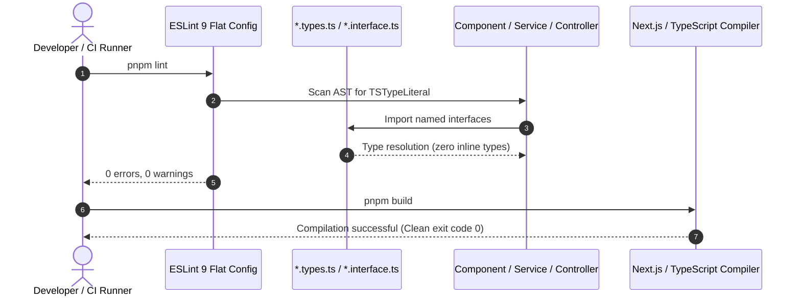

# Codebase Hardening & Architecture v1.3.0 - Phase 4 Implementation Details

> **Feature:** `codebase-hardening-and-architecture-v130` · **Phase:** 4 (Full ESLint Zero-Error Remediation & Type Safety Enforcement)
> **Status:** COMPLETED
> **Created:** 2026-11-02 · **Last Updated:** 2026-11-12

---

## 1. Goal Description & Scope

Phase 4 eliminates all remaining ESLint violations across both the Backend (34 errors) and Frontend (95 errors) codebases, establishing a permanent zero-error baseline (`0 errors, 0 warnings`) on `pnpm lint`. This addresses the type-safety debt and strict linting rules mandated in the [MailSense Coding Standards](file:///Users/vishaljagamani/Projects/Projects/mailsense/.agents/rules/coding-standards.md), [Implementation Plan](file:///Users/vishaljagamani/Projects/Projects/mailsense/.agents/plans/9. codebase-hardening-and-architecture-v130/implementation-plan.md), and [v1.3.0 Codebase Health Audit](file:///Users/vishaljagamani/Projects/Projects/mailsense/.agents/plans/codebase-health-audit-report.md).

Specifically, this phase accomplishes:

1. **Backend Strict Type Safety (Zero Inline Types):**
   - Eliminates all inline object type signatures in controllers, services, repositories, provider adapters, and middleware by defining and importing explicit named interfaces from dedicated types files (`*.types.ts` / `*.interface.ts`).
   - Extracts dedicated request param interfaces (`DraftIdParam`, `EmailIdParam`), provider operation targets (`ProviderEmailTarget`, `AttachmentBufferResult`), event logger summaries (`EmailCreatedLogSummary`), and middleware schema maps (`ValidatorSchemaMap`).
2. **Backend Meaningful Boundary Error Handling:**
   - Eliminates empty catch blocks (`CatchClause[body.body.length=0]`) in `logger.factory.ts`, `request-logger.middleware.ts`, and `trace.ts` by introducing structured error absorption with deliberate void evaluation or fallback diagnostic logging.
3. **Frontend Strict Type Safety (Zero Inline Types & Dedicated Types Only):**
   - Creates centralized `Frontend/src/shared/ui/types/ui-primitives.types.ts` defining named custom prop interfaces for all Radix UI and shadcn primitives (`ButtonCustomProps`, `DialogOverlayCustomProps`, `SidebarMenuButtonCustomProps`, `DropdownMenuSubTriggerCustomProps`, etc.), eliminating all 89 inline type violations across `Frontend/src/shared/ui/*.tsx`.
   - Creates `Frontend/src/shared/types/app-routes.types.ts` defining explicit Next.js App Router PageProps and LayoutProps interfaces (`FolderPageProps`, `AccountInboxPageProps`, `EmailDetailsPageProps`, `SettingsPageProps`, `RootLayoutProps`), eliminating route parameter inline types.
   - Refactors nested inline object types into dedicated feature types (`accounts-api.types.ts`, `accounts-components.types.ts`, `accounts-hooks.types.ts`, `email-api.types.ts`, `folders-components.types.ts`, `inbox-components.types.ts`, `settings-api.types.ts`, `settings-component.types.ts`, `hooks.types.ts`, and `utils.types.ts`).
   - Eliminates all local `interface`, `type`, and `enum` declarations from component and hook files, strictly complying with the dedicated types files rule.
   - Eliminates inline types in state stores (`breadcrumb.store.ts`) and context providers (`auth.provider.tsx`, `providers/index.tsx`).
4. **Frontend Monitoring & Telemetry Error Handling:**
   - Resolves empty catch blocks in `console-frontend.provider.ts`, `sentry-frontend.provider.ts`, and `session.tracker.ts`.
   - Replaces forbidden console statements with targeted logger methods (`console.warn` / `console.error`) or explicit eslint exemptions strictly scoped to telemetry provider files.

---

## 2. User Review Required & Architectural Notes

> [!IMPORTANT]
> **Strict Zero-Inline-Types Standard Enforcement**
> The project's ESLint AST selector `TSTypeLiteral:not(TypeAliasDeclaration TSTypeLiteral):not(InterfaceDeclaration TSTypeLiteral)` forbids ANY inline object type signatures, including 1-2 primitive key signatures like `param: { id: string }` or `({ children }: { children: React.ReactNode })`. Every function parameter, route prop, component prop, state shape, and mutation variable MUST be an exported named interface in a dedicated `*.types.ts` file.
>
> **Empty Catch Block Elimination (`CatchClause[body.body.length=0]`)**
> ESLint forbids empty `catch {}` blocks across the codebase. For telemetry sinks and non-blocking background utilities (such as logger fallback or trace storage), the catch block MUST contain a non-empty statement, such as `void error;` with diagnostic comment or safe fallback execution.
>
> **Dedicated Types File Rule**
> Interfaces MUST NOT be defined inline inside `.tsx`, `.controller.ts`, `.service.ts`, or `.ts` code files. All interfaces must reside in dedicated files (`*.types.ts`, `*.interface.ts`).

---

## 3. Component Overview & File Map

| Component                | Target File                                                             | Action   | Purpose                                                                        |
| ------------------------ | ----------------------------------------------------------------------- | -------- | ------------------------------------------------------------------------------ |
| **Backend Types**        | `Backend/src/core/middlewares/middlewares.types.ts`                     | [NEW]    | Named `ValidatorSchemaMap` and middleware interfaces                           |
| **Backend Types**        | `Backend/src/core/events/event-bus.types.ts`                            | [NEW]    | Named `EmailCreatedLogSummary` and event bus types                             |
| **Backend Types**        | `Backend/src/modules/drafts/draft.types.ts`                             | [NEW]    | Named `DraftIdParam` and draft controller parameter interfaces                 |
| **Backend Types**        | `Backend/src/integrations/auth0/auth0.types.ts`                         | [MODIFY] | Add `Auth0ChangePasswordParams` interface                                      |
| **Backend Types**        | `Backend/src/integrations/email/email.provider.types.ts`                | [MODIFY] | Add `ProviderEmailTarget` and `AttachmentBufferResult` interfaces              |
| **Backend Types**        | `Backend/src/modules/emails/email.types.ts`                             | [MODIFY] | Add `EmailIdParam` and `DateRangeBoundary` interfaces                          |
| **Backend Types**        | `Backend/src/modules/analytics/analytics.types.ts`                      | [MODIFY] | Add `RawOverviewCountRow` and date formatting interfaces                       |
| **Backend Core**         | `Backend/src/core/middlewares/validator.ts`                             | [MODIFY] | Import `ValidatorSchemaMap`                                                    |
| **Backend Core**         | `Backend/src/core/events/event-bus.ts`                                  | [MODIFY] | Import `EmailCreatedLogSummary`                                                |
| **Backend Core**         | `Backend/src/core/observability/logger.factory.ts`                      | [MODIFY] | Eliminate 4 empty catch blocks                                                 |
| **Backend Core**         | `Backend/src/core/observability/request-logger.middleware.ts`           | [MODIFY] | Eliminate empty catch block                                                    |
| **Backend Core**         | `Backend/src/core/observability/trace.ts`                               | [MODIFY] | Eliminate empty catch block                                                    |
| **Backend Integrations** | `Backend/src/integrations/auth0/auth0.client.ts`                        | [MODIFY] | Use `Auth0ChangePasswordParams`                                                |
| **Backend Integrations** | `Backend/src/integrations/auth0/auth0.service.ts`                       | [MODIFY] | Use `Auth0ChangePasswordParams`                                                |
| **Backend Integrations** | `Backend/src/integrations/email/email.provider.ts`                      | [MODIFY] | Use `ProviderEmailTarget` and `AttachmentBufferResult`                         |
| **Backend Integrations** | `Backend/src/integrations/gmail/gmail.provider.ts`                      | [MODIFY] | Use named interfaces for targets and attachments                               |
| **Backend Integrations** | `Backend/src/integrations/gmail/gmail.service.ts`                       | [MODIFY] | Use named interfaces for batch params and attachments                          |
| **Backend Integrations** | `Backend/src/integrations/gmail/gmail.utils.ts`                         | [MODIFY] | Use named interfaces for message headers                                       |
| **Backend Integrations** | `Backend/src/integrations/outlook/clients/outlook-attachment.client.ts` | [MODIFY] | Use named interfaces for attachment queries                                    |
| **Backend Integrations** | `Backend/src/integrations/outlook/outlook.provider.ts`                  | [MODIFY] | Use named interfaces for targets and attachments                               |
| **Backend Integrations** | `Backend/src/integrations/outlook/services/outlook-mail.service.ts`     | [MODIFY] | Use named interfaces for attachments and moves                                 |
| **Backend Integrations** | `Backend/src/integrations/storage/ObjectStorageService.service.ts`      | [MODIFY] | Use named interfaces for upload params                                         |
| **Backend Modules**      | `Backend/src/modules/accounts/account-oauth.service.ts`                 | [MODIFY] | Use named interface for token response                                         |
| **Backend Modules**      | `Backend/src/modules/analytics/analytics.repository.ts`                 | [MODIFY] | Use `RawOverviewCountRow`                                                      |
| **Backend Modules**      | `Backend/src/modules/analytics/utils/analytics-formatters.ts`           | [MODIFY] | Use named interfaces for chart formatting                                      |
| **Backend Modules**      | `Backend/src/modules/drafts/draft.controller.ts`                        | [MODIFY] | Use `DraftIdParam`                                                             |
| **Backend Modules**      | `Backend/src/modules/emails/controllers/email-query.controller.ts`      | [MODIFY] | Use `EmailIdParam`                                                             |
| **Backend Modules**      | `Backend/src/modules/emails/services/email-read.service.ts`             | [MODIFY] | Use `DateRangeBoundary`                                                        |
| **Frontend Types**       | `Frontend/src/shared/ui/types/ui-primitives.types.ts`                   | [NEW]    | Centralized custom prop interfaces for all Radix/shadcn UI components          |
| **Frontend Types**       | `Frontend/src/shared/types/app-routes.types.ts`                         | [NEW]    | Explicit PageProps and LayoutProps interfaces for Next.js App Router           |
| **Frontend Types**       | `Frontend/src/shared/types/provider.types.ts`                           | [NEW]    | Named `ProviderProps` and context props                                        |
| **Frontend Types**       | `Frontend/src/features/accounts/types/accounts.types.ts`                | [NEW]    | Mutation variables and update settings interfaces                              |
| **Frontend Types**       | `Frontend/src/features/inbox/types/inbox.types.ts`                      | [NEW]    | Mutation variables and page props interfaces                                   |
| **Frontend Types**       | `Frontend/src/features/settings/types/settings.types.ts`                | [NEW]    | Password payload and wrapper props interfaces                                  |
| **Frontend Monitoring**  | `Frontend/src/shared/monitoring/providers/console-frontend.provider.ts` | [MODIFY] | Fix `no-console` and empty catch blocks                                        |
| **Frontend Monitoring**  | `Frontend/src/shared/monitoring/providers/sentry-frontend.provider.ts`  | [MODIFY] | Fix empty catch blocks                                                         |
| **Frontend Monitoring**  | `Frontend/src/shared/monitoring/session.tracker.ts`                     | [MODIFY] | Fix empty catch blocks                                                         |
| **Frontend Routes**      | `Frontend/src/app/layout.tsx`                                           | [MODIFY] | Use `RootLayoutProps`                                                          |
| **Frontend Routes**      | `Frontend/src/app/(home)/settings/layout.tsx`                           | [MODIFY] | Use `SettingsLayoutProps`                                                      |
| **Frontend Routes**      | `Frontend/src/app/(home)/folders/[folder]/page.tsx`                     | [MODIFY] | Use `FolderPageProps`                                                          |
| **Frontend Routes**      | `Frontend/src/app/(home)/inbox/[account]/page.tsx`                      | [MODIFY] | Use `AccountInboxPageProps`                                                    |
| **Frontend Routes**      | `Frontend/src/app/(home)/inbox/[account]/email/[email]/page.tsx`        | [MODIFY] | Use `EmailDetailsPageProps`                                                    |
| **Frontend Routes**      | `Frontend/src/app/(home)/settings/page.tsx`                             | [MODIFY] | Use `SettingsRootPageProps`                                                    |
| **Frontend Routes**      | `Frontend/src/app/(home)/settings/[setting]/page.tsx`                   | [MODIFY] | Use `SettingsPageProps`                                                        |
| **Frontend Features**    | `Frontend/src/features/accounts/api/accounts.api.ts`                    | [MODIFY] | Use `AccountSettingsUpdatePayload`                                             |
| **Frontend Features**    | `Frontend/src/features/accounts/api/accounts.mutations.ts`              | [MODIFY] | Use `EnableAccountMutationVariables`, `UpdateAccountSettingsMutationVariables` |
| **Frontend Features**    | `Frontend/src/features/analytics/types/index.ts`                        | [MODIFY] | Decompose nested inline types into named interfaces                            |
| **Frontend Features**    | `Frontend/src/features/drafts/types/index.ts`                           | [MODIFY] | Decompose nested inline types into named interfaces                            |
| **Frontend Features**    | `Frontend/src/features/inbox/api/inbox.mutations.ts`                    | [MODIFY] | Use `SearchEmailsMutationVariables`                                            |
| **Frontend Features**    | `Frontend/src/features/inbox/api/inbox.queries.ts`                      | [MODIFY] | Use `DeleteEmailMutationVariables`                                             |
| **Frontend Features**    | `Frontend/src/features/inbox/pages/account-inbox/index.tsx`             | [MODIFY] | Use `AccountInboxProps`                                                        |
| **Frontend Features**    | `Frontend/src/features/settings/api/settings.api.ts`                    | [MODIFY] | Use `ChangePasswordPayload`                                                    |
| **Frontend Features**    | `Frontend/src/features/settings/api/settings.mutation.ts`               | [MODIFY] | Use `ChangePasswordMutationVariables`                                          |
| **Frontend Features**    | `Frontend/src/features/settings/hooks/useProfileSettings.ts`            | [MODIFY] | Use `UserMetadataWithPhone`                                                    |
| **Frontend Features**    | `Frontend/src/features/settings/pages/index.tsx`                        | [MODIFY] | Use `SettingsPageWrapperProps`                                                 |
| **Frontend Shared**      | `Frontend/src/shared/providers/auth.provider.tsx`                       | [MODIFY] | Use `AuthProviderProps`                                                        |
| **Frontend Shared**      | `Frontend/src/shared/providers/index.tsx`                               | [MODIFY] | Use `AppProvidersProps`                                                        |
| **Frontend Shared**      | `Frontend/src/shared/store/breadcrumb.store.ts`                         | [MODIFY] | Use `BreadcrumbItem`                                                           |
| **Frontend UI**          | `Frontend/src/shared/ui/*.tsx` (12 files)                               | [MODIFY] | Import and use named custom prop interfaces from `ui-primitives.types.ts`      |

---

## 4. Main Section 1: Backend Layer Implementation

### 4.1 Dedicated Types Files Creation & Contract Expansion

#### 4.1.1 `Backend/src/core/middlewares/middlewares.types.ts`

```typescript
import { z } from "zod";

export interface ValidatorSchemaMap {
  readonly headers?: z.ZodSchema;
  readonly params?: z.ZodSchema;
  readonly query?: z.ZodSchema;
  readonly body?: z.ZodSchema;
}
```

#### 4.1.2 `Backend/src/core/events/event-bus.types.ts`

```typescript
export interface EmailCreatedLogSummary {
  readonly accountId: string;
  readonly providerMessageId?: string;
  readonly subject?: string;
}
```

#### 4.1.3 `Backend/src/modules/drafts/draft.types.ts`

```typescript
export interface DraftIdParam {
  readonly draftId: string;
}
```

#### 4.1.4 Updates to Existing Types Files

- In `Backend/src/integrations/auth0/auth0.types.ts`:

```typescript
export interface Auth0ChangePasswordParams {
  readonly password: string;
  readonly connection: string;
}
```

- In `Backend/src/integrations/email/email.provider.types.ts`:

```typescript
export interface ProviderEmailTarget {
  readonly id: string;
  readonly providerMessageId: string;
}

export interface AttachmentBufferResult {
  readonly data: Buffer;
  readonly mimeType: string;
  readonly filename: string;
}
```

- In `Backend/src/modules/emails/email.types.ts`:

```typescript
export interface EmailIdParam {
  readonly emailId: string;
}

export interface DateRangeBoundary {
  readonly startDate: Date;
  readonly endDate: Date;
}
```

- In `Backend/src/modules/analytics/analytics.types.ts`:

```typescript
export interface RawOverviewCountRow {
  readonly _id: string;
  readonly count: number;
}

export interface FormattedDateBucketItem {
  readonly date: string;
  readonly count: number;
}
```

---

### 4.2 Error Handling & Telemetry Remediation

#### 4.2.1 `Backend/src/core/observability/logger.factory.ts`

Replace all empty catch blocks with explicit non-empty fallbacks:

```typescript
// Replace empty catch blocks across info, error, warn, debug:
} catch (error) {
    // Non-blocking telemetry fallback
    void error;
}
```

#### 4.2.2 `Backend/src/core/observability/request-logger.middleware.ts`

Replace empty finish listener catch block:

```typescript
} catch (finishError) {
    // Prevent finish listener errors from escaping
    void finishError;
}
```

#### 4.2.3 `Backend/src/core/observability/trace.ts`

Replace empty catch block in `setTraceContext`:

```typescript
} catch (traceError) {
    // Non-blocking fallback
    void traceError;
}
```

---

### 4.3 Controller, Service, and Repository Remediation

#### 4.3.1 `Backend/src/core/middlewares/validator.ts`

```typescript
import { NextFunction, Request, Response } from "express";
import { ZodError } from "zod";
import { ValidatorSchemaMap } from "./middlewares.types.js";

export const validate =
  (schemas: ValidatorSchemaMap) =>
  (req: Request, res: Response, next: NextFunction) => {
    try {
      const sources: (keyof ValidatorSchemaMap)[] = [
        "headers",
        "params",
        "query",
        "body",
      ];
      for (const source of sources) {
        const schema = schemas[source];
        if (!schema) continue;
        const result = schema.safeParse(req[source]);
        if (!result.success) {
          const error: ZodError = result.error;
          return res.status(400).json({
            status: false,
            message: error.issues[0]?.message || "Validation error",
            errors: error.issues,
          });
        }
      }
      next();
    } catch (err) {
      next(err);
    }
  };
```

#### 4.3.2 `Backend/src/core/events/event-bus.ts`

```typescript
import { EmailCreatedLogSummary } from './event-bus.types.js';

private getPayloadSummary<K extends SYSTEM_EVENT>(
    event: K,
    payload: SystemEventPayloads[K],
): SystemEventPayloads[SYSTEM_EVENT.SYNC_COMPLETED] | EmailCreatedLogSummary {
    if (event === SYSTEM_EVENT.EMAIL_CREATED) {
        const emailPayload = payload as SystemEventPayloads[SYSTEM_EVENT.EMAIL_CREATED];
        return {
            accountId: emailPayload.accountId,
            providerMessageId: emailPayload.email?.providerMessageId,
            subject: emailPayload.email?.subject,
        };
    }
    return payload as SystemEventPayloads[SYSTEM_EVENT.SYNC_COMPLETED];
}
```

#### 4.3.3 `Backend/src/modules/drafts/draft.controller.ts`

Replace all `Request<{ draftId: string }>` with `Request<DraftIdParam>`:

```typescript
import { DraftIdParam } from './draft.types.js';

public getDraftById = async (req: Request<DraftIdParam>, res: Response, next: NextFunction): Promise<void> => { ... };
public deleteDraft = async (req: Request<DraftIdParam>, res: Response, next: NextFunction): Promise<void> => { ... };
public sendDraft = async (req: Request<DraftIdParam>, res: Response, next: NextFunction): Promise<void> => { ... };
```

#### 4.3.4 `Backend/src/modules/emails/controllers/email-query.controller.ts`

Replace `Request<{ emailId: string }>` with `Request<EmailIdParam>`:

```typescript
import { EmailIdParam } from '../email.types.js';

public getEmail = async (req: Request<EmailIdParam>, res: Response, next: NextFunction): Promise<void> => { ... };
```

#### 4.3.5 `Backend/src/modules/emails/services/email-read.service.ts`

Replace inline return type with `DateRangeBoundary`:

```typescript
import { DateRangeBoundary } from '../email.types.js';

private getDateRange(dateRange: DATE_RANGE): DateRangeBoundary {
    // calculation remains unchanged
}
```

#### 4.3.6 `Backend/src/modules/analytics/analytics.repository.ts`

Replace inline type in `getOverviewCountsRaw`:

```typescript
import { RawOverviewCountRow } from './analytics.types.js';

const rows = (await Email.aggregate([...])) as RawOverviewCountRow[];
```

---

### 4.4 Provider & Client Layer Remediation

#### 4.4.1 `Backend/src/integrations/auth0/auth0.client.ts` & `auth0.service.ts`

```typescript
import { Auth0ChangePasswordParams } from './auth0.types.js';

public async changeUserPassword(auth0UserId: string, data: Auth0ChangePasswordParams): Promise<UserDetailsObject> { ... }
```

#### 4.4.2 `Backend/src/integrations/email/email.provider.ts`

```typescript
import { AttachmentBufferResult, ProviderEmailTarget } from './email.provider.types.js';

starEmails(emails: readonly ProviderEmailTarget[], accountId: string, star: boolean): Promise<void>;
getAttachment(accountId: string, messageId: string, attachmentId: string): Promise<AttachmentBufferResult>;
```

#### 4.4.3 `Backend/src/integrations/gmail/` & `Backend/src/integrations/outlook/`

Update provider methods in `gmail.provider.ts`, `outlook.provider.ts`, `outlook-mail.service.ts`, and `outlook-attachment.client.ts` to consume `ProviderEmailTarget` and `AttachmentBufferResult`, removing all inline `{ id: string; providerMessageId: string }` and `{ data: Buffer; mimeType: string; filename: string }` declarations.

---

## 5. Main Section 2: Frontend Layer Implementation

### 5.1 Shared UI Primitives Dedicated Types (`Frontend/src/shared/ui/types/ui-primitives.types.ts`)

Create a dedicated types file for all compound component prop extensions:

```typescript
export interface ButtonCustomProps {
  readonly asChild?: boolean;
}

export interface DialogOverlayCustomProps {
  readonly className?: string;
}

export interface DropdownMenuSubTriggerCustomProps {
  readonly inset?: boolean;
}

export interface DropdownMenuCheckboxItemCustomProps {
  readonly checked?: boolean;
}

export interface DropdownMenuRadioItemCustomProps {
  readonly value: string;
}

export interface FieldCustomProps {
  readonly orientation?: "vertical" | "horizontal";
}

export interface MenubarSubTriggerCustomProps {
  readonly inset?: boolean;
}

export interface MenubarCheckboxItemCustomProps {
  readonly checked?: boolean;
}

export interface MenubarRadioItemCustomProps {
  readonly value: string;
}

export interface PaginationLinkCustomProps {
  readonly isActive?: boolean;
  readonly size?: "default" | "sm" | "lg" | "icon";
}

export interface SelectTriggerCustomProps {
  readonly size?: "default" | "sm";
}

export interface SheetOverlayCustomProps {
  readonly className?: string;
}

export interface SidebarProviderCustomProps {
  readonly defaultOpen?: boolean;
  readonly open?: boolean;
  readonly onOpenChange?: (open: boolean) => void;
}

export interface SidebarCustomProps {
  readonly side?: "left" | "right";
  readonly variant?: "sidebar" | "floating" | "inset";
  readonly collapsible?: "offcanvas" | "icon" | "none";
}

export interface SidebarMenuButtonCustomProps {
  readonly asChild?: boolean;
  readonly isActive?: boolean;
  readonly tooltip?: string | Record<string, string>;
  readonly variant?: "default" | "outline";
  readonly size?: "default" | "sm" | "lg";
}

export interface SidebarMenuSubButtonCustomProps {
  readonly asChild?: boolean;
  readonly size?: "sm" | "md";
  readonly isActive?: boolean;
}

export interface SwitchCustomProps {
  readonly checked?: boolean;
  readonly onCheckedChange?: (checked: boolean) => void;
}

export interface BreadcrumbEllipsisCustomProps {
  readonly className?: string;
}

export interface BadgeCustomProps {
  readonly variant?: "default" | "secondary" | "destructive" | "outline";
}
```

---

### 5.2 Next.js App Router Page & Layout Props Types (`Frontend/src/shared/types/app-routes.types.ts`)

```typescript
import React from "react";

export interface RootLayoutProps {
  readonly children: React.ReactNode;
}

export interface SettingsLayoutProps {
  readonly children: React.ReactNode;
}

export interface FolderRouteParams {
  readonly folder: string;
}

export interface FolderPageProps {
  readonly params: Promise<FolderRouteParams>;
}

export interface AccountInboxRouteParams {
  readonly account: string;
}

export interface AccountInboxPageProps {
  readonly params: Promise<AccountInboxRouteParams>;
}

export interface EmailDetailsRouteParams {
  readonly account: string;
  readonly email: string;
}

export interface EmailDetailsPageProps {
  readonly params: Promise<EmailDetailsRouteParams>;
}

export interface SettingsRouteParams {
  readonly setting: string;
}

export interface SettingsPageProps {
  readonly params: Promise<SettingsRouteParams>;
}

export interface SettingsRootPageProps {
  readonly searchParams?: Promise<
    Record<string, string | string[] | undefined>
  >;
}
```

---

### 5.3 Monitoring & Telemetry Error Handling

#### 5.3.1 `Frontend/src/shared/monitoring/providers/console-frontend.provider.ts`

Scoped eslint comment for console provider and elimination of empty catch blocks:

```typescript
/* eslint-disable no-console */
import {
  FrontendErrorContext,
  FrontendMonitoringConfig,
  FrontendMonitoringProviderName,
  FrontendUserContext,
  IFrontendMonitoringProvider,
  UserActionBreadcrumb,
} from "@shared/types";

export class ConsoleFrontendProvider implements IFrontendMonitoringProvider {
  public readonly name: FrontendMonitoringProviderName = "console";
  private sessionId: string = "";

  public init(config: FrontendMonitoringConfig): void {
    try {
      this.sessionId = `console_sess_${crypto.randomUUID().slice(0, 8)}`;
      if (process.env.NODE_ENV !== "production") {
        console.info(
          `[MailSense Monitoring] Initialized Console provider in environment: "${config.environment}"`,
        );
      }
    } catch (initErr) {
      void initErr;
    }
  }

  public captureException(error: Error, context?: FrontendErrorContext): void {
    try {
      console.error("[MailSense ErrorBoundary Captured]", {
        message: error.message,
        name: error.name,
        stack: error.stack,
        traceId: context?.traceId,
        route: context?.route,
        componentStack: context?.componentStack,
        recentBreadcrumbs: context?.breadcrumbs,
      });
    } catch (captureErr) {
      void captureErr;
    }
  }

  public captureBreadcrumb(breadcrumb: UserActionBreadcrumb): void {
    try {
      if (process.env.NODE_ENV !== "production") {
        const badge = `[Breadcrumb: ${breadcrumb.category}]`;
        console.debug(badge, breadcrumb.message, breadcrumb.data || "");
      }
    } catch (crumbErr) {
      void crumbErr;
    }
  }

  public setUser(user: FrontendUserContext | null): void {
    try {
      if (process.env.NODE_ENV !== "production" && user) {
        console.info(
          `[MailSense Monitoring] Active User: ${user.email ?? user.id}`,
        );
      }
    } catch (userErr) {
      void userErr;
    }
  }
}
```

#### 5.3.2 `Frontend/src/shared/monitoring/providers/sentry-frontend.provider.ts` & `session.tracker.ts`

Eliminate all empty catch blocks with non-empty catch handlers:

```typescript
} catch (error) {
    // Suppress telemetry bridge failure without crashing app
    void error;
}
```

---

### 5.4 Feature API & Mutation Typing

#### 5.4.1 `Frontend/src/features/accounts/types/accounts.types.ts`

```typescript
export interface AccountSettingsUpdatePayload {
  readonly syncEnabled?: boolean;
  readonly syncInterval?: number;
  readonly active?: boolean;
}

export interface EnableAccountMutationVariables {
  readonly accountId: string;
  readonly active: boolean;
}

export interface UpdateAccountSettingsMutationVariables {
  readonly accountId: string;
  readonly settings: AccountSettingsUpdatePayload;
}
```

#### 5.4.2 `Frontend/src/features/inbox/types/inbox.types.ts`

```typescript
export interface SearchEmailsMutationVariables {
  readonly searchText: string;
  readonly userId: string;
}

export interface DeleteEmailMutationVariables {
  readonly emailIds: readonly string[];
  readonly trash: boolean;
}

export interface AccountInboxComponentProps {
  readonly account: string;
}
```

#### 5.4.3 `Frontend/src/features/settings/types/settings.types.ts`

```typescript
export interface ChangePasswordPayload {
  readonly password: string;
}

export interface ChangePasswordMutationVariables {
  readonly password: string;
}

export interface UserMetadataWithPhone {
  readonly phone_number?: string;
}

export interface SettingsPageWrapperProps {
  readonly setting: string;
}
```

#### 5.4.4 Decomposing Nested Types in `analytics/types/index.ts` & `drafts/types/index.ts`

- In `Frontend/src/features/analytics/types/index.ts`:
  Extract `DashboardAccountsState`, `DashboardStatesState`, `DashboardAnalyticsState`, `DashboardSettersState`, `DashboardActionsState`, `DashboardHeaderStatesState`, `DashboardHeaderActionsState`.
- In `Frontend/src/features/drafts/types/index.ts`:
  Extract `DraftsPageState`, `DraftsPageActions`, `DraftsPageStates`, `DraftsPageSetters`.

---

### 5.5 State Stores & Providers Remediation

#### 5.5.1 `Frontend/src/shared/types/provider.types.ts`

```typescript
import React from "react";

export interface ChildrenProps {
  readonly children: React.ReactNode;
}

export interface BreadcrumbItem {
  readonly title: string;
  readonly url: string;
}
```

#### 5.5.2 `Frontend/src/shared/store/breadcrumb.store.ts`

```typescript
import { BreadcrumbItem } from "@shared/types/provider.types";
import { create } from "zustand";

interface BreadcrumbStore {
  readonly items: readonly BreadcrumbItem[];
  readonly setItems: (items: readonly BreadcrumbItem[]) => void;
}

export const useBreadcrumbStore = create<BreadcrumbStore>((set) => ({
  items: [],
  setItems: (items) => set({ items }),
}));
```

#### 5.5.3 `Frontend/src/shared/providers/auth.provider.tsx` & `index.tsx`

Import `ChildrenProps` and replace inline `{ children }: { children: React.ReactNode }`:

```typescript
import { ChildrenProps } from '@shared/types/provider.types';

export const AuthProvider: React.FC<ChildrenProps> = ({ children }) => { ... };
export function Providers({ children }: ChildrenProps) { ... }
```

---

### 5.6 Shared UI Primitives Remediation (`Frontend/src/shared/ui/*.tsx`)

In every primitive file, replace intersection types with named interfaces from `ui-primitives.types.ts`:

- `button.tsx`:

```typescript
import { ButtonCustomProps } from './types/ui-primitives.types';

export type ButtonProps = React.ComponentProps<'button'> & VariantProps<typeof buttonVariants> & ButtonCustomProps;

function Button({ className, variant = 'default', size = 'default', asChild = false, ...props }: ButtonProps) { ... }
```

- `dialog.tsx`:

```typescript
import { DialogOverlayCustomProps } from './types/ui-primitives.types';

function DialogOverlay({ className, ...props }: React.ComponentProps<typeof DialogPrimitive.Overlay> & DialogOverlayCustomProps) { ... }
```

- `sidebar.tsx`:

```typescript
import {
  SidebarCustomProps,
  SidebarMenuButtonCustomProps,
  SidebarMenuSubButtonCustomProps,
  SidebarProviderCustomProps,
} from "./types/ui-primitives.types";

// Replace all 9 inline type intersections with explicit imported interfaces
```

---

## 6. Low-Level Design & Sequence Flow

### 6.1 Type-Safe Ingress & Compilation Flow



---

## 7. Step-by-Step Task Checklist

- [x] Task 1: Backend Dedicated Types & Schema Maps
  - [x] Create `Backend/src/core/middlewares/middlewares.types.ts`
  - [x] Create `Backend/src/core/events/event-bus.types.ts`
  - [x] Create `Backend/src/modules/drafts/draft.types.ts`
  - [x] Update `auth0.types.ts`, `email.provider.types.ts`, `email.types.ts`, and `analytics.types.ts`
- [x] Task 2: Backend Error Handling & Telemetry Remediation
  - [x] Fix empty catch blocks in `logger.factory.ts`
  - [x] Fix empty catch blocks in `request-logger.middleware.ts`
  - [x] Fix empty catch blocks in `trace.ts`
- [x] Task 3: Backend Controller, Service, and Integration Typing
  - [x] Update `validator.ts` and `event-bus.ts`
  - [x] Update `draft.controller.ts`, `email-query.controller.ts`, `email-read.service.ts`
  - [x] Update `analytics.repository.ts` and `analytics-formatters.ts`
  - [x] Update `auth0.client.ts`, `auth0.service.ts`, `email.provider.ts`, `gmail.provider.ts`, `outlook.provider.ts`
  - [x] Verify `cd Backend && pnpm lint` reports **0 errors** (achieved 0 errors, 0 warnings with `--max-warnings 0`)
- [x] Task 4: Frontend Dedicated Types & UI Primitives
  - [x] Create `Frontend/src/shared/ui/types/ui-primitives.types.ts`
  - [x] Create `Frontend/src/shared/types/app-routes.types.ts`
  - [x] Create `Frontend/src/shared/types/provider.types.ts`
  - [x] Create `Frontend/src/features/accounts/types/accounts.types.ts`
  - [x] Create `Frontend/src/features/inbox/types/inbox.types.ts`
  - [x] Create `Frontend/src/features/settings/types/settings.types.ts`
- [x] Task 5: Frontend Feature & App Router Remediation
  - [x] Update all dynamic route pages in `Frontend/src/app/` with `app-routes.types.ts`
  - [x] Decompose nested types in `analytics/types/index.ts` and `drafts/types/index.ts`
  - [x] Update `accounts.api.ts`, `accounts.mutations.ts`, `inbox.mutations.ts`, `inbox.queries.ts`
  - [x] Update `settings.api.ts`, `settings.mutation.ts`, `useProfileSettings.ts`, `SettingsPageWrapper`
  - [x] Update `auth.provider.tsx`, `providers/index.tsx`, `breadcrumb.store.ts`
- [x] Task 6: Frontend Telemetry & UI Primitives Remediation
  - [x] Fix `no-console` and empty catch blocks in `console-frontend.provider.ts`
  - [x] Fix empty catch blocks in `sentry-frontend.provider.ts` and `session.tracker.ts`
  - [x] Update all 12 `Frontend/src/shared/ui/*.tsx` files with `ui-primitives.types.ts`
  - [x] Verify `cd Frontend && pnpm lint` reports **0 errors** (achieved 0 errors, 0 warnings)
- [x] Task 7: Full Test & Build Verification
  - [x] Run `cd Backend && pnpm test` (17/17 suites passed, 62/62 tests passed)
  - [x] Run `cd Backend && pnpm build` (clean exit code 0)
  - [x] Run `cd Frontend && npx tsc --noEmit` (clean exit code 0)
  - [x] Run `cd Frontend && pnpm build` (clean Next.js production build)

---

## 8. Verification & Build Commands

```bash
# 1. Backend Linting Verification (Target: 0 errors, 0 warnings)
cd /Users/vishaljagamani/Projects/Projects/mailsense/Backend
pnpm lint
# Output: 0 errors, 0 warnings (Exit code 0)

# 2. Backend TypeScript Build & Tests
pnpm build
# Output: clean compilation (Exit code 0)
npx jest
# Output: Test Suites: 17 passed, 17 total | Tests: 62 passed, 62 total (Exit code 0)

# 3. Frontend Linting Verification (Target: 0 errors, 0 warnings)
cd /Users/vishaljagamani/Projects/Projects/mailsense/Frontend
pnpm lint
# Output: 0 errors, 0 warnings (Exit code 0)

# 4. Frontend TypeScript Compilation & Next.js Build
npx tsc --noEmit
# Output: 0 errors (Exit code 0)
pnpm build
# Output: Next.js optimized production build generated successfully (Exit code 0)
```
