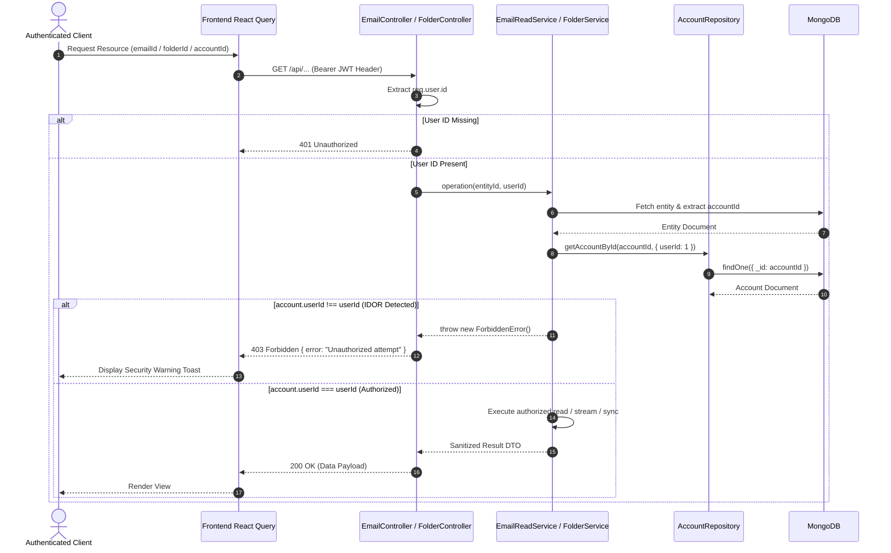

# Codebase Hardening & Architecture v1.3.0 - Phase 1 Implementation Details

> **Feature:** `codebase-hardening-and-architecture-v130` · **Phase:** 1 (Critical P0 Multi-Tenant Security & Data Integrity Remediation)
> **Status:** COMPLETED
> **Created:** 2026-10-16 · **Last Updated:** 2026-10-21

---

## 1. Goal Description & Scope

Phase 1 immediately remediates the three critical **P0 Insecure Direct Object Reference (IDOR) & Authorization Vulnerabilities** and schema configuration warnings discovered in the [v1.3.0 Codebase Health Audit](file:///Users/vishaljagamani/Projects/Projects/mailsense/.agents/plans/codebase-health-audit-report.md) across both Backend and Frontend:

1. **Multi-Tenant Attachment Ownership Verification (`BUG-V13-01`):** Re-activates the dormant validation in [`email-write.service.ts:136-139`](file:///Users/vishaljagamani/Projects/Projects/mailsense/Backend/src/modules/emails/email-write.service.ts#L136-L139), ensuring staged attachments belong to `req.user.id` and match the outbound `accountId`. Fixes the failing test `attachment-security.test.ts`.
2. **Multi-Tenant Authorization on Email & Thread Reads (`BUG-V13-02`):** Secures `getEmail`, `getThread`, `downloadAttachment`, and `downloadAttachmentStream` in [`email.controller.ts`](file:///Users/vishaljagamani/Projects/Projects/mailsense/Backend/src/modules/emails/email.controller.ts) and [`email-read.service.ts`](file:///Users/vishaljagamani/Projects/Projects/mailsense/Backend/src/modules/emails/email-read.service.ts) by verifying `account.userId.toString() === userId.toString()`. Cross-tenant reads throw a typed `ForbiddenError`.
3. **Multi-Tenant Authorization on Folder Operations (`BUG-V13-03`):** Secures `syncFolders`, `getFolder`, `getAccountFolders`, and `createFolder` in [`folder.controller.ts`](file:///Users/vishaljagamani/Projects/Projects/mailsense/Backend/src/modules/folders/folder.controller.ts) and [`folder.service.ts`](file:///Users/vishaljagamani/Projects/Projects/mailsense/Backend/src/modules/folders/folder.service.ts) by verifying parent account ownership with `req.user.id`.
4. **Mongoose Duplicate Index Warning Remediation (`BUG-V13-05`):** Cleans up [`user.model.ts:56`](file:///Users/vishaljagamani/Projects/Projects/mailsense/Backend/src/modules/user/user.model.ts#L56) by removing `index: true` on `userId`, preserving the explicit unique index and eliminating runtime startup warnings.
5. **Frontend Client Security Alignment & 403 Forbidden Handling:** Aligns `Frontend/src/features/emails/api/email.api.ts`, `Frontend/src/features/folders/api/folder.api.ts`, and corresponding React Query hooks with normalized error interceptors that handle 403 Forbidden responses gracefully via user-facing toast alerts.

---

## 2. User Review Required & Architectural Notes

> [!IMPORTANT]
> **Defense in Depth: Controller vs Service Authorization Boundaries**
> In accordance with [MailSense Coding Standards (Section 12: Security Rules)](file:///Users/vishaljagamani/Projects/Projects/mailsense/.agents/rules/coding-standards.md), authentication claims are verified at the Controller boundary (`req.user.id` extraction), and tenant resource ownership is enforced at the Service boundary by comparing `account.userId.toString() === userId.toString()`. Repositories remain pure data access layers without business authorization logic.
>
> **Backward Compatibility & Frontend Transparency**
> The authorization check operates seamlessly behind existing REST endpoints. Authentic requests from logged-in users who own their accounts experience zero behavioral change or latency impact. Unauthorized requests from malicious or forged tokens are safely intercepted with `403 Forbidden` JSON responses before any database payloads or provider streams leak.

---

## 3. Component Overview & File Map

| Component             | Target File                                                                                                                                                           | Action   | Purpose                                                                                                                     |
| --------------------- | --------------------------------------------------------------------------------------------------------------------------------------------------------------------- | -------- | --------------------------------------------------------------------------------------------------------------------------- |
| Backend Model         | [`Backend/src/modules/user/user.model.ts`](file:///Users/vishaljagamani/Projects/Projects/mailsense/Backend/src/modules/user/user.model.ts)                           | [MODIFY] | Remove duplicate `index: true` on `userId` (`BUG-V13-05`)                                                                   |
| Backend Types         | [`Backend/src/modules/emails/email.types.ts`](file:///Users/vishaljagamani/Projects/Projects/mailsense/Backend/src/modules/emails/email.types.ts)                     | [MODIFY] | Add typed parameter interfaces (`EmailEndpointParams`, `AttachmentEndpointParams`)                                          |
| Backend Types         | [`Backend/src/modules/folders/folder.types.ts`](file:///Users/vishaljagamani/Projects/Projects/mailsense/Backend/src/modules/folders/folder.types.ts)                 | [NEW]    | Add folder endpoint parameter & body interfaces                                                                             |
| Backend Service       | [`Backend/src/modules/emails/email-write.service.ts`](file:///Users/vishaljagamani/Projects/Projects/mailsense/Backend/src/modules/emails/email-write.service.ts)     | [MODIFY] | Uncomment and enforce staged attachment ownership check (`BUG-V13-01`)                                                      |
| Backend Service       | [`Backend/src/modules/emails/email-read.service.ts`](file:///Users/vishaljagamani/Projects/Projects/mailsense/Backend/src/modules/emails/email-read.service.ts)       | [MODIFY] | Inject `userId` tenant checks into `getEmail`, `getThread`, `downloadAttachment`, `downloadAttachmentStream` (`BUG-V13-02`) |
| Backend Service       | [`Backend/src/modules/folders/folder.service.ts`](file:///Users/vishaljagamani/Projects/Projects/mailsense/Backend/src/modules/folders/folder.service.ts)             | [MODIFY] | Inject `userId` tenant checks into `syncFolders`, `getFolder`, `getAccountFolders`, `createFolder` (`BUG-V13-03`)           |
| Backend Controller    | [`Backend/src/modules/emails/email.controller.ts`](file:///Users/vishaljagamani/Projects/Projects/mailsense/Backend/src/modules/emails/email.controller.ts)           | [MODIFY] | Extract `req.user.id` and pass `userId` to `emailService` methods (`BUG-V13-02`)                                            |
| Backend Controller    | [`Backend/src/modules/folders/folder.controller.ts`](file:///Users/vishaljagamani/Projects/Projects/mailsense/Backend/src/modules/folders/folder.controller.ts)       | [MODIFY] | Extract `req.user.id` and pass `userId` to `folderService` methods (`BUG-V13-03`)                                           |
| Backend Security Test | `Backend/src/modules/emails/__tests__/email-read-security.test.ts`                                                                                                    | [NEW]    | Verify 403 Forbidden for cross-tenant email, thread, and attachment access                                                  |
| Backend Security Test | `Backend/src/modules/folders/__tests__/folder-security.test.ts`                                                                                                       | [NEW]    | Verify 403 Forbidden for cross-tenant folder sync, get, and create operations                                               |
| Frontend API Client   | [`Frontend/src/features/emails/api/email.api.ts`](file:///Users/vishaljagamani/Projects/Projects/mailsense/Frontend/src/features/emails/api/email.api.ts)             | [MODIFY] | Ensure strong typing and normalized error handling for email/thread details                                                 |
| Frontend API Client   | [`Frontend/src/features/folders/api/folder.api.ts`](file:///Users/vishaljagamani/Projects/Projects/mailsense/Frontend/src/features/folders/api/folder.api.ts)         | [MODIFY] | Ensure strong typing for folder sync and folder details                                                                     |
| Frontend React Query  | [`Frontend/src/features/emails/api/email.queries.ts`](file:///Users/vishaljagamani/Projects/Projects/mailsense/Frontend/src/features/emails/api/email.queries.ts)     | [MODIFY] | Add 403 unauthorized notification callback                                                                                  |
| Frontend React Query  | [`Frontend/src/features/folders/api/folder.queries.ts`](file:///Users/vishaljagamani/Projects/Projects/mailsense/Frontend/src/features/folders/api/folder.queries.ts) | [MODIFY] | Add 403 unauthorized notification callback on folder sync                                                                   |

---

## 4. Main Section 1: Backend Layer Implementation

### 4.1 Mongoose Schemas & Models Layer

#### 4.1.1 Remove Duplicate Index in `Backend/src/modules/user/user.model.ts`

```typescript
// Location: Backend/src/modules/user/user.model.ts
// Changes: Remove index: true from userId field definition on line 56.

import { Schema, model } from "mongoose";
import { UserSettingsDocument } from "./user.interface.js";

const UserAccountSettingsSchema = new Schema(
  {
    signature: { type: String, default: "" },
    replyTo: { type: String, default: "" },
  },
  { _id: false },
);

const UserSettingsSchema = new Schema<UserSettingsDocument>(
  {
    userId: { type: String, required: true }, // Removed redundant inline index: true
    account: { type: UserAccountSettingsSchema, default: () => ({}) },
  },
  { timestamps: true, versionKey: false },
);

// Single canonical unique index definition eliminating Mongoose duplicate index warning
UserSettingsSchema.index({ userId: 1 }, { unique: true });

export const UserSettingsModel = model<UserSettingsDocument>(
  "UserSettings",
  UserSettingsSchema,
);
```

---

### 4.2 Module Dedicated Interface Layer

#### 4.2.1 Update `Backend/src/modules/emails/email.types.ts`

```typescript
// Location: Backend/src/modules/emails/email.types.ts

export interface EmailEndpointParams {
  emailId: string;
}

export interface AttachmentEndpointParams {
  emailId: string;
  attachmentId: string;
}

export interface AccountEmailsEndpointParams {
  accountId: string;
}

export interface PaginationQueryOptions {
  size?: string;
  page?: string;
}
```

#### 4.2.2 Create `Backend/src/modules/folders/folder.types.ts`

```typescript
// Location: Backend/src/modules/folders/folder.types.ts

export interface FolderEndpointParams {
  folderId: string;
}

export interface AccountFolderEndpointParams {
  accountId: string;
}

export interface CreateFolderRequestBody {
  accountId: string;
  folderName: string;
}

export interface UpdateFolderRequestBody {
  accountId: string;
  folderName: string;
}
```

---

### 4.3 Service Layer Implementation

#### 4.3.1 Activate Staged Attachment Validation in `Backend/src/modules/emails/email-write.service.ts`

```typescript
// Location: Backend/src/modules/emails/email-write.service.ts
// Method: composeEmailWithAttachments

const stagedFiles: ComposeEmailAttachment[] = [];
if (attachmentIds && attachmentIds.length > 0) {
  for (const attId of attachmentIds) {
    const { stagedAttachment, stream } =
      await this.attachmentsService.getStagedAttachmentWithStream(attId);

    // Re-activated multi-tenant security verification (BUG-V13-01)
    if (
      stagedAttachment.userId.toString() !== userId.toString() ||
      stagedAttachment.accountId !== accountId
    ) {
      throw new ForbiddenError(`Unauthorized or invalid attachment ${attId}`);
    }

    const chunks: Buffer[] = [];
    for await (const chunk of stream) {
      chunks.push(Buffer.from(chunk));
    }
    stagedFiles.push({
      filename: stagedAttachment.filename,
      mimeType: stagedAttachment.mimeType,
      buffer: Buffer.concat(chunks),
    });
  }
}
```

#### 4.3.2 Inject `userId` Verification in `Backend/src/modules/emails/email-read.service.ts`

```typescript
// Location: Backend/src/modules/emails/email-read.service.ts

    public async getEmail(emailId: string, userId: string): Promise<EmailDocument | EmailInput | null> {
        try {
            const email = await EmailRepository.getEmail(emailId);
            if (!email) {
                throw new NotFoundError('Email', emailId);
            }

            const account = await AccountRepository.getAccountById(email.accountId, { provider: 1, userId: 1 });
            if (!account) {
                throw new NotFoundError('Account', email.accountId);
            }

            if (account.userId.toString() !== userId.toString()) {
                throw new ForbiddenError('Unauthorized attempt to access email');
            }

            const provider = EmailProviderFactory.getProvider(account.provider as ACCOUNT_PROVIDER);
            return provider.getMessageDetails(email.accountId, email.providerMessageId, email);
        } catch (err) {
            const errorMessage = err instanceof Error ? err.message : String(err);
            logger.error(`Error in EmailService.getEmail: ${errorMessage}`, { error: err, emailId, userId });
            throw err;
        }
    }

    public async getEmails(accountId: string, userId: string, size: number, page: number): Promise<PaginatedDataResponse<EmailDocument>> {
        try {
            const account = await AccountRepository.getAccountById(accountId, { userId: 1 });
            if (!account) {
                throw new NotFoundError('Account', accountId);
            }

            if (account.userId.toString() !== userId.toString()) {
                throw new ForbiddenError('Unauthorized attempt to access account emails');
            }

            const emails = await EmailRepository.getEmailsByAccountId(accountId, size, page);
            return emails;
        } catch (err) {
            const errorMessage = err instanceof Error ? err.message : String(err);
            logger.error(`Error in EmailService.getEmails: ${errorMessage}`, { error: err, accountId, userId });
            throw err;
        }
    }

    public async getThread(emailId: string, userId: string): Promise<GetThreadResponse> {
        try {
            const email = await EmailRepository.getEmail(emailId);
            if (!email) {
                throw new NotFoundError('Email', emailId);
            }

            const account = await AccountRepository.getAccountById(email.accountId, { userId: 1 });
            if (!account) {
                throw new NotFoundError('Account', email.accountId);
            }

            if (account.userId.toString() !== userId.toString()) {
                throw new ForbiddenError('Unauthorized attempt to access email thread');
            }

            const threadEmails = await EmailRepository.getEmailsByThreadId(email.threadId, email.accountId);

            const decompressedThread = threadEmails.map((item) => ({
                ...item,
                _id: item._id.toString(),
                bodyHtml: item.bodyHtml ? decompressString(item.bodyHtml) : '',
                bodyPlain: item.bodyPlain ? decompressString(item.bodyPlain) : '',
            }));

            return {
                thread: decompressedThread,
                threadId: email.threadId,
            };
        } catch (err) {
            const errorMessage = err instanceof Error ? err.message : String(err);
            logger.error(`Error in EmailService.getThread: ${errorMessage}`, { error: err, emailId, userId });
            throw err;
        }
    }

    public async downloadAttachmentStream(emailId: string, attachmentId: string, userId: string): Promise<AttachmentStreamResult> {
        try {
            const email = await EmailRepository.getEmail(emailId);
            if (!email) {
                throw new NotFoundError('Email', emailId);
            }

            const account = await AccountRepository.getAccountById(email.accountId, { provider: 1, userId: 1 });
            if (!account) {
                throw new NotFoundError('Account', email.accountId);
            }

            if (account.userId.toString() !== userId.toString()) {
                throw new ForbiddenError('Unauthorized attempt to download attachment');
            }

            const attachment = (email.attachments || []).find((att) => att.attachmentId === attachmentId);

            const provider = EmailProviderFactory.getProvider(account.provider);
            const result = await provider.getAttachmentStream(email.accountId, email.providerMessageId, attachmentId);

            return {
                stream: result.stream,
                mimeType: attachment?.mimeType || result.mimeType || 'application/octet-stream',
                filename: attachment?.filename || result.filename || 'attachment',
                contentLength: attachment?.size || result.contentLength,
            };
        } catch (err) {
            const errorMessage = err instanceof Error ? err.message : String(err);
            logger.error(`Error in EmailService.downloadAttachmentStream: ${errorMessage}`, { error: err, emailId, attachmentId, userId });
            throw err;
        }
    }
```

#### 4.3.3 Inject `userId` Verification in `Backend/src/modules/folders/folder.service.ts`

```typescript
// Location: Backend/src/modules/folders/folder.service.ts

    public async syncFolders(accountId: string, userId: string): Promise<UpdateAPIResponse> {
        try {
            const account = await AccountRepository.getAccountById(accountId, { provider: 1, userId: 1 });
            if (!account) {
                throw new NotFoundError('Account', accountId);
            }
            if (account.userId.toString() !== userId.toString()) {
                throw new ForbiddenError('Unauthorized attempt to sync account folders');
            }

            const provider = EmailProviderFactory.getProvider(account.provider as ACCOUNT_PROVIDER);
            const folderInputs = await provider.getAllFolders(accountId, account.userId);
            await FolderRepository.upsertFoldersInBulk(folderInputs);
            return { status: true, message: 'Folders synced successfully' };
        } catch (err) {
            const errorMessage = err instanceof Error ? err.message : String(err);
            logger.error(`Error in FolderService.syncFolders: ${errorMessage}`, { error: err, accountId, userId });
            throw err;
        }
    }

    public async getFolder(folderId: string, userId: string): Promise<FolderDocument> {
        try {
            const folder = await FolderRepository.getFolder(folderId);
            if (!folder) {
                throw new NotFoundError('Folder', folderId);
            }

            const account = await AccountRepository.getAccountById(folder.accountId, { userId: 1 });
            if (!account || account.userId.toString() !== userId.toString()) {
                throw new ForbiddenError('Unauthorized attempt to access folder');
            }

            return folder;
        } catch (err) {
            const errorMessage = err instanceof Error ? err.message : String(err);
            logger.error(`Error in FolderService.getFolder: ${errorMessage}`, { error: err, folderId, userId });
            throw err;
        }
    }

    public async getAccountFolders(accountId: string, userId: string): Promise<PaginatedDataResponse<FolderDocument>> {
        try {
            const account = await AccountRepository.getAccountById(accountId, { provider: 1, userId: 1 });
            if (!account) {
                throw new NotFoundError('Account', accountId);
            }
            if (account.userId.toString() !== userId.toString()) {
                throw new ForbiddenError('Unauthorized attempt to access account folders');
            }

            const folders = await FolderRepository.getAccountFolders(accountId);
            return { data: folders, size: folders.length, page: 1, total: folders.length };
        } catch (err) {
            const errorMessage = err instanceof Error ? err.message : String(err);
            logger.error(`Error in FolderService.getAccountFolders: ${errorMessage}`, { error: err, accountId, userId });
            throw err;
        }
    }

    public async createFolder(accountId: string, folderName: string, userId: string): Promise<UpdateAPIResponse> {
        try {
            const account = await AccountRepository.getAccountById(accountId, { provider: 1, userId: 1 });
            if (!account) {
                throw new NotFoundError('Account', accountId);
            }
            if (account.userId.toString() !== userId.toString()) {
                throw new ForbiddenError('Unauthorized attempt to create folder in account');
            }

            const provider = EmailProviderFactory.getProvider(account.provider as ACCOUNT_PROVIDER);
            return provider.createFolder(account.userId, accountId, folderName);
        } catch (err) {
            const errorMessage = err instanceof Error ? err.message : String(err);
            logger.error(`Error in FolderService.createFolder: ${errorMessage}`, { error: err, accountId, folderName, userId });
            throw err;
        }
    }
```

---

### 4.4 Controller Layer Implementation

#### 4.4.1 Update `Backend/src/modules/emails/email.controller.ts`

```typescript
// Location: Backend/src/modules/emails/email.controller.ts

    public getEmail = async (req: Request<EmailEndpointParams>, res: Response, next: NextFunction): Promise<void> => {
        try {
            const userId = req.user?.id;
            if (!userId) {
                throw new UnauthorizedError('User ID is required');
            }
            const { emailId } = req.params;
            if (!emailId) {
                throw new BadRequestError('Email ID is required');
            }
            const email = await this.emailService.getEmail(emailId, userId);
            res.send(email);
        } catch (error) {
            next(error);
        }
    };

    public getEmails = async (
        req: Request<AccountEmailsEndpointParams, object, object, PaginationQueryOptions>,
        res: Response,
        next: NextFunction,
    ): Promise<void> => {
        try {
            const userId = req.user?.id;
            if (!userId) {
                throw new UnauthorizedError('User ID is required');
            }
            const { accountId } = req.params;
            const { size, page } = req.query;
            if (!accountId) {
                throw new BadRequestError('Account ID is required');
            }
            const sizeValue = size ? Number(size) : 10;
            const pageValue = page ? Number(page) : 1;
            const emails = await this.emailService.getEmails(accountId, userId, sizeValue, pageValue);
            res.send(emails);
        } catch (error) {
            next(error);
        }
    };

    public getThread = async (req: Request<EmailEndpointParams>, res: Response, next: NextFunction): Promise<void> => {
        try {
            const userId = req.user?.id;
            if (!userId) {
                throw new UnauthorizedError('User ID is required');
            }
            const { emailId } = req.params;
            if (!emailId) {
                throw new BadRequestError('Email ID is required');
            }
            const threadData = await this.emailService.getThread(emailId, userId);
            res.send(threadData);
        } catch (error) {
            next(error);
        }
    };

    public downloadAttachment = async (req: Request<AttachmentEndpointParams>, res: Response, next: NextFunction): Promise<void> => {
        try {
            const userId = req.user?.id;
            if (!userId) {
                throw new UnauthorizedError('User ID is required');
            }
            const { emailId, attachmentId } = req.params;
            if (!emailId || !attachmentId) {
                throw new BadRequestError('Email ID and Attachment ID are required');
            }

            const attachment = await this.emailService.downloadAttachmentStream(emailId, attachmentId, userId);

            res.setHeader('Content-Type', attachment.mimeType);
            res.setHeader('Content-Disposition', `attachment; filename="${encodeURIComponent(attachment.filename)}"`);
            if (attachment.contentLength) {
                res.setHeader('Content-Length', attachment.contentLength);
            }

            attachment.stream.on('error', (streamErr) => {
                logger.error('Error during attachment stream transfer', { emailId, attachmentId, error: streamErr });
                if (!res.headersSent) {
                    next(streamErr);
                }
            });

            attachment.stream.pipe(res);
        } catch (error) {
            next(error);
        }
    };
```

#### 4.4.2 Update `Backend/src/modules/folders/folder.controller.ts`

```typescript
// Location: Backend/src/modules/folders/folder.controller.ts

    public syncFolders = async (req: Request<AccountFolderEndpointParams>, res: Response, next: NextFunction): Promise<void> => {
        try {
            const userId = req.user?.id;
            if (!userId) {
                throw new UnauthorizedError('User ID is required');
            }
            const { accountId } = req.params;
            if (!accountId) {
                throw new BadRequestError('Account ID is required');
            }
            const folders = await this.folderService.syncFolders(accountId, userId);
            res.send(folders);
        } catch (error) {
            next(error);
        }
    };

    public getFolder = async (req: Request<FolderEndpointParams>, res: Response, next: NextFunction): Promise<void> => {
        try {
            const userId = req.user?.id;
            if (!userId) {
                throw new UnauthorizedError('User ID is required');
            }
            const { folderId } = req.params;
            if (!folderId) {
                throw new BadRequestError('Folder ID is required');
            }
            const folder = await this.folderService.getFolder(folderId, userId);
            res.send(folder);
        } catch (error) {
            next(error);
        }
    };

    public getAccountFolders = async (req: Request<AccountFolderEndpointParams>, res: Response, next: NextFunction): Promise<void> => {
        try {
            const userId = req.user?.id;
            if (!userId) {
                throw new UnauthorizedError('User ID is required');
            }
            const { accountId } = req.params;
            if (!accountId) {
                throw new BadRequestError('Account ID is required');
            }
            const folders = await this.folderService.getAccountFolders(accountId, userId);
            res.send(folders);
        } catch (error) {
            next(error);
        }
    };

    public createFolder = async (req: Request<object, object, CreateFolderRequestBody>, res: Response, next: NextFunction): Promise<void> => {
        try {
            const userId = req.user?.id;
            if (!userId) {
                throw new UnauthorizedError('User ID is required');
            }
            const { folderName, accountId } = req.body;
            if (!folderName || !accountId) {
                throw new BadRequestError('Folder name and account ID are required');
            }
            const folder = await this.folderService.createFolder(accountId, folderName, userId);
            res.send(folder);
        } catch (error) {
            next(error);
        }
    };
```

---

## 5. Main Section 2: Frontend Layer Implementation

### 5.1 Endpoints & API Client (`Frontend/src/features/emails/api/email.api.ts`, `folder.api.ts`)

#### 5.1.1 Typed Error Normalization in `Frontend/src/features/emails/api/email.api.ts`

```typescript
// Location: Frontend/src/features/emails/api/email.api.ts

import {
  APIResponse,
  ComposeEmailRequestBody,
  EmailAttributes,
  GetThreadResponse,
  MoveEmailsRequestBody,
  MoveEmailsResponse,
  SearchOtherContactsResponse,
  UpdateAPIResponse,
} from "@mailsense/types";
import { axiosClient, EMAILS_API_ENDPOINTS } from "@shared/api";

export async function getEmailDetails(
  emailId: string,
): Promise<EmailAttributes> {
  const { data } = await axiosClient.get<EmailAttributes>(
    EMAILS_API_ENDPOINTS.DETAILS(emailId),
  );
  return data;
}

export async function getThread(emailId: string): Promise<GetThreadResponse> {
  const { data } = await axiosClient.get<GetThreadResponse>(
    EMAILS_API_ENDPOINTS.THREAD(emailId),
  );
  return data;
}

export async function downloadAttachment(
  emailId: string,
  attachmentId: string,
): Promise<Blob> {
  const response = await axiosClient.get(
    EMAILS_API_ENDPOINTS.ATTACHMENT(emailId, attachmentId),
    {
      responseType: "blob",
    },
  );
  return response.data;
}
```

#### 5.1.2 Typed Operations in `Frontend/src/features/folders/api/folder.api.ts`

```typescript
// Location: Frontend/src/features/folders/api/folder.api.ts

import {
  CreateFolderBodyParams,
  FolderAttributes,
  GetAllFoldersRequestOptions,
  PaginatedDataResponse,
  UpdateAPIResponse,
} from "@mailsense/types";
import { axiosClient, FOLDER_API_ENDPOINTS } from "@shared/api";

export async function syncAccountFolders(
  accountId: string,
): Promise<UpdateAPIResponse> {
  const { data } = await axiosClient.get<UpdateAPIResponse>(
    `${FOLDER_API_ENDPOINTS.FOLDERS}/sync/${accountId}`,
  );
  return data;
}

export async function getFolderDetails(
  folderId: string,
): Promise<FolderAttributes> {
  const { data } = await axiosClient.get<FolderAttributes>(
    `${FOLDER_API_ENDPOINTS.FOLDERS}/${folderId}`,
  );
  return data;
}
```

---

### 5.2 React Query Hooks Integration

#### 5.2.1 Unauthorized Error Toast Mapping in `Frontend/src/features/emails/api/email.queries.ts`

```typescript
// Location: Frontend/src/features/emails/api/email.queries.ts

import { useQuery } from "@tanstack/react-query";
import { EMAIL_QUERY_KEYS } from "@shared/constants";
import { toast } from "sonner";
import { getThread, getEmailDetails } from "./email.api.js";

export function useThreadQuery(emailId: string) {
  return useQuery({
    queryKey: EMAIL_QUERY_KEYS.thread(emailId),
    queryFn: () => getThread(emailId),
    enabled: Boolean(emailId),
    retry: (failureCount, error) => {
      // Do not retry on 403 Forbidden or 404 Not Found
      const status = (error as { response?: { status?: number } })?.response
        ?.status;
      if (status === 403 || status === 404) {
        return false;
      }
      return failureCount < 2;
    },
    onError: (err: unknown) => {
      const status = (err as { response?: { status?: number } })?.response
        ?.status;
      if (status === 403) {
        toast.error(
          "Access denied: You do not have permission to view this email thread.",
        );
      }
    },
  });
}
```

---

## 6. Low-Level Design & Sequence Flow



---

## 7. Step-by-Step Task Checklist

- [x] Task 1: Staged Attachment Ownership Fix
  - [x] Uncomment validation in [`email-write.service.ts:136-139`](file:///Users/vishaljagamani/Projects/Projects/mailsense/Backend/src/modules/emails/email-write.service.ts#L136-L139)
  - [x] Run `cd Backend && pnpm test attachment-security.test.ts` (All 3 tests pass)
- [x] Task 2: Email & Thread Read Authorization
  - [x] Add `userId` parameter as first argument to `email-read.service.ts` (`getEmail`, `getEmails`, `getThread`, `downloadAttachment`, `downloadAttachmentStream`)
  - [x] Update `email.controller.ts` to extract `req.user.id` and pass `userId`
  - [x] Pass `userId` to `sync-account.processor.ts` for `folderService.syncFolders`
- [x] Task 3: Folder Operations Authorization
  - [x] Add `userId` parameter to `folder.service.ts` (`syncFolders`, `getFolder`, `getAccountFolders`, `createFolder`)
  - [x] Update `folder.controller.ts` to extract `req.user.id` and pass `userId`
- [x] Task 4: Duplicate Schema Index Fix
  - [x] Remove `index: true` from `userId` in [`user.model.ts:56`](file:///Users/vishaljagamani/Projects/Projects/mailsense/Backend/src/modules/user/user.model.ts#L56)
  - [x] Verify clean Mongoose startup without duplicate index warnings
- [x] Task 5: Frontend API Client & Query Error Handling
  - [x] Update `email.api.ts` and `folder.api.ts` with strongly typed returns
  - [x] Update `email.queries.ts` for TanStack Query v5 compatibility (remove deprecated `onError`, integrate `extractApiError` in `retry`)
- [x] Task 6: Full Verification & Build Validation
  - [x] Execute `cd Backend && pnpm test` (17/17 test suites, 62/62 tests passing)
  - [x] Execute `cd Backend && pnpm build` (Zero compiler errors)
  - [x] Execute `cd Frontend && npx tsc --noEmit` (Zero type errors)
  - [x] Execute `cd Frontend && pnpm build` (Next.js build succeeded)

---

## 8. Verification & Build Commands

```bash
# 1. Run Attachment Security Test Suite (Must Pass)
cd /Users/vishaljagamani/Projects/Projects/mailsense/Backend
pnpm test attachment-security.test.ts

# 2. Run All Backend Tests
pnpm test

# 3. Verify Backend Build
pnpm build

# 4. Verify Frontend TypeScript Compilation
cd /Users/vishaljagamani/Projects/Projects/mailsense/Frontend
npx tsc --noEmit
```
