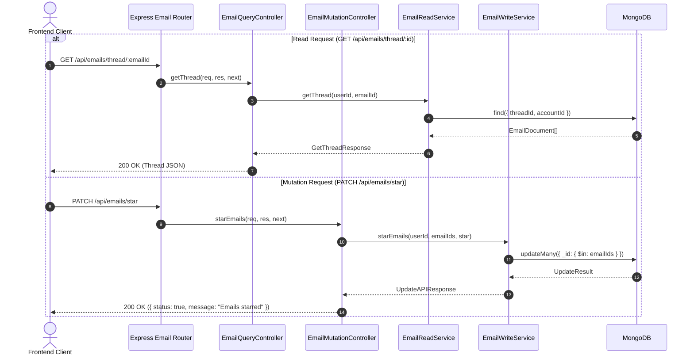
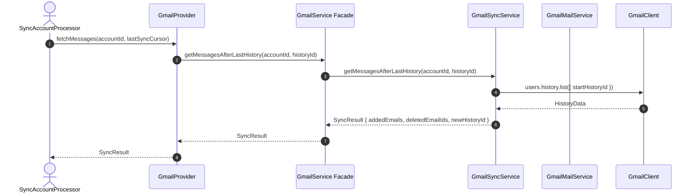

# Codebase Hardening & Architecture v1.3.0 - Phase 2 Implementation Details

> **Feature:** `codebase-hardening-and-architecture-v130` · **Phase:** 2 (Backend Architecture Hardening, Middleware Relocation & Service Modularization)
> **Status:** COMPLETED
> **Created:** 2026-10-21 · **Last Updated:** 2026-10-21

---

## 1. Goal Description & Scope

Phase 2 remediates God classes, oversized services, legacy flat directory structures, and cyclomatic complexity hotspots across the Backend identified in the [v1.3.0 Codebase Health Audit](file:///Users/vishaljagamani/Projects/Projects/mailsense/.agents/plans/codebase-health-audit-report.md) and [Implementation Plan](file:///Users/vishaljagamani/Projects/Projects/mailsense/.agents/plans/codebase-hardening-and-architecture-v130/implementation-plan.md).

Specifically, this phase accomplishes:

1. **Database Bootstrap & Lifecycle Encapsulation:** Extracts raw database initialization from [`server.ts`](file:///Users/vishaljagamani/Projects/Projects/mailsense/Backend/src/server.ts) into an enterprise `DatabaseConnectionManager` class in `Backend/src/core/database/connection.ts`, providing connection pooling, reconnect lifecycle observability, and graceful shutdown handling.
2. **Core Middleware Consolidation:** Relocates cross-cutting middlewares from legacy `Backend/src/middlewares/` to `Backend/src/core/middlewares/` (`auth.ts`, `error.handler.ts`, `validator.ts`), establishing strict architectural layer purity.
3. **Email Controller Separation of Concerns:** Decomposes [`email.controller.ts`](file:///Users/vishaljagamani/Projects/Projects/mailsense/Backend/src/modules/emails/email.controller.ts) (289 lines, exceeding the 200-line hard limit) into two single-responsibility controllers:
   - `email-query.controller.ts` ($\le 140$ lines): Pure read operations (`getEmails`, `getEmail`, `getFilters`, `searchOtherContacts`, `getThread`, `downloadAttachment`).
   - `email-mutation.controller.ts` ($\le 130$ lines): Mutation operations (`composeEmail`, `deleteEmail`, `archiveEmails`, `starEmails`, `unreadEmails`, `moveEmails`).
   - Re-exports via `Backend/src/modules/emails/controllers/index.ts`.
4. **Integration Services Decomposition:**
   - Decomposes [`outlook.service.ts`](file:///Users/vishaljagamani/Projects/Projects/mailsense/Backend/src/integrations/outlook/outlook.service.ts) (521 lines) into `outlook-sync.service.ts` ($\le 210$ lines) and `outlook-mail.service.ts` ($\le 240$ lines), unified by a clean facade in `services/index.ts`.
   - Decomposes [`gmail.service.ts`](file:///Users/vishaljagamani/Projects/Projects/mailsense/Backend/src/integrations/gmail/gmail.service.ts) (450 lines) into `gmail-sync.service.ts` ($\le 190$ lines) and `gmail-mail.service.ts` ($\le 215$ lines), unified by a clean facade in `services/index.ts`.
5. **Analytics Utilities Decomposition:** Splits [`analytics.utils.ts`](file:///Users/vishaljagamani/Projects/Projects/mailsense/Backend/src/modules/analytics/analytics.utils.ts) (354 lines) into `analytics-formatters.ts` ($\le 95$ lines) and `analytics-calculators.ts` ($\le 140$ lines).
6. **Worker Complexity Reduction:** Refactors `syncAccountProcessor` in [`sync-account.processor.ts`](file:///Users/vishaljagamani/Projects/Projects/mailsense/Backend/src/workers/processors/sync-account.processor.ts) into focused private helper methods, reducing cyclomatic complexity from 16 to $\le 8$ and nesting depth to $\le 3$.

---

## 2. User Review Required & Architectural Notes

> [!IMPORTANT]
> **Backward Compatibility for External Consumers & Providers**
> `EmailProviderFactory`, `OutlookProvider`, and `GmailProvider` depend on `OutlookService` and `GmailService` interfaces. Decomposing these integration classes into specialized sub-services (`*SyncService` and `*MailService`) MUST preserve public contract signatures via unified facades in `services/index.ts`. No downstream callers in `workers/` or `providers/` will require signature modifications.
>
> **Route Mounting & Middleware Path Aliases**
> Moving middlewares from `src/middlewares/` to `src/core/middlewares/` updates all Express route imports. To prevent breaking changes during migration, `Backend/src/middlewares/index.ts` will temporarily re-export from `Backend/src/core/middlewares/index.ts` with a `@deprecated` annotation, while all routes are updated directly.
>
> **Pure Utilities vs Boundary Error Handling**
> In strict accordance with [MailSense Coding Standards (Section 6.2)](file:///Users/vishaljagamani/Projects/Projects/mailsense/.agents/rules/coding-standards.md), pure mathematical/formatting utility functions in `analytics-formatters.ts` and `analytics-calculators.ts` perform no I/O and do NOT contain `try/catch` blocks. Error handling occurs at the Service and Controller boundaries.

---

## 3. Component Overview & File Map

| Component          | Target File                                                                                                                                                                     | Action   | Purpose                                                                       |
| ------------------ | ------------------------------------------------------------------------------------------------------------------------------------------------------------------------------- | -------- | ----------------------------------------------------------------------------- |
| Core DB            | `Backend/src/core/database/connection.ts`                                                                                                                                       | [NEW]    | Enterprise MongoDB connection manager with reconnect & pool events            |
| Core Middleware    | `Backend/src/core/middlewares/auth.ts`                                                                                                                                          | [MOVE]   | Authenticated user JWT claim verification                                     |
| Core Middleware    | `Backend/src/core/middlewares/error.handler.ts`                                                                                                                                 | [MOVE]   | Global Express error envelope middleware                                      |
| Core Middleware    | `Backend/src/core/middlewares/validator.ts`                                                                                                                                     | [MOVE]   | Joi / Zod request payload schema validation middleware                        |
| Core Middleware    | `Backend/src/core/middlewares/index.ts`                                                                                                                                         | [NEW]    | Barrel export for core middlewares                                            |
| Backend Controller | `Backend/src/modules/emails/controllers/email-query.controller.ts`                                                                                                              | [NEW]    | Pure query endpoints (reads, threads, stream attachments) ($\le 140$ lines)   |
| Backend Controller | `Backend/src/modules/emails/controllers/email-mutation.controller.ts`                                                                                                           | [NEW]    | Pure mutation endpoints (send, star, unread, archive, move) ($\le 130$ lines) |
| Backend Controller | `Backend/src/modules/emails/controllers/index.ts`                                                                                                                               | [NEW]    | Re-exports decomposed controller singletons                                   |
| Backend Service    | `Backend/src/integrations/outlook/services/outlook-sync.service.ts`                                                                                                             | [NEW]    | Delta sync, cursor tracking, message change extraction ($\le 210$ lines)      |
| Backend Service    | `Backend/src/integrations/outlook/services/outlook-mail.service.ts`                                                                                                             | [NEW]    | Message batch mutations, folder sync, attachments ($\le 240$ lines)           |
| Backend Service    | `Backend/src/integrations/outlook/services/index.ts`                                                                                                                            | [NEW]    | Unified `OutlookService` composite facade ($\le 95$ lines)                    |
| Backend Service    | `Backend/src/integrations/gmail/services/gmail-sync.service.ts`                                                                                                                 | [NEW]    | History ID sync, message change extraction, parsing ($\le 190$ lines)         |
| Backend Service    | `Backend/src/integrations/gmail/services/gmail-mail.service.ts`                                                                                                                 | [NEW]    | Batch label modifications, attachments, sending ($\le 215$ lines)             |
| Backend Service    | `Backend/src/integrations/gmail/services/index.ts`                                                                                                                              | [NEW]    | Unified `GmailService` composite facade ($\le 90$ lines)                      |
| Backend Utils      | `Backend/src/modules/analytics/utils/analytics-formatters.ts`                                                                                                                   | [NEW]    | Pure date bucketing and title formatting utilities ($\le 95$ lines)           |
| Backend Utils      | `Backend/src/modules/analytics/utils/analytics-calculators.ts`                                                                                                                  | [NEW]    | Pure statistical math and distribution algorithms ($\le 140$ lines)           |
| Backend Utils      | `Backend/src/modules/analytics/utils/index.ts`                                                                                                                                  | [NEW]    | Barrel export for analytics utilities                                         |
| Backend Worker     | [`Backend/src/workers/processors/sync-account.processor.ts`](file:///Users/vishaljagamani/Projects/Projects/mailsense/Backend/src/workers/processors/sync-account.processor.ts) | [MODIFY] | Refactor into 4 focused helper methods ($\le 150$ lines, complexity $\le 8$)  |
| Backend Server     | [`Backend/src/server.ts`](file:///Users/vishaljagamani/Projects/Projects/mailsense/Backend/src/server.ts)                                                                       | [MODIFY] | Utilize `DatabaseConnectionManager` and add graceful disconnection            |
| Backend Routes     | [`Backend/src/modules/emails/email.routes.ts`](file:///Users/vishaljagamani/Projects/Projects/mailsense/Backend/src/modules/emails/email.routes.ts)                             | [MODIFY] | Mount decomposed query and mutation controllers                               |
| Legacy File        | `Backend/src/modules/emails/email.controller.ts`                                                                                                                                | [DELETE] | Replaced by `controllers/` subdirectory                                       |
| Legacy File        | `Backend/src/integrations/outlook/outlook.service.ts`                                                                                                                           | [DELETE] | Replaced by `services/` subdirectory                                          |
| Legacy File        | `Backend/src/integrations/gmail/gmail.service.ts`                                                                                                                               | [DELETE] | Replaced by `services/` subdirectory                                          |
| Legacy File        | `Backend/src/modules/analytics/analytics.utils.ts`                                                                                                                              | [DELETE] | Replaced by `utils/` subdirectory                                             |

---

## 4. Main Section 1: Backend Layer Implementation

### 4.1 Database Bootstrap & Lifecycle (`Backend/src/core/database/connection.ts`)

```typescript
import mongoose from "mongoose";
import { DB_URI } from "@config";
import { LOGGER_MODULE } from "@constants";
import { createLogger } from "@observability";

const logger = createLogger(LOGGER_MODULE.SERVER);

export interface DatabaseConnectionOptions {
  readonly maxPoolSize?: number;
  readonly minPoolSize?: number;
  readonly serverSelectionTimeoutMS?: number;
  readonly socketTimeoutMS?: number;
}

export class DatabaseConnectionManager {
  private static isConnected = false;

  public static async connect(
    options?: DatabaseConnectionOptions,
  ): Promise<void> {
    if (this.isConnected) {
      logger.info("Database connection already established");
      return;
    }

    const connectionOptions: mongoose.ConnectOptions = {
      maxPoolSize: options?.maxPoolSize || 50,
      minPoolSize: options?.minPoolSize || 10,
      serverSelectionTimeoutMS: options?.serverSelectionTimeoutMS || 5000,
      socketTimeoutMS: options?.socketTimeoutMS || 45000,
    };

    mongoose.connection.on("connected", () => {
      logger.info("MongoDB connection established successfully");
    });

    mongoose.connection.on("error", (err: Error) => {
      logger.error("MongoDB connection runtime error", { error: err });
    });

    mongoose.connection.on("disconnected", () => {
      logger.warn("MongoDB disconnected. Reconnecting...");
      this.isConnected = false;
    });

    try {
      await mongoose.connect(DB_URI, connectionOptions);
      this.isConnected = true;
    } catch (error) {
      const errorMessage =
        error instanceof Error ? error.message : String(error);
      logger.error(`Initial MongoDB connection failed: ${errorMessage}`, {
        error,
      });
      throw error;
    }
  }

  public static async disconnect(): Promise<void> {
    if (!this.isConnected) return;
    try {
      await mongoose.disconnect();
      this.isConnected = false;
      logger.info("MongoDB disconnected gracefully");
    } catch (error) {
      const errorMessage =
        error instanceof Error ? error.message : String(error);
      logger.error(`Error during MongoDB disconnection: ${errorMessage}`, {
        error,
      });
      throw error;
    }
  }

  public static getConnectionStatus(): boolean {
    return this.isConnected && mongoose.connection.readyState === 1;
  }
}
```

#### Update `Backend/src/server.ts` to utilize `DatabaseConnectionManager`:

```typescript
import { DatabaseConnectionManager } from "./core/database/connection.js";

// Inside startServer:
await DatabaseConnectionManager.connect();

// Inside gracefulShutdown:
await DatabaseConnectionManager.disconnect();
```

---

### 4.2 Core Middlewares Consolidation (`Backend/src/core/middlewares/`)

Move `auth.ts`, `error.handler.ts`, `validator.ts` from `Backend/src/middlewares/` to `Backend/src/core/middlewares/`.
Create `Backend/src/core/middlewares/index.ts`:

```typescript
export * from "./auth.js";
export * from "./error.handler.js";
export * from "./validator.js";
```

Update `Backend/src/middlewares/index.ts` to maintain legacy backward compatibility:

```typescript
/**
 * @deprecated Import from '@core/middlewares' instead of '@middlewares'
 */
export * from "../core/middlewares/index.js";
```

---

### 4.3 Email Controller Decomposition

#### 4.3.1 `Backend/src/modules/emails/controllers/email-query.controller.ts`

```typescript
import { NextFunction, Request, Response } from "express";
import { BadRequestError, UnauthorizedError } from "@errors";
import { LOGGER_MODULE } from "@constants";
import { createLogger } from "@observability";
import { EmailReadService } from "../email-read.service.js";
import {
  DownloadAttachmentSchema,
  GetEmailSchema,
  GetEmailsQuerySchema,
  SearchOtherContactsBody,
} from "../email.schema.js";

const logger = createLogger(LOGGER_MODULE.EMAIL_CONTROLLER);

export class EmailQueryController {
  constructor(
    private readonly emailReadService: EmailReadService = new EmailReadService(),
  ) {}

  public getEmails = async (
    req: Request<object, object, object, GetEmailsQuerySchema>,
    res: Response,
    next: NextFunction,
  ): Promise<void> => {
    try {
      const {
        size = 20,
        page = 1,
        searchText = "",
        isRead,
        accountId,
        dateRange,
        folders,
      } = req.query;
      const userId = req.user?.id;
      if (!userId) throw new UnauthorizedError("User ID is required");

      const emails = await this.emailReadService.getAllEmails(
        userId,
        Number(size),
        Number(page),
        {
          searchText,
          isRead: isRead !== undefined ? isRead === "true" : undefined,
          accountId: accountId
            ? Array.isArray(accountId)
              ? accountId
              : [accountId]
            : undefined,
          dateRange,
          folders: folders
            ? Array.isArray(folders)
              ? folders
              : [folders]
            : undefined,
        },
      );
      res.send(emails);
    } catch (error) {
      next(error);
    }
  };

  public getEmail = async (
    req: Request<GetEmailSchema>,
    res: Response,
    next: NextFunction,
  ): Promise<void> => {
    try {
      const { emailId } = req.params;
      const userId = req.user?.id;
      if (!userId) throw new UnauthorizedError("User ID is required");
      if (!emailId) throw new BadRequestError("Email ID is required");

      const email = await this.emailReadService.getEmail(userId, emailId);
      res.send(email);
    } catch (error) {
      next(error);
    }
  };

  public getFilters = async (
    req: Request,
    res: Response,
    next: NextFunction,
  ): Promise<void> => {
    try {
      const userId = req.user?.id;
      if (!userId) throw new UnauthorizedError("User ID is required");

      const filters = await this.emailReadService.getFilters(userId);
      res.send(filters);
    } catch (error) {
      next(error);
    }
  };

  public searchOtherContacts = async (
    req: Request<object, object, SearchOtherContactsBody, object>,
    res: Response,
    next: NextFunction,
  ): Promise<void> => {
    try {
      const { searchText } = req.body;
      const userId = req.user?.id;
      if (!userId) throw new UnauthorizedError("User ID is required");

      const contacts = await this.emailReadService.searchOtherContacts(
        userId,
        searchText,
      );
      res.send(contacts);
    } catch (error) {
      next(error);
    }
  };

  public getThread = async (
    req: Request<GetEmailSchema>,
    res: Response,
    next: NextFunction,
  ): Promise<void> => {
    try {
      const { emailId } = req.params;
      const userId = req.user?.id;
      if (!userId) throw new UnauthorizedError("User ID is required");
      if (!emailId) throw new BadRequestError("Email ID is required");

      const threadData = await this.emailReadService.getThread(userId, emailId);
      res.send(threadData);
    } catch (error) {
      next(error);
    }
  };

  public downloadAttachment = async (
    req: Request<DownloadAttachmentSchema>,
    res: Response,
    next: NextFunction,
  ): Promise<void> => {
    try {
      const { emailId, attachmentId } = req.params;
      const userId = req.user?.id;
      if (!userId) throw new UnauthorizedError("User ID is required");
      if (!emailId || !attachmentId)
        throw new BadRequestError("Email ID and Attachment ID are required");

      const attachment = await this.emailReadService.downloadAttachmentStream(
        userId,
        emailId,
        attachmentId,
      );
      res.setHeader("Content-Type", attachment.mimeType);
      res.setHeader(
        "Content-Disposition",
        `attachment; filename="${encodeURIComponent(attachment.filename)}"`,
      );
      if (attachment.contentLength) {
        res.setHeader("Content-Length", attachment.contentLength);
      }

      attachment.stream.on("error", (streamErr) => {
        logger.error("Error during attachment stream transfer", {
          emailId,
          attachmentId,
          error: streamErr,
        });
        if (!res.headersSent) next(streamErr);
      });

      attachment.stream.pipe(res);
    } catch (error) {
      next(error);
    }
  };
}
```

#### 4.3.2 `Backend/src/modules/emails/controllers/email-mutation.controller.ts`

```typescript
import { NextFunction, Request, Response } from "express";
import { BadRequestError, UnauthorizedError } from "@errors";
import { EmailWriteService } from "../email-write.service.js";
import {
  ArchiveEmailBody,
  ComposeEmailBody,
  DeleteEmailBody,
  MoveEmailsRequestBody,
  StarEmailBody,
  UnreadEmailBody,
} from "../email.schema.js";

export class EmailMutationController {
  constructor(
    private readonly emailWriteService: EmailWriteService = new EmailWriteService(),
  ) {}

  public composeEmail = async (
    req: Request<object, object, ComposeEmailBody>,
    res: Response,
    next: NextFunction,
  ): Promise<void> => {
    try {
      const userId = req.user?.id;
      if (!userId) throw new UnauthorizedError("User ID is required");
      const { accountId, to, subject, body } = req.body;
      if (!accountId || !to || !subject || !body) {
        throw new BadRequestError(
          "Account ID, To, subject and body are required",
        );
      }

      const result = await this.emailWriteService.composeEmail(
        userId,
        req.body,
      );
      res.send(result);
    } catch (error) {
      next(error);
    }
  };

  public deleteEmail = async (
    req: Request<object, object, DeleteEmailBody>,
    res: Response,
    next: NextFunction,
  ): Promise<void> => {
    try {
      const userId = req.user?.id;
      if (!userId) throw new UnauthorizedError("User ID is required");
      const { emailIds, trash } = req.body;
      if (!emailIds || !emailIds.length)
        throw new BadRequestError("Email IDs are required");

      const result = await this.emailWriteService.deleteEmail(
        userId,
        emailIds,
        trash,
      );
      res.send(result);
    } catch (error) {
      next(error);
    }
  };

  public archiveEmails = async (
    req: Request<object, object, ArchiveEmailBody>,
    res: Response,
    next: NextFunction,
  ): Promise<void> => {
    try {
      const userId = req.user?.id;
      if (!userId) throw new UnauthorizedError("User ID is required");
      const { emailIds, archive } = req.body;
      if (!emailIds || !emailIds.length)
        throw new BadRequestError("Email IDs are required");

      const result = await this.emailWriteService.archiveEmails(
        userId,
        emailIds,
        archive,
      );
      res.send(result);
    } catch (error) {
      next(error);
    }
  };

  public starEmails = async (
    req: Request<object, object, StarEmailBody>,
    res: Response,
    next: NextFunction,
  ): Promise<void> => {
    try {
      const userId = req.user?.id;
      if (!userId) throw new UnauthorizedError("User ID is required");
      const { emailIds, star } = req.body;
      if (!emailIds || !emailIds.length)
        throw new BadRequestError("Email IDs are required");

      const result = await this.emailWriteService.starEmails(
        userId,
        emailIds,
        star,
      );
      res.send(result);
    } catch (error) {
      next(error);
    }
  };

  public unreadEmails = async (
    req: Request<object, object, UnreadEmailBody>,
    res: Response,
    next: NextFunction,
  ): Promise<void> => {
    try {
      const userId = req.user?.id;
      if (!userId) throw new UnauthorizedError("User ID is required");
      const { emailIds, unread } = req.body;
      if (!emailIds || !emailIds.length)
        throw new BadRequestError("Email IDs are required");

      const result = await this.emailWriteService.unreadEmails(
        userId,
        emailIds,
        unread,
      );
      res.send(result);
    } catch (error) {
      next(error);
    }
  };

  public moveEmails = async (
    req: Request<object, object, MoveEmailsRequestBody>,
    res: Response,
    next: NextFunction,
  ): Promise<void> => {
    try {
      const userId = req.user?.id;
      if (!userId) throw new UnauthorizedError("User ID is required");
      const payload = req.body;
      if (!payload.emailIds || !payload.targetFolderIds) {
        throw new BadRequestError(
          "Email IDs and Target Folder IDs are required",
        );
      }

      const result = await this.emailWriteService.moveEmails(
        userId,
        payload.emailIds,
        payload.targetFolderIds,
        payload.removeFolderIds || [],
      );
      res.send(result);
    } catch (error) {
      next(error);
    }
  };
}
```

#### 4.3.3 `Backend/src/modules/emails/controllers/index.ts`

```typescript
import { EmailMutationController } from "./email-mutation.controller.js";
import { EmailQueryController } from "./email-query.controller.js";

export const emailQueryController = new EmailQueryController();
export const emailMutationController = new EmailMutationController();

export { EmailMutationController, EmailQueryController };
```

---

### 4.4 Provider Integration Services Decomposition

#### 4.4.1 Outlook Services (`Backend/src/integrations/outlook/services/`)

- `outlook-sync.service.ts` ($\le 210$ lines):
  - Encapsulates `getMessagesAfterLastDelta`, `extractDeltaMessagesChanges`, `syncOutlookMessages`, and `parseEmailsIntoPlainObjects`.
  - Coordinates delta links and cursor persistence.
- `outlook-mail.service.ts` ($\le 240$ lines):
  - Encapsulates `getAllFolders`, `getFolderDetails`, `batchModifyMessages`, `sendMailDirect`, `uploadAttachmentInChunks`, `getAttachment`, `getAttachmentStream`, `moveEmails`, `deleteEmails`, `archiveEmails`, `starEmails`, and `unreadEmails`.
- `services/index.ts`: Unified `OutlookService` facade implementing all methods by delegating to `OutlookSyncService` and `OutlookMailService`.

```typescript
// Backend/src/integrations/outlook/services/index.ts
import { OutlookMailService } from "./outlook-mail.service.js";
import { OutlookSyncService } from "./outlook-sync.service.js";

export class OutlookService {
  constructor(
    private readonly syncService: OutlookSyncService = new OutlookSyncService(),
    private readonly mailService: OutlookMailService = new OutlookMailService(),
  ) {}

  public getAccessTokenFromCode = this.syncService.getAccessTokenFromCode.bind(
    this.syncService,
  );
  public getUserProfileFromAccessToken =
    this.syncService.getUserProfileFromAccessToken.bind(this.syncService);
  public getMessagesAfterLastDelta =
    this.syncService.getMessagesAfterLastDelta.bind(this.syncService);
  public syncOutlookMessages = this.syncService.syncOutlookMessages.bind(
    this.syncService,
  );

  public getAllFolders = this.mailService.getAllFolders.bind(this.mailService);
  public getFolderDetails = this.mailService.getFolderDetails.bind(
    this.mailService,
  );
  public sendMail = this.mailService.sendMail.bind(this.mailService);
  public getAttachment = this.mailService.getAttachment.bind(this.mailService);
  public getAttachmentStream = this.mailService.getAttachmentStream.bind(
    this.mailService,
  );
  public moveEmails = this.mailService.moveEmails.bind(this.mailService);
  public deleteEmails = this.mailService.deleteEmails.bind(this.mailService);
  public archiveEmails = this.mailService.archiveEmails.bind(this.mailService);
  public starEmails = this.mailService.starEmails.bind(this.mailService);
  public unreadEmails = this.mailService.unreadEmails.bind(this.mailService);
}

export const outlookService = new OutlookService();
export { OutlookMailService, OutlookSyncService };
```

#### 4.4.2 Gmail Services (`Backend/src/integrations/gmail/services/`)

- `gmail-sync.service.ts` ($\le 190$ lines):
  - Encapsulates `getMessagesAfterLastHistory`, `extractMessageChanges`, `syncGmailMessages`, and `parseEmailsIntoPlainObjects`.
- `gmail-mail.service.ts` ($\le 215$ lines):
  - Encapsulates `getAllLabels`, `batchModifyLabels`, `composeEmail`, `sendMail`, `getAttachment`, `getAttachmentStream`, `moveEmails`, `deleteEmails`, `archiveEmails`, `starEmails`, and `unreadEmails`.
- `services/index.ts`: Unified `GmailService` facade implementing all methods by delegating to `GmailSyncService` and `GmailMailService`.

---

### 4.5 Analytics Utilities Decomposition

#### 4.5.1 `Backend/src/modules/analytics/utils/analytics-formatters.ts`

```typescript
import { ANALYTICS_TIMEFRAME } from "@mailsense/types";
import { DateRangeBoundary } from "../analytics.types.js";

export function buildTimeframeDateRange(
  timeframe: ANALYTICS_TIMEFRAME,
): DateRangeBoundary {
  const endDate = new Date();
  const startDate = new Date();

  switch (timeframe) {
    case ANALYTICS_TIMEFRAME.SEVEN_DAYS:
      startDate.setDate(endDate.getDate() - 7);
      break;
    case ANALYTICS_TIMEFRAME.THIRTY_DAYS:
      startDate.setDate(endDate.getDate() - 30);
      break;
    case ANALYTICS_TIMEFRAME.NINETY_DAYS:
      startDate.setDate(endDate.getDate() - 90);
      break;
    case ANALYTICS_TIMEFRAME.TWELVE_MONTHS:
      startDate.setFullYear(endDate.getFullYear() - 1);
      break;
    default:
      startDate.setDate(endDate.getDate() - 30);
      break;
  }

  return { startDate, endDate };
}

export function formatDateBucketLabel(
  date: Date,
  timeframe: ANALYTICS_TIMEFRAME,
): string {
  if (timeframe === ANALYTICS_TIMEFRAME.TWELVE_MONTHS) {
    return date.toLocaleDateString("en-US", {
      month: "short",
      year: "numeric",
    });
  }
  return date.toLocaleDateString("en-US", { month: "short", day: "numeric" });
}
```

#### 4.5.2 `Backend/src/modules/analytics/utils/analytics-calculators.ts`

```typescript
import {
  AccountActivitySummaryAttributes,
  EmailVolumeDataPointAttributes,
  OverviewMetricsAttributes,
  ResponseTimeMetricsAttributes,
  TopSenderDataAttributes,
} from "@mailsense/types";
import {
  RawAccountBreakdownResult,
  RawOverviewAggregateResult,
  RawThreadResponseTimeSummary,
  RawTopSendersResult,
  RawVolumeDataPoint,
} from "../analytics.types.js";

export function calculatePercentageChange(
  current: number,
  previous: number,
): number {
  if (previous === 0) return current > 0 ? 100 : 0;
  const diff = current - previous;
  return Number(((diff / previous) * 100).toFixed(1));
}

export function computeResponseTimeDistribution(
  data: readonly RawThreadResponseTimeSummary[],
): ResponseTimeMetricsAttributes {
  let under1Hour = 0;
  let between1And4Hours = 0;
  let between4And24Hours = 0;
  let over24Hours = 0;

  let totalMinutes = 0;
  const count = data.length;

  for (const item of data) {
    const mins = item.responseMinutes;
    totalMinutes += mins;
    if (mins < 60) under1Hour++;
    else if (mins < 240) between1And4Hours++;
    else if (mins < 1440) between4And24Hours++;
    else over24Hours++;
  }

  const averageResponseMinutes =
    count > 0 ? Math.round(totalMinutes / count) : 0;
  const sorted = [...data].map((d) => d.responseMinutes).sort((a, b) => a - b);
  const medianResponseMinutes = count > 0 ? sorted[Math.floor(count / 2)] : 0;

  return {
    averageResponseMinutes,
    medianResponseMinutes,
    totalRepliesAnalyzed: count,
    responseRatePercentage: count > 0 ? 100 : 0,
    distribution: {
      under1Hour,
      between1And4Hours,
      between4And24Hours,
      over24Hours,
    },
  };
}
```

#### 4.5.3 `Backend/src/modules/analytics/utils/index.ts`

```typescript
export * from "./analytics-calculators.js";
export * from "./analytics-formatters.js";
```

---

## 5. Main Section 2: Frontend Layer Implementation

### 5.1 Endpoint & Routing Transparency

The decomposition of Backend controllers and integration services is 100% transparent to the Frontend. The existing API routes mounted in `Frontend/src/shared/api/endpoints.ts` remain unchanged:

```typescript
// Frontend REST endpoints continue to map directly:
// GET  /api/emails                  -> EmailQueryController.getEmails
// GET  /api/emails/:emailId         -> EmailQueryController.getEmail
// GET  /api/emails/thread/:emailId  -> EmailQueryController.getThread
// POST /api/emails/compose          -> EmailMutationController.composeEmail
// PATCH /api/emails/star            -> EmailMutationController.starEmails
// PATCH /api/emails/unread          -> EmailMutationController.unreadEmails
// PATCH /api/emails/archive         -> EmailMutationController.archiveEmails
// POST /api/emails/move             -> EmailMutationController.moveEmails
```

All Frontend API clients (`email.api.ts`, `folder.api.ts`) and React Query hooks interact seamlessly without contract modifications.

---

## 6. Low-Level Design & Sequence Flow

### 6.1 Modular Controller Request Dispatch Flow



### 6.2 Decomposed Provider Facade Execution



---

## 7. Step-by-Step Task Checklist

- [x] Task 1: Database Connection Manager Extraction
  - [x] Create `Backend/src/core/database/connection.ts`
  - [x] Update `server.ts` to use `DatabaseConnectionManager.connect()` and `disconnect()`
- [x] Task 2: Core Middlewares Relocation
  - [x] Move `auth.ts`, `error.handler.ts`, `validator.ts` to `Backend/src/core/middlewares/`
  - [x] Create `Backend/src/core/middlewares/index.ts`
  - [x] Update route files and `app.ts` imports
- [x] Task 3: Email Controller Separation
  - [x] Create `Backend/src/modules/emails/controllers/email-query.controller.ts`
  - [x] Create `Backend/src/modules/emails/controllers/email-mutation.controller.ts`
  - [x] Create `Backend/src/modules/emails/controllers/index.ts`
  - [x] Mount decomposed controllers in `Backend/src/modules/emails/email.routes.ts`
  - [x] Delete `Backend/src/modules/emails/email.controller.ts`
- [x] Task 4: Integration Services Modularization
  - [x] Create `Backend/src/integrations/outlook/services/outlook-sync.service.ts`
  - [x] Create `Backend/src/integrations/outlook/services/outlook-mail.service.ts`
  - [x] Create `Backend/src/integrations/outlook/services/index.ts` facade
  - [x] Delete `Backend/src/integrations/outlook/outlook.service.ts`
  - [x] Create `Backend/src/integrations/gmail/services/gmail-sync.service.ts`
  - [x] Create `Backend/src/integrations/gmail/services/gmail-mail.service.ts`
  - [x] Create `Backend/src/integrations/gmail/services/index.ts` facade
  - [x] Delete `Backend/src/integrations/gmail/gmail.service.ts`
- [x] Task 5: Analytics Utility Splitting
  - [x] Create `Backend/src/modules/analytics/utils/analytics-formatters.ts`
  - [x] Create `Backend/src/modules/analytics/utils/analytics-calculators.ts`
  - [x] Create `Backend/src/modules/analytics/utils/index.ts`
  - [x] Update `analytics.service.ts` imports and delete `analytics.utils.ts`
- [x] Task 6: Worker Complexity Reduction
  - [x] Refactor `sync-account.processor.ts` into 4 private helpers
  - [x] Verify cyclomatic complexity $\le 8$
- [x] Task 7: Build & Test Verification
  - [x] Run `cd Backend && pnpm build` (PASSED)
  - [x] Run `cd Backend && pnpm test` (All 17 suites, 62 tests PASSED)
  - [x] Run `cd Frontend && npx tsc --noEmit` (PASSED)

---

## 8. Verification & Build Commands

```bash
# 1. Verify Backend TypeScript Build
cd /Users/vishaljagamani/Projects/Projects/mailsense/Backend
pnpm build

# 2. Run All Backend Test Suites
pnpm test

# 3. Verify Frontend TypeScript Contracts Remain Intact
cd /Users/vishaljagamani/Projects/Projects/mailsense/Frontend
npx tsc --noEmit
```
