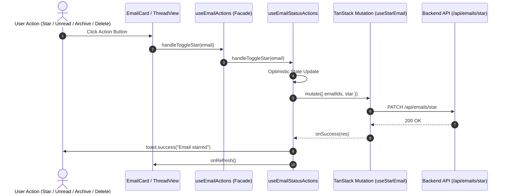
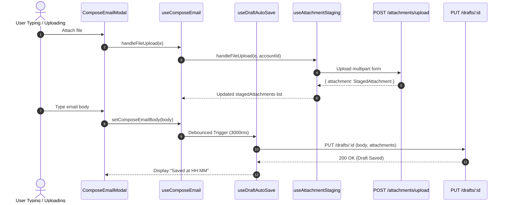

# Codebase Hardening & Architecture v1.3.0 - Phase 3 Implementation Details

> **Feature:** `codebase-hardening-and-architecture-v130` · **Phase:** 3 (Frontend Component Standards, Hook Modularization & Folder Consolidation)
> **Status:** APPROVED
> **Created:** 2026-10-21 · **Last Updated:** 2026-10-21

---

## 1. Goal Description & Scope

Phase 3 remediates architectural drift, oversized components, God hooks, and non-standard directory structures in the Frontend identified in the [v1.3.0 Codebase Health Audit](file:///Users/vishaljagamani/Projects/Projects/mailsense/.agents/plans/codebase-health-audit-report.md) and [Implementation Plan](file:///Users/vishaljagamani/Projects/Projects/mailsense/.agents/plans/codebase-hardening-and-architecture-v130/implementation-plan.md).

Specifically, this phase accomplishes:

1. **Elimination of Anonymous `index.tsx` Files:** Renames all 28 anonymous `index.tsx` components across `Frontend/src/features/` to canonical `PascalCase.tsx` files matching their exported component symbols, providing clean barrel `index.ts` re-exports to preserve developer ergonomics and IDE readability.
2. **God Hook Decomposition:**
   - Decomposes [`useEmailActions.ts`](file:///Users/vishaljagamani/Projects/Projects/mailsense/Frontend/src/features/emails/hooks/useEmailActions.ts) (215 lines) into two focused single-responsibility hooks: `useEmailStatusActions.ts` ($\le 110$ lines) and `useEmailMoveActions.ts` ($\le 95$ lines), unified by a thin composite facade hook ($\le 50$ lines).
   - Decomposes [`useComposeEmail.ts`](file:///Users/vishaljagamani/Projects/Projects/mailsense/Frontend/src/features/emails/hooks/useComposeEmail.ts) (229 lines) into `useDraftAutoSave.ts` ($\le 85$ lines) and `useAttachmentStaging.ts` ($\le 90$ lines), leaving a focused form orchestrator hook ($\le 95$ lines).
3. **Oversized Component Refactoring:**
   - Extracts `useFolderSelector.ts` from [`MoveToFolderDropdown.tsx`](file:///Users/vishaljagamani/Projects/Projects/mailsense/Frontend/src/features/emails/components/MoveToFolderDropdown.tsx) (241 lines), reducing the component to a pure rendering layer ($\le 130$ lines).
4. **Dedicated Types Files & Strictly Zero Inline Types:**
   - Extracts all component props, hook parameters, and state interfaces into dedicated `*.types.ts` files (`email-actions.types.ts`, `compose-email.types.ts`, `email-components.types.ts`).
   - Completely eliminates type declarations from `*.tsx` and `*.ts` code files.
5. **Folder Consolidation & Clean Architecture Alignment:**
   - Eliminates redundant directory `Frontend/src/entities/`, consolidating account icons and email utilities directly into their respective feature modules (`features/accounts/` and `features/emails/`).
   - Moves `Frontend/src/lib/utils.ts` to `Frontend/src/shared/utils/cn.ts` and aligns all Tailwind class-merge imports.
   - Cleans up residual `console.error` in [`useEmailKeyboardShortcuts.ts:142`](file:///Users/vishaljagamani/Projects/Projects/mailsense/Frontend/src/features/emails/hooks/useEmailKeyboardShortcuts.ts#L142), replacing it with `trackUserAction()`.

---

## 2. User Review Required & Architectural Notes

> [!IMPORTANT]
> **Git Case-Sensitivity & File History Preservation**
> All component renames from `index.tsx` to `PascalCase.tsx` MUST be performed via `git mv` to preserve commit history and prevent git case-collision issues on macOS / Linux CI systems (`git config core.ignorecase false`).
>
> **Barrel Export Encapsulation (`index.ts`)**
> While `index.tsx` component definitions are strictly eliminated, lightweight barrel `index.ts` files are retained in sub-component folders (e.g. `thread-view/index.ts` exporting `{ ThreadView } from './ThreadView'`). This prevents breaking existing page and container imports while guaranteeing unique, searchable file tabs in IDEs.
>
> **Boundary-Based Error Handling in React Hooks**
> In strict accordance with [MailSense Coding Standards (Section 6.2)](file:///Users/vishaljagamani/Projects/Projects/mailsense/.agents/rules/coding-standards.md), custom hooks and UI components do NOT wrap rendering logic or TanStack Query execution in meaningless `try/catch` blocks. Server state mutations manage errors via mutation callbacks (`onSuccess`, `onError`) with typed user notifications (`toast.error`), and render errors bubble to `ErrorBoundary.tsx`.

---

## 3. Component Overview & File Map

| Component          | Target File                                                                                                                                                                                     | Action   | Purpose                                                                  |
| ------------------ | ----------------------------------------------------------------------------------------------------------------------------------------------------------------------------------------------- | -------- | ------------------------------------------------------------------------ |
| Frontend Types     | `Frontend/src/features/emails/types/email-actions.types.ts`                                                                                                                                     | [NEW]    | Dedicated types for status & move actions, options, and returns          |
| Frontend Types     | `Frontend/src/features/emails/types/compose-email.types.ts`                                                                                                                                     | [NEW]    | Dedicated types for draft auto-save and attachment staging               |
| Frontend Types     | `Frontend/src/features/emails/types/email-components.types.ts`                                                                                                                                  | [NEW]    | Dedicated types for `MoveToFolderDropdownProps` and email UI             |
| Frontend Hook      | `Frontend/src/features/emails/hooks/useEmailStatusActions.ts`                                                                                                                                   | [NEW]    | Star, unread, archive, and delete action handlers ($\le 110$ lines)      |
| Frontend Hook      | `Frontend/src/features/emails/hooks/useEmailMoveActions.ts`                                                                                                                                     | [NEW]    | Folder move action handlers and modal state ($\le 95$ lines)             |
| Frontend Hook      | [`Frontend/src/features/emails/hooks/useEmailActions.ts`](file:///Users/vishaljagamani/Projects/Projects/mailsense/Frontend/src/features/emails/hooks/useEmailActions.ts)                       | [MODIFY] | Thin composite facade unifying status and move actions ($\le 50$ lines)  |
| Frontend Hook      | `Frontend/src/features/emails/hooks/useFolderSelector.ts`                                                                                                                                       | [NEW]    | Folder tree search, filtering, and selection state hook ($\le 80$ lines) |
| Frontend Component | [`Frontend/src/features/emails/components/MoveToFolderDropdown.tsx`](file:///Users/vishaljagamani/Projects/Projects/mailsense/Frontend/src/features/emails/components/MoveToFolderDropdown.tsx) | [MODIFY] | Pure declarative dropdown component ($\le 130$ lines)                    |
| Frontend Hook      | `Frontend/src/features/emails/hooks/useDraftAutoSave.ts`                                                                                                                                        | [NEW]    | Debounced auto-save draft orchestrator ($\le 85$ lines)                  |
| Frontend Hook      | `Frontend/src/features/emails/hooks/useAttachmentStaging.ts`                                                                                                                                    | [NEW]    | Attachment upload progress, delete, and staging state ($\le 90$ lines)   |
| Frontend Hook      | [`Frontend/src/features/emails/hooks/useComposeEmail.ts`](file:///Users/vishaljagamani/Projects/Projects/mailsense/Frontend/src/features/emails/hooks/useComposeEmail.ts)                       | [MODIFY] | Focused compose form orchestrator hook ($\le 95$ lines)                  |
| Frontend Hook      | [`Frontend/src/features/emails/hooks/useEmailKeyboardShortcuts.ts`](file:///Users/vishaljagamani/Projects/Projects/mailsense/Frontend/src/features/emails/hooks/useEmailKeyboardShortcuts.ts)   | [MODIFY] | Replace `console.error` on L142 with `trackUserAction()`                 |
| Frontend Utils     | `Frontend/src/shared/utils/cn.ts`                                                                                                                                                               | [NEW]    | Centralized Tailwind class variance merge utility                        |
| Frontend Component | `Frontend/src/features/accounts/components/AccountProviderIcon.tsx`                                                                                                                             | [NEW]    | Relocated from `entities/account/`                                       |
| Frontend Component | 28 `PascalCase.tsx` component files                                                                                                                                                             | [RENAME] | Rename all anonymous `index.tsx` files across features                   |
| Frontend Directory | `Frontend/src/entities/`                                                                                                                                                                        | [DELETE] | Consolidated into feature domains                                        |
| Frontend Directory | `Frontend/src/lib/utils.ts`                                                                                                                                                                     | [DELETE] | Replaced by `shared/utils/cn.ts`                                         |

---

## 4. Main Section 1: Backend Layer Implementation

### 4.1 Shared Contract Verification & API Endpoints

All decomposed Frontend hooks interact with the Backend through standardized REST contracts defined in `@mailsense/types`. Ensure no inline contracts are assumed by Frontend hooks:

```typescript
// Location: Verified against @mailsense/types
// Consumed by useEmailStatusActions, useEmailMoveActions, useAttachmentStaging
import {
  APIResponse,
  ComposeEmailRequestBody,
  EmailAttributes,
  FolderAttributes,
  PaginatedDataResponse,
  SuccessAPIResponse,
  UpdateAPIResponse,
  UploadAttachmentResponse,
} from "@mailsense/types";
```

### 4.2 Endpoint Mapping Verification

Ensure the centralized API constants in `Frontend/src/shared/api/endpoints.ts` support all decomposed hooks:

```typescript
// Verified constants consumed by Frontend:
// EMAILS_API_ENDPOINTS.STAR
// EMAILS_API_ENDPOINTS.UNREAD
// EMAILS_API_ENDPOINTS.ARCHIVE
// EMAILS_API_ENDPOINTS.MOVE
// DRAFTS_API_ENDPOINTS.CREATE / UPDATE / DELETE / SEND
// ATTACHMENT_API_ENDPOINTS.UPLOAD / DELETE
```

---

## 5. Main Section 2: Frontend Layer Implementation

### 5.1 Elimination of Anonymous `index.tsx` Files

All 28 anonymous `index.tsx` files are renamed using `git mv` to explicit `PascalCase.tsx` matching their component names. Each folder maintains an `index.ts` barrel file:

#### 5.1.1 Full Renaming Manifest

| Current Anonymous Path                                                                | Canonical Target Path                                                                                       | Barrel File (`index.ts`)                         |
| ------------------------------------------------------------------------------------- | ----------------------------------------------------------------------------------------------------------- | ------------------------------------------------ |
| `Frontend/src/features/settings/pages/index.tsx`                                      | `Frontend/src/features/settings/pages/SettingsPage.tsx`                                                     | `export * from './SettingsPage';`                |
| `Frontend/src/features/settings/pages/profile/index.tsx`                              | `Frontend/src/features/settings/pages/profile/ProfileSettingsPage.tsx`                                      | `export * from './ProfileSettingsPage';`         |
| `Frontend/src/features/settings/pages/account/index.tsx`                              | `Frontend/src/features/settings/pages/account/AccountSettingsPage.tsx`                                      | `export * from './AccountSettingsPage';`         |
| `Frontend/src/features/inbox/pages/index.tsx`                                         | `Frontend/src/features/inbox/pages/InboxPage.tsx`                                                           | `export * from './InboxPage';`                   |
| `Frontend/src/features/inbox/pages/account-inbox/index.tsx`                           | `Frontend/src/features/inbox/pages/account-inbox/AccountInboxPage.tsx`                                      | `export * from './AccountInboxPage';`            |
| `Frontend/src/features/auth/pages/index.tsx`                                          | `Frontend/src/features/auth/pages/AuthPage.tsx`                                                             | `export * from './AuthPage';`                    |
| `Frontend/src/features/drafts/components/draft-table/index.tsx`                       | `Frontend/src/features/drafts/components/draft-table/DraftTable.tsx`                                        | `export * from './DraftTable';`                  |
| `Frontend/src/features/drafts/pages/index.tsx`                                        | `Frontend/src/features/drafts/pages/DraftsPage.tsx`                                                         | `export * from './DraftsPage';`                  |
| `Frontend/src/features/emails/components/thread-view/index.tsx`                       | `Frontend/src/features/emails/components/thread-view/ThreadView.tsx`                                        | `export * from './ThreadView';`                  |
| `Frontend/src/features/emails/components/rich-text-editor/index.tsx`                  | `Frontend/src/features/emails/components/rich-text-editor/RichTextEditor.tsx`                               | `export * from './RichTextEditor';`              |
| `Frontend/src/features/emails/components/attachments/index.tsx`                       | `Frontend/src/features/emails/components/attachments/EmailAttachments.tsx`                                  | `export * from './EmailAttachments';`            |
| `Frontend/src/features/emails/pages/index.tsx`                                        | `Frontend/src/features/emails/pages/EmailsPage.tsx`                                                         | `export * from './EmailsPage';`                  |
| `Frontend/src/features/accounts/components/account-card/index.tsx`                    | `Frontend/src/features/accounts/components/account-card/AccountCard.tsx`                                    | `export * from './AccountCard';`                 |
| `Frontend/src/features/accounts/pages/index.tsx`                                      | `Frontend/src/features/accounts/pages/AccountsPage.tsx`                                                     | `export * from './AccountsPage';`                |
| `Frontend/src/features/folders/components/body/index.tsx`                             | `Frontend/src/features/folders/components/body/FolderBody.tsx`                                              | `export * from './FolderBody';`                  |
| `Frontend/src/features/folders/components/header/index.tsx`                           | `Frontend/src/features/folders/components/header/FolderHeader.tsx`                                          | `export * from './FolderHeader';`                |
| `Frontend/src/features/folders/pages/index.tsx`                                       | `Frontend/src/features/folders/pages/FoldersPage.tsx`                                                       | `export * from './FoldersPage';`                 |
| `Frontend/src/features/folders/pages/folder-email-list/index.tsx`                     | `Frontend/src/features/folders/pages/folder-email-list/FolderEmailListPage.tsx`                             | `export * from './FolderEmailListPage';`         |
| `Frontend/src/features/analytics/components/response-time-card/index.tsx`             | `Frontend/src/features/analytics/components/response-time-card/ResponseTimeCard.tsx`                        | `export * from './ResponseTimeCard';`            |
| `Frontend/src/features/analytics/components/email-volume-chart/index.tsx`             | `Frontend/src/features/analytics/components/email-volume-chart/EmailVolumeChart.tsx`                        | `export * from './EmailVolumeChart';`            |
| `Frontend/src/features/analytics/components/dashboard-header/index.tsx`               | `Frontend/src/features/analytics/components/dashboard-header/DashboardHeader.tsx`                           | `export * from './DashboardHeader';`             |
| `Frontend/src/features/analytics/components/dashboard-empty-state/index.tsx`          | `Frontend/src/features/analytics/components/dashboard-empty-state/DashboardEmptyState.tsx`                  | `export * from './DashboardEmptyState';`         |
| `Frontend/src/features/analytics/components/account-activity-grid/index.tsx`          | `Frontend/src/features/analytics/components/account-activity-grid/AccountActivityGrid.tsx`                  | `export * from './AccountActivityGrid';`         |
| `Frontend/src/features/analytics/components/dashboard-skeleton/index.tsx`             | `Frontend/src/features/analytics/components/dashboard-skeleton/DashboardSkeleton.tsx`                       | `export * from './DashboardSkeleton';`           |
| `Frontend/src/features/analytics/components/overview-kpi-cards/index.tsx`             | `Frontend/src/features/analytics/components/overview-kpi-cards/OverviewKpiCards.tsx`                        | `export * from './OverviewKpiCards';`            |
| `Frontend/src/features/analytics/components/top-senders-card/index.tsx`               | `Frontend/src/features/analytics/components/top-senders-card/TopSendersCard.tsx`                            | `export * from './TopSendersCard';`              |
| `Frontend/src/features/analytics/components/account-distribution-pie-chart/index.tsx` | `Frontend/src/features/analytics/components/account-distribution-pie-chart/AccountDistributionPieChart.tsx` | `export * from './AccountDistributionPieChart';` |
| `Frontend/src/features/analytics/pages/index.tsx`                                     | `Frontend/src/features/analytics/pages/AnalyticsPage.tsx`                                                   | `export * from './AnalyticsPage';`               |

---

### 5.2 Dedicated Types Files (Strictly Zero Inline Types)

#### 5.2.1 `Frontend/src/features/emails/types/email-actions.types.ts`

```typescript
import { EmailAttributes, PaginatedDataResponse } from "@mailsense/types";
import { Dispatch, SetStateAction } from "react";

export interface UseEmailActionsOptions {
  readonly selectedEmails: readonly string[];
  readonly emailsData: PaginatedDataResponse<EmailAttributes> | undefined;
  readonly setEmailsData: Dispatch<
    SetStateAction<PaginatedDataResponse<EmailAttributes> | undefined>
  >;
  readonly onRefresh: () => void;
  readonly onClearSelection?: () => void;
}

export interface UseEmailStatusActionsReturn {
  readonly emailsToDelete: readonly string[];
  readonly isShortcutsModalOpen: boolean;
  readonly isDeleting: boolean;
  readonly setEmailsToDelete: Dispatch<SetStateAction<string[]>>;
  readonly setIsShortcutsModalOpen: Dispatch<SetStateAction<boolean>>;
  readonly handleToggleStar: (email?: EmailAttributes) => void;
  readonly handleToggleUnread: (email?: EmailAttributes) => void;
  readonly handleArchiveEmail: (email?: EmailAttributes) => void;
  readonly handleConfirmDelete: () => void;
  readonly handlePromptDelete: (email?: EmailAttributes) => void;
}

export interface MoveEmailsModalState {
  readonly isOpen: boolean;
  readonly targetEmailIds: readonly string[];
}

export interface UseEmailMoveActionsReturn {
  readonly moveModalState: MoveEmailsModalState;
  readonly isMovingEmails: boolean;
  readonly openMoveModal: (emailIds: readonly string[]) => void;
  readonly closeMoveModal: () => void;
  readonly handleMoveEmails: (targetFolderId: string) => Promise<void>;
}

export interface UseEmailActionsReturn
  extends UseEmailStatusActionsReturn, UseEmailMoveActionsReturn {}
```

#### 5.2.2 `Frontend/src/features/emails/types/compose-email.types.ts`

```typescript
import {
  AccountAttributes,
  ComposeEmailRequestBody,
  SearchOtherContactsResponse,
  UploadAttachmentResponse,
} from "@mailsense/types";
import { Dispatch, SetStateAction } from "react";

export type StagedAttachmentItem = UploadAttachmentResponse["attachment"];

export interface UseDraftAutoSaveOptions {
  readonly composeBody: ComposeEmailRequestBody;
  readonly isOpen: boolean;
  readonly activeDraftId?: string | null;
}

export interface UseDraftAutoSaveReturn {
  readonly draftId: string | null;
  readonly isSavingDraft: boolean;
  readonly lastSavedAt: Date | null;
  readonly handleDiscardDraft: () => void;
}

export interface UseAttachmentStagingReturn {
  readonly stagedAttachments: readonly StagedAttachmentItem[];
  readonly isUploadingAttachment: boolean;
  readonly handleFileUpload: (
    event: React.ChangeEvent<HTMLInputElement>,
    targetAccountId: string,
  ) => Promise<void>;
  readonly handleRemoveStagedAttachment: (
    attachmentId: string,
  ) => Promise<void>;
  readonly clearStagedAttachments: () => void;
  readonly setStagedAttachments: Dispatch<
    SetStateAction<StagedAttachmentItem[]>
  >;
}

export interface ComposeEmailActionHandlers {
  readonly handleClose: () => void;
  readonly handleDiscardDraft: () => void;
  readonly sendEmail: () => Promise<void>;
  readonly handleFileUpload: (
    event: React.ChangeEvent<HTMLInputElement>,
  ) => Promise<void>;
  readonly handleRemoveStagedAttachment: (
    attachmentId: string,
  ) => Promise<void>;
}

export interface ComposeEmailFormStates {
  readonly isOpen: boolean;
  readonly isToFocused: boolean;
  readonly composeEmailBody: ComposeEmailRequestBody;
  readonly toEmailSearchText: string;
  readonly debouncedToEmailSearchText: string;
  readonly stagedAttachments: readonly StagedAttachmentItem[];
  readonly isUploadingAttachment: boolean;
  readonly isSavingDraft: boolean;
  readonly lastSavedAt: Date | null;
  readonly draftId: string | null;
}

export interface ComposeEmailFormSetters {
  readonly setIsToFocused: Dispatch<SetStateAction<boolean>>;
  readonly setComposeEmailBody: Dispatch<
    SetStateAction<ComposeEmailRequestBody>
  >;
  readonly setToEmailSearchText: Dispatch<SetStateAction<string>>;
}

export interface ComposeEmailAccountsState {
  readonly data: readonly AccountAttributes[] | undefined;
}

export interface ComposeEmailContactsState {
  readonly data: readonly SearchOtherContactsResponse[] | undefined;
}

export interface ComposeEmailLoadingState {
  readonly isLoading: boolean;
}

export interface UseComposeEmailReturn {
  readonly accounts: ComposeEmailAccountsState;
  readonly searchOtherContacts: ComposeEmailContactsState;
  readonly composeEmail: ComposeEmailLoadingState;
  readonly action: ComposeEmailActionHandlers;
  readonly states: ComposeEmailFormStates;
  readonly setter: ComposeEmailFormSetters;
}
```

#### 5.2.3 `Frontend/src/features/emails/types/email-components.types.ts`

```typescript
import { EmailAttributes, FolderAttributes } from "@mailsense/types";

export interface MoveToFolderDropdownProps {
  readonly emailIds: readonly string[];
  readonly selectedEmails?: readonly EmailAttributes[];
  readonly allEmails?: readonly EmailAttributes[];
  readonly accountId?: string;
  readonly folders?: readonly FolderAttributes[];
  readonly currentFolderId?: string;
  readonly onSuccess?: () => void;
  readonly disabled?: boolean;
}

export interface UseFolderSelectorOptions {
  readonly emailIds: readonly string[];
  readonly selectedEmails?: readonly EmailAttributes[];
  readonly allEmails?: readonly EmailAttributes[];
  readonly accountId?: string;
  readonly folders?: readonly FolderAttributes[];
  readonly currentFolderId?: string;
  readonly onSuccess?: () => void;
}

export interface UseFolderSelectorReturn {
  readonly isOpen: boolean;
  readonly setIsOpen: (open: boolean) => void;
  readonly searchQuery: string;
  readonly setSearchQuery: (query: string) => void;
  readonly availableFolders: readonly FolderAttributes[];
  readonly filteredFolders: readonly FolderAttributes[];
  readonly isMoving: boolean;
  readonly hasCrossAccountConflict: boolean;
  readonly handleSelectFolder: (
    targetFolder: FolderAttributes,
  ) => Promise<void>;
}
```

---

### 5.3 Custom Hook Decompositions

#### 5.3.1 `Frontend/src/features/emails/hooks/useEmailStatusActions.ts`

```typescript
"use client";

import { useDeleteEmail } from "@features/inbox/api/inbox.queries";
import { EmailAttributes } from "@mailsense/types";
import { useState } from "react";
import { toast } from "sonner";
import {
  useArchiveEmailMutation,
  useStarEmailMutation,
  useUnreadEmailMutation,
} from "../api/email.mutations";
import {
  UseEmailActionsOptions,
  UseEmailStatusActionsReturn,
} from "../types/email-actions.types";

export function useEmailStatusActions(
  options: UseEmailActionsOptions,
): UseEmailStatusActionsReturn {
  const {
    selectedEmails,
    emailsData,
    setEmailsData,
    onRefresh,
    onClearSelection,
  } = options;

  const [emailsToDelete, setEmailsToDelete] = useState<string[]>([]);
  const [isShortcutsModalOpen, setIsShortcutsModalOpen] =
    useState<boolean>(false);

  const { mutate: starEmailMutate } = useStarEmailMutation();
  const { mutate: unreadEmailMutate } = useUnreadEmailMutation();
  const { mutate: archiveEmailMutate } = useArchiveEmailMutation();
  const { mutate: deleteEmailMutate, isPending: isDeleting } = useDeleteEmail();

  const handleToggleStar = (email?: EmailAttributes): void => {
    const targetIds =
      selectedEmails.length > 0
        ? [...selectedEmails]
        : email
          ? [email._id]
          : [];
    if (targetIds.length === 0) return;

    let nextStar = true;
    if (emailsData?.data) {
      const targetEmails = emailsData.data.filter((item) =>
        targetIds.includes(item._id),
      );
      nextStar = !(
        targetEmails.length > 0 &&
        targetEmails.every((item) => item.folders?.includes("STARRED"))
      );
    } else if (email) {
      nextStar = !email.folders?.includes("STARRED");
    }

    const previousData = emailsData;
    setEmailsData((prev) => {
      if (!prev) return prev;
      return {
        ...prev,
        data: prev.data.map((item) => {
          if (targetIds.includes(item._id)) {
            const currentFolders = item.folders || [];
            const updatedFolders = nextStar
              ? Array.from(new Set([...currentFolders, "STARRED"]))
              : currentFolders.filter((f) => f.toUpperCase() !== "STARRED");
            return { ...item, folders: updatedFolders };
          }
          return item;
        }),
      };
    });

    starEmailMutate(
      { emailIds: targetIds, star: nextStar },
      {
        onSuccess: (res) => {
          if (res && (!("status" in res) || res.status)) {
            const label =
              targetIds.length > 1
                ? nextStar
                  ? `${targetIds.length} emails starred`
                  : `${targetIds.length} emails unstarred`
                : nextStar
                  ? "Email starred"
                  : "Email unstarred";
            toast.success(label, { duration: 3000 });
            onRefresh();
          } else {
            toast.error(
              "Failed to update star status. Please retry in some time.",
              { duration: 4000 },
            );
            setEmailsData(previousData);
            onRefresh();
          }
        },
        onError: () => {
          setEmailsData(previousData);
          onRefresh();
        },
      },
    );
  };

  const handleToggleUnread = (email?: EmailAttributes): void => {
    const targetIds =
      selectedEmails.length > 0
        ? [...selectedEmails]
        : email
          ? [email._id]
          : [];
    if (targetIds.length === 0) return;

    let nextUnread = true;
    if (emailsData?.data) {
      const targetEmails = emailsData.data.filter((item) =>
        targetIds.includes(item._id),
      );
      nextUnread = !(
        targetEmails.length > 0 && targetEmails.every((item) => !item.isRead)
      );
    } else if (email) {
      nextUnread = email.isRead;
    }

    const previousData = emailsData;
    setEmailsData((prev) => {
      if (!prev) return prev;
      return {
        ...prev,
        data: prev.data.map((item) =>
          targetIds.includes(item._id)
            ? { ...item, isRead: !nextUnread }
            : item,
        ),
      };
    });

    unreadEmailMutate(
      { emailIds: targetIds, unread: nextUnread },
      {
        onSuccess: (res) => {
          if (res && res.status) {
            const label =
              targetIds.length > 1
                ? nextUnread
                  ? `${targetIds.length} emails marked as unread`
                  : `${targetIds.length} emails marked as read`
                : nextUnread
                  ? "Marked as unread"
                  : "Marked as read";
            toast.success(label, { duration: 3000 });
            onRefresh();
          } else {
            toast.error(
              "Failed to update read status. Please retry in some time.",
              { duration: 4000 },
            );
            setEmailsData(previousData);
            onRefresh();
          }
        },
        onError: () => {
          setEmailsData(previousData);
          onRefresh();
        },
      },
    );
  };

  const handleArchiveEmail = (email?: EmailAttributes): void => {
    const targetIds =
      selectedEmails.length > 0
        ? [...selectedEmails]
        : email
          ? [email._id]
          : [];
    if (targetIds.length === 0) return;

    const previousData = emailsData;
    setEmailsData((prev) => {
      if (!prev) return prev;
      return {
        ...prev,
        data: prev.data.filter((item) => !targetIds.includes(item._id)),
      };
    });

    archiveEmailMutate(
      { emailIds: targetIds, archive: true },
      {
        onSuccess: (res) => {
          if (res && res.status) {
            toast.success(
              targetIds.length > 1
                ? `${targetIds.length} emails archived`
                : "Email archived",
              { duration: 3000 },
            );
            onClearSelection?.();
            onRefresh();
          } else {
            toast.error("Failed to archive email. Please retry in some time.", {
              duration: 4000,
            });
            setEmailsData(previousData);
            onRefresh();
          }
        },
        onError: () => {
          setEmailsData(previousData);
          onRefresh();
        },
      },
    );
  };

  const handlePromptDelete = (email?: EmailAttributes): void => {
    const targetIds =
      selectedEmails.length > 0
        ? [...selectedEmails]
        : email
          ? [email._id]
          : [];
    if (targetIds.length === 0) return;
    setEmailsToDelete(targetIds);
  };

  const handleConfirmDelete = (): void => {
    if (emailsToDelete.length === 0) return;
    const targetIds = [...emailsToDelete];
    const previousData = emailsData;

    setEmailsData((prev) => {
      if (!prev) return prev;
      return {
        ...prev,
        data: prev.data.filter((item) => !targetIds.includes(item._id)),
      };
    });

    deleteEmailMutate(
      { emailIds: targetIds, trash: true },
      {
        onSuccess: (res) => {
          if (res && res.status) {
            toast.success(
              targetIds.length > 1
                ? `${targetIds.length} emails deleted`
                : "Email deleted",
              { duration: 3000 },
            );
            setEmailsToDelete([]);
            onClearSelection?.();
            onRefresh();
          } else {
            toast.error("Failed to delete emails. Please retry in some time.", {
              duration: 4000,
            });
            setEmailsData(previousData);
            onRefresh();
          }
        },
        onError: () => {
          setEmailsData(previousData);
          onRefresh();
        },
      },
    );
  };

  return {
    emailsToDelete,
    isShortcutsModalOpen,
    isDeleting,
    setEmailsToDelete,
    setIsShortcutsModalOpen,
    handleToggleStar,
    handleToggleUnread,
    handleArchiveEmail,
    handleConfirmDelete,
    handlePromptDelete,
  };
}
```

#### 5.3.2 `Frontend/src/features/emails/hooks/useEmailMoveActions.ts`

```typescript
"use client";

import { useState } from "react";
import { toast } from "sonner";
import { useMoveEmailsMutation } from "../api/email.mutations";
import {
  MoveEmailsModalState,
  UseEmailActionsOptions,
  UseEmailMoveActionsReturn,
} from "../types/email-actions.types";

export function useEmailMoveActions(
  options: UseEmailActionsOptions,
): UseEmailMoveActionsReturn {
  const { onRefresh, onClearSelection } = options;

  const [moveModalState, setMoveModalState] = useState<MoveEmailsModalState>({
    isOpen: false,
    targetEmailIds: [],
  });

  const { mutate: moveEmailsMutate, isPending: isMovingEmails } =
    useMoveEmailsMutation();

  const openMoveModal = (emailIds: readonly string[]): void => {
    setMoveModalState({ isOpen: true, targetEmailIds: emailIds });
  };

  const closeMoveModal = (): void => {
    setMoveModalState({ isOpen: false, targetEmailIds: [] });
  };

  const handleMoveEmails = async (targetFolderId: string): Promise<void> => {
    const { targetEmailIds } = moveModalState;
    if (targetEmailIds.length === 0 || !targetFolderId) return;

    moveEmailsMutate(
      {
        emailIds: [...targetEmailIds],
        targetFolderIds: [targetFolderId],
        removeFolderIds: [],
      },
      {
        onSuccess: (res) => {
          if (res && res.status) {
            const count = targetEmailIds.length;
            toast.success(
              count > 1
                ? `${count} emails moved successfully`
                : "Email moved successfully",
              { duration: 3000 },
            );
            closeMoveModal();
            onClearSelection?.();
            onRefresh();
          } else {
            toast.error("Failed to move emails. Please retry in some time.", {
              duration: 4000,
            });
          }
        },
        onError: () => {
          toast.error("Failed to move emails. Please retry in some time.", {
            duration: 4000,
          });
        },
      },
    );
  };

  return {
    moveModalState,
    isMovingEmails,
    openMoveModal,
    closeMoveModal,
    handleMoveEmails,
  };
}
```

#### 5.3.3 `Frontend/src/features/emails/hooks/useEmailActions.ts` (Thin Facade)

```typescript
"use client";

import { useEmailMoveActions } from "./useEmailMoveActions";
import { useEmailStatusActions } from "./useEmailStatusActions";
import {
  UseEmailActionsOptions,
  UseEmailActionsReturn,
} from "../types/email-actions.types";

/**
 * Composite facade hook unifying status and move actions across email lists.
 * Enforces single-responsibility architecture while keeping a stable public API.
 */
export function useEmailActions(
  options: UseEmailActionsOptions,
): UseEmailActionsReturn {
  const statusActions = useEmailStatusActions(options);
  const moveActions = useEmailMoveActions(options);

  return {
    ...statusActions,
    ...moveActions,
  };
}
```

#### 5.3.4 `Frontend/src/features/emails/hooks/useFolderSelector.ts`

```typescript
"use client";

import { useGetAllFolders } from "@features/folders/api/folder.queries";
import { FolderAttributes } from "@mailsense/types";
import { trackUserAction } from "@shared/monitoring";
import { useAuthStore } from "@shared/store";
import { useMemo, useState } from "react";
import { toast } from "sonner";
import { useMoveEmailsMutation } from "../api/email.mutations";
import {
  UseFolderSelectorOptions,
  UseFolderSelectorReturn,
} from "../types/email-components.types";

export function useFolderSelector(
  options: UseFolderSelectorOptions,
): UseFolderSelectorReturn {
  const {
    emailIds,
    selectedEmails,
    allEmails,
    accountId,
    folders,
    currentFolderId,
    onSuccess,
  } = options;

  const [isOpen, setIsOpen] = useState<boolean>(false);
  const [searchQuery, setSearchQuery] = useState<string>("");
  const { user } = useAuthStore();

  const { data: fetchedFoldersData } = useGetAllFolders(
    !folders && user?.id
      ? { userId: user.id, size: 100, page: 1, filters: {} }
      : null,
  );

  const availableFolders = folders || fetchedFoldersData?.data || [];
  const { mutate: moveEmailsMutate, isPending: isMoving } =
    useMoveEmailsMutation();

  const resolvedSelectedEmailObjects = useMemo(() => {
    if (selectedEmails && selectedEmails.length > 0) return selectedEmails;
    if (allEmails && emailIds.length > 0) {
      return allEmails.filter((email) => emailIds.includes(email._id));
    }
    return [];
  }, [selectedEmails, allEmails, emailIds]);

  const selectedAccountIds = useMemo(() => {
    if (accountId) return [accountId];
    const ids = new Set<string>();
    resolvedSelectedEmailObjects.forEach((email) => {
      if (email.accountId) ids.add(email.accountId);
    });
    return Array.from(ids);
  }, [accountId, resolvedSelectedEmailObjects]);

  const hasCrossAccountConflict = selectedAccountIds.length > 1;

  const filteredFolders = useMemo(() => {
    let result = availableFolders;
    if (selectedAccountIds.length === 1) {
      const singleAccountId = selectedAccountIds[0];
      result = result.filter((f) => f.accountId === singleAccountId);
    }
    if (currentFolderId) {
      result = result.filter((f) => f._id !== currentFolderId);
    }
    if (searchQuery.trim()) {
      const q = searchQuery.toLowerCase().trim();
      result = result.filter((f) => f.name.toLowerCase().includes(q));
    }
    return result;
  }, [availableFolders, selectedAccountIds, currentFolderId, searchQuery]);

  const handleSelectFolder = async (
    targetFolder: FolderAttributes,
  ): Promise<void> => {
    if (emailIds.length === 0) return;

    if (hasCrossAccountConflict) {
      toast.error(
        "Cannot move emails from multiple accounts into a single folder at once.",
      );
      return;
    }

    const removeFolderIds = currentFolderId ? [currentFolderId] : [];
    moveEmailsMutate(
      {
        emailIds: [...emailIds],
        targetFolderIds: [targetFolder._id],
        removeFolderIds,
      },
      {
        onSuccess: (res) => {
          if (res && res.status) {
            const count = emailIds.length;
            toast.success(
              count > 1
                ? `${count} emails moved successfully`
                : "Email moved successfully",
              { duration: 3000 },
            );
            setIsOpen(false);
            setSearchQuery("");
            onSuccess?.();
          } else {
            toast.error("Failed to move emails. Please retry in some time.", {
              duration: 4000,
            });
          }
        },
        onError: (err) => {
          trackUserAction(
            "api.error",
            "Failed to move emails in folder selector",
            "error",
          );
          toast.error(
            err instanceof Error
              ? err.message
              : "Could not move emails to target folder.",
            { duration: 4000 },
          );
        },
      },
    );
  };

  return {
    isOpen,
    setIsOpen,
    searchQuery,
    setSearchQuery,
    availableFolders,
    filteredFolders,
    isMoving,
    hasCrossAccountConflict,
    handleSelectFolder,
  };
}
```

#### 5.3.5 `Frontend/src/features/emails/hooks/useDraftAutoSave.ts`

```typescript
"use client";

import { useDeleteDraftMutation } from "@features/drafts/api/draft.mutations";
import { useAutoSaveDraft as useCoreAutoSaveDraft } from "@features/drafts/hooks/useAutoSaveDraft";
import { trackUserAction } from "@shared/monitoring";
import { useCallback } from "react";
import { toast } from "sonner";
import {
  UseDraftAutoSaveOptions,
  UseDraftAutoSaveReturn,
} from "../types/compose-email.types";

export function useDraftAutoSave(
  options: UseDraftAutoSaveOptions,
): UseDraftAutoSaveReturn {
  const { composeBody, isOpen, activeDraftId } = options;
  const { mutate: deleteDraft } = useDeleteDraftMutation();

  const {
    draftId,
    isSaving: isSavingDraft,
    lastSavedAt,
  } = useCoreAutoSaveDraft({
    composeBody,
    isOpen,
    activeDraftId,
  });

  const handleDiscardDraft = useCallback(() => {
    const currentDraftId = draftId || activeDraftId;
    if (currentDraftId) {
      deleteDraft(currentDraftId, {
        onSuccess: () => toast.success("Draft discarded"),
        onError: () => toast.error("Failed to discard draft"),
      });
    }
    trackUserAction("ui.click", "Draft discarded", "info");
  }, [draftId, activeDraftId, deleteDraft]);

  return {
    draftId: draftId || activeDraftId || null,
    isSavingDraft,
    lastSavedAt,
    handleDiscardDraft,
  };
}
```

#### 5.3.6 `Frontend/src/features/emails/hooks/useAttachmentStaging.ts`

```typescript
"use client";

import { UploadAttachmentResponse } from "@mailsense/types";
import { axiosClient } from "@shared/api";
import { useState } from "react";
import { toast } from "sonner";
import {
  StagedAttachmentItem,
  UseAttachmentStagingReturn,
} from "../types/compose-email.types";

export function useAttachmentStaging(): UseAttachmentStagingReturn {
  const [stagedAttachments, setStagedAttachments] = useState<
    StagedAttachmentItem[]
  >([]);
  const [isUploadingAttachment, setIsUploadingAttachment] =
    useState<boolean>(false);

  const handleFileUpload = async (
    event: React.ChangeEvent<HTMLInputElement>,
    targetAccountId: string,
  ): Promise<void> => {
    const files = event.target.files;
    if (!files || files.length === 0) return;

    if (!targetAccountId) {
      toast.error("Please select or connect an account first");
      event.target.value = "";
      return;
    }

    setIsUploadingAttachment(true);
    try {
      for (let i = 0; i < files.length; i++) {
        const formData = new FormData();
        formData.append("file", files[i]);
        formData.append("accountId", targetAccountId);

        const res = await axiosClient.post<UploadAttachmentResponse>(
          "/attachments/upload",
          formData,
          {
            headers: { "Content-Type": "multipart/form-data" },
          },
        );

        const att = res.data?.attachment;
        if (att) {
          setStagedAttachments((prev) => [
            ...prev,
            {
              attachmentId: att.attachmentId,
              filename: att.filename,
              mimeType: att.mimeType,
              size: att.size,
              createdAt: att.createdAt || new Date(),
            },
          ]);
        }
      }
    } catch {
      toast.error("Failed to upload attachment");
    } finally {
      setIsUploadingAttachment(false);
      event.target.value = "";
    }
  };

  const handleRemoveStagedAttachment = async (
    attachmentId: string,
  ): Promise<void> => {
    try {
      await axiosClient.delete(`/attachments/${attachmentId}`);
    } finally {
      setStagedAttachments((prev) =>
        prev.filter((att) => att.attachmentId !== attachmentId),
      );
    }
  };

  const clearStagedAttachments = (): void => {
    setStagedAttachments([]);
  };

  return {
    stagedAttachments,
    isUploadingAttachment,
    handleFileUpload,
    handleRemoveStagedAttachment,
    clearStagedAttachments,
    setStagedAttachments,
  };
}
```

#### 5.3.7 `Frontend/src/features/emails/hooks/useComposeEmail.ts` (Orchestrator)

```typescript
"use client";

import { useCallback, useEffect, useState } from "react";
import { useGetAccountsQuery } from "@features/accounts/api/accounts.queries";
import { useSendDraftMutation } from "@features/drafts/api/draft.mutations";
import { useGetDraftByIdQuery } from "@features/drafts/api/draft.queries";
import { ComposeEmailRequestBody } from "@mailsense/types";
import { MESSAGES, UI_CONSTANTS } from "@shared/constants";
import { UseDebounceQuery } from "@shared/hooks";
import { trackUserAction } from "@shared/monitoring";
import { useAuthStore, useComposeEmailPopupStore } from "@shared/store";
import { toast } from "sonner";
import {
  useComposeEmailMutation,
  useSearchOtherContactsMutation,
} from "../api/email.mutations";
import { useAttachmentStaging } from "./useAttachmentStaging";
import { useDraftAutoSave } from "./useDraftAutoSave";
import { UseComposeEmailReturn } from "../types/compose-email.types";

export const useComposeEmail = (): UseComposeEmailReturn => {
  const user = useAuthStore((state) => state.user);
  const { isOpen, activeDraftId, closeCompose } = useComposeEmailPopupStore();

  const [isToFocused, setIsToFocused] = useState<boolean>(false);
  const [composeEmailBody, setComposeEmailBody] =
    useState<ComposeEmailRequestBody>({
      accountId: "",
      to: [],
      subject: "",
      body: "",
    });
  const [toEmailSearchText, setToEmailSearchText] = useState<string>("");
  const debouncedToEmailSearchText = UseDebounceQuery({
    text: toEmailSearchText,
  });

  const { data: accounts } = useGetAccountsQuery(user?.id ?? "");
  const { mutate: searchOtherContacts, data: searchOtherContactsData } =
    useSearchOtherContactsMutation();
  const { mutate: composeEmail, isPending: composeEmailLoading } =
    useComposeEmailMutation();
  const { mutate: sendDraft, isPending: sendDraftLoading } =
    useSendDraftMutation();
  const { data: existingDraftData, isLoading: isDraftLoading } =
    useGetDraftByIdQuery(activeDraftId || "", Boolean(activeDraftId && isOpen));

  const { draftId, isSavingDraft, lastSavedAt, handleDiscardDraft } =
    useDraftAutoSave({
      composeBody: composeEmailBody,
      isOpen,
      activeDraftId,
    });

  const {
    stagedAttachments,
    isUploadingAttachment,
    handleFileUpload: executeUpload,
    handleRemoveStagedAttachment,
    clearStagedAttachments,
    setStagedAttachments,
  } = useAttachmentStaging();

  useEffect(() => {
    if (existingDraftData && isOpen) {
      setComposeEmailBody({
        accountId: existingDraftData.accountId,
        to: existingDraftData.to || [],
        subject: existingDraftData.subject || "",
        body: existingDraftData.body || "",
      });
      if (
        existingDraftData.attachments &&
        existingDraftData.attachments.length > 0
      ) {
        setStagedAttachments(
          existingDraftData.attachments.map((att) => ({
            attachmentId: att.attachmentId,
            filename: att.filename,
            mimeType: att.mimeType,
            size: att.size,
            createdAt: new Date(),
          })),
        );
      }
    }
  }, [existingDraftData, isOpen, setStagedAttachments]);

  useEffect(() => {
    const q = debouncedToEmailSearchText?.trim() ?? "";
    if (q.length > 2) {
      searchOtherContacts(q);
    }
  }, [debouncedToEmailSearchText, searchOtherContacts]);

  useEffect(() => {
    if (
      accounts &&
      accounts.length > 0 &&
      !composeEmailBody.accountId &&
      !activeDraftId
    ) {
      setComposeEmailBody((prev) => ({ ...prev, accountId: accounts[0]._id }));
    }
  }, [accounts, composeEmailBody.accountId, activeDraftId]);

  const handleClose = useCallback(() => {
    closeCompose();
    setComposeEmailBody({ accountId: "", to: [], subject: "", body: "" });
    clearStagedAttachments();
    setToEmailSearchText("");
  }, [closeCompose, clearStagedAttachments]);

  const handleFileUpload = async (
    event: React.ChangeEvent<HTMLInputElement>,
  ): Promise<void> => {
    const targetAccountId =
      composeEmailBody.accountId || (accounts && accounts[0]?._id) || "";
    await executeUpload(event, targetAccountId);
  };

  const sendEmail = async (): Promise<void> => {
    const currentDraftId = draftId || activeDraftId;
    if (currentDraftId) {
      sendDraft(currentDraftId, {
        onSuccess: () => {
          toast.success(MESSAGES.EMAILS.SEND_EMAIL_SUCCESS, {
            duration: UI_CONSTANTS.TOAST.DURATION,
          });
          handleClose();
        },
        onError: () => {
          toast.error(MESSAGES.EMAILS.SEND_EMAIL_ERROR, {
            duration: UI_CONSTANTS.TOAST.DURATION,
          });
        },
      });
    } else {
      composeEmail(
        {
          accountId: composeEmailBody.accountId,
          to: composeEmailBody.to,
          subject: composeEmailBody.subject,
          body: composeEmailBody.body,
          attachmentIds: stagedAttachments.map((att) => att.attachmentId),
        },
        {
          onSuccess: () => {
            toast.success(MESSAGES.EMAILS.SEND_EMAIL_SUCCESS, {
              duration: UI_CONSTANTS.TOAST.DURATION,
            });
            handleClose();
          },
          onError: () => {
            toast.error(MESSAGES.EMAILS.SEND_EMAIL_ERROR, {
              duration: UI_CONSTANTS.TOAST.DURATION,
            });
          },
        },
      );
    }
  };

  return {
    accounts: { data: accounts },
    searchOtherContacts: { data: searchOtherContactsData },
    composeEmail: {
      isLoading: composeEmailLoading || sendDraftLoading || isDraftLoading,
    },
    action: {
      handleClose,
      handleDiscardDraft: () => {
        handleDiscardDraft();
        handleClose();
      },
      sendEmail,
      handleFileUpload,
      handleRemoveStagedAttachment,
    },
    states: {
      isOpen,
      isToFocused,
      composeEmailBody,
      toEmailSearchText,
      debouncedToEmailSearchText,
      stagedAttachments,
      isUploadingAttachment,
      isSavingDraft,
      lastSavedAt,
      draftId,
    },
    setter: { setIsToFocused, setComposeEmailBody, setToEmailSearchText },
  };
};
```

---

### 5.4 UI Component Refactoring

#### 5.4.1 `Frontend/src/features/emails/components/MoveToFolderDropdown.tsx`

```typescript
'use client';

import { Check, Folder, Loader2, Search, X } from 'lucide-react';
import React from 'react';
import { Button } from '@shared/ui/button';
import { Popover, PopoverContent, PopoverTrigger } from '@shared/ui/popover';
import { Tooltip, TooltipContent, TooltipTrigger } from '@shared/ui/tooltip';
import { useFolderSelector } from '../hooks/useFolderSelector';
import { MoveToFolderDropdownProps } from '../types/email-components.types';

export const MoveToFolderDropdown: React.FC<MoveToFolderDropdownProps> = (props) => {
    const { disabled = false } = props;
    const {
        isOpen,
        setIsOpen,
        searchQuery,
        setSearchQuery,
        availableFolders,
        filteredFolders,
        isMoving,
        hasCrossAccountConflict,
        handleSelectFolder,
    } = useFolderSelector(props);

    return (
        <Popover open={isOpen} onOpenChange={setIsOpen}>
            <Tooltip>
                <TooltipTrigger asChild>
                    <PopoverTrigger asChild>
                        <Button
                            variant="ghost"
                            size="icon"
                            disabled={disabled || isMoving}
                            className="relative h-8 w-8 text-neutral-400 hover:text-white hover:bg-neutral-800 disabled:opacity-40"
                            aria-label="Move emails to folder"
                        >
                            {isMoving ? <Loader2 className="h-4 w-4 animate-spin text-neutral-400" /> : <Folder className="h-4 w-4" />}
                        </Button>
                    </PopoverTrigger>
                </TooltipTrigger>
                <TooltipContent side="bottom" className="text-xs">
                    Move to folder
                </TooltipContent>
            </Tooltip>

            <PopoverContent align="start" sideOffset={6} className="w-64 p-0 bg-neutral-900 border border-neutral-800 shadow-xl rounded-lg">
                <div className="flex items-center gap-2 px-3 py-2 border-b border-neutral-800">
                    <Search className="h-3.5 w-3.5 text-neutral-400 shrink-0" />
                    <input
                        type="text"
                        placeholder="Search folders..."
                        value={searchQuery}
                        onChange={(e) => setSearchQuery(e.target.value)}
                        className="w-full bg-transparent text-xs text-neutral-200 placeholder-neutral-500 focus:outline-none"
                    />
                    {searchQuery && (
                        <button onClick={() => setSearchQuery('')} className="text-neutral-500 hover:text-neutral-300">
                            <X className="h-3 w-3" />
                        </button>
                    )}
                </div>

                {hasCrossAccountConflict && (
                    <div className="px-3 py-2 text-xs text-amber-400/90 bg-amber-500/10 border-b border-amber-500/20">
                        Selected emails span multiple accounts. Please select emails from a single account to move.
                    </div>
                )}

                <div className="max-h-56 overflow-y-auto py-1">
                    {filteredFolders.length === 0 ? (
                        <div className="px-3 py-4 text-center text-xs text-neutral-500">
                            {availableFolders.length === 0 ? 'No folders available' : 'No matching folders'}
                        </div>
                    ) : (
                        filteredFolders.map((targetFolder) => (
                            <button
                                key={targetFolder._id}
                                disabled={isMoving || hasCrossAccountConflict}
                                onClick={() => handleSelectFolder(targetFolder)}
                                className="w-full flex items-center justify-between px-3 py-1.5 text-xs text-neutral-300 hover:bg-neutral-800/80 hover:text-white transition-colors disabled:opacity-50"
                            >
                                <span className="flex items-center gap-2 truncate">
                                    <Folder className="h-3.5 w-3.5 shrink-0 text-neutral-400" />
                                    <span className="truncate">{targetFolder.name}</span>
                                </span>
                                {props.currentFolderId === targetFolder._id && <Check className="h-3.5 w-3.5 text-blue-400 shrink-0" />}
                            </button>
                        ))
                    )}
                </div>
            </PopoverContent>
        </Popover>
    );
};
```

---

### 5.5 Folder Consolidation & Utility Relocation

#### 5.5.1 Relocate `Frontend/src/lib/utils.ts` to `Frontend/src/shared/utils/cn.ts`

```typescript
// Location: Frontend/src/shared/utils/cn.ts
import { clsx, type ClassValue } from "clsx";
import { twMerge } from "tailwind-merge";

export function cn(...inputs: ClassValue[]): string {
  return twMerge(clsx(inputs));
}
```

Update `Frontend/src/shared/utils/index.ts` to re-export `cn`:

```typescript
export * from "./cn";
```

#### 5.5.2 Account Provider Icon Consolidation

Move `Frontend/src/entities/account/ui/AccountProviderIcon.tsx` $\to$ `Frontend/src/features/accounts/components/AccountProviderIcon.tsx`.
Delete `Frontend/src/entities/` and remove stale path mappings from `Frontend/tsconfig.json`.

---

## 6. Low-Level Design & Sequence Flow

### 6.1 Composite Facade Action Dispatch Flow



### 6.2 Compose Form Auto-Save & Staging Flow



---

## 7. Step-by-Step Task Checklist

- [ ] Task 1: Dedicated Types Extraction
  - [ ] Create `Frontend/src/features/emails/types/email-actions.types.ts`
  - [ ] Create `Frontend/src/features/emails/types/compose-email.types.ts`
  - [ ] Create `Frontend/src/features/emails/types/email-components.types.ts`
- [ ] Task 2: Anonymous Component File Renaming (`git mv`)
  - [ ] Rename all 28 anonymous `index.tsx` files to `PascalCase.tsx`
  - [ ] Add barrel export `index.ts` to each component folder
- [ ] Task 3: Hook Decomposition
  - [ ] Create `Frontend/src/features/emails/hooks/useEmailStatusActions.ts`
  - [ ] Create `Frontend/src/features/emails/hooks/useEmailMoveActions.ts`
  - [ ] Refactor `Frontend/src/features/emails/hooks/useEmailActions.ts` to thin facade
  - [ ] Create `Frontend/src/features/emails/hooks/useDraftAutoSave.ts`
  - [ ] Create `Frontend/src/features/emails/hooks/useAttachmentStaging.ts`
  - [ ] Refactor `Frontend/src/features/emails/hooks/useComposeEmail.ts` to orchestrator
- [ ] Task 4: Component Refactoring & Logging Fix
  - [ ] Create `Frontend/src/features/emails/hooks/useFolderSelector.ts`
  - [ ] Refactor `Frontend/src/features/emails/components/MoveToFolderDropdown.tsx`
  - [ ] Replace `console.error` in `Frontend/src/features/emails/hooks/useEmailKeyboardShortcuts.ts` with `trackUserAction()`
- [ ] Task 5: Folder Consolidation & Path Cleanups
  - [ ] Create `Frontend/src/shared/utils/cn.ts` and re-export in `shared/utils/index.ts`
  - [ ] Delete `Frontend/src/lib/utils.ts` and remove `Frontend/src/entities/`
- [ ] Task 6: Build Verification
  - [ ] Run `cd Frontend && npx tsc --noEmit`
  - [ ] Run `cd Frontend && pnpm build`
  - [ ] Run `cd Backend && pnpm test`

---

## 8. Verification & Build Commands

```bash
# 1. Verify Frontend TypeScript Compilation
cd /Users/vishaljagamani/Projects/Projects/mailsense/Frontend
npx tsc --noEmit

# 2. Verify Frontend Next.js Build
pnpm build

# 3. Verify Backend Tests Remain Intact
cd /Users/vishaljagamani/Projects/Projects/mailsense/Backend
pnpm test
```
