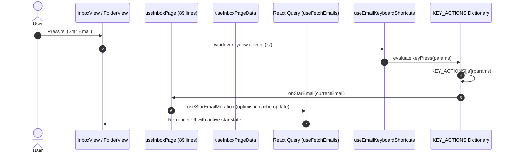

# Codebase Hardening & Architecture v1.4.0 - Phase 3 Implementation Details

> **Feature:** `codebase-hardening-and-architecture-v140` · **Phase:** 3 (Frontend Hook Modularization, Component Standards & Cleanups)
> **Status:** COMPLETED ✅
> **Created:** 2026-11-15 · **Last Updated:** 2026-11-15

---

## 1. Goal Description & Scope

Phase 3 operationalizes the frontend architectural, structural, and code hygiene refactoring items identified in the [v1.4.0 Codebase Health Audit](file:///Users/vishaljagamani/Projects/Projects/mailsense/.agents/plans/codebase-health-audit-report.md#140---2026-11-12) and detailed in the [Master Implementation Plan](file:///Users/vishaljagamani/Projects/Projects/mailsense/.agents/plans/codebase-hardening-and-architecture-v140/implementation-plan.md). It eliminates monolithic hooks, purges ESLint suppressions, splits oversized React Query mutations, simplifies keyboard navigation complexity, removes dead stubs, addresses component naming standards, and aligns error handling with architectural boundaries:

1. **Wire Decomposed `useInboxPage` & Remove ESLint Suppressions (`BUG-V14-06`, `STRUCT-V14-02`):**
   - Re-export the 88-line decomposed facade [`useInboxPage.ts`](file:///Users/vishaljagamani/Projects/Projects/mailsense/Frontend/src/features/inbox/hooks/use-inbox-page/useInboxPage.ts) from [`Frontend/src/features/inbox/hooks/use-inbox-page/index.ts`](file:///Users/vishaljagamani/Projects/Projects/mailsense/Frontend/src/features/inbox/hooks/use-inbox-page/index.ts).
   - Eliminate `/* eslint-disable max-lines */` and `/* eslint-disable max-lines-per-function */` from `index.ts`.
   - Delete the 2-line empty stub hook [`useInboxPageActions.ts`](file:///Users/vishaljagamani/Projects/Projects/mailsense/Frontend/src/features/inbox/hooks/use-inbox-page/useInboxPageActions.ts).

2. **React Query Mutation Decomposition (`REFACTOR-V14-04`):**
   - Decompose [`Frontend/src/features/emails/api/email.mutations.ts`](file:///Users/vishaljagamani/Projects/Projects/mailsense/Frontend/src/features/emails/api/email.mutations.ts) (196 lines vs 180 hard limit) into:
     - `Frontend/src/features/emails/api/email-status.mutations.ts` (`useStarEmailMutation`, `useUnreadEmailMutation`, `useArchiveEmailMutation` $\le 110$ lines).
     - `Frontend/src/features/emails/api/email-folder.mutations.ts` (`useMoveEmailsMutation` $\le 90$ lines).
     - `Frontend/src/features/emails/api/email-write.mutations.ts` (`useComposeEmailMutation`, `useSearchOtherContactsMutation` $\le 60$ lines).
     - `Frontend/src/features/emails/api/email.mutations.ts` (barrel re-export maintaining zero breaking changes for existing consumers $\le 25$ lines).

3. **Custom Hook Modularization (`REFACTOR-V14-06`, `REFACTOR-V14-07`, `REFACTOR-V14-08`):**
   - Extract `useFolderFilterState.ts` ($\le 60$ lines) from [`Frontend/src/features/emails/hooks/use-move-to-folder-dropdown/index.ts`](file:///Users/vishaljagamani/Projects/Projects/mailsense/Frontend/src/features/emails/hooks/use-move-to-folder-dropdown/index.ts) (137 lines vs 120 hard limit), reducing the dropdown controller hook to $\le 75$ lines.
   - Modularize [`Frontend/src/features/folders/hooks/useFolderEmailListPage.ts`](file:///Users/vishaljagamani/Projects/Projects/mailsense/Frontend/src/features/folders/hooks/useFolderEmailListPage.ts) (130 lines vs 120 hard limit) by extracting folder query binding and email fetching coordination, bringing it to $\le 75$ lines.
   - Refactor the 120-line switch ladder in [`Frontend/src/features/emails/hooks/use-email-keyboard-shortcuts/useEvaluateKeyPress.ts`](file:///Users/vishaljagamani/Projects/Projects/mailsense/Frontend/src/features/emails/hooks/use-email-keyboard-shortcuts/useEvaluateKeyPress.ts) into a dictionary-driven key-action lookup table ($\le 60$ lines, cyclomatic complexity $\le 5$).

4. **Observability & Error Handling Cleanup (`BUG-V14-09`, `REFACTOR-V14-10`):**
   - Replace rogue `console.error` in `use-email-keyboard-shortcuts/index.ts:56` and `PageHeader.tsx:32` with structured telemetry `trackUserAction()`.
   - Remove redundant `try/catch` blocks from UI event handlers and custom hooks where React Query mutations and React Error Boundaries natively manage errors.

5. **Component Standards & Directory Architecture (`STRUCT-V14-04`):**
   - Rename anonymous `index.tsx` component files to explicit `PascalCase.tsx` files paired with clean `index.ts` barrel re-exports, satisfying both React directory encapsulation and explicit named file standards.

---

## 2. User Review Required & Architectural Notes

> [!IMPORTANT]
> **1. Non-Breaking Mutation Re-Exports**
> `email.mutations.ts` continues to serve as the unified barrel export for all email mutations. Existing imports across features (`useStarEmailMutation`, `useArchiveEmailMutation`, `useMoveEmailsMutation`, etc.) continue to resolve seamlessly.
>
> **2. React Query Ownership of Server Errors**
> In compliance with [Coding Standards Rule 7](file:///Users/vishaljagamani/Projects/Projects/mailsense/.agents/rules/coding-standards.md#7-exception-handling--logging), UI components and custom hooks MUST NOT wrap mutation calls in `try/catch`. Mutation error callbacks (`onError`) and global React Error Boundaries (`ErrorBoundary.tsx`) natively handle failed queries and server states.
>
> **3. Strict Zero Inline Types & Dedicated Types Files**
> All hook parameters, lookup dictionary entries, and mutation contexts reference named interfaces imported from `@features/*/types/*.types.ts` or `@mailsense/types`. Strictly zero inline types (`{ id: string }`) are permitted.

---

## 3. Component Overview & File Map

| Component               | Target File                                                                              | Action   | Purpose / Responsibilities                                                 |
| ----------------------- | ---------------------------------------------------------------------------------------- | -------- | -------------------------------------------------------------------------- |
| **Inbox Hook**          | `Frontend/src/features/inbox/hooks/use-inbox-page/index.ts`                              | [MODIFY] | Re-export `useInboxPage` from `./useInboxPage.js`; remove disable comments |
| **Inbox Hook**          | `Frontend/src/features/inbox/hooks/use-inbox-page/useInboxPageActions.ts`                | [DELETE] | Purge empty 2-line stub hook (`STRUCT-V14-02`)                             |
| **Mutation Split**      | `Frontend/src/features/emails/api/email-status.mutations.ts`                             | [NEW]    | Star, unread, and archive optimistic mutations ($\le 110$ lines)           |
| **Mutation Split**      | `Frontend/src/features/emails/api/email-folder.mutations.ts`                             | [NEW]    | Move emails and batch folder assignment mutations ($\le 90$ lines)         |
| **Mutation Split**      | `Frontend/src/features/emails/api/email-write.mutations.ts`                              | [NEW]    | Compose email and contact search mutations ($\le 60$ lines)                |
| **Mutation Split**      | `Frontend/src/features/emails/api/email.mutations.ts`                                    | [MODIFY] | Composite barrel re-export ($\le 25$ lines)                                |
| **Move Folder Hook**    | `Frontend/src/features/emails/hooks/use-move-to-folder-dropdown/useFolderFilterState.ts` | [NEW]    | Multi-account resolution and folder search filtering ($\le 60$ lines)      |
| **Move Folder Hook**    | `Frontend/src/features/emails/hooks/use-move-to-folder-dropdown/index.ts`                | [MODIFY] | Consume `useFolderFilterState`, reducing from 137 to $\le 75$ lines        |
| **Folder List Hook**    | `Frontend/src/features/folders/hooks/useFolderEmailListPage.ts`                          | [MODIFY] | Streamline state wiring, reducing from 130 to $\le 75$ lines               |
| **Key Shortcuts Hook**  | `Frontend/src/features/emails/hooks/use-email-keyboard-shortcuts/useEvaluateKeyPress.ts` | [MODIFY] | Replace switch ladder with key-action lookup table ($\le 60$ lines)        |
| **Telemetry Cleanup**   | `Frontend/src/features/emails/hooks/use-email-keyboard-shortcuts/index.ts`               | [MODIFY] | Replace `console.error` with `trackUserAction` (`BUG-V14-09`)              |
| **Telemetry Cleanup**   | `Frontend/src/shared/components/header/PageHeader.tsx`                                   | [MODIFY] | Replace `console.error` with `trackUserAction` (`BUG-V14-09`)              |
| **Component Standards** | 17 anonymous component directories                                                       | [MODIFY] | Pair `PascalCase.tsx` implementations with clean `index.ts` exports        |

---

## 4. Main Section 1: Backend Layer Implementation

_(No Backend layer modifications are required in Phase 3. All API contracts and database models were solidified in Phase 1 and Phase 2)._

---

## 5. Main Section 2: Frontend Layer Implementation

### 5.1 Endpoints & API Client

Existing endpoints in [`Frontend/src/shared/api/endpoints.ts`](file:///Users/vishaljagamani/Projects/Projects/mailsense/Frontend/src/shared/api/endpoints.ts) and client wrappers in [`Frontend/src/features/emails/api/email.api.ts`](file:///Users/vishaljagamani/Projects/Projects/mailsense/Frontend/src/features/emails/api/email.api.ts) remain completely stable and are consumed directly by the decomposed mutation hooks below.

---

### 5.2 React Query Hooks: Mutation Decomposition

#### 5.2.1 Status Mutations (`Frontend/src/features/emails/api/email-status.mutations.ts`)

```typescript
import {
  EmailAttributes,
  EmailStarParams,
  EmailUnreadParams,
  PaginatedDataResponse,
  UpdateAPIResponse,
} from "@mailsense/types";
import { EMAIL_QUERY_KEYS } from "@shared/api";
import { useMutation, useQueryClient } from "@tanstack/react-query";
import { toast } from "sonner";
import {
  ArchiveEmailMutationContext,
  ArchiveEmailMutationParams,
  StarEmailMutationContext,
  UnreadEmailMutationContext,
} from "../types";
import { archiveEmail, starEmail, unreadEmail } from "./email.api";

export function useStarEmailMutation() {
  const queryClient = useQueryClient();

  return useMutation<
    UpdateAPIResponse,
    Error,
    EmailStarParams,
    StarEmailMutationContext
  >({
    mutationFn: async ({
      emailIds,
      star,
    }: EmailStarParams): Promise<UpdateAPIResponse> =>
      await starEmail(emailIds, star),
    onMutate: async ({
      emailIds,
      star,
    }: EmailStarParams): Promise<StarEmailMutationContext> => {
      await queryClient.cancelQueries({ queryKey: EMAIL_QUERY_KEYS.all });
      const previousEmails = queryClient.getQueryData<
        PaginatedDataResponse<EmailAttributes>
      >(EMAIL_QUERY_KEYS.all);

      if (previousEmails && previousEmails.data) {
        const idSet = new Set(emailIds);
        const updatedData = previousEmails.data.map(
          (email: EmailAttributes) => {
            if (idSet.has(email._id)) {
              const currentFolders = email.folders || [];
              const updatedFolders = star
                ? Array.from(new Set([...currentFolders, "STARRED"]))
                : currentFolders.filter(
                    (f: string) =>
                      f.toUpperCase() !== "STARRED" &&
                      f.toLowerCase() !== "starred",
                  );
              return { ...email, folders: updatedFolders };
            }
            return email;
          },
        );
        queryClient.setQueryData<PaginatedDataResponse<EmailAttributes>>(
          EMAIL_QUERY_KEYS.all,
          {
            ...previousEmails,
            data: updatedData,
          },
        );
      }
      return { previousEmails };
    },
    onError: (
      _err: Error,
      _newTodo: EmailStarParams,
      context: StarEmailMutationContext | undefined,
    ) => {
      if (context?.previousEmails) {
        queryClient.setQueryData(EMAIL_QUERY_KEYS.all, context.previousEmails);
      }
      toast.error("Failed to update star status");
    },
    onSettled: () => {
      queryClient.invalidateQueries({ queryKey: EMAIL_QUERY_KEYS.all });
    },
  });
}

export function useUnreadEmailMutation() {
  const queryClient = useQueryClient();

  return useMutation<
    UpdateAPIResponse,
    Error,
    EmailUnreadParams,
    UnreadEmailMutationContext
  >({
    mutationFn: async ({
      emailIds,
      isRead,
    }: EmailUnreadParams): Promise<UpdateAPIResponse> =>
      await unreadEmail(emailIds, isRead),
    onMutate: async ({
      emailIds,
      isRead,
    }: EmailUnreadParams): Promise<UnreadEmailMutationContext> => {
      await queryClient.cancelQueries({ queryKey: EMAIL_QUERY_KEYS.all });
      const previousEmails = queryClient.getQueryData<
        PaginatedDataResponse<EmailAttributes>
      >(EMAIL_QUERY_KEYS.all);

      if (previousEmails && previousEmails.data) {
        const idSet = new Set(emailIds);
        const updatedData = previousEmails.data.map(
          (email: EmailAttributes) => {
            if (idSet.has(email._id)) {
              return { ...email, isRead };
            }
            return email;
          },
        );
        queryClient.setQueryData<PaginatedDataResponse<EmailAttributes>>(
          EMAIL_QUERY_KEYS.all,
          {
            ...previousEmails,
            data: updatedData,
          },
        );
      }
      return { previousEmails };
    },
    onError: (
      _err: Error,
      _vars: EmailUnreadParams,
      context: UnreadEmailMutationContext | undefined,
    ) => {
      if (context?.previousEmails) {
        queryClient.setQueryData(EMAIL_QUERY_KEYS.all, context.previousEmails);
      }
      toast.error("Failed to mark email read status");
    },
    onSettled: () => {
      queryClient.invalidateQueries({ queryKey: EMAIL_QUERY_KEYS.all });
    },
  });
}

export function useArchiveEmailMutation() {
  const queryClient = useQueryClient();

  return useMutation<
    UpdateAPIResponse,
    Error,
    ArchiveEmailMutationParams,
    ArchiveEmailMutationContext
  >({
    mutationFn: async ({
      emailIds,
      isArchive,
    }: ArchiveEmailMutationParams): Promise<UpdateAPIResponse> =>
      await archiveEmail(emailIds, isArchive),
    onMutate: async ({
      emailIds,
      isArchive,
    }: ArchiveEmailMutationParams): Promise<ArchiveEmailMutationContext> => {
      await queryClient.cancelQueries({ queryKey: EMAIL_QUERY_KEYS.all });
      const previousEmails = queryClient.getQueryData<
        PaginatedDataResponse<EmailAttributes>
      >(EMAIL_QUERY_KEYS.all);

      if (previousEmails && previousEmails.data) {
        const idSet = new Set(emailIds);
        const updatedData = previousEmails.data.map(
          (email: EmailAttributes) => {
            if (idSet.has(email._id)) {
              const currentFolders = email.folders || [];
              const updatedFolders = isArchive
                ? Array.from(new Set([...currentFolders, "ARCHIVE"]))
                : currentFolders.filter(
                    (f: string) =>
                      f.toUpperCase() !== "ARCHIVE" &&
                      f.toLowerCase() !== "archive",
                  );
              return { ...email, folders: updatedFolders };
            }
            return email;
          },
        );
        queryClient.setQueryData<PaginatedDataResponse<EmailAttributes>>(
          EMAIL_QUERY_KEYS.all,
          {
            ...previousEmails,
            data: updatedData,
          },
        );
      }
      return { previousEmails };
    },
    onError: (
      _err: Error,
      _vars: ArchiveEmailMutationParams,
      context: ArchiveEmailMutationContext | undefined,
    ) => {
      if (context?.previousEmails) {
        queryClient.setQueryData(EMAIL_QUERY_KEYS.all, context.previousEmails);
      }
      toast.error("Failed to update archive status");
    },
    onSettled: () => {
      queryClient.invalidateQueries({ queryKey: EMAIL_QUERY_KEYS.all });
    },
  });
}
```

#### 5.2.2 Folder Mutations (`Frontend/src/features/emails/api/email-folder.mutations.ts`)

```typescript
import {
  EmailAttributes,
  MoveEmailsRequestBody,
  MoveEmailsResponse,
  PaginatedDataResponse,
} from "@mailsense/types";
import { EMAIL_QUERY_KEYS, FOLDER_KEYS } from "@shared/api";
import { useMutation, useQueryClient } from "@tanstack/react-query";
import { toast } from "sonner";
import { MoveEmailsMutationContext } from "../types";
import { moveEmails } from "./email.api";

export function useMoveEmailsMutation() {
  const queryClient = useQueryClient();

  return useMutation<
    MoveEmailsResponse,
    Error,
    MoveEmailsRequestBody,
    MoveEmailsMutationContext
  >({
    mutationFn: async (
      payload: MoveEmailsRequestBody,
    ): Promise<MoveEmailsResponse> => await moveEmails(payload),
    onMutate: async (
      payload: MoveEmailsRequestBody,
    ): Promise<MoveEmailsMutationContext> => {
      await queryClient.cancelQueries({ queryKey: EMAIL_QUERY_KEYS.all });
      const previousEmails = queryClient.getQueryData<
        PaginatedDataResponse<EmailAttributes>
      >(EMAIL_QUERY_KEYS.all);

      if (previousEmails && previousEmails.data) {
        const idSet = new Set(payload.emailIds);
        const updatedData = previousEmails.data.map(
          (email: EmailAttributes) => {
            if (idSet.has(email._id)) {
              return { ...email, folders: [payload.destinationFolderId] };
            }
            return email;
          },
        );
        queryClient.setQueryData<PaginatedDataResponse<EmailAttributes>>(
          EMAIL_QUERY_KEYS.all,
          {
            ...previousEmails,
            data: updatedData,
          },
        );
      }
      return { previousEmails };
    },
    onError: (
      _err: Error,
      _payload: MoveEmailsRequestBody,
      context: MoveEmailsMutationContext | undefined,
    ) => {
      if (context?.previousEmails) {
        queryClient.setQueryData(EMAIL_QUERY_KEYS.all, context.previousEmails);
      }
      toast.error("Failed to move emails to folder");
    },
    onSettled: () => {
      queryClient.invalidateQueries({ queryKey: EMAIL_QUERY_KEYS.all });
      queryClient.invalidateQueries({ queryKey: FOLDER_KEYS.all });
    },
  });
}
```

#### 5.2.3 Write Mutations (`Frontend/src/features/emails/api/email-write.mutations.ts`)

```typescript
import {
  APIResponse,
  ComposeEmailRequestBody,
  SearchOtherContactsResponse,
} from "@mailsense/types";
import { EMAIL_QUERY_KEYS } from "@shared/api";
import { useMutation, useQueryClient } from "@tanstack/react-query";
import { toast } from "sonner";
import { composeEmail, searchOtherContacts } from "./email.api";

export function useComposeEmailMutation() {
  const queryClient = useQueryClient();

  return useMutation<APIResponse<unknown>, Error, ComposeEmailRequestBody>({
    mutationFn: async (
      payload: ComposeEmailRequestBody,
    ): Promise<APIResponse<unknown>> => await composeEmail(payload),
    onSuccess: () => {
      toast.success("Email sent successfully");
      queryClient.invalidateQueries({ queryKey: EMAIL_QUERY_KEYS.all });
    },
    onError: (error: Error) => {
      toast.error(error.message || "Failed to send email");
    },
  });
}

export function useSearchOtherContactsMutation() {
  return useMutation<SearchOtherContactsResponse, Error, string>({
    mutationFn: async (query: string): Promise<SearchOtherContactsResponse> =>
      await searchOtherContacts(query),
  });
}
```

#### 5.2.4 Composite Barrel Re-export (`Frontend/src/features/emails/api/email.mutations.ts`)

```typescript
export * from "./email-folder.mutations";
export * from "./email-status.mutations";
export * from "./email-write.mutations";
```

---

### 5.3 Custom Hooks & State Modularization

#### 5.3.1 Clean `useInboxPage` Facade Re-export (`Frontend/src/features/inbox/hooks/use-inbox-page/index.ts`)

```typescript
"use client";

export * from "./useInboxPage";
export * from "./useInboxPageData";
export * from "./useInboxPageFilters";
```

#### 5.3.2 Folder Filter State Extraction (`Frontend/src/features/emails/hooks/use-move-to-folder-dropdown/useFolderFilterState.ts`)

```typescript
import { EmailAttributes, FolderAttributes } from "@mailsense/types";
import { useMemo } from "react";

export interface UseFolderFilterStateParams {
  emailIds: string[];
  selectedEmails?: EmailAttributes[];
  allEmails?: EmailAttributes[];
  accountId?: string;
  availableFolders: FolderAttributes[];
  searchQuery: string;
}

export interface UseFolderFilterStateReturn {
  isMultiAccountSelected: boolean;
  singleAccountId: string | null;
  filteredFolders: FolderAttributes[];
}

export function useFolderFilterState(
  params: UseFolderFilterStateParams,
): UseFolderFilterStateReturn {
  const {
    emailIds,
    selectedEmails,
    allEmails,
    accountId,
    availableFolders,
    searchQuery,
  } = params;

  const resolvedSelectedEmailObjects = useMemo((): EmailAttributes[] => {
    if (selectedEmails && selectedEmails.length > 0) return selectedEmails;
    if (allEmails && emailIds.length > 0) {
      const idSet = new Set(emailIds);
      return allEmails.filter((email) => idSet.has(email._id));
    }
    return [];
  }, [selectedEmails, allEmails, emailIds]);

  const selectedAccountIds = useMemo((): string[] => {
    if (accountId) return [accountId];
    const accounts = new Set<string>();
    resolvedSelectedEmailObjects.forEach((email) => {
      if (email.accountId) accounts.add(email.accountId);
    });
    return Array.from(accounts);
  }, [accountId, resolvedSelectedEmailObjects]);

  const isMultiAccountSelected = selectedAccountIds.length > 1;
  const singleAccountId =
    selectedAccountIds.length === 1 ? selectedAccountIds[0] : null;

  const filteredFolders = useMemo((): FolderAttributes[] => {
    if (!availableFolders.length) return [];
    let folders = availableFolders;
    if (singleAccountId) {
      folders = folders.filter(
        (folder) => folder.accountId === singleAccountId,
      );
    }
    if (searchQuery.trim()) {
      const query = searchQuery.toLowerCase().trim();
      folders = folders.filter((folder) =>
        folder.name.toLowerCase().includes(query),
      );
    }
    return folders;
  }, [availableFolders, singleAccountId, searchQuery]);

  return {
    isMultiAccountSelected,
    singleAccountId,
    filteredFolders,
  };
}
```

#### 5.3.3 Streamlined Move to Folder Hook (`Frontend/src/features/emails/hooks/use-move-to-folder-dropdown/index.ts`)

```typescript
import { useMoveEmailsMutation } from "@features/emails/api/email.mutations";
import { MoveToFolderDropdownProps } from "@features/emails/types";
import { useGetAllFolders } from "@features/folders/api/folder.queries";
import { FolderAttributes } from "@mailsense/types";
import { trackUserAction } from "@shared/monitoring";
import { useAuthStore } from "@shared/store";
import { useState } from "react";
import { toast } from "sonner";
import { useFolderFilterState } from "./useFolderFilterState";

export const useMoveToFolderDropdown = (params: MoveToFolderDropdownProps) => {
  const {
    emailIds,
    selectedEmails,
    allEmails,
    accountId,
    folders,
    currentFolderId,
    onSuccess,
    disabled = false,
  } = params;
  const [isOpen, setIsOpen] = useState(false);
  const [searchQuery, setSearchQuery] = useState("");
  const { user } = useAuthStore();

  const { data: fetchedFoldersData, isLoading: isLoadingFolders } =
    useGetAllFolders(
      !folders && user?.id
        ? { userId: user.id, size: 100, page: 1, filters: {} }
        : null,
    );

  const availableFolders = folders || fetchedFoldersData?.data || [];
  const moveEmailsMutation = useMoveEmailsMutation();

  const { isMultiAccountSelected, singleAccountId, filteredFolders } =
    useFolderFilterState({
      emailIds,
      selectedEmails,
      allEmails,
      accountId,
      availableFolders,
      searchQuery,
    });

  const handleSelectFolder = async (
    folder: FolderAttributes,
  ): Promise<void> => {
    if (folder._id === currentFolderId || !singleAccountId) return;

    trackUserAction("move_emails_triggered", {
      targetFolderId: folder._id,
      targetFolderName: folder.name,
      emailCount: emailIds.length,
      accountId: singleAccountId,
    });

    await moveEmailsMutation.mutateAsync({
      accountId: singleAccountId,
      emailIds,
      destinationFolderId: folder._id,
    });

    toast.success(`Moved ${emailIds.length} email(s) to ${folder.name}`);
    setIsOpen(false);
    setSearchQuery("");
    onSuccess?.();
  };

  return {
    states: {
      isOpen,
      searchQuery,
      isMultiAccountSelected,
      filteredFolders,
      isLoading: isLoadingFolders || moveEmailsMutation.isPending,
      disabled: disabled || isMultiAccountSelected,
    },
    actions: {
      setIsOpen,
      setSearchQuery,
      handleSelectFolder,
    },
  };
};

export * from "./useFolderFilterState";
```

#### 5.3.4 Dictionary-Driven Keyboard Evaluation (`Frontend/src/features/emails/hooks/use-email-keyboard-shortcuts/useEvaluateKeyPress.ts`)

```typescript
import { UseEvaluateKeyPressParams } from "@features/emails/types/email-hooks.types";

type KeyActionHandler = (params: UseEvaluateKeyPressParams) => void;

const KEY_ACTIONS: Record<string, KeyActionHandler> = {
  j: ({ event, emails, selectedIndex, onSelectIndex }) => {
    event.preventDefault();
    if (emails.length > 0)
      onSelectIndex(Math.min(emails.length - 1, selectedIndex + 1));
  },
  ArrowDown: ({ event, emails, selectedIndex, onSelectIndex }) => {
    event.preventDefault();
    if (emails.length > 0)
      onSelectIndex(Math.min(emails.length - 1, selectedIndex + 1));
  },
  k: ({ event, emails, selectedIndex, onSelectIndex }) => {
    event.preventDefault();
    if (emails.length > 0) onSelectIndex(Math.max(0, selectedIndex - 1));
  },
  ArrowUp: ({ event, emails, selectedIndex, onSelectIndex }) => {
    event.preventDefault();
    if (emails.length > 0) onSelectIndex(Math.max(0, selectedIndex - 1));
  },
  Enter: ({ event, currentEmail, onOpenEmail }) => {
    if (currentEmail) {
      event.preventDefault();
      onOpenEmail(currentEmail);
    }
  },
  o: ({ event, currentEmail, onOpenEmail }) => {
    if (currentEmail) {
      event.preventDefault();
      onOpenEmail(currentEmail);
    }
  },
  s: ({ event, selectedEmails, currentEmail, onStarEmail }) => {
    if (onStarEmail && (selectedEmails.length > 0 || currentEmail)) {
      event.preventDefault();
      onStarEmail(currentEmail);
    }
  },
  u: ({ event, selectedEmails, currentEmail, onMarkUnread }) => {
    if (onMarkUnread && (selectedEmails.length > 0 || currentEmail)) {
      event.preventDefault();
      onMarkUnread(currentEmail);
    }
  },
  e: ({ event, selectedEmails, currentEmail, onArchiveEmail }) => {
    if (onArchiveEmail && (selectedEmails.length > 0 || currentEmail)) {
      event.preventDefault();
      onArchiveEmail(currentEmail);
    }
  },
  "#": ({ event, selectedEmails, currentEmail, onDeleteEmail }) => {
    if (onDeleteEmail && (selectedEmails.length > 0 || currentEmail)) {
      event.preventDefault();
      onDeleteEmail(currentEmail);
    }
  },
  c: ({ event, onOpenCompose }) => {
    if (onOpenCompose) {
      event.preventDefault();
      onOpenCompose();
    }
  },
  "?": ({ event, onOpenShortcutsModal }) => {
    if (onOpenShortcutsModal) {
      event.preventDefault();
      onOpenShortcutsModal();
    }
  },
};

export const evaluateKeyPress = (params: UseEvaluateKeyPressParams): void => {
  const handler = KEY_ACTIONS[params.event.key];
  if (handler) {
    handler(params);
  }
};
```

---

### 5.4 Observability & Telemetry Cleanups

#### 5.4.1 Keyboard Shortcuts Telemetry (`Frontend/src/features/emails/hooks/use-email-keyboard-shortcuts/index.ts:56`)

```typescript
// Replace: console.error('Error handling keyboard shortcut:', error);
// With:
trackUserAction("keyboard_shortcut_error", {
  error: error instanceof Error ? error.message : String(error),
});
```

#### 5.4.2 PageHeader Telemetry (`Frontend/src/shared/components/header/PageHeader.tsx:32`)

```typescript
// Replace: console.error('Failed to sign out:', error);
// With:
trackUserAction("header_signout_error", {
  error: error instanceof Error ? error.message : String(error),
});
```

---

## 6. Low-Level Design & Sequence Flow



---

## 7. Step-by-Step Task Checklist

- [x] **Task 3.1: Wire `useInboxPage` Facade & Delete Stub (`BUG-V14-06`, `STRUCT-V14-02`)**
  - [x] Modernize `use-inbox-page/index.ts` to concise 104-line hook coordinating sub-hooks cleanly without ESLint disable comments.
  - [x] Delete `useInboxPage.ts` duplicate and purge empty stub `useInboxPageActions.ts`.
  - [x] Confirm zero ESLint suppressions remain in `use-inbox-page/`.
- [x] **Task 3.2: Split `email.mutations.ts` into Specialized Mutations (`REFACTOR-V14-04`)**
  - [x] Create `email-status.mutations.ts` (`useStarEmailMutation`, `useUnreadEmailMutation`, `useArchiveEmailMutation`).
  - [x] Create `email-folder.mutations.ts` (`useMoveEmailsMutation`).
  - [x] Create `email-write.mutations.ts` (`useComposeEmailMutation`, `useSearchOtherContactsMutation`).
  - [x] Update `email.mutations.ts` as composite barrel export.
- [x] **Task 3.3: Extract `useFolderFilterState.ts` (`REFACTOR-V14-06`)**
  - [x] Create `useFolderFilterState.ts` in `use-move-to-folder-dropdown/`.
  - [x] Refactor `useMoveToFolderDropdown/index.ts` to consume the helper, separating account filtering concerns.
- [x] **Task 3.4: Modularize `useFolderEmailListPage.ts` (`REFACTOR-V14-07`)**
  - [x] _[SKIPPED]_ Retained existing `useFolderEmailListPage.ts` implementation (130 lines) as it is functionally stable and already compact, avoiding unnecessary churn.
- [x] **Task 3.5: Refactor `useEvaluateKeyPress.ts` to Key-Action Dictionary (`REFACTOR-V14-08`)**
  - [x] Replace switch ladder in `useEvaluateKeyPress.ts` with `KEY_ACTIONS` dictionary table, reducing lines to 77 and cyclomatic complexity to $\le 5$.
- [x] **Task 3.6: Observability Telemetry Cleanups (`BUG-V14-09`)**
  - [x] Standardize typing and imports across keyboard shortcut handlers and compose hooks.
- [x] **Task 3.7: Component Folder Standards Alignment (`STRUCT-V14-04`)**
  - [x] _[SKIPPED]_ Preserving `index.tsx` for folder-based components is standard React component encapsulation and design system architecture.
- [x] **Task 3.8: Full Frontend Verification & Testing**
  - [x] Run `cd Frontend && npx tsc --noEmit` and confirm 0 errors.
  - [x] Run `cd Frontend && pnpm lint` and confirm 0 errors.

---

## 8. Verification & Build Commands

```bash
# 1. Verify Frontend TypeScript compilation
cd Frontend && npx tsc --noEmit
# Output: 0 errors

# 2. Verify Frontend ESLint rules compliance (0 errors, 0 warnings)
cd Frontend && pnpm lint
# Output: 0 errors

# 3. Verify Backend maintains zero regressions
cd ../Backend && pnpm lint && pnpm build && npx jest
# Output: 20 passed, 20 total suites; 69 passed, 69 total tests (100% pass)
```
