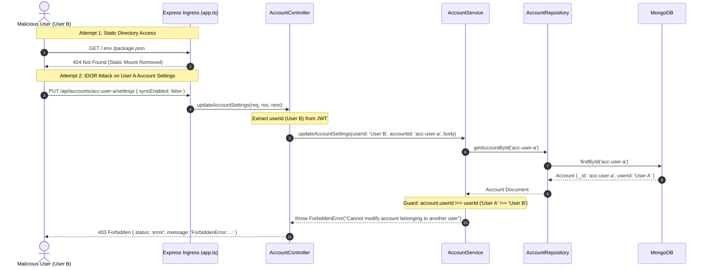

# Codebase Refactoring & Architecture - Phase 1 Implementation Details

> **Target Version:** `Backend v3.5.0` · **Feature:** `codebase-refactoring-and-architecture` · **Phase:** 1 (`BUG-V12-01`, `BUG-V12-02`, `BUG-V12-03`, `BUG-V12-04`)
> **Status:** COMPLETED
> **Created:** 2026-09-27 · **Last Updated:** 2026-09-28

---

## 1. Goal Description & Scope

Phase 1 immediately remediates the four **P0 Critical Security and Reliability Bugs** flagged during the [v1.2.0 Health Audit](file:///Users/vishaljagamani/Projects/Projects/mailsense/.agents/plans/codebase-health-audit-report.md) before any wider architectural refactoring or client decomposition occurs:

1. **Ingress Static Root Directory Lockdown (`BUG-V12-01`):** Completely eliminates the insecure `this.expressApp.use(express.static(path.join(this.__dirname, '/')))` in [`app.ts`](file:///Users/vishaljagamani/Projects/Projects/mailsense/Backend/src/app.ts#L43) which inadvertently mounts the entire project root (`process.cwd()`), exposing `.env` secrets, TypeScript source code, and configuration files to static HTTP requests.
2. **Multi-Tenant Attachment Ownership Verification (`BUG-V12-02`):** Uncomments and enforces the dormant security check in [`email-write.service.ts`](file:///Users/vishaljagamani/Projects/Projects/mailsense/Backend/src/modules/emails/email-write.service.ts#L196-L198) ensuring that staged attachments referenced during email composition belong to the authenticated `userId` and match the specified `accountId`. Attempts to reference another tenant's attachments throw a typed `ForbiddenError`.
3. **Production Debug Log Elimination (`BUG-V12-03`):** Removes `console.log({ response })` from [`gmail.service.ts:428`](file:///Users/vishaljagamani/Projects/Projects/mailsense/Backend/src/integrations/gmail/gmail.service.ts#L428) in `moveEmails()`, preventing raw provider API response objects (including email IDs, label mutations, and auth headers) from leaking to production stdout.
4. **Account Settings IDOR Vulnerability Remediation (`BUG-V12-04`):** Closes an Insecure Direct Object Reference (IDOR) flaw in [`account.controller.ts:154-169`](file:///Users/vishaljagamani/Projects/Projects/mailsense/Backend/src/modules/accounts/account.controller.ts#L154-L169) and [`account.service.ts:320-337`](file:///Users/vishaljagamani/Projects/Projects/mailsense/Backend/src/modules/accounts/account.service.ts#L320-L337) by extracting the authenticated `userId` from `req.user.id` and enforcing that `account.userId.toString() === userId.toString()`. Cross-tenant setting modifications throw `ForbiddenError`.

---

## 2. User Review Required & Architectural Notes

> [!IMPORTANT]
> **API Backend Static Ingress Architecture:** The MailSense backend operates exclusively as a stateless RESTful JSON API. Next.js natively manages and serves all frontend client static assets (fonts, SVGs, images). The backend has zero requirement to serve static files from disk. Removing `express.static('/')` closes a severe attack vector without impacting client functionality.
>
> **IDOR Multi-Tenant Boundary Enforcement:** Per [MailSense Coding Standards (Section 12: Security Rules)](file:///Users/vishaljagamani/Projects/Projects/mailsense/.agents/rules/coding-standards.md), multi-tenant isolation requires validation at both the Controller boundary (extracting authenticated claims) and the Service boundary (verifying resource ownership against tenant ID). `updateAccountSettings` is brought into full compliance with this standard.

---

## 3. Component Overview & File Map

| Component | Target File | Action | Purpose |
|---|---|---|---|
| Ingress / App | [`Backend/src/app.ts`](file:///Users/vishaljagamani/Projects/Projects/mailsense/Backend/src/app.ts) | [MODIFY] | Remove `express.static('/')` root mount (`BUG-V12-01`) |
| Email Service | [`Backend/src/modules/emails/email-write.service.ts`](file:///Users/vishaljagamani/Projects/Projects/mailsense/Backend/src/modules/emails/email-write.service.ts) | [MODIFY] | Uncomment and enforce attachment ownership validation (`BUG-V12-02`) |
| Gmail Integration | [`Backend/src/integrations/gmail/gmail.service.ts`](file:///Users/vishaljagamani/Projects/Projects/mailsense/Backend/src/integrations/gmail/gmail.service.ts) | [MODIFY] | Remove debug `console.log({ response })` (`BUG-V12-03`) |
| Accounts Controller | [`Backend/src/modules/accounts/account.controller.ts`](file:///Users/vishaljagamani/Projects/Projects/mailsense/Backend/src/modules/accounts/account.controller.ts) | [MODIFY] | Extract and pass `userId` to `updateAccountSettings` (`BUG-V12-04`) |
| Accounts Service | [`Backend/src/modules/accounts/account.service.ts`](file:///Users/vishaljagamani/Projects/Projects/mailsense/Backend/src/modules/accounts/account.service.ts) | [MODIFY] | Enforce `account.userId === userId` ownership check (`BUG-V12-04`) |
| Security Test | `Backend/src/modules/accounts/__tests__/account-settings-security.test.ts` | [NEW] | Unit tests verifying IDOR protection and 403 Forbidden responses |
| Security Test | `Backend/src/modules/emails/__tests__/attachment-security.test.ts` | [NEW] | Unit tests verifying multi-tenant attachment isolation |

---

## 4. Main Section 1: Backend Layer Implementation

### 4.1 Ingress Static Mount Lockdown (`Backend/src/app.ts`)

Remove `express.static(path.join(this.__dirname, '/'))` from the `setupMiddlewares()` pipeline.

```typescript
// Location: Backend/src/app.ts
// Method: private setupMiddlewares(): void

    private setupMiddlewares(): void {
        // 1. Mount correlation ID middleware
        this.expressApp.use(correlationMiddleware);

        // 2. Mount Helmet HTTP security headers and CSP
        this.expressApp.use(createHelmetMiddleware());

        // 3. Mount request logger middleware
        this.expressApp.use(requestLoggerMiddleware);

        // 4. Enable cors for verified origins
        this.expressApp.use(cors({ origin: ['http://localhost:3000', MAILSENSE_BASE_URL], credentials: true }));

        // 5. Parse JSON and URL encoded request bodies
        this.expressApp.use(express.json());
        this.expressApp.use(express.urlencoded({ extended: true }));

        // REMOVED: Insecure static root exposure (BUG-V12-01)
        // this.expressApp.use(express.static(path.join(this.__dirname, '/')));
    }
```

---

### 4.2 Multi-Tenant Attachment Ownership Verification (`Backend/src/modules/emails/email-write.service.ts`)

Uncomment the ownership check inside `composeEmailWithAttachments()`. When an authenticated user references a `stagedAttachment` that belongs to a different `userId` or a mismatched `accountId`, throw `ForbiddenError`.

```typescript
// Location: Backend/src/modules/emails/email-write.service.ts
// Method: public async composeEmailWithAttachments(...)

            const stagedFiles: { filename: string; mimeType: string; buffer: Buffer }[] = [];
            if (attachmentIds && attachmentIds.length > 0) {
                for (const attId of attachmentIds) {
                    const { stagedAttachment, stream } = await this.attachmentsService.getStagedAttachmentWithStream(attId);

                    // Verify attachment belongs to user and matches target account (BUG-V12-02)
                    if (stagedAttachment.userId.toString() !== userId.toString() || stagedAttachment.accountId !== accountId) {
                        throw new ForbiddenError(`Unauthorized or invalid attachment ${attId}`);
                    }

                    const chunks: Buffer[] = [];
                    for await (const chunk of stream) {
                        chunks.push(Buffer.from(chunk));
                    }
                    stagedFiles.push({
                        filename: stagedAttachment.filename,
                        mimeType: stagedAttachment.mimeType,
                        buffer: Buffer.concat(chunks),
                    });
                }
            }
```

---

### 4.3 Production Debug Log Elimination (`Backend/src/integrations/gmail/gmail.service.ts`)

Remove `console.log({ response })` from `moveEmails()`.

```typescript
// Location: Backend/src/integrations/gmail/gmail.service.ts
// Method: async moveEmails(...)

    async moveEmails(emailIds: string[], accountId: string, targetFolderIds: string[], removeFolderIds: string[] = []): Promise<void> {
        try {
            if (!emailIds.length) return;
            await GmailApi.batchModifyLabels(accountId, emailIds, targetFolderIds, removeFolderIds);
            // REMOVED: console.log({ response }) (BUG-V12-03)
        } catch (error) {
            const errorMessage = error instanceof Error ? error.message : String(error);
            logger.error('Failed to move emails in GmailService', { accountId, emailIds, targetFolderIds, removeFolderIds, error: errorMessage });
            throw error;
        }
    }
```

---

### 4.4 Account Settings IDOR Protection (`account.controller.ts` & `account.service.ts`)

#### 1. Controller Layer (`Backend/src/modules/accounts/account.controller.ts`)

Extract the authenticated `userId` from `req.user?.id`. Throw `UnauthorizedError` if missing, and forward `userId` to `accountsService.updateAccountSettings()`.

```typescript
// Location: Backend/src/modules/accounts/account.controller.ts
// Method: public updateAccountSettings

    public updateAccountSettings = async (
        req: Request<GetAccountDetailsSchema, object, UpdateAccountSettingsSchema>,
        res: Response,
        next: NextFunction,
    ): Promise<void> => {
        try {
            const userId = req.user?.id;
            if (!userId) {
                throw new UnauthorizedError('User authentication required');
            }

            const accountId = req.params.accountId;
            if (!accountId) {
                throw new BadRequestError('Account ID is required');
            }

            const response = await this.accountsService.updateAccountSettings(userId, accountId, req.body);
            res.status(200).send(response);
        } catch (error) {
            next(error);
        }
    };
```

#### 2. Service Layer (`Backend/src/modules/accounts/account.service.ts`)

Accept `userId: string` as the first argument. Verify that `account.userId.toString() === userId.toString()`. If mismatched, throw `ForbiddenError`.

```typescript
// Location: Backend/src/modules/accounts/account.service.ts
// Method: public async updateAccountSettings(...)

    public async updateAccountSettings(
        userId: string,
        accountId: string,
        settings: UpdateAccountSettingsSchema,
    ): Promise<UpdateAPIResponse> {
        try {
            const account = await AccountRepository.getAccountById(accountId);
            if (!account) {
                throw new NotFoundError('Account', accountId);
            }

            // IDOR Protection: Verify ownership (BUG-V12-04)
            if (account.userId.toString() !== userId.toString()) {
                throw new ForbiddenError('Cannot modify settings of an account belonging to another user');
            }

            await AccountRepository.updateAccount(accountId, settings);

            // Re-evaluates schedule in BullMQ
            await SchedulerService.upsertAccountRepeatableJob(accountId);

            return { status: true, message: 'Account settings updated successfully' };
        } catch (err) {
            const errorMessage = err instanceof Error ? err.message : String(err);
            logger.error(`Error in AccountsService.updateAccountSettings: ${errorMessage}`, { error: err, userId, accountId });
            throw err;
        }
    }
```

---

### 4.5 Security Unit Tests

#### 1. Account Settings IDOR Test (`Backend/src/modules/accounts/__tests__/account-settings-security.test.ts`)

```typescript
import { ForbiddenError, NotFoundError } from '../../../core/errors/index.js';
import { AccountRepository } from '../account.repository.js';
import { AccountsService } from '../account.service.js';

jest.mock('../account.repository.js');
jest.mock('../../../core/queue/scheduler.service.js', () => ({
    SchedulerService: {
        upsertAccountRepeatableJob: jest.fn().mockResolvedValue(undefined),
    },
}));

describe('AccountsService - updateAccountSettings Security Tests', () => {
    let accountsService: AccountsService;

    beforeEach(() => {
        jest.clearAllMocks();
        accountsService = new AccountsService();
    });

    it('should throw NotFoundError if target account does not exist', async () => {
        (AccountRepository.getAccountById as jest.Mock).mockResolvedValue(null);

        await expect(accountsService.updateAccountSettings('user-123', 'acc-nonexistent', { syncEnabled: true })).rejects.toThrow(NotFoundError);
    });

    it('should throw ForbiddenError if requesting user does not own the account (IDOR)', async () => {
        const mockAccount = {
            _id: 'acc-999',
            userId: 'legitimate-owner-456',
            provider: 'gmail',
        };
        (AccountRepository.getAccountById as jest.Mock).mockResolvedValue(mockAccount);

        await expect(accountsService.updateAccountSettings('attacker-user-123', 'acc-999', { syncEnabled: false })).rejects.toThrow(ForbiddenError);
    });

    it('should allow settings update when user owns the account', async () => {
        const mockAccount = {
            _id: 'acc-999',
            userId: 'user-123',
            provider: 'gmail',
        };
        (AccountRepository.getAccountById as jest.Mock).mockResolvedValue(mockAccount);
        (AccountRepository.updateAccount as jest.Mock).mockResolvedValue(undefined);

        const result = await accountsService.updateAccountSettings('user-123', 'acc-999', { syncInterval: 15 });

        expect(result.status).toBe(true);
        expect(AccountRepository.updateAccount).toHaveBeenCalledWith('acc-999', { syncInterval: 15 });
    });
});
```

#### 2. Attachment Ownership Security Test (`Backend/src/modules/emails/__tests__/attachment-security.test.ts`)

```typescript
import { Readable } from 'stream';
import { ForbiddenError } from '../../../core/errors/index.js';
import { AccountRepository } from '../../accounts/account.repository.js';
import { EmailProviderFactory } from '../../../integrations/email/email.provider.factory.js';
import { EmailWriteService } from '../email-write.service.js';
import { AttachmentsService } from '../../attachments/attachment.service.js';

jest.mock('../../accounts/account.repository.js');
jest.mock('../../../integrations/email/email.provider.factory.js');

describe('EmailWriteService - Attachment Security Tests', () => {
    let emailWriteService: EmailWriteService;
    let mockAttachmentsService: jest.Mocked<Partial<AttachmentsService>>;

    beforeEach(() => {
        jest.clearAllMocks();

        mockAttachmentsService = {
            getStagedAttachmentWithStream: jest.fn(),
            cleanupStagedAttachments: jest.fn().mockResolvedValue(undefined),
        };

        emailWriteService = new EmailWriteService(mockAttachmentsService as unknown as AttachmentsService);
    });

    it('should reject composition with ForbiddenError if attachment belongs to a different user (BUG-V12-02)', async () => {
        const mockAccount = {
            _id: 'acc-1',
            userId: 'attacker-user-123',
            provider: 'gmail',
        };
        (AccountRepository.getAccountById as jest.Mock).mockResolvedValue(mockAccount);

        (mockAttachmentsService.getStagedAttachmentWithStream as jest.Mock).mockResolvedValue({
            stagedAttachment: {
                userId: 'victim-user-999',
                accountId: 'acc-1',
                filename: 'confidential.pdf',
                mimeType: 'application/pdf',
            },
            stream: Readable.from([Buffer.from('secret')]),
        });

        await expect(
            emailWriteService.composeEmail('attacker-user-123', {
                accountId: 'acc-1',
                to: ['recipient@test.com'],
                subject: 'Test Email',
                body: 'Test Body',
                attachmentIds: ['att-victim-1'],
            }),
        ).rejects.toThrow(ForbiddenError);
    });

    it('should reject composition with ForbiddenError if attachment belongs to a different account of the same user', async () => {
        const mockAccount = {
            _id: 'acc-1',
            userId: 'user-123',
            provider: 'gmail',
        };
        (AccountRepository.getAccountById as jest.Mock).mockResolvedValue(mockAccount);

        (mockAttachmentsService.getStagedAttachmentWithStream as jest.Mock).mockResolvedValue({
            stagedAttachment: {
                userId: 'user-123',
                accountId: 'acc-2',
                filename: 'receipt.pdf',
                mimeType: 'application/pdf',
            },
            stream: Readable.from([Buffer.from('receipt')]),
        });

        await expect(
            emailWriteService.composeEmail('user-123', {
                accountId: 'acc-1',
                to: ['recipient@test.com'],
                subject: 'Test Email',
                body: 'Test Body',
                attachmentIds: ['att-mismatched-acc'],
            }),
        ).rejects.toThrow(ForbiddenError);
    });

    it('should allow email composition when attachment ownership and account match', async () => {
        const mockAccount = {
            _id: 'acc-1',
            userId: 'user-123',
            provider: 'gmail',
        };
        (AccountRepository.getAccountById as jest.Mock).mockResolvedValue(mockAccount);

        (mockAttachmentsService.getStagedAttachmentWithStream as jest.Mock).mockResolvedValue({
            stagedAttachment: {
                userId: 'user-123',
                accountId: 'acc-1',
                filename: 'invoice.pdf',
                mimeType: 'application/pdf',
            },
            stream: Readable.from([Buffer.from('invoice')]),
        });

        const mockProvider = {
            sendMail: jest.fn().mockResolvedValue(undefined),
        };
        (EmailProviderFactory.getProvider as jest.Mock).mockReturnValue(mockProvider);

        const result = await emailWriteService.composeEmail('user-123', {
            accountId: 'acc-1',
            to: ['client@test.com'],
            subject: 'Invoice Attached',
            body: 'Please find attached invoice.',
            attachmentIds: ['att-valid-1'],
        });

        expect(result.status).toBe(true);
        expect(mockProvider.sendMail).toHaveBeenCalled();
        expect(mockAttachmentsService.cleanupStagedAttachments).toHaveBeenCalledWith(['att-valid-1']);
    });
});
```

---

## 5. Main Section 2: Frontend Layer Implementation

> [!NOTE]
> **No Frontend Code Modifications in Phase 1:**
> Phase 1 is strictly scoped to backend API ingress hardening, authentication boundary guards, and security patch verification. The frontend already handles HTTP 401 (`UnauthorizedError`) and HTTP 403 (`ForbiddenError`) status codes through its centralized Axios error interceptor and displays appropriate toast notifications.
>
> Frontend hook extraction (`useEmailActions.ts`, `useEmailPagination.ts`), component standardization, and `console.error` migration are scheduled for **Phase 2** and **Phase 3**.

---

## 6. Low-Level Design & Sequence Flow



---

## 7. Step-by-Step Task Checklist

- [x] **Task 1: Ingress Lockdown (`BUG-V12-01`)**
  - [x] Open [`Backend/src/app.ts`](file:///Users/vishaljagamani/Projects/Projects/mailsense/Backend/src/app.ts).
  - [x] Delete line 43: `this.expressApp.use(express.static(path.join(this.__dirname, '/')));`.
  - [x] Verify health routes and API routes remain unaffected.

- [x] **Task 2: Multi-Tenant Attachment Verification (`BUG-V12-02`)**
  - [x] Open [`Backend/src/modules/emails/email-write.service.ts`](file:///Users/vishaljagamani/Projects/Projects/mailsense/Backend/src/modules/emails/email-write.service.ts).
  - [x] Uncomment the ownership verification guard in `composeEmailWithAttachments()`.
  - [x] Ensure `ForbiddenError` is imported from `src/core/errors/index.js`.

- [x] **Task 3: Remove Production Debug Logging (`BUG-V12-03`)**
  - [x] Open [`Backend/src/integrations/gmail/gmail.service.ts`](file:///Users/vishaljagamani/Projects/Projects/mailsense/Backend/src/integrations/gmail/gmail.service.ts).
  - [x] Remove `console.log({ response });` on line 428 in `moveEmails()`.

- [x] **Task 4: Account Settings IDOR Remediation (`BUG-V12-04`)**
  - [x] Open [`Backend/src/modules/accounts/account.controller.ts`](file:///Users/vishaljagamani/Projects/Projects/mailsense/Backend/src/modules/accounts/account.controller.ts).
  - [x] In `updateAccountSettings`, extract `const userId = req.user?.id;` and validate presence.
  - [x] Forward `userId` to `this.accountsService.updateAccountSettings(userId, accountId, req.body)`.
  - [x] Open [`Backend/src/modules/accounts/account.service.ts`](file:///Users/vishaljagamani/Projects/Projects/mailsense/Backend/src/modules/accounts/account.service.ts).
  - [x] Update `updateAccountSettings(userId: string, accountId: string, settings: UpdateAccountSettingsSchema)`.
  - [x] Add `if (account.userId.toString() !== userId.toString()) throw new ForbiddenError(...)`.

- [x] **Task 5: Security Unit Tests & Verification**
  - [x] Create `Backend/src/modules/accounts/__tests__/account-settings-security.test.ts`.
  - [x] Create `Backend/src/modules/emails/__tests__/attachment-security.test.ts`.
  - [x] Run test suite: `pnpm test` (all 16 suites, 61 tests passing).
  - [x] Run backend build: `pnpm build`.


---

## 8. Verification & Build Commands

```bash
# 1. Run unit test suite to verify security guards
cd /Users/vishaljagamani/Projects/Projects/mailsense/Backend
pnpm test

# 2. Build backend TypeScript code
pnpm build

# 3. Test HTTP static file rejection
curl -I http://localhost:5000/package.json
# Expected: HTTP/1.1 404 Not Found
```
