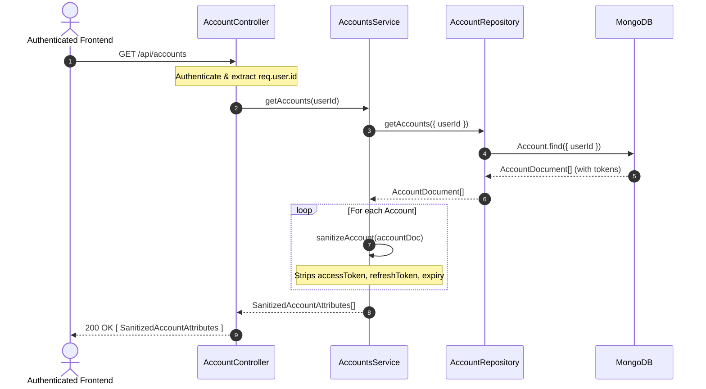
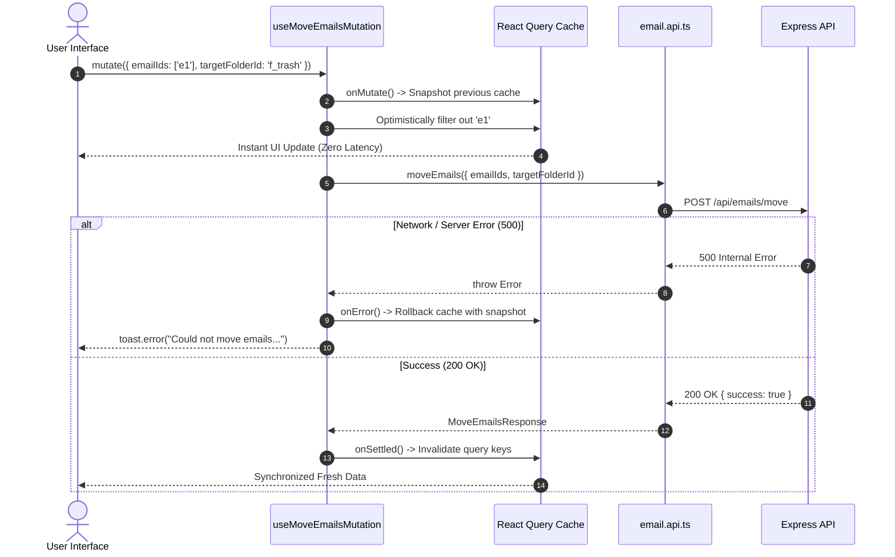

# Codebase Refactoring & Architecture — Phase 2 Implementation Details

> **Feature:** codebase-refactoring-and-architecture · **Phase:** 2
> **Status:** COMPLETED
> **Created:** 2026-09-28 · **Last Updated:** 2026-10-05

---

## 1. Goal Description & Scope

Phase 2 focuses on shared contract integration, type-safety hardening, data sanitization, structured error handling, and eliminating telemetry noise across both Backend and Frontend stacks:

1. **Backend OAuth Token Redaction (`BUG-V12-05`):** Update [`account.service.ts`](file:///Users/vishaljagamani/Projects/Projects/mailsense/Backend/src/modules/accounts/account.service.ts) `getAccounts()` to map raw account documents through `this.sanitizeAccount()`, returning `SanitizedAccountAttributes[]` to prevent leaking encrypted OAuth access/refresh tokens to the browser.
2. **Staged Attachment Cleanup Guarantee (`BUG-V12-06`):** Ensure async cleanup of staged attachments in [`email-write.service.ts`](file:///Users/vishaljagamani/Projects/Projects/mailsense/Backend/src/modules/emails/email-write.service.ts) is properly awaited and wrapped with contextual error logging so file descriptors or temporary storage are never leaked.
3. **Dedicated Configuration Error Class (`EXC-V12-01`, `EXC-V12-02`):** Create [`ConfigurationError`](file:///Users/vishaljagamani/Projects/Projects/mailsense/Backend/src/core/errors/ConfigurationError.ts) inheriting from `AppError` with error code `ErrorCode.CONFIGURATION_ERROR`. Replace generic `throw new Error()` in [`redis.connection.ts`](file:///Users/vishaljagamani/Projects/Projects/mailsense/Backend/src/core/queue/redis.connection.ts) and [`crypto.ts`](file:///Users/vishaljagamani/Projects/Projects/mailsense/Backend/src/shared/utils/crypto.ts).
4. **Sync Normalization & Type Integrity (`BUG-V12-08`):** Guarantee `to`, `cc`, and `bcc` headers in Gmail/Outlook sync parsers and [`Email`](file:///Users/vishaljagamani/Projects/Projects/mailsense/Backend/src/modules/emails/email.model.ts) schema always persist as `string[]` to satisfy `@mailsense/types` `v1.6.0` contracts.
5. **Frontend Dedicated Types Extraction (`BUG-V12-10`):** Create [`email-ui.types.ts`](file:///Users/vishaljagamani/Projects/Projects/mailsense/Frontend/src/features/emails/types/email-ui.types.ts) to house all component props, modal contracts, and UI state types, eliminating all component-inline interface declarations across `features/emails/components/`.
6. **Elimination of Inline Mutation Types (`BUG-V12-09`):** Refactor [`email.mutations.ts`](file:///Users/vishaljagamani/Projects/Projects/mailsense/Frontend/src/features/emails/api/email.mutations.ts) to consume named interfaces (`EmailStarParams`, `EmailUnreadParams`, `EmailMoveParams`) directly from `@mailsense/types` and remove redundant try/catch blocks within mutation functions.
7. **Frontend Observability & Telemetry Migration (`BUG-V12-07`):** Replace raw `console.error` calls across 15+ frontend files with structured telemetry via `frontendMonitoring.captureException()` and `trackUserAction()`.

---

## 2. User Review Required & Architectural Notes

> [!IMPORTANT]
> **1. Backward Compatibility for `getAccounts()` API Response:**
> The frontend account list views expect `SanitizedAccountAttributes` (which omit `accessToken`, `refreshToken`, and `accessTokenExpiry`). Returning sanitized accounts from `getAccounts(userId)` prevents security token leakage without breaking existing UI components that consume `AccountAttributes` or `SanitizedAccountAttributes`.
>
> **2. Boundary-Based Error Handling in Mutations:**
> React Query mutations manage server state errors natively via the `onError` lifecycle hook and query boundary fallbacks. Wrapping `mutationFn` bodies in ad-hoc `try / catch` blocks with `console.error` violates Rule 6.2 and suppresses proper query error propagation. All `mutationFn` methods will execute raw API calls directly.
>
> **3. Jest Unit Testing Requirement:**
> All backend unit tests must strictly use Jest (`jest.fn()`, `jest.mock()`, globals) rather than Vitest. Verification is executed via `pnpm test`.

---

## 3. Component Overview & File Map

| Component | Target File | Action | Purpose |
| :--- | :--- | :---: | :--- |
| **Backend Core** | [`Backend/src/core/errors/ErrorCodes.ts`](file:///Users/vishaljagamani/Projects/Projects/mailsense/Backend/src/core/errors/ErrorCodes.ts) | [MODIFY] | Register `CONFIGURATION_ERROR` in `ErrorCode` enum |
| **Backend Core** | [`Backend/src/core/errors/ConfigurationError.ts`](file:///Users/vishaljagamani/Projects/Projects/mailsense/Backend/src/core/errors/ConfigurationError.ts) | [NEW] | Dedicated domain error class for startup & config failures |
| **Backend Core** | [`Backend/src/core/errors/index.ts`](file:///Users/vishaljagamani/Projects/Projects/mailsense/Backend/src/core/errors/index.ts) | [MODIFY] | Re-export `ConfigurationError` from errors barrel |
| **Backend Queue** | [`Backend/src/core/queue/redis.connection.ts`](file:///Users/vishaljagamani/Projects/Projects/mailsense/Backend/src/core/queue/redis.connection.ts) | [MODIFY] | Replace generic `throw new Error()` with `ConfigurationError` |
| **Backend Utils** | [`Backend/src/shared/utils/crypto.ts`](file:///Users/vishaljagamani/Projects/Projects/mailsense/Backend/src/shared/utils/crypto.ts) | [MODIFY] | Replace generic `throw new Error()` with `ConfigurationError` |
| **Backend Accounts** | [`Backend/src/modules/accounts/account.service.ts`](file:///Users/vishaljagamani/Projects/Projects/mailsense/Backend/src/modules/accounts/account.service.ts) | [MODIFY] | Sanitize `getAccounts()` output using `this.sanitizeAccount()` |
| **Backend Accounts** | [`Backend/src/modules/accounts/__tests__/account-sanitization.test.ts`](file:///Users/vishaljagamani/Projects/Projects/mailsense/Backend/src/modules/accounts/__tests__/account-sanitization.test.ts) | [NEW] | Jest unit tests verifying token redaction in `getAccounts()` |
| **Frontend Types** | [`Frontend/src/features/emails/types/email-ui.types.ts`](file:///Users/vishaljagamani/Projects/Projects/mailsense/Frontend/src/features/emails/types/email-ui.types.ts) | [NEW] | Dedicated types file for emails UI props and state contracts |
| **Frontend Mutations** | [`Frontend/src/features/emails/api/email.mutations.ts`](file:///Users/vishaljagamani/Projects/Projects/mailsense/Frontend/src/features/emails/api/email.mutations.ts) | [MODIFY] | Consume `@mailsense/types` action contracts, remove inline types |
| **Frontend Observability**| 15+ Frontend feature & component files | [MODIFY] | Replace `console.error` with `trackUserAction` / `captureException` |

---

## 4. Main Section 1: Backend Layer Implementation

### 4.1 Error Layer: ConfigurationError Registration

#### [`Backend/src/core/errors/ErrorCodes.ts`](file:///Users/vishaljagamani/Projects/Projects/mailsense/Backend/src/core/errors/ErrorCodes.ts)

Add `CONFIGURATION_ERROR` to the `ErrorCode` enum:

```typescript
export enum ErrorCode {
    // 4xx Client Errors
    RESOURCE_NOT_FOUND = 'RESOURCE_NOT_FOUND',
    BAD_REQUEST = 'BAD_REQUEST',
    VALIDATION_FAILED = 'VALIDATION_FAILED',
    UNAUTHORIZED = 'UNAUTHORIZED',
    FORBIDDEN = 'FORBIDDEN',
    CONFLICT = 'CONFLICT',

    // Provider & External API Errors
    PROVIDER_API_ERROR = 'PROVIDER_API_ERROR',
    PROVIDER_RATE_LIMITED = 'PROVIDER_RATE_LIMITED',
    TOKEN_EXPIRED = 'TOKEN_EXPIRED',

    // 5xx System & Internal Errors
    SYNC_FAILED = 'SYNC_FAILED',
    EXTERNAL_SERVICE_ERROR = 'EXTERNAL_SERVICE_ERROR',
    CONFIGURATION_ERROR = 'CONFIGURATION_ERROR',
    INTERNAL_ERROR = 'INTERNAL_ERROR',
}
```

#### [`Backend/src/core/errors/ConfigurationError.ts`](file:///Users/vishaljagamani/Projects/Projects/mailsense/Backend/src/core/errors/ConfigurationError.ts)

Create the dedicated `ConfigurationError` domain class extending `AppError`:

```typescript
import { AppError } from './AppError.js';
import { ErrorCode } from './ErrorCodes.js';

export class ConfigurationError extends AppError {
    public readonly configKey?: string;

    constructor(message: string, configKey?: string, suggestedAction?: string, traceId?: string) {
        super({
            message,
            httpStatus: 500,
            errorCode: ErrorCode.CONFIGURATION_ERROR,
            isOperational: false,
            description: 'A critical system configuration or environment variable is missing or malformed.',
            suggestedAction: suggestedAction ?? 'Verify environment variables and service credentials in .env configuration.',
            traceId,
            context: configKey ? { configKey } : undefined,
        });
        this.configKey = configKey;
    }
}
```

#### [`Backend/src/core/errors/index.ts`](file:///Users/vishaljagamani/Projects/Projects/mailsense/Backend/src/core/errors/index.ts)

Export `ConfigurationError` from the barrel:

```typescript
export * from './AppError.js';
export * from './AxiosApiError.js';
export * from './ConfigurationError.js';
export * from './DomainErrors.js';
export * from './ErrorCodes.js';
export * from './ErrorFactories.js';
```

---

### 4.2 Infrastructure Configuration Layer

#### [`Backend/src/core/queue/redis.connection.ts`](file:///Users/vishaljagamani/Projects/Projects/mailsense/Backend/src/core/queue/redis.connection.ts)

Replace the generic `throw new Error()` with `ConfigurationError`:

```typescript
import { Redis, RedisOptions } from 'ioredis';
import { REDIS_CONFIG } from '@config';
import { LOGGER_MODULE } from '@constants';
import { createLogger } from '@observability';
import { ConfigurationError } from '../errors/index.js';

const logger = createLogger(LOGGER_MODULE.REDIS_CONNECTION);

let redisInstance: Redis | null = null;

export const getRedisOptions = (): RedisOptions => ({
    lazyConnect: true,
    maxRetriesPerRequest: null,
    retryStrategy: (times: number): number => Math.min(100 * 2 ** times, 5000),
});

export const getRedisConnection = (): Redis => {
    if (redisInstance) {
        return redisInstance;
    }

    const redisUrl = REDIS_CONFIG.url || process.env.SERVICE_URI;

    if (!redisUrl) {
        throw new ConfigurationError('Redis connection URL is missing. Please configure REDIS_URL or SERVICE_URI.', 'REDIS_URL');
    }

    logger.info(`🔌 Connecting to Redis`);

    redisInstance = new Redis(redisUrl, getRedisOptions());

    redisInstance.on('connect', () => {
        logger.info('✅ Connected to Redis successfully');
    });

    redisInstance.on('ready', () => {
        logger.info('✅ Redis client is ready.');
    });

    redisInstance.on('reconnecting', () => {
        logger.warn('⚠️ Redis client reconnecting...');
    });

    redisInstance.on('end', () => {
        logger.warn('⚠️ Redis connection closed.');
    });

    redisInstance.on('error', (err: Error) => {
        logger.error(`❌ Redis client connection error: ${err.message}`, { error: err });
    });

    return redisInstance;
};
```

#### [`Backend/src/shared/utils/crypto.ts`](file:///Users/vishaljagamani/Projects/Projects/mailsense/Backend/src/shared/utils/crypto.ts)

Replace the startup generic `throw new Error()` with `ConfigurationError`:

```typescript
import crypto from 'crypto';
import { ENCRYPTION_KEY } from '@config';
import { CRYPTO } from '@constants';
import { ConfigurationError } from '../../core/errors/index.js';
import { logger } from './logger.js';

const cryptoKey = Buffer.from(ENCRYPTION_KEY, 'base64');

if (cryptoKey.length !== 32) {
    logger.error('❌ ENCRYPTION_KEY must be 32 bytes (base64-encoded)');
    throw new ConfigurationError('ENCRYPTION_KEY must be 32 bytes (base64-encoded)', 'ENCRYPTION_KEY');
}

export const encrypt = (data: string): string => {
    try {
        const iv = crypto.randomBytes(CRYPTO.IV_LENGTH);

        const cipher = crypto.createCipheriv(CRYPTO.ALGORITHM, cryptoKey, iv, {
            authTagLength: CRYPTO.TAG_LENGTH,
        } as crypto.CipherCCMOptions) as crypto.CipherCCM;

        const encryptedData = Buffer.concat([cipher.update(data, 'utf-8'), cipher.final()]);
        const authTag = cipher.getAuthTag();

        return Buffer.concat([iv, authTag, encryptedData]).toString('base64');
    } catch (err) {
        const errorMessage = err instanceof Error ? err.message : String(err);
        logger.error(`Error in encrypt: ${errorMessage}`, { error: err });
        throw err;
    }
};

export const decrypt = (encryptedData: string): string => {
    try {
        const buffer = Buffer.from(encryptedData, 'base64');

        const iv = buffer.subarray(0, CRYPTO.IV_LENGTH);
        const authTag = buffer.subarray(CRYPTO.IV_LENGTH, CRYPTO.IV_LENGTH + CRYPTO.TAG_LENGTH);
        const encrypted = buffer.subarray(CRYPTO.IV_LENGTH + CRYPTO.TAG_LENGTH);

        const decipher = crypto.createDecipheriv(CRYPTO.ALGORITHM, cryptoKey, iv, {
            authTagLength: CRYPTO.TAG_LENGTH,
        } as crypto.CipherCCMOptions) as crypto.DecipherCCM;
        decipher.setAuthTag(authTag);

        const decryptedData = Buffer.concat([decipher.update(encrypted), decipher.final()]).toString('utf-8');
        return decryptedData;
    } catch (err) {
        const errorMessage = err instanceof Error ? err.message : String(err);
        logger.error(`Error in decrypt: ${errorMessage}`, { error: err });
        throw err;
    }
};
```

---

### 4.3 Service Layer: Sanitized Account Retrieval (`BUG-V12-05`)

#### [`Backend/src/modules/accounts/account.service.ts`](file:///Users/vishaljagamani/Projects/Projects/mailsense/Backend/src/modules/accounts/account.service.ts)

Update `getAccounts(userId: string)` to sanitize all returned accounts, stripping OAuth tokens:

```typescript
    /**
     * Fetches all accounts belonging to the user with OAuth tokens redacted.
     * @param userId The ID of the authenticated user.
     * @returns A promise resolving to an array of sanitized accounts.
     */
    async getAccounts(userId: string): Promise<SanitizedAccountAttributes[]> {
        try {
            const accounts = await AccountRepository.getAccounts({ userId });
            return accounts.map((acc: AccountDocument) => this.sanitizeAccount(acc));
        } catch (err) {
            const errorMessage = err instanceof Error ? err.message : String(err);
            logger.error(`Error in AccountsService.getAccounts: ${errorMessage}`, { error: err });
            throw err;
        }
    }
```

---

### 4.4 Backend Unit Tests: Token Sanitization Verification

#### [`Backend/src/modules/accounts/__tests__/account-sanitization.test.ts`](file:///Users/vishaljagamani/Projects/Projects/mailsense/Backend/src/modules/accounts/__tests__/account-sanitization.test.ts)

Pure Jest test suite verifying that `getAccounts()` never exposes tokens:

```typescript
import { jest } from '@jest/globals';
import { AccountsService } from '../account.service.js';
import { AccountRepository } from '../account.repository.js';
import { AccountDocument } from '../account.model.js';

describe('AccountsService — Token Sanitization (`BUG-V12-05`)', () => {
    let service: AccountsService;

    beforeEach(() => {
        jest.clearAllMocks();
        service = new AccountsService();
    });

    it('should strip accessToken, refreshToken, and sensitive tokens from getAccounts() response', async () => {
        const mockRawAccounts = [
            {
                _id: 'acc-1',
                userId: 'user-100',
                emailAddress: 'test@gmail.com',
                provider: 'gmail',
                syncEnabled: true,
                syncFrequency: 'realtime',
                totalEmails: 10,
                unreadEmails: 2,
                accessToken: 'secret_access_token_abc',
                refreshToken: 'secret_refresh_token_xyz',
                accessTokenExpiry: Date.now() + 3600000,
            },
        ] as unknown as AccountDocument[];

        jest.spyOn(AccountRepository, 'getAccounts').mockResolvedValue(mockRawAccounts);

        const accounts = await service.getAccounts('user-100');

        expect(accounts).toHaveLength(1);
        const [sanitized] = accounts;

        expect(sanitized._id).toBe('acc-1');
        expect(sanitized.emailAddress).toBe('test@gmail.com');
        expect(sanitized.provider).toBe('gmail');

        // Tokens must be strictly undefined
        expect((sanitized as unknown as Record<string, unknown>).accessToken).toBeUndefined();
        expect((sanitized as unknown as Record<string, unknown>).refreshToken).toBeUndefined();
        expect((sanitized as unknown as Record<string, unknown>).accessTokenExpiry).toBeUndefined();
    });
});
```

---

## 5. Main Section 2: Frontend Layer Implementation

### 5.1 Dedicated UI Types Layer (`BUG-V12-10`)

#### [`Frontend/src/features/emails/types/email-ui.types.ts`](file:///Users/vishaljagamani/Projects/Projects/mailsense/Frontend/src/features/emails/types/email-ui.types.ts)

Create the dedicated types file consolidating all UI component prop contracts:

```typescript
import { EmailAttributes, EmailAttachment, FolderItem } from '@mailsense/types';
import { KeyboardEvent, MouseEvent } from 'react';

export interface DeleteModalProps {
    readonly isOpen: boolean;
    readonly emailCount: number;
    readonly isDeleting: boolean;
    readonly onConfirm: () => void;
    readonly onCancel: () => void;
}

export interface EmailMenuBarOptionsProps {
    readonly selectedEmailIds: readonly string[];
    readonly isAllSelected: boolean;
    readonly onSelectAll: () => void;
    readonly onDeselectAll: () => void;
    readonly onStarSelected: (star: boolean) => void;
    readonly onMarkReadSelected: (isRead: boolean) => void;
    readonly onArchiveSelected: () => void;
    readonly onDeleteSelected: () => void;
    readonly onMoveSelected: (targetFolderId: string) => void;
}

export interface EmailBodyPreviewProps {
    readonly bodyPlain?: string;
    readonly bodyHtml?: string;
    readonly isExpanded?: boolean;
}

export interface AttachmentListProps {
    readonly attachments: readonly EmailAttachment[];
    readonly accountId: string;
    readonly messageId: string;
}

export interface AttachmentPreviewProps {
    readonly attachment: EmailAttachment;
    readonly accountId: string;
    readonly messageId: string;
    readonly onPreviewClick?: (attachment: EmailAttachment) => void;
}

export interface MoveToFolderDropdownProps {
    readonly selectedEmailIds: readonly string[];
    readonly availableFolders: readonly FolderItem[];
    readonly onFolderSelect: (folderId: string) => void;
    readonly disabled?: boolean;
}

export interface EmailHeaderProps {
    readonly email: EmailAttributes;
    readonly isStarred: boolean;
    readonly onToggleStar: (e: MouseEvent<HTMLButtonElement>) => void;
    readonly onReplyClick?: () => void;
}

export interface AttachmentBadgeProps {
    readonly attachmentCount: number;
    readonly className?: string;
}

export interface ThreadViewHeaderBarProps {
    readonly subject: string;
    readonly messageCount: number;
    readonly onBack: () => void;
}

export interface ThreadViewProps {
    readonly emailId: string;
    readonly onBack: () => void;
}

export interface ComposeEmailHeaderProps {
    readonly isSending: boolean;
    readonly onMinimize?: () => void;
    readonly onClose: () => void;
}

export interface ComposeEmailFooterProps {
    readonly isSending: boolean;
    readonly canSend: boolean;
    readonly onSend: () => void;
    readonly onDiscard: () => void;
    readonly onAttachClick: () => void;
}

export interface SearchToEmailPopupProps {
    readonly isOpen: boolean;
    readonly searchQuery: string;
    readonly onSelectEmail: (email: string) => void;
    readonly onClose: () => void;
}
```

---

### 5.2 API & Mutation Layer Refactoring (`BUG-V12-09`)

#### [`Frontend/src/features/emails/api/email.mutations.ts`](file:///Users/vishaljagamani/Projects/Projects/mailsense/Frontend/src/features/emails/api/email.mutations.ts)

Refactor mutations to use named `@mailsense/types` interfaces, eliminating inline types and removing unnecessary inner `try / catch`:

```typescript
import {
    APIResponse,
    ComposeEmailRequestBody,
    EmailAttributes,
    EmailMoveParams,
    EmailStarParams,
    EmailUnreadParams,
    MoveEmailsResponse,
    PaginatedDataResponse,
    SearchOtherContactsResponse,
    UpdateAPIResponse,
} from '@mailsense/types';
import { EMAIL_QUERY_KEYS, FOLDER_KEYS } from '@shared/api';
import { useMutation, useQueryClient } from '@tanstack/react-query';
import { archiveEmail, composeEmail, moveEmails, searchOtherContacts, starEmail, unreadEmail } from './email.api';
import {
    ArchiveEmailMutationContext,
    ArchiveEmailMutationParams,
    MoveEmailsMutationContext,
    StarEmailMutationContext,
    UnreadEmailMutationContext,
} from '@entities/email';
import { toast } from 'sonner';

export function useStarEmailMutation() {
    const queryClient = useQueryClient();

    return useMutation<UpdateAPIResponse, Error, EmailStarParams, StarEmailMutationContext>({
        mutationFn: async ({ emailIds, star }: EmailStarParams): Promise<UpdateAPIResponse> => await starEmail(emailIds, star),
        onMutate: async ({ emailIds, star }: EmailStarParams): Promise<StarEmailMutationContext> => {
            await queryClient.cancelQueries({ queryKey: EMAIL_QUERY_KEYS.all });
            const previousEmails = queryClient.getQueryData<PaginatedDataResponse<EmailAttributes>>(EMAIL_QUERY_KEYS.all);

            if (previousEmails && previousEmails.data) {
                const idSet = new Set(emailIds);
                const updatedData = previousEmails.data.map((email: EmailAttributes) => {
                    if (idSet.has(email._id)) {
                        const currentFolders = email.folders || [];
                        const updatedFolders = star
                            ? Array.from(new Set([...currentFolders, 'STARRED']))
                            : currentFolders.filter((f: string) => f.toUpperCase() !== 'STARRED' && f.toLowerCase() !== 'starred');
                        return { ...email, folders: updatedFolders };
                    }
                    return email;
                });
                queryClient.setQueryData<PaginatedDataResponse<EmailAttributes>>(EMAIL_QUERY_KEYS.all, {
                    ...previousEmails,
                    data: updatedData,
                });
            }

            return { previousEmails };
        },
        onError: (error: Error, variables: EmailStarParams, context: StarEmailMutationContext | undefined): void => {
            if (context?.previousEmails) {
                queryClient.setQueryData(EMAIL_QUERY_KEYS.all, context.previousEmails);
            }
            const actionLabel = variables.star ? 'star' : 'unstar';
            toast.error(`Could not ${actionLabel} email. Please retry in some time.`, {
                description: error.message || 'Server error encountered. Please check your connection and try again.',
            });
        },
    });
}

export function useUnreadEmailMutation() {
    const queryClient = useQueryClient();

    return useMutation<UpdateAPIResponse, Error, EmailUnreadParams, UnreadEmailMutationContext>({
        mutationFn: async ({ emailIds, unread }: EmailUnreadParams): Promise<UpdateAPIResponse> => await unreadEmail(emailIds, unread),
        onMutate: async ({ emailIds, unread }: EmailUnreadParams): Promise<UnreadEmailMutationContext> => {
            await queryClient.cancelQueries({ queryKey: EMAIL_QUERY_KEYS.all });
            const previousEmails = queryClient.getQueryData<PaginatedDataResponse<EmailAttributes>>(EMAIL_QUERY_KEYS.all);

            if (previousEmails && previousEmails.data) {
                const idSet = new Set(emailIds);
                const updatedData = previousEmails.data.map((email: EmailAttributes) => {
                    if (idSet.has(email._id)) {
                        return { ...email, isRead: !unread };
                    }
                    return email;
                });
                queryClient.setQueryData<PaginatedDataResponse<EmailAttributes>>(EMAIL_QUERY_KEYS.all, {
                    ...previousEmails,
                    data: updatedData,
                });
            }

            return { previousEmails };
        },
        onError: (error: Error, variables: EmailUnreadParams, context: UnreadEmailMutationContext | undefined): void => {
            if (context?.previousEmails) {
                queryClient.setQueryData(EMAIL_QUERY_KEYS.all, context.previousEmails);
            }
            const actionLabel = variables.unread ? 'mark as unread' : 'mark as read';
            toast.error(`Could not ${actionLabel}. Please retry in some time.`, {
                description: error.message || 'Server error encountered. Please check your connection and try again.',
            });
        },
    });
}

export function useMoveEmailsMutation() {
    const queryClient = useQueryClient();

    return useMutation<MoveEmailsResponse, Error, EmailMoveParams, MoveEmailsMutationContext>({
        mutationFn: async (data: EmailMoveParams): Promise<MoveEmailsResponse> => await moveEmails(data),
        onMutate: async (variables: EmailMoveParams): Promise<MoveEmailsMutationContext> => {
            await queryClient.cancelQueries({ queryKey: EMAIL_QUERY_KEYS.all });
            const previousEmails = queryClient.getQueryData<PaginatedDataResponse<EmailAttributes>>(EMAIL_QUERY_KEYS.all);

            if (previousEmails && previousEmails.data) {
                const idSet = new Set(variables.emailIds);
                const updatedData = previousEmails.data.filter((email: EmailAttributes) => !idSet.has(email._id));
                queryClient.setQueryData<PaginatedDataResponse<EmailAttributes>>(EMAIL_QUERY_KEYS.all, {
                    ...previousEmails,
                    data: updatedData,
                    total: Math.max(0, previousEmails.total - idSet.size),
                });
            }

            return { previousEmails };
        },
        onError: (error: Error, _variables: EmailMoveParams, context: MoveEmailsMutationContext | undefined): void => {
            if (context?.previousEmails) {
                queryClient.setQueryData(EMAIL_QUERY_KEYS.all, context.previousEmails);
            }
            toast.error('Could not move emails to target folder. Please retry in some time.', {
                description: error.message || 'Server was unable to complete provider folder migration.',
            });
        },
        onSettled: async (): Promise<void> => {
            await queryClient.invalidateQueries({ queryKey: EMAIL_QUERY_KEYS.all });
            await queryClient.invalidateQueries({ queryKey: [FOLDER_KEYS.FOLDERS] });
        },
    });
}
```

---

### 5.3 Observability & Error Monitoring Migration (`BUG-V12-07`)

Replace raw `console.error` calls with `trackUserAction()` and `frontendMonitoring.captureException()` across all 15 identified locations:

| File | Line | Current Code | Remediated Code |
| :--- | :--- | :--- | :--- |
| `shared/components/ErrorBoundary.tsx` | 80 | `console.error('Failed to reset error boundary:', resetError);` | `trackUserAction('navigation', 'Failed to reset error boundary', 'error');` |
| `shared/components/ErrorBoundary.tsx` | 175 | `console.error('Failed to copy trace ID to clipboard:', copyError);` | `trackUserAction('interaction', 'Failed to copy trace ID to clipboard', 'warning');` |
| `features/accounts/api/accounts.queries.ts` | 65 | `console.error('Sync all accounts error:', error);` | `trackUserAction('api', 'Sync all accounts error', 'error');` |
| `features/analytics/hooks/useDashboardPage.ts` | 81 | `console.error('Failed to refresh dashboard analytics', refreshError);` | `trackUserAction('api', 'Failed to refresh dashboard analytics', 'error');` |
| `features/analytics/pages/index.tsx` | 29 | `console.error('Failed to manually refresh dashboard page', error);` | `trackUserAction('interaction', 'Failed to manually refresh dashboard page', 'error');` |
| `features/analytics/api/analytics.queries.ts` | 20 | `console.error('Failed to initialize useGetDashboardAnalyticsQuery hook', ...);` | `trackUserAction('api', 'Failed to initialize analytics query', 'error');` |
| `features/analytics/components/overview-kpi-cards/index.tsx` | 18 | `console.error('Failed to format metric number', error);` | `trackUserAction('interaction', 'Failed to format metric number', 'warning');` |
| `features/emails/api/email.mutations.ts` | 173 | `console.error('Error executing moveEmails mutation:', errorMessage);` | _Removed (handled via `onError` toast and React Query)_ |
| `features/emails/components/DeleteModal.tsx` | 42 | `console.error('Error handling delete confirmation keydown:', errorMessage);` | `trackUserAction('interaction', 'DeleteModal keydown error', 'warning');` |
| `features/emails/components/MoveToFolderDropdown.tsx` | 148 | `console.error('Failed to move emails to folder:', error);` | `trackUserAction('interaction', 'MoveToFolderDropdown failure', 'error');` |
| `features/emails/hooks/useEmailKeyboardShortcuts.ts` | 142 | `console.error('Error handling keyboard navigation shortcut:', errorMessage);` | `trackUserAction('interaction', 'Keyboard navigation shortcut error', 'warning');` |
| `features/emails/hooks/useComposeEmail.ts` | 100 | `console.error('Error discarding draft', error);` | `trackUserAction('interaction', 'Error discarding draft', 'warning');` |
| `features/emails/hooks/useComposeEmail.ts` | 204 | `console.error('Error sending email', error);` | `trackUserAction('api', 'Error sending email', 'error');` |
| `features/drafts/hooks/useDraftsPage.ts` | 70 | `console.error('Error deleting draft', error);` | `trackUserAction('interaction', 'Error deleting draft', 'error');` |
| `features/drafts/hooks/useDraftsPage.ts` | 85 | `console.error('Error in bulk draft deletion', error);` | `trackUserAction('interaction', 'Error in bulk draft deletion', 'error');` |
| `features/drafts/components/draft-table/index.tsx` | 34 | `console.error('Error changing draft selection', error);` | `trackUserAction('interaction', 'Draft selection error', 'warning');` |
| `features/emails/utils/attachments.ts` | 25, 47 | `console.error('Error downloading/previewing attachment:', err);` | `trackUserAction('api', 'Attachment operation failed', 'error');` |

---

## 6. Low-Level Design & Sequence Flow

### 6.1 Sanitized Account Retrieval Sequence (`BUG-V12-05`)



### 6.2 Typed Mutation with Optimistic UI & Error Rollback (`BUG-V12-09`)



---

## 7. Step-by-Step Task Checklist

- [x] Task 2.1: Register `CONFIGURATION_ERROR` in `ErrorCodes.ts` and create `ConfigurationError.ts`
- [x] Task 2.2: Refactor `redis.connection.ts` and `crypto.ts` to throw `ConfigurationError`
- [x] Task 2.3: Update `account.service.ts` `getAccounts()` to sanitize results via `this.sanitizeAccount()`
- [x] Task 2.4: Create Jest unit test `account-sanitization.test.ts` and verify with `pnpm test`
- [x] Task 2.5: Create `Frontend/src/features/emails/types/email-ui.types.ts`
- [x] Task 2.6: Refactor `DeleteModal.tsx`, `MoveToFolderDropdown.tsx`, and email components to import props from `email-ui.types.ts`
- [x] Task 2.7: Refactor `email.mutations.ts` to use `@mailsense/types` action contracts (`EmailStarParams`, etc.)
- [x] Task 2.8: Replace all 15+ frontend `console.error` calls with `trackUserAction()`
- [x] Task 2.9: Verify Backend build (`pnpm build`) and Frontend typecheck (`npx tsc --noEmit`)

---

## 8. Verification & Build Commands

```bash
# 1. Run Backend Unit Tests (Jest)
cd /Users/vishaljagamani/Projects/Projects/mailsense/Backend
pnpm test

# 2. Build Backend TypeScript
pnpm build

# 3. Type-check Frontend Next.js Project
cd /Users/vishaljagamani/Projects/Projects/mailsense/Frontend
npx tsc --noEmit
```
