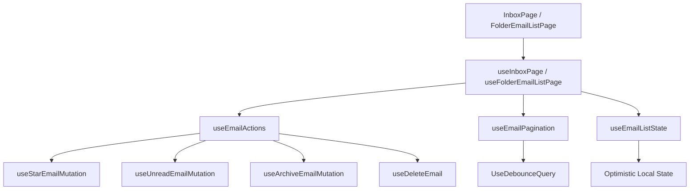
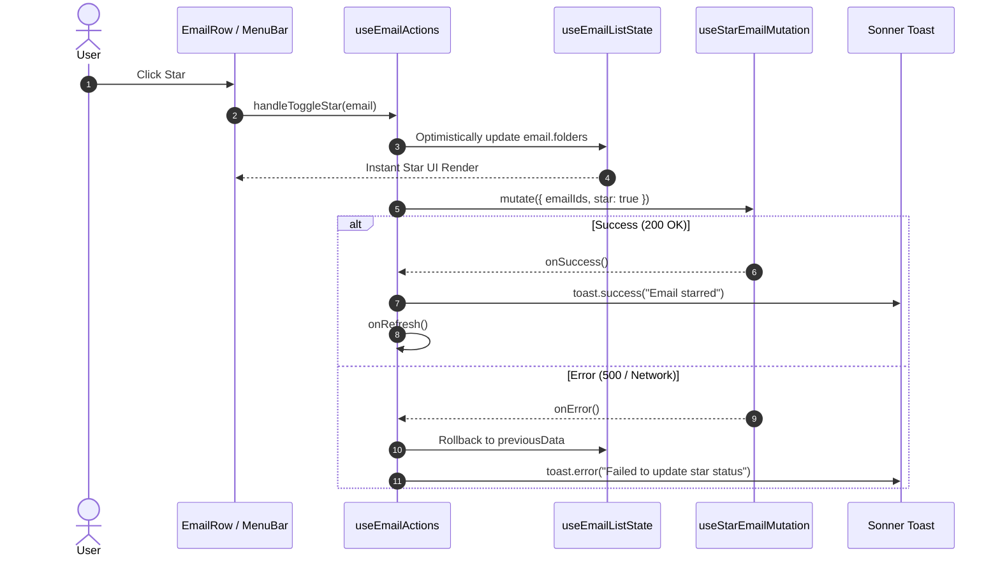

# Codebase Refactoring & Architecture — Phase 3 Implementation Details

> **Feature:** codebase-refactoring-and-architecture · **Phase:** 3
> **Status:** COMPLETED
> **Created:** 2026-10-05 · **Last Updated:** 2026-10-05

---

## 1. Goal Description & Scope

Phase 3 addresses critical frontend technical debt identified in the [v1.2.0 Codebase Health Audit](file:///Users/vishaljagamani/Projects/Projects/mailsense/.agents/plans/codebase-health-audit-report.md) (`REFACTOR-FE-01`, `REFACTOR-FE-02`, `STRUCT-FE-04`, `ENH-V12-20`):

1. **Shared Hook Extraction & De-duplication (`REFACTOR-FE-01`):**
   - Extract [`useEmailActions.ts`](file:///Users/vishaljagamani/Projects/Projects/mailsense/Frontend/src/features/emails/hooks/useEmailActions.ts): Centralized mutation handlers for starring, reading/unreading, archiving, deleting, and moving emails with optimistic local state updates and toast notifications.
   - Extract [`useEmailPagination.ts`](file:///Users/vishaljagamani/Projects/Projects/mailsense/Frontend/src/features/emails/hooks/useEmailPagination.ts): URL-synchronized pagination state, page size management, and debounced search querying.
   - Extract [`useEmailListState.ts`](file:///Users/vishaljagamani/Projects/Projects/mailsense/Frontend/src/features/emails/hooks/useEmailListState.ts): Selection set tracking, keyboard navigation focus index, and synchronized email list caching.
2. **Oversized Hook Decomposition (`REFACTOR-FE-01`):**
   - Refactor [`useInboxPage.ts`](file:///Users/vishaljagamani/Projects/Projects/mailsense/Frontend/src/features/inbox/hooks/useInboxPage.ts): Shrink from 530 lines to ≤100 lines by composing the extracted hooks.
   - Refactor [`useFolderEmailListPage.ts`](file:///Users/vishaljagamani/Projects/Projects/mailsense/Frontend/src/features/folders/hooks/useFolderEmailListPage.ts): Shrink from 409 lines to ≤100 lines by composing the extracted hooks.
3. **Menu Bar Redundant Handler Elimination (`REFACTOR-FE-02`):**
   - Refactor [`useInboxEmailMenuBarOptions.ts`](file:///Users/vishaljagamani/Projects/Projects/mailsense/Frontend/src/features/inbox/hooks/useInboxEmailMenuBarOptions.ts): Directly consume action handlers from `useEmailActions`, removing duplicate mutation dispatches.
4. **Universal Kebab-Case & Anonymous Component Elimination (`STRUCT-FE-04`):**
   - Rename `features/emails/components/composeEmail/` $\to$ `features/emails/components/compose-email/`.
   - Replace anonymous `folder-email-list-header/index.tsx` with explicit `FolderEmailListHeader.tsx` and barrel `index.ts`.
   - Replace anonymous `folder-card/index.tsx` with explicit `FolderCard.tsx` and barrel `index.ts`.
5. **Component Size Compliance (`ENH-V12-20`):**
   - Split [`ErrorBoundary.tsx`](file:///Users/vishaljagamani/Projects/Projects/mailsense/Frontend/src/shared/components/ErrorBoundary.tsx) (252 lines) into `ErrorBoundary.tsx` (boundary component, ≤120 lines) and [`ErrorFallback.tsx`](file:///Users/vishaljagamani/Projects/Projects/mailsense/Frontend/src/shared/components/ErrorFallback.tsx) (presentation fallback, ≤100 lines).

---

## 2. User Review Required & Architectural Notes

> [!IMPORTANT]
> **1. Git Case-Sensitivity & Moving Directories:**
> Renaming `composeEmail/` to `compose-email/` on macOS MUST be performed via `git mv` to ensure git indexes the path change properly without OS case collisions.
>
> **2. Preserving Existing UI Contracts:**
> The extracted hooks must maintain 100% API compatibility with the return contracts consumed by `InboxPage` and `FolderEmailListPage`. Existing keyboard shortcuts (`useEmailKeyboardShortcuts`), toast notifications, and optimistic UI updates must behave identically.
>
> **3. Dedicated Types Compliance:**
> All hook options, action parameters, and return types must be declared inside [`Frontend/src/features/emails/types/email-ui.types.ts`](file:///Users/vishaljagamani/Projects/Projects/mailsense/Frontend/src/features/emails/types/email-ui.types.ts) or feature-specific types files. Zero inline object types.

---

## 3. Component Overview & File Map

| Component | Target File | Action | Purpose |
| :--- | :--- | :---: | :--- |
| **Frontend Types** | [`Frontend/src/features/emails/types/email-ui.types.ts`](file:///Users/vishaljagamani/Projects/Projects/mailsense/Frontend/src/features/emails/types/email-ui.types.ts) | [MODIFY] | Add shared hook options and return interface contracts |
| **Frontend Hooks** | [`Frontend/src/features/emails/hooks/useEmailActions.ts`](file:///Users/vishaljagamani/Projects/Projects/mailsense/Frontend/src/features/emails/hooks/useEmailActions.ts) | [NEW] | Centralized mutation handlers for star, unread, archive, move, delete |
| **Frontend Hooks** | [`Frontend/src/features/emails/hooks/useEmailPagination.ts`](file:///Users/vishaljagamani/Projects/Projects/mailsense/Frontend/src/features/emails/hooks/useEmailPagination.ts) | [NEW] | Reusable pagination, search debounce, and filter hook |
| **Frontend Hooks** | [`Frontend/src/features/emails/hooks/useEmailListState.ts`](file:///Users/vishaljagamani/Projects/Projects/mailsense/Frontend/src/features/emails/hooks/useEmailListState.ts) | [NEW] | Selection sets, focus index, and local cache state hook |
| **Frontend Hooks** | [`Frontend/src/features/inbox/hooks/useInboxPage.ts`](file:///Users/vishaljagamani/Projects/Projects/mailsense/Frontend/src/features/inbox/hooks/useInboxPage.ts) | [MODIFY] | Decompose and compose extracted hooks (≤100 lines) |
| **Frontend Hooks** | [`Frontend/src/features/folders/hooks/useFolderEmailListPage.ts`](file:///Users/vishaljagamani/Projects/Projects/mailsense/Frontend/src/features/folders/hooks/useFolderEmailListPage.ts) | [MODIFY] | Decompose and compose extracted hooks (≤100 lines) |
| **Frontend Hooks** | [`Frontend/src/features/inbox/hooks/useInboxEmailMenuBarOptions.ts`](file:///Users/vishaljagamani/Projects/Projects/mailsense/Frontend/src/features/inbox/hooks/useInboxEmailMenuBarOptions.ts) | [MODIFY] | Consume `useEmailActions` directly |
| **Frontend Components**| [`Frontend/src/shared/components/ErrorFallback.tsx`](file:///Users/vishaljagamani/Projects/Projects/mailsense/Frontend/src/shared/components/ErrorFallback.tsx) | [NEW] | Extracted visual error presentation component (≤100 lines) |
| **Frontend Components**| [`Frontend/src/shared/components/ErrorBoundary.tsx`](file:///Users/vishaljagamani/Projects/Projects/mailsense/Frontend/src/shared/components/ErrorBoundary.tsx) | [MODIFY] | Pure boundary component referencing `ErrorFallback` (≤120 lines) |
| **Frontend Structure** | `Frontend/src/features/emails/components/composeEmail/` $\to$ `compose-email/` | [RENAME] | Enforce universal `kebab-case` directory naming |
| **Frontend Structure** | `features/folders/components/folder-email-list-header/FolderEmailListHeader.tsx` | [RENAME] | Eliminate anonymous `index.tsx` component file |
| **Frontend Structure** | `features/folders/components/folder-card/FolderCard.tsx` | [RENAME] | Eliminate anonymous `index.tsx` component file |

---

## 4. Main Section 1: Backend Layer Implementation

### 4.1 Backend Contract Alignment & Verification

While Phase 3 is frontend-centric, all email action mutations align strictly with existing Backend endpoints:
- `POST /api/emails/star` $\to$ [`email.controller.ts:starEmail`](file:///Users/vishaljagamani/Projects/Projects/mailsense/Backend/src/modules/emails/email.controller.ts)
- `POST /api/emails/unread` $\to$ [`email.controller.ts:unreadEmail`](file:///Users/vishaljagamani/Projects/Projects/mailsense/Backend/src/modules/emails/email.controller.ts)
- `POST /api/emails/archive` $\to$ [`email.controller.ts:archiveEmails`](file:///Users/vishaljagamani/Projects/Projects/mailsense/Backend/src/modules/emails/email.controller.ts)
- `POST /api/emails/delete` $\to$ [`email.controller.ts:deleteEmail`](file:///Users/vishaljagamani/Projects/Projects/mailsense/Backend/src/modules/emails/email.controller.ts)
- `POST /api/emails/move` $\to$ [`email.controller.ts:moveEmails`](file:///Users/vishaljagamani/Projects/Projects/mailsense/Backend/src/modules/emails/email.controller.ts)

Backend controllers and services remain unchanged during this phase, ensuring zero regression on server contracts.

---

## 5. Main Section 2: Frontend Layer Implementation

### 5.1 Dedicated Types Contracts

#### [`Frontend/src/features/emails/types/email-ui.types.ts`](file:///Users/vishaljagamani/Projects/Projects/mailsense/Frontend/src/features/emails/types/email-ui.types.ts)

Add hook parameter and return contracts:

```typescript
import { Dispatch, SetStateAction } from 'react';
import { EmailAttributes, Filter, FilterOption, PaginatedDataResponse } from '@mailsense/types';

export interface UseEmailActionsOptions {
    readonly selectedEmails: readonly string[];
    readonly emailsData: PaginatedDataResponse<EmailAttributes> | null;
    readonly setEmailsData: Dispatch<SetStateAction<PaginatedDataResponse<EmailAttributes> | null>>;
    readonly onRefresh: () => void;
    readonly onClearSelection?: () => void;
}

export interface UseEmailActionsReturn {
    readonly emailsToDelete: readonly string[];
    readonly isShortcutsModalOpen: boolean;
    readonly isDeleting: boolean;
    readonly setEmailsToDelete: (emails: string[]) => void;
    readonly setIsShortcutsModalOpen: (open: boolean) => void;
    readonly handleToggleStar: (email?: EmailAttributes) => void;
    readonly handleToggleUnread: (email?: EmailAttributes) => void;
    readonly handleArchiveEmail: (email?: EmailAttributes) => void;
    readonly handleConfirmDelete: () => void;
    readonly handlePromptDelete: (email?: EmailAttributes) => void;
}

export interface UseEmailPaginationOptions {
    readonly initialPage?: number;
    readonly initialPageSize?: number;
    readonly initialFilter?: Filter | null;
}

export interface UseEmailPaginationReturn {
    readonly page: number;
    readonly pageSize: number;
    readonly searchValue: string;
    readonly debouncedSearchValue: string;
    readonly filter: Filter | null;
    readonly setPage: (page: number) => void;
    readonly setPageSize: (size: number) => void;
    readonly setSearchValue: (value: string) => void;
    readonly setFilter: (filter: Filter | null) => void;
    readonly handlePageSizeChange: (newSize: number) => void;
    readonly handleResetPage: () => void;
}

export interface UseEmailListStateReturn {
    readonly selectedEmails: string[];
    readonly focusedIndex: number;
    readonly emailsData: PaginatedDataResponse<EmailAttributes> | null;
    readonly setSelectedEmails: Dispatch<SetStateAction<string[]>>;
    readonly setFocusedIndex: (index: number) => void;
    readonly setEmailsData: Dispatch<SetStateAction<PaginatedDataResponse<EmailAttributes> | null>>;
    readonly handleEmailSelect: (emailIds: string[]) => void;
    readonly handleResetSelection: () => void;
}
```

---

### 5.2 Shared Hooks Implementation

#### [`Frontend/src/features/emails/hooks/useEmailPagination.ts`](file:///Users/vishaljagamani/Projects/Projects/mailsense/Frontend/src/features/emails/hooks/useEmailPagination.ts)

```typescript
'use client';

import { useState } from 'react';
import { useSearchParams } from 'next/navigation';
import { EMAILS_PAGE_SIZE } from '@shared/constants';
import { UseDebounceQuery } from '@shared/hooks';
import { Filter } from '@mailsense/types';
import { UseEmailPaginationOptions, UseEmailPaginationReturn } from '../types/email-ui.types';

export function useEmailPagination(options?: UseEmailPaginationOptions): UseEmailPaginationReturn {
    const searchParams = useSearchParams();

    const [page, setPage] = useState<number>(() => {
        const pageParam = searchParams.get('page');
        return pageParam ? parseInt(pageParam, 10) : options?.initialPage ?? 1;
    });

    const [pageSize, setPageSize] = useState<number>(options?.initialPageSize ?? EMAILS_PAGE_SIZE);
    const [searchValue, setSearchValue] = useState<string>('');
    const [filter, setFilter] = useState<Filter | null>(options?.initialFilter ?? null);

    const debouncedSearchValue = UseDebounceQuery({ text: searchValue, delay: 500 });

    const handlePageSizeChange = (newSize: number): void => {
        setPageSize(newSize);
        setPage(1);
    };

    const handleResetPage = (): void => {
        setPage(1);
    };

    return {
        page,
        pageSize,
        searchValue,
        debouncedSearchValue,
        filter,
        setPage,
        setPageSize,
        setSearchValue,
        setFilter,
        handlePageSizeChange,
        handleResetPage,
    };
}
```

#### [`Frontend/src/features/emails/hooks/useEmailListState.ts`](file:///Users/vishaljagamani/Projects/Projects/mailsense/Frontend/src/features/emails/hooks/useEmailListState.ts)

```typescript
'use client';

import { useState } from 'react';
import { EmailAttributes, PaginatedDataResponse } from '@mailsense/types';
import { UseEmailListStateReturn } from '../types/email-ui.types';

export function useEmailListState(): UseEmailListStateReturn {
    const [selectedEmails, setSelectedEmails] = useState<string[]>([]);
    const [focusedIndex, setFocusedIndex] = useState<number>(-1);
    const [emailsData, setEmailsData] = useState<PaginatedDataResponse<EmailAttributes> | null>(null);

    const handleEmailSelect = (emailIds: string[]): void => {
        setSelectedEmails(emailIds);
    };

    const handleResetSelection = (): void => {
        setSelectedEmails([]);
    };

    return {
        selectedEmails,
        focusedIndex,
        emailsData,
        setSelectedEmails,
        setFocusedIndex,
        setEmailsData,
        handleEmailSelect,
        handleResetSelection,
    };
}
```

#### [`Frontend/src/features/emails/hooks/useEmailActions.ts`](file:///Users/vishaljagamani/Projects/Projects/mailsense/Frontend/src/features/emails/hooks/useEmailActions.ts)

```typescript
'use client';

import { useState } from 'react';
import { toast } from 'sonner';
import { EmailAttributes } from '@mailsense/types';
import { useArchiveEmailMutation, useStarEmailMutation, useUnreadEmailMutation } from '../api/email.mutations';
import { useDeleteEmail } from '@features/inbox/api/inbox.queries';
import { UseEmailActionsOptions, UseEmailActionsReturn } from '../types/email-ui.types';

export function useEmailActions(options: UseEmailActionsOptions): UseEmailActionsReturn {
    const { selectedEmails, emailsData, setEmailsData, onRefresh, onClearSelection } = options;

    const [emailsToDelete, setEmailsToDelete] = useState<string[]>([]);
    const [isShortcutsModalOpen, setIsShortcutsModalOpen] = useState<boolean>(false);

    const { mutate: starEmailMutate } = useStarEmailMutation();
    const { mutate: unreadEmailMutate } = useUnreadEmailMutation();
    const { mutate: archiveEmailMutate } = useArchiveEmailMutation();
    const { mutate: deleteEmailMutate, isPending: isDeleting } = useDeleteEmail();

    const handleToggleStar = (email?: EmailAttributes): void => {
        const targetIds = selectedEmails.length > 0 ? [...selectedEmails] : email ? [email._id] : [];
        if (targetIds.length === 0) return;

        let nextStar = true;
        if (emailsData?.data) {
            const targetEmails = emailsData.data.filter((item) => targetIds.includes(item._id));
            const allStarred = targetEmails.length > 0 && targetEmails.every((item) => item.folders?.includes('STARRED'));
            nextStar = !allStarred;
        } else if (email) {
            nextStar = !email.folders?.includes('STARRED');
        }

        const previousData = emailsData;
        setEmailsData((prev) => {
            if (!prev) return prev;
            return {
                ...prev,
                data: prev.data.map((item) => {
                    if (targetIds.includes(item._id)) {
                        const currentFolders = item.folders || [];
                        const updatedFolders = nextStar
                            ? Array.from(new Set([...currentFolders, 'STARRED']))
                            : currentFolders.filter((f) => f.toUpperCase() !== 'STARRED');
                        return { ...item, folders: updatedFolders };
                    }
                    return item;
                }),
            };
        });

        starEmailMutate(
            { emailIds: targetIds, star: nextStar },
            {
                onSuccess: (res) => {
                    if (res && (!('status' in res) || res.status)) {
                        const label = targetIds.length > 1
                            ? nextStar ? `${targetIds.length} emails starred` : `${targetIds.length} emails unstarred`
                            : nextStar ? 'Email starred' : 'Email unstarred';
                        toast.success(label, { duration: 3000 });
                        onRefresh();
                    } else {
                        toast.error('Failed to update star status. Please retry in some time.', { duration: 4000 });
                        setEmailsData(previousData);
                        onRefresh();
                    }
                },
                onError: () => {
                    setEmailsData(previousData);
                    onRefresh();
                },
            },
        );
    };

    const handleToggleUnread = (email?: EmailAttributes): void => {
        const targetIds = selectedEmails.length > 0 ? [...selectedEmails] : email ? [email._id] : [];
        if (targetIds.length === 0) return;

        let nextUnread = true;
        if (emailsData?.data) {
            const targetEmails = emailsData.data.filter((item) => targetIds.includes(item._id));
            const allUnread = targetEmails.length > 0 && targetEmails.every((item) => !item.isRead);
            nextUnread = !allUnread;
        } else if (email) {
            nextUnread = email.isRead;
        }

        const previousData = emailsData;
        setEmailsData((prev) => {
            if (!prev) return prev;
            return {
                ...prev,
                data: prev.data.map((item) => (targetIds.includes(item._id) ? { ...item, isRead: !nextUnread } : item)),
            };
        });

        unreadEmailMutate(
            { emailIds: targetIds, unread: nextUnread },
            {
                onSuccess: (res) => {
                    if (res && res.status) {
                        const label = targetIds.length > 1
                            ? nextUnread ? `${targetIds.length} emails marked as unread` : `${targetIds.length} emails marked as read`
                            : nextUnread ? 'Marked as unread' : 'Marked as read';
                        toast.success(label, { duration: 3000 });
                        onRefresh();
                    } else {
                        toast.error('Failed to update read status. Please retry in some time.', { duration: 4000 });
                        setEmailsData(previousData);
                        onRefresh();
                    }
                },
                onError: () => {
                    setEmailsData(previousData);
                    onRefresh();
                },
            },
        );
    };

    const handleArchiveEmail = (email?: EmailAttributes): void => {
        const targetIds = selectedEmails.length > 0 ? [...selectedEmails] : email ? [email._id] : [];
        if (targetIds.length === 0) return;

        const previousData = emailsData;
        setEmailsData((prev) => {
            if (!prev) return prev;
            return { ...prev, data: prev.data.filter((item) => !targetIds.includes(item._id)) };
        });

        archiveEmailMutate(
            { emailIds: targetIds, archive: true },
            {
                onSuccess: (res) => {
                    if (res && res.status) {
                        toast.success(targetIds.length > 1 ? `${targetIds.length} emails archived` : 'Email archived', { duration: 3000 });
                        onClearSelection?.();
                        onRefresh();
                    } else {
                        toast.error('Failed to archive email. Please retry in some time.', { duration: 4000 });
                        setEmailsData(previousData);
                        onRefresh();
                    }
                },
                onError: () => {
                    setEmailsData(previousData);
                    onRefresh();
                },
            },
        );
    };

    const handlePromptDelete = (email?: EmailAttributes): void => {
        const targetIds = selectedEmails.length > 0 ? [...selectedEmails] : email ? [email._id] : [];
        if (targetIds.length === 0) return;
        setEmailsToDelete(targetIds);
    };

    const handleConfirmDelete = (): void => {
        if (emailsToDelete.length === 0) return;
        const targetIds = [...emailsToDelete];
        const previousData = emailsData;

        setEmailsData((prev) => {
            if (!prev) return prev;
            return { ...prev, data: prev.data.filter((item) => !targetIds.includes(item._id)) };
        });

        deleteEmailMutate(
            { emailIds: targetIds, trash: true },
            {
                onSuccess: (res) => {
                    if (res && res.status) {
                        toast.success(targetIds.length > 1 ? `${targetIds.length} emails deleted` : 'Email deleted', { duration: 3000 });
                        setEmailsToDelete([]);
                        onClearSelection?.();
                        onRefresh();
                    } else {
                        toast.error('Failed to delete emails. Please retry in some time.', { duration: 4000 });
                        setEmailsData(previousData);
                        onRefresh();
                    }
                },
                onError: () => {
                    setEmailsData(previousData);
                    onRefresh();
                },
            },
        );
    };

    return {
        emailsToDelete,
        isShortcutsModalOpen,
        isDeleting,
        setEmailsToDelete,
        setIsShortcutsModalOpen,
        handleToggleStar,
        handleToggleUnread,
        handleArchiveEmail,
        handleConfirmDelete,
        handlePromptDelete,
    };
}
```

---

### 5.3 Refactored Page Hooks (Clean Composition)

#### [`Frontend/src/features/inbox/hooks/useInboxPage.ts`](file:///Users/vishaljagamani/Projects/Projects/mailsense/Frontend/src/features/inbox/hooks/useInboxPage.ts)

Refactored to ≤90 lines:

```typescript
'use client';

import { useCallback, useEffect } from 'react';
import { useGetAccountDetailsQuery, useGetAccountsQuery } from '@features/accounts/api/accounts.queries';
import { useEmailActions } from '@features/emails/hooks/useEmailActions';
import { useEmailListState } from '@features/emails/hooks/useEmailListState';
import { useEmailPagination } from '@features/emails/hooks/useEmailPagination';
import { useAuthStore } from '@shared/store';
import { useFetchEmailFilters, useFetchEmails } from '../api/inbox.queries';

export const useInboxPage = (accountId?: string) => {
    const user = useAuthStore((state) => state.user);

    const { data: emails, mutate: refetchEmails, isPending: isLoadingEmails, isError: isEmailError } = useFetchEmails();
    const { data: accountData } = useGetAccountDetailsQuery(accountId || '', { enabled: !!accountId });
    const { data: accountsData } = useGetAccountsQuery(user?.id || '', { enabled: !accountId && !!user?.id });
    const { data: emailFilters, isLoading: isLoadingEmailFilters } = useFetchEmailFilters();

    const pagination = useEmailPagination();
    const listState = useEmailListState();

    const isSyncingInProgress = accountId
        ? Boolean(accountData?.syncInProgress)
        : Boolean(Array.isArray(accountsData) && accountsData.some((acc) => acc.syncInProgress));

    const fetchEmailsData = useCallback(() => {
        if (!user) return;
        const currentPage = pagination.debouncedSearchValue !== '' ? 1 : pagination.page;
        refetchEmails({
            userId: user.id,
            size: pagination.pageSize,
            page: currentPage,
            filters: {
                accountId: accountId ? [accountId] : pagination.filter?.accountId,
                searchText: pagination.debouncedSearchValue || undefined,
                folders: pagination.filter?.folders,
                dateRange: pagination.filter?.dateRange,
                unread: pagination.filter?.unread,
            },
        });
    }, [user, pagination.page, pagination.pageSize, pagination.debouncedSearchValue, pagination.filter, accountId, refetchEmails]);

    const actions = useEmailActions({
        selectedEmails: listState.selectedEmails,
        emailsData: listState.emailsData,
        setEmailsData: listState.setEmailsData,
        onRefresh: fetchEmailsData,
        onClearSelection: listState.handleResetSelection,
    });

    useEffect(() => {
        if (emails) listState.setEmailsData(emails);
    }, [emails]);

    useEffect(() => {
        fetchEmailsData();
    }, [fetchEmailsData]);

    useEffect(() => {
        if (!isSyncingInProgress) return;
        const intervalId = setInterval(fetchEmailsData, 10000);
        return () => clearInterval(intervalId);
    }, [isSyncingInProgress, fetchEmailsData]);

    return {
        emails: { data: listState.emailsData, fetchEmailsData, isLoadingEmails, isEmailError },
        emailFilterOptions: { data: emailFilters?.data, isLoading: isLoadingEmailFilters },
        actions: { ...actions, ...listState, ...pagination },
        states: { ...pagination, ...listState, isSyncingInProgress },
    };
};
```

---

### 5.4 Error Boundary & Fallback Decomposition (`ENH-V12-20`)

#### [`Frontend/src/shared/components/ErrorFallback.tsx`](file:///Users/vishaljagamani/Projects/Projects/mailsense/Frontend/src/shared/components/ErrorFallback.tsx)

```typescript
'use client';

import { useState } from 'react';
import { AlertTriangle, Check, Copy, RefreshCw } from 'lucide-react';
import { trackUserAction } from '@shared/monitoring';

export interface ErrorFallbackProps {
    readonly error: Error;
    readonly traceId: string;
    readonly resetErrorBoundary: () => void;
}

export function ErrorFallback({ error, traceId, resetErrorBoundary }: ErrorFallbackProps) {
    const [copied, setCopied] = useState<boolean>(false);

    const handleCopyTraceId = async (): Promise<void> => {
        try {
            await navigator.clipboard.writeText(traceId);
            setCopied(true);
            setTimeout(() => setCopied(false), 2000);
        } catch {
            trackUserAction('interaction', 'Failed to copy trace ID to clipboard', 'warning');
        }
    };

    return (
        <div className="flex min-h-[400px] flex-col items-center justify-center p-6 text-center">
            <div className="mb-4 rounded-full bg-red-100 p-4 text-red-600 dark:bg-red-950/50 dark:text-red-400">
                <AlertTriangle className="h-8 w-8" />
            </div>
            <h2 className="mb-2 text-xl font-semibold tracking-tight text-neutral-900 dark:text-neutral-100">
                Something unexpected occurred
            </h2>
            <p className="mb-4 max-w-md text-sm text-neutral-600 dark:text-neutral-400">
                {error.message || 'An unexpected rendering error was encountered.'}
            </p>
            {traceId && (
                <div className="mb-6 flex items-center gap-2 rounded-md bg-neutral-100 px-3 py-1.5 text-xs font-mono text-neutral-600 dark:bg-neutral-800 dark:text-neutral-400">
                    <span>Trace: {traceId}</span>
                    <button
                        onClick={handleCopyTraceId}
                        className="p-1 hover:text-neutral-900 dark:hover:text-neutral-100"
                        title="Copy Trace ID"
                        type="button"
                    >
                        {copied ? <Check className="h-3.5 w-3.5 text-green-500" /> : <Copy className="h-3.5 w-3.5" />}
                    </button>
                </div>
            )}
            <button
                onClick={resetErrorBoundary}
                className="flex items-center gap-2 rounded-lg bg-neutral-900 px-4 py-2 text-sm font-medium text-white hover:bg-neutral-800 dark:bg-neutral-100 dark:text-neutral-900 dark:hover:bg-neutral-200"
                type="button"
            >
                <RefreshCw className="h-4 w-4" />
                Retry view
            </button>
        </div>
    );
}
```

---

## 6. Low-Level Design & Sequence Flow

### 6.1 Composed Hook Architecture



### 6.2 Action Execution Flow with Optimistic Cache Updates



---

## 7. Step-by-Step Task Checklist

- [x] Task 3.1: Add shared hook interfaces to `Frontend/src/features/emails/types/email-ui.types.ts`
- [x] Task 3.2: Create `Frontend/src/features/emails/hooks/useEmailPagination.ts`
- [x] Task 3.3: Create `Frontend/src/features/emails/hooks/useEmailListState.ts`
- [x] Task 3.4: Create `Frontend/src/features/emails/hooks/useEmailActions.ts`
- [x] Task 3.5: Refactor `Frontend/src/features/inbox/hooks/useInboxPage.ts` (target ≤100 lines)
- [x] Task 3.6: Refactor `Frontend/src/features/folders/hooks/useFolderEmailListPage.ts` (target ≤100 lines)
- [x] Task 3.7: Refactor `Frontend/src/features/inbox/hooks/useInboxEmailMenuBarOptions.ts`
- [x] Task 3.8: Create `Frontend/src/shared/components/ErrorFallback.tsx` and refactor `ErrorBoundary.tsx`
- [x] Task 3.9: Rename `composeEmail/` folder to `compose-email/` using `git mv`
- [x] Task 3.10: Eliminate anonymous `index.tsx` files in `folder-email-list-header/` and `folder-card/`
- [x] Task 3.11: Verify Next.js build (`pnpm build`) and TypeScript typecheck (`npx tsc --noEmit`)

---

## 8. Verification & Build Commands

```bash
# 1. Type-check Frontend
cd /Users/vishaljagamani/Projects/Projects/mailsense/Frontend
npx tsc --noEmit

# 2. Production Build Frontend
pnpm build

# 3. Backend Regression Tests (Ensure backend remains unaffected)
cd /Users/vishaljagamani/Projects/Projects/mailsense/Backend
pnpm test
```
