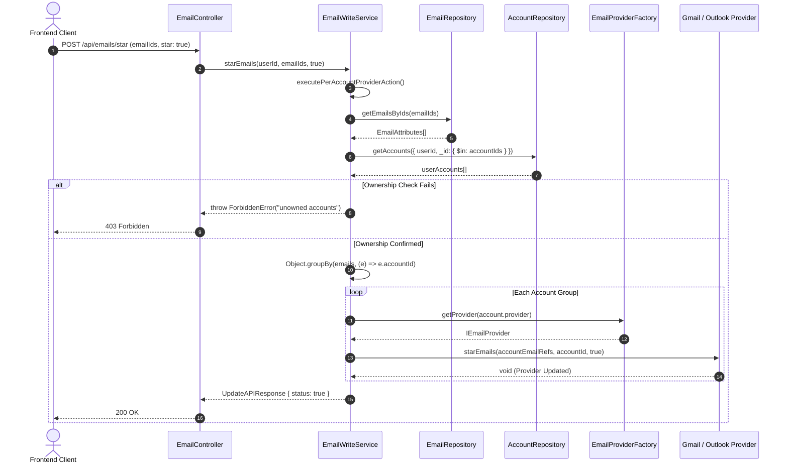

# Codebase Refactoring & Architecture — Phase 4 Implementation Details

> **Feature:** codebase-refactoring-and-architecture · **Phase:** 4
> **Status:** COMPLETED
> **Created:** 2026-10-05 · **Last Updated:** 2026-10-14

---

## 1. Goal Description & Scope

Phase 4 targets backend service architectural hardening, eliminating extensive code duplication, removing unnecessary class instantiations, and decomposing monolithic integration clients identified during the [v1.2.0 Codebase Health Audit](file:///Users/vishaljagamani/Projects/Projects/mailsense/.agents/plans/codebase-health-audit-report.md) (`REFACTOR-BE-01`, `REFACTOR-BE-02`, `REFACTOR-BE-03`, `ENH-V12-11`, `ENH-V12-12`, `ENH-V12-14`):

1. **DRY Per-Account Batch Processing (`REFACTOR-BE-02`):**
   - Extract a centralized private helper `executePerAccountProviderAction()` in [`Backend/src/modules/emails/email-write.service.ts`](file:///Users/vishaljagamani/Projects/Projects/mailsense/Backend/src/modules/emails/email-write.service.ts).
   - Refactor `deleteEmail`, `archiveEmails`, `starEmails`, `unreadEmails`, and `moveEmails` to route through this pipeline.
   - Enforce uniform multi-tenant ownership validation across accounts and eliminate ~120 lines of repeated boilerplate.

2. **Modular OAuth Service Decomposition (`REFACTOR-BE-01`):**
   - Extract OAuth consent generation, token exchange, and account provisioning logic from [`Backend/src/modules/accounts/account.service.ts`](file:///Users/vishaljagamani/Projects/Projects/mailsense/Backend/src/modules/accounts/account.service.ts) into a dedicated [`Backend/src/modules/accounts/account-oauth.service.ts`](file:///Users/vishaljagamani/Projects/Projects/mailsense/Backend/src/modules/accounts/account-oauth.service.ts).
   - Decompose `AccountsService` to focus strictly on account query and settings mutation responsibilities (target ≤180 lines).

3. **Dead Constructor Elimination (`ENH-V12-14`):**
   - Remove redundant empty constructors `constructor() {}` in [`account.service.ts`](file:///Users/vishaljagamani/Projects/Projects/mailsense/Backend/src/modules/accounts/account.service.ts) and [`folder.service.ts`](file:///Users/vishaljagamani/Projects/Projects/mailsense/Backend/src/modules/folders/folder.service.ts).

4. **Stateless API Wrapper Standardization (`REFACTOR-BE-03`):**
   - Unify [`OutlookApi`](file:///Users/vishaljagamani/Projects/Projects/mailsense/Backend/src/integrations/outlook/outlook.client.ts) to use `static async` stateless methods matching [`GmailApi`](file:///Users/vishaljagamani/Projects/Projects/mailsense/Backend/src/integrations/gmail/gmail.client.ts).
   - Eliminate unnecessary `new OutlookApi()` instantiation in `OutlookService`.

5. **Integration Client Decomposition (`ENH-V12-11`, `ENH-V12-12`):**
   - Decompose [`Backend/src/integrations/outlook/outlook.client.ts`](file:///Users/vishaljagamani/Projects/Projects/mailsense/Backend/src/integrations/outlook/outlook.client.ts) (651 lines $\to$ each client ≤250 lines):
     - `clients/outlook-auth.client.ts`: OAuth exchange, token refresh, and user profile retrieval.
     - `clients/outlook-mail.client.ts`: Message queries, batch actions, delta synchronization, drafts, and attachments.
     - `clients/outlook-folder.client.ts`: Folder trees, folder delta changes, and contact search.
     - `clients/index.ts`: Unified static facade and modular exports.
   - Decompose [`Backend/src/integrations/gmail/gmail.client.ts`](file:///Users/vishaljagamani/Projects/Projects/mailsense/Backend/src/integrations/gmail/gmail.client.ts) (506 lines $\to$ each client ≤250 lines):
     - `clients/gmail-auth.client.ts`: OAuth consent token exchange, refresh tokens, and profile loading.
     - `clients/gmail-mail.client.ts`: Message batch fetching, modifications, sending, and history extraction.
     - `clients/gmail-contacts.client.ts`: Labels and contact directory queries.
     - `clients/index.ts`: Unified static facade and modular exports.

---

## 2. User Review Required & Architectural Notes

> [!IMPORTANT]
> **1. Multi-Tenant Batch Security Preservation:**
> The `executePerAccountProviderAction()` helper MUST strictly maintain the multi-tenant ownership barrier:
> - Fetch all email documents by ID.
> - Verify all emails belong to accounts owned by `userId` (i.e. `userAccounts.length === accountIds.length`).
> - If any email belongs to an account not owned by the user, immediately abort with `ForbiddenError`.
>
> **2. Backward Compatibility for Integration Clients:**
> The decomposed client classes will be re-exported via `OutlookApi` and `GmailApi` barrel facades (`clients/index.ts`). Existing consumers (`GmailService`, `OutlookService`, `SchedulerService`) can transition seamlessly without breaking interfaces or call-sites.
>
> **3. Strict Type Safety (Zero Inline Types):**
> All helper parameters, batch action callbacks, and OAuth service parameters MUST use named interfaces from `@mailsense/types` or module interface files (`PerAccountActionContext`, `ProcessAccountTokensParams`, etc.).

---

## 3. Component Overview & File Map

| Component | Target File | Action | Purpose |
| :--- | :--- | :---: | :--- |
| **Backend Emails** | [`Backend/src/modules/emails/email-write.service.ts`](file:///Users/vishaljagamani/Projects/Projects/mailsense/Backend/src/modules/emails/email-write.service.ts) | [MODIFY] | Add `executePerAccountProviderAction` and simplify batch action methods |
| **Backend Accounts** | [`Backend/src/modules/accounts/account-oauth.service.ts`](file:///Users/vishaljagamani/Projects/Projects/mailsense/Backend/src/modules/accounts/account-oauth.service.ts) | [NEW] | Specialized OAuth callback and token handling service |
| **Backend Accounts** | [`Backend/src/modules/accounts/account.service.ts`](file:///Users/vishaljagamani/Projects/Projects/mailsense/Backend/src/modules/accounts/account.service.ts) | [MODIFY] | Delegate OAuth to `AccountOAuthService`, remove dead constructor |
| **Backend Folders** | [`Backend/src/modules/folders/folder.service.ts`](file:///Users/vishaljagamani/Projects/Projects/mailsense/Backend/src/modules/folders/folder.service.ts) | [MODIFY] | Remove empty constructor |
| **Backend Outlook** | `Backend/src/integrations/outlook/clients/outlook-auth.client.ts` | [NEW] | Outlook OAuth token & profile client (≤200 lines) |
| **Backend Outlook** | `Backend/src/integrations/outlook/clients/outlook-mail.client.ts` | [NEW] | Outlook messages, delta sync, send & batch client (≤250 lines) |
| **Backend Outlook** | `Backend/src/integrations/outlook/clients/outlook-folder.client.ts` | [NEW] | Outlook folders and contacts client (≤200 lines) |
| **Backend Outlook** | `Backend/src/integrations/outlook/clients/index.ts` | [NEW] | Barrel export & static `OutlookApi` facade |
| **Backend Outlook** | [`Backend/src/integrations/outlook/outlook.service.ts`](file:///Users/vishaljagamani/Projects/Projects/mailsense/Backend/src/integrations/outlook/outlook.service.ts) | [MODIFY] | Update to static `OutlookApi` calls, remove instance allocation |
| **Backend Gmail** | `Backend/src/integrations/gmail/clients/gmail-auth.client.ts` | [NEW] | Gmail OAuth token & profile client (≤200 lines) |
| **Backend Gmail** | `Backend/src/integrations/gmail/clients/gmail-mail.client.ts` | [NEW] | Gmail messages, history, send & batch client (≤250 lines) |
| **Backend Gmail** | `Backend/src/integrations/gmail/clients/gmail-contacts.client.ts` | [NEW] | Gmail labels and contacts client (≤150 lines) |
| **Backend Gmail** | `Backend/src/integrations/gmail/clients/index.ts` | [NEW] | Barrel export & static `GmailApi` facade |

---

## 4. Main Section 1: Backend Layer Implementation

### 4.1 Helper Layer: `EmailWriteService.executePerAccountProviderAction`

In [`Backend/src/modules/emails/email-write.service.ts`](file:///Users/vishaljagamani/Projects/Projects/mailsense/Backend/src/modules/emails/email-write.service.ts), implement the centralized per-account processor:

```typescript
import { ACCOUNT_PROVIDER, EmailAttributes, PerAccountActionContext, UpdateAPIResponse } from '@mailsense/types';
import { ForbiddenError, NotFoundError } from '@errors';
import { AccountRepository } from '@modules/accounts/account.repository.js';
import { EmailRepository } from './email.repository.js';
import { EmailProviderFactory } from '@integrations/email/email.provider.factory.js';
import { EMAIL_LIST_DB_FIELD_MAPPING } from './email.constants.js';
import { IEmailProvider } from '@integrations/email/email.provider.interface.js';

export class EmailWriteService {
    // ...
    
    /**
     * Centralized pipeline to group target emails by account, verify ownership,
     * and execute provider operations with uniform boundary logging and error handling.
     */
    private async executePerAccountProviderAction(
        userId: string,
        emailIds: readonly string[],
        actionDescription: string,
        action: (context: PerAccountActionContext, provider: IEmailProvider) => Promise<void>,
    ): Promise<UpdateAPIResponse> {
        try {
            const emailList = await EmailRepository.getEmailsByIds(
                [...emailIds],
                EMAIL_LIST_DB_FIELD_MAPPING.LIST.projection,
            );
            if (!emailList.length) {
                throw new NotFoundError('Emails', emailIds.join(', '));
            }

            const accountIds = Array.from(new Set(emailList.map((email) => email.accountId)));
            const userAccounts = await AccountRepository.getAccounts({
                userId,
                _id: { $in: accountIds },
            });

            if (userAccounts.length !== accountIds.length) {
                throw new ForbiddenError(`Unauthorized attempt to ${actionDescription} emails from unowned accounts`);
            }

            const groupedEmails = Object.groupBy(emailList, (item) => item.accountId);

            for (const [accountId, emails] of Object.entries(groupedEmails)) {
                const account = userAccounts.find((acc) => String(acc._id) === accountId);
                if (!account || !emails) continue;

                const provider = EmailProviderFactory.getProvider(account.provider as ACCOUNT_PROVIDER);
                await action({ accountId, emails }, provider);
            }

            return {
                status: true,
                message: `Emails ${actionDescription} successfully`,
            };
        } catch (err) {
            const errorMessage = err instanceof Error ? err.message : String(err);
            logger.error(`Error in EmailWriteService.${actionDescription}: ${errorMessage}`, { error: err });
            throw err;
        }
    }
}
```

Refactored methods inside `EmailWriteService`:

```typescript
    public async starEmails(userId: string, emailIds: string[], star: boolean): Promise<UpdateAPIResponse> {
        return this.executePerAccountProviderAction(userId, emailIds, star ? 'star' : 'unstar', async (ctx, provider) => {
            const emailRefs = ctx.emails.map((email) => ({
                id: String(email._id),
                providerMessageId: email.providerMessageId,
            }));
            await provider.starEmails(emailRefs, ctx.accountId, star);
        });
    }

    public async unreadEmails(userId: string, emailIds: string[], unread: boolean): Promise<UpdateAPIResponse> {
        return this.executePerAccountProviderAction(userId, emailIds, unread ? 'mark unread' : 'mark read', async (ctx, provider) => {
            const providerMessageIds = ctx.emails.map((email) => email.providerMessageId);
            await provider.unreadEmails(providerMessageIds, ctx.accountId, unread);
        });
    }

    public async archiveEmails(userId: string, emailIds: string[], archive: boolean): Promise<UpdateAPIResponse> {
        return this.executePerAccountProviderAction(userId, emailIds, 'archive', async (ctx, provider) => {
            const providerMessageIds = ctx.emails.map((email) => email.providerMessageId);
            await provider.archiveEmails(providerMessageIds, ctx.accountId, archive);
        });
    }

    public async deleteEmail(userId: string, emailIds: string[], trash: boolean): Promise<UpdateAPIResponse> {
        return this.executePerAccountProviderAction(userId, emailIds, 'delete', async (ctx, provider) => {
            const providerMessageIds = ctx.emails.map((email) => email.providerMessageId);
            await provider.deleteEmails(providerMessageIds, ctx.accountId, trash);
        });
    }

    public async moveEmails(
        userId: string,
        emailIds: string[],
        targetFolderIds: string[],
        removeFolderIds?: string[],
    ): Promise<UpdateAPIResponse> {
        return this.executePerAccountProviderAction(userId, emailIds, 'move', async (ctx, provider) => {
            const emailRefs = ctx.emails.map((email) => ({
                id: String(email._id),
                providerMessageId: email.providerMessageId,
            }));
            await provider.moveEmails(emailRefs, ctx.accountId, targetFolderIds, removeFolderIds);
        });
    }
```

---

### 4.2 Dedicated Service: `AccountOAuthService`

Create [`Backend/src/modules/accounts/account-oauth.service.ts`](file:///Users/vishaljagamani/Projects/Projects/mailsense/Backend/src/modules/accounts/account-oauth.service.ts):

```typescript
import { LOGGER_MODULE } from '@constants';
import { BadRequestError, ConflictError } from '@errors';
import * as GmailUtils from '@integrations/gmail/gmail.utils.js';
import * as OutlookUtils from '@integrations/outlook/outlook.utils.js';
import { ACCOUNT_PROVIDER } from '@mailsense/types';
import { SchedulerService } from '@modules/scheduler/scheduler.service.js';
import { createLogger } from '@observability';
import { GmailService } from '@integrations/gmail/gmail.service.js';
import { OutlookService } from '@integrations/outlook/outlook.service.js';
import { AccountRepository } from './account.repository.js';
import { AccountDocument, AccountInput } from './account.model.js';
import { OAuthCallbackResult, ProcessAccountTokensParams } from './account.interface.js';

const logger = createLogger(LOGGER_MODULE.ACCOUNT_SERVICE);

export class AccountOAuthService {
    private readonly gmailService: GmailService;
    private readonly outlookService: OutlookService;

    constructor() {
        this.gmailService = new GmailService();
        this.outlookService = new OutlookService();
    }

    public async connect(provider: string): Promise<{ readonly url: string }> {
        try {
            if (provider === ACCOUNT_PROVIDER.GMAIL) {
                const url = await GmailUtils.buildGmailOAuthConsentURL();
                return { url };
            } else if (provider === ACCOUNT_PROVIDER.OUTLOOK) {
                const url = await OutlookUtils.buildOutlookOAuthConsentURL();
                return { url };
            }
            throw new BadRequestError('Invalid provider');
        } catch (err) {
            const errorMessage = err instanceof Error ? err.message : String(err);
            logger.error(`Error in AccountOAuthService.connect: ${errorMessage}`, { error: err });
            throw err;
        }
    }

    public async handleCallback(provider: string, code: string, userId: string): Promise<OAuthCallbackResult> {
        try {
            if (provider === ACCOUNT_PROVIDER.GMAIL) {
                return await this.handleGmailCallback(code, userId);
            } else if (provider === ACCOUNT_PROVIDER.OUTLOOK) {
                return await this.handleOutlookCallback(code, userId);
            }
            throw new BadRequestError('Invalid provider');
        } catch (err) {
            const errorMessage = err instanceof Error ? err.message : String(err);
            logger.error(`Error in AccountOAuthService.handleCallback: ${errorMessage}`, { error: err });
            throw err;
        }
    }

    private async handleGmailCallback(code: string, userId: string): Promise<OAuthCallbackResult> {
        const tokens = await this.gmailService.getAccessTokenFromCode(code);
        const profile = await this.gmailService.getUserProfile(tokens.access_token);
        return this.processAccountTokens({
            userId,
            provider: ACCOUNT_PROVIDER.GMAIL,
            emailAddress: profile.emailAddress,
            accessToken: tokens.access_token,
            refreshToken: tokens.refresh_token,
            expiryDate: tokens.expiry_date,
        });
    }

    private async handleOutlookCallback(code: string, userId: string): Promise<OAuthCallbackResult> {
        const tokens = await this.outlookService.getAccessTokenFromCode(code);
        const profile = await this.outlookService.getUserProfile(tokens.access_token);
        const expiryDate = Date.now() + tokens.expires_in * 1000;
        return this.processAccountTokens({
            userId,
            provider: ACCOUNT_PROVIDER.OUTLOOK,
            emailAddress: profile.mail || profile.userPrincipalName,
            accessToken: tokens.access_token,
            refreshToken: tokens.refresh_token,
            expiryDate,
        });
    }

    private async processAccountTokens(params: ProcessAccountTokensParams): Promise<OAuthCallbackResult> {
        const { userId, provider, emailAddress, accessToken, refreshToken, expiryDate } = params;
        const existingAccount = await AccountRepository.getAccountByEmail(emailAddress);

        if (existingAccount) {
            if (existingAccount.userId.toString() !== userId.toString()) {
                throw new ConflictError('Account is already registered with another user');
            }
            await AccountRepository.updateAccountTokens(existingAccount._id.toString(), {
                accessToken,
                refreshToken,
                accessTokenExpiry: expiryDate,
            });
            return { accountId: existingAccount._id.toString(), isNew: false };
        }

        const account = await AccountRepository.createAccount({
            userId,
            provider,
            emailAddress,
            accessToken,
            refreshToken,
            accessTokenExpiry: expiryDate,
            syncEnabled: true,
        });

        await SchedulerService.scheduleAccountRepeatableJob(account._id.toString(), account.syncFrequency);
        return { accountId: account._id.toString(), isNew: true };
    }
}

export const accountOAuthService = new AccountOAuthService();
```

---

### 4.3 Modular Integration Clients

#### 4.3.1 Outlook Client Decomposition (`Backend/src/integrations/outlook/clients/`)

Group Outlook API methods into domain-focused static classes:

- **`outlook-auth.client.ts` (≤200 lines):**
  - `getAccessTokenFromCode(code: string)`
  - `refreshAccessToken(refreshToken: string)`
  - `getUserProfile(accessToken: string)`

- **`outlook-mail.client.ts` (≤250 lines):**
  - `getMessages(accessToken: string, params: GetMessagesParams)`
  - `getDeltaMessages(accessToken: string, deltaLink?: string)`
  - `sendMail(accessToken: string, payload: SendMailPayload)`
  - `starEmails(...)`, `unreadEmails(...)`, `deleteEmails(...)`, `moveEmails(...)`
  - `getAttachmentStream(accessToken: string, messageId: string, attachmentId: string)`

- **`outlook-folder.client.ts` (≤200 lines):**
  - `getMailFolders(accessToken: string)`
  - `getDeltaMailFolders(accessToken: string, deltaLink?: string)`
  - `createMailFolder(accessToken: string, displayName: string)`
  - `searchOtherContacts(accessToken: string, query: string)`

- **`index.ts`:**
  Re-exports `OutlookAuthClient`, `OutlookMailClient`, `OutlookFolderClient`, and provides the static `OutlookApi` facade:

```typescript
import { OutlookAuthClient } from './outlook-auth.client.js';
import { OutlookFolderClient } from './outlook-folder.client.js';
import { OutlookMailClient } from './outlook-mail.client.js';

export class OutlookApi {
    public static readonly getAccessTokenFromCode = OutlookAuthClient.getAccessTokenFromCode;
    public static readonly refreshAccessToken = OutlookAuthClient.refreshAccessToken;
    public static readonly getUserProfile = OutlookAuthClient.getUserProfile;

    public static readonly getMessages = OutlookMailClient.getMessages;
    public static readonly getDeltaMessages = OutlookMailClient.getDeltaMessages;
    public static readonly sendMail = OutlookMailClient.sendMail;
    public static readonly starEmails = OutlookMailClient.starEmails;
    public static readonly unreadEmails = OutlookMailClient.unreadEmails;
    public static readonly deleteEmails = OutlookMailClient.deleteEmails;
    public static readonly moveEmails = OutlookMailClient.moveEmails;
    public static readonly getAttachmentStream = OutlookMailClient.getAttachmentStream;

    public static readonly getMailFolders = OutlookFolderClient.getMailFolders;
    public static readonly getDeltaMailFolders = OutlookFolderClient.getDeltaMailFolders;
    public static readonly createMailFolder = OutlookFolderClient.createMailFolder;
    public static readonly searchOtherContacts = OutlookFolderClient.searchOtherContacts;
}

export { OutlookAuthClient, OutlookMailClient, OutlookFolderClient };
```

#### 4.3.2 Gmail Client Decomposition (`Backend/src/integrations/gmail/clients/`)

Group Gmail API methods into domain-focused static classes:

- **`gmail-auth.client.ts` (≤200 lines):**
  - `getAccessTokenFromCode(code: string)`
  - `refreshAccessToken(refreshToken: string)`
  - `getUserProfile(accessToken: string)`

- **`gmail-mail.client.ts` (≤250 lines):**
  - `getMessages(accessToken: string, params: GmailQueryParams)`
  - `getMessage(accessToken: string, messageId: string)`
  - `batchModifyMessages(accessToken: string, payload: GmailBatchModifyPayload)`
  - `sendMail(accessToken: string, payload: GmailSendMailPayload)`
  - `getHistoryList(accessToken: string, startHistoryId: string)`
  - `getAttachmentStream(accessToken: string, messageId: string, attachmentId: string)`

- **`gmail-contacts.client.ts` (≤150 lines):**
  - `getLabels(accessToken: string)`
  - `createLabel(accessToken: string, labelName: string)`
  - `searchOtherContacts(accessToken: string, query: string)`

- **`index.ts`:**
  Re-exports `GmailAuthClient`, `GmailMailClient`, `GmailContactsClient`, and provides the static `GmailApi` facade.

---

## 5. Main Section 2: Frontend Layer Implementation

> [!NOTE]
> Phase 4 is an exclusive **Backend Architectural & Engineering Refactoring Phase**. No frontend component, page, or hook logic is altered. All frontend-to-backend REST API contracts remain 100% backward-compatible.

---

## 6. Low-Level Design & Sequence Flow



---

## 7. Step-by-Step Task Checklist

- [x] Task 4.1: Implement `executePerAccountProviderAction()` private helper in `Backend/src/modules/emails/email-write.service.ts`
- [x] Task 4.2: Refactor `starEmails`, `unreadEmails`, `archiveEmails`, `deleteEmail`, and `moveEmails` to use the DRY pipeline
- [x] Task 4.3: Create `Backend/src/modules/accounts/account-oauth.service.ts` and delegate OAuth flows from `AccountsService`
- [x] Task 4.4: Remove empty constructors from `account.service.ts` and `folder.service.ts`
- [x] Task 4.5: Decompose `Backend/src/integrations/outlook/outlook.client.ts` into `clients/` (`outlook-auth.client.ts`, `outlook-mail.client.ts`, `outlook-folder.client.ts`, `outlook-attachment.client.ts`, `index.ts`)
- [x] Task 4.6: Update `OutlookService` to call `OutlookApi` statically and remove `this.outlookApi = new OutlookApi()`
- [x] Task 4.7: Decompose `Backend/src/integrations/gmail/gmail.client.ts` into `clients/` (`gmail-auth.client.ts`, `gmail-mail.client.ts`, `gmail-contacts.client.ts`, `gmail-attachment.client.ts`, `index.ts`)
- [x] Task 4.8: Verify full backend test suite (`pnpm test`) — all tests must run on Jest with 100% pass rate
- [x] Task 4.9: Verify backend compilation (`pnpm build`)

---

## 8. Verification & Build Commands

```bash
# 1. Run full backend unit tests (strictly Jest)
cd /Users/vishaljagamani/Projects/Projects/mailsense/Backend
pnpm test

# 2. Build backend TypeScript bundle
pnpm build

# 3. Verify Frontend still compiles cleanly against backend contracts
cd /Users/vishaljagamani/Projects/Projects/mailsense/Frontend
npx tsc --noEmit
```
