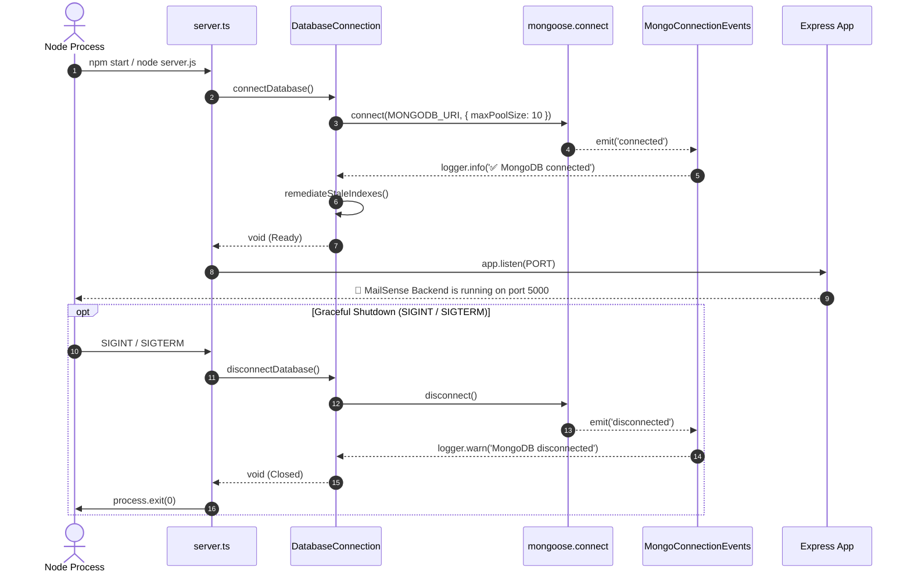

# Codebase Refactoring & Architecture — Phase 5 Implementation Details

> **Feature:** codebase-refactoring-and-architecture · **Phase:** 5
> **Status:** READY FOR IMPLEMENTATION
> **Created:** 2026-10-14 · **Last Updated:** 2026-10-15

---

## 1. Goal Description & Scope

Phase 5 represents the final structural consolidation phase of the **v1.2.0 Deep Structural & Refactoring Health Audit** ([v1.2.0 Audit Report](file:///Users/vishaljagamani/Projects/Projects/mailsense/.agents/plans/codebase-health-audit-report.md)). It establishes enterprise architectural boundaries, enforces modular subdirectory organization with barrel exports across core modules, extracts infrastructure connection lifecycles, and installs automated ESLint quality guardrails (`STRUCT-BE-01`, `STRUCT-BE-02`, `STRUCT-BE-05`, `STRUCT-BE-06`, `ENH-V12-16`, `ENH-V12-17`):

1. **Database Connection Lifecycle Extraction (`STRUCT-BE-02`):**
   - Extract connection setup, connection pooling, event listeners (`connected`, `error`, `disconnected`), stale index remediation, and health checks from [`server.ts`](file:///Users/vishaljagamani/Projects/Projects/mailsense/Backend/src/server.ts) and [`db.config.ts`](file:///Users/vishaljagamani/Projects/Projects/mailsense/Backend/src/core/config/db.config.ts) into a dedicated singleton class [`DatabaseConnection`](file:///Users/vishaljagamani/Projects/Projects/mailsense/Backend/src/core/database/connection.ts) in `core/database/`.
   - Provide structured lifecycle hooks `connectDatabase()`, `disconnectDatabase()`, and `getDatabaseState()`.

2. **Core Middlewares Relocation (`STRUCT-BE-01`):**
   - Relocate [`Backend/src/middlewares/`](file:///Users/vishaljagamani/Projects/Projects/mailsense/Backend/src/middlewares) to [`Backend/src/core/middlewares/`](file:///Users/vishaljagamani/Projects/Projects/mailsense/Backend/src/core/middlewares) to unify all cross-cutting infrastructure concerns under `src/core/`.
   - Update `@middlewares` path mapping in `tsconfig.json` and `jest.config.js` to point to `src/core/middlewares/index.ts`.

3. **Backend Module Subdirectory Standardization with Barrel Exports (`STRUCT-BE-05`):**
   - Restructure `Backend/src/modules/emails/` and `Backend/src/modules/accounts/` from flat folders into standardized categorized subdirectories adhering strictly to [Coding Standards Rule 5.5](file:///Users/vishaljagamani/Projects/Projects/mailsense/.agents/rules/coding-standards.md):
     - `controllers/` + `index.ts`
     - `services/` + `index.ts`
     - `repositories/` + `index.ts`
     - `models/` + `index.ts`
     - `schemas/` + `index.ts`
     - `interfaces/` (or `types/`) + `index.ts`
     - `routes/` + `index.ts`
   - Provide barrel re-exports (`index.ts`) at module and subdirectory roots so existing consumers remain completely decoupled from internal decompositions.

4. **Integration Services Standardization (`STRUCT-BE-06`):**
   - Organize Gmail and Outlook integrations into standard `clients/` and `services/` subdirectories with barrel exports (`index.ts`).

5. **Automated ESLint Guardrails Enforcement (`ENH-V12-16`, `ENH-V12-17`):**
   - Configure [`Backend/eslint.config.mjs`](file:///Users/vishaljagamani/Projects/Projects/mailsense/Backend/eslint.config.mjs) with strict engineering rules: `max-lines: 300`, `max-lines-per-function: 50`, `max-params: 6`, `max-depth: 4`, `complexity: 10`, `no-console: "error"`, and AST selectors prohibiting inline object types, `unknown`, `never`, and empty catch blocks.
   - Configure [`Frontend/eslint.config.mjs`](file:///Users/vishaljagamani/Projects/Projects/mailsense/Frontend/eslint.config.mjs) with component limits (`max-lines: 200`), hook limits (`max-lines: 120`), `no-console: ["error", { allow: ["warn"] }]`, and AST selectors forbidding inline types.

---

## 2. User Review Required & Architectural Notes

> [!IMPORTANT]
> **Zero Breaking Changes via Barrel Exports & Path Aliases:**
> - Relocating `src/middlewares/` to `src/core/middlewares/` preserves all existing imports using the `@middlewares` path alias by updating `tsconfig.json` and `jest.config.js`.
> - Re-exporting decomposed subdirectories through `modules/emails/index.ts` and `modules/accounts/index.ts` ensures backward compatibility for external consumers across routes and workers.
> - Git tracking must use case-sensitive git moves for all file renames to guarantee cross-platform compatibility on Linux CI/CD pipelines.

---

## 3. Component Overview & File Map

| Component | Target File | Action | Purpose |
|---|---|---|---|
| **Backend Core** | `Backend/src/core/database/connection.ts` | [NEW] | Encapsulated MongoDB connection lifecycle & health monitoring |
| **Backend Core** | `Backend/src/core/database/index.ts` | [NEW] | Barrel export for database connection manager |
| **Backend Core** | `Backend/src/core/middlewares/auth.ts` | [MOVE] | Relocate JWT authentication middleware to `core/middlewares/` |
| **Backend Core** | `Backend/src/core/middlewares/error.handler.ts` | [MOVE] | Relocate global Express error handling middleware |
| **Backend Core** | `Backend/src/core/middlewares/validator.ts` | [MOVE] | Relocate Zod schema validation middleware wrapper |
| **Backend Core** | `Backend/src/core/middlewares/index.ts` | [NEW] | Central barrel export for core middlewares |
| **Backend Core** | `Backend/src/server.ts` | [MODIFY] | Delegate DB lifecycle to `DatabaseConnection` |
| **Backend Core** | `Backend/src/core/config/index.ts` | [MODIFY] | Re-export database lifecycle from `core/database/` |
| **Backend Emails** | `Backend/src/modules/emails/controllers/` | [NEW] | Subdirectory for `email.controller.ts` + `index.ts` |
| **Backend Emails** | `Backend/src/modules/emails/services/` | [NEW] | Subdirectory for `email.service.ts`, `email-read.service.ts`, `email-write.service.ts` + `index.ts` |
| **Backend Emails** | `Backend/src/modules/emails/repositories/` | [NEW] | Subdirectory for `email.repository.ts` + `index.ts` |
| **Backend Emails** | `Backend/src/modules/emails/models/` | [NEW] | Subdirectory for `email.model.ts` + `index.ts` |
| **Backend Emails** | `Backend/src/modules/emails/schemas/` | [NEW] | Subdirectory for `email.schema.ts` + `index.ts` |
| **Backend Emails** | `Backend/src/modules/emails/interfaces/` | [NEW] | Subdirectory for `email.types.ts` + `index.ts` |
| **Backend Emails** | `Backend/src/modules/emails/routes/` | [NEW] | Subdirectory for `email.routes.ts` + `index.ts` |
| **Backend Emails** | `Backend/src/modules/emails/index.ts` | [NEW] | Module barrel export encapsulating internal subdirectories |
| **Backend Accounts** | `Backend/src/modules/accounts/controllers/` | [NEW] | Subdirectory for `account.controller.ts` + `index.ts` |
| **Backend Accounts** | `Backend/src/modules/accounts/services/` | [NEW] | Subdirectory for `account.service.ts`, `account-oauth.service.ts` + `index.ts` |
| **Backend Accounts** | `Backend/src/modules/accounts/repositories/` | [NEW] | Subdirectory for `account.repository.ts`, `sync-job.repository.ts` + `index.ts` |
| **Backend Accounts** | `Backend/src/modules/accounts/models/` | [NEW] | Subdirectory for `account.model.ts`, `sync-job.model.ts` + `index.ts` |
| **Backend Accounts** | `Backend/src/modules/accounts/schemas/` | [NEW] | Subdirectory for `account.schema.ts` + `index.ts` |
| **Backend Accounts** | `Backend/src/modules/accounts/interfaces/` | [NEW] | Subdirectory for `account.types.ts` + `index.ts` |
| **Backend Accounts** | `Backend/src/modules/accounts/routes/` | [NEW] | Subdirectory for `account.routes.ts` + `index.ts` |
| **Backend Accounts** | `Backend/src/modules/accounts/index.ts` | [NEW] | Module barrel export encapsulating internal subdirectories |
| **Backend Integrations** | `Backend/src/integrations/gmail/services/` | [NEW] | Subdirectory for `gmail.service.ts` + `index.ts` |
| **Backend Integrations** | `Backend/src/integrations/gmail/index.ts` | [NEW] | Central barrel export for Gmail integration clients & services |
| **Backend Integrations** | `Backend/src/integrations/outlook/services/` | [NEW] | Subdirectory for `outlook.service.ts` + `index.ts` |
| **Backend Integrations** | `Backend/src/integrations/outlook/index.ts` | [NEW] | Central barrel export for Outlook integration clients & services |
| **Backend Linter** | `Backend/eslint.config.mjs` | [MODIFY] | Add AST selectors for zero inline types, code size limits, complexity |
| **Frontend Linter** | `Frontend/eslint.config.mjs` | [MODIFY] | Add AST selectors for zero inline types, max lines, console guardrails |

---

## 4. Main Section 1: Backend Layer Implementation

### 4.1 Core Database Connection Manager (`Backend/src/core/database/connection.ts`)

```typescript
import mongoose, { ConnectionStates } from 'mongoose';
import { DATABASE, MONGODB_URI } from '@config';
import { LOGGER_MODULE } from '@constants';
import { createLogger } from '@observability';

const logger = createLogger(LOGGER_MODULE.DATABASE);

export interface DatabaseHealthStatus {
    connected: boolean;
    state: string;
    host: string;
    database: string;
    poolSize: number;
}

export class DatabaseConnection {
    private static instance: DatabaseConnection | null = null;
    private isInitialized = false;

    private constructor() {
        this.setupEventListeners();
    }

    public static getInstance(): DatabaseConnection {
        if (!DatabaseConnection.instance) {
            DatabaseConnection.instance = new DatabaseConnection();
        }
        return DatabaseConnection.instance;
    }

    private setupEventListeners(): void {
        mongoose.connection.on('connected', () => {
            logger.info('✅ MongoDB connection established');
        });

        mongoose.connection.on('error', (err: Error) => {
            logger.error(`❌ MongoDB connection error: ${err.message}`, { error: err });
        });

        mongoose.connection.on('disconnected', () => {
            logger.warn('⚠️ MongoDB connection lost. Disconnected.');
        });
    }

    public async connect(): Promise<void> {
        if (this.isInitialized && mongoose.connection.readyState === ConnectionStates.connected) {
            logger.info('MongoDB is already connected');
            return;
        }

        try {
            await mongoose.connect(MONGODB_URI, {
                dbName: DATABASE,
                maxPoolSize: 10,
                serverSelectionTimeoutMS: 5000,
            });
            this.isInitialized = true;
            await this.remediateStaleIndexes();
        } catch (err: unknown) {
            const errorMessage = err instanceof Error ? err.message : String(err);
            logger.error(`❌ Failed to connect to MongoDB: ${errorMessage}`, { error: err });
            throw err;
        }
    }

    public async disconnect(): Promise<void> {
        if (mongoose.connection.readyState !== ConnectionStates.disconnected) {
            await mongoose.disconnect();
            this.isInitialized = false;
            logger.info('🔌 MongoDB connection gracefully closed');
        }
    }

    public getHealthStatus(): DatabaseHealthStatus {
        const stateMap: Record<number, string> = {
            [ConnectionStates.disconnected]: 'disconnected',
            [ConnectionStates.connected]: 'connected',
            [ConnectionStates.connecting]: 'connecting',
            [ConnectionStates.disconnecting]: 'disconnecting',
        };

        return {
            connected: mongoose.connection.readyState === ConnectionStates.connected,
            state: stateMap[mongoose.connection.readyState] || 'unknown',
            host: mongoose.connection.host || 'unknown',
            database: mongoose.connection.name || DATABASE,
            poolSize: 10,
        };
    }

    private async remediateStaleIndexes(): Promise<void> {
        const db = mongoose.connection.db;
        if (!db) return;

        try {
            const collections = await db.listCollections({ name: 'accounts' }).toArray();
            if (collections.length > 0) {
                const accountsCollection = db.collection('accounts');
                const indexes = await accountsCollection.indexes();
                if (indexes.some((index) => index.name === 'id_1')) {
                    logger.info('🗑️ Dropping stale unique index "id_1" on accounts collection...');
                    await accountsCollection.dropIndex('id_1');
                    logger.info('✅ Stale index "id_1" dropped successfully');
                }
            }
        } catch (error: unknown) {
            const errorMessage = error instanceof Error ? error.message : String(error);
            logger.warn(`Failed during index remediation check: ${errorMessage}`, { error });
        }
    }
}

export const databaseConnection = DatabaseConnection.getInstance();
export const connectDatabase = (): Promise<void> => databaseConnection.connect();
export const disconnectDatabase = (): Promise<void> => databaseConnection.disconnect();
export const getDatabaseHealthStatus = (): DatabaseHealthStatus => databaseConnection.getHealthStatus();
```

Barrel export `Backend/src/core/database/index.ts`:

```typescript
export * from './connection.js';
```

---

### 4.2 Core Middlewares Relocation & Barrel Export (`Backend/src/core/middlewares/`)

Relocate existing files:
- `Backend/src/middlewares/auth.ts` $\to$ `Backend/src/core/middlewares/auth.ts`
- `Backend/src/middlewares/error.handler.ts` $\to$ `Backend/src/core/middlewares/error.handler.ts`
- `Backend/src/middlewares/validator.ts` $\to$ `Backend/src/core/middlewares/validator.ts`

Provide `Backend/src/core/middlewares/index.ts`:

```typescript
export * from './auth.js';
export * from './error.handler.js';
export * from './validator.js';
```

Update `Backend/tsconfig.json` paths mapping:

```json
{
  "compilerOptions": {
    "paths": {
      "@middlewares": ["./src/core/middlewares/index.ts"],
      "@core/middlewares/*": ["./src/core/middlewares/*"],
      "@core/database": ["./src/core/database/index.ts"]
    }
  }
}
```

Update `Backend/jest.config.js`:

```javascript
moduleNameMapper: {
    '^@middlewares$': '<rootDir>/src/core/middlewares/index.ts',
    '^@core/middlewares/(.*)$': '<rootDir>/src/core/middlewares/$1',
    '^@core/database$': '<rootDir>/src/core/database/index.ts',
}
```

---

### 4.3 Module Subdirectory Categorization & Barrel Exports

#### 4.3.1 Emails Module (`Backend/src/modules/emails/`)

Organize files into subdirectories:
- `controllers/`: `email.controller.ts` $\to$ `controllers/email.controller.ts` + `controllers/index.ts`
- `services/`: `email.service.ts`, `email-read.service.ts`, `email-write.service.ts` $\to$ `services/` + `services/index.ts`
- `repositories/`: `email.repository.ts` $\to$ `repositories/email.repository.ts` + `repositories/index.ts`
- `models/`: `email.model.ts` $\to$ `models/email.model.ts` + `models/index.ts`
- `schemas/`: `email.schema.ts` $\to$ `schemas/email.schema.ts` + `schemas/index.ts`
- `interfaces/`: `email.types.ts` $\to$ `interfaces/email.types.ts` + `interfaces/index.ts`
- `routes/`: `email.routes.ts` $\to$ `routes/email.routes.ts` + `routes/index.ts`

`Backend/src/modules/emails/index.ts`:

```typescript
export * from './controllers/index.js';
export * from './interfaces/index.js';
export * from './models/index.js';
export * from './repositories/index.js';
export * from './routes/index.js';
export * from './schemas/index.js';
export * from './services/index.js';
```

#### 4.3.2 Accounts Module (`Backend/src/modules/accounts/`)

Organize files into subdirectories:
- `controllers/`: `account.controller.ts` $\to$ `controllers/account.controller.ts` + `controllers/index.ts`
- `services/`: `account.service.ts`, `account-oauth.service.ts` $\to$ `services/` + `services/index.ts`
- `repositories/`: `account.repository.ts`, `sync-job.repository.ts` $\to$ `repositories/` + `repositories/index.ts`
- `models/`: `account.model.ts`, `sync-job.model.ts` $\to$ `models/` + `models/index.ts`
- `schemas/`: `account.schema.ts` $\to$ `schemas/account.schema.ts` + `schemas/index.ts`
- `interfaces/`: `account.types.ts` $\to$ `interfaces/account.types.ts` + `interfaces/index.ts`
- `routes/`: `account.routes.ts` $\to$ `routes/account.routes.ts` + `routes/index.ts`

`Backend/src/modules/accounts/index.ts`:

```typescript
export * from './controllers/index.js';
export * from './interfaces/index.js';
export * from './models/index.js';
export * from './repositories/index.js';
export * from './routes/index.js';
export * from './schemas/index.js';
export * from './services/index.js';
```

---

### 4.4 Automated ESLint Guardrails (`Backend/eslint.config.mjs`)

Update `Backend/eslint.config.mjs` to enforce strict structural limits and AST syntax prohibitions, while exempting dedicated types files (`*.types.ts`, `*.interface.ts`) and unit tests:

```javascript
import eslint from '@eslint/js';
import unusedImports from 'eslint-plugin-unused-imports';
import { defineConfig } from 'eslint/config';
import tseslint from 'typescript-eslint';

export default defineConfig(
    {
        ignores: ['dist/**', 'coverage/**', 'node_modules/**', '.pnpm-store/**'],
    },
    eslint.configs.recommended,
    ...tseslint.configs.recommended,
    {
        files: ['src/**/*.ts'],
        plugins: {
            'unused-imports': unusedImports,
        },
        rules: {
            semi: 'off',
            quotes: ['error', 'single', { allowTemplateLiterals: true }],
            'no-unused-vars': 'off',
            '@typescript-eslint/no-unused-vars': 'off',
            '@typescript-eslint/no-explicit-any': 'error',
            'unused-imports/no-unused-imports': 'error',
            'unused-imports/no-unused-vars': [
                'error',
                {
                    vars: 'all',
                    varsIgnorePattern: '^_',
                    args: 'after-used',
                    argsIgnorePattern: '^_',
                },
            ],
            // Code Size Guardrails
            'max-lines': ['warn', { max: 300, skipBlankLines: true, skipComments: true }],
            'max-lines-per-function': ['warn', { max: 50, skipBlankLines: true, skipComments: true }],
            'max-params': ['warn', { max: 6 }],
            'max-depth': ['warn', { max: 4 }],
            complexity: ['warn', { max: 10 }],
            'no-console': 'error',

            // Global AST Constraints: Explicit types, no unknown, no never, no empty catch
            'no-restricted-syntax': [
                'error',
                {
                    selector: "TSTypeReference[typeName.name='unknown']",
                    message: 'Use explicit TypeScript types, interfaces, or generics instead of unknown.',
                },
                {
                    selector: "TSTypeReference[typeName.name='never']",
                    message: 'The never type is forbidden unless used in exhaustive switch checks.',
                },
                {
                    selector: 'CatchClause[body.body.length=0]',
                    message: 'Empty catch blocks are strictly forbidden. Log or rethrow errors.',
                },
            ],
        },
    },
    // Non-types source files: Strictly prohibit inline object types
    {
        files: ['src/**/*.ts'],
        ignores: [
            'src/**/*.types.ts',
            'src/**/*.interface.ts',
            'src/**/*.d.ts',
            'src/**/__tests__/**',
            'src/**/__mocks__/**',
            'src/**/*.test.ts',
            'src/**/*.spec.ts',
        ],
        rules: {
            'no-restricted-syntax': [
                'error',
                {
                    selector: "TSTypeReference[typeName.name='unknown']",
                    message: 'Use explicit TypeScript types, interfaces, or generics instead of unknown.',
                },
                {
                    selector: "TSTypeReference[typeName.name='never']",
                    message: 'The never type is forbidden unless used in exhaustive switch checks.',
                },
                {
                    selector: 'CatchClause[body.body.length=0]',
                    message: 'Empty catch blocks are strictly forbidden. Log or rethrow errors.',
                },
                {
                    selector: 'TSTypeLiteral',
                    message: 'Inline object types are strictly forbidden. Define named interfaces in dedicated types files.',
                },
            ],
        },
    },
    // Unit tests overrides
    {
        files: [
            'src/**/__tests__/**/*.ts',
            'src/**/__mocks__/**/*.ts',
            'src/**/*.test.ts',
            'src/**/*.spec.ts',
        ],
        rules: {
            'max-lines': 'off',
            'max-lines-per-function': 'off',
            'max-params': 'off',
            'max-depth': 'off',
            complexity: 'off',
            'no-console': 'off',
            '@typescript-eslint/no-explicit-any': 'off',
            'no-restricted-syntax': 'off',
        },
    },
);
```

---

## 5. Main Section 2: Frontend Layer Implementation

### 5.1 Automated ESLint Guardrails (`Frontend/eslint.config.mjs`)

Update `Frontend/eslint.config.mjs` to incorporate size and typing guardrails matching health audit standards:

```javascript
import { dirname } from 'path';
import { fileURLToPath } from 'url';
import { FlatCompat } from '@eslint/eslintrc';

const __filename = fileURLToPath(import.meta.url);
const __dirname = dirname(__filename);

const compat = new FlatCompat({
    baseDirectory: __dirname,
});

const eslintConfig = [
    {
        ignores: ['node_modules/**', '.next/**', 'out/**', 'build/**', 'next-env.d.ts'],
    },
    ...compat.extends('next/core-web-vitals', 'next/typescript'),
    {
        files: ['src/**/*.{ts,tsx}'],
        rules: {
            '@typescript-eslint/no-explicit-any': 'error',
            'max-lines': ['warn', { max: 300, skipBlankLines: true, skipComments: true }],
            'max-lines-per-function': ['warn', { max: 50, skipBlankLines: true, skipComments: true }],
            'max-params': ['warn', { max: 6 }],
            'max-depth': ['warn', { max: 4 }],
            complexity: ['warn', { max: 10 }],
            'no-console': ['error', { allow: ['warn', 'error'] }],
            'react-hooks/rules-of-hooks': 'error',
            'react-hooks/exhaustive-deps': 'warn',
            'no-restricted-syntax': [
                'error',
                {
                    selector: "TSTypeReference[typeName.name='unknown']",
                    message: 'Use explicit TypeScript types, interfaces, or generics instead of unknown.',
                },
                {
                    selector: "TSTypeReference[typeName.name='never']",
                    message: 'The never type is forbidden unless used in exhaustive switch checks.',
                },
                {
                    selector: 'CatchClause[body.body.length=0]',
                    message: 'Empty catch blocks are strictly forbidden. Log or rethrow errors.',
                },
            ],
        },
    },
    // Non-types source files: Strictly prohibit inline object types
    {
        files: ['src/**/*.{ts,tsx}'],
        ignores: [
            'src/**/*.types.ts',
            'src/**/*.interface.ts',
            'src/**/*.d.ts',
            'src/**/__tests__/**',
            'src/**/__mocks__/**',
            'src/**/*.test.{ts,tsx}',
            'src/**/*.spec.{ts,tsx}',
        ],
        rules: {
            'no-restricted-syntax': [
                'error',
                {
                    selector: "TSTypeReference[typeName.name='unknown']",
                    message: 'Use explicit TypeScript types, interfaces, or generics instead of unknown.',
                },
                {
                    selector: "TSTypeReference[typeName.name='never']",
                    message: 'The never type is forbidden unless used in exhaustive switch checks.',
                },
                {
                    selector: 'CatchClause[body.body.length=0]',
                    message: 'Empty catch blocks are strictly forbidden. Log or rethrow errors.',
                },
                {
                    selector: 'TSTypeLiteral',
                    message: 'Inline object types are strictly forbidden. Define named interfaces in dedicated types files.',
                },
            ],
        },
    },
];

export default eslintConfig;
```

---

## 6. Low-Level Design & Sequence Flow



---

## 7. Step-by-Step Task Checklist

- [ ] Task 5.1: Create `Backend/src/core/database/connection.ts` and `Backend/src/core/database/index.ts`
- [ ] Task 5.2: Refactor `Backend/src/server.ts` to consume `connectDatabase()` and `disconnectDatabase()`
- [ ] Task 5.3: Move `Backend/src/middlewares/` to `Backend/src/core/middlewares/` and update `@middlewares` paths in `tsconfig.json` & `jest.config.js`
- [ ] Task 5.4: Reorganize `Backend/src/modules/emails/` into categorized subdirectories with barrel exports (`controllers/`, `services/`, `repositories/`, `models/`, `schemas/`, `interfaces/`, `routes/`, `index.ts`)
- [ ] Task 5.5: Reorganize `Backend/src/modules/accounts/` into categorized subdirectories with barrel exports (`controllers/`, `services/`, `repositories/`, `models/`, `schemas/`, `interfaces/`, `routes/`, `index.ts`)
- [ ] Task 5.6: Reorganize `Backend/src/integrations/gmail/` and `Backend/src/integrations/outlook/` with `services/` and module barrel exports (`index.ts`)
- [ ] Task 5.7: Update `Backend/eslint.config.mjs` with code-size limits and AST selectors for zero inline types
- [ ] Task 5.8: Update `Frontend/eslint.config.mjs` with size guardrails and AST selectors for zero inline types
- [ ] Task 5.9: Verify backend unit tests on Jest (`pnpm test`) — 100% pass rate
- [ ] Task 5.10: Verify backend compilation (`pnpm build`) and frontend compilation (`npx tsc --noEmit`)

---

## 8. Verification & Build Commands

```bash
# 1. Run full backend unit tests (strictly Jest)
cd /Users/vishaljagamani/Projects/Projects/mailsense/Backend
pnpm test

# 2. Build backend TypeScript bundle
pnpm build

# 3. Verify Frontend still compiles cleanly against backend contracts
cd /Users/vishaljagamani/Projects/Projects/mailsense/Frontend
npx tsc --noEmit

# 4. Run ESLint checks across Backend and Frontend
cd /Users/vishaljagamani/Projects/Projects/mailsense/Backend && pnpm lint
cd /Users/vishaljagamani/Projects/Projects/mailsense/Frontend && pnpm lint
```
