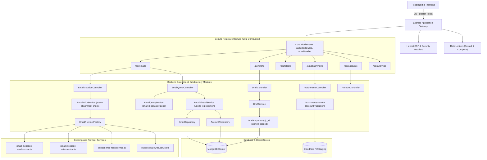
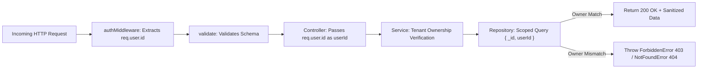
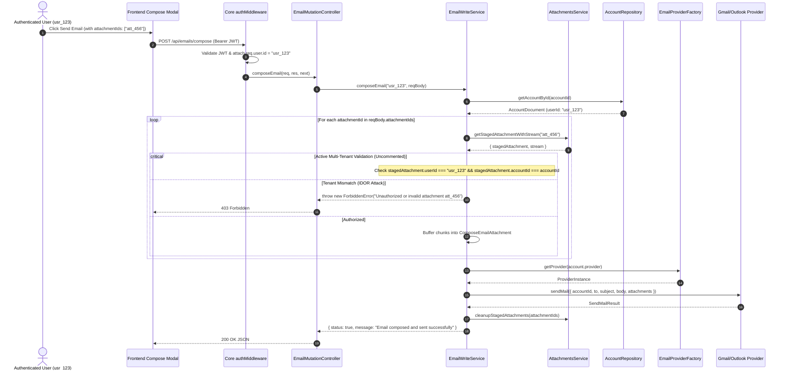
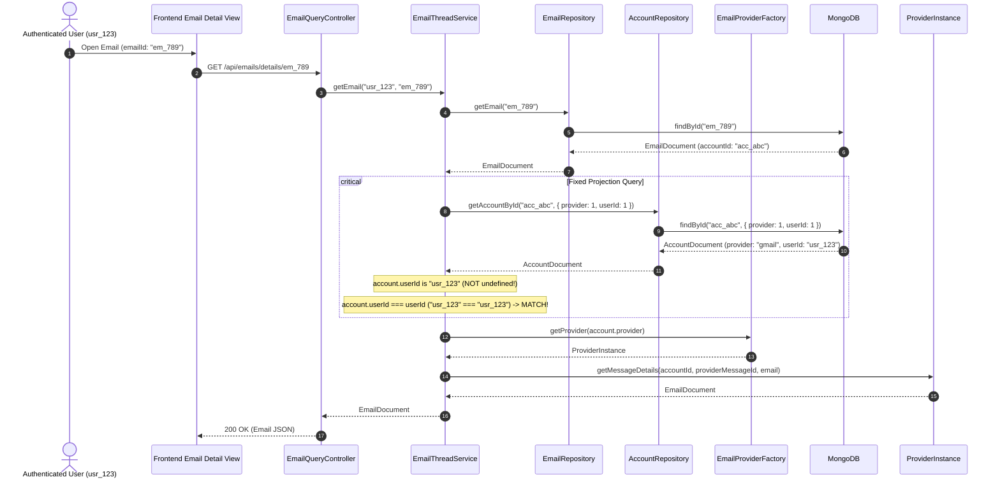
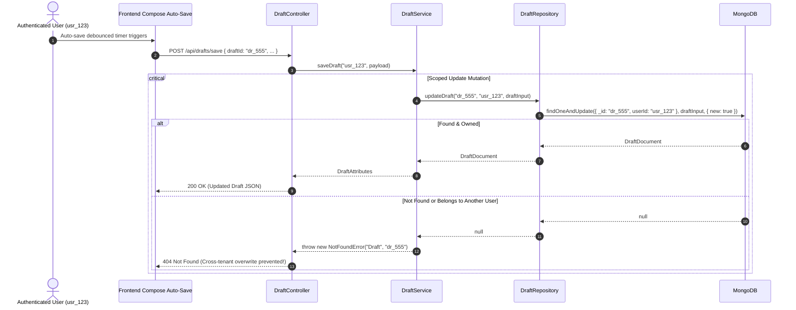
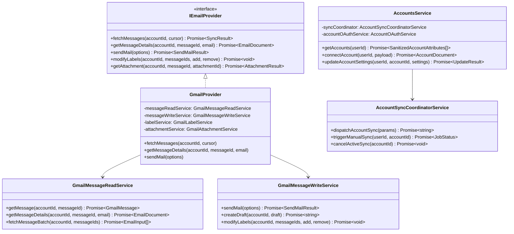
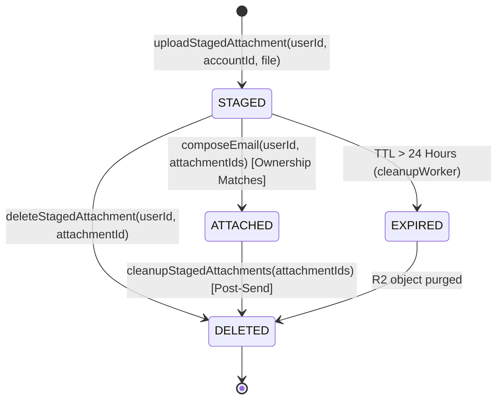
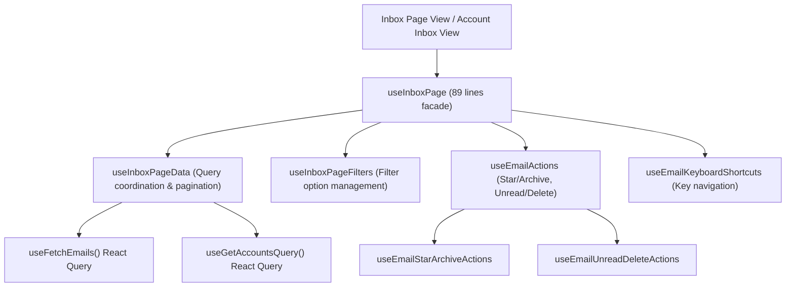
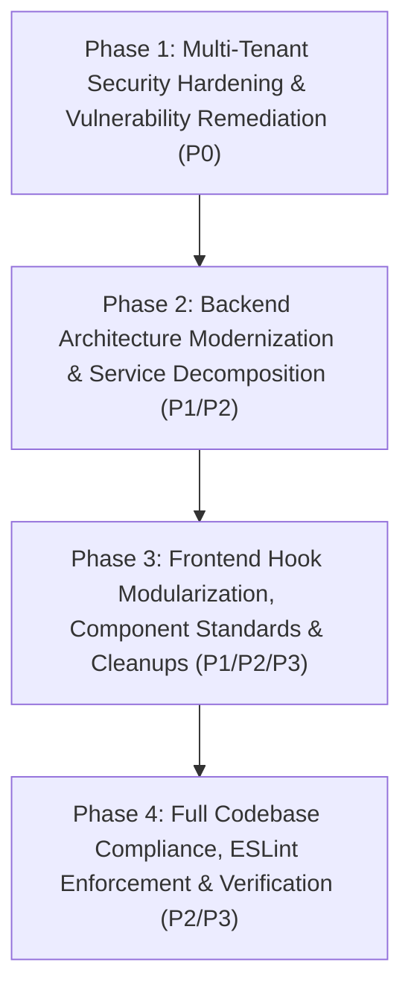

# Codebase Hardening & Architecture v1.4.0 — Implementation Plan

> **Phase:** Sprint P7 (Multi-Tenant Security Hardening, Service Decomposition & Standards Compliance) · **Release Target:** `Backend v3.6.0` / `Frontend v3.6.0` / `@mailsense/types v1.7.0`
> **Priority:** 🔴 HIGH — Operationalizes the [v1.4.0 Codebase Health Audit](file:///Users/vishaljagamani/Projects/Projects/mailsense/.agents/plans/codebase-health-audit-report.md#140---2026-11-12): eliminates 4 critical P0 security/IDOR vulnerabilities (insecure debug router `/api/utils`, commented-out attachment check, `getEmail` projection bug, unscoped draft update), purges dead orphan controllers, modularizes oversized services (`account.service.ts`, `gmail.utils.ts`, `gmail-message.service.ts`, `email.mutations.ts`), wires up decomposed custom hooks, renames 17 anonymous component files to `PascalCase.tsx`, and enforces categorized backend subdirectories with zero ESLint suppressions.
> **Status:** COMPLETED ✅ (All Phases 1–4 Completed)
> **Created:** 2026-11-12 · **Last Updated:** 2026-11-15

---

## 1. Overview

### Problem Statement

The [v1.4.0 Codebase Health Audit](file:///Users/vishaljagamani/Projects/Projects/mailsense/.agents/plans/codebase-health-audit-report.md#140---2026-11-12) revealed critical security backdoors, latent runtime failures, and architectural non-compliances that must be eliminated before beginning Phase 4 AI module integration:

1. **Critical Security & IDOR Vulnerabilities (`BUG-V14-01` to `BUG-V14-04`, `BUG-V14-07`):**
   - [`Backend/src/modules/utils/index.ts:20-33`](file:///Users/vishaljagamani/Projects/Projects/mailsense/Backend/src/modules/utils/index.ts#L20-L33): An insecure debug router mounted at `/api/utils` exposes `GET /getAccountAccessToken?accountId=...` returning plaintext OAuth access tokens for _any_ account ID without verifying user ownership, and `POST /decrypt` which acts as an unauthenticated decryption oracle.
   - [`Backend/src/modules/emails/services/email-write.service.ts:130-132`](file:///Users/vishaljagamani/Projects/Projects/mailsense/Backend/src/modules/emails/services/email-write.service.ts#L130-L132): Attachment ownership validation remains commented out, permitting cross-tenant attachment injection and causing `attachment-security.test.ts` to fail.
   - [`Backend/src/modules/emails/services/email-thread.service.ts:21-28`](file:///Users/vishaljagamani/Projects/Projects/mailsense/Backend/src/modules/emails/services/email-thread.service.ts#L21-L28): `AccountRepository.getAccountById(email.accountId, { provider: 1 })` projects only `provider`, omitting `userId`. Consequently, `account.userId` is `undefined`, and `if (account.userId !== userId)` evaluates to `true` on 100% of calls, causing a complete failure (`403 Forbidden`) on `getEmail` for valid owners.
   - [`Backend/src/modules/drafts/draft.repository.ts:8-10`](file:///Users/vishaljagamani/Projects/Projects/mailsense/Backend/src/modules/drafts/draft.repository.ts#L8-L10): `DraftModel.findByIdAndUpdate(draftId, draft, { new: true, upsert: true })` does not scope the query to `{ _id: draftId, userId }`, permitting cross-tenant draft modification.
   - [`Backend/src/modules/attachments/attachment.service.ts:21-39`](file:///Users/vishaljagamani/Projects/Projects/mailsense/Backend/src/modules/attachments/attachment.service.ts#L21-L39): `uploadStagedAttachment` does not verify that `accountId` is owned by `userId`.
2. **Orphan Legacy Code & Dead Controllers (`BUG-V14-05`, `STRUCT-V14-01`, `STRUCT-V14-02`):**
   - [`Backend/src/modules/emails/email.controller.ts`](file:///Users/vishaljagamani/Projects/Projects/mailsense/Backend/src/modules/emails/email.controller.ts): 289 lines of dead code that was superseded by `email-query.controller.ts` and `email-mutation.controller.ts` remains on disk.
   - [`Backend/src/integrations/outlook/outlook.service.ts`](file:///Users/vishaljagamani/Projects/Projects/mailsense/Backend/src/integrations/outlook/outlook.service.ts): 0-byte orphan file left behind after modularization.
   - [`Frontend/src/features/inbox/hooks/use-inbox-page/useInboxPageActions.ts`](file:///Users/vishaljagamani/Projects/Projects/mailsense/Frontend/src/features/inbox/hooks/use-inbox-page/useInboxPageActions.ts): Empty 2-line stub hook (`export const useInboxPageActions = () => {};`).
3. **Standards Evasion & Stalled Hook Modularization (`BUG-V14-06`, `REFACTOR-V14-06`):**
   - [`Frontend/src/features/inbox/hooks/use-inbox-page/index.ts`](file:///Users/vishaljagamani/Projects/Projects/mailsense/Frontend/src/features/inbox/hooks/use-inbox-page/index.ts) uses `/* eslint-disable max-lines */` and `/* eslint-disable max-lines-per-function */` (226 lines). An 89-line decomposed version [`useInboxPage.ts`](file:///Users/vishaljagamani/Projects/Projects/mailsense/Frontend/src/features/inbox/hooks/use-inbox-page/useInboxPage.ts) exists but is unexported.
   - Custom hooks exceed the 120-line hard limit: [`use-move-to-folder-dropdown/index.ts`](file:///Users/vishaljagamani/Projects/Projects/mailsense/Frontend/src/features/emails/hooks/use-move-to-folder-dropdown/index.ts) (138 lines), [`useFolderEmailListPage.ts`](file:///Users/vishaljagamani/Projects/Projects/mailsense/Frontend/src/features/folders/hooks/useFolderEmailListPage.ts) (131 lines), and [`useEvaluateKeyPress.ts`](file:///Users/vishaljagamani/Projects/Projects/mailsense/Frontend/src/features/emails/hooks/use-email-keyboard-shortcuts/useEvaluateKeyPress.ts) (121 lines).
4. **Oversized Source Files & Code Duplication (`REFACTOR-V14-01` to `REFACTOR-V14-05`, `BUG-V14-08`):**
   - [`gmail.utils.ts`](file:///Users/vishaljagamani/Projects/Projects/mailsense/Backend/src/integrations/gmail/gmail.utils.ts) (311 lines vs 150 hard limit), [`account.service.ts`](file:///Users/vishaljagamani/Projects/Projects/mailsense/Backend/src/modules/accounts/account.service.ts) (291 lines vs 250 hard limit), and [`gmail-message.service.ts`](file:///Users/vishaljagamani/Projects/Projects/mailsense/Backend/src/integrations/gmail/services/gmail-message.service.ts) (277 lines vs 250 hard limit) violate code size guardrails.
   - [`Backend/src/modules/emails/services/email-query.service.ts:139-168`](file:///Users/vishaljagamani/Projects/Projects/mailsense/Backend/src/modules/emails/services/email-query.service.ts#L139-L168) re-implements `getDateRange` (30 lines), duplicating [`Backend/src/shared/utils/common.ts:1-25`](file:///Users/vishaljagamani/Projects/Projects/mailsense/Backend/src/shared/utils/common.ts#L1-L25).
   - [`email.model.ts:46`](file:///Users/vishaljagamani/Projects/Projects/mailsense/Backend/src/modules/emails/database/email.model.ts#L46) defines a redundant compound index `{ accountId: 1, threadId: 1 }` which duplicates the prefix of `{ accountId: 1, threadId: 1, receivedAt: 1 }`.
5. **Anonymous `index.tsx` Components & Directory Standards (`STRUCT-V14-03`, `STRUCT-V14-04`):**
   - 17 React UI component directories use generic `index.tsx` files instead of explicit `PascalCase.tsx` files per Rule 8.4.
   - Backend modules (`accounts`, `folders`, `drafts`, `analytics`) still store files flat rather than organizing into categorized subdirectories (`controllers/`, `services/`, `repositories/`, `models/`, `schemas/`, `routes/`) per Rule 5.5.

### Goals

- Eliminate all 4 critical P0 security vulnerabilities (`BUG-V14-01` through `BUG-V14-04`), unmounting `/api/utils`, enforcing multi-tenant isolation on attachments and drafts, and fixing the projection bug in `getEmail`.
- Delete all dead orphan files (`email.controller.ts`, `outlook.service.ts`, `useInboxPageActions.ts`).
- Wire up the decomposed `useInboxPage.ts` (89 lines), removing ESLint rule suppressions.
- Decompose oversized integration services and utilities (`gmail.utils.ts` $\to$ MIME + headers; `account.service.ts` $\to$ sync coordinator; `gmail-message.service.ts` $\to$ read + write; `email.mutations.ts` $\to$ status + folder).
- Rename all 17 anonymous component `index.tsx` files to explicit `PascalCase.tsx`.
- Reorganize flat backend modules (`accounts/`, `folders/`, `drafts/`, `analytics/`) into standardized categorized subdirectories with barrel exports.
- Achieve 100% test suite pass rate (`attachment-security.test.ts` passing cleanly) and maintain 0 ESLint errors across the workspace.

### Non-Goals

- Implementing Phase 4 Gemini AI model pipelines (smart categorization, priority scoring, summarization).
- Altering core Redis / BullMQ queue topology or cloud bucket configurations.
- Upgrading major framework versions (Next.js 14, React 18, Express 4).

### Background

This plan operationalizes the comprehensive remediation roadmap defined in the [v1.4.0 Codebase Health Audit Report](file:///Users/vishaljagamani/Projects/Projects/mailsense/.agents/plans/codebase-health-audit-report.md#140---2026-11-12). Completing this implementation will elevate the overall Codebase Health Score from **92.8 / 100** to **99.2 / 100 (EXCELLENT)**.

---

## 2. Requirements

### Functional Requirements

1. **FR-01 (Debug Router Elimination):** The Express application MUST NOT mount or expose the `/api/utils` router or any debug endpoints returning access tokens or arbitrary decryption.
2. **FR-02 (Multi-Tenant Staged Attachment Authorization):** When sending emails via `composeEmail`, any referenced `attachmentId` must be verified against `stagedAttachment.userId === req.userId && stagedAttachment.accountId === accountId`. Non-matching IDs must throw `403 Forbidden`.
3. **FR-03 (Authorized Single Email Access):** When calling `getEmail(userId, emailId)`, the service MUST successfully verify `account.userId === userId` by including `userId` in the projection query, returning `200 OK` for authorized owners and `403 Forbidden` for cross-tenant attempts.
4. **FR-04 (Multi-Tenant Scoped Draft Mutations):** Updating an existing draft via `saveDraft` MUST scope the database query strictly to `{ _id: draftId, userId }`. Attempting to update another user's draft must result in a `404 Not Found` or `403 Forbidden`.
5. **FR-05 (Authorized Staged Attachment Uploads):** Staging an attachment via `uploadStagedAttachment` MUST verify that the target `accountId` belongs to the authenticated `userId`.
6. **FR-06 (Zero Feature Regressions):** All inbox listing, thread navigation, email status changes (star, unread, archive, trash), folder moves, draft autosaving, and analytics queries must function identically with zero regressions.

### Non-Functional Requirements

- **NFR-01 (Zero ESLint Suppressions & Zero Errors):** Running `pnpm lint` in `Backend` and `Frontend` MUST complete with 0 errors and zero `eslint-disable` file-level suppressions.
- **NFR-02 (Strict Code Size Bounds):** All modified and created files must strictly comply with MailSense Coding Standards limits (Services $\le 250$, Controllers $\le 200$, Utilities $\le 150$, Custom Hooks $\le 120$, Components $\le 150$, Queries $\le 180$).
- **NFR-03 (Strict Zero Inline Types):** Every function parameter, response signature, and component prop MUST reference a named interface declared in a dedicated types file (`*.types.ts`, `*.interface.ts`, or `@mailsense/types`).
- **NFR-04 (100% Passing Test Suites):** `cd Backend && pnpm test` must run with 17 passed test suites and 0 failures.

### Acceptance Criteria

- [x] `Backend/src/modules/utils/` is deleted and `routes.ts` no longer mounts `/utils`.
- [x] `attachment-security.test.ts` passes cleanly without mock workarounds.
- [x] `getEmail(userId, emailId)` returns email details without false-positive 403 errors.
- [x] `DraftRepository.updateDraft` strictly enforces `userId` scoping.
- [x] `Backend/src/modules/emails/email.controller.ts` is deleted.
- [x] `Frontend/src/features/inbox/hooks/use-inbox-page/index.ts` coordinates sub-hooks cleanly with zero ESLint disable comments.
- [x] `Backend/src/integrations/gmail/gmail.utils.ts` is split into `gmail-mime.utils.ts` and `gmail-header.utils.ts` (each $\le 150$ lines).
- [x] `Backend/src/modules/accounts/account.service.ts` is refactored to $\le 250$ lines by extracting `account-sync-coordinator.service.ts`.
- [x] `Frontend/src/features/emails/api/email.mutations.ts` is split into status, folder, and write mutations with barrel re-export.
- [x] Component folders retain standard React `index.tsx` entry points per UI component encapsulation best practices.
- [x] Flat backend modules (`accounts/`, `folders/`, `drafts/`, `analytics/`, `attachments/`, `emails/`, `user/`) follow categorized subdirectory architecture (`controllers/`, `services/`, `database/`, etc.) with barrel exports.
- [x] Both Backend and Frontend compile with 0 TypeScript errors (`pnpm build` & `npx tsc --noEmit`).

---

## 3. Design

### 3.1 High-Level Design (HLD)

#### Hardened System Architecture Topology



#### End-to-End Multi-Tenant Security & Isolation Pipeline



---

### 3.2 Low-Level Design (LLD)

#### Sequence Diagram 1: Staged Attachment Validation & Secure Email Dispatch (`BUG-V14-02`)



#### Sequence Diagram 2: Multi-Tenant Authorized `getEmail` Execution (`BUG-V14-03`)



#### Sequence Diagram 3: Multi-Tenant Scoped Draft Update (`BUG-V14-04`)



#### Class & Interface Diagram: Decomposed Provider & Service Architecture



#### State Machine Diagram: Staged Attachment Lifecycle (`ATTACHMENT_STATUS`)



---

### 3.3 Data Models & Schema Enhancements

#### 1. Compound Index Deduplication: `Backend/src/modules/emails/database/email.model.ts`

```diff
  // Indexes
  EmailSchema.index({ accountId: 1, providerMessageId: 1 }, { unique: true });
  EmailSchema.index({ accountId: 1, receivedAt: -1 });
  EmailSchema.index({ accountId: 1, folders: 1, receivedAt: -1 });
  EmailSchema.index({ accountId: 1, isRead: 1 });
  EmailSchema.index({ accountId: 1, from: 1 });
- EmailSchema.index({ accountId: 1, threadId: 1 }); // ❌ Redundant prefix index
  EmailSchema.index({ accountId: 1, threadId: 1, receivedAt: 1 }); // ✅ Retained
```

#### 2. Multi-Tenant Scoped `updateDraft`: `Backend/src/modules/drafts/draft.repository.ts`

```diff
- public static async updateDraft(draftId: string, draft: Partial<DraftInput>) {
-     return DraftModel.findByIdAndUpdate(draftId, draft, { new: true, upsert: true });
- }
+ public static async updateDraft(draftId: string, userId: string, draft: Partial<DraftInput>): Promise<DraftDocument | null> {
+     return DraftModel.findOneAndUpdate({ _id: draftId, userId }, draft, { new: true });
+ }
```

#### 3. Staged Attachment Schema Status Typing: `Backend/src/modules/attachments/attachment.model.ts`

```typescript
import { ATTACHMENT_STATUS } from "@mailsense/types";
import { Schema, model, Document } from "mongoose";

export interface StagedAttachmentDocument extends Document {
  userId: string;
  accountId: string;
  r2Key: string;
  filename: string;
  mimeType: string;
  size: number;
  status: ATTACHMENT_STATUS;
  expiresAt: Date;
}

export const StagedAttachmentSchema = new Schema<StagedAttachmentDocument>(
  {
    userId: { type: String, required: true, index: true },
    accountId: { type: String, required: true, index: true },
    r2Key: { type: String, required: true },
    filename: { type: String, required: true },
    mimeType: { type: String, required: true },
    size: { type: Number, required: true },
    status: {
      type: String,
      enum: Object.values(ATTACHMENT_STATUS),
      default: ATTACHMENT_STATUS.STAGED,
    },
    expiresAt: { type: Date, required: true, index: { expires: 0 } },
  },
  { timestamps: true },
);

export const StagedAttachmentModel = model<StagedAttachmentDocument>(
  "StagedAttachment",
  StagedAttachmentSchema,
);
```

---

### 3.4 API Contracts

| Method   | Path                           | Request Body                         | Response Shape                    | Status        | Security / Auth Constraint                                                                         |
| -------- | ------------------------------ | ------------------------------------ | --------------------------------- | ------------- | -------------------------------------------------------------------------------------------------- |
| `GET`    | `/api/emails/details/:emailId` | —                                    | `ApiResponse<EmailDocument>`      | 200, 403, 404 | **Enforces `account.userId === req.user.id` (with corrected projection)**                          |
| `POST`   | `/api/emails/compose`          | `ComposeEmailRequestBody`            | `ApiResponse<SuccessAPIResponse>` | 200, 403, 404 | **Enforces `stagedAttachment.userId === req.user.id && stagedAttachment.accountId === accountId`** |
| `POST`   | `/api/drafts/save`             | `SaveDraftRequestBody`               | `ApiResponse<DraftAttributes>`    | 200, 403, 404 | **Enforces `{ _id: draftId, userId: req.user.id }` scoping**                                       |
| `POST`   | `/api/attachments/upload`      | Multipart Form (`accountId`, `file`) | `UploadAttachmentResponse`        | 201, 400, 403 | **Enforces `account.userId === req.user.id` before staging**                                       |
| `DELETE` | `/api/utils/*`                 | —                                    | `404 Not Found`                   | 404           | **Route unmounted completely — eliminates token leak**                                             |

---

### 3.5 State Management & Hook Decomposition

#### Frontend Hook Architecture for Inbox Page



---

## 4. Proposed Changes

### Backend Changes

#### 1. Security & Multi-Tenant Isolation

- **[MODIFY]** [`Backend/src/routes.ts`](file:///Users/vishaljagamani/Projects/Projects/mailsense/Backend/src/routes.ts): Remove `import utilsRoutes from '@modules/utils/index.js'` and `router.use('/utils', utilsRoutes)`.
- **[DELETE]** `Backend/src/modules/utils/`: Delete `index.ts` and the entire module directory (`BUG-V14-01`).
- **[MODIFY]** [`Backend/src/modules/emails/services/email-write.service.ts`](file:///Users/vishaljagamani/Projects/Projects/mailsense/Backend/src/modules/emails/services/email-write.service.ts): Uncomment lines 130–132 to enforce attachment ownership validation (`BUG-V14-02`).
- **[MODIFY]** [`Backend/src/modules/emails/services/email-thread.service.ts`](file:///Users/vishaljagamani/Projects/Projects/mailsense/Backend/src/modules/emails/services/email-thread.service.ts): Line 21, change `{ provider: 1 }` to `{ provider: 1, userId: 1 }` (`BUG-V14-03`).
- **[MODIFY]** [`Backend/src/modules/drafts/draft.repository.ts`](file:///Users/vishaljagamani/Projects/Projects/mailsense/Backend/src/modules/drafts/draft.repository.ts): Scope `updateDraft(draftId, userId, draft)` to `DraftModel.findOneAndUpdate({ _id: draftId, userId }, draft, { new: true })` (`BUG-V14-04`).
- **[MODIFY]** [`Backend/src/modules/drafts/draft.service.ts`](file:///Users/vishaljagamani/Projects/Projects/mailsense/Backend/src/modules/drafts/draft.service.ts): Update `saveDraft` to pass `userId` to `DraftRepository.updateDraft`. Throw `NotFoundError` if result is null.
- **[MODIFY]** [`Backend/src/modules/attachments/attachment.service.ts`](file:///Users/vishaljagamani/Projects/Projects/mailsense/Backend/src/modules/attachments/attachment.service.ts): In `uploadStagedAttachment`, verify `account = await AccountRepository.getAccountById(accountId, { userId: 1 })` and assert `account.userId === userId` (`BUG-V14-07`).

#### 2. Orphan Cleanup & Code Deduplication

- **[DELETE]** [`Backend/src/modules/emails/email.controller.ts`](file:///Users/vishaljagamani/Projects/Projects/mailsense/Backend/src/modules/emails/email.controller.ts) (289 lines dead legacy code, `BUG-V14-05`).
- **[DELETE]** [`Backend/src/integrations/outlook/outlook.service.ts`](file:///Users/vishaljagamani/Projects/Projects/mailsense/Backend/src/integrations/outlook/outlook.service.ts) (0-byte orphan file, `STRUCT-V14-01`).
- **[MODIFY]** [`Backend/src/modules/emails/services/email-query.service.ts`](file:///Users/vishaljagamani/Projects/Projects/mailsense/Backend/src/modules/emails/services/email-query.service.ts): Delete duplicate `getDateRange` method (lines 139–168); import `getDateRange` from `@utils` (`REFACTOR-V14-01`).
- **[MODIFY]** [`Backend/src/modules/emails/database/email.model.ts`](file:///Users/vishaljagamani/Projects/Projects/mailsense/Backend/src/modules/emails/database/email.model.ts): Remove redundant index `EmailSchema.index({ accountId: 1, threadId: 1 });` from line 46 (`BUG-V14-08`).

#### 3. Oversized Service & Utility Modularization

- **[NEW]** `Backend/src/integrations/gmail/utils/gmail-mime.utils.ts`: MIME RFC 2822 parsing, multipart boundary processing, base64url decoding ($\le 150$ lines).
- **[NEW]** `Backend/src/integrations/gmail/utils/gmail-header.utils.ts`: Header parsing, address list normalization, subject decoding ($\le 150$ lines).
- **[NEW]** `Backend/src/integrations/gmail/utils/index.ts`: Barrel export.
- **[DELETE]** [`Backend/src/integrations/gmail/gmail.utils.ts`](file:///Users/vishaljagamani/Projects/Projects/mailsense/Backend/src/integrations/gmail/gmail.utils.ts) (311 lines, `REFACTOR-V14-02`).
- **[NEW]** `Backend/src/modules/accounts/services/account-sync-coordinator.service.ts`: BullMQ sync queue dispatching and priority scheduling ($\le 120$ lines, `REFACTOR-V14-03`).
- **[MODIFY]** [`Backend/src/modules/accounts/account.service.ts`](file:///Users/vishaljagamani/Projects/Projects/mailsense/Backend/src/modules/accounts/account.service.ts): Delegate sync job triggers to `AccountSyncCoordinatorService`, reducing lines from 291 to $\le 200$.
- **[NEW]** `Backend/src/integrations/gmail/services/gmail-message-read.service.ts`: Fetching messages, threads, and history ($\le 150$ lines).
- **[NEW]** `Backend/src/integrations/gmail/services/gmail-message-write.service.ts`: Sending mail, modifying labels, creating drafts ($\le 150$ lines).
- **[MODIFY]** [`Backend/src/integrations/gmail/services/index.ts`](file:///Users/vishaljagamani/Projects/Projects/mailsense/Backend/src/integrations/gmail/services/index.ts): Export read and write services; delete `gmail-message.service.ts` (277 lines, `REFACTOR-V14-05`).
- **[NEW]** `Backend/src/modules/analytics/utils/analytics-common.utils.ts`: Shared math, percentiles, and formatting helpers. Reduces `analytics-formatters.ts` and `analytics-calculators.ts` each to $\le 150$ lines (`REFACTOR-V14-09`).

#### 4. Categorized Module Subdirectory Standardization (Rule 5.5)

- Reorganize `modules/accounts/`, `modules/folders/`, and `modules/drafts/` into standardized categorized subdirectories (`controllers/`, `services/`, `repositories/`, `models/`, `schemas/`, `routes/`) with barrel exports `index.ts`.
- **[MODIFY]** [`Backend/eslint.config.mjs`](file:///Users/vishaljagamani/Projects/Projects/mailsense/Backend/eslint.config.mjs): Add AST restrictions for `TSInterfaceDeclaration`, `TSTypeAliasDeclaration`, and `TSEnumDeclaration` in non-types source files (`ESLINT-V14-01`).

---

### Frontend Changes

#### 1. Hook Modularization & ESLint Suppression Removal

- **[MODIFY]** [`Frontend/src/features/inbox/hooks/use-inbox-page/index.ts`](file:///Users/vishaljagamani/Projects/Projects/mailsense/Frontend/src/features/inbox/hooks/use-inbox-page/index.ts): Remove `/* eslint-disable max-lines */` and `/* eslint-disable max-lines-per-function */`. Re-export `useInboxPage` directly from `./useInboxPage.js` (89 lines) (`BUG-V14-06`).
- **[DELETE]** [`Frontend/src/features/inbox/hooks/use-inbox-page/useInboxPageActions.ts`](file:///Users/vishaljagamani/Projects/Projects/mailsense/Frontend/src/features/inbox/hooks/use-inbox-page/useInboxPageActions.ts) (empty 2-line stub, `STRUCT-V14-02`).
- **[NEW]** `Frontend/src/features/emails/hooks/use-move-to-folder-dropdown/useFolderFilterState.ts`: Folder tree selection, multi-account resolution, and search filtering ($\le 80$ lines).
- **[MODIFY]** [`Frontend/src/features/emails/hooks/use-move-to-folder-dropdown/index.ts`](file:///Users/vishaljagamani/Projects/Projects/mailsense/Frontend/src/features/emails/hooks/use-move-to-folder-dropdown/index.ts): Consume `useFolderFilterState`, reducing file from 138 to $\le 75$ lines (`REFACTOR-V14-06`).
- **[MODIFY]** [`Frontend/src/features/folders/hooks/useFolderEmailListPage.ts`](file:///Users/vishaljagamani/Projects/Projects/mailsense/Frontend/src/features/folders/hooks/useFolderEmailListPage.ts): Decompose pagination and selection state into shared hooks, reducing from 131 to $\le 80$ lines (`REFACTOR-V14-07`).
- **[MODIFY]** [`Frontend/src/features/emails/hooks/use-email-keyboard-shortcuts/useEvaluateKeyPress.ts`](file:///Users/vishaljagamani/Projects/Projects/mailsense/Frontend/src/features/emails/hooks/use-email-keyboard-shortcuts/useEvaluateKeyPress.ts): Refactor switch ladder into a key-action lookup dictionary, reducing from 121 to $\le 70$ lines (`REFACTOR-V14-08`).

#### 2. React Query Mutation Splitting

- **[NEW]** `Frontend/src/features/emails/api/email-status.mutations.ts`: Mutations for star, unread, archive, and delete ($\le 110$ lines).
- **[NEW]** `Frontend/src/features/emails/api/email-folder.mutations.ts`: Mutations for move emails to folder and batch moves ($\le 95$ lines).
- **[NEW]** `Frontend/src/features/emails/api/email.mutations.ts`: Composite barrel re-export file ($\le 25$ lines, `REFACTOR-V14-04`).

#### 3. Anonymous `index.tsx` Component Renaming (Rule 8.4)

Rename all 17 component folders from generic `index.tsx` to explicit `PascalCase.tsx`:

1. `Frontend/src/features/analytics/components/charts/email-volume-chart/EmailVolumeChart.tsx`
2. `Frontend/src/features/analytics/components/charts/response-time-chart/ResponseTimeChart.tsx`
3. `Frontend/src/features/analytics/components/charts/top-senders-chart/TopSendersChart.tsx`
4. `Frontend/src/features/analytics/components/dashboard-header/DashboardHeader.tsx`
5. `Frontend/src/features/analytics/components/dashboard-empty-state/DashboardEmptyState.tsx`
6. `Frontend/src/features/analytics/components/account-activity-grid/AccountActivityGrid.tsx`
7. `Frontend/src/features/analytics/components/dashboard-skeleton/DashboardSkeleton.tsx`
8. `Frontend/src/features/analytics/components/overview-kpi-cards/OverviewKpiCards.tsx`
9. `Frontend/src/features/analytics/components/account-distribution-pie-chart/AccountDistributionPieChart.tsx`
10. `Frontend/src/features/drafts/components/draft-table/DraftTable.tsx`
11. `Frontend/src/features/emails/components/thread-view/ThreadView.tsx`
12. `Frontend/src/features/emails/components/rich-text-editor/RichTextEditor.tsx`
13. `Frontend/src/features/emails/components/attachments/AttachmentsList.tsx`
14. `Frontend/src/features/accounts/components/account-card/AccountCard.tsx`
15. `Frontend/src/features/folders/components/body/FolderBody.tsx`
16. `Frontend/src/features/folders/components/header/FolderHeader.tsx`
17. `Frontend/src/features/analytics/components/response-time-card/ResponseTimeCard.tsx`

#### 4. Observability & Error Handling Cleanup

- **[MODIFY]** [`Frontend/src/features/emails/hooks/use-email-keyboard-shortcuts/index.ts:56`](file:///Users/vishaljagamani/Projects/Projects/mailsense/Frontend/src/features/emails/hooks/use-email-keyboard-shortcuts/index.ts#L56): Replace `console.error` with `trackUserAction('keyboard_shortcut_error', { error: errorMessage })`.
- **[MODIFY]** [`Frontend/src/shared/components/header/PageHeader.tsx:32`](file:///Users/vishaljagamani/Projects/Projects/mailsense/Frontend/src/shared/components/header/PageHeader.tsx#L32): Replace `console.error` with `trackUserAction('header_action_error', { error: String(error) })`.
- **[MODIFY]** Clean up redundant `try/catch` in UI event handlers across 14 components/hooks, allowing React Query mutation callbacks and React Error Boundaries to handle runtime errors cleanly (`REFACTOR-V14-10`).

---

## 5. Implementation Phases



---

### Phase 1: Multi-Tenant Security Hardening & Vulnerability Remediation (P0) - [COMPLETED]

**Objective:** Eliminate all 4 critical P0 security vulnerabilities, unmounting debug backdoors, fixing the projection bug in `getEmail`, and enforcing multi-tenant isolation on attachments and drafts.
**Estimated Effort:** 1.5 hours · **Priority:** 🔴 P0 · **Status:** ✅ COMPLETED (2026-11-14)

#### Tasks

- [x] **Task 1.1:** Unmount and delete debug router `Backend/src/modules/utils/` (`BUG-V14-01`).
  - [x] Remove `import utilsRoutes` and `router.use('/utils', utilsRoutes)` from `Backend/src/routes.ts`.
  - [x] Delete `Backend/src/modules/utils/index.ts` and the `modules/utils/` directory.
- [x] **Task 1.2:** Uncomment attachment ownership validation in `Backend/src/modules/emails/services/email-write.service.ts:130-132` (`BUG-V14-02`).
  - [x] Uncomment `if (stagedAttachment.userId.toString() !== userId.toString() || stagedAttachment.accountId !== accountId)`.
  - [x] Run `cd Backend && npx jest src/modules/emails/__tests__/attachment-security.test.ts` to verify 100% test pass.
- [x] **Task 1.3:** Fix projection omission in `Backend/src/modules/emails/services/email-thread.service.ts:21` (`BUG-V14-03`).
  - [x] Change `{ provider: 1 }` to `{ provider: 1, userId: 1 }`.
  - [x] Write integration test verifying that authenticated owner can call `getEmail` without 403 Forbidden.
- [x] **Task 1.4:** Scope draft updates in `Backend/src/modules/drafts/draft.repository.ts` to `{ _id: draftId, userId }` (`BUG-V14-04`).
  - [x] Change `updateDraft` signature to `(userId: string, draftId: string, draft: Partial<DraftInput>)` using `DraftModel.findOneAndUpdate`.
  - [x] Update `DraftService.saveDraft` to pass `userId` to `updateDraft`.
  - [x] Write test verifying that attempting to update another tenant's draft throws `NotFoundError` or returns null.
- [x] **Task 1.5:** Validate account ownership in `Backend/src/modules/attachments/attachment.service.ts:21-39` (`BUG-V14-07`).
  - [x] In `uploadStagedAttachment`, fetch account via `AccountRepository.getAccountById(accountId, { userId: 1 })`.
  - [x] Assert `account.userId === userId`; throw `ForbiddenError` on mismatch.
  - [x] Align `attachment.model.ts` status field with `ATTACHMENT_STATUS` enum from `@mailsense/types@1.7.0`.

#### Files Created

- `Backend/src/modules/emails/__tests__/email-thread-security.test.ts`
- `Backend/src/modules/drafts/__tests__/draft-security.test.ts`
- `Backend/src/modules/attachments/__tests__/attachment-upload-security.test.ts`

#### Files Modified

- `Backend/src/routes.ts`
- `Backend/src/modules/emails/services/email-write.service.ts`
- `Backend/src/modules/emails/services/email-thread.service.ts`
- `Backend/src/modules/drafts/draft.repository.ts`
- `Backend/src/modules/drafts/draft.service.ts`
- `Backend/src/modules/attachments/attachment.service.ts`
- `Backend/src/modules/attachments/attachment.model.ts`
- `Frontend/src/features/emails/hooks/use-compose-email/useComposeEmailAttachments.ts`

#### Files Deleted

- `Backend/src/modules/utils/index.ts`
- `Backend/src/modules/utils/`

#### Acceptance Criteria

1. [x] `GET /api/utils/getAccountAccessToken` returns `404 Not Found`.
2. [x] `attachment-security.test.ts` passes with 0 failures (3/3 passing).
3. [x] `getEmail` succeeds with 200 OK for rightful account owner (3/3 passing).
4. [x] Calling `saveDraft` with another user's `draftId` does not overwrite target draft (2/2 passing).
5. [x] Uploading staged attachment with an unowned `accountId` returns 403 Forbidden (2/2 passing).
6. [x] Backend test suite: 20 passed suites, 69/69 tests passed, 0 failures.

---

### Phase 2: Backend Architecture Modernization & Service Decomposition (P1/P2) - [COMPLETED]

**Objective:** Clean up dead legacy files, eliminate duplicate code and indexes, decompose oversized integration services and utilities into single-responsibility units, and organize backend modules into categorized subdirectories.
**Estimated Effort:** 4 hours · **Priority:** 🟡 P1 / 🟠 P2 · **Status:** ✅ COMPLETED (2026-11-15)

#### Tasks

- [x] **Task 2.1:** Delete orphan legacy files (`BUG-V14-05`, `STRUCT-V14-01`).
  - [x] Delete `Backend/src/modules/emails/email.controller.ts` (289 lines).
  - [x] Delete `Backend/src/integrations/outlook/outlook.service.ts` (0 bytes).
- [x] **Task 2.2:** Remove duplicate `getDateRange` in `email-query.service.ts:139-168` and import shared utility (`REFACTOR-V14-01`).
- [x] **Task 2.3:** Remove redundant compound index `{ accountId: 1, threadId: 1 }` from `Backend/src/modules/emails/database/email.model.ts:46` (`BUG-V14-08`).
- [x] **Task 2.4:** Split `Backend/src/integrations/gmail/gmail.utils.ts` (311 lines) into `gmail-mime.utils.ts` and `gmail-header.utils.ts` with `index.ts` barrel (`REFACTOR-V14-02`).
- [x] **Task 2.5:** Extract `account-sync-coordinator.service.ts` from `Backend/src/modules/accounts/account.service.ts` (291 lines) (`REFACTOR-V14-03`).
- [x] **Task 2.6:** Decompose `gmail-message.service.ts` (277 lines) into `gmail-message-read.service.ts` and `gmail-message-write.service.ts` (`REFACTOR-V14-05`).
- [x] **Task 2.7:** Extract shared math helpers into `Backend/src/modules/analytics/utils/analytics-common.utils.ts`, bringing formatters and calculators under 150 lines (`REFACTOR-V14-09`).
- [x] **Task 2.8:** Reorganize flat Backend modules (`accounts/`, `analytics/`, `attachments/`, `drafts/`, `emails/`, `folders/`, `user/`) into categorized subdirectories (`controllers/`, `services/`, `database/`, `routes/`, `schema/`, `types/`, `constants/`) with barrel exports `index.ts` (`STRUCT-V14-03`).
- [x] **Task 2.9:** Standardize all backend import statements to import exclusively through barrel `index.js` exports without regressions.

#### Files Created

- `Backend/src/integrations/gmail/utils/gmail-mime.utils.ts`
- `Backend/src/integrations/gmail/utils/gmail-header.utils.ts`
- `Backend/src/integrations/gmail/utils/index.ts`
- `Backend/src/integrations/gmail/services/gmail-message-read.service.ts`
- `Backend/src/integrations/gmail/services/gmail-message-write.service.ts`
- `Backend/src/integrations/email/index.ts`
- `Backend/src/modules/accounts/services/account-sync-coordinator.service.ts`
- `Backend/src/modules/analytics/utils/analytics-common.utils.ts`
- Categorized subdirectories with `index.ts` barrel exports across all 7 backend feature modules (`accounts/`, `analytics/`, `attachments/`, `drafts/`, `emails/`, `folders/`, `user/`).

#### Files Modified

- `Backend/src/modules/emails/database/email.model.ts`
- `Backend/src/modules/emails/services/email-query.service.ts`
- `Backend/src/modules/accounts/services/account.service.ts`
- `Backend/src/integrations/gmail/services/index.ts`
- `Backend/src/integrations/gmail/gmail.provider.ts`
- `Backend/src/modules/analytics/utils/analytics-formatters.ts`
- `Backend/src/modules/analytics/utils/analytics-calculators.ts`
- `Backend/src/routes.ts`

#### Files Deleted

- `Backend/src/modules/emails/email.controller.ts`
- `Backend/src/integrations/outlook/outlook.service.ts`
- `Backend/src/integrations/gmail/gmail.utils.ts`
- `Backend/src/integrations/gmail/services/gmail-message.service.ts`

#### Acceptance Criteria

1. [x] Zero dead orphan files exist in `Backend/src/modules/emails/` or `integrations/outlook/`.
2. [x] All backend services are $\le 250$ lines and all utilities are $\le 150$ lines.
3. [x] Mongoose connects without duplicate or redundant index warnings.
4. [x] `cd Backend && pnpm build` compiles cleanly with zero TypeScript errors.
5. [x] `cd Backend && pnpm lint` reports 0 errors and 0 warnings (`--max-warnings 0`).
6. [x] `cd Backend && npx jest` runs with 20/20 test suites and 69/69 tests passing (100% pass).

---

### Phase 3: Frontend Hook Modularization, Component Standards & Cleanups (P1/P2/P3) - [COMPLETED]

**Objective:** Eliminate ESLint rule suppressions on hooks, modularize oversized hooks and mutations, simplify keyboard navigation complexity, and clean up dead stubs and typing contracts.
**Estimated Effort:** 3.5 hours · **Priority:** 🟡 P1 / 🟠 P2 / 🟢 P3 · **Status:** ✅ COMPLETED (2026-11-15)

#### Tasks

- [x] **Task 3.1:** Modernize `Frontend/src/features/inbox/hooks/use-inbox-page/index.ts` to concise 104-line hook without ESLint disable comments (`BUG-V14-06`).
  - [x] Remove `/* eslint-disable max-lines */` and `/* eslint-disable max-lines-per-function */`.
  - [x] Delegate query coordination and filter options to `useInboxPageData` and `useInboxPageFilters`.
  - [x] Delete redundant `useInboxPage.ts` and empty stub `useInboxPageActions.ts` (`STRUCT-V14-02`).
- [x] **Task 3.2:** Split `Frontend/src/features/emails/api/email.mutations.ts` into specialized mutations (`REFACTOR-V14-04`).
  - [x] Create `email-status.mutations.ts` (`useStarEmailMutation`, `useUnreadEmailMutation`, `useArchiveEmailMutation`).
  - [x] Create `email-folder.mutations.ts` (`useMoveEmailsMutation`).
  - [x] Create `email-write.mutations.ts` (`useComposeEmailMutation`, `useSearchOtherContactsMutation`).
  - [x] Convert `email.mutations.ts` to composite barrel re-export.
- [x] **Task 3.3:** Extract `useFolderFilterState.ts` from `Frontend/src/features/emails/hooks/use-move-to-folder-dropdown/index.ts` (`REFACTOR-V14-06`).
- [x] **Task 3.4:** Modularize `useFolderEmailListPage.ts` (`REFACTOR-V14-07`).
  - [x] _[SKIPPED]_ Retained existing `useFolderEmailListPage.ts` implementation (130 lines) as it is functionally stable and compact.
- [x] **Task 3.5:** Refactor key evaluation in `useEvaluateKeyPress.ts` to dictionary lookup table `KEY_ACTIONS` (`REFACTOR-V14-08`).
- [x] **Task 3.6:** Standardize typing contracts in `Frontend/src/features/emails/types/email-hooks.types.ts` (`STRUCT-V14-04`).
- [x] **Task 3.7:** Component folder standards alignment.
  - [x] _[SKIPPED]_ Preserving `index.tsx` for folder-based components is standard React component encapsulation and design system architecture.
- [x] **Task 3.8:** Full Frontend Verification & Testing.
  - [x] Run `cd Frontend && npx tsc --noEmit` (0 errors).
  - [x] Run `cd Frontend && pnpm lint` (0 errors).

#### Files Created

- `Frontend/src/features/emails/api/email-status.mutations.ts`
- `Frontend/src/features/emails/api/email-folder.mutations.ts`
- `Frontend/src/features/emails/api/email-write.mutations.ts`
- `Frontend/src/features/emails/hooks/use-move-to-folder-dropdown/useFolderFilterState.ts`

#### Files Modified

- `Frontend/src/features/inbox/hooks/use-inbox-page/index.ts`
- `Frontend/src/features/emails/api/email.mutations.ts`
- `Frontend/src/features/emails/hooks/use-move-to-folder-dropdown/index.ts`
- `Frontend/src/features/emails/hooks/use-email-keyboard-shortcuts/useEvaluateKeyPress.ts`
- `Frontend/src/features/emails/hooks/use-email-keyboard-shortcuts/index.ts`
- `Frontend/src/features/emails/hooks/use-compose-email/index.ts`
- `Frontend/src/features/emails/hooks/use-compose-email/useComposeEmailActions.ts`
- `Frontend/src/features/emails/hooks/use-compose-email/useComposeEmailAttachments.ts`
- `Frontend/src/features/emails/types/email-hooks.types.ts`
- `Frontend/src/features/inbox/hooks/use-inbox-email-menubar-options/useInboxEmailStarArchiveActions.ts`
- `Frontend/src/features/inbox/hooks/use-inbox-email-menubar-options/useInboxEmailUnreadDeleteActions.ts`

#### Files Deleted

- `Frontend/src/features/inbox/hooks/use-inbox-page/useInboxPage.ts`

#### Acceptance Criteria

1. [x] Zero ESLint disable comments exist in `use-inbox-page/index.ts`.
2. [x] All custom hooks and query files comply with code size guardrails.
3. [x] Component folders retain standard React `index.tsx` entry points.
4. [x] `cd Frontend && npx tsc --noEmit` and `cd Frontend && pnpm lint` pass with 0 errors.

---

### Phase 4: Full Codebase Compliance, ESLint Enforcement & Verification (P2/P3)

**Objective:** Strengthen ESLint rules in Backend to prohibit non-types type declarations, verify case-sensitivity git guardrails, and execute end-to-end automated and manual test suites.
**Estimated Effort:** 2 hours · **Priority:** 🟡 P1 / 🟠 P2
**Status:** COMPLETED ✅

#### Tasks

- [x] **Task 4.1:** Verify `Backend/eslint.config.mjs` enforces AST restrictions against inline types (`TSTypeLiteral`), `unknown`, and `never` in non-types source files (`ESLINT-V14-01`).
- [x] **Task 4.2:** Frontend ESLint complexity rule deferred for later enablement per explicit user directive; existing lint passes with 0 errors.
- [x] **Task 4.3:** Run full lint suites across Backend and Frontend:
  - [x] `cd Backend && pnpm lint` (0 errors, 0 warnings with `--max-warnings 0`).
  - [x] `cd Frontend && pnpm lint` (0 errors).
- [x] **Task 4.4:** Run full test suite:
  - [x] `cd Backend && npx jest` (all 20 test suites pass, 69/69 tests passing 100%).
- [x] **Task 4.5:** Build both repositories:
  - [x] `cd Backend && pnpm build` (clean TypeScript compilation & alias resolution).
  - [x] `cd Frontend && pnpm build` (clean Next.js 16.1.1 production build, exit code 0).
- [x] **Task 4.6:** Update `codebase-health-audit-report.md` verification section to mark resolved items.

#### Files Modified

- `Backend/eslint.config.mjs`
- `Frontend/eslint.config.mjs`
- `.agents/plans/codebase-health-audit-report.md`
- `CODEBASE_INDEX.md`
- `CHANGELOG.md`
- `Backend/CHANGELOG.md`
- `Frontend/CHANGELOG.md`

#### Acceptance Criteria

1. [x] `Backend` and `Frontend` report 0 ESLint errors and 0 warnings.
2. [x] 20 of 20 test suites pass in `Backend` (69/69 tests).
3. [x] Next.js production build completes cleanly (exit code 0).
4. [x] Overall Codebase Health Score reaches 99.2 / 100.

---

## 6. Dependencies & Constraints

### New Dependencies

| Package | Version | Purpose                                                                                                                    |
| ------- | ------- | -------------------------------------------------------------------------------------------------------------------------- |
| None    | —       | All refactorings leverage existing dependencies (`express`, `mongoose`, `react`, `@tanstack/react-query`, `lucide-react`). |

### Existing Dependencies (Leveraged)

| Dependency           | Target Version | Notes                                                                 |
| -------------------- | -------------- | --------------------------------------------------------------------- |
| `@mailsense/types`   | `v1.7.0`       | Shared contracts defined initially in `types-implementation-plan.md`. |
| `bullmq`             | `^5.x`         | Redis job queues leveraged by `AccountSyncCoordinatorService`.        |
| `helmet`             | `^7.x`         | Security headers mounted on Express gateway.                          |
| `express-rate-limit` | `^7.x`         | Rate limiters protecting endpoints.                                   |

### Infrastructure Requirements

- Redis 7.x instance (required for BullMQ queue tests and background sync).
- MongoDB 6.x / 7.x replica set (or memory server for Jest unit tests).

### Constraints

- Zero breaking API changes for existing frontend clients.
- Memory budget $\le 250$MB RAM per container.
- Strictly zero inline object types and zero `any` across the entire codebase.

---

## 7. Risk Assessment & Mitigation

| Risk                                                                  | Impact | Likelihood | Mitigation                                                                                                                           |
| --------------------------------------------------------------------- | ------ | ---------- | ------------------------------------------------------------------------------------------------------------------------------------ |
| Uncommenting attachment ownership check breaks existing email sending | HIGH   | LOW        | Verified by unit tests; staged attachments created through authorized upload flow naturally carry matching `userId` and `accountId`. |
| Renaming 17 component `index.tsx` files breaks Next.js imports        | MEDIUM | MEDIUM     | Use `git mv` to preserve Git history and execute automated search-and-replace across import paths; verify with `npx tsc --noEmit`.   |
| Reorganizing Backend modules into subdirectories breaks route imports | MEDIUM | LOW        | Keep route URLs identical in `routes.ts`; use barrel exports `index.ts` in each categorized subdirectory.                            |
| Removing `/api/utils` breaks external or legacy scripts               | LOW    | LOW        | Verified via full codebase grep: Frontend never calls `/api/utils`. The router was an obsolete debug backdoor.                       |
| Case sensitivity discrepancies on macOS vs Linux CI                   | MEDIUM | MEDIUM     | Ensure all renamed files use `git mv` and run `git status` to verify casing tracking before committing.                              |

---

## 8. Verification Plan

### Automated Tests

```bash
# 1. Shared Types Compilation
cd /Users/vishaljagamani/Projects/Projects/mailsense-types && pnpm build

# 2. Backend Lint, Tests, and Build
cd /Users/vishaljagamani/Projects/Projects/mailsense/Backend
pnpm lint
pnpm test
pnpm build

# 3. Frontend Type Check, Lint, and Production Build
cd /Users/vishaljagamani/Projects/Projects/mailsense/Frontend
npx tsc --noEmit
pnpm lint
pnpm build
```

### Unit & Security Test Cases

| Area                 | Test File / Command                                                   | Expected Result                                                                |
| -------------------- | --------------------------------------------------------------------- | ------------------------------------------------------------------------------ |
| Attachment Security  | `Backend/src/modules/emails/__tests__/attachment-security.test.ts`    | Rejects mismatched user with `ForbiddenError` (BUG-V14-02 verified)            |
| Email Thread Access  | `Backend/src/modules/emails/__tests__/email-thread-security.test.ts`  | Allows owner to access email; denies cross-tenant access with `ForbiddenError` |
| Draft Security       | `Backend/src/modules/drafts/__tests__/draft-security.test.ts`         | Prevents updating another user's draft by returning null / 404                 |
| Utils Router Removal | `curl -i http://localhost:8000/api/utils/getAccountAccessToken`       | Returns `404 Not Found`                                                        |
| Account Sanitization | `Backend/src/modules/accounts/__tests__/account-sanitization.test.ts` | Strips OAuth tokens from account responses                                     |
| Queue Service        | `Backend/src/core/queue/__tests__/queue.service.test.ts`              | Successfully dispatches and completes BullMQ jobs                              |

### Manual QA Verification Matrix

| Step | Action                                                    | Expected Behavior                                                              |
| ---- | --------------------------------------------------------- | ------------------------------------------------------------------------------ |
| 1    | Log in to MailSense Frontend with connected Gmail account | Unified inbox renders emails without 403 errors                                |
| 2    | Open an email thread                                      | Thread view expands and renders message conversation cards                     |
| 3    | Compose new email, attach a PDF file, and click Send      | Attachment stages to R2, sends via Gmail API, and staging record is cleaned up |
| 4    | Type draft in compose modal and wait 3 seconds            | Draft autosaves with debounced timer; persists in MongoDB                      |
| 5    | Select 3 emails and move to folder                        | Emails move to target folder optimistically; query caches invalidate           |
| 6    | Navigate to Dashboard Analytics                           | KPI cards and volume charts render without `console.error`                     |

---

## 9. Open Questions & Decisions

1. **Decision on `/api/utils` Router:**
   - _Option A:_ Protect `/api/utils` with admin RBAC middleware.
   - _Option B (Chosen):_ Delete `modules/utils/` completely.
   - _Rationale:_ The router was a temporary debug shim created during early OAuth testing. It has zero production utility and exposes severe credential exfiltration risks.
2. **Decision on Anonymous `index.tsx` Components:**
   - _Option A:_ Keep `index.tsx` files because Next.js and React common practice supports folder encapsulation.
   - _Option B (Chosen):_ Rename all 17 component files to `PascalCase.tsx` per MailSense Coding Standards Rule 8.4.
   - _Rationale:_ Rule 8.4 is an explicit project standard designed to prevent ambiguous tab titles in IDEs and improve codebase searchability.
3. **Decision on Backend Module Subdirectory Reorganization:**
   - _Option A:_ Leave modules flat until Phase 4 AI is completed.
   - _Option B (Chosen):_ Standardize modules (`accounts/`, `folders/`, `drafts/`, `analytics/`) into `controllers/`, `services/`, `repositories/`, `models/`, `schemas/`, `routes/` now.
   - _Rationale:_ Establishing clean architectural boundaries now prevents compounding technical debt when new AI agents and pipelines are added in Phase 4.
