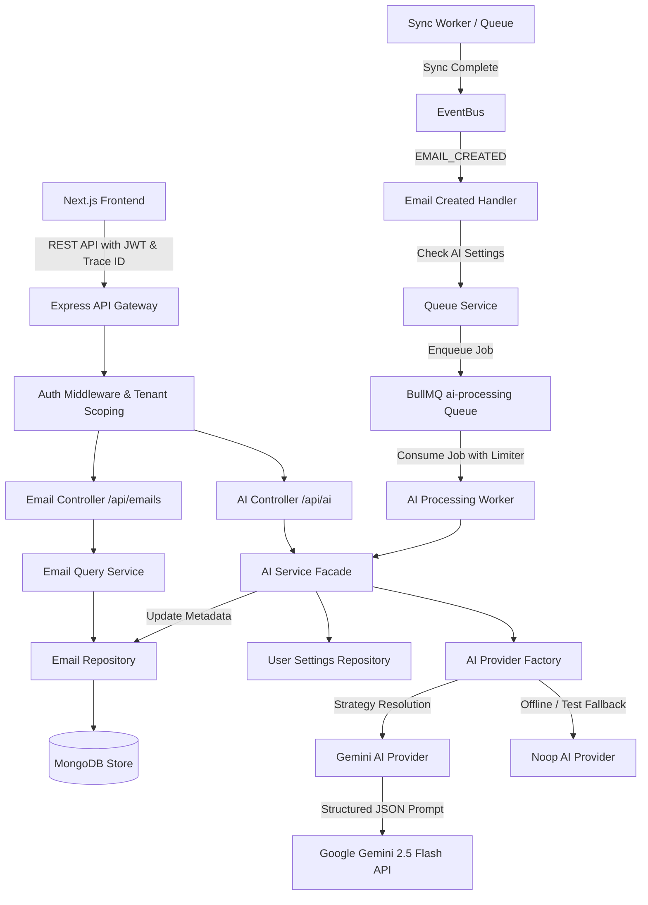
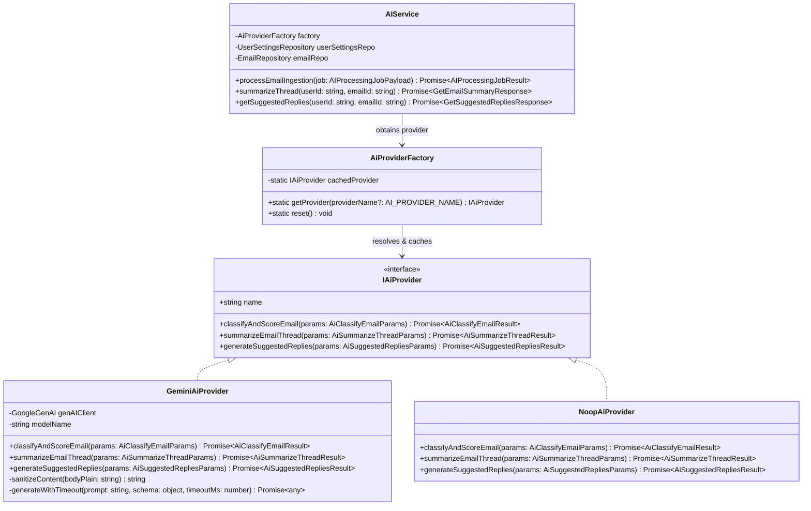
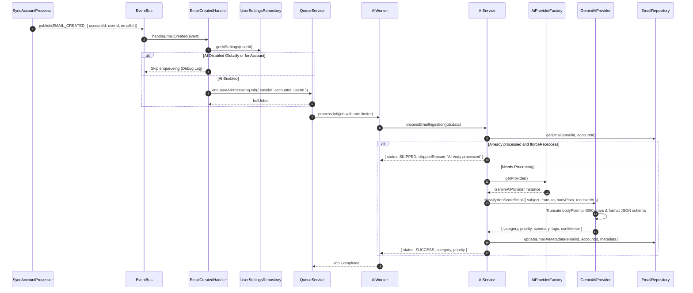
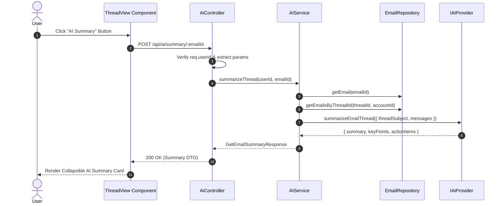

# AI Foundation & Core Features — Implementation Plan

> **Phase:** Sprint P8 (AI Foundation & Core Features) · **Release Target:** `Backend v3.7.0` / `Frontend v3.7.0` / `@mailsense/types v1.8.0`
> **Priority:** 🟡 HIGH — Core differentiator transforming MailSense from a multi-account aggregator into an intelligent, AI-augmented email workspace
> **Status:** READY FOR REVIEW & EXECUTION
> **Created:** 2026-09-14 · **Last Updated:** 2026-11-19

---

## 1. Overview

### Problem Statement

MailSense currently provides full email aggregation, two-way provider synchronization (Gmail & Outlook), thread management, drafts, search, and analytics across unified and account-specific inboxes. However, users still suffer from cognitive overload when dealing with high-volume inboxes:

1. **Information Overload:** Sifting through marketing promotions, automated transaction receipts, and system notifications to find actionable messages is manual, slow, and error-prone.
2. **Priority Blindness:** Critical messages from executives, key clients, or urgent project alerts blend indistinguishably with low-priority newsletters.
3. **Lengthy Thread Fatigue:** Long email conversations require reading every back-and-forth exchange to extract core decisions, pending questions, or assigned action items.
4. **Repetitive Response Crafting:** Typing standard acknowledgments, meeting confirmations, or polite declines is repetitive and time-consuming.

The event-driven foundation (Event Bus, BullMQ workers, and `EMAIL_CREATED` / `EMAIL_BATCH_SYNCED` events), the multi-tenant security architecture (strict `userId` scoping), and the full-stack observability infrastructure (standardized domain error hierarchy, structured Pino logging, distributed tracing) are fully hardened as of Health Audit v1.5.0 (Health Score: **98.5 / 100**). The codebase is 100% prepared for an asynchronous, pluggable AI pipeline.

### Goals

- **Configurable AI Provider / Strategy Design Pattern:** Architect a provider-agnostic AI subsystem (`IAiProvider`, `AiProviderFactory`) defaulting to Google Gemini (`gemini-3.6-flash`), with pluggable support for alternate providers (e.g., OpenAI, Anthropic, local LLMs) and a `NoopAiProvider` for offline testing.
- **Asynchronous AI Worker Pipeline:** Integrate BullMQ queue (`ai-processing`) subscribing to `EMAIL_CREATED` events with native worker rate limiting (`limiter`) and concurrency controls to perform background email classification and scoring without blocking sync ingestion or degrading UI performance.
- **Smart Categorization:** Automatically classify incoming emails into structured categories (`work`, `personal`, `finance`, `social`, `promotions`, `updates`, `general`) using structured JSON schema generation (`responseMimeType: "application/json"`, `responseSchema`).
- **Priority Scoring & Priority Inbox View:** Score emails into `critical`, `high`, `normal`, and `low` priority levels based on urgency, relationship context (including `to` recipient evaluation), and deadlines. Support a dedicated "Priority Inbox" view and visual warning indicators.
- **Email & Thread Summarization:** Generate one-line TL;DR summaries during ingestion for instant list-view previews and provide on-demand multi-bullet thread summaries with key action items in the conversation view.
- **Contextual Suggested Replies:** Generate 2–3 tone-adapted quick replies (`formal`, `casual`, `concise` via `SUGGESTED_REPLY_TONE`) that launch the compose modal pre-populated with context.
- **AI Settings, Privacy Controls & Data Minimization:** Provide global, per-feature, and per-account AI toggles, coupled with explicit user consent tracking and strict prompt sanitization (HTML stripped, 4,000 char truncation, zero attachments/base64 sent to LLM).
- **Resilience & Fault Isolation:** Protect against upstream 429 rate limits via BullMQ `job.rateLimit()`, use `AbortController` timeouts (30s) on LLM calls, and implement idempotency guards.
- **Architecture & Standards Compliance:** Align with MailSense Coding Standards (categorized subdirectories, barrel exports, zero `any`, zero inline object types, boundary-based error handling).

### Non-Goals

- **Email Auto-Sending:** AI will never dispatch emails automatically. Suggested replies require explicit user review, editing, and dispatch via the composer.
- **Model Fine-Tuning / Data Retention:** We will not fine-tune custom models or permit third-party retention of user emails. Data transmission strictly adheres to zero-retention enterprise API agreements.
- **Natural Language Search / Agentic Tools:** Natural language semantic email queries and autonomous multi-step agent workflows are reserved for Phase 7 (Advanced AI).
- **Custom User Rules Engine:** User-defined heuristic filter rules (e.g. "If sender = boss, mark important") belong to Phase 5.

### Background / Architectural Context

In the MailSense architecture, email ingestion occurs via background sync workers (`SyncAccountProcessor`) which process changes from Gmail and Outlook. Upon creating an email record in MongoDB, an `EMAIL_CREATED` event is broadcast through `EventBus`. The handler in `Backend/src/core/events/handlers/email-created.handler.ts` was architected with a dedicated hook to enqueue AI jobs.

Building on the Phase 3 Observability framework, all AI operations will carry distributed correlation IDs (`traceId`), performance timers (`withTiming`), structured metadata (`LOGGER_MODULE.AI_SERVICE`), and strict error classification (`ExternalServiceError`, `AiProcessingError`).

---

## 2. Requirements

### Functional Requirements

1. **FR-01 (Pluggable Provider Strategy):** The backend MUST load AI capabilities through an `IAiProvider` interface selected via `AiProviderFactory` based on configuration (`AI_PROVIDER=gemini`). Switching providers must require zero modifications to controllers, workers, or business services.
2. **FR-02 (Asynchronous Classification & Priority Scoring):** When a new email arrives via background sync, the system MUST enqueue an `ai-processing` BullMQ job if AI is enabled for the account. The AI provider classifies the category (`work`, `personal`, `finance`, `social`, `promotions`, `updates`, `general`), computes the priority (`critical`, `high`, `normal`, `low`), and generates a 1-sentence TL;DR summary.
3. **FR-03 (Inbox Category Badges & Filtering):** The frontend email list MUST render color-coded category badges on email rows and support filtering by category in mailbox query filters.
4. **FR-04 (Priority Inbox View):** Users MUST be able to filter by priority level or switch to a "Priority" view displaying Critical and High priority messages.
5. **FR-05 (On-Demand Thread Summarization):** Users can click "Summarize" inside an email thread to trigger an on-demand API call returning bulleted key points and extracted action items.
6. **FR-06 (Contextual Suggested Replies):** The email detail view MUST display 2–3 contextual reply chips typed with `SUGGESTED_REPLY_TONE`. Clicking a chip opens the Compose modal pre-filled with the recipient, subject (`Re: ...`), and suggested reply text.
7. **FR-07 (Granular Privacy & Account Controls):** Users MUST be able to toggle AI globally, toggle specific sub-features (`categorization`, `priorityScoring`, `summarization`, `suggestedReplies`), and disable AI for specific connected accounts. If AI is disabled for an account, incoming emails skip AI ingestion completely.

### Non-Functional Requirements

- **NFR-01 (Latency & Performance):** Background email classification must complete within $\le 3$ seconds of queue pickup under standard load. On-demand summary and suggestion endpoints must return responses within $\le 2.5$ seconds. LLM calls must enforce a 30-second `AbortController` timeout.
- **NFR-02 (Rate Limiting & Resilient Backoff):** The AI provider integration must enforce queue-level concurrency limits (`concurrency: 5`), BullMQ worker rate limiting (`limiter: { max: 50, duration: 60000 }`), exponential backoff (starting at 2s with up to 3 retries), and graceful pause via `job.rateLimit()` upon upstream 429 quota exhaustion.
- **NFR-03 (Data Minimization & Privacy):** Prompts sent to AI providers MUST contain only essential text fields (`subject`, `from`, `to`, `receivedAt`, and sanitized `bodyPlain` truncated to 4,000 characters). Raw HTML, scripts, base64 payloads, and binary attachments must NEVER be sent to the LLM.
- **NFR-04 (Strict Type Safety):** Zero tolerance for `any`, `never`, or `unknown` types across backend and frontend codebases. All domain enums, job payloads, and DTOs must be exported from `@mailsense/types v1.8.0`. Zero inline object types.
- **NFR-05 (Fault Isolation):** Failures in the AI worker or upstream AI API must NEVER fail email synchronization or prevent users from reading, composing, or managing emails.
- **NFR-06 (Idempotency):** The AI worker must inspect `aiProcessedAt` before dispatching LLM calls; already-processed emails must be skipped with `AI_PROCESSING_STATUS.SKIPPED` unless `forceReprocess: true`.

### Acceptance Criteria

- [ ] `IAiProvider` interface, `AiProviderFactory`, `GeminiAiProvider`, and `NoopAiProvider` implemented with 100% test coverage.
- [ ] New emails ingested during background sync receive `aiCategory`, `aiPriority`, `aiSummary`, and `aiProcessedAt` in MongoDB.
- [ ] Email table displays category pills and priority indicators with zero layout shift.
- [ ] `GET /api/emails` supports filtering by `aiCategory` and `aiPriority`.
- [ ] `POST /api/ai/summary/:emailId` returns structured bullet points and action items within 3 seconds.
- [ ] `GET /api/ai/suggestions/:emailId` returns 2–3 contextual suggested replies that populate the composer upon click.
- [ ] Disabling AI globally or for a specific account stops background AI job enqueueing immediately.
- [ ] Both Backend and Frontend compile with 0 errors (`pnpm build` & `npx tsc --noEmit`).

---

## 3. Design

### 3.1 High-Level Design

#### System Architecture Topology



---

### 3.2 AI Provider Strategy Design Pattern

To prevent vendor lock-in and guarantee long-term maintainability, the AI subsystem follows the **Provider / Strategy Pattern**, identical to how MailSense abstracts email providers (`IEmailProvider` $\to$ `GmailProvider`, `OutlookProvider`):



---

### 3.3 Sequence Flows

#### Flow 1: Asynchronous Email Ingestion & Classification Pipeline



#### Flow 2: On-Demand Thread Summarization Flow



---

### 3.4 Data Models & Schema Updates

#### 1. Updated `EmailSchema` (`Backend/src/modules/emails/database/email.model.ts`)

```typescript
// Add to EmailSchema:
aiCategory: {
    type: String,
    enum: Object.values(EMAIL_AI_CATEGORY),
    default: null,
    index: true,
},
aiPriority: {
    type: String,
    enum: Object.values(EMAIL_AI_PRIORITY),
    default: null,
    index: true,
},
aiSummary: {
    type: String,
    default: null,
},
aiTags: {
    type: [String],
    default: [],
},
aiProcessedAt: {
    type: Date,
    default: null,
},
aiProvider: {
    type: String,
    enum: Object.values(AI_PROVIDER_NAME),
    default: null,
},

// Compound query indexes:
EmailSchema.index({ accountId: 1, aiCategory: 1, receivedAt: -1 });
EmailSchema.index({ accountId: 1, aiPriority: 1, receivedAt: -1 });
```

#### 2. Updated `UserSettingsSchema` (`Backend/src/modules/user/database/user.model.ts`)

```typescript
const UserAISettingsSchema = new Schema<UserAISettings>(
  {
    enabled: { type: Boolean, default: true },
    features: {
      categorization: { type: Boolean, default: true },
      priorityScoring: { type: Boolean, default: true },
      summarization: { type: Boolean, default: true },
      suggestedReplies: { type: Boolean, default: true },
    },
    disabledAccountIds: { type: [String], default: [] },
    consentGivenAt: { type: Date, default: () => new Date() },
  },
  { _id: false },
);
```

---

### 3.5 BullMQ Worker Concurrency, Rate Limiting & Gemini Integration

#### BullMQ Worker Configuration (`Backend/src/workers/ai.worker.ts`)

```typescript
const workerOptions: WorkerOptions = {
  connection: connection as ConnectionOptions,
  concurrency: 5, // I/O-bound LLM network operations
  prefix,
  lockDuration: 60000, // 60s lock for long-running AI operations
  limiter: {
    max: 50, // Maximum 50 requests per minute to match Gemini API rate limits
    duration: 60000,
  },
};
```

#### Handling 429 Quota Exhaustion Gracefully

```typescript
// Inside AI worker processor:
try {
  return await aiService.processEmailIngestion(job.data);
} catch (error) {
  if (error instanceof RateLimitError) {
    const retryAfterMs = error.retryAfterMs ?? 10000;
    await job.rateLimit(retryAfterMs);
    throw Worker.RateLimitError();
  }
  throw error;
}
```

#### Gemini SDK Calling Pattern with Timeout (`@google/genai`)

```typescript
const controller = new AbortController();
const timeoutId = setTimeout(() => controller.abort(), 30000); // 30s timeout

try {
  const response = await this.aiClient.models.generateContent({
    model: this.modelName,
    contents: prompt,
    config: {
      responseMimeType: "application/json",
      responseSchema: classificationResponseSchema,
      temperature: 0.1, // Deterministic classification
    },
  });
  return JSON.parse(response.text!);
} finally {
  clearTimeout(timeoutId);
}
```

---

### 3.6 API Contracts

Mounted under `/api/ai` and `/api/user/settings`:

| Method  | Endpoint                       | Request Body                              | Response Shape                             | Description                                               |
| :------ | :----------------------------- | :---------------------------------------- | :----------------------------------------- | :-------------------------------------------------------- |
| `POST`  | `/api/ai/summary/:emailId`     | —                                         | `ApiResponse<GetEmailSummaryResponse>`     | On-demand comprehensive thread summarization              |
| `GET`   | `/api/ai/suggestions/:emailId` | —                                         | `ApiResponse<GetSuggestedRepliesResponse>` | 2–3 contextual quick reply suggestions                    |
| `GET`   | `/api/user/settings/ai`        | —                                         | `ApiResponse<GetUserAISettingsResponse>`   | Fetch current user's AI settings & feature flags          |
| `PATCH` | `/api/user/settings/ai`        | `UpdateUserAISettingsPayload`             | `ApiResponse<GetUserAISettingsResponse>`   | Update global/per-feature/per-account AI settings         |
| `GET`   | `/api/emails`                  | Query: `?aiCategory=work&aiPriority=high` | `ApiResponse<GetEmailsResponse>`           | Extended mailbox list with AI category & priority filters |

---

## 4. Proposed Changes

| Component                  | Target File                                                       | Action   | Purpose / Responsibilities                                                                                                                                            |
| -------------------------- | ----------------------------------------------------------------- | -------- | --------------------------------------------------------------------------------------------------------------------------------------------------------------------- |
| **Shared Types**           | `@mailsense/types`                                                | [MODIFY] | Add domain enums (`EMAIL_AI_CATEGORY`, `EMAIL_AI_PRIORITY`, `SUGGESTED_REPLY_TONE`, `AI_PROVIDER_NAME`, `AI_FEATURE_KEY`, `AI_PROCESSING_STATUS`), DTOs, job payloads |
| **Config**                 | `Backend/src/core/config/app.config.ts`                           | [MODIFY] | Add `ai: { provider, geminiApiKey, geminiModel }`                                                                                                                     |
| **Config**                 | `Backend/src/core/config/env.schema.ts`                           | [MODIFY] | Add Zod schema validations for `AI_PROVIDER`, `GEMINI_API_KEY`                                                                                                        |
| **Observability**          | `Backend/src/core/constants/observability.constants.ts`           | [MODIFY] | Add `AI_SERVICE`, `AI_CONTROLLER`, `AI_WORKER`, `AI_PROCESSING_PROCESSOR`, `GEMINI_PROVIDER` to `LOGGER_MODULE`                                                       |
| **Errors**                 | `Backend/src/core/errors/ErrorCodes.ts`                           | [MODIFY] | Add `ErrorCode.AI_PROCESSING_FAILED`                                                                                                                                  |
| **Errors**                 | `Backend/src/core/errors/DomainErrors.ts`                         | [MODIFY] | Add `AiProcessingError` operational domain error class                                                                                                                |
| **Queue Types**            | `Backend/src/core/queue/queue.types.ts`                           | [NEW]    | Dedicated types file for `SyncAccountPayload`, `RefreshTokenPayload`, `AIProcessingJobPayload` (Zero inline types)                                                    |
| **Queue Config**           | `Backend/src/core/queue/queue.config.ts`                          | [MODIFY] | Register `AI_PROCESSING` BullMQ queue                                                                                                                                 |
| **Queue Service**          | `Backend/src/core/queue/queue.service.ts`                         | [MODIFY] | Add `enqueueAiProcessingJob` helper, import types from `queue.types.ts`                                                                                               |
| **AI Provider Contract**   | `Backend/src/integrations/ai/ai.provider.ts`                      | [NEW]    | Declare `IAiProvider` interface                                                                                                                                       |
| **AI Provider Types**      | `Backend/src/integrations/ai/ai.provider.types.ts`                | [NEW]    | Parameter and result contracts for AI strategy methods                                                                                                                |
| **AI Provider Factory**    | `Backend/src/integrations/ai/ai.provider.factory.ts`              | [NEW]    | Strategy selector and singleton cache for AI providers                                                                                                                |
| **Gemini AI Provider**     | `Backend/src/integrations/ai/providers/gemini.provider.ts`        | [NEW]    | Google GenAI SDK wrapper with structured JSON schema output and AbortController timeout                                                                               |
| **Noop AI Provider**       | `Backend/src/integrations/ai/providers/noop.provider.ts`          | [NEW]    | Deterministic mock provider for unit tests & offline dev                                                                                                              |
| **AI Integration Barrel**  | `Backend/src/integrations/ai/index.ts`                            | [NEW]    | Centralized export accessible via `@integrations/ai`                                                                                                                  |
| **AI Worker**              | `Backend/src/workers/ai.worker.ts`                                | [NEW]    | BullMQ worker consuming `ai-processing` jobs with rate limiting and concurrency controls                                                                              |
| **AI Processor**           | `Backend/src/workers/processors/ai-processing.processor.ts`       | [NEW]    | Processor executing AI classification, idempotency check, and persisting metadata                                                                                     |
| **Workers Barrel**         | `Backend/src/workers/index.ts`                                    | [MODIFY] | Re-export `AIProcessingWorker`                                                                                                                                        |
| **Event Subscriber**       | `Backend/src/core/events/handlers/email-created.handler.ts`       | [MODIFY] | Check AI settings and enqueue job on `EMAIL_CREATED`                                                                                                                  |
| **Email Model**            | `Backend/src/modules/emails/database/email.model.ts`              | [MODIFY] | Add AI fields and compound indexes                                                                                                                                    |
| **Email Repository**       | `Backend/src/modules/emails/database/email.repository.ts`         | [MODIFY] | Add `updateEmailAiMetadata` and extend filter builders                                                                                                                |
| **AI Module Subdirectory** | `Backend/src/modules/ai/...`                                      | [NEW]    | Categorized module: `controllers/`, `services/`, `routes/`, `schema/`, `types/`, `constants/`                                                                         |
| **Frontend Endpoints**     | `Frontend/src/shared/api/endpoints.ts`                            | [MODIFY] | Add `AI_API_ENDPOINTS` constants                                                                                                                                      |
| **Frontend API Client**    | `Frontend/src/features/emails/api/email-ai.api.ts`                | [NEW]    | Axios wrapper for summary and suggestions                                                                                                                             |
| **Frontend React Query**   | `Frontend/src/features/emails/api/email-ai.queries.ts`            | [NEW]    | React Query hooks (`useGetEmailSummaryQuery`, `useGetSuggestedRepliesQuery`)                                                                                          |
| **Frontend UI Badge**      | `Frontend/src/features/emails/components/CategoryBadge.tsx`       | [NEW]    | Visual color-coded category pill                                                                                                                                      |
| **Frontend UI Flag**       | `Frontend/src/features/emails/components/PriorityFlag.tsx`        | [NEW]    | Visual priority level indicator                                                                                                                                       |
| **Frontend Summary Card**  | `Frontend/src/features/emails/components/EmailAiSummaryCard.tsx`  | [NEW]    | Accordion card rendering key takeaways & action items                                                                                                                 |
| **Frontend Reply Chips**   | `Frontend/src/features/emails/components/SuggestedRepliesBar.tsx` | [NEW]    | Contextual reply chips with compose pre-fill integration                                                                                                              |
| **Frontend Settings View** | `Frontend/src/features/settings/components/AiSettingsTab.tsx`     | [NEW]    | AI Settings management tab (toggles, consent, overrides) matching PascalCase naming                                                                                   |

---

## 5. Implementation Phases

### Phase 1: Shared Contracts & AI Provider Strategy Infrastructure

**Objective:** Release `@mailsense/types v1.8.0`, install `@google/genai`, and implement the configurable Provider/Strategy pattern (`IAiProvider`, `AiProviderFactory`, `GeminiAiProvider`, `NoopAiProvider`).
**Estimated Effort:** 1.5 days · **Target:** Backend & `@mailsense/types`

#### Tasks:

- [x] Define shared contracts in `@mailsense/types`:
  - [x] Enums: `EMAIL_AI_CATEGORY`, `EMAIL_AI_PRIORITY`, `SUGGESTED_REPLY_TONE`, `AI_PROVIDER_NAME`, `AI_FEATURE_KEY`, `AI_PROCESSING_STATUS`.
  - [x] Interfaces: `EmailAiMetadata`, `AiClassifyEmailParams`, `AiClassifyEmailResult`, `AiThreadMessageInput`, `AiSummarizeThreadParams`, `AiSummarizeThreadResult`, `AiSuggestedRepliesParams`, `AiSuggestedRepliesResult`.
  - [x] DTOs & Job Payloads: `AIProcessingJobPayload`, `AIProcessingJobResult`, `GetEmailSummaryResponse`, `SuggestedReplyItem`, `GetSuggestedRepliesResponse`, `UserAIFeatureSettings`, `UserAISettings`, `UpdateUserAISettingsPayload`, `GetUserAISettingsResponse`.
  - [x] Additive extensions to `EmailAttributes`, `EmailListDTO`, `GetAllEmailsFilters`, `UserSettings`.
  - [x] Build `@mailsense/types` and link in Backend and Frontend.
- [x] Update Backend environment config (`env.schema.ts`, `app.config.ts`) to validate `AI_PROVIDER` and `GEMINI_API_KEY`.
- [x] Add AI logging module identifiers to `Backend/src/core/constants/observability.constants.ts` (`AI_SERVICE`, `AI_CONTROLLER`, `AI_WORKER`, `AI_PROCESSING_PROCESSOR`, `GEMINI_PROVIDER`).
- [x] Add `ErrorCode.AI_PROCESSING_FAILED` in `Backend/src/core/errors/ErrorCodes.ts` and `AiProcessingError` in `Backend/src/core/errors/DomainErrors.ts`.
- [x] Create `Backend/src/integrations/ai/ai.provider.ts` declaring `IAiProvider`.
- [x] Create `Backend/src/integrations/ai/providers/noop.provider.ts` for offline testing and deterministic CI/CD runs.
- [x] Create `Backend/src/integrations/ai/providers/gemini.provider.ts` wrapping Google GenAI (`@google/genai`) with structured JSON schema output (`responseMimeType: "application/json"`, `responseSchema`), temperature 0.1, 30s `AbortController` timeout, and domain error wrapping.
- [x] Create `Backend/src/integrations/ai/ai.provider.factory.ts` resolving provider strategies with singleton caching.
- [x] Export integration barrel at `Backend/src/integrations/ai/index.ts`.
- [x] Write unit tests in `Backend/src/integrations/ai/__tests__/provider.factory.test.ts` and `gemini.provider.test.ts`.

---

### Phase 2: Asynchronous AI Queue & Ingestion Pipeline

**Objective:** Establish BullMQ `ai-processing` queue with rate limiting and concurrency controls, implement `AIProcessingWorker`, update `EmailSchema`, and connect `EMAIL_CREATED` event dispatching.
**Estimated Effort:** 1.5 days · **Target:** Backend Infrastructure & Database

#### Tasks:

- [x] Update `EmailSchema` and `EmailDocument` in `Backend/src/modules/emails/database/email.model.ts` with AI fields (`aiCategory`, `aiPriority`, `aiSummary`, `aiTags`, `aiProcessedAt`, `aiProvider`) and compound indexes.
- [x] Implement `EmailRepository.updateEmailAiMetadata` in `Backend/src/modules/emails/database/email.repository.ts`.
- [x] Create `Backend/src/core/queue/queue.types.ts` for queue payload contracts (`SyncAccountPayload`, `RefreshTokenPayload`, `AIProcessingJobPayload`), eliminating pre-existing inline type declarations.
- [x] Register `QUEUE_NAMES.AI_PROCESSING` in `Backend/src/core/queue/queue.config.ts`.
- [x] Add `QueueService.enqueueAiProcessingJob` in `Backend/src/core/queue/queue.service.ts` importing types from `queue.types.ts`.
- [x] Implement `aiProcessingProcessor` in `Backend/src/workers/processors/ai-processing.processor.ts`:
  - [x] Add idempotency check: skip already-processed emails if `aiProcessedAt` exists and `!forceReprocess`.
  - [x] Sanitize prompt input: strip HTML tags and truncate `bodyPlain` to 4,000 characters.
  - [x] Invoke `AIService.processEmailIngestion` and return structured `AIProcessingJobResult`.
- [x] Create `AIProcessingWorker` in `Backend/src/workers/ai.worker.ts` extending `BaseWorker`:
  - [x] Configure `concurrency: 5` and `limiter: { max: 50, duration: 60000 }` to respect Gemini RPM.
  - [x] Handle HTTP 429 quota exhaustion via `job.rateLimit(retryAfterMs)` and `Worker.RateLimitError`.
- [x] Export `AIProcessingWorker` in `Backend/src/workers/index.ts`.
- [x] Wire up `Backend/src/core/events/handlers/email-created.handler.ts` to inspect user AI settings and enqueue jobs.
- [x] Wire worker startup and shutdown in `Backend/src/core/queue/index.ts`.
- [x] Write worker unit tests in `Backend/src/workers/__tests__/ai.worker.test.ts`.

---

### Phase 3: Core AI Module & On-Demand REST Endpoints

**Objective:** Create categorized `Backend/src/modules/ai/` module with controllers, services, and routes for on-demand thread summarization and suggested replies.
**Estimated Effort:** 2 days · **Target:** Backend API Layer

#### Tasks:

- [ ] Create `Backend/src/modules/ai/` organized into categorized subdirectories:
  - [ ] `controllers/ai.controller.ts`: Handles `POST /summary/:emailId` and `GET /suggestions/:emailId` with caller tenant verification.
  - [ ] `services/ai.service.ts`: Orchestrates email retrieval, thread assembly, provider delegation, and telemetry logging via `LOGGER_MODULE.AI_SERVICE`.
  - [ ] `routes/ai.routes.ts`: Routes with Zod parameter validation schemas.
  - [ ] `schema/ai.schema.ts`: Validation schemas for route parameters.
  - [ ] `types/ai.types.ts`: Module-specific named interfaces (strictly zero inline types).
  - [ ] `constants/ai.constants.ts`: Module error codes and constants.
  - [ ] `index.ts`: Clean barrel export for AI module.
- [ ] Mount AI router under `/api/ai` in `Backend/src/routes.ts`.
- [ ] Extend `EmailQueryService` and `EmailRepository.getEmails` to support filtering by `aiCategory` and `aiPriority`.
- [ ] Add integration tests in `Backend/src/modules/ai/__tests__/ai.integration.test.ts`.

---

### Phase 4: AI Settings & Privacy Controls

**Objective:** Add user AI settings management, consent tracking, and per-account overrides.
**Estimated Effort:** 1 day · **Target:** Backend User Module & Frontend Settings

#### Tasks:

- [ ] Extend `UserSettingsSchema` in `Backend/src/modules/user/database/user.model.ts` with `UserAISettingsSchema`.
- [ ] Add `getAiSettings` and `updateAiSettings` methods to `UserSettingsRepository`.
- [ ] Add `GET /api/user/settings/ai` and `PATCH /api/user/settings/ai` endpoints in `Backend/src/modules/user/`.
- [ ] Create Frontend API client in `Frontend/src/features/settings/api/ai-settings.api.ts` and React Query hooks (`useGetAiSettingsQuery`, `useUpdateAiSettingsMutation`).
- [ ] Create `Frontend/src/features/settings/components/AiSettingsTab.tsx` with global toggle, feature checkboxes, and per-account exclusion switches.
- [ ] Mount "AI Settings" tab in Settings page navigation.

---

### Phase 5: Frontend UI Components & Inbox Integration

**Objective:** Build responsive UI components for category badges, priority flags, thread summary cards, and quick reply chips.
**Estimated Effort:** 2 days · **Target:** Frontend UI & State

#### Tasks:

- [ ] Create `CategoryBadge.tsx` with semantic color mappings (Work: Indigo, Finance: Emerald, Personal: Sky, Social: Purple, Promotions: Pink, Updates: Amber, General: Slate).
- [ ] Create `PriorityFlag.tsx` with distinct icons (Critical: Red Alert, High: Orange Flag, Normal: Subtle, Low: Down Arrow).
- [ ] Integrate `CategoryBadge` and `PriorityFlag` into `EmailListTable.tsx` and `EmailCard.tsx`.
- [ ] Add "Priority Inbox" quick-filter button to `EmailListHeader.tsx` (`useInboxData` query synchronization).
- [ ] Add Category filter dropdown to inbox filter modal (`FilterModal.tsx`).
- [ ] Create `EmailAiSummaryCard.tsx` with loading skeleton, bulleted summary, and action items list in `ThreadView.tsx`.
- [ ] Create `SuggestedRepliesBar.tsx` rendering quick reply chips typed with `SUGGESTED_REPLY_TONE`; clicking a chip opens the Compose modal with pre-filled content.
- [ ] Verify zero inline types and zero ESLint errors across all new components.

---

### Phase 6: End-to-End Verification & Performance Benchmarking

**Objective:** Verify system performance, rate limiting resilience, and 100% test suite pass rate.
**Estimated Effort:** 1 day · **Target:** Full Workspace

#### Tasks:

- [ ] Run backend unit and integration test suites: `cd Backend && npx jest` (all suites passing).
- [ ] Run backend and frontend linting: `pnpm lint` in both workspaces (0 errors, 0 warnings).
- [ ] Run frontend TypeScript checks: `npx tsc --noEmit` (0 errors).
- [ ] Run production builds: `pnpm build` in Backend and Frontend.
- [ ] Execute end-to-end QA:
  - [ ] Ingest emails and verify background classification within $\le 3$s.
  - [ ] Verify category badges and priority indicators in Unified and Account Inbox views.
  - [ ] Verify on-demand thread summarization and suggested replies.
  - [ ] Verify disabling AI for an account skips background job enqueueing.
- [ ] Update `CHANGELOG.md`, `CODEBASE_INDEX.md`, and Health Audit Report.

---

## 6. Dependencies & Constraints

### New Dependencies

| Package         | Version | Purpose                                                          |
| :-------------- | :------ | :--------------------------------------------------------------- |
| `@google/genai` | `^1.x`  | Official Google GenAI SDK for Gemini 2.5 Flash structured output |

### Existing Dependencies (Leveraged)

| Dependency         | Target Version | Notes                                                       |
| :----------------- | :------------- | :---------------------------------------------------------- |
| `@mailsense/types` | `^1.8.0`       | Shared contracts, domain enums, and DTOs                    |
| `bullmq`           | `^5.x`         | Redis-backed background job queue with native rate limiting |
| `ioredis`          | `^5.x`         | Shared Redis connection                                     |
| `zod`              | `^3.x`         | Request validation schemas and environment variable parsing |

### Infrastructure Requirements

- **Redis:** Required for BullMQ `ai-processing` queue. Reuses the existing application Redis instance.
- **Google AI Studio API Key:** `GEMINI_API_KEY` environment variable.

### Constraints

- **Gemini Free Tier Rate Limits:** 15 RPM / 1,500 RPD (Free) or 1,000+ RPM (Tier 1 Pay-as-you-go). Worker limiter is configured to `max: 50, duration: 60000` to prevent accidental quota exhaustion.
- **Data Minimization:** No email HTML, scripts, attachments, or base64 data may be sent to the LLM. Only sanitized plain text truncated to 4,000 characters is permitted.
- **Single-Process Memory:** Peak memory consumption must remain bounded during AI batch ingestion through concurrency limits (`concurrency: 5`).

---

## 7. Risk Assessment & Mitigation

| Risk                                      | Impact | Likelihood | Mitigation                                                                                                                                                                                             |
| :---------------------------------------- | :----- | :--------- | :----------------------------------------------------------------------------------------------------------------------------------------------------------------------------------------------------- |
| **Upstream Gemini 429 Rate Limiting**     | HIGH   | MEDIUM     | Queue worker rate limiting (`limiter: { max: 50, duration: 60000 }`), exponential backoff retries (3 attempts), and BullMQ `job.rateLimit(retryAfterMs)` pausing the worker without burning retries.   |
| **LLM Call Hanging / Network Latency**    | HIGH   | MEDIUM     | Wrap all Gemini API requests with a 30-second `AbortController` timeout; abort and reject with `AiProcessingError`.                                                                                    |
| **Large Email Body Token Exhaustion**     | MEDIUM | HIGH       | Input sanitizer strictly truncates `bodyPlain` to 4,000 characters; HTML tags, images, and attachments are stripped prior to LLM call.                                                                 |
| **Inaccurate or Hallucinated Categories** | LOW    | LOW        | Enforce strict Gemini JSON Schema (`responseSchema`) with enum constraints (`EMAIL_AI_CATEGORY`), temperature 0.1 for deterministic classification.                                                    |
| **User Privacy & Regulatory Exposure**    | HIGH   | LOW        | Explicit opt-in consent recorded (`consentGivenAt`); zero data sent to AI for accounts listed in `disabledAccountIds`; zero-retention enterprise API.                                                  |
| **Provider Lock-in**                      | MEDIUM | LOW        | Provider / Strategy Pattern isolates all provider-specific logic inside `Backend/src/integrations/ai/providers/`. Switching to another LLM requires zero changes to workers, services, or controllers. |
| **Duplicate Processing on Resync**        | LOW    | MEDIUM     | Worker processor checks `email.aiProcessedAt` before dispatching LLM calls; skips with `AI_PROCESSING_STATUS.SKIPPED` unless `forceReprocess: true`.                                                   |

---

## 8. Verification Plan

### Automated Tests

```bash
# 1. Shared Types Compilation
cd /Users/vishaljagamani/Projects/Projects/mailsense-types
pnpm build
pnpm type-check

# 2. Backend Verification
cd /Users/vishaljagamani/Projects/Projects/mailsense/Backend
pnpm lint
npx jest
pnpm build

# 3. Frontend Verification
cd /Users/vishaljagamani/Projects/Projects/mailsense/Frontend
npx tsc --noEmit
pnpm lint
pnpm build
```

#### Unit Test Cases

| Feature                 | Test Case                          | Target Suite               | Expected Result                                               |
| :---------------------- | :--------------------------------- | :------------------------- | :------------------------------------------------------------ |
| **AI Provider Factory** | Resolve Gemini provider by enum    | `provider.factory.test.ts` | Returns `GeminiAiProvider` instance                           |
| **AI Provider Factory** | Resolve Noop provider in test mode | `provider.factory.test.ts` | Returns `NoopAiProvider` instance                             |
| **Gemini AI Provider**  | Structured classification parse    | `gemini.provider.test.ts`  | Correctly parses structured JSON matching schema              |
| **Gemini AI Provider**  | Abort on 30s timeout               | `gemini.provider.test.ts`  | Throws `AiProcessingError` when aborted                       |
| **AI Processor**        | Idempotency skip check             | `ai.worker.test.ts`        | Skips email when `aiProcessedAt` is set and `!forceReprocess` |
| **AI Worker**           | 429 rate limit backoff             | `ai.worker.test.ts`        | Calls `job.rateLimit()` and pauses queue                      |
| **AI Service**          | Thread summarization aggregation   | `ai.integration.test.ts`   | Returns summary with key points and action items              |

### Manual Verification Checklist

- [ ] Ingest new email via sync and verify category badge and priority flag appear in the inbox table.
- [ ] Verify category filter dropdown in inbox filters emails by `EMAIL_AI_CATEGORY`.
- [ ] Click "AI Summary" in thread view and verify summary card loads within 3s.
- [ ] Click a suggested reply chip and verify compose modal opens with pre-filled content.
- [ ] Toggle AI off globally in Settings $\to$ verify subsequent incoming emails skip AI queueing.
- [ ] Exclude a specific connected account from AI in Settings $\to$ verify emails from that account skip AI queueing.

---

## 9. Open Questions & Decisions

### Resolved Decisions

| Decision                            | Resolution                                                           | Date       | Rationale                                                                                     |
| :---------------------------------- | :------------------------------------------------------------------- | :--------- | :-------------------------------------------------------------------------------------------- |
| **AI Provider Abstraction Pattern** | Provider / Strategy Pattern (`IAiProvider`, `AiProviderFactory`)     | 2026-09-14 | Aligns with existing `IEmailProvider` pattern for Gmail and Outlook; prevents vendor lock-in. |
| **LLM Output Format Enforcement**   | Native Gemini JSON Schema (`responseSchema`) with `temperature: 0.1` | 2026-11-15 | Eliminates fragile prompt-based JSON parsing and regex matching.                              |
| **Async vs Sync Ingestion**         | Asynchronous via BullMQ (`ai-processing` queue)                      | 2026-09-14 | Email sync must never block or degrade when LLM APIs experience latency.                      |
| **Tone Representation**             | Named `SUGGESTED_REPLY_TONE` enum                                    | 2026-11-19 | Complies with zero inline types rule and prevents string typos.                               |

### Open Decisions

> [!NOTE]
> **Q1: Gemini API Quota Tier**
> What tier of Gemini API will be used in staging and production?
>
> - **Option A (Recommended):** Google AI Studio Tier 1 (Pay-as-you-go) — Provides 1,000+ RPM and zero data retention for enterprise compliance.
> - **Option B:** Free Tier — Limited to 15 RPM; requires lowering worker limiter to `max: 15, duration: 60000`.

> [!NOTE]
> **Q2: Re-processing on AI Enablement**
> When a user enables AI after having it disabled, should historical emails be processed?
>
> - **Option A (Recommended):** Forward-only — Process only new emails received after AI is enabled. Add a manual "Analyze Inbox" button in Settings for bulk historical triage.
> - **Option B:** Automatic retroactive sync — Enqueue all unclassified emails from the last 7 days. (Higher initial token usage).
