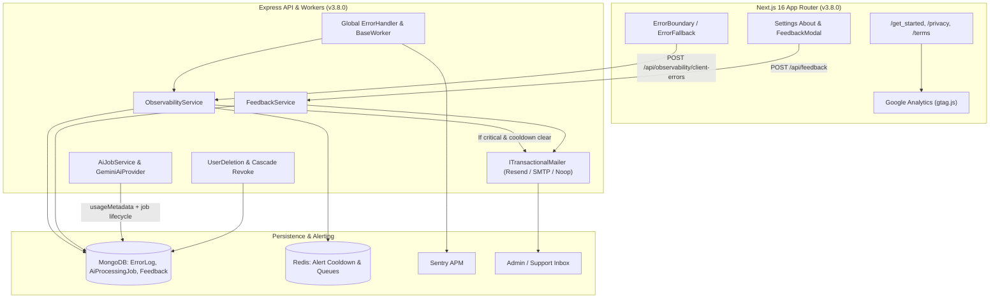
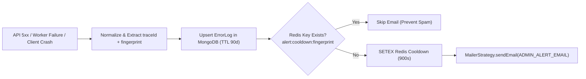
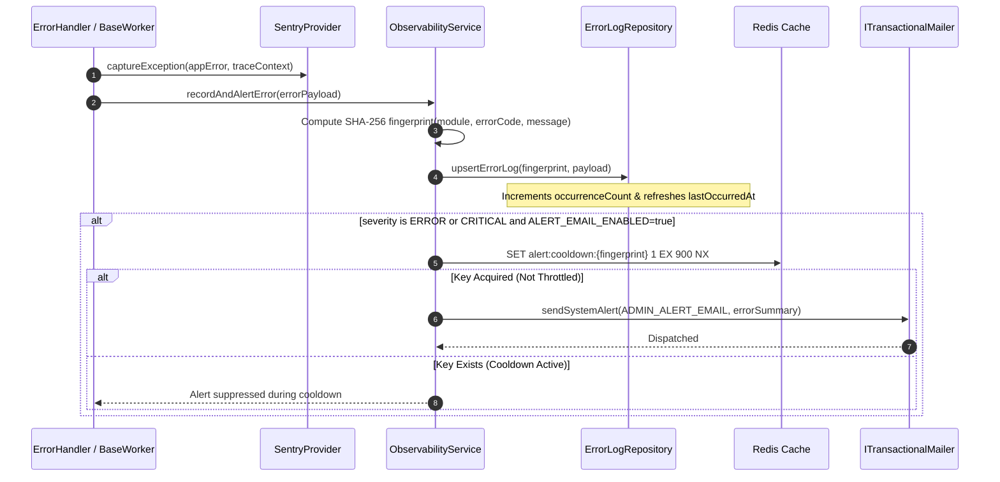
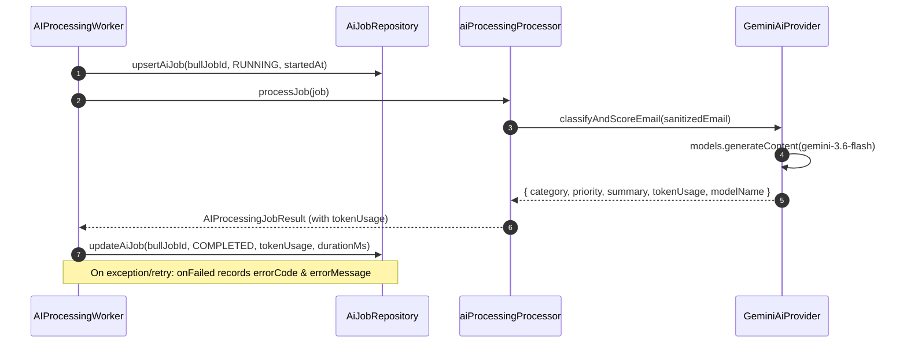
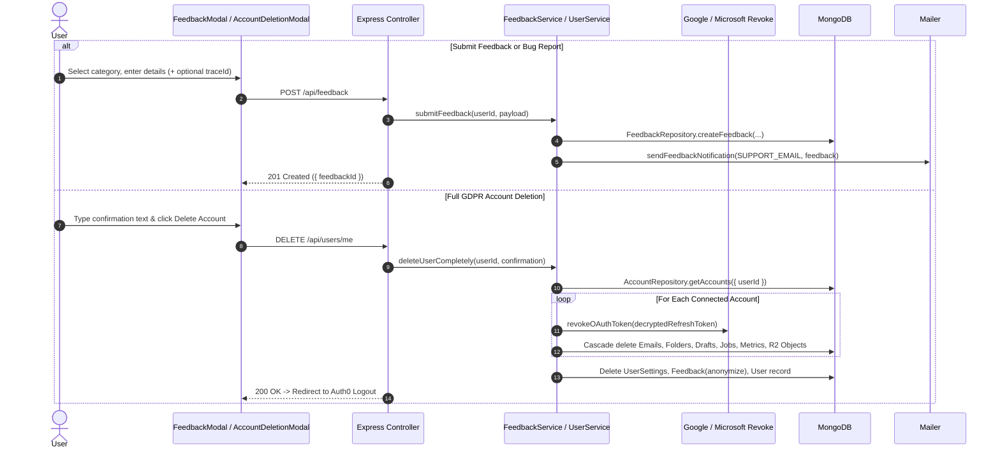
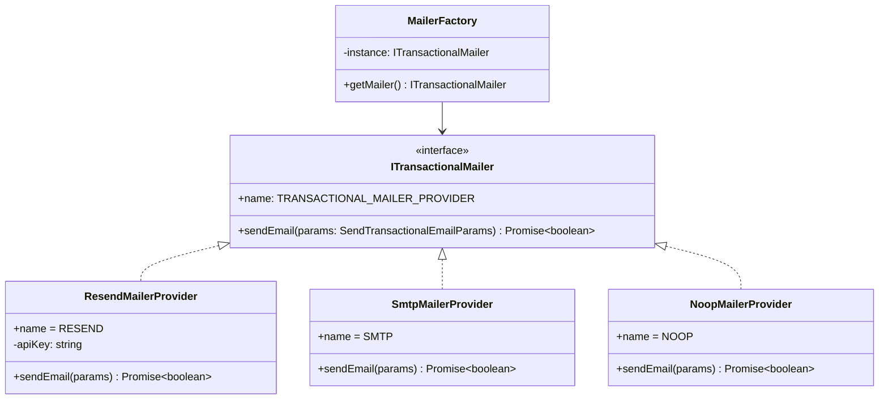
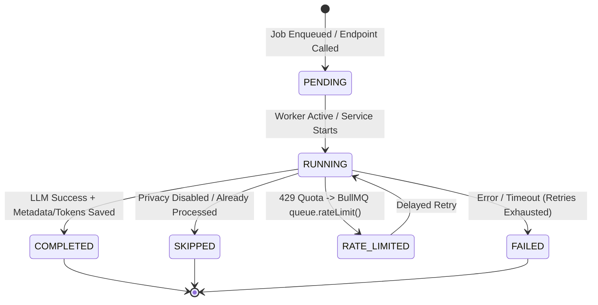

# Public Release Hardening, Observability & Compliance — Implementation Plan

> **Phase:** Sprint P9 (Pre-Launch Validation, Hardened Observability, Telemetry & Public Release) · **Release Target:** `Backend v3.8.0` / `Frontend v3.8.0` / `@mailsense/types v1.9.0`
> **Priority:** 🔴 HIGH — Mandatory production hardening, legal compliance, observability, and end-to-end validation prior to public open-source launch
> **Status:** IN PROGRESS (Phases 1–3 Completed — Ready for Phase 4)
> **Created:** 2026-11-25 · **Last Updated:** 2026-11-26

---

## 1. Overview

### Problem Statement

MailSense has completed its Core Aggregation, Analytics Dashboard, and AI Foundation (`v3.7.0`). Before opening the application to public users via social media, portfolio links, and search engines, a comprehensive codebase inspection revealed critical production-readiness gaps across stability, observability, legal compliance, and user support:

1. **Unresolved Runtime Bugs & Placeholder Boilerplate:**
   - [Frontend/src/app/layout.tsx](file:///Users/vishaljagamani/Projects/Projects/mailsense/Frontend/src/app/layout.tsx#L18-L21) still renders default Next.js boilerplate (`title: 'Create Next App'`, `description: 'Generated by create next app'`) with no OpenGraph tags, Twitter Cards, `robots.ts`, or `sitemap.ts` for search engine discovery.
   - [Frontend/src/features/settings/pages/index.tsx](file:///Users/vishaljagamani/Projects/Projects/mailsense/Frontend/src/features/settings/pages/index.tsx#L23-L41) hardcodes `defaultValue="profile"` instead of honoring the dynamic `/settings/[setting]` route parameter, and omits `<TabsContent value="about">` despite `about` existing in `SETTINGS_OPTIONS`.
   - [Frontend/src/features/settings/components/profile/AccountDeletionModal.tsx](file:///Users/vishaljagamani/Projects/Projects/mailsense/Frontend/src/features/settings/components/profile/AccountDeletionModal.tsx#L24-L26) displays a "coming soon" placeholder instead of performing actual user deletion.
   - [Frontend/src/shared/constants/sidebar.constants.ts](file:///Users/vishaljagamani/Projects/Projects/mailsense/Frontend/src/shared/constants/sidebar.constants.ts#L6-L10) and [Frontend/src/shared/components/sidebar/nav-user.tsx](file:///Users/vishaljagamani/Projects/Projects/mailsense/Frontend/src/shared/components/sidebar/nav-user.tsx#L35) retain placeholder `'shadcn'` / `'CN'` strings.
   - [Backend/src/modules/accounts/services/account-write.service.ts](file:///Users/vishaljagamani/Projects/Projects/mailsense/Backend/src/modules/accounts/services/account-write.service.ts#L31-L45) removes `Account` and `Email` records upon disconnect, leaving orphaned `Folder`, `Draft`, `SyncJob`, `AccountMetrics`, `AiProcessingJob`, and R2 objects without revoking upstream Gmail/Outlook OAuth tokens.
   - Codebase lint/type hygiene: [MonitoringManager](file:///Users/vishaljagamani/Projects/Projects/mailsense/Backend/src/core/monitoring/monitoring.manager.ts#L74) defaults release tag to `'3.2.0'`, [sentry.client.config.ts](file:///Users/vishaljagamani/Projects/Projects/mailsense/Frontend/sentry.client.config.ts#L9) hardcodes release `'3.2.0'`, [GeminiAiProvider](file:///Users/vishaljagamani/Projects/Projects/mailsense/Backend/src/integrations/ai/providers/gemini.provider.ts#L44) falls back to deprecated `'gemini-2.5-flash'`, and prohibited `try/catch` blocks remain in custom hooks (`useDashboardPage.ts`, `useDraftsPage.ts`).
   - Debug/boilerplate cleanup: [app.ts](file:///Users/vishaljagamani/Projects/Projects/mailsense/Backend/src/app.ts#L47) exposes a `/testEndpoint` debug route, [app.config.ts](file:///Users/vishaljagamani/Projects/Projects/mailsense/Backend/src/core/config/app.config.ts#L22) retains a dead `catfact.ninja` test URL, [nav-user.tsx](file:///Users/vishaljagamani/Projects/Projects/mailsense/Frontend/src/shared/components/sidebar/nav-user.tsx#L63-L80) contains large commented-out code blocks, and [use-email-keyboard-shortcuts/index.ts](file:///Users/vishaljagamani/Projects/Projects/mailsense/Frontend/src/features/emails/hooks/use-email-keyboard-shortcuts/index.ts#L58) uses `console.error` instead of structured monitoring.
   - Next.js App Router gaps: No `global-error.tsx` root error boundary exists, `sentry.client.config.ts` should be migrated to `instrumentation-client.ts` per Next.js deprecation, and no `opengraph-image` social preview asset exists for social media sharing.
   - Type violation: [user.interfaces.ts](file:///Users/vishaljagamani/Projects/Projects/mailsense-types/src/user/user.interfaces.ts#L75) uses `Record<string, unknown>` for `user_metadata` violating strict type safety standards.
2. **Lack of Persistent MongoDB Error Logs & Real-Time Admin Alerts:** Errors currently stream only to ephemeral stdout logs and Sentry. Public launch demands searchable, TTL-bounded error storage in MongoDB (`error_logs`) paired with throttled maintainer email alerts (`5xx` API faults, worker exhaustions, client crash boundaries) and client error bridging.
3. **Missing AI Job & Token Spend Tracking:** Unlike `SyncJob`, `AIProcessingWorker` and on-demand AI endpoints do not persist job status, execution duration, model name, or Gemini `usageMetadata` (`inputTokens`, `outputTokens`, `totalTokens`) in MongoDB—preventing cost and latency monitoring once public traffic scales.
4. **Missing Privacy Policy, OAuth Limited-Use Disclosure & Terms:** [Frontend/src/middleware.ts](file:///Users/vishaljagamani/Projects/Projects/mailsense/Frontend/src/middleware.ts#L9) redirects all unauthenticated routes to `/get_started`. Google/Microsoft OAuth verification and public visitors require publicly accessible `/privacy` and `/terms` routes, clear disclosures on the Login page, and a comprehensive Settings $\to$ About page documenting sign-in, OAuth revocation, data deletion, and Gemini AI data minimization.
5. **No Product Analytics or Feedback Channel:** There is no Google Analytics (`GA4`) traffic funnel tracking and no built-in channel for public users to submit bug reports, feature requests, or general feedback directly in-app or via email.

### Goals

- **Pre-Launch Codebase & Log Hygiene:** Conduct Health Audit `v1.5.0` per [health-audit-standards.md](file:///Users/vishaljagamani/Projects/Projects/mailsense/.agents/rules/health-audit-standards.md), fix existing UI/backend bugs, purge debug endpoints, clean up commented-out code, fix stale Sentry client release, migrate to `instrumentation-client.ts`, create `global-error.tsx`, and bring active error logs to **0**.
- **Hardened Observability & Alerting:** Persist backend, worker, and frontend crash errors to MongoDB (`ErrorLog` with 90-day TTL and deduplication fingerprints) and dispatch Redis-throttled admin email alerts via a strategy-based `ITransactionalMailer` (`Resend` / `SMTP` / `Noop`).
- **AI Job & Token Spend Database Tracking:** Persist every background and on-demand AI execution to MongoDB (`AiProcessingJob`) capturing Gemini `usageMetadata` (input/output/total tokens), duration, status, and errors.
- **Legal Compliance & Full Data Ownership:** Launch public `/privacy` and `/terms` routes, add legal notices on LoginCard, build Settings $\to$ About (`/settings/about`), and implement true cascade Account/OAuth Revocation and GDPR User Wipe (`DELETE /api/users/me`).
- **Site Telemetry & User Feedback Loop:** Integrate privacy-respecting Google Analytics 4 (`GA4`) and build an in-app `FeedbackModal` + `FeedbackModule` storing reports in MongoDB and notifying maintainer email (with `mailto:` + GitHub Issues fallback).
- **Full End-to-End Public Release Verification:** Validate the complete user lifecycle from Auth0 signup through Gmail/Outlook sync, AI features, and account deletion prior to `v3.8.0` open-source release.

### Non-Goals

- **New Feature Tracks:** Custom Rules Engine (Roadmap Phase 5), Real-Time SSE Notifications (Phase 6), and Natural Language Search (Phase 8) remain deferred until after `v3.8.0` public launch.
- **Admin Dashboard UI for Logs:** MongoDB `error_logs`, `ai_processing_jobs`, and `feedback` collections will be queried directly via MongoDB Compass/Atlas during initial launch; an internal admin portal is out of scope for `v3.8.0`.
- **PII Tracking in Analytics:** Email subjects, sender addresses, or message bodies will NEVER be transmitted to Google Analytics or stored in `ErrorLog` payloads.

### Background / Architectural Context

MailSense (`Backend v3.7.0`, `Frontend v3.7.0`, `@mailsense/types v1.8.0`) uses an event-driven BullMQ + Redis worker architecture (`SyncWorker`, `AIProcessingWorker`, `TokenRefreshWorker`), strategy-patterned integrations (`IEmailProvider`, `IAiProvider`, `IMonitoringProvider`), and Auth0 session authentication. The new observability, mailer, AI job persistence, and feedback modules slot directly into existing `BaseWorker`, `MonitoringManager`, `errorHandler`, and `SettingsPage` boundaries without disrupting email sync pipelines.

---

## 2. Requirements

### Functional Requirements

1. **FR-01 (Persistent Error Logging):** All backend `5xx`/non-operational HTTP exceptions, background worker failures, and Frontend `ErrorBoundary` crashes persist sanitized diagnostic records into MongoDB (`error_logs`) with trace correlation (`traceId`) and occurrence counting via `fingerprint`.
2. **FR-02 (Throttled Maintainer Email Alerts):** Unhandled server errors (`statusCode >= 500`), dead-lettered BullMQ jobs, and infrastructure probe failures trigger formatted alert emails to `ADMIN_ALERT_EMAIL` via `ITransactionalMailer`, throttled via Redis cooldown keys to prevent alert storms.
3. **FR-03 (AI Job & Token Persistence):** Every `AIProcessingWorker` run (`backgroundClassification` / `manualReprocess`) and on-demand `AIService` call (`onDemandSummary` / `onDemandSuggestions`) writes an `AiProcessingJob` record in MongoDB capturing `provider`, `modelName`, `status`, `processingDurationMs`, and `tokenUsage` (`inputTokens`, `outputTokens`, `totalTokens`, `cachedTokens`).
4. **FR-04 (Public Privacy Policy & Terms):** Public routes `/privacy` and `/terms` load without Auth0 login, detailing Auth0 sign-in, Google API Services User Data Policy (Limited Use), Microsoft Outlook OAuth scopes, token encryption, OAuth revocation, GDPR deletion, Gemini AI data minimization, GA4 cookies/telemetry, and Sentry masking.
5. **FR-05 (Login Page Legal Footer & SEO Metadata):** LoginCard displays Privacy Policy and Terms links with concise trust messaging; Root layout serves complete SEO metadata (`title`, `description`, `openGraph`, `twitter`), `robots.ts`, and `sitemap.ts`.
6. **FR-06 (Settings About Page):** Navigating to `/settings/about` opens the About tab displaying release version, open-source repository links, interactive Privacy & Security overview, quick OAuth revocation instructions, and direct Feedback trigger.
7. **FR-07 (OAuth Token Revocation & GDPR Account Wipe):** Disconnecting a connected mail account revokes upstream OAuth tokens (Gmail/Outlook) and cascades deletion across `Account`, `Email`, `Folder`, `Draft`, `SyncJob`, `AiProcessingJob`, `AccountMetrics`, and R2 attachments. Clicking "Delete Account" in Settings executes `DELETE /api/users/me` with typed confirmation, cascading across all user records and clearing Auth0 session.
8. **FR-08 (Google Analytics 4 Integration):** Frontend loads `GA4` when `NEXT_PUBLIC_GA_MEASUREMENT_ID` is configured, tracking pageviews and anonymized non-PII milestone events (`login_initiated`, `account_connected`, `ai_feature_used`, `feedback_submitted`).
9. **FR-09 (In-App Feedback & Bug Reporting):** Authenticated users can open a "Feedback / Report Bug" modal from the sidebar footer, Settings $\to$ About, or `ErrorFallback` (auto-attaching `traceId`), submit categorized reports (`bugReport`, `featureRequest`, `generalFeedback`, `other`), store them in MongoDB (`feedback`), dispatch an email to `SUPPORT_EMAIL`, or use direct `mailto:` / GitHub Issue links.
10. **FR-10 (End-to-End Validation & Zero Errors):** Every core user journey passes automated and manual QA with zero console errors, zero unhandled rejections, and zero ESLint/TypeScript warnings.

### Non-Functional Requirements

- **NFR-01 (Non-Blocking Observability):** MongoDB error writes, AI job telemetry inserts, and transactional alert emails MUST execute safely without throwing unhandled errors into user request paths or causing infinite error-logging recursion.
- **NFR-02 (Bounded Storage via TTL):** `ErrorLog` documents MUST carry a MongoDB TTL index (`expireAfterSeconds: 7776000` — 90 days) to prevent unbounded database growth.
- **NFR-03 (Alert Storm Prevention):** Identical error fingerprints MUST trigger at most 1 alert email per configurable cooldown window (default 15 minutes) tracked in Redis.
- **NFR-04 (Strict PII Redaction):** Error logs, AI job records, GA4 events, and alert emails MUST NEVER persist raw OAuth tokens, passwords, email bodies, or user attachments.
- **NFR-05 (Abuse & Spam Protection):** Public/client-facing endpoints (`POST /api/observability/client-errors` and `POST /api/feedback`) MUST be protected by dedicated rate limiters and Zod schema validation.
- **NFR-06 (Zero Type Violations):** Strict compliance with zero `any`, `never`, `unknown`, zero inline object types, and dedicated type files importing contracts from `@mailsense/types v1.9.0`.
- **NFR-07 (Helmet CSP Allowlist):** Backend Helmet CSP `scriptSrc` and `connectSrc` directives MUST include GA4 domains (`*.googletagmanager.com`, `*.google-analytics.com`) when GA4 is active, and Sentry domains for error reporting.
- **NFR-08 (Social Preview & SEO):** Root `layout.tsx` MUST serve complete SEO metadata (OpenGraph, Twitter Cards), and an `opengraph-image.png` MUST exist in `Frontend/src/app/` for social media sharing preview.

### Acceptance Criteria

- [ ] `POST /api/feedback` persists feedback to MongoDB, dispatches support notification email, and enforces rate limiting.
- [ ] `ErrorHandler` and `BaseWorker` record unhandled errors in `error_logs` collection and dispatch throttled email alerts to `ADMIN_ALERT_EMAIL`.
- [ ] `AIProcessingWorker` and `AIService` record `AiProcessingJob` documents with accurate `inputTokens`, `outputTokens`, `totalTokens`, `modelName`, and `processingDurationMs`.
- [ ] `/privacy` and `/terms` load smoothly in an incognito browser session without Auth0 redirect.
- [ ] `/settings/about` renders the About & Privacy overview, version `3.8.0`, OAuth controls, and Feedback launcher; `/settings/ai` opens directly to AI tab.
- [ ] `DELETE /api/users/me` removes all user accounts, emails, folders, drafts, jobs, metrics, R2 attachments, and revokes upstream OAuth tokens.
- [ ] Google Analytics initializes cleanly when `NEXT_PUBLIC_GA_MEASUREMENT_ID` is set and fires zero PII in event payloads.
- [ ] Pre-launch Health Audit `v1.5.0` documented in `codebase-health-audit-report.md` with 0 P0/P1 findings and 0 errors in Backend/Frontend builds & tests.

---

## 3. Design

### 3.1 High-Level Design

#### System Architecture Topology



#### Error Persistence & Throttled Email Alert Pipeline



### 3.2 Low-Level Design

#### Sequence Diagram 1: Persistent Error Logging & Admin Email Alert



#### Sequence Diagram 2: AI Job Lifecycle & Token Spend Tracking



#### Sequence Diagram 3: User Feedback Submission & GDPR Account Wipe



#### Class Diagram: Transactional Mailer & Observability Strategy



#### State Machine Diagram: AI Job Lifecycle (`AiProcessingJob`)



### 3.3 Data Models / Schema Changes

All interface attributes are imported from `@mailsense/types v1.9.0`.

#### 1. `Backend/src/modules/observability/database/error-log.model.ts` [NEW]

```typescript
import {
  ERROR_LOG_SEVERITY,
  ERROR_LOG_SOURCE,
  ErrorLogAttributes,
} from "@mailsense/types";
import { Document, model, Schema } from "mongoose";

export type ErrorLogDocument = Document & ErrorLogAttributes;

const ErrorLogSchema = new Schema<ErrorLogDocument>(
  {
    traceId: { type: String, required: false, index: true },
    fingerprint: { type: String, required: true, unique: true, index: true },
    source: {
      type: String,
      enum: Object.values(ERROR_LOG_SOURCE),
      required: true,
      index: true,
    },
    severity: {
      type: String,
      enum: Object.values(ERROR_LOG_SEVERITY),
      required: true,
      index: true,
    },
    module: { type: String, required: true, index: true },
    errorCode: { type: String, required: true, index: true },
    httpStatus: { type: Number, required: false },
    message: { type: String, required: true },
    stack: { type: String, required: false },
    context: { type: Schema.Types.Mixed, required: false },
    environment: { type: String, required: true },
    appVersion: { type: String, required: true },
    resolved: { type: Boolean, default: false, index: true },
    occurrenceCount: { type: Number, default: 1 },
    lastOccurredAt: { type: Number, required: true, index: true },
  },
  { timestamps: true, versionKey: false },
);

// 90-day TTL index to bound MongoDB storage automatically
ErrorLogSchema.index({ createdAt: 1 }, { expireAfterSeconds: 7776000 });

export const ErrorLog = model<ErrorLogDocument>("ErrorLog", ErrorLogSchema);
```

#### 2. `Backend/src/modules/ai/database/ai-job.model.ts` [NEW]

```typescript
import {
  AI_JOB_STATUS,
  AI_OPERATION_TYPE,
  AI_PROVIDER_NAME,
  AiProcessingJobAttributes,
} from "@mailsense/types";
import { Document, model, Schema } from "mongoose";

export type AiJobDocument = Document & AiProcessingJobAttributes;

const AiTokenUsageSchema = new Schema(
  {
    inputTokens: { type: Number, required: true, default: 0 },
    outputTokens: { type: Number, required: true, default: 0 },
    totalTokens: { type: Number, required: true, default: 0 },
    cachedTokens: { type: Number, required: false },
  },
  { _id: false },
);

const AiJobSchema = new Schema<AiJobDocument>(
  {
    userId: { type: String, ref: "User", required: true, index: true },
    accountId: { type: String, ref: "Account", required: true, index: true },
    emailId: { type: String, ref: "Email", required: true, index: true },
    bullJobId: { type: String, required: false, unique: true, sparse: true },
    operationType: {
      type: String,
      enum: Object.values(AI_OPERATION_TYPE),
      required: true,
      index: true,
    },
    status: {
      type: String,
      enum: Object.values(AI_JOB_STATUS),
      default: AI_JOB_STATUS.PENDING,
      index: true,
    },
    provider: {
      type: String,
      enum: Object.values(AI_PROVIDER_NAME),
      required: true,
    },
    modelName: { type: String, required: true },
    startedAt: { type: Number, required: true, index: true },
    completedAt: { type: Number, required: false },
    processingDurationMs: { type: Number, required: false },
    tokenUsage: { type: AiTokenUsageSchema, required: false },
    estimatedCostUsd: { type: Number, required: false },
    skippedReason: { type: String, required: false },
    errorMessage: { type: String, required: false },
    errorCode: { type: String, required: false },
    attemptCount: { type: Number, default: 1 },
    traceId: { type: String, required: false, index: true },
  },
  { timestamps: true, versionKey: false },
);

AiJobSchema.index({ userId: 1, operationType: 1, startedAt: -1 });
AiJobSchema.index({ status: 1, startedAt: -1 });

export const AiJob = model<AiJobDocument>("AiJob", AiJobSchema);
```

#### 3. `Backend/src/modules/feedback/database/feedback.model.ts` [NEW]

```typescript
import {
  FEEDBACK_CATEGORY,
  FEEDBACK_STATUS,
  FeedbackAttributes,
} from "@mailsense/types";
import { Document, model, Schema } from "mongoose";

export type FeedbackDocument = Document & FeedbackAttributes;

const FeedbackDiagnosticsSchema = new Schema(
  {
    pageUrl: { type: String, required: true },
    appVersion: { type: String, required: true },
    userAgent: { type: String, required: false },
    traceId: { type: String, required: false },
  },
  { _id: false },
);

const FeedbackSchema = new Schema<FeedbackDocument>(
  {
    userId: { type: String, ref: "User", required: true, index: true },
    userEmail: { type: String, required: true },
    category: {
      type: String,
      enum: Object.values(FEEDBACK_CATEGORY),
      required: true,
      index: true,
    },
    title: { type: String, required: true },
    description: { type: String, required: true },
    diagnostics: { type: FeedbackDiagnosticsSchema, required: false },
    status: {
      type: String,
      enum: Object.values(FEEDBACK_STATUS),
      default: FEEDBACK_STATUS.NEW,
      index: true,
    },
    emailDispatched: { type: Boolean, default: false },
  },
  { timestamps: true, versionKey: false },
);

export const Feedback = model<FeedbackDocument>("Feedback", FeedbackSchema);
```

### 3.4 API Contracts

| Method   | Path                               | Auth              | Rate Limit      | Request Body               | Response                    | Description                                                                  |
| -------- | ---------------------------------- | ----------------- | --------------- | -------------------------- | --------------------------- | ---------------------------------------------------------------------------- |
| `POST`   | `/api/observability/client-errors` | Optional / Public | Strict (20/15m) | `ReportClientErrorPayload` | `ReportClientErrorResponse` | Records Frontend ErrorBoundary crashes to MongoDB + triggers throttled alert |
| `POST`   | `/api/feedback`                    | Required (JWT)    | Strict (5/15m)  | `CreateFeedbackPayload`    | `CreateFeedbackResponse`    | Saves bug report/feature request in MongoDB and notifies `SUPPORT_EMAIL`     |
| `DELETE` | `/api/users/me`                    | Required (JWT)    | Auth Limiter    | `DeleteUserAccountRequest` | `DeleteUserAccountResponse` | Performs GDPR cascade data wipe + upstream OAuth token revocation            |

### 3.5 State Management (Frontend)

| Feature                 | Query / Mutation                                   | Endpoints & Keys                            | Cache / Analytics Side Effects                                                           |
| ----------------------- | -------------------------------------------------- | ------------------------------------------- | ---------------------------------------------------------------------------------------- |
| **Client Error Bridge** | Direct Axios call in `ErrorBoundary` boundary only | `OBSERVABILITY_API_ENDPOINTS.CLIENT_ERRORS` | Non-blocking `void` report with `traceId`; fires `gaTrackEvent('client_error_captured')` |
| **Feedback Modal**      | `useSubmitFeedbackMutation`                        | `FEEDBACK_API_ENDPOINTS.SUBMIT`             | Displays success toast; fires `gaTrackEvent('feedback_submitted', { category })`         |
| **GDPR Account Delete** | `useDeleteUserAccountMutation`                     | `USER_API_ENDPOINTS.DELETE_ME`              | Clears React Query `queryClient.clear()`, clears Zustand stores, triggers Auth0 Logout   |
| **Google Analytics 4**  | Global `GoogleAnalytics` component in `RootLayout` | N/A (`gtag.js` script)                      | Pageview sync on `usePathname()` change; gated behind `NEXT_PUBLIC_GA_MEASUREMENT_ID`    |

---

## 4. Proposed Changes

> Contracts are imported from `@mailsense/types v1.9.0` per [types-implementation-plan.md](file:///Users/vishaljagamani/Projects/Projects/mailsense/.agents/plans/12.%20public-launch-readiness/types-implementation-plan.md).

### Backend

#### [NEW] Transactional Mailer Integration (`Backend/src/integrations/mailer/`)

| File                                  | Purpose                                                                                           |
| ------------------------------------- | ------------------------------------------------------------------------------------------------- |
| `mailer.interface.ts`                 | `ITransactionalMailer` interface (imports `SendTransactionalEmailParams` from `@mailsense/types`) |
| `providers/resend-mailer.provider.ts` | Resend HTTPS REST mailer using `axios` (zero new heavy deps)                                      |
| `providers/smtp-mailer.provider.ts`   | Optional Nodemailer/SMTP adapter for self-hosted deployments                                      |
| `providers/noop-mailer.provider.ts`   | Offline/test mailer logging payload safely without network I/O                                    |
| `mailer.factory.ts`                   | Strategy selector driven by `EMAIL_ALERT_PROVIDER` env variable                                   |
| `index.ts`                            | Barrel export                                                                                     |

#### [NEW] Observability Persistence Module (`Backend/src/modules/observability/`)

| File                                      | Purpose                                                                                             |
| ----------------------------------------- | --------------------------------------------------------------------------------------------------- |
| `database/error-log.model.ts`             | Mongoose schema + 90-day TTL index                                                                  |
| `database/error-log.repository.ts`        | `upsertErrorLog` (increments `occurrenceCount` via `fingerprint`) — zero `try/catch`                |
| `services/observability.service.ts`       | PII redaction, SHA-256 fingerprint generation, Redis cooldown throttling, and `EmailAlert` dispatch |
| `controllers/observability.controller.ts` | `reportClientError` endpoint handler                                                                |
| `schema/observability.schema.ts`          | Zod validation for `ReportClientErrorPayload`                                                       |
| `routes/observability.routes.ts`          | Mounts `POST /client-errors` with dedicated rate limiter                                            |
| `index.ts`                                | Module barrel export                                                                                |

#### [NEW] Feedback Module (`Backend/src/modules/feedback/`)

| File                                 | Purpose                                                                   |
| ------------------------------------ | ------------------------------------------------------------------------- |
| `database/feedback.model.ts`         | `Feedback` Mongoose schema                                                |
| `database/feedback.repository.ts`    | `createFeedback`, `markEmailDispatched` — zero `try/catch`                |
| `services/feedback.service.ts`       | Saves submission & dispatches formatted support email via `MailerFactory` |
| `controllers/feedback.controller.ts` | `submitFeedback` controller                                               |
| `schema/feedback.schema.ts`          | Zod schema validating title, category, description, diagnostics           |
| `routes/feedback.routes.ts`          | Protected `POST /` route with `feedbackRateLimiter`                       |
| `index.ts`                           | Module barrel export                                                      |

#### [NEW] AI Job Persistence (`Backend/src/modules/ai/database/`)

| File                   | Purpose                                                                |
| ---------------------- | ---------------------------------------------------------------------- |
| `ai-job.model.ts`      | `AiJob` Mongoose model mirroring `SyncJob` + token metrics             |
| `ai-job.repository.ts` | `upsertAiJob`, `updateAiJob`, `createOnDemandAiJob` — zero `try/catch` |
| `index.ts`             | Barrel export                                                          |

#### [MODIFY] Backend Existing Files

- [env.schema.ts](file:///Users/vishaljagamani/Projects/Projects/mailsense/Backend/src/core/config/env.schema.ts) & [app.config.ts](file:///Users/vishaljagamani/Projects/Projects/mailsense/Backend/src/core/config/app.config.ts): Add `APP_VERSION`, `EMAIL_ALERT_PROVIDER`, `RESEND_API_KEY`, `SMTP_URL`, `ADMIN_ALERT_EMAIL`, `SUPPORT_EMAIL`, `ALERT_EMAIL_ENABLED`, `ALERT_COOLDOWN_SECONDS`. Remove dead `catfact.ninja` test URL from `config` object.
- [app.ts](file:///Users/vishaljagamani/Projects/Projects/mailsense/Backend/src/app.ts#L47): Remove `/testEndpoint` debug route — must not be exposed in public production builds.
- [gemini.provider.ts](file:///Users/vishaljagamani/Projects/Projects/mailsense/Backend/src/integrations/ai/providers/gemini.provider.ts): Update default fallback to `'gemini-3.6-flash'`; extract `response.usageMetadata` into `AiTokenUsage`; remove `: unknown` and `: never` violations using explicit error narrowing.
- [ai.worker.ts](file:///Users/vishaljagamani/Projects/Projects/mailsense/Backend/src/workers/workers/ai.worker.ts) & [ai-processing.processor.ts](file:///Users/vishaljagamani/Projects/Projects/mailsense/Backend/src/workers/processors/ai-processing.processor.ts): Implement `onActive`, `onCompleted`, `onFailed` persisting `AiJob` records including `inputTokens`, `outputTokens`, `totalTokens`.
- [ai.service.ts](file:///Users/vishaljagamani/Projects/Projects/mailsense/Backend/src/modules/ai/services/ai.service.ts): Record `ON_DEMAND_SUMMARY` and `ON_DEMAND_SUGGESTIONS` `AiJob` telemetry asynchronously after execution.
- [error.handler.ts](file:///Users/vishaljagamani/Projects/Projects/mailsense/Backend/src/core/middlewares/error.handler.ts), [logger.factory.ts](file:///Users/vishaljagamani/Projects/Projects/mailsense/Backend/src/core/observability/logger.factory.ts), [monitoring.manager.ts](file:///Users/vishaljagamani/Projects/Projects/mailsense/Backend/src/core/monitoring/monitoring.manager.ts), & [base.worker.ts](file:///Users/vishaljagamani/Projects/Projects/mailsense/Backend/src/workers/base.worker.ts): Persist non-operational/`5xx`/worker errors via `ObservabilityService`; deduplicate double Sentry captures; bump fallback release from `'3.2.0'` to `'3.8.0'`.
- [observability.constants.ts](file:///Users/vishaljagamani/Projects/Projects/mailsense/Backend/src/core/constants/observability.constants.ts): Remove `'/testEndpoint'` from `HEALTH_PROBES_API_ENDPOINTS` and add `LOGGER_MODULE` entries (`OBSERVABILITY_CONTROLLER`, `OBSERVABILITY_SERVICE`, `FEEDBACK_CONTROLLER`, `FEEDBACK_SERVICE`, `RESEND_MAILER`, `SMTP_MAILER`, `NOOP_MAILER`, `MAILER_FACTORY`, `AI_JOB_REPOSITORY`).
- [helmet.config.ts](file:///Users/vishaljagamani/Projects/Projects/mailsense/Backend/src/core/security/helmet.config.ts): Add GA4 script domains (`*.googletagmanager.com`, `*.google-analytics.com`) to `scriptSrc` and `connectSrc` CSP directives; add Sentry ingest domain to `connectSrc`.
- [account-write.service.ts](file:///Users/vishaljagamani/Projects/Projects/mailsense/Backend/src/modules/accounts/services/account-write.service.ts), [gmail.client.ts](file:///Users/vishaljagamani/Projects/Projects/mailsense/Backend/src/integrations/gmail/), & [outlook.provider.ts](file:///Users/vishaljagamani/Projects/Projects/mailsense/Backend/src/integrations/outlook/outlook.provider.ts): Implement OAuth token revocation + complete cascade cleanup of `Folder`, `Draft`, `SyncJob`, `AiJob`, `AccountMetrics`, `UserSettings.ai.disabledAccountIds`, and R2 objects.
- [user.service.ts](file:///Users/vishaljagamani/Projects/Projects/mailsense/Backend/src/modules/user/services/user.service.ts), [user.controller.ts](file:///Users/vishaljagamani/Projects/Projects/mailsense/Backend/src/modules/user/controllers/user.controller.ts), & [user.routes.ts](file:///Users/vishaljagamani/Projects/Projects/mailsense/Backend/src/modules/user/routes/user.routes.ts): Add `DELETE /api/users/me` GDPR full wipe endpoint.
- [rate-limit.config.ts](file:///Users/vishaljagamani/Projects/Projects/mailsense/Backend/src/core/security/rate-limit.config.ts) & [routes.ts](file:///Users/vishaljagamani/Projects/Projects/mailsense/Backend/src/routes.ts): Register `/observability` and `/feedback` routes with dedicated rate limiters.

---

### Frontend

#### [NEW] Public Legal Pages, Root Error Boundary & SEO Assets (`Frontend/src/app/`, `Frontend/src/`)

| File                        | Purpose                                                                                                                                              |
| --------------------------- | ---------------------------------------------------------------------------------------------------------------------------------------------------- |
| `app/privacy/page.tsx`      | Publicly accessible Privacy Policy (Auth0, Google Limited Use, Outlook, OAuth revocation, GDPR deletion, Gemini AI privacy, GA4 & Sentry disclosure) |
| `app/terms/page.tsx`        | Publicly accessible Terms of Service & Open Source MIT disclaimer                                                                                    |
| `app/global-error.tsx`      | Next.js App Router root error boundary capturing fatal layout crashes to Sentry + client-errors API and rendering safe recovery UI                   |
| `app/robots.ts`             | Next.js SEO `robots.txt` allowing public `/get_started`, `/privacy`, `/terms` indexing while disallowing authenticated routes                        |
| `app/sitemap.ts`            | Next.js XML sitemap for public landing and legal pages                                                                                               |
| `app/opengraph-image.png`   | Social preview card (1200x630) for LinkedIn, X/Twitter, Instagram, and portfolio link unfurling                                                      |
| `instrumentation-client.ts` | Next.js App Router client Sentry initialization replacing deprecated `Frontend/sentry.client.config.ts` (`release: 3.8.0`)                           |

#### [DELETE] Deprecated Frontend Files

- [sentry.client.config.ts](file:///Users/vishaljagamani/Projects/Projects/mailsense/Frontend/sentry.client.config.ts): Removed after migrating client Sentry initialization to `Frontend/src/instrumentation-client.ts`.

#### [NEW] Google Analytics 4 (`Frontend/src/shared/analytics/`)

| File                  | Purpose                                                                                       |
| --------------------- | --------------------------------------------------------------------------------------------- |
| `GoogleAnalytics.tsx` | `next/script` GA4 loader (`NEXT_PUBLIC_GA_MEASUREMENT_ID`) + automatic route pageview tracker |
| `ga.utils.ts`         | Type-safe `trackGaEvent` helper (strictly non-PII event names & metadata)                     |
| `index.ts`            | Barrel export                                                                                 |

#### [NEW] Settings About & In-App Feedback (`Frontend/src/features/`)

| File                                             | Purpose                                                                                                                                              |
| ------------------------------------------------ | ---------------------------------------------------------------------------------------------------------------------------------------------------- |
| `features/settings/pages/about/index.tsx`        | About & Privacy Overview page (release version `v3.8.0`, open-source repo, OAuth revocation guide, AI privacy summary, legal links, Feedback button) |
| `features/feedback/types/feedback.types.ts`      | Component prop & hook return types (`FeedbackModalProps`, `UseFeedbackReturn`)                                                                       |
| `features/feedback/api/feedback.api.ts`          | `submitFeedbackRequest` API wrapper                                                                                                                  |
| `features/feedback/api/feedback.queries.ts`      | `useSubmitFeedbackMutation` React Query hook                                                                                                         |
| `features/feedback/components/FeedbackModal.tsx` | Accessible dialog allowing users to file Bug Reports, Feature Suggestions, or General Feedback + direct `mailto:` / GitHub Issues fallback           |
| `shared/store/feedback.store.ts`                 | Global Zustand trigger (`openFeedbackModal(prefill?)`) so Sidebar, About page, and `ErrorFallback` can open the modal seamlessly                     |

#### [MODIFY] Frontend Existing Files

- [layout.tsx](file:///Users/vishaljagamani/Projects/Projects/mailsense/Frontend/src/app/layout.tsx): Replace `"Create Next App"` with full MailSense SEO metadata (`title`, `description`, `openGraph`, `twitter`) and mount `<GoogleAnalytics />`.
- [middleware.ts](file:///Users/vishaljagamani/Projects/Projects/mailsense/Frontend/src/middleware.ts): Add `'/privacy'`, `'/terms'`, `'/robots.txt'`, `'/sitemap.xml'` to `publicPaths`.
- [LoginCard.tsx](file:///Users/vishaljagamani/Projects/Projects/mailsense/Frontend/src/features/auth/components/LoginCard.tsx): Add open-source privacy trust badge and clickable links to `/privacy` and `/terms`.
- [settings/pages/index.tsx](file:///Users/vishaljagamani/Projects/Projects/mailsense/Frontend/src/features/settings/pages/index.tsx): Honor `setting` route param (`value` / `defaultValue={activeTab}`) and mount `<TabsContent value="about"><AboutSettings /></TabsContent>`.
- [AccountDeletionModal.tsx](file:///Users/vishaljagamani/Projects/Projects/mailsense/Frontend/src/features/settings/components/profile/AccountDeletionModal.tsx): Replace placeholder text with typed confirmation (`"DELETE"`) wired to `useDeleteUserAccountMutation`, Auth0 logout, and full data wipe feedback.
- [sidebar.constants.ts](file:///Users/vishaljagamani/Projects/Projects/mailsense/Frontend/src/shared/constants/sidebar.constants.ts) & [nav-user.tsx](file:///Users/vishaljagamani/Projects/Projects/mailsense/Frontend/src/shared/components/sidebar/nav-user.tsx): Remove `'shadcn'` / `'CN'` placeholders; strip commented-out JSX blocks (`nav-user.tsx` L63–80); add "Feedback & Support" quick action and "About & Privacy" shortcut.
- [endpoints.ts](file:///Users/vishaljagamani/Projects/Projects/mailsense/Frontend/src/shared/api/endpoints.ts) & [routes.ts](file:///Users/vishaljagamani/Projects/Projects/mailsense/Frontend/src/shared/constants/routes.ts): Add `OBSERVABILITY_API_ENDPOINTS`, `FEEDBACK_API_ENDPOINTS`, `SETTINGS_API_ENDPOINTS.DELETE_ME`, and public `ROUTES.PRIVACY` / `ROUTES.TERMS`.
- [frontend.manager.ts](file:///Users/vishaljagamani/Projects/Projects/mailsense/Frontend/src/shared/monitoring/frontend.manager.ts) & [sentry-frontend.provider.ts](file:///Users/vishaljagamani/Projects/Projects/mailsense/Frontend/src/shared/monitoring/providers/sentry-frontend.provider.ts): Update hardcoded `'3.2.0'` release fallbacks to `process.env.NEXT_PUBLIC_APP_VERSION || '3.8.0'`.
- [ErrorBoundary.tsx](file:///Users/vishaljagamani/Projects/Projects/mailsense/Frontend/src/shared/components/ErrorBoundary.tsx) & [ErrorFallback.tsx](file:///Users/vishaljagamani/Projects/Projects/mailsense/Frontend/src/shared/components/ErrorFallback.tsx): Bridge client crash reports to `POST /api/observability/client-errors` and add a "Report Issue" button launching `FeedbackModal` pre-populated with `traceId`.
- [useDashboardPage.ts](file:///Users/vishaljagamani/Projects/Projects/mailsense/Frontend/src/features/analytics/hooks/useDashboardPage.ts) & [useDraftsPage.ts](file:///Users/vishaljagamani/Projects/Projects/mailsense/Frontend/src/features/drafts/hooks/useDraftsPage.ts): Remove prohibited `try/catch` blocks inside custom hooks per `coding-standards.md`.
- [use-email-keyboard-shortcuts/index.ts](file:///Users/vishaljagamani/Projects/Projects/mailsense/Frontend/src/features/emails/hooks/use-email-keyboard-shortcuts/index.ts#L58): Replace raw `console.error` call with structured `trackUserAction` monitoring.

---

## 5. Implementation Phases

> **Phase Implementation Documentation:** Before or during execution of each phase, generate its detailed code-level spec under `mailsense/.agents/implementations/12. public-launch-readiness/phase-<N>-<phase-name>.md` in compliance with [implementation-files-standards.md](file:///Users/vishaljagamani/Projects/Projects/mailsense/.agents/rules/implementation-files-standards.md).

### Phase 1: Shared Contracts, Pre-Launch Health Audit & Baseline Bug Fixes

**Objective:** Release `@mailsense/types v1.9.0`, resolve static/lint violations, remove debug leftovers, and fix all immediate pre-launch frontend/backend boilerplate bugs.
**Estimated Effort:** 2 days

#### Tasks

- [x] Implement and build `@mailsense/types v1.9.0` per [types-implementation-plan.md](file:///Users/vishaljagamani/Projects/Projects/mailsense/.agents/plans/12.%20public-launch-readiness/types-implementation-plan.md), including `UserDetailsObject` / `ProfileSettingsDataObject` type remediation and `package.json` subpath exports, and sync compiled `dist/` to `Backend` and `Frontend`.
- [x] Run Codebase Health Audit `v1.5.0` across Backend and Frontend per [health-audit-standards.md](file:///Users/vishaljagamani/Projects/Projects/mailsense/.agents/rules/health-audit-standards.md) and update `codebase-health-audit-report.md`.
- [x] Fix boilerplate SEO metadata in `Frontend/src/app/layout.tsx` (via `shared/constants/seo.ts`), add `robots.ts`, `sitemap.ts`, `opengraph-image.png`, and `global-error.tsx`.
- [x] Migrate `Frontend/sentry.client.config.ts` to `Frontend/src/instrumentation-client.ts` (deleting `sentry.client.config.ts`) and update release fallbacks from `'3.2.0'` to `'3.8.0'` across `monitoring.manager.ts`, `frontend.manager.ts`, and `sentry-frontend.provider.ts`.
- [x] Fix `/settings/[setting]` tab routing bug (`value={activeTab}`) and add `about` tab slot (`AboutSettingsStub`) in `Frontend/src/features/settings/pages/index.tsx`.
- [x] Replace `'shadcn'` / `'CN'` placeholders in `sidebar.constants.ts` and `nav-user.tsx`, and remove commented-out JSX blocks (`nav-user.tsx` L63–80).
- [x] Remove `/testEndpoint` route from `Backend/src/app.ts` and `HEALTH_PROBES_API_ENDPOINTS`, and remove dead `catfact.ninja` URL from `Backend/src/core/config/app.config.ts`.
- [x] Replace `console.error` in `use-email-keyboard-shortcuts/index.ts` and `PageHeader.tsx`, remove prohibited `try/catch` blocks in `useDashboardPage.ts`, `useDraftsPage.ts`, and `useComposeEmailAttachments.ts`, remove `: unknown`/`: never` in `gemini.provider.ts` & `ai-processing.processor.ts`, and uncomment attachment ownership guard (`email-write.service.ts:129-131`).

#### Files to Create

- `Frontend/src/app/global-error.tsx`
- `Frontend/src/app/robots.ts`
- `Frontend/src/app/sitemap.ts`
- `Frontend/src/app/opengraph-image.png`
- `Frontend/src/instrumentation-client.ts`
- `Frontend/src/shared/constants/seo.ts`
- `Frontend/src/features/emails/api/attachment.api.ts`
- `Frontend/src/features/emails/api/attachment.mutations.ts`
- `Frontend/src/features/settings/components/about/AboutSettingsStub.tsx`

#### Files to Modify

- `Backend/src/app.ts`
- `Backend/src/core/config/app.config.ts`
- `Backend/src/core/constants/observability.constants.ts`
- `Backend/src/core/monitoring/monitoring.manager.ts`
- `Backend/src/integrations/ai/providers/gemini.provider.ts`
- `Frontend/src/app/layout.tsx`
- `Frontend/src/features/settings/pages/index.tsx`
- `Frontend/src/shared/constants/sidebar.constants.ts`
- `Frontend/src/shared/components/sidebar/nav-user.tsx`
- `Frontend/src/shared/monitoring/frontend.manager.ts`
- `Frontend/src/shared/monitoring/providers/sentry-frontend.provider.ts`
- `Frontend/src/config/config.ts`
- `Frontend/src/features/accounts/api/accounts.queries.ts`
- `Frontend/src/features/drafts/api/draft.mutations.ts`
- `Frontend/src/shared/api/errors.ts`
- `Frontend/src/shared/components/header/PageHeader.tsx`
- `Frontend/src/shared/constants/index.ts`
- `Frontend/src/shared/types/errors.types.ts`
- `Frontend/src/shared/types/pages.types.ts`
- `Frontend/src/features/analytics/hooks/useDashboardPage.ts`
- `Frontend/src/features/drafts/hooks/useDraftsPage.ts`
- `Frontend/src/features/emails/hooks/use-email-keyboard-shortcuts/index.ts`
- `Frontend/src/features/emails/hooks/use-compose-email/useComposeEmailAttachments.ts`
- `Backend/src/core/errors/AxiosApiError.ts`
- `Backend/src/core/middlewares/error.handler.ts`
- `Backend/src/core/types/error.types.ts`
- `Backend/src/core/types/observability.types.ts`
- `Backend/src/integrations/ai/ai.provider.types.ts`
- `Backend/src/modules/emails/services/email-write.service.ts`
- `Backend/src/server.ts`
- `Backend/src/workers/processors/ai-processing.processor.ts`
- `.agents/plans/codebase-health-audit-report.md`
- _(Delete: `Frontend/sentry.client.config.ts`)_

#### Acceptance Criteria

1. [x] `@mailsense/types v1.9.0` builds cleanly (`tsup` + `tsc`) and syncs cleanly with Backend and Frontend.
2. [x] `layout.tsx`, `opengraph-image.png`, `global-error.tsx`, Settings route deep-links (`/settings/ai`, `/settings/about`), and sidebar user avatars render production metadata without debug endpoints or `'3.2.0'` tags.
3. [x] Zero forbidden `try/catch` blocks in refactored hooks/components, zero raw `console.error` in feature hooks, zero lint warnings, and 24/24 Jest suites (87/87 tests) pass.

---

### Phase 2: Hardened Observability, MongoDB ErrorLogs & Email Alerts

**Objective:** Persist API/worker/client errors in MongoDB with 90-day TTL and alert the maintainer via Redis-throttled transactional emails.
**Estimated Effort:** 2 days

#### Tasks

- [x] Implement `ITransactionalMailer` strategy (`ResendMailerProvider`, `SmtpMailerProvider`, `NoopMailerProvider`, `MailerFactory`) under `Backend/src/integrations/mailer/`.
- [x] Add mailer & alerting env vars to `env.schema.ts`, `env.config.ts`, `app.config.ts`, and `LOGGER_MODULE` identifiers to `observability.constants.ts`.
- [x] Create `ErrorLog` model (with 90-day TTL index) & `ErrorLogRepository` (`upsertErrorLog` incrementing `occurrenceCount`).
- [x] Implement `ObservabilityService` with PII scrubbing, SHA-256 error fingerprinting, non-blocking DB write, HTML-escaped email alerts, and Redis cooldown (`alert:cooldown:<fingerprint>`).
- [x] Wire `observabilityService` singleton into `errorHandler` and `BaseWorker` (eliminating duplicate Sentry calls via `forwardToMonitoring: false`).
- [x] Create `POST /api/observability/client-errors` endpoint with rate limiter and connect `ErrorBoundary.tsx` and `global-error.tsx`.

#### Files to Create

- `Backend/src/integrations/mailer/mailer.constants.ts`
- `Backend/src/integrations/mailer/mailer.types.ts`
- `Backend/src/integrations/mailer/providers/resend-mailer.provider.ts`
- `Backend/src/integrations/mailer/providers/smtp-mailer.provider.ts`
- `Backend/src/integrations/mailer/providers/noop-mailer.provider.ts`
- `Backend/src/integrations/mailer/mailer.factory.ts`
- `Backend/src/integrations/mailer/index.ts`
- `Backend/src/integrations/mailer/__tests__/mailer.factory.test.ts`
- `Backend/src/modules/observability/constants/` (`observability.constants.ts`, `index.ts`)
- `Backend/src/modules/observability/database/error-log.model.ts`
- `Backend/src/modules/observability/database/error-log.repository.ts`
- `Backend/src/modules/observability/database/index.ts`
- `Backend/src/modules/observability/services/observability.service.ts`
- `Backend/src/modules/observability/services/index.ts`
- `Backend/src/modules/observability/controllers/observability.controller.ts`
- `Backend/src/modules/observability/controllers/index.ts`
- `Backend/src/modules/observability/schemas/observability.schema.ts`
- `Backend/src/modules/observability/schemas/index.ts`
- `Backend/src/modules/observability/routes/observability.routes.ts`
- `Backend/src/modules/observability/routes/index.ts`
- `Backend/src/modules/observability/types/observability.types.ts`
- `Backend/src/modules/observability/types/index.ts`
- `Backend/src/modules/observability/utils/observability.utils.ts`
- `Backend/src/modules/observability/utils/index.ts`
- `Backend/src/modules/observability/index.ts`
- `Backend/src/modules/observability/__tests__/observability.service.test.ts`
- `Frontend/src/shared/api/observability.api.ts`

#### Files to Modify

- `Backend/package.json`
- `Backend/src/core/config/env.schema.ts`
- `Backend/src/core/config/env.config.ts`
- `Backend/src/core/config/app.config.ts`
- `Backend/src/core/constants/observability.constants.ts`
- `Backend/src/core/middlewares/error.handler.ts`
- `Backend/src/core/security/rate-limit.config.ts`
- `Backend/src/workers/base.worker.ts`
- `Backend/src/routes.ts`
- `Backend/src/modules/emails/services/email-write.service.ts`
- `Frontend/package.json`
- `Frontend/src/shared/api/endpoints.ts`
- `Frontend/src/shared/api/index.ts`
- `Frontend/src/shared/components/ErrorBoundary.tsx`
- `Frontend/src/app/global-error.tsx`

#### Acceptance Criteria

1. [x] Triggering an unhandled 500 error, worker exception, or client ErrorBoundary crash stores a sanitized record in MongoDB `error_logs` and dispatches 1 email within the cooldown window.
2. [x] Repeated identical errors within 15 minutes increment `occurrenceCount` without sending duplicate emails.
3. [x] Database or mailer outage never crashes or blocks HTTP responses.

---

### Phase 3: AI Job Lifecycle & Token Spend Tracking in MongoDB

**Objective:** Track all background and on-demand AI runs in MongoDB including latency, status, model, and input/output/total tokens spent.
**Estimated Effort:** 1.5 days

#### Tasks

- [x] Update `GeminiAiProvider.generateWithSchema` to parse `response.usageMetadata` (`promptTokenCount`, `candidatesTokenCount`, `totalTokenCount`, `cachedContentTokenCount`) and attach `tokenUsage` and `modelName` to results (`GeminiStructuredGenerationResult<T>`), plus deterministic telemetry in `NoopAiProvider`.
- [x] Create `AiJob` model & `AiJobRepository` under `Backend/src/modules/ai/database/` with zero `try/catch` and Phase 4 cascade delete helpers.
- [x] Add `onActive`, `onCompleted`, `onFailed` lifecycle hooks to `AIProcessingWorker` persisting `AiJob` status, duration, and token metrics (importing strictly from `@modules/ai/database/index.js`).
- [x] Update `aiProcessingProcessor` to forward `tokenUsage` and `modelName` in `AIProcessingJobResult`.
- [x] Update `AIService.summarizeThread` and `AIService.getSuggestedReplies` to record `ON_DEMAND_SUMMARY` and `ON_DEMAND_SUGGESTIONS` jobs safely.
- [x] Add unit tests verifying `usageMetadata` extraction and `AiJobRepository` persistence (`ai-job-tracking.test.ts`).

#### Files to Create

- `Backend/src/modules/ai/database/ai-job.model.ts`
- `Backend/src/modules/ai/database/ai-job.repository.ts`
- `Backend/src/modules/ai/database/index.ts`
- `Backend/src/modules/ai/__tests__/ai-job-tracking.test.ts`

#### Files to Modify

- `Backend/src/integrations/ai/ai.provider.types.ts`
- `Backend/src/integrations/ai/providers/gemini.provider.ts`
- `Backend/src/integrations/ai/providers/noop.provider.ts`
- `Backend/src/workers/workers/ai.worker.ts`
- `Backend/src/workers/processors/ai-processing.processor.ts`
- `Backend/src/modules/ai/types/ai.types.ts`
- `Backend/src/modules/ai/services/ai.service.ts`
- `Backend/src/modules/ai/index.ts`

#### Acceptance Criteria

1. [x] Syncing emails writes `AiJob` documents matching `SyncJob` ergonomics with accurate `inputTokens`, `outputTokens`, `totalTokens`, and `modelName`.
2. [x] On-demand Thread Summary and Suggested Replies invocations log corresponding token spend documents cleanly.

---

### Phase 4: Privacy Policy, Terms, Settings About & Full GDPR / OAuth Revocation

**Objective:** Deliver complete legal transparency and verifiable user data deletion & OAuth token revocation controls.
**Estimated Effort:** 2 days

#### Tasks

- [ ] Update `Frontend/src/middleware.ts` `publicPaths` to permit `/privacy`, `/terms`, `/robots.txt`, and `/sitemap.xml` without login.
- [ ] Build public `Frontend/src/app/privacy/page.tsx` and `Frontend/src/app/terms/page.tsx` covering Auth0 sign-in, Google API Limited Use Policy, Microsoft Outlook scopes, AES token encryption, OAuth revocation, GDPR deletion, Gemini AI data minimization, GA4, and Sentry.
- [ ] Update `LoginCard.tsx` with concise privacy assurance and `/privacy` + `/terms` links; update `Frontend/src/shared/constants/routes.ts`.
- [ ] Build `Frontend/src/features/settings/pages/about/index.tsx` and wire `/settings/about` tab.
- [ ] Enhance `AccountsWriteService.initiateAccountDeletion` + Gmail/Outlook providers to revoke OAuth tokens upstream and cascade-delete `Folder`, `Draft`, `SyncJob`, `AiJob`, `AccountMetrics`, `UserSettings.ai.disabledAccountIds`, and R2 attachments.
- [ ] Implement `UserService.deleteUserCompletely` (`DELETE /api/users/me`) and wire `AccountDeletionModal.tsx` with `"DELETE"` confirmation and Auth0 logout redirect.

#### Files to Create

- `Frontend/src/app/privacy/page.tsx`
- `Frontend/src/app/terms/page.tsx`
- `Frontend/src/features/settings/pages/about/index.tsx`

#### Files to Modify

- `Backend/src/modules/accounts/services/account-write.service.ts`
- `Backend/src/integrations/gmail/clients/gmail.client.ts`
- `Backend/src/integrations/outlook/outlook.provider.ts`
- `Backend/src/modules/user/services/user.service.ts`
- `Backend/src/modules/user/controllers/user.controller.ts`
- `Backend/src/modules/user/routes/user.routes.ts`
- `Backend/src/modules/user/schema/user.schema.ts`
- `Frontend/src/middleware.ts`
- `Frontend/src/shared/constants/routes.ts`
- `Frontend/src/shared/api/endpoints.ts`
- `Frontend/src/features/auth/components/LoginCard.tsx`
- `Frontend/src/features/settings/pages/index.tsx`
- `Frontend/src/features/settings/components/profile/AccountDeletionModal.tsx`

#### Acceptance Criteria

1. Unauthenticated visitors can read `/privacy` and `/terms` directly from the Login page or social links.
2. Disconnecting an email account revokes provider access and purges all synced artifacts across collections and R2.
3. Submitting Account Deletion removes all user data across collections and logs the user out cleanly.

---

### Phase 5: Google Analytics 4 & In-App User Feedback / Bug Reporting

**Objective:** Track anonymized site traffic & funnel metrics via GA4 and empower users to report bugs or suggest features in-app or via email.
**Estimated Effort:** 1.5 days

#### Tasks

- [ ] Update `Backend/src/core/security/helmet.config.ts` CSP directives to allow `*.googletagmanager.com` and `*.google-analytics.com`.
- [ ] Implement `Frontend/src/shared/analytics/GoogleAnalytics.tsx` and type-safe `trackGaEvent` helper (strictly no email PII) and mount in `Frontend/src/app/layout.tsx`.
- [ ] Instrument anonymized funnel events across login, account connection, AI summary/suggestions, and feedback submission.
- [ ] Build Backend `FeedbackModule` (`feedback.model.ts`, `feedback.repository.ts`, `feedback.service.ts`, `feedback.controller.ts`, `feedback.schema.ts`, `feedback.routes.ts`) with `feedbackRateLimiter`.
- [ ] Build Frontend `FeedbackModal.tsx`, Zustand `feedback.store.ts`, and React Query `feedback.queries.ts` including direct `mailto:` and GitHub Issues fallback links.
- [ ] Mount Feedback trigger in Sidebar Footer / `NavUser`, Settings $\to$ About page, and `ErrorFallback.tsx` (passing `traceId`).

#### Files to Create

- `Backend/src/modules/feedback/database/feedback.model.ts`
- `Backend/src/modules/feedback/database/feedback.repository.ts`
- `Backend/src/modules/feedback/services/feedback.service.ts`
- `Backend/src/modules/feedback/controllers/feedback.controller.ts`
- `Backend/src/modules/feedback/schema/feedback.schema.ts`
- `Backend/src/modules/feedback/routes/feedback.routes.ts`
- `Backend/src/modules/feedback/index.ts`
- `Frontend/src/shared/analytics/GoogleAnalytics.tsx`
- `Frontend/src/shared/analytics/ga.utils.ts`
- `Frontend/src/shared/analytics/index.ts`
- `Frontend/src/features/feedback/types/feedback.types.ts`
- `Frontend/src/features/feedback/api/feedback.api.ts`
- `Frontend/src/features/feedback/api/feedback.queries.ts`
- `Frontend/src/features/feedback/components/FeedbackModal.tsx`
- `Frontend/src/shared/store/feedback.store.ts`

#### Files to Modify

- `Backend/src/core/security/helmet.config.ts`
- `Backend/src/core/security/rate-limit.config.ts`
- `Backend/src/routes.ts`
- `Frontend/src/app/layout.tsx`
- `Frontend/src/shared/api/endpoints.ts`
- `Frontend/src/shared/store/index.ts`
- `Frontend/src/shared/components/sidebar/nav-user.tsx`
- `Frontend/src/shared/components/ErrorFallback.tsx`
- `Frontend/src/features/settings/pages/about/index.tsx`

#### Acceptance Criteria

1. `GA4` script initializes when `NEXT_PUBLIC_GA_MEASUREMENT_ID` is configured and records zero PII in network requests.
2. Users can submit bug reports with optional `traceId` from anywhere in the app or `ErrorFallback`, persisted in MongoDB and emailed to maintainer support.

---

### Phase 6: Full End-to-End Flow Validation, Error Log Zeroing & `v3.8.0` Launch

**Objective:** Validate all user journeys end-to-end, bring all runtime error logs to 0, finalize documentation, and cut release `v3.8.0`.
**Estimated Effort:** 2 days

#### Tasks

- [ ] Execute full manual & automated QA script across: Auth0 Signup/Login $\to$ Gmail & Outlook OAuth Connect $\to$ Sync & SyncJob $\to$ Unified & Account Inbox $\to$ Thread View & Attachments $\to$ Compose & Drafts $\to$ Folders & Bulk Actions $\to$ Dashboard Analytics $\to$ AI Categorization/Priority/Summary/Replies & AiJob DB check $\to$ Feedback Submit $\to$ Account Revocation & GDPR Deletion.
- [ ] Audit MongoDB `error_logs` and Sentry issues from QA session; resolve every root cause until error log count = **0**.
- [ ] Run full build, lint, type-check, and Jest suites across `@mailsense/types`, `Backend`, and `Frontend`.
- [ ] Update `CHANGELOG.md` (user-facing), `Backend/CHANGELOG.md`, `Frontend/CHANGELOG.md`, `CODEBASE_INDEX.md`, `features-list.md`, and bump packages to `3.8.0` / `1.9.0`.
- [ ] Verify production README, social preview card (`opengraph-image.png`), Google Search Console / GA4 / Sentry release tagging, and Google/Microsoft OAuth privacy link readiness.

#### Files to Create

- `mailsense/.agents/implementations/12. public-launch-readiness/phase-1-*.md` through `phase-6-*.md` (created progressively across Phases 1–6)

#### Files to Modify

- `CHANGELOG.md`
- `Backend/CHANGELOG.md`
- `Backend/package.json`
- `Frontend/CHANGELOG.md`
- `Frontend/package.json`
- `CODEBASE_INDEX.md`
- `.agents/rules/features-list.md`
- `.agents/plans/mailsense-development-roadmap.md`
- `.agents/plans/12. public-launch-readiness/implementation-plan.md` (status $\to$ `COMPLETED`)

#### Acceptance Criteria

1. 100% pass rate on all E2E QA scenarios with **0 unresolved errors** in Sentry and MongoDB `error_logs`.
2. Zero ESLint warnings, zero TypeScript errors, 100% Jest test pass rate, and clean Next.js/Express production builds.

---

## 6. Dependencies & Constraints

### New Dependencies

| Package                            | Version | Workspace                                     | Purpose                                                                                |
| ---------------------------------- | ------- | --------------------------------------------- | -------------------------------------------------------------------------------------- |
| `nodemailer` + `@types/nodemailer` | `^6.x`  | `Backend` (optional if using Resend REST API) | Only required if choosing raw SMTP relay; `ResendMailerProvider` uses existing `axios` |

### Existing Dependencies (Leveraged)

| Dependency                   | Target Version | Notes                                                              |
| ---------------------------- | -------------- | ------------------------------------------------------------------ |
| `@mailsense/types`           | `v1.9.0`       | Shared AI telemetry, error log, feedback, and GDPR DTOs            |
| `@google/genai`              | `^3.6.1`       | Exposes `response.usageMetadata` for input/output token accounting |
| `ioredis` / `bullmq`         | `^5.x`         | Redis cooldown locks (`SETEX`) + AI worker lifecycle events        |
| `zod` / `express-rate-limit` | Existing       | Payload validation & public endpoint spam protection               |

### Infrastructure & Environment Variables

- **Backend New Env Vars:** `APP_VERSION`, `EMAIL_ALERT_PROVIDER` (`resend` | `smtp` | `noop`), `RESEND_API_KEY`, `SMTP_URL`, `ADMIN_ALERT_EMAIL`, `SUPPORT_EMAIL`, `ALERT_EMAIL_ENABLED`, `ALERT_COOLDOWN_SECONDS`.
- **Frontend New Env Vars:** `NEXT_PUBLIC_APP_VERSION`, `NEXT_PUBLIC_GA_MEASUREMENT_ID`, `NEXT_PUBLIC_SUPPORT_EMAIL`, `NEXT_PUBLIC_GITHUB_REPO_URL`, `NEXT_PUBLIC_SITE_URL`.

---

## 7. Risk Assessment & Mitigation

| Risk                                                               | Impact | Likelihood | Mitigation                                                                                                                                                            |
| ------------------------------------------------------------------ | ------ | ---------- | --------------------------------------------------------------------------------------------------------------------------------------------------------------------- |
| Alert email storms during DB/Redis outage                          | HIGH   | HIGH       | Deduplicate via SHA-256 fingerprint + Redis cooldown lock (`900s`), with in-memory fallback `Map` if Redis itself is down                                             |
| `ErrorLog` DB write throws error causing recursion                 | HIGH   | MEDIUM     | Isolate `ObservabilityService` inside safe `try/catch` with `forwardToMonitoring: false` logger so DB failures never re-trigger `captureException`                    |
| Unauthenticated `POST /client-errors` abused for DB spam           | MEDIUM | MEDIUM     | Strict Zod payload size limits (max 2KB stack) + tight IP rate limit (`20/15m`) + 90-day TTL index                                                                    |
| `Feedback` email delivery fails if `RESEND_API_KEY` missing in dev | LOW    | HIGH       | Default to `NoopMailerProvider` in dev/test; always persist feedback in MongoDB first so zero feedback is lost                                                        |
| Google OAuth verification rejects `/privacy` behind Auth0 login    | HIGH   | HIGH       | Whitelist `/privacy` and `/terms` in `Frontend/src/middleware.ts` `publicPaths` and verify via unauthenticated curl/incognito check                                   |
| GDPR deletion partially fails leaving orphaned user data           | HIGH   | MEDIUM     | Revoke OAuth tokens best-effort (log warning if already revoked), then execute deterministic ordered cleanup across all Mongo collections + R2 before deleting `User` |

---

## 8. Verification Plan

### Automated Tests

```bash
# 1. Build Shared Contracts
cd /Users/vishaljagamani/Projects/Projects/mailsense-types && pnpm build && npx tsc --noEmit

# 2. Backend Unit Tests, Lint, Type-check & Build
cd /Users/vishaljagamani/Projects/Projects/mailsense/Backend && npx jest && pnpm lint && pnpm build

# 3. Frontend Lint, Type-check & Production Build
cd /Users/vishaljagamani/Projects/Projects/mailsense/Frontend && pnpm lint && npx tsc --noEmit && pnpm build
```

#### Unit Test Cases

| Module                 | Test Case                                      | Expected Result                                                                         |
| ---------------------- | ---------------------------------------------- | --------------------------------------------------------------------------------------- |
| `ObservabilityService` | Repeat identical error within cooldown window  | Upserts Mongo `ErrorLog` (`occurrenceCount: 2`), dispatches only 1 alert email          |
| `ObservabilityService` | DB write failure during error recording        | Logs local warning and exits gracefully without throwing                                |
| `GeminiAiProvider`     | `generateContent` returns `usageMetadata`      | Attaches accurate `inputTokens`, `outputTokens`, `totalTokens` to result                |
| `FeedbackService`      | Valid authenticated feedback submission        | Persists `Feedback` document in MongoDB and triggers mailer                             |
| `UserService`          | GDPR account wipe with wrong confirmation text | Throws `BadRequestError` without deleting data                                          |
| `UserService`          | Confirmed GDPR account wipe                    | Revokes OAuth tokens and removes accounts, emails, folders, drafts, jobs, metrics, user |

### End-to-End Public Launch QA Matrix (Must Pass Before Release)

- [ ] **Auth & Landing:** Incognito visit to `/` redirects to `/get_started`; `/privacy`, `/terms`, `/robots.txt`, `/sitemap.xml` render HTTP 200 without auth.
- [ ] **Metadata & GA4:** `<title>`, OpenGraph preview, favicon render properly; GA4 pageviews fire with zero email PII.
- [ ] **Connect & Sync:** Connect Gmail + Outlook via OAuth $\to$ verify `SyncJob` persisted in MongoDB $\to$ verify emails, folders, and attachments load cleanly.
- [ ] **Core Email Ops:** Read conversation thread, preview/download attachment, compose + save/send draft, star/unread/archive/delete, move folder, search & filter, keyboard shortcuts (`?`, `j/k`, `c`).
- [ ] **AI Pipeline & Job Tracking:** Synced emails receive `aiCategory`/`aiPriority`/`aiSummary`, `AiProcessingJob` record created in MongoDB with `inputTokens`/`outputTokens`/`totalTokens`; Summary card & Suggested Replies work in `ThreadView`; `/settings/ai` toggles exclude account properly.
- [ ] **Observability & Error Zeroing:** Simulated 500 error persists in `error_logs`, triggers admin alert email once per cooldown, appears in Sentry; verify `error_logs` count is **0** after validation cleanup.
- [ ] **Feedback & Support:** Submit bug report from `FeedbackModal` & `ErrorFallback` (`traceId` attached) $\to$ verify MongoDB `feedback` record & maintainer email received.
- [ ] **Revocation & GDPR Wipe:** Revoke/disconnect one account $\to$ verify cascade purge & upstream revoke; delete test user via `AccountDeletionModal` $\to$ verify complete data wipe & Auth0 logout.

---

## 9. Open Questions & Decisions

> [!IMPORTANT]
> **Q1: Transactional Email Provider (`Resend` vs `SMTP / Nodemailer`)**
> Admin error alerts and feedback notification emails require a reliable transactional transport independent of user Gmail/Outlook OAuth tokens.
>
> - **Option A (Recommended):** **Resend REST API** (`https://api.resend.com/emails`) via existing `axios` (3,000 free emails/month, zero new npm dependencies, immune to blocked SMTP ports on cloud hosts), behind `ITransactionalMailer` strategy so `SMTP` (`nodemailer`) can also be plugged in for self-hosters.
> - **Option B:** `nodemailer` SMTP only (can fail on PaaS platforms blocking outbound port 25/587).

> [!NOTE]
> **Q2: Auth0 Account Deletion Sync on GDPR Wipe**
> When a user deletes their account via `DELETE /api/users/me`, MailSense purges all MongoDB/R2/BullMQ data and triggers Auth0 Management API deletion if `AUTH0_API_*` management scopes include `delete:users`, then redirects to Auth0 `/auth/logout`.
>
> - **Decision:** Verify whether the Auth0 M2M application already holds `delete:users` scope; if absent, enable it in Auth0 Dashboard during Phase 4 execution (or document graceful fallback if M2M permission is restricted).

> [!NOTE]
> **Q3: Privacy-First Analytics Mode**
> Should GA4 load unconditionally or respect browser Do-Not-Track / show a lightweight privacy notice?
>
> - **Recommendation:** Disclose GA4 clearly in `/privacy`, disable Google Signals/ad-personalization flags, and strictly forbid passing email content/addresses into custom GA events.

### Resolved Decisions

| Decision               | Resolution                                                                                                    | Date       |
| ---------------------- | ------------------------------------------------------------------------------------------------------------- | ---------- |
| Release gating         | Execute Pre-Launch Hardening & Validation (`v3.8.0`) _before_ starting Custom Rules (`Phase 5` roadmap)       | 2026-11-25 |
| Error log retention    | Use 90-day MongoDB TTL index + SHA-256 fingerprint deduplication + Redis 15m alert cooldown                   | 2026-11-25 |
| AI telemetry placement | Capture both BullMQ background jobs and on-demand endpoints in `AiJob` collection with Gemini `usageMetadata` | 2026-11-25 |
