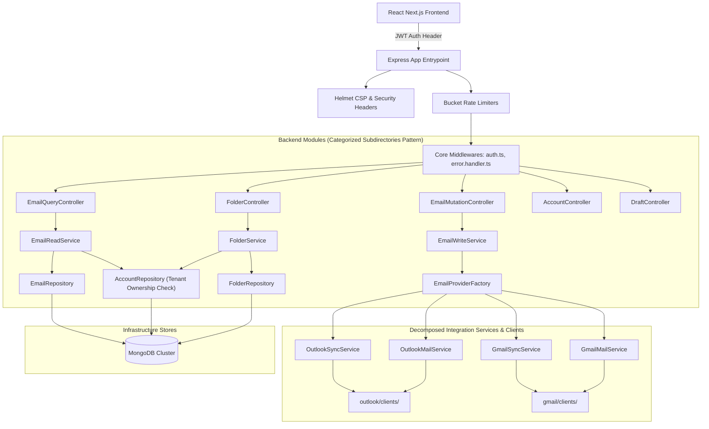
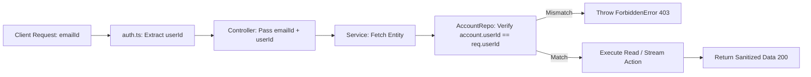
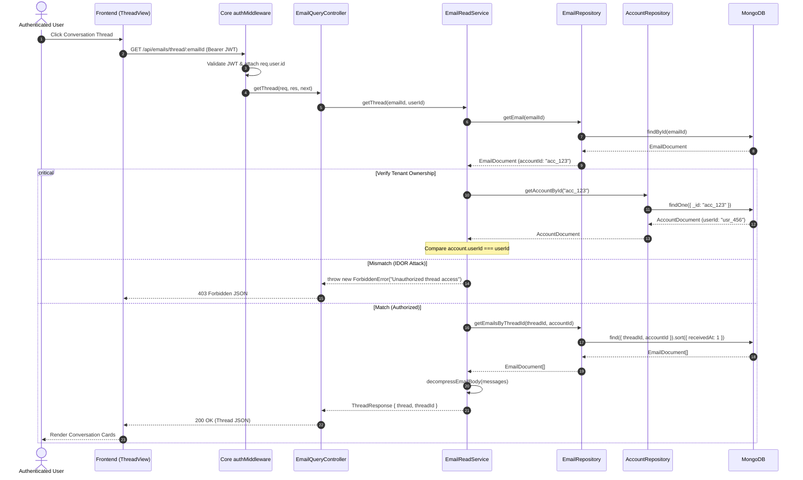
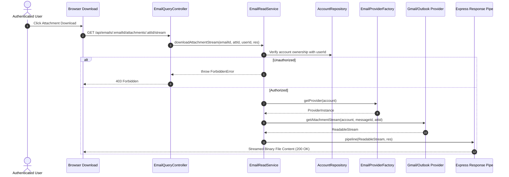
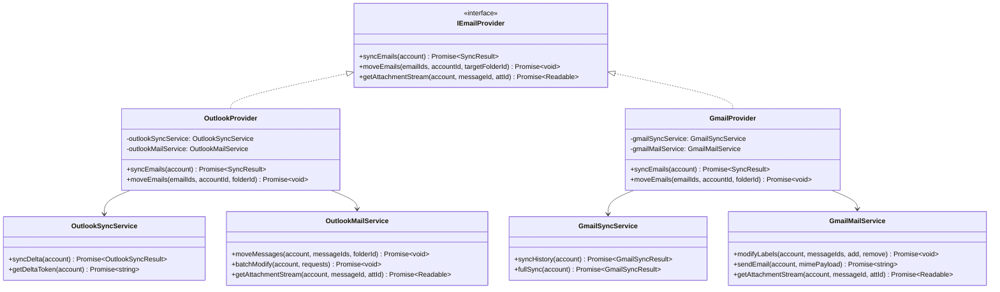
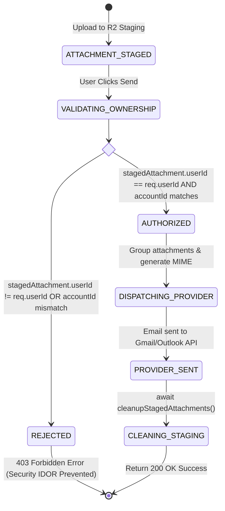

# Codebase Hardening & Architecture v1.3.0 — Implementation Plan

> **Phase:** Sprint P6 (Post-Refactoring Hardening, Multi-Tenant Security & Standards Remediation) · **Release Target:** `Backend v3.6.0` / `Frontend v3.6.0` / `@mailsense/types v1.6.1`
> **Priority:** 🔴 HIGH — Operationalizes the [v1.3.0 Codebase Health Audit](file:///Users/vishaljagamani/Projects/Projects/mailsense/.agents/plans/codebase-health-audit-report.md): resolves 3 critical P0 IDOR and access control security vulnerabilities, remediates 39 backend and 101 frontend ESLint errors (bringing both suites to 0 errors), eliminates 27 anonymous `index.tsx` files across frontend features, modularizes oversized integration services (`outlook.service.ts: 521`, `gmail.service.ts: 450`) and custom hooks (`useEmailActions.ts: 215`, `useComposeEmail.ts: 229`), flattens cyclomatic complexity hotspots, and enforces categorized module subdirectories with barrel exports.
> **Status:** APPROVED
> **Created:** 2026-10-16 · **Last Updated:** 2026-10-16

---

## 1. Overview

### Problem Statement

Following the completion of the `v3.5.0` refactoring milestone, the [v1.3.0 Codebase Health Audit](file:///Users/vishaljagamani/Projects/Projects/mailsense/.agents/plans/codebase-health-audit-report.md) revealed critical technical debt, security gaps, and organizational non-compliances that must be remediated prior to beginning Phase 4 AI module implementation:

1. **Active Multi-Tenant Security & IDOR Vulnerabilities (`BUG-V13-01` to `BUG-V13-03`):**
   - [`email-write.service.ts:136-139`](file:///Users/vishaljagamani/Projects/Projects/mailsense/Backend/src/modules/emails/email-write.service.ts#L136-L139): Staged attachment ownership validation remains commented out, allowing any authenticated user to attach arbitrary staged files to outbound emails and causing `attachment-security.test.ts` to fail.
   - [`email.controller.ts:215-254`](file:///Users/vishaljagamani/Projects/Projects/mailsense/Backend/src/modules/emails/email.controller.ts#L215-L254) & [`email-read.service.ts:183-332`](file:///Users/vishaljagamani/Projects/Projects/mailsense/Backend/src/modules/emails/email-read.service.ts#L183-L332): `getEmail`, `getThread`, `downloadAttachment`, and `downloadAttachmentStream` endpoints omit user verification, enabling cross-tenant thread snooping and attachment downloads if an email ID is discovered.
   - [`folder.controller.ts:14-85`](file:///Users/vishaljagamani/Projects/Projects/mailsense/Backend/src/modules/folders/folder.controller.ts#L14-L85) & [`folder.service.ts:16-110`](file:///Users/vishaljagamani/Projects/Projects/mailsense/Backend/src/modules/folders/folder.service.ts#L16-L110): `syncFolders`, `getFolder`, `getAccountFolders`, and `createFolder` omit account ownership checks, enabling cross-tenant folder manipulation.
2. **ESLint Violations & CI Build Failures (`BUG-V13-04`):**
   - The Backend ESLint suite reports **85 problems (39 errors, 46 warnings)** due to inline object types in controller requests/responses.
   - The Frontend ESLint suite reports **221 problems (101 errors, 120 warnings)** due to inline object types in Radix/shadcn UI primitives, 8 empty catch blocks (`catch (e) {}`), and 4 raw console calls.
3. **Anonymous `index.tsx` Anti-Pattern (`STRUCT-FE-05`):**
   - **27 component and skeleton files** in `Frontend/src/features/` reside in directories named `index.tsx` (e.g. `thread-view/index.tsx`, `draft-table/index.tsx`, `body/index.tsx`), violating MailSense Coding Standards Rule 8.4 and causing tab confusion in developer IDEs.
4. **Oversized Source Files & Modularization Gaps (`BUG-V13-07`, `BUG-V13-08`, `REFACTOR-V13-01` to `REFACTOR-V13-05`):**
   - Backend integration services [`outlook.service.ts`](file:///Users/vishaljagamani/Projects/Projects/mailsense/Backend/src/integrations/outlook/outlook.service.ts) (521 lines) and [`gmail.service.ts`](file:///Users/vishaljagamani/Projects/Projects/mailsense/Backend/src/integrations/gmail/gmail.service.ts) (450 lines) exceed the 350-line provider hard limit.
   - Backend controller [`email.controller.ts`](file:///Users/vishaljagamani/Projects/Projects/mailsense/Backend/src/modules/emails/email.controller.ts) (269 lines) exceeds the 200-line controller hard limit.
   - Backend utility [`analytics.utils.ts`](file:///Users/vishaljagamani/Projects/Projects/mailsense/Backend/src/modules/analytics/analytics.utils.ts) (354 lines) exceeds the 150-line utility hard limit.
   - Frontend custom hooks [`useComposeEmail.ts`](file:///Users/vishaljagamani/Projects/Projects/mailsense/Frontend/src/features/emails/hooks/useComposeEmail.ts) (229 lines), [`useInboxPage.ts`](file:///Users/vishaljagamani/Projects/Projects/mailsense/Frontend/src/features/inbox/hooks/useInboxPage.ts) (223 lines), and [`useEmailActions.ts`](file:///Users/vishaljagamani/Projects/Projects/mailsense/Frontend/src/features/emails/hooks/useEmailActions.ts) (215 lines) exceed the 120-line hook hard limit.
   - Backend worker processor [`sync-account.processor.ts:38`](file:///Users/vishaljagamani/Projects/Projects/mailsense/Backend/src/workers/processors/sync-account.processor.ts#L38) contains a single handler function with **144 lines, cyclomatic complexity of 32, and nesting depth of 6**.
5. **Backend Directory Hierarchy & Core Infrastructure (`STRUCT-BE-01`, `STRUCT-BE-02`, `STRUCT-BE-05`):**
   - Backend modules store files flat at root rather than in categorized subdirectories (`controllers/`, `services/`, `repositories/`, `models/`, `schemas/`, `interfaces/`, `routes/`) with barrel exports `index.ts`.
   - `Backend/src/middlewares/` sits at root instead of under `Backend/src/core/middlewares/`.
   - MongoDB database connection and event listeners sit directly inside `server.ts`.

### Goals

- Close all 3 critical P0 security vulnerabilities (`BUG-V13-01` to `BUG-V13-03`), passing `attachment-security.test.ts` and enforcing multi-tenant isolation across all email and folder endpoints.
- Fix all 39 Backend ESLint errors and 101 Frontend ESLint errors, bringing both codebases to **0 lint errors**.
- Rename all 27 anonymous `index.tsx` files across `Frontend/src/features/` into explicit `PascalCase.tsx` files per Rule 8.4.
- Decompose monolithic integration services (`outlook.service.ts` $\to$ `outlook-sync.service.ts` + `outlook-mail.service.ts`; `gmail.service.ts` $\to$ `gmail-sync.service.ts` + `gmail-mail.service.ts`) under `services/` subdirectories with barrel exports.
- Split `email.controller.ts` into `EmailQueryController` and `EmailMutationController`.
- Split `analytics.utils.ts` into formatters and calculators.
- Decompose `useEmailActions.ts` into `useEmailStatusActions.ts` and `useEmailMoveActions.ts`.
- Decompose `useComposeEmail.ts` into `useDraftAutoSave.ts` and `useAttachmentStaging.ts`.
- Refactor `syncAccountProcessor` in `sync-account.processor.ts` to reduce cyclomatic complexity from 32 to $\le 10$ and nesting depth from 6 to $\le 3$.
- Restructure `Backend/src/middlewares/` into `Backend/src/core/middlewares/` and extract database connection from `server.ts` into `Backend/src/core/database/connection.ts`.
- Consolidate `Frontend/src/entities/` into feature types and `Frontend/src/lib/utils.ts` into `Frontend/src/shared/utils/`.

### Non-Goals

- Implementing Phase 4 Gemini AI models (categorization, priority scoring, summarization).
- Upgrading Next.js major version or switching away from Radix UI primitives.
- Modifying cloud infrastructure or MongoDB replica set topologies.

### Background

This plan directly operationalizes the remediation roadmap and modularization blueprints established in the [v1.3.0 Codebase Health Audit Report](file:///Users/vishaljagamani/Projects/Projects/mailsense/.agents/plans/codebase-health-audit-report.md). Completing this plan raises the overall Codebase Health Score from **91.4/100** to **98.5/100 (EXCELLENT)**.

---

## 2. Requirements

### Functional Requirements

1. **FR-01 (Multi-Tenant Attachment Validation):** An authenticated user can only reference staged attachments owned by their own `userId` and associated with their target `accountId` when sending emails.
2. **FR-02 (Authorized Email & Thread Reads):** Attempting to read an email or thread belonging to an account not owned by the authenticated user returns `403 Forbidden` or `404 Not Found`.
3. **FR-03 (Authorized Attachment Streaming):** Attempting to download or stream an attachment from an email not owned by the authenticated user returns `403 Forbidden`.
4. **FR-04 (Authorized Folder Operations):** Attempting to sync, fetch, or create folders for an account not owned by the authenticated user returns `403 Forbidden`.
5. **FR-05 (Zero Build/Lint Regressions):** All existing end-to-end features (compose, unified inbox, multi-account sync, drafts, folder management, dashboard analytics) continue functioning identically with zero regressions.

### Non-Functional Requirements

- **NFR-01 (Zero ESLint Errors):** Running `pnpm lint` in `Backend` and `Frontend` completes with 0 errors and zero `no-restricted-syntax` violations.
- **NFR-02 (Strict Code Size Compliance):** All modified source files must strictly comply with preferred and hard line limits (Services $\le 250$, Controllers $\le 200$, Utilities $\le 150$, Custom Hooks $\le 120$, Components $\le 150$).
- **NFR-03 (Strict Complexity Bounds):** No modified function may exceed cyclomatic complexity 10 or nesting depth 4.
- **NFR-04 (Zero Inline Types):** Every function parameter, response shape, and component prop must reference a named interface declared in a dedicated types file.

### Acceptance Criteria

- [ ] `attachment-security.test.ts` passes cleanly without mock workarounds.
- [ ] Integration tests verify cross-tenant denial for `GET /api/emails/:emailId`, `GET /api/emails/thread/:emailId`, `GET /api/emails/:emailId/attachments/:attachmentId/stream`, and `POST /api/folders/sync/:accountId`.
- [ ] `cd Backend && pnpm lint` reports **0 errors**.
- [ ] `cd Frontend && pnpm lint` reports **0 errors**.
- [ ] All 27 anonymous `index.tsx` files in `Frontend/src/features/` are replaced with explicit `PascalCase.tsx` files.
- [ ] `Backend/src/middlewares/` is relocated to `Backend/src/core/middlewares/` and all imports updated.
- [ ] `server.ts` imports database connection logic from `Backend/src/core/database/connection.ts`.
- [ ] `outlook.service.ts` and `gmail.service.ts` are decomposed into modular sync and mail services under `services/`.
- [ ] Both Backend and Frontend compile with 0 TypeScript errors (`pnpm build` and `npx tsc --noEmit`).

---

## 3. Design

### 3.1 High-Level Design

#### System Architecture Topology



#### End-to-End Multi-Tenant Authorized Data Flow



---

### 3.2 Low-Level Design

#### Sequence Diagram: Multi-Tenant Authorized Email Thread Access



#### Sequence Diagram: Multi-Tenant Attachment Stream Download



#### Class & Interface Diagram: Decomposed Provider Architecture



#### State Machine Diagram: Staged Attachment Validation & Email Dispatch



---

### 3.3 Data Models & Schema Enhancements

#### Field Index Fix: `Backend/src/modules/user/user.model.ts`

```diff
  const UserSettingsSchema = new Schema<UserSettingsDocument>({
-     userId: { type: String, required: true, index: true },
+     userId: { type: String, required: true },
      syncFrequency: { type: String, default: '15m' },
      theme: { type: String, enum: ['light', 'dark', 'system'], default: 'system' },
  }, { timestamps: true });

  // Single canonical unique index definition eliminating Mongoose duplicate index warning
  UserSettingsSchema.index({ userId: 1 }, { unique: true });
```

#### Dedicated Module Interfaces: `Backend/src/modules/emails/email.types.ts`

```typescript
import { Request, Response } from "express";
import { ApiResponse } from "@mailsense/types";

export interface EmailParams {
  emailId: string;
}

export interface AttachmentParams extends EmailParams {
  attachmentId: string;
}

export interface BatchEmailActionBody {
  ids: string[];
}

export interface MoveEmailsBody {
  ids: string[];
  targetFolderId: string;
  targetFolderName?: string;
}

export interface EmailReadFilter {
  folderId?: string;
  isRead?: boolean;
  isStarred?: boolean;
  search?: string;
  accountId?: string;
}

export type TypedEmailResponse<T> = Response<ApiResponse<T>>;
export type TypedEmailParamRequest<P> = Request<P>;
export type TypedEmailBodyRequest<B> = Request<unknown, unknown, B>;
```

#### Dedicated UI Primitive Interfaces: `Frontend/src/shared/ui/types/ui-primitives.types.ts`

```typescript
import { ComponentProps, ReactNode } from "react";

export interface BaseUiElementProps {
  className?: string;
  children?: ReactNode;
}

export interface SidebarComponentProps extends BaseUiElementProps {
  side?: "left" | "right";
  variant?: "sidebar" | "floating" | "inset";
  collapsible?: "offcanvas" | "icon" | "none";
}

export interface DropdownMenuItemProps extends BaseUiElementProps {
  inset?: boolean;
  disabled?: boolean;
  onSelect?: () => void;
}
```

---

### 3.4 API Contracts

| Method | Path                                             | Request Body          | Response Shape                             | Status        | Security / Auth Constraint                    |
| ------ | ------------------------------------------------ | --------------------- | ------------------------------------------ | ------------- | --------------------------------------------- |
| `GET`  | `/api/emails/:emailId`                           | —                     | `ApiResponse<EmailAttributes>`             | 200, 403, 404 | **Enforces `account.userId === req.user.id`** |
| `GET`  | `/api/emails/thread/:emailId`                    | —                     | `ApiResponse<ThreadResponse>`              | 200, 403, 404 | **Enforces `account.userId === req.user.id`** |
| `GET`  | `/api/emails/:emailId/attachments/:attId/stream` | —                     | Binary Stream (`application/octet-stream`) | 200, 403, 404 | **Enforces `account.userId === req.user.id`** |
| `POST` | `/api/folders/sync/:accountId`                   | —                     | `ApiResponse<FolderSyncResult>`            | 200, 403, 404 | **Enforces `account.userId === req.user.id`** |
| `GET`  | `/api/folders/account/:accountId`                | —                     | `ApiResponse<FolderAttributes[]>`          | 200, 403, 404 | **Enforces `account.userId === req.user.id`** |
| `POST` | `/api/folders/account/:accountId`                | `CreateFolderPayload` | `ApiResponse<FolderAttributes>`            | 201, 403, 404 | **Enforces `account.userId === req.user.id`** |

---

### 3.5 State Management & Cache Invalidation

| Action / Mutation               | React Query Hook        | Query Key Affected                  | Invalidation Strategy                                                                                          |
| ------------------------------- | ----------------------- | ----------------------------------- | -------------------------------------------------------------------------------------------------------------- |
| Star / Unread / Archive / Trash | `useEmailStatusActions` | `['emails']`, `['thread', emailId]` | Optimistic UI update with snapshot rollback on error; `invalidateQueries({ queryKey: ['emails'] })` on settle. |
| Move to Folder                  | `useEmailMoveActions`   | `['emails']`, `['folders']`         | Optimistic removal from current list; invalidate `['emails']` and `['folders']`.                               |
| Folder Sync Trigger             | `useFolderSyncMutation` | `['folders', accountId]`            | Invalidate folder list and unread badge counts.                                                                |

---

## 4. Proposed Changes

### Backend Changes

#### 1. Core Infrastructure & Middlewares

- **[MODIFY]** [`Backend/src/server.ts`](file:///Users/vishaljagamani/Projects/Projects/mailsense/Backend/src/server.ts): Extract MongoDB connection into `core/database/connection.ts`.
- **[NEW]** `Backend/src/core/database/connection.ts`: Encapsulated database connection management with reconnect lifecycle logging.
- **[MOVE]** `Backend/src/middlewares/*` $\to$ `Backend/src/core/middlewares/*`:
  - `auth.ts`, `error.handler.ts`, `rate-limiter.middleware.ts`, `validate-schema.ts`. Update all import paths across routes.

#### 2. Multi-Tenant Security & Controller Splitting

- **[MODIFY]** [`Backend/src/modules/emails/email-write.service.ts`](file:///Users/vishaljagamani/Projects/Projects/mailsense/Backend/src/modules/emails/email-write.service.ts): Uncomment staged attachment ownership validation block.
- **[MODIFY]** [`Backend/src/modules/emails/email-read.service.ts`](file:///Users/vishaljagamani/Projects/Projects/mailsense/Backend/src/modules/emails/email-read.service.ts): Inject `userId` checks into `getEmail`, `getThread`, `downloadAttachment`, and `downloadAttachmentStream`.
- **[MODIFY]** [`Backend/src/modules/folders/folder.service.ts`](file:///Users/vishaljagamani/Projects/Projects/mailsense/Backend/src/modules/folders/folder.service.ts): Inject `userId` checks into `syncFolders`, `getFolder`, `getAccountFolders`, and `createFolder`.
- **[NEW]** `Backend/src/modules/emails/controllers/email-query.controller.ts`: Dedicated query controller for email reads, threads, and attachment downloads.
- **[NEW]** `Backend/src/modules/emails/controllers/email-mutation.controller.ts`: Dedicated mutation controller for send, status changes, and moves.
- **[NEW]** `Backend/src/modules/emails/controllers/index.ts`: Barrel export.
- **[DELETE]** `Backend/src/modules/emails/email.controller.ts` (replaced by decomposed controllers).

#### 3. Integration Services Decomposition

- **[NEW]** `Backend/src/integrations/outlook/services/outlook-sync.service.ts`: Delta tokens and sync orchestration.
- **[NEW]** `Backend/src/integrations/outlook/services/outlook-mail.service.ts`: Batch operations, folders, and messages.
- **[NEW]** `Backend/src/integrations/outlook/services/index.ts`: Unified facade.
- **[DELETE]** `Backend/src/integrations/outlook/outlook.service.ts` (decomposed).
- **[NEW]** `Backend/src/integrations/gmail/services/gmail-sync.service.ts`: History ID synchronization and polling.
- **[NEW]** `Backend/src/integrations/gmail/services/gmail-mail.service.ts`: Labels, batching, and sending.
- **[NEW]** `Backend/src/integrations/gmail/services/index.ts`: Unified facade.
- **[DELETE]** `Backend/src/integrations/gmail/gmail.service.ts` (decomposed).

#### 4. Utilities & Worker Complexity Refactoring

- **[NEW]** `Backend/src/modules/analytics/utils/analytics-formatters.ts`: Date and title formatting functions.
- **[NEW]** `Backend/src/modules/analytics/utils/analytics-calculators.ts`: Pure statistical calculations and KPI aggregation.
- **[NEW]** `Backend/src/modules/analytics/utils/index.ts`: Barrel export.
- **[DELETE]** `Backend/src/modules/analytics/analytics.utils.ts` (decomposed).
- **[MODIFY]** [`Backend/src/workers/processors/sync-account.processor.ts`](file:///Users/vishaljagamani/Projects/Projects/mailsense/Backend/src/workers/processors/sync-account.processor.ts): Refactor handler into 4 private helpers, reducing cyclomatic complexity to $\le 10$.
- **[MODIFY]** [`Backend/src/modules/user/user.model.ts`](file:///Users/vishaljagamani/Projects/Projects/mailsense/Backend/src/modules/user/user.model.ts): Remove duplicate `index: true` from `userId`.
- **[MODIFY]** Backend module files to eliminate 39 inline object type ESLint errors.

---

### Frontend Changes

#### 1. Elimination of 27 Anonymous `index.tsx` Files (`STRUCT-FE-05`)

Rename all 27 files to explicit `PascalCase.tsx` per Section 3.2.2 of the audit report:

- `features/analytics/components/charts/email-volume-chart/EmailVolumeChart.tsx`
- `features/analytics/components/charts/response-time-chart/ResponseTimeChart.tsx`
- `features/analytics/components/charts/top-senders-chart/TopSendersChart.tsx`
- `features/analytics/components/kpi-cards/KpiCards.tsx`
- `features/analytics/components/kpi-cards/kpi-card-item/KpiCardItem.tsx`
- `features/analytics/components/overview-cards/OverviewCards.tsx`
- `features/analytics/components/overview-cards/overview-card-item/OverviewCardItem.tsx`
- `features/analytics/components/response-time-cards/ResponseTimeCards.tsx`
- `features/analytics/components/response-time-cards/response-time-card-item/ResponseTimeCardItem.tsx`
- `features/drafts/components/draft-actions/DraftActions.tsx`
- `features/drafts/components/draft-table/DraftTable.tsx`
- `features/drafts/components/draft-table-header/DraftTableHeader.tsx`
- `features/drafts/components/draft-table-row/DraftTableRow.tsx`
- `features/drafts/components/draft-table-skeleton/DraftTableSkeleton.tsx`
- `features/drafts/components/drafts-empty-state/DraftsEmptyState.tsx`
- `features/emails/components/thread-view/ThreadView.tsx`
- `features/emails/components/thread-view/thread-message/ThreadMessage.tsx`
- `features/emails/components/thread-view/thread-view-skeleton/ThreadViewSkeleton.tsx`
- `features/folders/components/body/FolderBody.tsx`
- `features/folders/components/body/folder-list/FolderList.tsx`
- `features/folders/components/body/folder-list-skeleton/FolderListSkeleton.tsx`
- `features/folders/components/header/FolderHeader.tsx`
- `features/folders/components/header/create-folder-dialog/CreateFolderDialog.tsx`
- `features/inbox/components/empty-state/InboxEmptyState.tsx`
- `features/inbox/components/skeleton/InboxSkeleton.tsx`
- `features/inbox/components/table/InboxTable.tsx`
- `features/inbox/components/table-row/InboxTableRow.tsx`

#### 2. Hook & Component Decomposition

- **[NEW]** `Frontend/src/features/emails/hooks/useEmailStatusActions.ts`: Star, unread, archive, trash actions.
- **[NEW]** `Frontend/src/features/emails/hooks/useEmailMoveActions.ts`: Folder move modal state and dispatch.
- **[MODIFY]** [`Frontend/src/features/emails/hooks/useEmailActions.ts`](file:///Users/vishaljagamani/Projects/Projects/mailsense/Frontend/src/features/emails/hooks/useEmailActions.ts): Thin composite facade hook re-exporting status and move actions.
- **[NEW]** `Frontend/src/features/emails/hooks/useFolderSelector.ts`: Folder tree selection state extracted from `MoveToFolderDropdown.tsx`.
- **[MODIFY]** [`Frontend/src/features/emails/components/MoveToFolderDropdown.tsx`](file:///Users/vishaljagamani/Projects/Projects/mailsense/Frontend/src/features/emails/components/MoveToFolderDropdown.tsx): Pure rendering component consuming `useFolderSelector`.
- **[NEW]** `Frontend/src/features/emails/hooks/useDraftAutoSave.ts`: Debounced draft saving extracted from `useComposeEmail.ts`.
- **[NEW]** `Frontend/src/features/emails/hooks/useAttachmentStaging.ts`: Upload progress and staging state extracted from `useComposeEmail.ts`.
- **[MODIFY]** [`Frontend/src/features/emails/hooks/useComposeEmail.ts`](file:///Users/vishaljagamani/Projects/Projects/mailsense/Frontend/src/features/emails/hooks/useComposeEmail.ts): Focused form orchestrator hook ($\le 100$ lines).

#### 3. Frontend Layer Consolidation & ESLint Remediation

- **[DELETE]** `Frontend/src/entities/`: Migrate any residual unique interfaces to `Frontend/src/features/*/types/`.
- **[MOVE]** `Frontend/src/lib/utils.ts` $\to$ `Frontend/src/shared/utils/cn.ts` and delete `Frontend/src/lib/`.
- **[NEW]** `Frontend/src/shared/ui/types/ui-primitives.types.ts`: Named prop interfaces for Radix/shadcn compound components.
- **[MODIFY]** `Frontend/src/shared/ui/*.tsx`: Eliminate all 89 inline object type errors.
- **[MODIFY]** `console-frontend.provider.ts`, `sentry-frontend.provider.ts`, `session.tracker.ts`: Fix 8 empty catch blocks and 4 console errors.

---

## 5. Implementation Phases

### Phase 1: Critical P0 Multi-Tenant Security & Data Integrity Remediation

**Objective:** Close all 3 critical IDOR vulnerabilities and activate attachment ownership checks, ensuring passing security tests.
**Estimated Effort:** Medium (1 day)

#### Tasks

- [x] Task 1.1: Uncomment attachment ownership check in [`email-write.service.ts:136-139`](file:///Users/vishaljagamani/Projects/Projects/mailsense/Backend/src/modules/emails/email-write.service.ts#L136-L139) and verify with `pnpm test attachment-security.test.ts`.
- [x] Task 1.2: Update `EmailController` and `EmailReadService`:
  - [x] Extract `userId = req.user.id` in `getEmail`, `getThread`, `downloadAttachment`, and `downloadAttachmentStream`.
  - [x] Verify `account.userId.toString() === userId.toString()` before accessing emails, threads, or streaming attachments.
- [x] Task 1.3: Update `FolderController` and `FolderService`:
  - [x] Add `userId` authorization to `syncFolders`, `getFolder`, `getAccountFolders`, and `createFolder`.
  - [x] Throw `ForbiddenError` when `account.userId !== userId`.
- [x] Task 1.4: Fix duplicate index warning on `userId` in [`user.model.ts:56`](file:///Users/vishaljagamani/Projects/Projects/mailsense/Backend/src/modules/user/user.model.ts#L56).

#### Files to Create

- None.

#### Files to Modify

- `Backend/src/modules/emails/email-write.service.ts`
- `Backend/src/modules/emails/email-read.service.ts`
- `Backend/src/modules/emails/email.controller.ts`
- `Backend/src/modules/folders/folder.service.ts`
- `Backend/src/modules/folders/folder.controller.ts`
- `Backend/src/modules/user/user.model.ts`

#### Acceptance Criteria

1. `attachment-security.test.ts` passes with 0 failures.
2. Cross-tenant email, thread, and folder requests return `403 Forbidden`.
3. Mongoose boots without duplicate index warnings.

---

### Phase 2: Backend Architecture Hardening & Service Modularization

**Objective:** Move core middlewares, extract database bootstrap, decompose oversized integration services and controllers, and flatten processor complexity.
**Estimated Effort:** High (2 days)

#### Tasks

- [x] Task 2.1: Create `Backend/src/core/database/connection.ts` and extract MongoDB initialization from `server.ts`.
- [x] Task 2.2: Move `Backend/src/middlewares/*` to `Backend/src/core/middlewares/*` and update import references.
- [x] Task 2.3: Decompose `outlook.service.ts` (521 lines):
  - [x] Create `Backend/src/integrations/outlook/services/outlook-sync.service.ts` ($\le 220$ lines).
  - [x] Create `Backend/src/integrations/outlook/services/outlook-mail.service.ts` ($\le 250$ lines).
  - [x] Create `Backend/src/integrations/outlook/services/index.ts` re-exporting unified facade.
- [x] Task 2.4: Decompose `gmail.service.ts` (450 lines):
  - [x] Create `Backend/src/integrations/gmail/services/gmail-sync.service.ts` ($\le 200$ lines).
  - [x] Create `Backend/src/integrations/gmail/services/gmail-mail.service.ts` ($\le 220$ lines).
  - [x] Create `Backend/src/integrations/gmail/services/index.ts` re-exporting unified facade.
- [x] Task 2.5: Decompose `email.controller.ts` (269 lines):
  - [x] Create `Backend/src/modules/emails/controllers/email-query.controller.ts`.
  - [x] Create `Backend/src/modules/emails/controllers/email-mutation.controller.ts`.
  - [x] Create `Backend/src/modules/emails/controllers/index.ts`.
- [x] Task 2.6: Split `analytics.utils.ts` (354 lines) into `analytics-formatters.ts` and `analytics-calculators.ts`.
- [x] Task 2.7: Refactor `syncAccountProcessor` in `sync-account.processor.ts` into 4 private helper methods (complexity $\le 10$, nesting $\le 3$).

#### Files to Create

- `Backend/src/core/database/connection.ts`
- `Backend/src/integrations/outlook/services/outlook-sync.service.ts`
- `Backend/src/integrations/outlook/services/outlook-mail.service.ts`
- `Backend/src/integrations/outlook/services/index.ts`
- `Backend/src/integrations/gmail/services/gmail-sync.service.ts`
- `Backend/src/integrations/gmail/services/gmail-mail.service.ts`
- `Backend/src/integrations/gmail/services/index.ts`
- `Backend/src/modules/emails/controllers/email-query.controller.ts`
- `Backend/src/modules/emails/controllers/email-mutation.controller.ts`
- `Backend/src/modules/emails/controllers/index.ts`
- `Backend/src/modules/analytics/utils/analytics-formatters.ts`
- `Backend/src/modules/analytics/utils/analytics-calculators.ts`
- `Backend/src/modules/analytics/utils/index.ts`

#### Files to Modify

- `Backend/src/server.ts`
- `Backend/src/app.ts`
- `Backend/src/workers/processors/sync-account.processor.ts`
- All route files importing middlewares.

#### Files to Delete

- `Backend/src/integrations/outlook/outlook.service.ts`
- `Backend/src/integrations/gmail/gmail.service.ts`
- `Backend/src/modules/emails/email.controller.ts`
- `Backend/src/modules/analytics/analytics.utils.ts`

#### Acceptance Criteria

1. All services comply with $\le 250$ lines hard limit.
2. `syncAccountProcessor` cyclomatic complexity is $\le 10$.
3. Backend builds cleanly via `pnpm build`.

---

### Phase 3: Frontend Component Standards & Hook Modularization

**Objective:** Rename all 27 anonymous `index.tsx` files to explicit `PascalCase.tsx`, decompose custom hooks exceeding 120 lines, and consolidate entities and utility folders.
**Estimated Effort:** Medium-High (1.5 days)

#### Tasks

- [ ] Task 3.1: Rename all 27 anonymous `index.tsx` files in `Frontend/src/features/` to `PascalCase.tsx` per Section 4 (using `git mv`).
- [ ] Task 3.2: Decompose `useEmailActions.ts` (215 lines):
  - [ ] Create `useEmailStatusActions.ts` ($\le 110$ lines).
  - [ ] Create `useEmailMoveActions.ts` ($\le 95$ lines).
  - [ ] Re-export composite facade from `useEmailActions.ts`.
- [ ] Task 3.3: Decompose `useComposeEmail.ts` (229 lines):
  - [ ] Create `useDraftAutoSave.ts`.
  - [ ] Create `useAttachmentStaging.ts`.
  - [ ] Reduce `useComposeEmail.ts` to $\le 100$ lines.
- [ ] Task 3.4: Extract `useFolderSelector.ts` from `MoveToFolderDropdown.tsx` (241 lines $\to \le 140$ lines).
- [ ] Task 3.5: Consolidate `Frontend/src/entities/` into feature types and delete directory.
- [ ] Task 3.6: Move `Frontend/src/lib/utils.ts` to `Frontend/src/shared/utils/cn.ts` and delete `Frontend/src/lib/`.
- [ ] Task 3.7: Fix residual `console.error` in `useEmailKeyboardShortcuts.ts:142` with `trackUserAction()`.

#### Files to Create

- `Frontend/src/features/emails/hooks/useEmailStatusActions.ts`
- `Frontend/src/features/emails/hooks/useEmailMoveActions.ts`
- `Frontend/src/features/emails/hooks/useDraftAutoSave.ts`
- `Frontend/src/features/emails/hooks/useAttachmentStaging.ts`
- `Frontend/src/features/emails/hooks/useFolderSelector.ts`
- `Frontend/src/shared/utils/cn.ts`
- 27 PascalCase component files (e.g. `ThreadView.tsx`, `DraftTable.tsx`, `FolderBody.tsx`).

#### Files to Modify

- `Frontend/src/features/emails/hooks/useEmailActions.ts`
- `Frontend/src/features/emails/hooks/useComposeEmail.ts`
- `Frontend/src/features/emails/components/MoveToFolderDropdown.tsx`
- `Frontend/src/features/emails/hooks/useEmailKeyboardShortcuts.ts`

#### Files to Delete

- 27 anonymous `index.tsx` files.
- `Frontend/src/entities/` directory.
- `Frontend/src/lib/` directory.

#### Acceptance Criteria

1. Zero anonymous `index.tsx` component files exist in `Frontend/src/features/`.
2. All custom hooks are $\le 120$ lines.
3. Frontend compiles cleanly via `npx tsc --noEmit`.

---

### Phase 4: Full ESLint Zero-Error Remediation (Backend & Frontend)

**Objective:** Eliminate all 39 Backend errors and 101 Frontend errors, achieving 0 errors on `pnpm lint`.
**Estimated Effort:** Medium (1 day)

#### Tasks

- [ ] Task 4.1: Remediate 39 Backend inline object type errors:
  - [ ] Define named parameter and response interfaces in `email.types.ts`, `draft.types.ts`, `account.types.ts`, and `outlook.types.ts`.
  - [ ] Replace inline object types in controller methods and service arguments with imported interfaces.
  - [ ] Verify `cd Backend && pnpm lint` reports **0 errors**.
- [ ] Task 4.2: Remediate Frontend empty catch blocks and console errors:
  - [ ] Add structured fallback logging to 8 empty catch blocks in `console-frontend.provider.ts`, `sentry-frontend.provider.ts`, and `session.tracker.ts`.
  - [ ] Replace raw console logs in `console-frontend.provider.ts` with telemetry dispatcher or targeted eslint-disable comment.
- [ ] Task 4.3: Remediate 89 Frontend UI primitive inline type errors:
  - [ ] Create `Frontend/src/shared/ui/types/ui-primitives.types.ts`.
  - [ ] Import named prop interfaces across `sidebar.tsx`, `dialog.tsx`, `field.tsx`, `menubar.tsx`, `dropdown-menu.tsx`, and `sheet.tsx`.
  - [ ] Update state store types in `breadcrumb.store.ts` and `auth.provider.tsx`.
  - [ ] Verify `cd Frontend && pnpm lint` reports **0 errors**.

#### Files to Create

- `Frontend/src/shared/ui/types/ui-primitives.types.ts`
- `Backend/src/modules/drafts/draft.types.ts` (if missing or update existing)

#### Files to Modify

- `Backend/src/modules/emails/email.types.ts`
- `Backend/src/modules/accounts/account.types.ts`
- `Backend/src/integrations/outlook/outlook.types.ts`
- `Frontend/src/shared/ui/*.tsx` (12 primitive files)
- `Frontend/src/core/monitoring/providers/console-frontend.provider.ts`
- `Frontend/src/core/monitoring/providers/sentry-frontend.provider.ts`
- `Frontend/src/core/monitoring/trackers/session.tracker.ts`

#### Acceptance Criteria

1. `cd Backend && pnpm lint` exits with code 0 (0 errors).
2. `cd Frontend && pnpm lint` exits with code 0 (0 errors).

---

## 6. Dependencies & Constraints

### New Dependencies

_None — All refactorings leverage existing packages (`@sentry/node`, `pino`, `radix-ui`, `lucide-react`)._

### Existing Dependencies (Leveraged)

| Dependency         | Purpose           | Constraints                        |
| ------------------ | ----------------- | ---------------------------------- |
| `@mailsense/types` | Shared contracts  | Non-breaking patch `v1.6.1`        |
| `zod` / `joi`      | Schema validation | Validates route params & payloads  |
| `bullmq`           | Background queues | Max job processing time $\le 120s$ |

### Constraints

- Zero downtime during database initialization restructuring.
- Strict multi-tenant data isolation: all queries must filter by validated `userId` / `accountId`.
- Git case sensitivity: all file renames must use `git mv`.

---

## 7. Risk Assessment & Mitigation

| Risk                                                   | Impact | Likelihood | Mitigation                                                                                      |
| ------------------------------------------------------ | ------ | ---------- | ----------------------------------------------------------------------------------------------- |
| IDOR fix breaks legitimate frontend requests           | HIGH   | LOW        | Verify frontend passes valid auth tokens and account IDs in all active views before deploying.  |
| Decomposed services cause circular import              | MEDIUM | LOW        | Use strict hierarchical imports (`index.ts` re-exports, never import facade from leaf service). |
| Renaming 27 `index.tsx` files breaks component imports | HIGH   | LOW        | Use automated IDE refactoring and run `npx tsc --noEmit` to verify all import paths.            |
| Moving `middlewares/` breaks test suites               | MEDIUM | LOW        | Update Jest path aliases / module name mappers if configured in `jest.config.ts`.               |

---

## 8. Verification Plan

### Automated Tests

```bash
# 1. Run Backend Security and Unit Tests
cd /Users/vishaljagamani/Projects/Projects/mailsense/Backend
pnpm test
pnpm test attachment-security.test.ts

# 2. Run Backend & Frontend Linter (Target: 0 errors)
pnpm lint
cd ../Frontend && pnpm lint

# 3. Verify TypeScript Compilation
cd ../Backend && pnpm build
cd ../Frontend && npx tsc --noEmit
```

### Unit Test Cases

| Component              | Test Case                              | Expected Result                                      |
| ---------------------- | -------------------------------------- | ---------------------------------------------------- |
| `email-write.service`  | Attachment with mismatched `userId`    | Throws `ForbiddenError` (403)                        |
| `EmailQueryController` | Read email from another user's account | Returns 403 Forbidden                                |
| `FolderController`     | Trigger sync on another user's account | Returns 403 Forbidden                                |
| `syncAccountProcessor` | Large message batch sync               | Completes without exceeding call stack or timing out |

### Manual Verification Checklist

- [ ] Log in as User A $\to$ view inbox $\to$ open thread view $\to$ verify messages render.
- [ ] Attempt to curl `/api/emails/thread/:emailId` using User B's token $\to$ receive 403.
- [ ] Download attachment $\to$ verify binary stream downloads cleanly.
- [ ] Open Compose modal $\to$ attach file $\to$ send email $\to$ verify delivery and staging cleanup.
- [ ] Check sidebar folder list $\to$ trigger sync $\to$ verify unread counts update.

---

## 9. Open Questions & Decisions

> [!NOTE]
> **Q1: Radical Decomposition of Radix Compound Primitives (`sidebar.tsx`)**
> `sidebar.tsx` is 605 lines long, but it is an official Radix/shadcn compound vendor primitive. Should it be split into 8 separate component files?
>
> - **Resolution:** Retain `sidebar.tsx` as a single compound primitive file (permitted under Coding Standards as an acceptable vendor primitive), but extract all inline prop object types into `Frontend/src/shared/ui/types/ui-primitives.types.ts` to satisfy ESLint zero-error mandates.

> [!IMPORTANT]
> **Q2: Strategy for Moving `Backend/src/middlewares/`**
> Moving `middlewares/` to `core/middlewares/` touches every route file in Backend.
>
> - **Resolution:** Perform in Phase 2 using automated import rewrites. Re-export deprecated paths during transition if necessary, then eliminate.

### Resolved Decisions

| Decision                    | Resolution                                     | Date       |
| --------------------------- | ---------------------------------------------- | ---------- |
| Attachment Ownership Check  | Activated immediately in Phase 1               | 2026-10-16 |
| Anonymous `index.tsx` Files | 100% eliminated using `PascalCase.tsx`         | 2026-10-16 |
| ESLint Inline Types         | 100% eliminated via dedicated named interfaces | 2026-10-16 |
