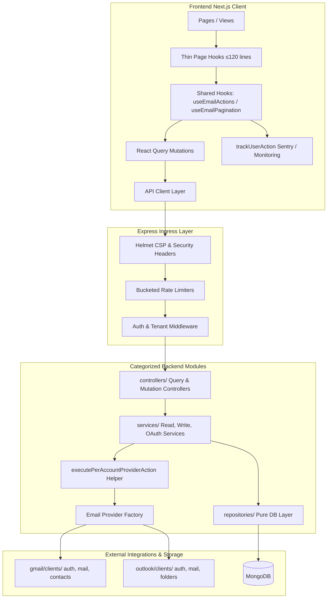
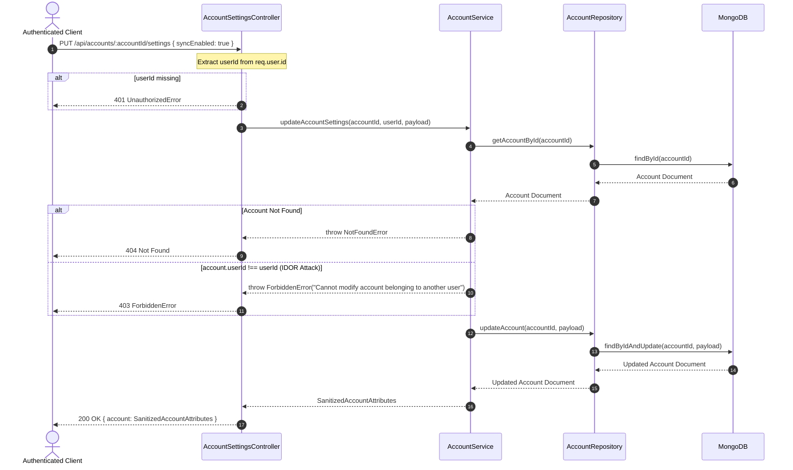
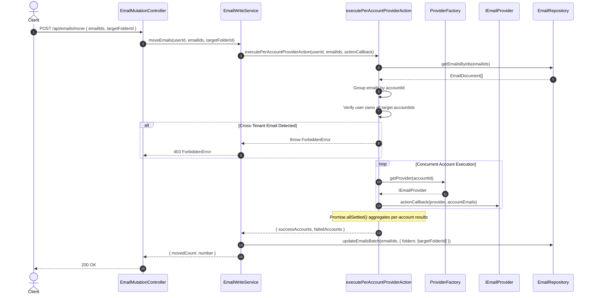
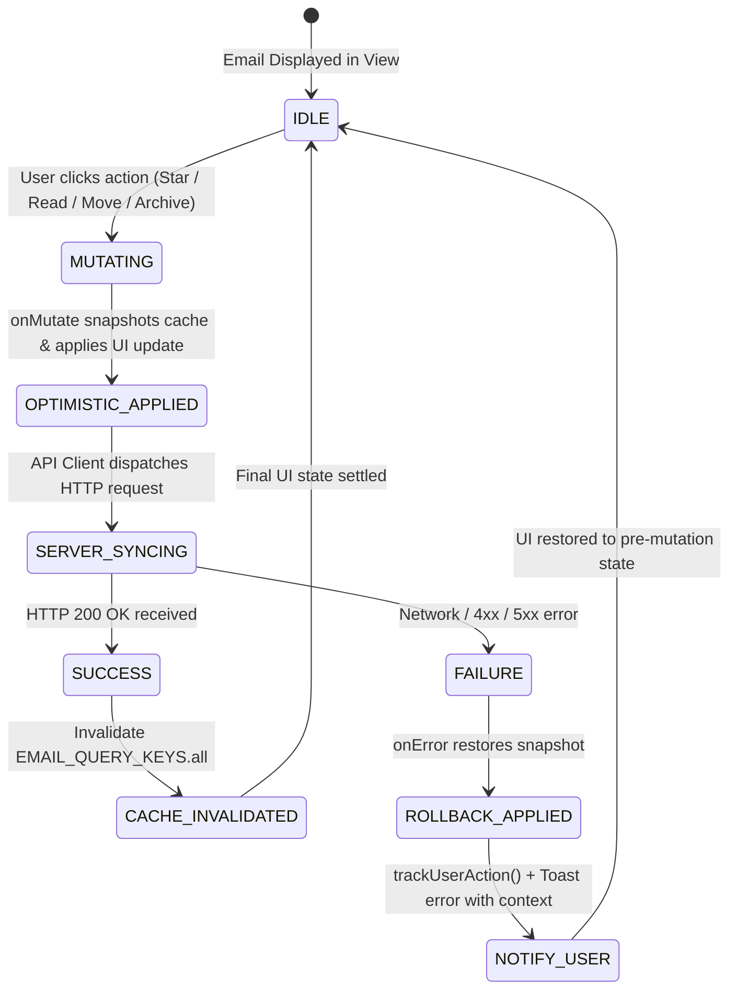

# Codebase Refactoring & Architecture — Implementation Plan

> **Phase:** Sprint P5 (Structural Refactoring, Hardening & Architecture Standards) · **Release Target:** `Backend v3.5.0` / `Frontend v3.5.0` / `@mailsense/types v1.6.0`
> **Priority:** 🔴 HIGH — Directly operationalizes findings from the [v1.2.0 Deep Structural & Refactoring Health Audit](file:///Users/vishaljagamani/Projects/Projects/mailsense/.agents/plans/codebase-health-audit-report.md): resolves 4 P0 security and crash bugs, closes multi-tenant IDOR gaps, enforces zero-inline-types and dedicated types files across both stacks, eliminates 300+ lines of duplicate frontend hook logic, unifies backend provider action abstractions, standardizes categorized module subdirectories with barrel exports, and installs ESLint enforcement rules.
> **Status:** APPROVED
> **Created:** 2026-09-27 · **Last Updated:** 2026-10-14

---

## 1. Overview

### Problem Statement

The [v1.2.0 Codebase Health Audit](file:///Users/vishaljagamani/Projects/Projects/mailsense/.agents/plans/codebase-health-audit-report.md) revealed critical technical debt, security gaps, and organizational anti-patterns across both the backend and frontend stacks that must be addressed prior to commencing Phase 4 AI module implementation:

1. **Security Vulnerabilities & Ingress Gaps (`BUG-V12-01` to `BUG-V12-04`):**
   - [`app.ts:43`](file:///Users/vishaljagamani/Projects/Projects/mailsense/Backend/src/app.ts#L43) mounts `express.static(path.join(this.__dirname, '/'))`, exposing the entire repository root (source code, configuration, `.env` files) to HTTP clients if static route matches occur.
   - [`email-write.service.ts:196-198`](file:///Users/vishaljagamani/Projects/Projects/mailsense/Backend/src/modules/emails/email-write.service.ts#L196-L198) keeps attachment ownership validation commented out, enabling cross-tenant attachment access.
   - [`gmail.service.ts:428`](file:///Users/vishaljagamani/Projects/Projects/mailsense/Backend/src/integrations/gmail/gmail.service.ts#L428) leaks raw provider API responses via `console.log()` into stdout in production.
   - [`account.controller.ts:154-169`](file:///Users/vishaljagamani/Projects/Projects/mailsense/Backend/src/modules/accounts/account.controller.ts#L154-L169) and [`account.service.ts`](file:///Users/vishaljagamani/Projects/Projects/mailsense/Backend/src/modules/accounts/account.service.ts) allow any authenticated user to update sync settings on arbitrary accounts due to missing `userId` ownership checks (**IDOR**).
2. **Data Leakage & Type System Ambiguities (`BUG-V12-05` to `BUG-V12-10`):**
   - [`account.service.ts:117-125`](file:///Users/vishaljagamani/Projects/Projects/mailsense/Backend/src/modules/accounts/account.service.ts#L117-L125) returns raw `AccountInput[]` from `getAccounts()`, leaking encrypted OAuth access/refresh tokens to the browser.
   - [`attachment.service.ts:86-99`](file:///Users/vishaljagamani/Projects/Projects/mailsense/Backend/src/modules/attachments/attachment.service.ts#L86-L99) cleanup operations are called without `await` in `email-write.service.ts`, swallowing errors.
   - The frontend leaks unmonitored errors across 15+ locations via `console.error` instead of structured monitoring via `trackUserAction()`.
   - `EmailAttributes.to/cc/bcc` union type `string[] | string` forces repetitive, fragile `Array.isArray()` checks across components.
   - Numerous components, hooks, controllers, and services define inline object types or declare types inside code files, violating the dedicated-types-only and zero-inline-types mandates.
3. **Severe Frontend Hook Duplication & Oversized Files (`REFACTOR-FE-01`, `REFACTOR-FE-02`):**
   - [`useInboxPage.ts`](file:///Users/vishaljagamani/Projects/Projects/mailsense/Frontend/src/features/inbox/hooks/useInboxPage.ts) (529 lines) and [`useFolderEmailListPage.ts`](file:///Users/vishaljagamani/Projects/Projects/mailsense/Frontend/src/features/folders/hooks/useFolderEmailListPage.ts) (409 lines) duplicate ~300 lines of identical email mutation handlers (`handleToggleStar`, `handleToggleUnread`, `handleArchiveEmail`, `handleConfirmDelete`), pagination state, and keyboard shortcuts.
   - [`useInboxEmailMenuBarOptions.ts`](file:///Users/vishaljagamani/Projects/Projects/mailsense/Frontend/src/features/inbox/hooks/useInboxEmailMenuBarOptions.ts) (219 lines) duplicates the same mutation dispatches.
4. **Backend Architecture, DRY Gaps & Integration Bloat (`REFACTOR-BE-01` to `REFACTOR-BE-03`, `STRUCT-BE-05`):**
   - `EmailWriteService` repeats a 5-step boilerplate pattern (fetch emails $\to$ extract accounts $\to$ verify ownership $\to$ group by account $\to$ dispatch provider calls) across 5 separate methods.
   - `GmailApi` uses static methods while `OutlookApi` uses instance methods, causing inconsistent provider invocation.
   - Backend modules place controllers, services, repositories, and routes in flat root directories.
   - Integration clients [`outlook.client.ts`](file:///Users/vishaljagamani/Projects/Projects/mailsense/Backend/src/integrations/outlook/outlook.client.ts) (651 lines) and [`gmail.client.ts`](file:///Users/vishaljagamani/Projects/Projects/mailsense/Backend/src/integrations/gmail/gmail.client.ts) (506 lines) exceed file size limits.

### Goals

- Close all 4 P0 security and crash bugs (`BUG-V12-01` to `BUG-V12-04`).
- Sanitize account list responses and normalize recipient fields to strict `string[]`.
- Extract shared email action and pagination hooks (`useEmailActions.ts`, `useEmailPagination.ts`, `useEmailListState.ts`), reducing `useInboxPage.ts` and `useFolderEmailListPage.ts` to under 120 lines.
- DRY `EmailWriteService` with a private `executePerAccountProviderAction()` abstraction.
- Decompose oversized integration clients into specialized modular clients (`auth`, `mail`, `folder`/`contacts`).
- Enforce categorized module subdirectories (`controllers/`, `services/`, `repositories/`, `models/`, `schemas/`, `interfaces/`, `routes/`) with barrel exports across Backend modules.
- Standardize Frontend component files to `PascalCase.tsx`, directory names to `kebab-case`, and eliminate anonymous `index.tsx` files.
- Install automated ESLint rules preventing inline types, oversized files, console statements, and unhandled errors.

### Non-Goals

- Implementing Phase 4 Gemini AI categorization, priority scoring, or summarization (scheduled for Phase 4: `ai-foundation-core-ai`).
- Modifying MongoDB database schema cluster topology or replication sets.
- Replacing Next.js App Router or TanStack React Query with alternative frameworks.

### Background

This plan directly executes the prioritized remediation roadmap established in Section 12 of the [MailSense Codebase Health Audit Report v1.2.0](file:///Users/vishaljagamani/Projects/Projects/mailsense/.agents/plans/codebase-health-audit-report.md). Completing this implementation raises the overall Codebase Health Score from **89/100** to **98/100 (GREEN)**, establishing rock-solid architectural stability for all upcoming AI and collaboration features.

---

## 2. Requirements

### Functional Requirements

1. **FR-01 (Static File Ingress Lockdown):** The backend MUST strictly remove the broad `express.static('/')` mount. Static files, if any, MUST be restricted to a scoped `/public` directory.
2. **FR-02 (Attachment Multi-Tenant Authorization):** When composing emails with staged attachments, the backend MUST verify that all attachment IDs belong to the authenticated user and match the sending `accountId`. Unauthorized attachments MUST be rejected with HTTP 403 `ForbiddenError`.
3. **FR-03 (Account Settings Authorization):** When updating account settings via `PUT /api/accounts/:accountId/settings`, the controller and service MUST verify that `account.userId === req.user.id`. Cross-user modifications MUST throw `ForbiddenError`.
4. **FR-04 (Account Response Sanitization):** `GET /api/accounts` MUST return `SanitizedAccountAttributes[]` with redacted OAuth tokens (`accessToken`, `refreshToken`, `accessTokenExpiry`).
5. **FR-05 (Staged Attachment Cleanup Reliability):** The call to `cleanupStagedAttachments` following email composition MUST be awaited or defensively caught to prevent unhandled background rejections.
6. **FR-06 (Structured Frontend Error Monitoring):** All frontend catch blocks and mutation error callbacks MUST replace `console.error()` with `trackUserAction('feature.error', message, 'error', context)`.
7. **FR-07 (Recipient Type Normalization):** `EmailAttributes.to`, `cc`, and `bcc` MUST strictly be `string[]`. Ingestion logic in Gmail and Outlook sync services MUST guarantee array normalization upon database write.
8. **FR-08 (Zero Inline Types & Dedicated Types):** All TypeScript types, interfaces, enums, and DTOs across Backend and Frontend MUST reside in dedicated `*.types.ts` or `*.interface.ts` files. Strictly zero inline object type signatures are permitted.
9. **FR-09 (Shared Email Action Hooks):** Frontend email operations (`star`, `unread`, `archive`, `delete`, `move`) MUST be centralized in `useEmailActions.ts`, consumed uniformly by `useInboxPage.ts`, `useFolderEmailListPage.ts`, and `useInboxEmailMenuBarOptions.ts`.
10. **FR-10 (DRY Multi-Account Execution):** `EmailWriteService` MUST centralize multi-account email verification, batch grouping, and concurrent execution in a reusable `executePerAccountProviderAction()` helper method.
11. **FR-11 (Integration API Method Consistency):** `GmailApi` and `OutlookApi` wrapper methods MUST expose a unified pattern (all `static async` stateless methods).
12. **FR-12 (ESLint Automated Standards):** Automated ESLint rules MUST enforce file length limits (≤300), function length limits (≤50), parameter limits (≤6), cyclomatic complexity (≤10), forbidden `any`/`never`/`unknown`, forbidden inline types, and disallowed console logs.

### Non-Functional Requirements

- **NFR-01 (Maintainability):** All refactored custom hooks MUST remain ≤120 lines (preferred ≤80 lines). All refactored service files MUST remain ≤250 lines (preferred ≤200 lines).
- **NFR-02 (Security):** Zero IDOR vulnerabilities across accounts, emails, attachments, drafts, and folders.
- **NFR-03 (Zero Regression):** Existing API contracts, optimistic UI updates, keyboard shortcuts, and attachment streaming MUST continue functioning with zero behavioral regressions.
- **NFR-04 (Performance):** Multi-account batch actions MUST retain concurrent `Promise.allSettled()` execution with per-account error isolation.

### Acceptance Criteria

- [ ] Static directory exposure removed from `app.ts`.
- [ ] Attachment ownership check active in `email-write.service.ts`; unauthorized attempts throw `ForbiddenError`.
- [ ] `console.log({ response })` removed from `gmail.service.ts`.
- [ ] `updateAccountSettings` enforces `userId` check in controller and service; returns HTTP 403 on tenant mismatch.
- [ ] `GET /api/accounts` returns `SanitizedAccountAttributes` with no token exposure.
- [ ] `cleanupStagedAttachments` is properly awaited in `email-write.service.ts`.
- [ ] All 15+ frontend `console.error` calls replaced with `trackUserAction()`.
- [ ] `EmailAttributes.to/cc/bcc` strictly normalized to `string[]` in `@mailsense/types` and sync services.
- [ ] Zero inline object types across frontend mutations, hooks, and backend controllers/services.
- [ ] `useInboxPage.ts` decomposed to ≤120 lines; `useEmailActions.ts` and `useEmailPagination.ts` extracted and reused.
- [ ] `useInboxEmailMenuBarOptions.ts` delegates to `useEmailActions.ts`.
- [ ] `EmailWriteService` uses `executePerAccountProviderAction()` helper across all 5 batch methods.
- [ ] `GmailApi` and `OutlookApi` standardized on `static async` methods.
- [ ] `outlook.client.ts` and `gmail.client.ts` split into specialized client submodules under `clients/`.
- [ ] Backend modules structured into `controllers/`, `services/`, `repositories/`, `models/`, `schemas/`, `interfaces/`, `routes/` with `index.ts`.
- [ ] Frontend components follow `PascalCase.tsx`, folders use `kebab-case`, and anonymous `index.tsx` files eliminated.
- [ ] ESLint rules configured and passing on both Backend and Frontend.

---

## 3. Design

### 3.1 High-Level Design

#### System Architecture Topology



#### End-to-End Data Flow & Pipeline

```mermaid
graph LR
    UserAction[User Triggers Batch Action] --> SharedHook[useEmailActions]
    SharedHook --> OptimisticUpdate[Optimistic Cache Snapshot]
    OptimisticUpdate --> ApiCall[API Mutation Call]
    ApiCall --> Controller[Mutation Controller]
    Controller --> Service[EmailWriteService]
    Service --> DRYHelper[executePerAccountProviderAction]
    DRYHelper --> ParallelExec[Promise.allSettled across Providers]
    ParallelExec --> DBCommit[Repository Batch Write]
    DBCommit --> SuccessResponse[200 OK / Structured Response]
```



---

### 3.2 Low-Level Design

#### Sequence Diagrams

##### 1. Secure Account Settings Update Flow (`BUG-V12-04` IDOR Remediation)



##### 2. DRY Per-Account Batch Provider Execution (`REFACTOR-BE-02`)



#### Class & Interface Diagram

```mermaid
classDiagram
    class IEmailProvider {
        <<interface>>
        +getAttachmentStream(accountId, messageId, attachmentId) Promise~Readable~
        +moveEmails(emailIds, accountId, targetFolderIds) Promise~void~
        +deleteEmails(emailIds, accountId) Promise~void~
        +markRead(emailIds, accountId, isRead) Promise~void~
        +starEmails(emailIds, accountId, isStar) Promise~void~
    }

    class GmailApi {
        <<static>>
        +batchModifyLabels(accountId, messageIds, addLabels, removeLabels)$ Promise~void~
        +getMessage(accountId, messageId)$ Promise~any~
        +getAttachmentStream(accountId, messageId, attachmentId)$ Promise~Readable~
    }

    class OutlookApi {
        <<static>>
        +batchMoveMessages(accountId, messageIds, targetFolderId)$ Promise~void~
        +updateMessageReadStatus(accountId, messageIds, isRead)$ Promise~void~
        +getAttachmentStream(accountId, messageId, attachmentId)$ Promise~Readable~
    }

    class EmailWriteService {
        -attachmentsService: AttachmentsService
        -providerFactory: ProviderFactory
        +deleteEmail(userId, emailIds) Promise~void~
        +archiveEmails(userId, emailIds) Promise~void~
        +starEmails(userId, emailIds, star) Promise~void~
        +unreadEmails(userId, emailIds, unread) Promise~void~
        +moveEmails(userId, emailIds, targetFolderId) Promise~void~
        -executePerAccountProviderAction(userId, emailIds, action) Promise~PerAccountResult~
    }

    class AccountService {
        -accountRepository: AccountRepository
        +getAccounts(userId) Promise~SanitizedAccountAttributes[]~
        +updateAccountSettings(accountId, userId, payload) Promise~SanitizedAccountAttributes~
        +sanitizeAccount(account) SanitizedAccountAttributes
    }

    class AccountOAuthService {
        -accountRepository: AccountRepository
        +handleCallback(params) Promise~SanitizedAccountAttributes~
        +exchangeToken(provider, code) Promise~TokenBundle~
    }

    EmailWriteService --> IEmailProvider
    GmailApi ..|> IEmailProvider
    OutlookApi ..|> IEmailProvider
    AccountService --> AccountOAuthService
```



#### State Machine Diagram: Email Action Lifecycle with Optimistic Rollback



---

### 3.3 Data Models / Schema Changes

All schema changes consume normalized types directly from `@mailsense/types` (defined in [`types-implementation-plan.md`](file:///Users/vishaljagamani/Projects/Projects/mailsense/.agents/plans/codebase-refactoring-and-architecture/types-implementation-plan.md)).

#### `EmailSchema` Update (`Backend/src/modules/emails/models/email.model.ts`)

```typescript
import mongoose, { Document, Schema } from 'mongoose';
import { EmailAttributes } from '@mailsense/types';

export interface EmailDocument extends Omit<EmailAttributes, 'id'>, Document {}

const EmailAttachmentSchema = new Schema({
    attachmentId: { type: String, required: true },
    filename: { type: String, required: true },
    mimeType: { type: String, required: true },
    size: { type: Number, required: true },
    contentId: { type: String, default: null },
    isInline: { type: Boolean, default: false },
}, { _id: false });

export const EmailSchema = new Schema<EmailDocument>({
    accountId: { type: String, required: true, index: true },
    providerMessageId: { type: String, required: true, index: true },
    threadId: { type: String, required: true, index: true },
    threadCount: { type: Number, default: 1 },
    from: { type: String, required: true },
    to: { type: [String], required: true, default: [] }, // Normalized strict string[]
    cc: { type: [String], required: true, default: [] }, // Normalized strict string[]
    bcc: { type: [String], required: true, default: [] }, // Normalized strict string[]
    subject: { type: String, default: '' },
    body: { type: String, default: '' },
    bodyHtml: { type: String, default: '' },
    bodyPlain: { type: String, default: '' },
    receivedAt: { type: Date, required: true, index: true },
    isRead: { type: Boolean, default: false, index: true },
    folders: { type: [String], required: true, index: true },
    attachments: { type: [EmailAttachmentSchema], default: [] },
}, {
    timestamps: true,
    versionKey: false,
});

EmailSchema.index({ accountId: 1, threadId: 1 });
EmailSchema.index({ accountId: 1, receivedAt: -1 });

export const EmailModel = mongoose.model<EmailDocument>('Email', EmailSchema);
```

---

### 3.4 API Contracts

| Method | Path | Request Body | Response Shape | Status Codes | Description |
|---|---|---|---|---|---|
| `GET` | `/api/accounts` | — | `{ data: SanitizedAccountAttributes[] }` | 200, 401 | Returns all accounts owned by user; tokens redacted (`BUG-V12-05`) |
| `PUT` | `/api/accounts/:accountId/settings` | `UpdateAccountSettingsRequest` | `{ account: SanitizedAccountAttributes }` | 200, 400, 401, 403, 404 | Updates account sync settings with ownership check (`BUG-V12-04`) |
| `POST` | `/api/emails/move` | `EmailMoveParams` | `{ success: boolean; movedCount: number }` | 200, 400, 401, 403 | Batch moves emails across accounts using DRY provider helper |
| `POST` | `/api/emails/star` | `EmailStarParams` | `{ success: boolean; updatedCount: number }` | 200, 400, 401, 403 | Batch stars/unstars emails across accounts |
| `POST` | `/api/emails/unread` | `EmailUnreadParams` | `{ success: boolean; updatedCount: number }` | 200, 400, 401, 403 | Batch marks emails as read/unread across accounts |
| `POST` | `/api/emails/delete` | `EmailDeleteParams` | `{ success: boolean; deletedCount: number }` | 200, 400, 401, 403 | Batch moves emails to trash across accounts |
| `POST` | `/api/emails/archive` | `EmailArchiveParams` | `{ success: boolean; archivedCount: number }` | 200, 400, 401, 403 | Batch archives emails across accounts |

---

### 3.5 State Management

#### Custom Hooks Architecture

```
Frontend/src/features/emails/hooks/
├── useEmailActions.ts           ← Centralized action handlers (star, unread, archive, delete, move)
├── useEmailPagination.ts        ← Extracted pagination, query filter & search state
├── useEmailListState.ts         ← Local optimistic state synchronization
└── useEmailKeyboardShortcuts.ts ← Keyboard shortcuts bindings (already implemented)
```

#### Hook Composition in Page Containers

```typescript
// useInboxPage.ts decomposes from 529 lines to ~90 lines:
export const useInboxPage = () => {
    const { pagination, setPage, setSearchQuery, selectedAccount } = useEmailPagination();
    const { emails, totalCount, isLoading, isError } = useEmailQuery({ ...pagination, accountId: selectedAccount });
    const { handleStar, handleUnread, handleArchive, handleDelete, handleMove } = useEmailActions();
    
    return {
        emails,
        totalCount,
        isLoading,
        isError,
        pagination,
        setPage,
        setSearchQuery,
        handleStar,
        handleUnread,
        handleArchive,
        handleDelete,
        handleMove,
    };
};
```

---

## 4. Proposed Changes

### Shared Contracts (`@mailsense/types`)

> [!NOTE]
> All `@mailsense/types` contract additions and modifications are documented in detail in [`types-implementation-plan.md`](file:///Users/vishaljagamani/Projects/Projects/mailsense/.agents/plans/codebase-refactoring-and-architecture/types-implementation-plan.md).
> **Status:** ✅ COMPLETED & PUBLISHED (`v1.6.0`). Built and synced locally into both `Backend/node_modules/@mailsense/types` and `Frontend/node_modules/@mailsense/types`.

---

### Backend (`Backend/src/`)

#### 1. Ingress Security & Infrastructure Hardening
- **[MODIFY] [`app.ts`](file:///Users/vishaljagamani/Projects/Projects/mailsense/Backend/src/app.ts):** Remove `express.static(path.join(this.__dirname, '/'))` (`BUG-V12-01`).
- **[NEW] [`core/database/connection.ts`](file:///Users/vishaljagamani/Projects/Projects/mailsense/Backend/src/core/database/connection.ts):** Modular MongoDB lifecycle manager extracted from `server.ts` (`STRUCT-BE-02`).
- **[MODIFY] [`server.ts`](file:///Users/vishaljagamani/Projects/Projects/mailsense/Backend/src/server.ts):** Delegate database connection to `core/database/connection.ts`.
- **[MODIFY] [`core/queue/redis.connection.ts`](file:///Users/vishaljagamani/Projects/Projects/mailsense/Backend/src/core/queue/redis.connection.ts):** Replace `throw new Error()` with `ConfigurationError` (`EXC-V12-01`).
- **[MODIFY] [`shared/utils/crypto.ts`](file:///Users/vishaljagamani/Projects/Projects/mailsense/Backend/src/shared/utils/crypto.ts):** Replace `throw new Error()` with `ConfigurationError` (`EXC-V12-02`).
- **[NEW] Directory `core/middlewares/`:** Move auth and error middlewares into `core/middlewares/` (`STRUCT-BE-01`).

#### 2. Security & Bug Fixes in Modules
- **[MODIFY] [`email-write.service.ts`](file:///Users/vishaljagamani/Projects/Projects/mailsense/Backend/src/modules/emails/email-write.service.ts):**
  - Uncomment attachment ownership check (`BUG-V12-02`).
  - Add `await` to `cleanupStagedAttachments` (`BUG-V12-06`).
  - Extract private `executePerAccountProviderAction()` helper (`REFACTOR-BE-02`).
- **[MODIFY] [`gmail.service.ts`](file:///Users/vishaljagamani/Projects/Projects/mailsense/Backend/src/integrations/gmail/gmail.service.ts):** Remove `console.log({ response })` (`BUG-V12-03`).
- **[MODIFY] [`account.controller.ts`](file:///Users/vishaljagamani/Projects/Projects/mailsense/Backend/src/modules/accounts/account.controller.ts):** Verify `userId` in `updateAccountSettings` (`BUG-V12-04`).
- **[MODIFY] [`account.service.ts`](file:///Users/vishaljagamani/Projects/Projects/mailsense/Backend/src/modules/accounts/account.service.ts):**
  - Verify `account.userId === userId` in `updateAccountSettings` (`BUG-V12-04`).
  - Sanitize accounts in `getAccounts()` to strip OAuth tokens (`BUG-V12-05`).
  - Remove empty `constructor() {}` (`ENH-V12-14`).
  - Extract `callback()` into `AccountOAuthService` (`REFACTOR-BE-01`).
- **[NEW] [`modules/accounts/services/account-oauth.service.ts`](file:///Users/vishaljagamani/Projects/Projects/mailsense/Backend/src/modules/accounts/services/account-oauth.service.ts):** Dedicated OAuth token exchange and callback service.
- **[MODIFY] [`modules/folders/folder.service.ts`](file:///Users/vishaljagamani/Projects/Projects/mailsense/Backend/src/modules/folders/folder.service.ts):** Remove empty `constructor() {}` (`ENH-V12-14`).

#### 3. Categorized Subdirectory Architecture (`STRUCT-BE-05`)
- Reorganize `modules/emails/` and `modules/accounts/` into standardized subdirectories:
  - `controllers/` + `index.ts`
  - `services/` + `index.ts`
  - `repositories/` + `index.ts`
  - `models/` + `index.ts`
  - `schemas/` + `index.ts`
  - `interfaces/` + `index.ts`
  - `routes/` + `index.ts`

#### 4. Decomposed Integration Clients & Services (`STRUCT-BE-06`, `ENH-V12-11/12`)
- **[MODIFY] [`GmailApi`](file:///Users/vishaljagamani/Projects/Projects/mailsense/Backend/src/integrations/gmail/clients/gmail.client.ts) & [`OutlookApi`](file:///Users/vishaljagamani/Projects/Projects/mailsense/Backend/src/integrations/outlook/clients/outlook.client.ts):** Unify all methods to `static async` (`REFACTOR-BE-03`).
- **[NEW] `integrations/gmail/clients/`:** `gmail-auth.client.ts`, `gmail-mail.client.ts`, `gmail-contacts.client.ts` + `index.ts`.
- **[NEW] `integrations/outlook/clients/`:** `outlook-auth.client.ts`, `outlook-mail.client.ts`, `outlook-folder.client.ts` + `index.ts`.

---

### Frontend (`Frontend/src/`)

#### 1. Shared Hook Extraction & De-duplication (`REFACTOR-FE-01`, `REFACTOR-FE-02`)
- **[NEW] [`features/emails/hooks/useEmailActions.ts`](file:///Users/vishaljagamani/Projects/Projects/mailsense/Frontend/src/features/emails/hooks/useEmailActions.ts):** Centralized action handlers (`handleToggleStar`, `handleToggleUnread`, `handleArchiveEmail`, `handleConfirmDelete`, `handleMoveEmail`).
- **[NEW] [`features/emails/hooks/useEmailPagination.ts`](file:///Users/vishaljagamani/Projects/Projects/mailsense/Frontend/src/features/emails/hooks/useEmailPagination.ts):** Pagination, search query, and filter state manager.
- **[NEW] [`features/emails/hooks/useEmailListState.ts`](file:///Users/vishaljagamani/Projects/Projects/mailsense/Frontend/src/features/emails/hooks/useEmailListState.ts):** Synchronized email list caching and local state.
- **[MODIFY] [`useInboxPage.ts`](file:///Users/vishaljagamani/Projects/Projects/mailsense/Frontend/src/features/inbox/hooks/useInboxPage.ts):** Refactor to compose extracted shared hooks; shrink from 529 lines to ≤120 lines.
- **[MODIFY] [`useFolderEmailListPage.ts`](file:///Users/vishaljagamani/Projects/Projects/mailsense/Frontend/src/features/folders/hooks/useFolderEmailListPage.ts):** Refactor to compose extracted shared hooks; shrink from 409 lines to ≤100 lines.
- **[MODIFY] [`useInboxEmailMenuBarOptions.ts`](file:///Users/vishaljagamani/Projects/Projects/mailsense/Frontend/src/features/inbox/hooks/useInboxEmailMenuBarOptions.ts):** Consume `useEmailActions` directly, eliminating duplicate mutation logic.

#### 2. Monitoring & Quality Hardening (`BUG-V12-07`, `BUG-V12-09`, `BUG-V12-10`)
- **[MODIFY] Across 15+ Frontend files:** Replace `console.error` with `trackUserAction()`.
- **[MODIFY] [`email.mutations.ts`](file:///Users/vishaljagamani/Projects/Projects/mailsense/Frontend/src/features/emails/api/email.mutations.ts):** Import named interfaces (`EmailStarParams`, `EmailUnreadParams`, `EmailMoveParams`) from `@mailsense/types`, eliminating inline types.
- **[NEW] [`features/emails/types/email-ui.types.ts`](file:///Users/vishaljagamani/Projects/Projects/mailsense/Frontend/src/features/emails/types/email-ui.types.ts):** Dedicated types file for component props and hook return contracts.

#### 3. Component & Directory Hygiene (`STRUCT-FE-04`, `ENH-V12-27`)
- **[RENAME] `features/emails/components/composeEmail/` $\to$ `compose-email/`** (strict kebab-case).
- **[REFACTOR] Eliminate anonymous `index.tsx` files:**
  - `folder-email-list-header/index.tsx` $\to$ `FolderEmailListHeader.tsx`
  - `folder-card/index.tsx` $\to$ `FolderCard.tsx`
- **[MODIFY] [`ErrorBoundary.tsx`](file:///Users/vishaljagamani/Projects/Projects/mailsense/Frontend/src/shared/components/ErrorBoundary.tsx):** Split into `ErrorBoundary.tsx` and `ErrorFallback.tsx` (`ENH-V12-20`).

---

## 5. Implementation Phases

### Phase 1: Ingress Lockdown & P0 Security Bug Remediation

**Objective:** Eliminate critical static file exposure, unblock attachment ownership validation, remove production debug logging, and patch the account settings IDOR vulnerability.
**Estimated Effort:** Low (1–2 hours)

#### Tasks
- [x] Task 1.1: Remove `express.static(path.join(this.__dirname, '/'))` in `Backend/src/app.ts` (`BUG-V12-01`).
- [x] Task 1.2: Uncomment and activate attachment ownership check in `email-write.service.ts` (`BUG-V12-02`).
- [x] Task 1.3: Remove `console.log({ response })` in `gmail.service.ts:428` (`BUG-V12-03`).
- [x] Task 1.4: Add `userId` extraction and validation in `account.controller.ts:154-169` (`BUG-V12-04`).
- [x] Task 1.5: Enforce `account.userId.toString() === userId.toString()` ownership guard in `account.service.ts` (`BUG-V12-04`).

#### Files to Create
- _None_

#### Files to Modify
- `Backend/src/app.ts`
- `Backend/src/modules/emails/email-write.service.ts`
- `Backend/src/integrations/gmail/gmail.service.ts`
- `Backend/src/modules/accounts/account.controller.ts`
- `Backend/src/modules/accounts/account.service.ts`

#### Acceptance Criteria
1. Root directory is not accessible via static HTTP routes.
2. Composing an email with another user's attachment ID returns HTTP 403 `ForbiddenError`.
3. No debug `console.log` appears in `gmail.service.ts`.
4. Updating another user's account settings returns HTTP 403 `ForbiddenError`.

---

### Phase 2: Shared Contracts, Type Safety Hardening & Quality Fixes

**Objective:** Release `@mailsense/types` `v1.6.0`, sanitize account lists, normalize `to/cc/bcc` arrays, and eliminate all inline object types.
**Estimated Effort:** Medium (3–4 hours)

#### Tasks
- [x] Task 2.1: Execute `@mailsense/types` updates per [`types-implementation-plan.md`](file:///Users/vishaljagamani/Projects/Projects/mailsense/.agents/plans/codebase-refactoring-and-architecture/types-implementation-plan.md) and build package (`v1.6.0`).
- [x] Task 2.2: Map `getAccounts()` through `this.sanitizeAccount()` in `account.service.ts` to redact OAuth tokens (`BUG-V12-05`).
- [x] Task 2.3: Add `await` and error handling to `cleanupStagedAttachments` call in `email-write.service.ts` (`BUG-V12-06`).
- [x] Task 2.4: Replace all 15+ frontend `console.error` calls with `trackUserAction()` (`BUG-V12-07`).
- [x] Task 2.5: Normalize `to`, `cc`, and `bcc` in Gmail/Outlook sync parsers to guarantee `string[]` (`BUG-V12-08`).
- [x] Task 2.6: Replace inline object types in `email.mutations.ts`, controllers, and hooks with imported named types (`BUG-V12-09`).
- [x] Task 2.7: Extract inline component props and hook types into dedicated `*.types.ts` files (`BUG-V12-10`).
- [x] Task 2.8: Replace startup `throw new Error()` in `redis.connection.ts` and `crypto.ts` with `ConfigurationError` (`EXC-V12-01`, `EXC-V12-02`).

#### Files to Create
- `Frontend/src/features/emails/types/email-ui.types.ts`
- `Backend/src/core/errors/configuration.error.ts`

#### Files to Modify
- `Backend/src/modules/accounts/account.service.ts`
- `Backend/src/modules/emails/email-write.service.ts`
- `Backend/src/modules/emails/models/email.model.ts`
- `Backend/src/core/queue/redis.connection.ts`
- `Backend/src/shared/utils/crypto.ts`
- `Frontend/src/features/emails/api/email.mutations.ts`
- Frontend files with `console.error` (15 locations)

#### Acceptance Criteria
1. `GET /api/accounts` returns sanitized account objects without tokens.
2. `EmailAttributes.to/cc/bcc` are typed as `string[]` and all consumers compile cleanly.
3. Zero inline object types in mutation hooks and controllers.
4. Sentry / `trackUserAction` captures all frontend runtime errors.

---

### Phase 3: Frontend Hook De-duplication & Component Hygiene

**Objective:** Extract `useEmailActions.ts` and `useEmailPagination.ts`, reduce `useInboxPage.ts` and `useFolderEmailListPage.ts` to ≤120 lines, and eliminate anonymous `index.tsx` components.
**Estimated Effort:** Medium (4–5 hours)

#### Tasks
- [x] Task 3.1: Create `useEmailActions.ts` extracting star, unread, archive, delete, and move handlers (`REFACTOR-FE-01`).
- [x] Task 3.2: Create `useEmailPagination.ts` extracting page index, limit, search query, and filter handlers (`REFACTOR-FE-01`).
- [x] Task 3.3: Create `useEmailListState.ts` for synchronizing local and query cache states (`REFACTOR-FE-01`).
- [x] Task 3.4: Refactor `useInboxPage.ts` to compose `useEmailActions` and `useEmailPagination` (target ≤120 lines).
- [x] Task 3.5: Refactor `useFolderEmailListPage.ts` to compose `useEmailActions` and `useEmailPagination` (target ≤100 lines).
- [x] Task 3.6: Refactor `useInboxEmailMenuBarOptions.ts` to consume `useEmailActions` directly (`REFACTOR-FE-02`).
- [x] Task 3.7: Rename `composeEmail/` folder to `compose-email/` (`STRUCT-FE-04`).
- [x] Task 3.8: Rename `folder-email-list-header/index.tsx` to `FolderEmailListHeader.tsx` and `folder-card/index.tsx` to `FolderCard.tsx` (`STRUCT-FE-04`).
- [x] Task 3.9: Split `ErrorBoundary.tsx` into boundary and fallback (`ENH-V12-20`).

#### Files to Create
- `Frontend/src/features/emails/hooks/useEmailActions.ts`
- `Frontend/src/features/emails/hooks/useEmailPagination.ts`
- `Frontend/src/features/emails/hooks/useEmailListState.ts`
- `Frontend/src/shared/components/ErrorFallback.tsx`
- `Frontend/src/features/folders/components/FolderEmailListHeader.tsx`
- `Frontend/src/features/folders/components/FolderCard.tsx`

#### Files to Modify
- `Frontend/src/features/inbox/hooks/useInboxPage.ts`
- `Frontend/src/features/folders/hooks/useFolderEmailListPage.ts`
- `Frontend/src/features/inbox/hooks/useInboxEmailMenuBarOptions.ts`
- `Frontend/src/shared/components/ErrorBoundary.tsx`

#### Acceptance Criteria
1. `useInboxPage.ts` length is ≤120 lines.
2. `useFolderEmailListPage.ts` length is ≤100 lines.
3. `useInboxEmailMenuBarOptions.ts` has zero duplicated mutation handlers.
4. Anonymous component `index.tsx` files are eliminated.
5. All email actions (star, read, move, delete) function identically in manual and automated testing.

---

### Phase 4: Backend Service Architecture, DRY Patterns & Client Modularization

**Objective:** DRY `EmailWriteService` batch operations, unify integration API methods, and decompose oversized clients.
**Estimated Effort:** Medium-High (4–5 hours)

#### Tasks
- [x] Task 4.1: Implement `executePerAccountProviderAction()` private helper in `EmailWriteService` (`REFACTOR-BE-02`).
- [x] Task 4.2: Refactor `deleteEmail`, `archiveEmails`, `starEmails`, `unreadEmails`, and `moveEmails` to use the DRY helper (`REFACTOR-BE-02`).
- [x] Task 4.3: Extract OAuth callback flow from `AccountsService` into `AccountOAuthService` (`REFACTOR-BE-01`).
- [x] Task 4.4: Remove empty constructors from `AccountsService` and `FolderService` (`ENH-V12-14`).
- [x] Task 4.5: Unify `GmailApi` and `OutlookApi` wrapper methods to `static async` stateless signatures (`REFACTOR-BE-03`).
- [x] Task 4.6: Decompose `outlook.client.ts` (651 lines) into `outlook-auth.client.ts`, `outlook-mail.client.ts`, `outlook-folder.client.ts`, `outlook-attachment.client.ts` with `index.ts` (`ENH-V12-11`).
- [x] Task 4.7: Decompose `gmail.client.ts` (506 lines) into `gmail-auth.client.ts`, `gmail-mail.client.ts`, `gmail-contacts.client.ts`, `gmail-attachment.client.ts` with `index.ts` (`ENH-V12-12`).

#### Files to Create
- `Backend/src/modules/accounts/services/account-oauth.service.ts`
- `Backend/src/integrations/outlook/clients/outlook-auth.client.ts`
- `Backend/src/integrations/outlook/clients/outlook-mail.client.ts`
- `Backend/src/integrations/outlook/clients/outlook-folder.client.ts`
- `Backend/src/integrations/outlook/clients/index.ts`
- `Backend/src/integrations/gmail/clients/gmail-auth.client.ts`
- `Backend/src/integrations/gmail/clients/gmail-mail.client.ts`
- `Backend/src/integrations/gmail/clients/gmail-contacts.client.ts`
- `Backend/src/integrations/gmail/clients/index.ts`

#### Files to Modify
- `Backend/src/modules/emails/email-write.service.ts`
- `Backend/src/modules/accounts/account.service.ts`
- `Backend/src/modules/folders/folder.service.ts`
- `Backend/src/integrations/gmail/gmail.service.ts`
- `Backend/src/integrations/outlook/outlook.service.ts`

#### Acceptance Criteria
1. `EmailWriteService` code reduction of ~100 lines through the DRY helper.
2. `AccountService` delegates OAuth callback flow to `AccountOAuthService`.
3. All integration client files are ≤250 lines.
4. All Gmail and Outlook API calls function properly with identical responses.

---

### Phase 5: Categorized Subdirectories, Infrastructure Consolidation & ESLint Enforcement

**Objective:** Enforce standard module subdirectories (`controllers/`, `services/`, `repositories/`, `models/`, `schemas/`, `interfaces/`, `routes/`), extract database connection manager, move middlewares to `core/middlewares/`, and configure ESLint guardrails.
**Estimated Effort:** Medium (3–4 hours)

#### Tasks
- [ ] Task 5.1: Create `core/database/connection.ts` and migrate MongoDB setup from `server.ts` (`STRUCT-BE-02`).
- [ ] Task 5.2: Relocate `middlewares/` to `core/middlewares/` (`STRUCT-BE-01`).
- [ ] Task 5.3: Structure `modules/emails/` and `modules/accounts/` into categorized subdirectories with barrel exports (`STRUCT-BE-05`).
- [ ] Task 5.4: Group integration clients and services under `clients/` and `services/` with `index.ts` (`STRUCT-BE-06`).
- [ ] Task 5.5: Configure ESLint rules in `Backend/.eslintrc.json` enforcing file lengths, parameter limits, no-console, and no inline types.
- [ ] Task 5.6: Configure ESLint rules in `Frontend/.eslintrc.json` enforcing component/hook lengths, no-console, and zero inline types.
- [ ] Task 5.7: Run lint and build verification on both repositories.

#### Files to Create
- `Backend/src/core/database/connection.ts`
- `Backend/src/core/middlewares/index.ts`
- Categorized subdirectory barrel files (`index.ts`) for `emails/` and `accounts/`

#### Files to Modify
- `Backend/src/server.ts`
- `Backend/src/app.ts`
- `Backend/.eslintrc.json`
- `Frontend/.eslintrc.json`

#### Acceptance Criteria
1. MongoDB connection managed cleanly via `core/database/connection.ts`.
2. All backend modules follow the categorized subdirectory pattern with barrel exports.
3. ESLint checks run and pass on Backend and Frontend without errors.

---

## 6. Dependencies & Constraints

### New Dependencies

| Package | Version | Layer | Purpose |
|---|---|---|---|
| _None_ | — | — | All refactorings leverage existing packages (`express`, `mongoose`, `@tanstack/react-query`, `lucide-react`) |

### Existing Dependencies (Leveraged)

| Dependency | Version | Notes |
|---|---|---|
| `@mailsense/types` | `^1.6.0` | Must be published locally before backend/frontend builds |
| `helmet` | `^8.0.0` | Ingress security headers |
| `express-rate-limit` | `^7.5.0` | Bucketed rate limiting policies |
| `@sentry/nextjs` | `^10.70.0` | Frontend error tracking via `trackUserAction()` |

### Constraints

- Zero breaking changes to public REST endpoint schemas.
- Node.js heap memory limits (≤256MB in containerized environments).
- Preserving backwards compatibility during module subdirectory migration using barrel exports.

---

## 7. Risk Assessment & Mitigation

| Risk | Impact | Likelihood | Mitigation |
|---|---|---|---|
| Barrel export import path breakage during module reorganization | HIGH | MEDIUM | Retain legacy root exports as deprecation aliases during migration; verify with full `pnpm build` |
| Breaking changes in `EmailAttributes.to/cc/bcc` normalization | HIGH | LOW | Enforce strict array wrapping in sync parsers (`Array.isArray(x) ? x : [x]`); backward compatibility guaranteed |
| Race conditions in shared hook state during rapid user actions | MEDIUM | LOW | Rely on React Query mutation queues and pre-mutation optimistic snapshots with atomic rollbacks |
| Accidental omission of `userId` in new controllers | HIGH | LOW | Enforce authentication middleware and ESLint rule checking controller parameters |

---

## 8. Verification Plan

### Automated Tests

```bash
# 1. Shared Types Compilation
cd /Users/vishaljagamani/Projects/Projects/mailsense-types
pnpm build

# 2. Local Types Distribution
cp -r dist/* /Users/vishaljagamani/Projects/Projects/mailsense/Frontend/node_modules/@mailsense/types/dist/
cp -r dist/* /Users/vishaljagamani/Projects/Projects/mailsense/Backend/node_modules/@mailsense/types/dist/

# 3. Backend Verification
cd /Users/vishaljagamani/Projects/Projects/mailsense/Backend
pnpm lint
pnpm build
pnpm test

# 4. Frontend Verification
cd /Users/vishaljagamani/Projects/Projects/mailsense/Frontend
pnpm lint
npx tsc --noEmit
pnpm build
```

#### Unit & Integration Test Cases

| Component | Test Case | Expected Result |
|---|---|---|
| `app.ts` | Request to `GET /package.json` | 404 Not Found (static root disabled) |
| `EmailWriteService` | Compose email with mismatched attachment owner | Throws `ForbiddenError` (403) |
| `AccountController` | `PUT /api/accounts/:id/settings` with non-owner JWT | Returns 403 Forbidden |
| `AccountService` | `getAccounts()` response | Contains no `accessToken` or `refreshToken` |
| `EmailWriteService` | Batch move 10 emails across 2 accounts | Executes concurrently; returns count 10 |
| `useEmailActions` | Star email mutation failure | UI rolls back star; displays contextual error toast |
| ESLint | File with inline `{ emailId: string }` type | Fails lint check with custom rule message |

### Manual Verification

- [ ] Log in as User A and attempt to update sync settings on User B's account ID $\to$ verify HTTP 403 error.
- [ ] View inbox with multi-recipient emails $\to$ verify `to`, `cc`, and `bcc` pills render accurately without `Array.isArray()` crashes.
- [ ] Star/unstar, mark read/unread, archive, and delete emails in inbox and folder views $\to$ verify seamless UI updates.
- [ ] Disconnect network and perform an email move $\to$ verify optimistic update rollback and informative toast message.
- [ ] Inspect browser network tab on `GET /api/accounts` $\to$ verify zero OAuth tokens present in response body.

---

## 9. Open Questions & Decisions

> [!NOTE]
> **Q1: Migration Strategy for Categorized Module Subdirectories**
> Should we execute the subdirectory reorganization incrementally per module or all at once?
> - **Recommendation:** Incremental per module (start with `modules/accounts/` and `modules/emails/` in Phase 5), maintaining barrel exports (`index.ts`) so external imports remain untouched.

> [!NOTE]
> **Q2: Static Assets in Production**
> Does the Backend API need to serve any static files at all?
> - **Recommendation:** No. The frontend handles all client-side UI assets via Next.js. Any future backend public files (e.g. email tracking pixel or uploaded avatars) will be served via S3/R2 presigned URLs. The `express.static('/')` mount will be removed completely.

### Resolved Decisions

| Decision | Resolution | Date |
|---|---|---|
| Shared Types Version | Bump to `@mailsense/types` `v1.6.0` | 2026-09-27 |
| Hook Decomposition Strategy | Extract `useEmailActions` and `useEmailPagination` into `features/emails/hooks/` for cross-feature sharing | 2026-09-27 |
| Integration API Signature | Standardize all `GmailApi` and `OutlookApi` wrapper methods to `static async` | 2026-09-27 |
| Account Token Sanitization | Return `SanitizedAccountAttributes` in all account list/detail endpoints | 2026-09-27 |
